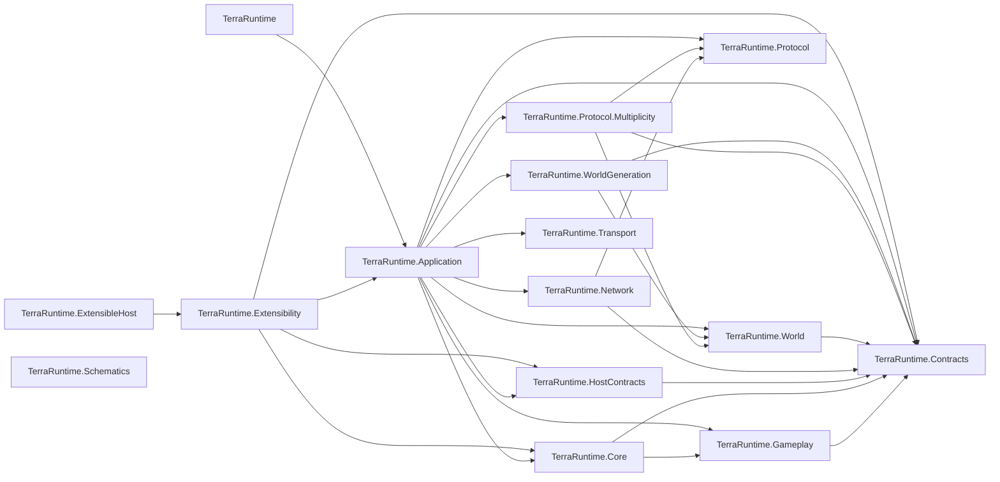
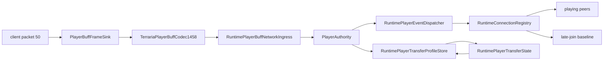
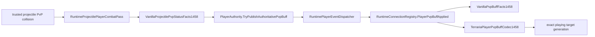
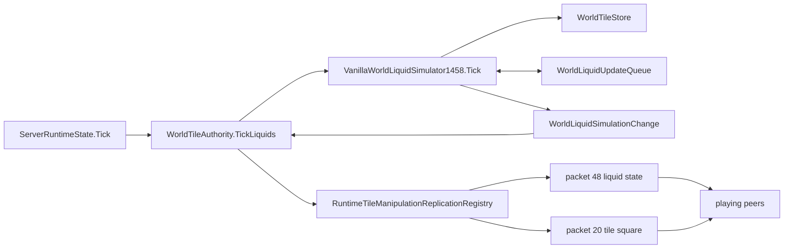
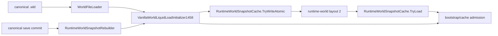
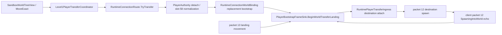
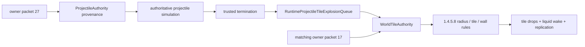
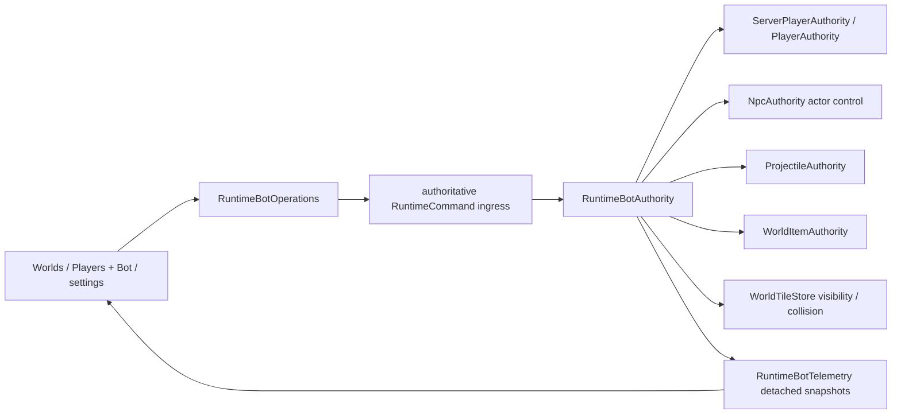
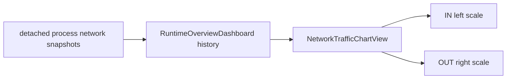

# Production graph

## Four-accessory selector ownership, 2026-10-26

Existing RuntimePlayerItemPhase1458 owns nullable offset/cooldown state; known constructor state starts0/0, retired/unrepresented state stays null. Source-local early update ages it before dead/ghost exits. Equipment projection has explicit opt-in for this known human phase; generic/bot callers remain closed. Ordered ammo selects physical occurrence first, consumes Random selector prefix before conservation, then journals counter/physical/private cost/clocks/RNG together. Saved paid bodies replay from the post-selector random checkpoint; delayed27/5/138 never rerun live selection or rewind state. Transfer retains selector state while clearing old-world delivery. No second ledger/stream/queue or recovery funding was added. Combined acceptance/shipment remains in work-state.

## Ordinary ammo Update observation, 2026-10-26

Concrete VanillaProjectileWorldStateStepper supplies one typed ordinary-ammo source observation on the existing subupdate proposal; RuntimeProjectileBehaviorStateStepper preserves it through state-only post composition. RuntimeProjectileStateExecutor validates represented type/reason and the existing pre-publication sink's explicit capability before adopting. The concrete ProjectileAuthority-composed sink consumes existing projectile RNG after generation-safe adoption and before publication, so callback failure cannot replay it. There is no new random owner, queue or inventory funding. Scope is Update timeout/tile collision; other Kill entry paths are not silently routed into this consumer. Root composition/gate/shipment evidence remains in work-state.
## Fishing character boundary follow-up, 2026-10-26

At the first accepted spawn, the initial packet5 character image establishes physical fishing-stock ceilings in the existing `RuntimePlayerInventoryStore`, covering the main inventory and four banks. No private quantity or copper grant occurs. The existing cursor/sort/bank owners move those ceilings; respawn and transfer never reseed them. Bait, three fishing potions, quest fish and crates spend canonical physical stock within known ceilings; actual rewards alone add private quantities. Reward-first crate reports are held in the existing `PendingShopJournal`, with no physical/cap/RNG adoption until the existing source138 exact cohort matcher pays.

The bounded typed codec turns playing-state76 into an authenticated command; the current member retains count/golf and the existing peer relay publishes them. Paid Angler adoption locks the session count; transfer carries lock/count/golf. World daily names remain the persisted duplicate barrier; no parallel character store exists. Official join does not send76, own76 is ignored without SSC, and the source GUI rewards before75. Actual original GetData5 additionally ignores an unlocked non-SSC client's own inventory image; the inventory-lock branch remains unprobed. Explicit counter snapshots and authoritative paid intents therefore remain a bounded server contract, not proven transparent GUI inventory/lifetime/reward compatibility.

Frozen source8fae3672 passes Release0/0, focused556/556, fast25350/25350 and one independently audited full1566763/1566763, zero skips; all5253methods are executed. Fresh Windows Native server/five smokes, exact-test typed managed/fresh Native55cases/189951assertions each, and actual Release/Native TCP bootstrap/relay/vitals/initial-stock/76/refusal/rejoin checks pass. Both hosts are stopped. `.cache/character-sync/acceptance.json` declares the exact scope and pins; Linux Native and normal GUI economic adoption remain outside that proof. No production dependency or owner graph edge was added.

## Fishing merge integration, 2026-10-26

User explicitly authorized merging `feature/fishing-authority-1458` (`3ecaa538`) into local main. Integration combines current origin/main `33adecbb` (including paid furniture and later liquid/Temple corrections) with the fishing commits; the original feature worktree remains unchanged. Six additive conflicts preserve BOTH status/evidence histories and all test resource groups, with866unique embedded-resource aliases. WorldRuntime's existing managedCustody binding and the added Angler save/publication binding are both retained. No production conflict required a behavioral rewrite.

Fresh integration Release WAE0/0; focused532/532 plus separate actual ToolPlayer placement/PaidFurniture2/2 pass. Documentation123paired pages/285Markdown and gameplay-domain462file audit pass. Evidence is `.cache/merge-fishing/integration.json` in `TerraRuntime-fishing-integration`; source-input SHA `2055d79dba1dc02d0d354d8d088fec636556467dfc239b6d4657da7654b81cfb`. This attests the merged Release/targeted composition only. Earlier branch fast and base full/Native results are NOT combined-tree acceptance; fresh full/Native/live remain held by the user's shared-slot decision. The known packet76 count-import/reconnect defect and ordinary character inventory bootstrap gap remain explicitly open. Vanilla character files remain client-owned; SSC/server`.plr` storage is not a prerequisite. Local main advancement follows the merge commit; no push is authorized.

## Ordinary placement and furniture: accepted metadata/phase graph, 2026-10-26

The combined existing ToolUse/Input, local source-clock, inventory-journal and world mutation owners retain ordinary replacement and paid furniture in one joint adoption boundary. Metadata insertion/removal/pose uses one prepared immutable canonical image, source dictionary entry slots/LIFO free slots, monotonic session IDs and file-order load reindex; raw file DTOs and explicit ad-hoc ID policy remain distinct. Section version fences, snapshot/save and live replication consume that same owner. No new project, production dependency, authoritative inventory ledger or RNG stream was introduced. Exact3969-input/158DLL Release/full/WindowsNative/actualTCP acceptance is complete and recorded at the top of work-state. Subsequent ammo phase-paid FIFO and released-tool witness changes remain private; no wholeMain/fullparity claim. Git history is authoritative for shipment.

## Paid furniture + ordinary replacement: combined candidate, 2026-10-26

Modern20/87/79 reports and ordinary79 reports join the existing placement Input and inventory journal; only source-replayed footprints plus paid stock can create an empty canonical tile entity. RuntimeWorldFurnitureStore1458 now publishes one prepared immutable metadata image containing rows, ID/position lookups, next live ID and source entry-slot/free-slot ordering. All arrays/lookups are allocated before the same terrain/metadata odd/even adoption fence. Canonical loaded worlds reindex surviving file-order IDs and invalidate only affected section metadata; explicit ad-hoc import retains its IDs. Same-update known-stage and ordinary replacement/cache participants remain intact. No second ledger/RNG owner/project/dependency is added. Root191/freshRelease/fast are green; combined full31501 and freshNative50774 are active, so no new shipment/full-parity claim. Latest work-state supersedes earlier candidate counts below.

## Ordinary replacement candidate ownership, 2026-10-26

The next ordinary-placement candidate keeps incomplete replacement alternatives inside the existing ToolUse/RuntimePlayerPlacementAlternative1458 owner. Each bounded constant-target history retains its source clocks, local RNG, remote crit and both mining-cache endpoints against one guarded read image. WorldTileAuthority detached source previews perform actual replacement rather than a generic kill/place substitute; world/drop/inventory adoption retains the established joint boundary. Specialized placement Input can retain an exact same-update release endpoint; generic source-stage and unrelated tool callers remain strict. SourcePass adds only a FossilOnly continuation flag on top of the shipped furniture/track/reset paths. No new project, NuGet, authoritative ledger or RNG stream. This is a composed unbuilt candidate, not accepted production; current exact status and pending siblings are at the top of work-state.

## Corrected character ownership boundary, 2026-10-26

User target is an OTAPI-like multiplayer server core with ordinary client-owned characters, not mandatory SSC. Missing server `.plr` storage is not a missing graph owner. The actual integration edge is character bootstrap/session state -> canonical inventory/count baseline -> validated in-session fishing/quest transactions. Existing transfer preservation does not replace normal reconnect. FishingFrameSink currently discards76 character counter imports and starts fresh count0; that is a compatibility gap to repair through the existing owner. Initial inventory funding must be traced at normal bootstrap; source-earned fixture stock alone is insufficient evidence. No second economy/character database is authorized or needed. Earlier graph references demanding a durable character owner for vanilla fishing are superseded.

## Fishing freeze and pending integration gates, 2026-10-26

The connected fishing graph is committed as `8bcd2109` + `ca6c935f`; no dependency/project edge added and no main integration performed. Release WAE and focused532 plus mandatoryfast25315/25316 pass. Full planned5229methods was stopped explicitly by the user to release the shared heavy slot; no fullXML/acceptance, Native or live evidence exists for this candidate. Source3973 SHA05a6ab49b447b1af1189950d8c8ff6288082d3d3f878b1b0a380ec7960e9d15f and197canonical DLLs remain frozen. Resume heavy gates only after slot coordination; interrupted evidence is not a successful checkpoint.

Merge-sensitive owners: PlayerAuthority remote phase/ToolSelection/GemStaff/buffs/luck and membership/transfer; all RuntimePlayerInventoryStore caps/captures/bank/cursor/coin paths (shared QuantityLaneCount); ProjectileAuthority ingress/simulation and replication; NpcAuthority plus Core NaturalSpawn publication and town-resident store; WorldRuntime composition/clock/checkpoint; World metadata/header rewriting/prepared cache6/progression and protocol world7; test resource aliases and paired docs. Other branches must use the same variable cap stride in any added custody participants. No second economy or rewardledger was introduced.

## Fishing candidate07 integration guard, 2026-10-26

Source graph remains frozen at3973-input SHA `05a6ab49b447b1af1189950d8c8ff6288082d3d3f878b1b0a380ec7960e9d15f`. The existing quantity owner now has a variable admitted-lane count; pending Gem refill prediction must use the same stride as inventory/cursor/bank/transfer captures. Its old `slot*5+lane` sibling was caught by the unchanged pending-twins test and corrected. Exact owned consumable transitions retain their canonical local definition for potion->pole/tool/weapon buffering. Dedicated fishing cloud background is zero on the no-draw source path and is distinct from the existing rain-driven cloudAlpha used by WindyDayMusic. Focused532 passes; common fast/full/Native/live acceptance is still pending and must not be inferred from component evidence.

## Fishing authority graph delta, 2026-10-26

No project/dependency edge added. PlayerAuthority remote item phase now joins existing local clocks, funded inventory mutation and exact ProjectileAuthority bobber generation; neither27 nor41 funds or creates an accepted cast without the source boundary. Projectile motion uses existing terrain/liquid owner, scene scan and worldclock/progression captures. Main, UpdatePlayers and the source static FishDropsDB context keep distinct roles. Fishing potions reuse indexed paid buffclock slots; ladybug bait reuses luck/rain owners.

One prepared fishing reward participant reuses existing inventory/quantities/caps, source GetItem coin storage and allocation-preview worlditems; it adopts before observers. Questfish debits precede rewards; crate debits follow all grants. The existing whole inventory journal supplies sourcebefore-image and report certification for one exact crate opening, and WorldRuntime exposes queued revision-bound explicit host intent. No separate inventory or rewardledger. SpecialfishingNPCs enter the existing naturalspawn allocator; Red resident identity/progression adopts before retention/publication. FishingFrameSink1458 admits quest intent but rejects client imported completion counts.

WorldAnglerQuestData1458 immutable quest/names flows through canonical loaded metadata, worldclock dawn, source questselector, preparedcache6 and checkpointserializer. The exact headerblock writer preserves rescueflag/tail and adjusts validated section offsets. Redunlock uses existing progression/packet7/save owner. Existing playertransfer carries lifetimecount and same fundedstock/caps/ladybugownership; durable servercharacter diskowner is absent. This is candidate graph state; final factual gate evidence follows after sourcefreeze. Three paired guides are linked from bilingual README/gameplay. Main integration must combine shared PlayerAuthority/RemoteItemPhase/buff/inventory, NpcAuthority/town/CoreNPCpublication, WorldRuntime/clock/checkpoint and World/protocol changes deliberately.

## Connected player-use checkpoint: accepted owner graph, 2026-10-26

The existing PlayerAuthority ToolUse/local item-phase owner, RemotePhase inventory journal and WorldTileAuthority paired source previews jointly retain local clocks, paid quantity, both501 hit histories, world and source RNG before publication. Retained LocalManaFeedbackOwned follows a qualified mana use through later tool/passive selection; constructor-known remote clocks alone do not establish it. Canonical RuntimeWorldFurnitureStore1458 attaches to WorldTileStore, reuses existing DTOs and provides deep snapshots through the same odd/even section-version and checkpoint owners. No new project, production dependency, mutable item ledger or RNG stream was introduced. Final3932-input/158DLL Release/full/WindowsNative/actualTCP acceptance is recorded at the top of work-state. Broader original local Shoot scheduling, placement/replacement families and fresh furniture creation remain next isolated blocks rather than implied parity.

## Current player-use integration, 2026-10-26

Integration branch `integration/player-use-20261026` builds on shipped7ff and local CC checkpointe387. PlayerAuthority's existing ToolUse owns placement clocks, bounded report cohorts, source payment receipts and replacement-hit state; the existing inventory RemotePhase journal adopts exact consumed quantities. WorldTileAuthority prepares both caller-role source passes and jointly adopts world, local RNG, player clocks, quantity and metadata before observers. Unknown local operation state must not retire independent dedicated-remote presentation. The latest work-state records actual source-neighbor repairs and outstanding fast failures; no combined shipment/full acceptance is implied by this graph note.

Canonical mutable tile entities now attach to the exact WorldTileStore through RuntimeWorldFurnitureStore1458, reusing WorldTileEntity DTOs. Loaded doll/hatrack arrays are deep-owned; removal/pose participants use the existing world mutation plan and odd/even section-version fence. Section metadata encoding and detached checkpoint snapshots consume the same owner. New production dependencies or RNG streams are not introduced; the World project grants the existing Application assembly internal access for the concrete joint-adoption boundary. Actual root furniture+ingress13/13 and the source/causal component evidence are in work-state. Broader TE interactions, placement families and whole vanilla parity remain separate work.

CURRENT2026-10-26 integration: exact eventf4 and NPCeefd histories are composed with tools/Larva/remaining defaults; source coverage is468 explicit lifecycle/287creation-only/one metadata-only. Common death planning unions event and Gem guards, source typed fanouts retain catch/AI methods, and event bootstrap refresh coexists with player tool-world facts. Prepared tool NPC births query the guarded staged terrain through the existing collision owner before joint adoption; the whole NpcAuthority wet-package snapshot is deliberately not copied over later Gem/event composition. No new project/dependency/ledger/RNG owner was added. Candidate03 fast and fresh Windows Native/five smokes +Release/Native actualTCP are green, but ONE unfiltered full is still live in root session81300; shipping remains pending. See latest work-state and applied maps.

LATEST2026-10-26 candidate: remaining NPC roster + specialhammer137/424/442 are composed and fresh WAE0/0/44cases pass (frozen NPC38 + six grouped tools/furniture Facts). The next composed49/136 source-framing caller and ProductionTileSink fixture migration await Game's shared-window mining/pipeline validation. Both callers coexist; latest shared driver retained; resource union752. No source-test overwrite or runtime lifecycle expansion. See applied maps in `.cache/merge-events/{npc-remaining-integration,special-hammer-integration,single-cell-integration-02}` and updated work-state. Town now owns real local placement clock/payment/world transition, NPC coupled Larva/QueenBee. No final full/Native/live/push yet.

2026-10-26 candidate, not shipped: events33974c2b + frozen all-tools v9 in `TerraRuntime-events-integration`, c379706a/ed102 base. Root actual phase44/44 (including five tool Facts) and strengthened Food/Permanent2/2 green; two omission controls actual assertion RED/exact158-DLL restore GREEN. Local consumer-clock transition reuses exact known preimage and already executed RNG; unknown placement-clock lineage fences local tool actions without deleting independent remote ItemCheck. Active placement-to-tool world-action continuity still open. Initial combined fast78 failures preserved; combined full/Native/live pending. Newest work-state is authoritative for owners/build window.
## NPC remaining-default candidate boundary, 2026-10-26

Existing Gameplay source-default catalog/partial data+spawn defaults, existing Core RuntimeNpcStore capture guard and App NpcAuthority world-facts capture own this extension. No production project/reference/dependency/registry change. Three nullable init properties extend VanillaNpcSpawnContext, preserving its3-argument constructor/Deconstruct.431 prior runtime registrations remain; creation-only actors gain no AI/status/combat/death lifecycle. Source664 remains unconstructible geometry. Candidate baseline c379/ed102; no promotion/full/Native acceptance.

## All-tools integration boundary, 2026-10-26

Shipping graph remains main `ed1021ee` (NPC/PvE plus concurrent worldgen). All-tool draft base stays e0 and is composed as deltas, never as wholesale replacement of current production. V7 now passes both normal player/Lucy and actor/falling Facts2/2, build08-source-sections WAE0/0; combined-run08 retains the actual TRX. Missing falling21 was a fixture item-registry binding omission;22 required the original active constructor-position player0. Session0 movement alone did not establish that pose. Extra20 required the original empty recipient section map. All expected wire assertions remain; no production replication rule changed. Scope is480 terrain episodes,2 local catches,24 cuts and220 generic constructor/configured AI10 landings, not natural WorldGen birth or complete tools parity.

V8 begins from1659 byte-pinned v7 source/config inputs, excluding test binaries and intermediate outputs. Its world-bomb9/player75 integration preserves source-owned owner255 origin and source28 NPC contact ordering; player context/RNG guards and alias refusal precede live Kill entry. Application and test build03 WAE0/0. Actual common4-Fact run01 is3pass/1fail: Game tools, Player/Lucy and replant5295 pass; actor reaches a concrete bomb RNG mismatch expected19/actual18. NPC peer owns v8 diagnostic/restoration, so no concurrent mutations. Town owns isolated replant regression controls; Game owns natural falling producer correction against a newly frozen actual support-KillTile origin oracle. Source integrity18 capture pins/77 root inputs is current; it is not broad behavioral or Native acceptance. Neither v7 nor v8 has been promoted to shipping source.

2026-10-26 accepted first37 checkpoint keeps all project edges unchanged. The existing NPC store adds wet-birth queries and retained home/catchable fields; transient AI intent reaches the existing replication owner through both fanouts. Existing terminal-removal and item-allocation journals adopt catch state/RNG before observers, with catch-specific pending publication and bounded full-generation baseline protection. Nonresident Gem AI7 uses the same store preview, physics, status/death/loot and RNG owners; no second NPC engine or random stream is introduced. SwitchTiles/HitSwitch remains a world/tools dependency, and ordinary spawning retains selector dependencies. Contracts and limits are in the paired `npc-ai3-ai7-runtime-1458` guides. Windows Native and full-suite gates pass; Linux Native is unverified.

## AI3/AI7 runtime ownership extension, 2026-10-26

The runtime worktree keeps the project graph. RuntimeNpcStore materializes NewNPC wet through a world-supplied existing WetCollision query before publication; detached natural-spawn previews copy it and retain store/RNG currentness. Reentrant mutations reject the outer birth. The existing store/executor consumes transient immediate/low-priority network intents with the accepted revision. INpcStateCommitSink.NpcVanillaAiStateCommitted defaults to the legacy callback; the replication registry owns the explicit source network phase separately from immediate combat publication, with bounded handle/revision-owned netSpam for the exact undead cohort. AI7 critter preparation extends existing accepted-preview/common death-plan owners and does not imply resident scheduling/commerce. No second NPC engine, dispatcher or random stream is introduced.

2026-10-25 Ice/Jungle Chest Placement block uses existing `PostSettlePass1458`, `JungleStructurePass1458` and `ChestPlacementPass1458` owners. Workspace now carries bounded ephemeral GenVars.JChestX/Y anchors from the early shrine pass to chest placement and the post-Ice non-solid162/226 fact; generated chest inventories remain in its existing persisted chest side table. `GenerationTileFraming1458.KillTile` is assembly-internal for the source fallback. No new project, dependency, threading boundary or world-file field. Rows59/65 are bounded `C` on official registered complete-delegate fixtures; special seeds and real prefixes remain open.

## Isolated event authority integration

Block3 passed local frozen Release/focused/causal/fast/full/WindowsNative checks; exact evidence and platform limits are at the work-state head. The existing detached death planner now owns all31 credited Moon participants, five source boss rewards/milestones and source wave2..20 publication. Immutable death effects flow through the retained local journal and NPC replication owner; the clock's accepted revision is distinct from vanilla's packet78 predicate. Existing milestone/header/packet7 owners carry the five saved flags, while the invasion scalar retains first-clear pending Lantern state. The composition's narrow worldStateAdopted callback refreshes an immutable join snapshot after all adoption and before the first public prelude/loot observer. Ordinary Goblin/Pirate/Frost and Captain/Ghost journals share that boundary. The existing shared RuntimeNpcSpawnCycle1458 owns source noSpawnCycle suppression before observers; no independent spawn loop or event queue is added.

Canonical WorldRuntime now constructs exactly VanillaNpcSpawnRules.PhysicalSlotCount=200 NPC slots. The prior default256 protocol-addressable store prevented strict source spawning/Captain producers from running in a real world. The Core custom-host capacity API and its existing refusal guards remain intact; protocol addressability does not define the vanilla physical table. Frost143/144/145 are admitted only to the trusted terminal backend; public vanilla births/damage and the paid/natural cohort gate still refuse DefinitionOnly AI38. Source projectiles143→110 and145→109 remain NPC-owner dependencies;144 has no gun. MartianProbe/AI80, remaining invasion encounters/selectors, DD2 overlap, Santa retirement, later Lantern consumption, natural global RNG ordering and LinuxNative evidence remain open.

The seasonal continuation keeps ownership in the same graph: RuntimeWorldClock retains one immutable dawn notice; WorldRuntime adopts live bootstrap before score/season/start publications; existing loot, item creation, shop and town move-in consumers read the known clock. Checkpoint capture carries nullable Today overrides and composes clock/season/invasion/progression header patches. The season patcher reparses the raw bounded header for its cursor; prepared metadata offsets are not authority. Packet7 overlays all36 journal milestones and3 existing unlocks. ShadowOrbSmashed reaches its existing validated save byte. No shipping package, project or graph edge is added. Independent source observations and final platform/acceptance status belong to verified-vanilla/work-state and the paired Moon/Frost guides.

`feature/events-invasion-progression` reuses Application player funding, invasion scalar, detached NPC death plans, progression journal, checkpoint and packet owners; no package/project added. Paid events adopt debit/RNG/state before observers. Frost2 joins save/progress/terminal ownership. Blood Moon/Eclipse use live clock/header values. Moon preview counters adopt with accepted death; ordinary admitted Goblin/Pirate deaths retain a local publication journal. Core projected terminal removal owns exact generation/revision; Application owns verified content admission. Live shop resolver overlays Frost/Pirate/Martian milestones. Final evidence and remaining natural/actor/loot/platform dependencies are tracked at the work-state head and in paired event guides.

2026-10-25 ordinary Shell Piles row56 now uses the existing `SourceBackedPostSettle1458 -> PostSettlePass1458` owner, Beaches' two published `Workspace` shell anchors and the same shared vanilla RNG. The invented sampled single-tile placement is replaced by source `ShellPile` brush offers; no project, dependency, threading or persistence edge changes. Row56 is bounded `C` on eight registered official full-pass fixtures; special seeds still route through compatibility.

2026-10-25 Waterfalls row58 now uses the existing `SourceBackedPostSettle1458 -> PostSettlePass1458` owner, shared vanilla RNG, collision catalog and `WorldSmoothingCatalog1458` pound/support predicates. The invented liquid-placement loop is removed. No project, dependency or ownership edge changes; row58 is bounded `C` on eight official registered full-pass fixtures.

2026-10-25 Final Cleanup ordinary grass-offer correction stays in `FinalPass1458` and uses the existing shared generation RNG. The source `TileID.Sets.Dirt` set includes type668, so an unchanged `668` cell can terminate the bounded offer loop. No project, dependency or ownership edge changes; row109 remains partial.
## NPC contact debuff application: isolated branch, 2026-10-25

Independent worktree `TerraRuntime-combat-buffs`, branch `combat/npc-contact-buffs`, base `e0bbf65fc125e43d0a4d5495468cef6fc06d6d71`. No all-tools cache drafts were imported, edited or promoted. Existing contact collision/Hurt/HP/immunity owners now adopt source-ordered NPC statuses before observers; player slots retain contact provenance/timers and generation-checked packet 55 confirms adjusted duration. Server actors merge contact presence with lava/MoonLeech and use existing HP/regen for neutral poison/cursed/fire. Ankh Shield immunity is projected through the admitted equipment snapshot. Default contact RNG forwards the existing shared Main.rand owner.

Independent original StatusFromNPC numeric corpus: 110016 rows per Windows/Linux edition, repeated exactly; source-platform rounding, FTW effective difficulty, all 694 identities and rare branches covered. This is helper evidence, not whole Player.Update/natural client parity. Validation details are recorded below; this is an isolated integration candidate, not full vanilla/platform acceptance.

Validation on frozen source/test fingerprint `a53154fa1a4f7244f39f23a92b8114fd26151c7d24f9188ae1bbaad0bec74b38`: Release solution warnings-as-errors: 0 warnings, 0 errors; 41 focused/neighbor tests; mandatory fast 25,004/25,005 with 0 failures/errors and the known liquid skip; CI tools 61/61, documentation 104 pairs / 247 files, project graph 15/29 and domain audit 422. Final unfiltered fallback passes 1,563,297/1,563,298 cases with zero failures/errors and the one pre-existing canonical-liquid skip; all 5,001 methods selected, zero exclusions. Test time $923.931\,\mathrm{s}$. Complete XML/log/result remain in `.cache/validation/clock-guard-affected`. Source/test fingerprint and all frozen input hashes remain unchanged after the full run. Windows NativeAOT server/five smokes pass. All 16 unchanged new Facts also pass typed managed and fresh Windows Native with 1,024,679 assertion invocations and byte-identical per-Fact reports; this static harness is separate from the normal xUnit runner. Native CLR directory 0/0; 38 reference DLLs and linked test/resource hashes remain exact. Evidence `.cache/validation`, `.cache/npc-contact-native-v2/acceptance.json`, `.cache/windows-native-result.json`. Linux NativeAOT cannot run here: Windows target-OS publish guard rejects linux-x64, and no WSL distribution is installed; no Linux acceptance is claimed.

The meaningful omission control removes only human contact application and yields 5 assertion failures / errors 0, then source restoration passes. The first fast result is preserved rejected: one old test expected a random callback during already-active GodMode contact; the verified source returns before DamageVar, so that branch now asserts zero draws and avoidance explicitly. The first CI-tools result is also preserved rejected: an unchanged baseline generated prefix table had a stale normal-table SHA comment. Reproduction against exact HEAD inputs confirmed the defect; regeneration changes only that comment, no numeric tables or predicates. No new dependency, merge, push or GitHub CI wait.

The first complete full run is retained rejected: 1,563,296 passed / 1,563,298 total, one known skip and one WorkerCompletionCommandForwarder shutdown assertion after its one-second deadline (errors 0). The unchanged isolated class passes; its bounded shutdown allowance now matches the neighboring worker tests at five seconds, preserving all ownership/thread/result assertions. A subsequent retry was stopped after its passing fast tier to apply the measured empty-contact clock guard; it is not accepted full evidence. The final accepted run is recorded above; the rejected and aborted results remain separate.

The clock now checks owned presence before any census/44-slot cloning. Same isolated workload, 1,000 warmup and 10,000 measured ticks: empty-contact one-player allocation falls from $848\,\mathrm{B/tick}$ to $40\,\mathrm{B/tick}$; ten-player allocation from $8264\,\mathrm{B/tick}$ to $40\,\mathrm{B/tick}$. Workload and project bytes are unchanged; old/new exact App inputs are pinned in `.cache/contact-clock-bench/comparison-manifest.json`. Timing is a concurrent-machine component sample, not a whole-tick/TPS claim. The first stale copied-DLL measurement is retained rejected; the accepted after run verifies the new App hash before/after.

Remaining: DefinitionOnly NPC contact, full Hurt/banner/luck/dodge/parry and exceptional hitboxes; nonrepresented status consumers/cures, unsupported active status retirement of the shared remote phase (expiration does not recover RNG custody), broader hostile-projectile status and whole Main scheduling. Contact application and duration ownership are implemented; complete vanilla physiological parity is not claimed. Paired details: [EN](../en/npc-contact-debuffs-1458.md) / [RU](../ru/npc-contact-debuffs-1458.md).
## Isolated AI3/AI7 roster and staircase checkpoint, 2026-10-25

Worktree `C:/Users/Xekep/Documents/GitHub/TerraRuntime-npc-roster`, branch `npc-roster-ai3-ai7`, base `e0bbf65fc125e43d0a4d5495468cef6fc06d6d71`. The original checkout and all-tools drafts were not edited or promoted. Do not merge or push this branch automatically.

Official census: AI3 has 191 positive types + 27 signed identities; AI7 has 82 positive types and no signed variants. Promoted 106 positive definitions + 27 signed variants into actual creation defaults. Global creation-default support is 501 positive + 63 signed; source lookup remains 691 positive + 65 signed. Explicit lifecycle admission remains the previous 431 identities. New 133 entries carry CreationDefaultsOnly; remaining 192 entries (190 positive + 2 signed) remain DefinitionOnly. SupportsRuntimeLifecycle gates AI/prepasses, status, targeting, combat, death/loot and roles; definition/source/family metadata never grants those paths. Existing registrations including Gnome624 are preserved. FullVanillaAiParity remains false.

The existing store/factory, dispatcher, RNG, collision and lifecycle are reused. Ground defaults own raw/body sizing, original Windows x86 versus Linux arithmetic, signed chronology, money, difficulty and Good/Tenth/Remix/Hardmode/Plantera transformations. Corrected original Main.Initialize_TileAndNPCData1 bootstrap supplies 92 catchable identities including 36 AI7; Friendly now includes those 36 (the previous Bunny46/ExplosiveBunny614 true values are preserved). The shared collision boundary retains nullable StairFall across omitted updates/Transform, resets it at fresh birth, distinguishes platform/slope descent and supplies AI7 home/day/eclipse/invasion context.

Independent source evidence: both original executables run 153600 default contexts per platform and 300 full classic objects, repeated byte-identically with zero capture errors. Corrected source manifest `.cache/ai37-source-v2/source-repeats.json`; two committed numeric gzip resources. Context tests compare 4300800 fields. Runtime tests cover 600 classic births, 4608 contextual births and all 133 creation-only lifecycle refusals; staircase tests retain 2560 original states and actual two-update AI3/AI7 movement. Original initializer/dependency audit found no other missing bootstrap for retained fields. No decompiled bodies, game text or assets are shipped.

Final root Release Rebuild warnings-as-errors: 0 warnings/errors; grouped 42151/42151 pass. Mandatory final fast: 25000/25001 pass, failures/errors 0, the single pre-existing canonical-liquid skip. One unfiltered full suite: 1563293/1563294 passed, failures 0, runner errors 0, skips 1, test time 785.281 s; accepted=True. All 4995 discovered methods selected, no exclusions.

Fresh Windows NativeAOT server publish and loop/protocol/network/world/TUI smokes all pass. Server executable SHA256 `440c929249988240f10a188d0f2c196caa86c06efe3794c8bce58484b3218c6f`. Exact three current durable test sources and corrected fixtures also pass managed/fresh Windows Native: 11 invocations, 5093946 assertions; final evidence `.cache/npc-roster/native-component/v4/acceptance.json` (SHA256 `64c1d639077212b01b1f106206c530dea0f61e25ff485cabdfa5aa2379e28f4a`). Native component executable SHA256 `2ed317de5012e9af237155381c4f8e20cdff3df803b7dea25fa90438b37633c0`. Copied Tenth/signed-Good omissions fail; old staircase fails 4/5 new cases; substituting only the old App DLL fails the new lifecycle status assertion, restoration passes. App/Core are byte-identical across component v2/v3/v4, so this omission proof remains applicable after the corrected Game-only flag change.

Executed production/test freeze: 3321 inputs, SHA256 `d9af05033a2c2e7d0c4be1d22f7e0898024ee0ce0b402fa3bf045ade8984a77e`, unchanged through full/fast/server gates. Afterwards only one extra EOF CRLF after the closing class brace was removed from NpcStairFall1458Tests.cs. Strict old=final+CRLF proof is `.cache/npc-roster/eof-bridge/bridge.json`; all other bytes/inputs and shipping code remain exact. Final source SHA256 `2b68f41f8954f986068c15f3eff3c6396a2790a5341b429c2887c30a642b39a4`. Fresh component v4 validates the exact normalized test source. Evidence lives under `.cache/npc-roster/`, `.cache/ai37-source-v2/`, `.cache/ai37-controls/` and `.cache/ai3-ai7-stairs/`. Preserve rejected diagnostics: initial fast 5 failures exposed lifecycle conflation; second fast 160 failures exposed the old life-filled-as-admission test assumption; heavy preflight 960 failures exposed uninitialized catchability in the first flag oracle. Old uninitialized `.cache/ai37-source/` flag captures are rejected; unchanged dense rows preserve numeric scope only. Native component v1/v2 are historical, not final acceptance; v3 is prior to the EOF-only normalization.

Known limits: new definitions do not grant autonomous AI, natural spawning, attacks/transforms, capture/rescue, status/combat/death/loot or town lifecycle. Complete npcSlots, trap/lava/cold flags, catch-immunity, frame/visual state, wet/special AI7 scheduling, conveyors/graphics offsets and broad outer-loop/encounter parity remain open. Named NetVariantCatalog still has 36 entries; 63 measures supported creation definitions through the existing ground owner, not that Count. Other families' old metadata flags are not recertified by this scoped probe. Genuine Linux NativeAOT is unavailable locally (no WSL distribution) and remains unverified; no graphical official-client or GitHub CI acceptance is claimed. Full source/addition lists and mirrored scope: `docs/en/npc-ai3-ai7-roster-1458.md` / RU pair.

## Gem-staff block: accepted local checkpoint, 2026-10-25

The connected block integrates all seven retained gem staffs/effective robes, funded mana/ManaFlower use, initial/twin/midpoint entitlements, source AI29 motion/terrain, prepared NPC contact and same-projectile Kill. It repairs Windows selector cutoff/tie arithmetic, active-NoItems paid midpoint and contact, exact-owner disconnect completion, terminal same-generation callback cleanup and stale composed-event network publication. The handwritten graph is Game240/Core176/App563 with52 numeric gem resources and six new normal public Facts including the existing-class network entrypoint. Contact remains NPC1/3/59/luck0 and represented effects; player-projectile tile cutting, summon/local mining and full vanilla parity remain separate gaps.

Release tests/server WAE0/0;226 focused tests pass. Mandatory fast24988/24989 and ONE unfiltered full1563281/1563282 pass with zero failures/errors and the same known liquid skip. All4985 discovered methods selected; zero exclusions. Full test time $692.446\,\mathrm{s}$; complete XML retained on C. The exact five new normal Fact bodies plus the normal network entrypoint pass typed managed/fresh WindowsNative:220447 source-helper predicates and195860 separately counted outer assertions. Fresh WindowsNative server/five smokes and actual Release/Native82/49/129, two-client/chat and72 signed35/43 effects per host pass; both hosts stopped. LinuxNative remains unverified; no new dependency or GitHub CI wait.

Executed source/test fingerprint `2ec093bd11b6009e50ec2e883fff824d1dac197fb3ff7dc67706d044bdd1e4bd` against parent `639af30b`. Evidence: `.cache/next-work-on-c/gem-shipping-acceptance-v2`, `gem-typed-native-acceptance-v2` and `gem-server-live-acceptance-v2`. Typed manifest SHA`0ae061f30b0c4d5e2f9a65e3d097f56c10e03486434ef54db701fbc7108abef0`; live aggregate SHA`2103bd498dd2adb755e3721b1997af098b0372446a50477ea86abeb1cde144d0`. The final unchanged test binary also detects the two NoItems contact omissions by substituting only the prior App DLL: two assertion failures/errors0, then all three selected tests pass after restoration. Source comparison verifies only those two neutral23 admissions differ across563 App inputs, ignoring comments/strict line endings. After acceptance, only spaces on otherwise empty actor source line149 were removed; exact executed bytes and a strict one-line bridge are retained at `gem-resume-20261025-v1/whitespace-bridge-v1/bridge.json`. No executable token, fixture or assertion changed. Ordinary Git LF projection is separately checked before commit; changed C# inputs contain no raw/verbatim multiline literals. Git shipment record is authoritative for commit/push state.

## Gem-staff connected candidate, 2026-10-25

The assembled candidate reuses player item-phase payment, funded inventory and pending-volley ownership for seven retained gem staffs and effective robes. Core retains trusted feature initialization, actor ordinal and a private active Kill body; the actor integrates terrain, inline prepared NPC contacts, immunity, trail and terminal removal. The later generic combat pass excludes these types. Packet projection owns generation-bound pending source update intent and revalidates adopted state after earlier composed callbacks. Exact old owner loss selects source dedicated completion without borrowing replacement-player statistics; its ordinary Kill is a silent removal, while world-bounds exit retains packet29.

The handwritten compiler graph is Game240/Core176/App563, plus generated inputs. Prepared contact remains the represented NPC1/3/59/luck0 slice. Player projectile tile cutting/world mutations and complete vanilla parity are not established. All component source/ABI/output handoffs remain distinct from final shipping acceptance; one coherent final gate under `gem-shipping-acceptance-v2` is pending. The previous food shipment below is historical acceptance, not evidence for this candidate.

## Food producer, provenance and current-clock merge: accepted local checkpoint, 2026-10-15

The existing item-use/inventory transaction pays food before observers. PlayerBuffState owns provenance, remaining ticks, private semantic lineage and bounded actual slot origins in its44 slots; no separate payment ledger or general scheduler. Only real clock changes bridge QuickBuff capture. Captured eligibility/economic alternatives remain fixed, while ordered paid offers apply to current slots after full219-slot preparation. Nonclock semantic/private mutation refuses; no old timer is copied back.

Food updates age through successful/refused player phases, retain final-tick effects, clear death/outside-death food and reset destination epoch on transfer. Legacy potion clocks remain unchanged. Source-ordered buff-before-equipment projection reaches motion, represented weapon and Expert-health consumers. Game233/App555 have5/16 deltas, with all other owners unchanged.

Release tests/server WAE0/0;193/193 focused normal-discovery tests; mandatory fast24982/24983; ONE unfiltered full1563275/1563276, zero failures/errors and the same known liquid skip. All4979 methods selected, zero exclusions. Full test time $744.569\,\mathrm{s}$. Complete XML remains on C. Exact same three new normal Fact bodies pass typed managed/fresh WindowsNative, with171242 Game helper predicates and2525 wrapper/App typed assertions. Fresh Native server/five smokes and actual Release/Native82/49/129, two-client/chat and72 signed35/43 effects per host pass; both hosts stopped. LinuxNative remains unverified; no new dependency or GitHub CI wait.

Executed source/test fingerprint `fb369b22c800eb669cc12932219149ddbd52b59d808a4487b070a5f611056d24` against parent e9d44908. Evidence: `.cache/next-work-on-c/food-shipping-acceptance-v1`, `food-typed-native-acceptance-v2` and `food-server-live-acceptance-v1`. Typed manifest SHA7dcc05c81fbde329973648640ad224521857b4b19e910cbaffe0d005ffe1e65e; live aggregate SHA0ed2a441a10b27b39730cb71026306c683e2c7b20edbe75a76b653bfe947bb43. No post-test source/fixture/assertion/format changes. Ordinary Git LF projection is separately checked before commit; no multiline C# literal changes. Git shipment record is authoritative for commit/push state.

## Durable chest ownership, recovery and sandbox handoff: accepted local checkpoint, 2026-10-15

The existing chest slot owner now retains exact funded quantities and copper, including partial and zero budgets. Physical items and private budgets adopt together before observers. Remote crafting carries those exact certificates through its existing journal instead of crediting the nominal value of removed material.

The lifetime normalized-world-path lease spans startup, recovery, simulation and final background checkpoint completion. The game thread reserves canonical revisions; background work validates the world, prepares its immutable custody dependency and atomically publishes the world. Recovery validates the matching dependency before replacement. Retention preserves current/backup/candidate dependencies within bounded work. Custody files are authoritative; runtime/bootstrap caches remain disposable. Explicit initial vanilla import is separate from ordinary restart and trusted fresh generation.

Readonly sandbox materialization binds custody to the same captured canonical bytes, then passes the detached budget snapshot through both runtime constructors. It takes no writer lease and never repairs or refills a managed source. Default-untrusted vanilla file imports require explicit opt-in. The normal grouped Fact passes on managed and fresh Windows Native: host5653, trust45, remote15498 predicates plus3 wrappers. Release126 focused, fast24979/24980 and full1563272/1563273 pass with zero failures/errors and one known liquid skip. All4976 full methods are selected. Release/Native live join/relay/effects and five Native server smokes pass; Linux Native remains unverified.

Executed source/test fingerprint: `2d8c183caced361fe714998a87476cb2e0c4c1ce28ac0d602465257aa62924ca`. Evidence: `.cache/next-work-on-c/durable-chests-shipping-acceptance-v2`, `durable-chest-typed-native-acceptance-v1` and `durable-chests-live-acceptance-v2`. One existing fixture receives a strict post-test carriage-return-only bridge and four helpers lose only surplus empty EOF lines, with executed originals retained; no assertions, production or binaries change. Shipping text fingerprint: `2179edfe76e0f030849ee3c54d995b9e8381a86a89e0ded241a704f277834e18`. No CI wait or new dependency. Food/QuickBuff work remains a separate cache-only successor.

## Funded crafting, Torch favor and bank custody: accepted local checkpoint, 2026-10-15

Final staging note: the cached diff check found trailing spaces on four otherwise blank lines in CraftCurrencyChecks.cs/CraftStateChecks.cs. Only those spaces were removed; exact executed originals, old/new hashes and line numbers are preserved at root-combined-gameplay-v1/whitespace-bridge-v1/bridge.json. Root verifies this token-identical test-only bridge against executed c268 inputs, separately records final shipping text fingerprint, and does not rerun tests for cosmetic changes. Production/shipping32/assertions are unchanged. Final diff checks include HEAD/staged new files, not just previously tracked unstaged paths.

The final source/test fingerprint is c268025e55b18fc8639c522001968da54daf9ff0233db2da762c0cf7c7e697ba. Reviewed promotion contains55 substantive production deltas,14 normal test files,41 numeric embedded resources and their project entries;290 newline-only differences were excluded. Final bridges isolate remote test helper namespaces, use typed empty-item identity and correct LocalCraft routing (ae4e848). No test assertions were weakened. Root verified all547 other Application owners unchanged for the routing correction. Exact frozen components and historical rejected candidates remain preserved.

Fresh Release tests/server builds pass with zero warnings/errors; focused21/21 and domain audit429 pass. Mandatory fast passes24978/24979, zero failures/errors, one known canonical-liquid skip. ONE unfiltered full passes1563271/1563272, zero failures/errors and the same skip;4975/4975 methods selected with zero exclusions. Test time815.280seconds, complete XML2112286968bytes is preserved on C. Root session26738 is terminal0 with MANAGED_GATES_COMPLETE. Evidence: `.cache/next-work-on-c/combined-shipping-acceptance-v5`; final verifier and guarded commit scripts are in the parent next-work-on-c directory. No GitHub CI wait.

All six new public Facts pass on managed and fresh Windows Native against the same shipping32. Four-Fact source/local/currency/remote proof is crafting-native-root-v2; Torch/bank proof is combined-torch-bank-native-v2 (6735/100470 predicates each). Native server publish and five smokes pass in combined-server-native-v2. Actual Release/Native82/49/129, two-client relay/chat and72 signed35/43 effects per host pass; both hosts stopped. Aggregate live manifest b4e082135d6c880e1f3953f63027b1d9e1ef382743e766de16dcba6d5df7635d. Input pins/shipping32 remain exact. Linux Native remains unverified; no production dependency added. Git commit/push record for this snapshot is authoritative; do not repeat historical rejected gates or merge their sources.

Integrated scope: source recipe catalog/environment, owned local repeated-recipe witnesses, committed remote material certificates with local-first/all-cost-once adoption, paid Torch5043 unlock/bestiary664 and favor-recipe consumers, role-correct bank ambiguity witnesses. Client RNG/prefix custody, unconfirmed alchemy/all-skip, unrestricted mixed hidden histories, fishing and local mining remain unfinished. Full catalog coverage is not all-recipe runtime authority. Strict loaded-world stock still refuses partial/q0 deposits until the next durable host block ships.

Resume the active continuous objective with NPC's cache-only world-chest-durable-custody-v4. Its5567 source State ingress plus actual save/restart predicates and unchanged old39007 remote neighbor pass, but source-sensitive host controls/freeze and independent review remain pending. Historical v3 source used6bf LocalCraft; v4 explicitly rebases reviewed ae4. Do not wholesale promote an older whole graph or replace current shipping owners. Use existing lease/checkpoint/slot owner, explicit import, fail-closed missing companion and bounded retention. No new full run is needed merely to inspect that next component. Goal remains active; this checkpoint does not claim complete vanilla compatibility.

## Final v5 fast accepted; one unfiltered full is running, 2026-10-15

Candidate fingerprintc268025e55b18fc8639c522001968da54daf9ff0233db2da762c0cf7c7e697ba is unchanged. Release tests/server WAE0/0, expandedfocused21/21, domain429C# green. Mandatoryfast accepted24978/24979,failures/errors0,oneknownliquidskip,189.491testseconds. Root session26738 now runs ONE explicit unfilteredfull under `.cache/next-work-on-c/combined-shipping-acceptance-v5/full-tests`:4975/4975methods,0excluded. No terminalfullresult yet; do not call it accepted. Allnewreports/temp/artifacts on C.

Current v5 exact managed/WindowsNative four-public-Fact Game/local/currency/remote replay accepted at crafting-native-root-v2. Separate exact Torch/bank accepted at combined-torch-bank-native-v2:6735/100470 checks each managed/Native; proof90547f04... and metadata-only artifact-binding-final-v5.json scope correction. Native server+five smokes accepted at combined-server-native-v2/acceptance-manifest.json SHAaa9a5d42464cdabeafa121333c0156238d13512f6b2404ad45cd84fca729770f; exeSHA d3094d2408ace8f4b66ad8007c1c130b045404a1d886ac059354db3c7c8ed334. Fresh Release actual82/49/129/two-clientrelay/chat/72signed35/43 passed/stopped; Native-v5 actuallive running peer session24458/hostPID3600/port18561, output combined-live-acceptance-v3/native. Bothhosts must stop before final acceptance. LinuxNative unverified; no new dependency/CI wait.

Final source routing immutable117e1f07c59a422863151a1ab2d8f38f0bf74033cbcd11bf452a15f33e62c644 has647pins rootverified; promotedae4 and547otherAppowners match. Earlierv2 compile,v3audit,v4fast10 and withdrawn firstdraft2-feature failures remain preserved/rejected; no priorfull was started. No commit/push yet, main/origin770932d2. After full+Native-live terminal acceptance update bilingual/native-baseline status then commit/push main without CI wait. Goal staysactive.

NPC durable successor151-check checkpoint remains separate cache-only with historical6bf baselineexplicit; new host-integration successor may overlay exactae4 in ownC cache NOW. No tracked/sharedshipping modifications while rootgatesrun. Initial import/missingcompanion/defaultstartup/recovery and partialq0hostpaths must have actualproof before shipment; shipping still refuses partial/q0worlddeposits.

## Combined v4 rejected on actual cursor routing regressions, 2026-10-15

Mandatoryfastv4 is terminal rejected:24979total,24968passed,10failed,1knownskip,errors0,175.057seconds. Freshfull NEVER started. Complete rawXML/log/results and root-combined-gameplay-v1/v4-fast-rejection.json are preserved. New LocalCraft staging intercepts ordinary main/cursor, return/transfer/drop and main-sort routes. Game owns the minimal shared routing correction; Town independently traces partial-transfer/sort failures to that same interception. Existing assertions remain unchanged. Root preparedv5 focuses all six existing failing classes plus new sixFacts before fast/full. Correction and shipment pending.

Scopedv4 only: exact managed/WindowsNative Torch/bank6735/100470 and four static Game/local/currency/remote publicFacts pass; Native server/five smokes and actual Release/Native82/49/129/two-clientrelay/chat/72signed effects pass, bothhosts stopped. Snapshotad0fb289... Native/live successes do not override rejectedfast; rebind after correction. LinuxNative unverified. Goal active; no commit/push or CI wait.

## Combined v4 stopped on genuine cursor routing regressions, 2026-10-15

Mandatoryfastv4 is terminal rejected:24979 total,24968passed,10failed,1knownskip,errors0,175.057seconds. Fresh full NEVER started. Preserve acceptance-v4/fast-tests raw completeXML/log/result and root-combined-gameplay-v1/v4-fast-rejection.json; do not relabel Native/live passes as overall acceptance. Ten existing assertions identify new LocalCraft staging stealing ordinary main/cursor, return/transfer/drop and credit-first main-sort routes. Game agent owns the minimal shared routing correction; Town independently traces partial-transfer and sort failures to the same interception rather than modifying those solvers. Root v5 focused preflight now includes all six existing failing test classes alongside new sixFacts before any furtherfast/full. Production source correction is pending; no assertion weakening or commit/push.

Scoped v4 only: fresh managed/WindowsNative static exact Torch/bank6735/100470 passed, Game/local/currency/remote four publicFacts passed (adapter265276 plus unchanged nested remote counters), Native server/five smokes passed and actual Release/Native82/49/129, two-clientrelay/chat/72signedeffects passed; bothhosts stopped. These snapshots remain historical ad0fb289... evidence and must be rebound after routing changes. LinuxNative still unverified. Goal active.

## Fresh combined shipping gates v4: builds and six Facts green, 2026-10-15

Current shipping candidate source/test fingerprintad0fb289ddc3491893931eba3a65b7d49aa83a207b8d1aa99eed681379fc7328. Release tests/server WAE0/0; exact fresh shipping/test32 frozen; actual normal xUnit6/6/errors0/failures0; domain literal audit429C# green. Acceptance `.cache/next-work-on-c/combined-shipping-acceptance-v4`, root running session61176. Mandatoryfast and ONE unfilteredfull pending/in progress, not yet accepted. New managed/WindowsNative exact four-Fact Game/local/remote replay runs separately at `crafting-native-root-v1`; Town owns exact Torch/bank Native and server/five-smokes, Game agent owns actual Release/Native82/49/129+two-client+72effects on C. LinuxNative remains unverified; no CI wait or shipment claim. HEAD/origin770932d2 fetched0/0.

Two preserved pre-gate failures are not green: v2 initial full-project compilation exposed root-namespace Fixture/EventRelay shadowing existing test aliases (223compileerrors); root moved only six new remote helper namespaces to TerraRuntime.Tests.WorldChestCrafting and added their using to the same Fact. Bridge `root-combined-gameplay-v1/test-namespace-bridge.json`, assertions unchanged. Correctedv3 builds/sixFacts passed, but domainaudit rejected raw item.Type==0 in the new external-material loop. Root uses equivalent ItemTypeId.IsNone, source bridge `typed-empty-identity-bridge.json`; zero and negative-value behavior remains equivalent. Full never began onv2/v3. Frozen component originals remain unchanged; actual candidate is promotedv2 plus these explicit bridges.

NPC separately freezes real-world durable component15e6c373da012b725ce671d5fa48911bf76f1ecadbaa595fa7ff6225c1b5dad6: actual loader-valid.wld78predicates, WAE0/0, three meaningful omission failures/restoredgreen. This proves configured atomic persistence/lease/artifact component, NOT Store/bootstrap/host integration; successor connection continues cache-only. Partial/q0 world deposits remain refused in shipping candidate. Goal active; commit/push pending final checks.

## Combined crafting/Torch/bank promoted; fresh gates on C, 2026-10-15

Root verified all1135 frozen v2 pins and baseline guards, then promoted55 substantive production source deltas,14 normal test CS files,41 numeric embedded resources and the corresponding test project entries. The290 newline-only differences are excluded. Source map/manifest: `.cache/next-work-on-c/crafting-all-connected-v2/promotion-plan.json` SHA05063dda62a992715838b2a07d8088a20474d259eed7ac4a11947d1e028617e5, manifest3e2dbeb8c326b57b2d6d139c90c6ff094a645521e811b1ce62d658b4a7decd57. Root promotion record `.cache/next-work-on-c/root-combined-gameplay-v1/tracked-promotion-v2.json` guards110 files plus csproj; prior staged a48/ffde bank code/test are replaced. No commit/push yet; HEAD/main remains770932d2.

Final bank role successor0b8075badad9104f5c91de244d055ade959afae9848fe50f3443e4d3dfb91d32 contributes PhysicalReturn3cad59ce2536e079b2283eda4784945c9ba77024ccca83462f6dd1cb7a85485e and Facte8d070b7c11467c99369c726628e6c042fcf845400a7b099705ddc0369fbbe87. It retains32 State cases and adds4 actual Stone false-refusal regressions plus8 valid Gel/Arrow/Copper/Silver role controls;24 original Favorite rows and40 reserved-role rows remain. Typed total100470, WAE0/0. Oldca78 fails expected1/actual0; three sensitive source controls fail and restoration passes. Root independently verifies882 role pins. Full-family main endpoints remain0..49, coin full-family bank4/32 only; no invented DoCoins or unrestricted closure proof.

Frozen combined v2 real xUnit6/6/errors0/failures0 and exact32 before/after pass; one rebased role omission fails exactly one EqualException, restoration passes. Six Torch omission controls remain honestly historicalv1; the sole production delta from v1 is bank PhysicalReturn. Independent payment/currentness/denial source review finds no additional concrete blocker. Fresh normal Release tests/server, focused, mandatoryfast and ONE unfiltered full now run on C under `.cache/next-work-on-c/combined-shipping-acceptance-v2`, root session40927. No fresh shipping gate has yet been accepted. All new TEMP/TMP/artifacts/logs use C. WindowsNative/live preparation delegated; LinuxNative remains unverified. Old affected164 storage failure stays failed and preserved, never substituted for a full pass.

NPC separately continues cache-only durable custodyv2: exclusive logical-world lifetime lease, reserved source revisions, immutable hash/revision-bound companion and explicit managed import/recovery. Core/codec compile WAE0/0; actual complete.wld probe and Store/bootstrap connection remain pending. Partial/q0 world deposits remain refused in promoted strict loaded-stock runtime. Client prefix RNG ownership, alchemy all-skip, arbitrary mixed hidden histories, fishing and local mining remain open. Goal active, no GitHubCI wait.

## Bank witness staged; failed storage gate preserved; combined work moves to C, 2026-10-15

Current tracked gameplay changes are ONLY `RuntimePlayerInventoryStore.PhysicalReturn.cs` (`a48ddd82c3715865c11e4d0713a4eb119bea11c13e3d02b19e20014779f37d8f`) and new one-Fact `OwnedBankClosedExchange1458Tests.cs` (`ffde83c677bf119d688b1526eb9e213f4775aae913a3506d819374dceaaaf8a4`), plus bilingual support docs and memory/roadmap. Root guarded all532 original App owners before promotion. New normal xUnit baseline fails expected0/actual1 on unchanged production. Fixed Release tests/server build WAE0/0; fast24973/24974 passes with zero failures/errors and the known liquid skip. Exact fresh server/test32 match; same24-case typed Fact passes43062 on managed and freshly published Windows Native PE64/CLR0. Independent immutable bank component `a3a55c5a53f63a998addb09f3267ea35257158c8ef13fd9c60df32ab628ea217` has2907 pins,532 source owners+one generated globalusing and three source-sensitive omission failures/restoration. This is NOT final accepted shipment.

Required affected164 matrix run session14812 is TERMINAL failure: runnerexit4 after911.748 seconds, truncated XML1845714944 bytes, parser unclosed token near1845303692. D filled to zero during final report output. Do not relabel this run green or claim completion from executed cases. Raw XML/logs/results remain at `D:/TerraRuntime-cache/bank-full-middle-shipping-root-v1/affected-tests`; their fingerprint and prior scoped passes are preserved at `C:/Users/Xekep/Documents/GitHub/TerraRuntime/.cache/next-work-on-c/root-combined-gameplay-v1/previous-bank-checkpoint-status.json`.

Automatic tool approval rejected the proposed historical-report relocation with `blocked by policy`; no move/delete happened. A lossless NTFS compact attempt returned0 files and freed no space; old historical XML content hash remains unchanged. ALL NEW builds/temp/logs/prototypes now use repository `.cache/next-work-on-c/` on C (observed313GB free); D is preserved read-only. No new blockers: C work proceeds. Agent D audit/packaging writes that hit ENOSPC remain incomplete and are not final evidence.

Sibling source audit requires a combined bank successor before shipment: opposite Favorite flags in full stacks can preserve the public image yet swap object custody in contexts0/32; newly added full-family endpoints must exclude reserved main50..58 until role1/2 proof. Agent Game actual32-case C successor passes57438, with source counterexamples and controls pending final handoff. Current a48 snapshot covers identical tuples only; do not declare all full-capacity histories fixed. Root holds shipment and will coalesce the qualified bank successor with funded remote craft and paid Torch producer/consumer before one new full gate on C.

Root independently reviews paid Torch producer `038aa2b13d1654a7c1da409cecce3f4fd74411e1c5bad511d67e7f6c76f0c859`:902 pins,543 own App sources,233 Game sources, real xUnit1/1 and static42-case5923 checks on exact32; four actual EqualException omission failures. Review is `D:/TerraRuntime-cache/crafting-boundaries-root-v1/torch-favor-owned-review-v1.json` (written before disk exhaustion). Town also proves eight actual favor-recipe consumer cases, including raw-import refusal, disabled auto-torch bit and late custody; final C successor/composition pending.

Root independently reviews connected remote output `c4e4188676ff03c0ac40e583338203a1de4935619277fb7f2921e6107b4911fa`:3995 own pins,841 source inputs, exact32 and portable public Fact39007 predicates (39003 in78 transfer+24 RPC+8 security+2 real-loop cases, plus four public wrapper assertions), six actual omission failures/restoration. This is typed harness execution, not a normal shipping xUnit/Native/full gate. Use minimal42-row guarded map addendum `1285a4e834f7ec398b3decf4344c1e479dabeaba454bd03e8413767c52ba4530`, excluding239 newline-only map rows. Review at C `.cache/next-work-on-c/root-combined-gameplay-v1/remote-connected-component-review-v1.json`. One no-cost no-change denial ACK still increments a conservative rejection counter; it is not a grant or corrupted refund. Durable partial/q0 world deposits remain refused and require canonical custody follow-up.

Town owns a single C composition of NPC remote output, paid Torch+actual consumers, clean root Game/local test bundle and Game bank successor, including portable xUnit resources/promotion guards. NPC separately prototypes canonical durable custody via generation/revision/hash and checkpoint preparation, not disposable runtime cache authority. Production HEAD/origin remain770932d2 (last fetch0/0); no new commit/push. Goal active; no CI wait or full-compatibility claim.

## Real xUnit promotion bundle and actual bank full-stack regression, 2026-10-15

Root prepares normal xUnit3 shipping tests at `D:/TerraRuntime-cache/crafting-local-shipping-tests-root-v1/promotion-manifest.json`:three real Facts,23 unique embedded numeric gzip fixtures, no custom Assert shim or absolute runtime fixture paths. Existing Game source/kernel, local66 ingress+2 region and four configured currency scenarios retain their assertions. Actual Release WAE0/0 and3/3 execution pass on exact32 clean frozen-localv3 dependencies before/after. Initial combined resource packaging duplicated two shared local aliases; deduplicated before accepted build/run. This is promotion-ready test packaging, not yet tracked Game/App shipment; withdrawn currency experiment is excluded.

Root independently reviews frozen world compound-cost successor `deae954eb986284bfd8d9209d2de33906c405df008a24fff2e2c9fb45ef386a2`:4736 pins,833 source inputs,26 guarded deltas, explicit WorldRuntime strict loaded-stock constructor and actual78/29695 binary replay on exact32. Seven control assertion logs and mutated DLL hashes verified.3821 pins intentionally reference the sibling controls tree, so the control bundle is pinned rather than immutable-root-self-contained. Report: `D:/TerraRuntime-cache/crafting-boundaries-root-v1/world-compound-cost-review-v2.json`. Remote result recipe coupling, local-vs-world debit alternatives and durable partial/q0 storage remain unfinished; NPC now implements actual remote-output coupling on a new connected graph, preserving localv3 currency owners unchanged.

Game finds a meaningful actual bank caller red: keep two identical full Copper100 bank stacks with privately allocated0/1 copper, while independently moving owned Wood main0 to another bank slot. Existing merge/right closed-history enumeration misses a genuine three-Left full-stack object exchange, so the caller credits Wood although accepted private coin allocation is ambiguous. Original assertion expects no joint private credit and fails actual1. Agent isolates the minimal PhysicalReturn fix against CURRENT770932 production inputs, not the unshipped crafting graph, plus normal xUnit regression and old/new controls. Root reverified39 accepted production/test pins and32 shipping DLLs at `permanent-eight-production-acceptance-v1/shipping-bin`; App SHA66936980b5696182b200bd1e0ae5299f085ba760d5e2d945eb8c5d75a3d21dd0. Affected-tier dry run selects164/4962 methods plus mandatory fast; no full fallback. Root will ship this concrete bank fix after review/grouped local gates while Torch and remote craft continue.

Production remains `770932d2`; no new commit/push yet. Goal active.

## Currency proposal withdrawn after meaningful omission control, 2026-10-15

The root currency two-owner experiment is NOT a gameplay fix and must not be promoted. Independent removal of the new predicate leaves actual four-case6354 ingress assertions green: existing `accepted.CanElideConservativeBankAlternatives()` already applies the same global before-to-after copper/final-allocation proof in `CompleteLocalCraftJournal`. The proposed delta only changes redundant `UniqueReducedAllocation` metadata. The green currency scenarios remain useful regression evidence for existing support, not changed behavior. Root notified both composing agents before either merged it and restored the mutable generic-closure draft's currency owners from unchanged local-v3. The experimental source/build/logs remain preserved under `crafting-currency-convergence-app-prototype-v1/WITHDRAWN.json`; do not label the insensitive omission as a successful negative control.

Earlier entries describe the experiment in chronological context and are superseded by this finding. Shipping composition uses frozen local-v3 `9ef8dae8` currency owners unchanged. Full-capacity object-exchange enumeration remains a distinct source-grounded component under review; represented-family exhaustion is not an unrestricted closure certificate. Root prepares normal xUnit/resource promotion of existing local/Game/source coverage while NPC owns funded remote-output coupling and Town owns paid Torch5043/bestiary664. Production remains `770932d2`; objective active, no new shipment.

## Parallel blocks and composed local review, 2026-10-15

All three agents run substantive separate blocks at the user's explicit request: world-chest compound transfer/funded remote results, transformed private-image closure, and paid Torch God's Favor integration. Town's completed local/channel successor is independently reviewed before its next task; production remains `770932d2`, with no new crafting promotion or shipment.

Root verifies frozen local-v3 manifest `9ef8dae85e7d61dfcb7df100b247583bfc4a9189c25fb79b612d352231e5c489`:780 manifest pins,542 Application compile inputs and six owner deltas versus local-v2. Actual configured66 ingress+2 region replay passes133096 predicates and unchanged channel helper48 State+8 guards passes65316, with exact32 dependencies before/after. Parent66852 is not relabeled: composed charged timing changes per-tick predicate count. Root reviews six source hunks, including selected animation/ItemTime captured at craft seal. Report: `D:/TerraRuntime-cache/crafting-boundaries-root-v1/local-channel-review-v3.json`.

Independent transformed replay falsifies the proposed Silver-to-Copper convergence example: Copper nominal maximum100 prevents a normal200 cursor; two quick crafts create separate100 stacks and can preserve differing private allocations. Negative refusal is correct here. Copper100/100-to-Silver2 is the next convergence candidate, but physically identical full-capacity object exchanges are not emitted by the current public click helper and require explicit source-certified enumeration. Current draft remains incomplete and uncalled; no full closure certificate or shipping acceptance is claimed.

Root adds a stronger currency-only sufficient proof using the existing global copper conservation/final-allocation predicate, rather than admitting on represented-family exhaustion. `HasUniqueCraftAllocation(bool conservativeCurrency)` and its actual CraftWitness caller enable direct before-to-after uniqueness only for recipes3597..3602; material recipes retain their nominal-funding conditions. Coherent candidate `D:/TerraRuntime-cache/crafting-currency-convergence-app-prototype-v1` owns542 source inputs/31 dependency references and only two deltas atop frozen local-v3; generic closure draft owners are excluded. Corrected actual Application and two probes build WAE0/0; unchanged State133096 and Channel65316 pass on exact fresh32 before/after. Initial preparation stopped at an optional missing inputs JSON, and its subsequent unchanged-parent build is not counted as changed-code evidence. Root independently replays four configured typed5/138 currency ingress scenarios against exact own32:6354 checks,135 charged ticks each, paidcursor1 only after two conversions; one conversion remains uncredited for both private initial allocations. Complete219 quantity/copper/caps and other physical slots are checked. The initial failed fixture omitted SetCraftingWorldFacts; corrected source-grounded setup is green without changing production or weakening assertions. This is not an original wholeUI capture. Omission controls/final freeze and coherent composition remain pending. Candidate status is `candidate-status.json`; root actual ingress review/log are next to it.

## Three parallel owner blocks resumed; transformed private replay drafted, 2026-10-15

User explicitly requests several agents concurrently. Existing NPC/Town/Game agents resume world-chest exact transfer+remote cost custody, local-bank/channel composition and independent transformed-private replay proof respectively; root owns review/composition and its separate closure source. Shipping remains `770932d2`; no new promotion/commit/push.

Root independently verifies local frozen-v2 `49ca892173e9b4c98bde2ad36c97a4e178fb408b7890fdc535f2595dc9d84ab6`:109 manifest pins,574 actual compiler/reference/project pins,542 Application compile inputs,31 own reference paths and24 guarded source deltas. Actual unchanged56 ingress+2reach110460 replay and detached108 fractional67392 replay pass on exact fresh32 before/after bindings. Root also verifies channel successor `c8a36e1a2d1af18e4dcbe29352553805d101581e06065d256cc602ffff13eebc`,3586 pins/actual48 State+eight guard66852 replay and four meaningful omitted-producer/channel-policy assertion failures. Review: `D:/TerraRuntime-cache/crafting-boundaries-root-v1/local-channel-review-v1.json`. Known actual weapon113/218/495 channel producers retain expected projectile16/34/79; raw unknown channels remain refused. No invented local projectile index mapping is used. Channel source caller/census qualification and new bank-currentness/channel merged successor remain separate review inputs.

Root independently replays bank geometry `1b2076ff050b0257661f186a8aec99453cfaf589dd85d2e4c6f8c7b7034e9584`:335 pins,232 byte-equal Game parent owners/one guarded DefinitionCatalog delta,120 checks, actual old-catalog assertion failure/restoration. This component was built Debug WAE0/0; it is not a Release/Native or executable-AI acceptance. Review: `D:/TerraRuntime-cache/crafting-boundaries-root-v1/bank-geometry-review-v1.json`.

Root mutable transformed closure at `D:/TerraRuntime-cache/crafting-transformed-closure-prototype-v1/` adds optional alternative visitors to existing bulk/sort/closed-return enumerators and separately charged same-recipe replay over detached private images. Defaults keep established callers. The draft binds candidate capture+connection, clones private arrays and compares final physical/q/copper/caps rather than rejecting solely before transformation; no live owner adoption is added. Application/probe WAE0/0 and unchanged110460 State predicates pass. This is NOT closure acceptance: full-max object exchanges, represented chain coverage, positive convergence/divergence/unpaid tests, actual caller integration and final controls are pending. Initial compile setup omitted restore/StateProgram/new Compile item and found private nested-property/ref-property access; corrected draft uses bounded clone methods and local environment value. Draft exact deltas/status: `D:/TerraRuntime-cache/crafting-boundaries-root-v1/craft-closure-draft-status-v1.json`. Do not regenerate Source from the initial preparation helper without preserving subsequent fixes.

Remote funded result receipt, canonical partial/q0 chest persistence, owned client lottery/all-skip, paid TorchGod5043+bestiary664 and full combined acceptance remain required objective work. Town and NPC now test real early world32/module12 before later138; hold funds in the same existing receipt rather than inventing funding from an approval. Full/Native/live checks and shipping follow coherent combined review; no GitHub CI wait. Goal active.

## Relevant projectile census fixed and independently replayed; cache space recovered, 2026-10-14

Production remains `770932d2`; no crafting promotion/commit/push. Root verifies immutable special-projectile successor `D:/TerraRuntime-cache/crafting-projectile-removal-owned-prototype-v1/immutable-final-v1/manifest.json`, SHA256 `cc60c574c3b8ffa197b612e2fb969f18ddcc0d8db0374d6d2d828fcc22f3cd18`:1211 pins,959 actual compiled inputs,770 compiler-reference records,32 exact output/reference bindings,940 unchanged parent owners and five guarded delta owners. Independent typed replay passes23448 checks across24 actual State/eight Core guard scenarios. Six rebuilt omission controls and one actual old-definition-DLL control each fail unchanged assertions; restoration passes. Root review: `D:/TerraRuntime-cache/crafting-boundaries-root-v1/craft-projectile-final-review-v2.json`.

The original moving-Arrow source fixture is preserved, not replaced by a stationary sibling. Broad full SlotState equality incorrectly rejected crafted6148/1/p57 while an unrelated Arrow moved/expired. Root verifies frozen red `4044e1c1fd6f8411fc11e149ee80c56e8f3e4844837e94384ad48894070022b6`. The corrected constructor-time census checks all source0..999 matching membership/identity/generation, permitting unrelated motion/removal; matching removal preimages are reread after currentness in the callback-free adoption span. New matching births, ownership/type/generation changes still refuse. Source29-first literal ingress, joint adoption before observers and throwing/reentrant publication are exercised. Source1000 overflow is excluded. Exact ChannelShotCache cancellation remains unfinished; current channel refusal is not full sourcehook parity. Nearby bank currentness likewise needs geometry only for525/960/734, not unrelated clocks or positions.

C: reached zero free bytes and a root verifier write failed. Root relocated only the exact historical raw `.cache/slime-hive-mech-zones-v3-accepted-tests-20261004.xml` to `D:/TerraRuntime-cache/relocated-full-reports-v1/`, preserving1999822579 bytes and before/afterSHA256. Relocation metadata is `relocation.json`; creating a historical-path symlink was unavailable, so later reads of that historical report must resolve through the ledger. No report content, source or frozen candidate was deleted. C: recovered2121674752 free bytes; D: had5844832256 free after relocation. These are observed values, not a capacity guarantee. Further temporary builds use D; heavy new full XML output must not refill C.

Town has merged minimal projectile hunks and nonconflicting remote18 owners into the connected local candidate, preserving its shop/world composition. Its46-case86202 predicate report and all-bank context/geometry successor remain pending final immutable review; no combined acceptance inferred. NPC implements source32 two-store journal custody. Root Torch App audit identifies existing death-prelude unpublished adoption/publication reuse and ninth personal-flag binding/transfer/currentness plus multi-player credit aggregation requirements; no paid5043/bestiary runtime implementation claimed. Full/Native/live and shipping follow coherent combined review. Goal active.

## Torch God kernel implemented; context3 wire boundary independently reviewed, 2026-10-14

Production remains `770932d2`; no crafting promotion or shipment. Root implements TorchGod5043 in the existing selected-consumable owner/catalog on an isolated Game-v2 copy. Existing eight-bit permanent unlock ABI is unchanged. New detached TryStepTorchGodFavor returns selected clocks/consumption, unlocked/enabled flags and Applied; payment, packet4/51 acknowledgement, scripted bestiary664 credit and publication remain caller-owned. Raw appearance does not provide the local-effects decision.

Immutable component `D:/TerraRuntime-cache/torch-god-favor-game-prototype-v1/immutable-component-v1/manifest.json`, SHA256 `d121b177f3d91be873709a658657a446a1847e5cb76e4d5fe2bfe074fb49deb7`, contains233 source-tree files,331 pinned artifacts and two guarded production-owner deltas; all other source-tree owners equal frozen Game-v2 parent. Fresh Game/probe WAE0/0 and direct typed1920-tick replay pass362880 checks against all four original24-profile captures: complete59 item identities/quantities/prefix/favorite, clocks, flags/vitals and full56 RNG/cursor/next. Four isolated local-owner/consumption/once-only/enabled-toggle omissions each fail unchanged typed assertions; restoration passes. Initial mutable probe missed Core RNG reference and used nonexistent BuffTypeId.IsNone; corrected frozen project/probe replay succeeds. This is a detached executable component, not a public xUnit Fact, Native or paid Application producer acceptance.

Root independently verifies original context3 source `D:/TerraRuntime-cache/world-chest-cursor-original-source-v1/manifest.json`, SHA256 `fedd81cdd6a41bade1b46c653cb62b84b4a3d107915a2a031c0fce952d6f6cdd`:30 pins, four equal11-row captures/full219 player/world40/RNG,13 source gestures/process. Independent literal32 parsing matches all11 captured publication images. Source full-identical and closed full-max cycles emit32 with no5/138; completing every chest explanation only at138 would reject these real siblings. Unchanged/restored chest tuples must remain an ACK/explanation path without swapping private budgets; partial hidden-cycle ambiguity remains a refusal until the durable owner is implemented. Root review/replay: `D:/TerraRuntime-cache/crafting-boundaries-root-v1/context3-torch-review-v1.json`.

Three agents temporarily failed403 at the Codex service, then were given resume tasks preserving files/process state; no runtime or source failure is inferred. Town has42 configured State scenarios/78542 predicates (38 original paid rows plus four denied-cursor/recovery siblings), final bank/context/census closure pending. Game moves special-projectile census capture to journal seal before cooperative work; its earlier20-case proof is not the final successor. NPC continues context3 same-journal two-store staging and transitional strict loaded-world custody, with partial/q0 durable ownership still in the full objective. Whole combined acceptance/full/Native/live and commit/push remain pending; goal active.

## Chest persistence boundary executed; Torch God producer source captured, 2026-10-14

Shipping remains `770932d2`, no new crafting commit/push. Root actual configured physical-persistence probe `D:/TerraRuntime-cache/crafting-chest-persistence-boundary-root-v1/manifest.json`, SHA256 `55a71af2e50f608e21c34d13300aa706458e5185005d1b731f66d6f39decaa6f`, pins85 artifacts/exact remotev3 runtime32. Three cases/156 typed checks show raw32 material1в†’999, identity9в†’2 and coin1в†’100 accepted, copied by CaptureSnapshot, emitted by actual WorldFileChestEncoder and retained by RuntimeChestStore reimport. This is a component boundary, not a whole checkpoint/restart execution. Actual SnapshotSource/Coordinator/Recovery source pins establish its surrounding canonical path. The first probe compilation failed on duplicate anonymous-property naming; raw diagnostic is retained and corrected probe builds WAE0/0 and executes0.

Root reviews custody design `2fa25928471a8ddc6b5b648e1b47abf47bf79cca929df14a20adac5c5a27aab9` and17 owner/source pins. The existing disposable runtime-world cache cannot be sole custody storage. Next implementation retains raw32 proposals in the same219 journal until exact source player↔chest transfer proves both stores. Trusted loaded-world strict/full-owned mode is transitional; partial/q0 deposits remain required follow-up with durable canonical checkpoint ownership. Preserve physical items and both preimages on refusal; do not launder a network increase as a trusted reload, silently drop partial items or claim full storage completion.

Root TorchGod favor original corpus `D:/TerraRuntime-cache/torch-god-favor-original-source-v1/manifest.json`, SHA256 `18b9e0d2478ff12439c6957dd4c97558404ecbce77afbfb132a1e40b36b8e307`, has43 pins/four equal24-profile captures/1920 actual ItemCheck calls. Local5043 use has useTime/useAnimation30, changes unlockedBiomeTorches and UsingBiomeTorches, consumes one item and emits literal4 then51/subtype5 before later5/138; remote owner branch does not apply the unlock. Recipe190в†’5573 and3565в†’5638 require unlockedBiomeTorches, packet4 TorchAndCartFlags bit2, not the bit0 enabled toggle. Server source51/subtype5 registers bestiary664 credit, so paid unlock integration must stage that once with the existing scripted-death preview owner. Source20-tick full RNG is observed but does not establish which draw belongs to the unlock. Initial unused/obsolete fixture compiler failures and wrong achievement-registration diagnostics are preserved; corrected runs pass. No full Main/UI, natural TorchGod event or new runtime producer claim.

Root review `D:/TerraRuntime-cache/crafting-boundaries-root-v1/next-owners-review-v1.json` verifies both chains and literal4/51/5/138. Town reports38 original local-craft ingress rows with21,130 predicates, still awaiting final immutable connected handoff. Game is adding exact1093/1094 existing projectile definitions needed by the real grappling census and joint result hook; this is not executable AI parity. Full/Native/live checks and shipping remain pending for the coherent combined block. Goal active.

## Nearby bank geometry captured; remote controls verified, 2026-10-14

Shipping main remains `770932d2`; all new crafting code remains cache-only. Root verifies remote v3 readiness `e7d366bdd9c7b640ab661fc8170d2ca883bea5c3d162685fcee71ba0e3d08449`:4625 pinned control artifacts, eight meaningful unchanged-helper assertion failures with exact other31 runtime references, restored52 cases/2146653 checks. Evidence: `D:/TerraRuntime-cache/crafting-boundaries-root-v1/remote-controls-review-v3.json`. This closes the remote configured omission review, not whole crafting funding or promotion acceptance.

Root original nearby-bank corpus is frozen `D:/TerraRuntime-cache/crafting-nearby-banks-original-source-v1/manifest.json`, SHA256 `6f1eebe4fd2d5e8895ebbc30553ff27e744cdeb18a5520030ea2696073df8b04`:28 pins, four equal20-profile actual GetBanksInRangeOf executions. It proves inactive tile.type eligibility, half-open79x79 range, original integer projectile Hitbox closest-point edges, projectile slot order before x-major tiles, first-bank deduplication and other-owner projectile eligibility. Closed Void Bag5325 in main0..57 excludes nearby bank4; cursor58 does not. Configured mixed order is bank4в†’bank3в†’bank2в†’bank1. The initial Windows build nonzero exit with successful console footer remains preserved; explicit repeat and subsequent four captures exit0. Linux original is executed under Windows net11; Linux NativeOS acceptance is not claimed.

Town is replacing its explicit incomplete-projectile-geometry refusal using this corpus and full-census currentness. Station/scene activity guards are separate from nearby tile eligibility and remain correct. Game is extending the existing prepared projectile owner for joint1093/1094 retirement, without immediate publication before inventory adoption. NPC is auditing loaded-world imports, raw32 min-preserving ownership, ordered player↔chest transfer and persistence, because current chest physical tuples alone cannot certify funded recipe output. Source client RNG/all-skip remains a separate unfinished ownership boundary. No full/Native/live check or new shipment inferred from source probes.

## Crafting kernel and connected remote independently replayed, 2026-10-14

Production remains at main `770932d2`; no crafting promotion, commit or push. Root independently verifies immutable Game v2 manifest `763455ad69034bfe097ef81217338a6a0056679cc9615e404f14189bc927fdd6`, all367 pins,242 compiled inputs,356 compiler-reference records,32 references,227 unchanged owners and six guarded overlays. Direct typed component replay passes126692 checks; all six isolated omission logs contain actual TypedAssertionException and restored execution passes. Evidence: `D:/TerraRuntime-cache/crafting-boundaries-root-v1/game-kernel-review-v2.json`. This proves the detached source component, not client RNG custody or connected Application authority.

Root independently replays remote connected v2 `6a6e2561dc19c27d64c7697931ae9b6a463cb03afb1c19f41230310721cf1c5a`:743 pins,597 compiled inputs,18 guarded deltas,32 exact runtime references and188 frozen XML reference paths;52 configured cases/2146653 checks pass. Maximum late-match remains6144002 charged steps under the shared64-per-tick budget. Evidence: `D:/TerraRuntime-cache/crafting-boundaries-root-v1/remote-review-v2.json`. V1 had a standalone project-path packaging failure; v2 corrects it. Root also independently replays frozen v3 `960a85c5e2c3321437abe6d7878b5c6187869ea586e79f74a89e3ca9fe0ccbc6`:742 pins,597 compiled inputs,18 guarded deltas,32 exact references and188 frozen XML reference paths;52 cases/2146653 checks pass. Its sole context-owner change refuses read certificates at saturated revision, consistent with mutation guards. Evidence: `D:/TerraRuntime-cache/crafting-boundaries-root-v1/remote-review-v3.json`. Final eight isolated omission controls remain pending; no promotion acceptance yet. Remote approval still does not certify recipe output funding.

Original reach evidence `D:/TerraRuntime-cache/crafting-reach-original-source-v1/manifest.json`, SHA256 `ed052def8f3aaeb7c41665672f0a0aadef6acb02bc37e6cb30e18a4cb47630fb`, establishes default5/3, Journey far18/14 and all67 known mount hitboxes in four equal544-profile captures. The earlier environment matrix deliberately configured5/4; it never established the default range. The existing Game hitbox/region APIs pass3808 typed comparisons. Application's unconsumed5/4 projection is being corrected in the connected local candidate.

Local candidate now exercises actual State.Apply/Tick normal torch crafting, but complete bank/context order, transformed private after-image convergence, remote funding, projectile1093/1094 side effects and owned client alchemy lottery/all-skip remain unfinished. Game and Town are coordinating the side-effect owner integration; no new ledger or guessed client seed is authorized. Full/Native/live checks follow the coherent promoted block, not these cache component replays. Goal remains active.

## Crafting components verified; connected authority in progress, 2026-10-14

Production remains at main `770932d2`; new crafting work is isolated under D and is not promoted or shipped. Root independently reviewed original remote request59 pins/four equal14-profile captures, local28 pins/four equal25 profiles and caller19 pins/four equal9 profiles. Literal local packet5 rows match full219 after-images; source138 is the empty three-byte frame. Additive caller evidence proves actual Item.OnCreated changes recipe3367 output5437 into5358, source prefixable cursor refuses evenprefix0, and noItems/cursed are not original crafting UI locks. Source private client RNG and an explicitly owned deterministic random producer are distinct; do not manufacture a client seed from packet5/138.

Root environment source is frozen `D:/TerraRuntime-cache/crafting-environment-original-source-v1/manifest.json`, SHA256 `6e28c32c7bbb33e546dac6aaa4ea47715be16f557fc850c041188acc9400014e`: four genuine original binary executions agree, each59,128 AdjTiles and922,368 recipe-condition calls. Source matrix covers1,508 tile profiles,20 liquid boundaries,36 left-edge/fractional/Artisan regions and256 masks across all3,603 recipes;930,004 independent root numeric assertions. Initial missing MapHelper bootstrap diagnostic is preserved; actual original initialization fixes the fixture. Right/bottom out-of-world behavior and wholeMain/UI are not claimed.

Compiled catalog+environment component is frozen `D:/TerraRuntime-cache/crafting-environment-game-prototype-v1/manifest.json`, SHA256 `35972cb820ee5a20c456a4260bacd0e5488d7a4e6ddf9e9494d94b7498349df8`:232 compiled source inputs/229 unchanged owners,271 pins,2,067,041 direct comparisons. Actual alias/liquid-threshold/snow-condition omissions fail the same assertion program; restoration passes. This three-file candidate is consumed by the cache-only crafting kernel, not shipping runtime. Root API and original catalog reviews are under `D:/TerraRuntime-cache/crafting-boundaries-root-v1/`.

Root reviewed standalone Bootstrap namespace candidate `50deb04bfb7f7e425c3749e8e086126b4eb74ced73a470767bd213a99e8c5aaa`:532 sources/531 unchanged owners,647 pins, actual candidate32 and direct168 checks. Old-App omission fails the actual Continue-vs-Stop assertion. Classification must precede chat bounds; configured large request alone does not establish a natural source UI sequence. Remote candidate and Game kernel are now compiling; their final connected/currentness/backpressure/omission/Native proofs remain pending. Original negative bank indices serialize signed five-byte integers and are filtered as null by the server; do not reject legitimate mixed-bank requests as malformed.

Unfinished integrations remain in the objective: bank/current-container accessibility and order, remote chest result custody, whole-operation funding/copper/caps convergence, source-owned biome and tile-currentness checks, TorchGod producer custody, zero-debit alchemy and private client RNG. Witness discount/prefix possibilities do not prove fair owned random decisions. All-skip alchemy is a genuine vanilla outcome, so refusing its unconfirmed funding is an explicit gap, not completion. Coin conversion must conserve fractional private copper rather than mint face value. Remote world stock accepts existing owner raw32 imports; module approval alone cannot establish trusted recipe output funding. Continue these integrations before claiming full crafting compatibility. No new full test, Native runtime acceptance, commit/push or GitHub CI claim.

## Crafting authority resumed: source evidence, 2026-10-14

The continuous goal is active again after the user-provided continuation. Shipping main remains `770932d2`; no new runtime crafting implementation or acceptance is claimed. Next coherent block covers both real 1.4.5.8 paths: ordinary client-side crafting reconciled through retained inventory custody, and `CraftingRequests.NetCraftingRequestsModule` remote-world-chest ingredient requests. The module contains residual ingredient/group quantities and chest indices, not recipe/output identity; approving it does not certify a crafted result.

Original executable catalog is frozen at `D:/TerraRuntime-cache/crafting-catalog-original-source-v1/manifest.json`, SHA256 `a3af2f735c6c431e6472b65588421d7e2c36be54dccb7c5521ac9ccce4b7dae2`. Four actual Windows/Linux first/repeat processes agree on 3,603 recipes, 34 groups, nine tile inheritance rows and water-source tiles172/207. Root independently verifies all33 pins, four captures and20,450 numeric checks in `D:/TerraRuntime-cache/crafting-boundaries-root-v1/catalog-review.json`. Catalog initialization uses configured default world/GameMode; world variants, actual craft consumption/result-prefix RNG, grant ordering and side effects remain unverified by this catalog. It is not runtime crafting support.

Root source/current-owner audit pins19 files at `D:/TerraRuntime-cache/crafting-boundaries-root-v1/audit.json`. Source local path discounts each required unit before consumption, consumes inventory0..57 and ordered accessible containers, creates/prefixes result, then grants to cursor or quick-craft inventory. Actual station/liquid/biome conditions, Artisan region, alchemy and result6148/6149 projectile-removal effects must reach real consumers. Reuse existing219 inventory journal and shared bounded scheduler, comparing all equivalent cursor/bank/shop/craft explanations before granting private output custody; raw packet5 cannot mint funding. Avoid a separate speculative ledger or an uncalled crafting planner.

Independent remote request and Application ingress probes are in progress under D. Original executable module ID12 and request/response bytes have been observed; immutable final review is still pending. Source duplicates/ingredient overlaps can approve less physical consumption with original invariant diagnostics, and source eligibility has no server600px distance check. Preserve original evidence while implementing bounded complete preflight/atomic debit; distinguish explicit trust-boundary policy from vanilla parity. Configured shipping32 tiny module12 currently returns WrongModule/Continue and preserves Playing; larger requests and literal original-byte replay are still under investigation. No runtime fix, full/Native/live acceptance, commit or push is inferred from preparation.

Next: freeze/review literal original request and actual local CraftItem/sync-boundary captures; then integrate both real authority paths, whole-operation currentness/funding/RNG and callback-safe publication. Run grouped focused/fast/affected checks after the coherent block, infrequent full per user, then commit/push without waiting for GitHub CI. Historical stop/pending entries below retain their dates and are superseded for the current resume point.

## Eight permanent upgrades: verified local checkpoint, 2026-10-12

All eight `3335/5326/5337..5342` now have owned funded use, ordered packet4-before-inventory acknowledgement, permanent flag custody across receipt retirement/transfer and next-phase projections. Root reviewed Game229/App532 source inputs, five Game and fourteen App owner changes, two runtime test files and eight reused resource aliases. Four grouped Game Facts and ONE runtime Fact execute 4,182,320/65,123 checks on fresh managed and Windows Native shipping32; six Game and six App omission controls fail actual assertions and restoration passes. Independent sequential-family and imported-Galaxy reds are preserved; corrected assertions pass. Runtime Ambrosia Dirt/Wall/CopperPick comparisons use a real55-tick idle boundary. No incoherent setup diagnostic is counted as a production failure.

Fresh Release tests/server WAE0/0, focused620/620 and fast24972/24973 pass, failures/errors0, one known liquid skip. Actual Windows Native server publish/five smokes and Release/Native live82/49/129, two-client relay and72 signed effects pass; both hosts stopped. Root source/test fingerprint `9041b011f159f2613497960934df422c591072f0a887293771295ea8bc19daa8`; fresh32 remain unchanged. Initial nonexistent-server-path and Native preflight schema failures are preserved separately from corrected accepted runs. No GitHub CI wait or fresh unfiltered full: user requested closing/shipping the current block after grouped local checks. The previous Life full remains preserved failed with its separate accepted fixture-only follow-up; it is never relabeled as all-eight evidence. Linux Native is unverified.

This is a scoped checkpoint, not full vanilla compatibility. Owned crafting station aliases/liquids/recipe grants, fishing pole/bait/world/bobber/catch authority and local mining ItemTime/world interactions remain explicit unfinished integrations. Gummy original GetFishingConditions78->82 is supplementary source evidence, not a new uncalled production helper. Generation replacement is not independently covered by a new scenario; disconnect and existing currentness coverage remain distinct. User requested finishing and pushing this block; no further feature work starts now. Commit/push follows the accepted frozen source; actual Git shipment record is authoritative.

## Life progression local checkpoint; failed full preserved, 2026-10-11

Fresh Release/server WAE builds pass with zero warnings/errors; focused235/235 and exact managed/WindowsNative Game/runtime Facts2081222/44788 pass. WindowsNative server/five smokes and actual Release/Native82/49/129/two-client/72 signed effects pass; both hosts stopped. ONE unfiltered full executed1563261 cases:1563259 passed, one known liquid skip and one failed RuntimeBotAuthorityTests exact-ammo fixture. The randomized Vortex/Shroomite breastplate legitimately conserves arrows; the fixture removed only MagicQuiver. A test-only setup correction removes both offers while retaining every original debit/projectile/PvP assertion. Original failed full is preserved and never declared green; corrected bot69/69 and fresh fast acceptance are recorded separately in D:/TerraRuntime-cache/life-bot-fixture-followup-v1. Production source and all32 shipping references remain byte-identical. No second full or GitHub CI wait; LinuxNative remains unverified. This scoped checkpoint does not establish wholeMain/UI, persistence, unrestricted health authority or full vanilla parity. Goal active.

Next: all eight permanent upgrades3335/5326/5337..5342, including paid flag custody and real next-phase consumers. Cache-only source/design/prototypes are not shipping acceptance. Historical entries below retain their original status.

## Life progression integrated; gates pending, 2026-10-11

Two existing Game owners and ten existing App owners implement29/1291 through the existing selected-use envelope, inventory funding, callback-free phase adoption and transfer DTO. Permanent maximum custody is distinct from per-attempt local intent; no new project, dependency, queue, ledger or quantity-lane ABI. Existing109 policy stays unchanged. Root promotion proofs `.cache/life-app-root-promotion-v5.json` and `.cache/life-runtime-root-promotion-v1.json`; combined shipping gates remain pending.

## Voidstorage source role — accepted local checkpoint, 2026-10-11

Fresh Release/serverWAE0/0; focused231/231; fast24965/24966, errors/failures0, known canonical-liquid skip1. Exact Game ONE Fact106345 and owned ONE Fact2688 typed checks pass managed/fresh WindowsNative on identical fresh32 shipping references. Isolated WindowsNative server/five smokes and actual Release/Native82/49/129/two-client relay/72signed35/43effects pass; both hosts stopped. Source/test fingerprintf641f0f1ae2f3f1f512932142678a243cf4d15d2c8a7669311f24b08b1414698; root verification .cache/void-storage-production-acceptance-v1/root-final-verification.json. Original QuickBuff full1563256/1563257 remains historical only; no new full executed for this block per user's infrequent-full instruction. Its disk-full XML export error is preserved. Next full follows a broader coherent block, with heavy report output on D. LinuxNative remains unverified; no CI wait.

Source catalog covers6196flags/6153positive-neutral/42activewriters; storage-excluded4346/5095 neutral. Captured main0..57 source4131gate precedes all providers and is shared with selectedhealth planning. Closed knownwriters admit/inert, open unownedwriters refuse wholecensus; cursor/bank bags cannot open; stored gear/prefixes do not grant equipped effects. Complete inventory/equipment/actor/indexedbuff/provider/RNG currentness remains. Represented unknown IDs refuse at classification; raw-invalid normalization compatibility stays separate. Source272role cases include all-writers actual40slot/25field union; unknown test modes refuse. Five actual runtime omissions and two sourcecatalog omissions fail assertions/restoredgreen. No wholeMain/UI or42activeproducer implementation claim. Commit/push follows final scope/docs check; actual Git/cache shipment evidence is authoritative.

Next actual ammo probe uses source039a04e8... normal corresponding27в†’Air5/138 and genuine prior-frame5/138в†’NEW27; full59/q/copper/caps/clocks/RNG/duplicate/sourceepoch checks. Require real failing assertion before production fix; no invented first5refund or newledger/q0policy change. Goal active.

## Voidstorage role integrated after shipped QuickBuff, 2026-10-11

QuickBuff is committed/pushed main/origin/main9bfd97b7498058ca76c4e11766c6e7384937d949, clean shipment evidence .cache/quick-buff-root-commit-push-v1.json. Full execution1563256/1563257, errors/failures0/knownliquidskip1; original XML export disk-full failure is explicitly retained and verified against terminal console/finished header. Two test whitespace-only fixes have a token-identical bridge; no new executions inferred. All prior full/Native/live processes terminal. No GitHub CI wait.

Root promoted immutable source-backed VanillaVoidStorageCatalog1458; all6196 identities,6153positive neutral/42activewriters,4346/5095sourceexcluded neutral. App source a89ab2fb6802da0172af738e8eaccee1e9421a365e6f28b84540ecc3364733af independently reviewed531inputs and3guarded owners; now promoted with actual final runtime ONE Fact/helper after all5meaningful omission failures/restored1/1. The same immutable before-provider main0..57 source4131gate reaches equipment and selected health; closed knownwriters admit/inert, open unownedwriters refuse wholecensus; cursor/banks cannot open. Existing inventorySerial/full actor/equipment/buff/provider/RNG guards remain. Proof .cache/void-app-root-review-v2.json and .cache/void-runtime-root-promotion-v2.json.

Game successor73eb6b38932b37b4767a8374de5aab9d4bc94e8a028f503f7b3e59bba8d9c285 is promoted with ONE strengthened Fact/eight numeric resources: all272roles now include actual40slot all-writers aggregate25effect-vector comparison and explicit known-mode assertion; original2cuts fail Assert.Equal/restored1/1. Final staged whitespace check passes. Reports .cache/void-catalog-root-promotion-v1.json and .cache/void-game-test-root-promotion-v2.json. Fresh WAE/focused/fast/Native/live acceptance remains pending. User requests full suites rarely; no immediate second full run after just-completed QuickBuff, defer next full until broader coherent block and do not claim old full executed new code. Native preparations static only; LinuxNative unverified. Next ammo source includes genuine last1в†’Air27в†’5/138 and previous-frame5/138в†’NEW27, source039a04e8...; design only, no same-shot5first inference/newledger/q0policy change. Goal active.

## QuickBuff six — complete local acceptance, 2026-10-11

Fresh Release WAE builds0/0; focused88/88; fast24963/24964; ONE unfiltered full1563256/1563257, errors/failures0, one known canonical-liquid skip. Exact new Game ONE Fact29346 typed checks and owned ONE Fact77936 typed checks both pass managed/fresh WindowsNative. Isolated WindowsNative server/five smokes and actual fresh Release/Native82/49/129/two-client relay/72 signed35/43 effects pass; both hosts stopped. Root verification .cache/quick-buff-production-acceptance-v1/root-final-verification.json, source/test fingerprint1611b5180235989c01d5f34b4c774110d06696019f570a4e7cb919f946976fd0. No GitHub CI wait; LinuxNative remains locally unverified.

Integrated six-potion source planner and existing219-journal funded reconciliation retain source5/50/13/138, indexed44 buff durations, full private funding/copper/caps, global64 work slices and joint adoption before observers. Five runtime omission controls plus four Game behavior cuts fail assertions and restore green. Represented full-stack main/bank4/mixed-bank hidden exchanges are compared before payment; unchanged live ACKs do not move funding. Callback exception/reentry, generation replacement, subset buff removal, late-provider mutation and subsequent genuine batches are checked. Scope excludes food/unknown immunity producers/natural wholeMain/UI/unrestricted hidden history/full vanilla compatibility. Commit/push follows this accepted checkpoint; actual Git shipment record remains authoritative.

Next source-backed block: Voidstorage role catalog and source4131 main0..57 gate. Preserve sourceclosed-gate inert storedwriters, sourceopen-gate refusal for unowned42effects, cursor/bank exclusion and immutable census currentness. Next code/tests remain cache-only until this checkpoint ships; goal active.

The original full test process finished1563257 cases, failures/errors0; XML export then failed disk-full (runner4/original wrapper1). Console summary and finished assembly XML header agree. Raw result remains rejected for export; .cache/quick-buff-production-acceptance-v1/full-execution-recovery.json accepts execution only, preserves the failed truncated1.87GB XML byte-exact on D via xml-relocation.json. No full rerun or XML repair.

## QuickBuff final audit prepared; next Void role source gate widened, 2026-10-11

Root prepared and syntax-checked .cache/verify-quick-buff-shipping-root-v1.py; it requires terminal managedGatesComplete/full acceptance, actual inputset and source/test fingerprint,88 focused XML, fast/full single canonical-liquid skip, fresh32 server/test equality, native source/exe pins, exact two componentNative checks and both stopped live hosts. It has not run yet because original full session81043 remains confirmed live by write_stdin; no restart. Fetch origin completed and HEAD...origin/main=0/0; branchmain. Commit/push remains authorized after this exact audit and final docs.

Next cache App role95e776b4de55b65d59c8797002d97508b9594efcd5e84f52924d62314435ab36 was reviewed: one delta removes six-only bank exception in favor of source-neutral catalog, but unconditionally refuses42writers even when sourcebag gate is closed. Root required next successor to derive source4131 ordinarymain0..57 gate from immutable fullcensus beforeproviders and retain currentness: known active storedwriters can be inert with bagclosed; openbag stillrefuses unowned42effects. Cursor/bank4131 mustnotopen. NPC/Town instructed to include closed15/6190, cursor/bankbag, openrefusal and latebag-gate mutation realTick cases. Original272phase proof includes gate cases; no unconditionalwhitelist approximation as final scope. Existing95e776 remains immutable predecessor; no currentshipping inputs edited. Independent source/catalog23857checks and detachedGame replay1/1 are cache evidence only.

## QuickBuff live acceptance; full run still active, 2026-10-11

Isolated Windows Native server/five smokes gate27070 is TERMINAL0. Fresh Release/Native live gate75968 is TERMINAL0, acceptance manifest1844f3960e21e747ca7d942427222950a7a8c7dab2f6d5e1acf1481d0c963698. Both hosts accepted real82/49/129, two-client relay and72 signed35/43 health/mana effects; process_stopped=true for both. Evidence .cache/quick-buff-production-acceptance-v1/native-five-status.json and .cache/quick-buff-production-live-v1/{results,acceptance-manifest}.json. Root checked terminal results; authoritative source/test fingerprint remains1611b5180235989c01d5f34b4c774110d06696019f570a4e7cb919f946976fd0.

Remaining current block gate: ONE full run session81043 confirmed live by write_stdin, statusfull unset. Do not restart or declare full/shipping/commit complete. After terminal full/docs/diff/source verification, finalize scope/docs and commit/push. Next NPC/Town cache-only Voidstorage role preparations progress independently; no tracked current inputs changed. Goal active.

## QuickBuff fresh managed and Native checkpoint, 2026-10-11

Fresh production source/test fingerprint1611b5180235989c01d5f34b4c774110d06696019f570a4e7cb919f946976fd0, baselineb0be8e6. Release Rebuild/serverWAE0/0; exact fresh32 test/server equality; focused88/88 and fast24963/24964, failures/errors0, one known canonical-liquid skip. Exact new Game ONE Fact passes29346 typed checks managed/WindowsNative; exact owned ONE Fact passes77936 managed/WindowsNative. Root independently verified fresh32/code/manifest/PE pins in .cache/quick-buff-native-root-review-v1.json. Linux Native remains unverified.

Combined gate confirmed live session81043, now executing its ONE unfiltered full run; isolated Native server/five-smoke gate confirmed live session27070, Generating native code. Do not restart while these handles remain live. Status .cache/quick-buff-production-acceptance-v1/status.json; freshNativeFive status separately; live82/49/129/35/43 still pending, no commit/push or broad shipping claim yet. No src/tests mutation during acceptance. Next Voidstorage neutral-role Game/source pins365 verified cache-only (.cache/void-storage-next-root-pin-review-v1.json); NPC/Town prepare isolated next block without changing these inputs. Goal remains active.

## QuickBuff runtime integration checkpoint, 2026-10-11

Root independently verified exact531 compiled inputs and promoted10 baseline-guarded App deltas from v6 source binding38af99fa33590f6451eff371392eed91e8e87d8e991c05e5eb848e056ae54ac0. Runtime ONE Fact/helper and two bank resources are promoted from immutable successor8086d291a406aaee68f4ad94d1733c014f92ccb32b66034d6aa45c5612b82ad6; four existing Game numeric resources are shared. Five actual unchanged-helper omission controls each fail assertions with zero runner errors; restoration passes1/1. Added bank160 copper-zero and per-slice global64 work assertions strengthen the final helper. Evidence .cache/quick-buff-app-binding-root-review-v6.json, .cache/quick-buff-app-root-promotion-v6.json and .cache/quick-buff-runtime-root-promotion-v2.json.

Source bank/mixed manifest89b289b39eda37afdd12aed04ae7f39ee204ba81949090c018b6361385434078 records128 QuickBuff/192 Left calls. Root independently verified780 assertions, four identical captures and full219/44/source RNG/frame images (.cache/quick-buff-bank-source-root-review-v1.json). Explanation-only full-max context0/4/32 exchanges cover main/Bank4 paid sources with main/allbank partners; unchanged live ACK semantics remain unchanged. Runtime checks actual5/50/13/138, joint payment before callbacks, old-generation publication suppression, buff removal/reentry, subsequent legitimate batches, actualTick/provider/currentness and partial-funding ambiguity. Six-only bank projection remains bounded; future source-neutral bank-role expansion is cache-only. Fresh combined managed/full/Native/live acceptance, commit and push remain pending; prior b0be8e6 checkpoint is shipped. Goal remains active.

## QuickBuff Game promotion and connected boundary review, 2026-10-11

Root promoted two existing Game owners, one differential Fact and sixteen numeric fixtures from immutable final manifest d025bf4115ad73c218ad6b4eb77166015f48ce1e1d88bda35069ac03f716e026. All frozen source/provenance/control pins were independently verified; four meaningful omitted behaviors fail assertions and restored execution passes. Evidence .cache/quick-buff-game-root-promotion-v1.json. Actual domain audit passes428 files after two comment-only canonical sentinel/domain annotations, explicitly bridged in .cache/quick-buff-game-root-comment-bridge-v1.json. Root Release test build passes with zero warnings/errors; direct xUnit Game/neighbor preflight passes7/7, errors0/failures0 (.cache/quick-buff-game-root-preflight-v2.json). Earlier dotnet-test runner ignored the intended narrow filter; its exact owned process tree was stopped, and the interrupted v1 log is diagnostic only.

Connected App remains cache-only under review. Actual normal source13 previously incremented the input revision and rejected the journal before payment; v2 uses a narrow certificate for the one unchanged movement owner write. Independent six-slot q1 and active-clock actual State.Tick cases now pass after source-consistent setup. Actual Void-bank caller now passes38 source batches on v3 after a six-neutral-potion storage projection. Genuine full-max main closedcycle qA1/qB0 then exposed a real private-outcome bug: the Game observable-delta return skipped the hidden identical exchange. v4 explanation-only provenance exchange fixes the exact same assertion; v3 omission fails and restoration passes. Before shipping, extend the comparison to source-valid bank4/mixed storage closedcycles; Game prepares independent source addendum and Town adds actualTick partial-funding refusals. Final App binding531/10deltas is independently verified but remains cache-only pending the expanded alternatives/currentness/controls. Keep actual source5/50/13/138 and paid/denied custody assertions; no fixture exclusion, full/Native/live or QuickBuff shipping claim. Prior selected buff/Quiver checkpoint b0be8e6 remains shipped.

## QuickBuff continuation after shipped buff/Quiver checkpoint, 2026-10-11

Selected buff potions and Magic Quiver are committed and pushed: main/origin/main b0be8e6bc85d76a23190fa92397d6c1a1b81ac60. Evidence .cache/selected-buff-quiver-root-commit-push-v2.json. Combined gate58023 is TERMINAL0: full1563254/1563255, focused54/54, fast24961/24962, no failures/errors and one known liquid skip. Native component proofs, five server smokes and Release/Native live are accepted within the documented scope. Both live hosts are stopped; no acceptance process remains live. Historical pending entries below are superseded by this checkpoint. Linux Native remains locally unverified; no GitHub CI wait.

Next production block is QuickBuff6. Game prepares the source-exact planner on the existing selected-consumable owner; NPC prepares same219-journal raw50 retention and joint paid138 resolution; Town independently tests actual State.Apply/Tick source batches and private custody alternatives. All next code/tests are cache-only pending coherent immutable review, actual omission controls and currentness/callback proof. Root reviewed early draft and required existing Right/Left closed-cursor witnesses and bulk alternatives rather than treating the new tripleLeft witness as uniqueness; active journal must precede a stale acknowledgement explanation. New source sparse/metadata captures are under review. Do not broaden to food/unknown immunity/crafting/spectator ownership without evidence. Continue item/inventory/ammo/equipment, then combat/buffs, events/progression and remaining NPC parity.

## Selected buff potions and Magic Quiver — accepted local checkpoint, 2026-10-11

Release warnings-as-errors builds passed; focused54/54; fast24961/24962; one unfiltered full1563254/1563255. No failures/errors; fast/full retain the single known canonical-liquid skip. WindowsNative Game3Facts838059 checks and the new owned Fact88693 checks passed; the explicit identical32/source/resource bridge reuses those component executions after two neighboring unknown-gear fixtures changed. Five isolated WindowsNative server smokes and Release/Native live82/49/129 plus72signed35/43effects passed; both live hosts stopped.

Final evidence: .cache/selected-buff-potion-production-acceptance-v2/root-final-verification.json, source/test fingerprint 5821f6efce31020a913f505269e5d5c2902ac4a4da5f4f5a8e6dbb358b7e1646. Six selected neutral buff-potion families and represented functional/inherited Quiver roles are accepted within the documented source and owned-phase scope. Initial unrelated imported presence remains separate; remote duration aging is unchanged. LinuxNative, food, automaticQuickBuff, wholeMain/UI and FullVanillaAiParity remain unverified/open. Commit/push is authorized and follows this checkpoint; actual Git status and .cache/selected-buff-quiver-root-commit-push-v2.json record shipment.

Next block: QuickBuff6 source planner and connected paid journal reconciliation, prepared cache-only by Game/NPC/Town. Original112calls and16closedcursorcycle captures establish source semantics and a genuine indistinguishable partial-funding alternative. Reuse the existing219 journal, global64-step scheduler and bounded selected-use explanation; never grant effects before funding/private-outcome convergence.

## Selected buff potions and equipment - integration checkpoint, 2026-10-11

The previous armor/standalone consumption/35-43 relay block is committed and pushed: main and origin/main are bd384405ec3911c7003ca212d46636a7a3ce049d. Post-push evidence: .cache/armor-relay-root-commit-push-v1.json. Its full/Native/live processes are terminal; older pending records below are historical.

Six selected buff potions292/303/2344/2346/2347/2349 now have promoted Game catalog/use code, one source-bound Fact and four original capture resources. Promotion evidence: .cache/selected-buff-potion-root-game-promotion-v1.json. Root incremental Release build passes with zero warnings/errors; the new Game Fact, two unchanged local healing/mana Facts and unchanged owned potion ACK Fact pass4/4 (.cache/selected-buff-potion-root-game-preflight-v1.xml). This is an intermediate Game/neighbor check, not combined App acceptance.

Root guarded-promoted eight existing App owners from coherent compiled-v4 manifest SHAe5f1469d80d0d0cfcd8b3a60d3a138a5f564c24c280b2d02a72b2469acdf0d91; evidence .cache/selected-buff-quiver-root-app-promotion-v1.json. Root Application Release build passes WAE0/0. Actual v2 reds established unpaid buff presence and remaining-duration truncation. The successor uses the existing selected-use receipt for denied-use ACKs and rejects changed reports introducing the known denied increment; initial/import policy remains separate. Source-order subset deletion preserves remaining durations, uses current slots after every compaction, preserves43 and refuses partial duplicate ambiguity. Cache own7cases and unchanged old8 ACK pass; Town final-v2 runtime proof is promoted: one grouped Fact and two typed helpers, six new original resources and two reused unchanged Game resources. Source84/nextboundary48 and248 admitted Quiver cases/56 explicit refusals pass cache real xUnit alongside the unchanged eight-potion ACK Fact. Four omitted-fix controls each fail the actual new assertion and retain the old ACK pass; restoration passes2/2. The static new Fact has88693 observed outer checks. Root independently verified final source/resource/control pins; .cache/selected-buff-quiver-root-test-promotion-v2.json records promotion. Root combined acceptance is now running; no final shipping claim yet. No new state owner, queue or funding ledger.

Magic Quiver1321 companion source evidence .cache/magic-quiver-equipment-original-source-v1/manifest.json SHA9a0ce1de25f9ad3534d694b7f246fa77685653fe61738d0c80717613db23bd78 is independently verified in .cache/magic-quiver-equipment-root-source-review-v1.json:30pins, four216-profile captures, full59/44/equipment/RNG56, platform repeats identical and32 decimal formatting differences with equal actual Single bits. Its effect belongs to original ApplyEquipFunctional. Existing Game semantics suffice; the minimal App equipment admission is now promoted. Final joint runtime source proof and shipping gates remain pending. The ordinary Bow helper remains narrower; genuine neutral-prefix Quiver shots use the existing generic projectile provenance path, so its helper-only refusal is not a demonstrated gameplay regression.

Root v1 gate28762 is TERMINAL1: focused49/49 passed, fast24959/24962 has two obsolete unknown-equipment1321 fixture failures and one known liquid skip. Both fixtures now use source-valid still-unsupported Magma Stone1322; all refusal predicates are unchanged. Final successor gate58023 (.cache/run-selected-buff-potion-production-gates-v2.py) is live, fingerprint5821f6efce31020a913f505269e5d5c2902ac4a4da5f4f5a8e6dbb358b7e1646: Release rebuild/server WAE0/0, fresh32 frozen, focused54/54 passed. Mandatory fast24961/24962 passed with zero failures/errors and one known liquid skip. One unfiltered full is LIVE in the same session58023; do not restart on observation timeout. Release/Native live successor57372 is TERMINAL0: both hosts passed join82/49/129 and72effects35/43 (15sections, signed bounds, actor replacement, FIFO/noecho); both hosts stopped. Manifest .cache/selected-buff-potion-production-live-v2/acceptance-manifest.json SHA97b239143a314ebc2c8933630c63566e5157b3eff629f46fa92623710eb2b299. Game3 managed/WindowsNative838059 checks and new ownedFact88693 each passed against v1 fresh32; reuse for v2 is verified by .cache/selected-buff-quiver-native-preparation-v2/shipping-v1-to-v2-proof-reuse.json SHAb28f081a5e6e6e506b86b72c3d3aca7a2006cb3be70611b55028424786f1c757 and root independent component review; this is not a claimed new execution. Server first Native publish97041 failedCS2012 shared PDB; isolated artifacts retry85380 is TERMINAL0 and all5smokes passed. Preserve original diagnostics. Final full acceptance remains pending. Current block is not committed/pushed yet. Run focused checks then one combined full for this block; reuse fresh32 shipping references for Native/live. Food, QuickBuff, whole Main/UI, Linux Native acceptance and FullVanillaAiParity remain open. Continue item/inventory/ammo/equipment, combat/buffs, events/progression and remaining NPC parity without waiting for GitHub CI.

## Armor, standalone consumption and35/43 relay - accepted checkpoint, 2026-10-11

Local acceptance passed: Release warnings-as-errors builds; focused 81/81; fast 24959/24960 and full 1563252/1563253, with no failures/errors and one known skip. Windows NativeAOT passed five server smokes, the same two Game Facts with 500722 checks and three connected Facts with 2715 outer assertions. Release and Native passed real socket join 82/49/129 and 72 effects 35/43; both hosts stopped. Linux NativeAOT remains locally unverified; GitHub CI was not awaited.

Evidence .cache/armor-relay-production-acceptance-v1/root-final-verification.json with fingerprint 2e161154c6f435173a060798336f75f70e067c3cc75fe64a61d9c5fe3364d325. Full gate82964 is TERMINAL0; no root acceptance process remains live. Current block admits six armor roles/four complete conservation offers, nine standalone consumption metadata and exact funded projectile custody debit; importedq0 remains usable and full paid-ammo authority is not claimed. Whole ItemCheck/UI and Linux Native parity are not claimed. Commit/push follows final staged review; next six selected buff-potion block remains cache-only. Earlier pending/diagnostic records below retain historical scope.

## Combined shipping checkpoint - full still running, 2026-10-11

Root combined focused81/81 and mandatoryfast24959/24960 passed, errors0/failures0, one known canonical liquid skip. One unfiltered full is LIVE session82964; do not restart or claim complete. Fresh Windows Native server/five smokes TERMINAL0 session67717. Game exact same2Facts managed/freshWindowsNative both500722checks, cases2/2, errors0, PEAMD64 CLRdirectory0; successor v3 acceptance manifest SHA621eb474ecbc5a2674c7963a4f736284f0e779a6fb15f2fefd6a5fb22e582af7, productiontest/12resources/fresh32 verified.

Release and Native real socket join82/49/129 and two-client relay plus72signed35/43effects passed; each had15sections, actorreplacement, FIFO and noorigin echo. Both hosts stopped; session19700 TERMINAL0. Live manifest .cache/armor-relay-production-live-v1/acceptance-manifest.json SHAc9668b97d333e2051441b262482a973eee05ffd2906934e7e20b8aac00c74657. Combined3Fact Native successor v3 TERMINAL0 agent handle17402: managed3/3 and freshWindowsNative3/3, actual outertypedassertcounts1/2594/120=2715 identical, separate sourcehelper predicates1776/2594/119; acceptance manifest .cache/armor-relay-combined-native-preparation-v3/acceptance-manifest.json SHA66159b9b0bbdd888d81674f9f24cd4b0dadcfe02b91ede0037477542be8be35c. Earlier v2 mistakenly summed helper and outer counters and stopped before Native. UTF8 EN/RU armor section repair promoted with preserved historical prefix and corrected standalone scope; docs103pairs245 and diff checks passed. No predicates lost. All43 final inputpins unchanged, sourcefingerprint2e161154c6f435173a060798336f75f70e067c3cc75fe64a61d9c5fe3364d325. Linux Native locally unverified. No commit/push yet.

Next ammo ordering gap source-backed design .cache/ammo-report-first-reconciliation-review-v1/review.json SHA52922392dfa9bec9953abda132cb518a96d2d933d197a7305fbce0b133a75dac. Original Main sync precedes current update, so previous-frame5 then NEW27 is legitimate. Do not blanket refund/escrow any first5. Candidate must use existing certified before-image/pending-volley ownership and preserve importedq0 policy without minting funding. Agent prepares cache-only next block while final current production inputpins remain locked.

## Combined armor, standalone consumption and relay gates, 2026-10-11

Root promoted final Game2 Facts (1984 independent source comparisons), configured owned armor/Bow/standalone Fact2594 and exact funded custody Fact119. Numeric resources are preserved; current production includes four armor offers and ranged standalone consumption at the original packet27 pre-consumption checkpoint. Bomb166/Dynamite167 are not ranged and do not draw armor offers. Imported private quantity0 remains permitted; complete paid-ammo authority is not claimed. The configured checkpoint does not certify earlier ItemCheck/Shoot RNG or natural UI scheduling.

Fresh combined Release test/server builds WAE0/0; final focused81/81 passed. Root production gate session82964 is LIVE, currently running fast before ONE unfiltered full fallback. Fresh shipping32/source-test fingerprint2e161154c6f435173a060798336f75f70e067c3cc75fe64a61d9c5fe3364d325. Native server/five-smoke session67717 is LIVE against those input pins. Game Native preparation v2 stopped before build because its dynamic reference props were included in immutable code hashes; cache-only successor preparation is underway. Combined relay/owned/custody Native prep also required a cache-only correction of stale asset/hash metadata; no production predicate was changed.

Earlier bot fixture correction was insufficient because Configure overwrites initial gear via EnsurePlayerLoadout. Final fixture clears functional conservation gear after Configure; all existing assertions remain intact. Actual affected57/57 passed before final combined rebuild. Evidence .cache/armor-relay-bot-network-fixture-correction-v2.json. Earlier fast failure remains historical, not acceptance. No current-block commit/push or final full/Native/live acceptance yet; Linux Native locally unverified. Continuous objective remains active.

## Armor integration fast audit and sibling consumption gap, 2026-10-11

Fast preflight session67805 is TERMINAL exit1:24956passed/24958total, one actual bot network fixture assertion and one known canonical-liquid skip, errors0. The fixture required mandatory packet5 debit998 despite random armor/Quiver conservation. Root pinned only this fixture's functional gear to no conservation, retaining all assertions; Release test build WAE0/0 and full bot network class34/34 pass. Evidence `.cache/armor-relay-bot-network-fixture-correction-v1.json` and restored XML. This is not final fast acceptance; do not poll/restart the terminal handle or relabel it green.

Independent additive original unassisted armor source is frozen:48profiles per process/192calls, all Quiver/Box/Potion false, sixpieces withweapons96/39 andseeds0/1/2/7. Root verified24pins/fourdeep-equal records/full59,46physicaldebits per process. Source manifestSHA8bfee523d0a5bfbdd8183e986269b0d061ed2b1f48a2547981c164e4ade8a624 and root audit `.cache/armor-ammo-unassisted-root-audit-v1.json`. Separate typed Game addendum2/2 compares original1472 plus192rows/fullRNG56/Next; it does not rewrite promoted resources or prove whole original phase. Town actual configured owned phase/Bow39 test is green919checks and awaits sensitive admission omission/final frozen durable map. Preserve explicit configured RNGcursor boundary and independent source scope.

Game independently found another consumer that must be included in this armor block: original ItemCheck tail43615-43630 applies four armor offers to ranged consumable selected-stack items. Existing admitted standalone projectile path always debits without these draws. Root verified current1458 source; Game is capturing exact admitted metadata/ForceConsumption/CanConsume and preparing minimal cache correction. Do not start final full/Native/live gates until this sibling consumption is resolved and integrated with durable coverage. No broader equipment admission bypass or new funding ledger. NPC's separate exact-funded projectile debit remains cache-only. Continuous goal active; no current-block commit/push/acceptance yet.

## Armor conservation and35/43 relay integration - gates pending, 2026-10-11

Root integrated the reviewed35/43 presentation relay and four armor production owners: Game snapshot/static grants, shared conservation ordering, inherited role catalog and App remote equipment admission. Six roles are head1002 and bodies3804/4983/3878/1549/2758; enabled armor offers draw10/5/5/4 after existing offers without short-circuiting. Existing complete-set gates remain unchanged. The relay publishes every authenticated signed occurrence to other playing peers through the existing typed ingress and bounded owner loop, without granting vitals or funding.

Root current preflight: runtime and test Release builds WAE0/0; actual grouped/current-neighbor checks18/18 plus35/35, no failures/errors/skips. Durable Game2Facts use four immutable numeric resources and typed RNG56 access; relay1Fact retains1776 meaningful predicates. Root independently reviewed current1458 Player SHAa82bac2c18210e21e0fb59537b4c7d99e0647bc2c2b645dff066974763188618 and all frozen Game/App pins. Proof: `.cache/armor-relay-root-preflight-status-v1.json`, guarded/durable promotion records and current-source review. Earlier72 socket effects are relay candidate preflight, not combined shipping acceptance.

No current-block commit/push or final fast/full/Native/live acceptance yet. Town is finishing independent actual phase/projectile composition: original arrow captures configure MagicQuiver, unsupported by the whole remote equipment census; do not bypass admission or claim detached owner agreement as independent whole-phase parity. Prefer matching supported bullet/buff source configuration or a distinct original no-accessory capture. Final combined gate/native/live drivers are prepared under `.cache/run-armor-relay-*.py`, not executing. Batch the completed integration before ONE full fallback. Static Game Native2 preparation and relay Native1 preparation await fresh combined shipping32; Linux Native remains locally unverified.

Generic ammo private custody still uses min(previousBudget, remainingStack), not exact funded consumption. NPC is preparing a separate narrow projectile-produced debit using the existing store, preserving initial importedq0 policy, source proof and callback-free ownership; do not call this full paid-ammo authority. No new dependency/queue or five-lane ABI expansion. The continuous gameplay goal remains active.

## Owned selected potions - accepted local checkpoint, 2026-10-11

Eight neutral-prefix healing/mana items (28/188/499/3544 and 110/189/500/2209) now use the existing player phase with one funded physical debit, source clocks/RNG, indexed sickness and vitals. Full vitals still consume the funded item. The bounded latest-use receipt reconciles report-first and phase-first inventory/vital/buff observations without replaying paid benefits, resetting durations or restoring newer owned damage/mana expenditure. Repeated funded uses preserve quantity3->2->1; transfer clears receipt state while retaining accepted custody. Five consumption lanes and existing ownership/queue boundaries remain unchanged.

Local acceptance: Release warnings-as-errors builds0/0; focused38/38; fast24925/24926; one unfiltered full run1563218/1563219. No failures/errors; fast/full retain one known canonical-liquid skip. Typed managed and fresh Windows Native Game2/2 each146858 checks and ACK1/1 each16492 checks pass against identical shipping32. Fresh Windows Native server/five smokes and Release/Native live82/49/129 with two-client relay pass; both hosts stopped. Four neighboring fixture migrations only establish explicit trusted funding or preserve the remote-source clock projection; original numeric source oracles remain unchanged. Linux Native remains locally unverified; GitHub CI was not awaited.

Final evidence: `.cache/selected-potion-production-acceptance-v2/root-final-verification.json`, final status, preserved Native scope bridge and `.cache/selected-potion-production-live-v2/acceptance-manifest.json`. Source/test SHA256 `e26145b90ac2ca7bd9164273d46f65e9452e3d0c7b4a0b1389361f9fb356ccf3` records executed working bytes relative to baseline c4af1341; Git newline normalization is separate. Corrected original capture covers608 configured sequences/12160 phase comparisons across the combined source cohorts, not natural whole Main/UI execution.

Resume: review and integrate the independently captured35/43 presentation relay next, then continue inventory/ammo/equipment, combat/buffs and events/progression. The relay remains cache-only at this checkpoint and grants no vitals or funding. Canonical Air differs from the source's transient retained zero-stack type. Arbitrary historical ACK streams, unrestricted player health authority and full gameplay/AI parity are not claimed. FullVanillaAiParity remains false. Earlier entries below preserve historical status.

## Selected potion owned phase integration - acceptance pending, 2026-10-11

Current working tree reuses the existing complete player item phase and remote inventory journal for one funded selected-potion debit with clocks, RNG, indexed buffs and vitals. A bounded latest-use receipt holds provisional inventory context, anticipated client vitals/type image and actual paid outcome; exact matching reports acknowledge without replay. Existing cursor preparation supplies the original pre-debit budget for report-first ambiguity. No new queue, funding ledger, project/dependency edge or consumption-lane ABI is added. Destination transfer clears the receipt while preserving accepted inventory/funding. Production gates and checkpoint remain pending; previous accepted sections below describe committed shipping code.

2026-10-11 one-cell table-object increment: the existing `GenerationTileFraming1458` now applies source `CheckOnTable1x1` support checks to nine identities during `FinalCleanup`, reusing the admitted `GenerationFurnitureTiles1458` table catalog and KillTile dust path. No new project/dependency/ownership edge; row109 remains partial.

2026-10-11 tree-root validation correction: `Validator1458` now accepts the source `CheckTreeWithSettings` inactive Type0 `(154,-1)` frame, preserving the generation-only versus structural validator boundary. No new project/dependency/ownership edge.

## Restock and sorting custody - accepted local checkpoint, 2026-10-11

Source-backed Restock, localized main/bank Sort, represented coin overflow and retained coin-slot cursor moves are integrated with the existing bounded inventory owners. Positive retained coin tuples may reach the signed wire bound32767; nominal100/9999 remain merge capacities, and the source wallet availability clamp remains9999999999 copper. Owner-specific prefix validation is preserved. Zero/fractional prepared coin sources retain physical provenance without gaining economic funding. Sorting keeps exact private custody alternatives, including ordinary cursor credits; obsolete sorted observations cannot consume a valid ordinary transfer. Genuine indistinguishable closed cursor cycles with different funding still reject.

Local acceptance: Release warnings-as-errors builds0/0; focused348/348; fast24922/24923; one unfiltered full run1563215/1563216. Failures/errors are zero, with the single known canonical-liquid skip in fast/full. Typed managed and fresh Windows Native each pass ten new grouped Facts261251 checks, bank312+partial16 rows195736 checks, and shop3015 checks against the same fresh32 assemblies. Fresh Windows Native server/five smokes and Release/Native live82/49/129 with two-client relay pass; both live hosts stopped. The source-valid122 original human cursor comparisons remain unchanged; a configured overlapping Sort/cursor regression fails when the correction is omitted and passes after restoration. Linux Native remains locally unverified; GitHub CI was not awaited.

Evidence: `.cache/restock-sort-production-acceptance-v2/status.json`, `.cache/restock-sort-production-root-final-verification-v1.json`, `.cache/restock-sort-oversized-native-preparation-v4/acceptance-manifest.json`, `.cache/restock-sort-bank328-shipping-native-v1/acceptance-manifest.json`, `.cache/restock-sort-shop3015-native-preparation-v1/acceptance-manifest.json`, `.cache/restock-sort-production-live-v1/acceptance-manifest.json`. Source/test SHA256 `89bbc86bc49009eb24ff8d5308c6c03cc50e6286bb430ac764f54cdfc4119536`; production SHA256 `b14f4ca642f1e0d7e09ac7729f09fbd2a4a96e0965d8934bbded2fcfe676e7cd`.

Resume: owned selected healing/mana potion consumption, using the current phase, funding, buff and acknowledgement owners. The next component is cache-only and not accepted. World-chest ingress, arbitrary mixed operation batches, unrestricted hidden cursor cycles and natural whole Main/UI remain outside this checkpoint. FullVanillaAiParity remains false. Earlier entries below retain historical status.

## Bulk and multi-bank custody — accepted local checkpoint, 2026-10-11

The shipping graph now includes source-backed DepositAll, LootAll, QuickStack(false), shift transfers and represented reduced multi-bank cursor chains. The retained journal captures original 219-slot custody before ordinary debits, certifies its current overlay separately, and completes through the existing global 64-step-per-tick scheduler and command queue. Ambiguous custody is rejected before economic fallback; immediate ordinary receive behavior, observers and Bank4 profile mirroring are preserved. No new production dependency or queue was added.

Local acceptance: warnings-as-errors builds 0/0; focused 155/155; fast 24914/24915; one unfiltered full run 1563207/1563208. Failures/errors are zero; fast/full retain the single known canonical-liquid skip. The exact shipping references passed typed managed and fresh Windows Native checks for 312 original rows plus 16 partial-budget rows (188392 checks), and all 3015 existing shop checks. Fresh Windows Native server/five smokes and Release/Native live 82/49/129 with two-client relay passed; both hosts stopped. Linux Native remains locally unverified; GitHub CI was not awaited.

Evidence: `.cache/bank-coherent-production-acceptance-v1/status.json`, `.cache/bank-coherent-production-root-final-verification-v1.json`, `.cache/bank-combined-shipping-native-root-v1/acceptance-manifest.json`, `.cache/bank-old-shop-native-rebind-root-v1/acceptance-manifest.json`, `.cache/bank-coherent-production-live-v2/acceptance-manifest.json`. Source/test SHA256 `a916fcd294a6bfd010494727e56586d8e007679b950721f6129bb92f476d1e90`. Earlier records retain their historical status.

Resume: Restock and inventory/bank sorting. Original captures and a detached Restock Game component are cache-only next-block evidence, not shipping acceptance. Arbitrary hidden cursor cycles, mixed bulk operations, nearby world-chest ingress and whole Main/natural UI remain outside this checkpoint. FullVanillaAiParity remains false.

## Standard-client shop/bank journal — accepted local checkpoint, 2026-10-11

Source-backed cursor/bank moves use contexts `4` and `32`; the independent no-conversation replay covers 72 original rows and disjoint-player traffic. Without a captured shop quote, an ordinary cursor `58` report preserves immediate physical receive adoption and observers before `138`; retained funding is at most the earlier budget and the new physical quantity, never a minted grant. A compatible bank alternative retains the original image until matching bank reports and the delimiter complete it. With a known quote, the journal stages its reports and publishes the accepted batch after joint completion. Raw Bank4 retains normal receive normalization, RNG, input revision and transfer-profile mirroring; private bank state is adopted before callbacks. Other bank-movement families remain outside this producer.

Local gates passed: focused 150/150, fast 24909/24910, full 1563202/1563203. Zero failures/errors, one known skip in fast/full. Typed managed and fresh Windows Native each passed 3015 checks, preserving all 2964 original predicates through static typed private-field access on the same authorities. Five Native server smokes and live Release/Native with two-client relay passed; both hosts stopped. Linux Native remains locally unverified; GitHub CI was not awaited. No whole Main/natural UI or full NPC/gameplay parity claim.

Evidence: `.cache/shop-coherent-production-acceptance-v2/status.json`, `.cache/shop-coherent-production-focused-v4.xml`, `.cache/shop-root-three-native-preparation-v3/acceptance-manifest.json`, `.cache/shop-coherent-production-live-v2/results.json`. Source/test SHA256 `9e7a7326976450709b5a889872f8ff0fc11d56946e1fefd2f56305d42a47f925`. Earlier independent bank 40968/72 evidence is scoped separately from final32 verification. FullVanillaAiParity remains false. Earlier entries retain their historical status.

Resume: complete the remaining multi-bank and multi-slot movement producers on the same bounded owners; this checkpoint admits only the represented cursor/bank families. Do not infer full gameplay or NPC parity from this accepted journal.

## Channelled magic stored prefixes — accepted local checkpoint, 2026-10-11

Magic Missile113, Flamelash218 and Rainbow Rod495 now use their represented stored magic prefixes through existing owned phase, mana payment/Flower refill and trusted projectile birth. Source evidence covers5376 genuine remote phase calls,444 stored-prefix captures and432 configured local shoot-component calls across both original platforms/repeats. Managed durable checks retain full56/cursor; six sensitive omissions fail assertions and restoration passes2/2. No new RNG owner or selected/projectile-hit crit stream is introduced. Host item-prefix arithmetic remains distinct from unknown client shop-price arithmetic.

Release Rebuild has zero warnings/errors; focused49/49, fast24894/24895 and one unfiltered full run 1563187/1563188 pass with zero failures/errors and one known canonical-liquid skip in fast/full. Fresh Windows NativeAOT/five smokes pass. Typed managed and Windows Native each pass97119 checks:222 stored-stat rows,2688 direct-owned phase comparisons and432 trusted birth cases; Native uses public RNG offers/Next and excludes private full56 and whole State.Tick claims. Release/Native live82/49+129 and two-client relay pass; both hosts are stopped. Linux NativeAOT remains locally unverified; GitHub CI is not awaited.

Evidence: `.cache/magic-prefix-production-acceptance-v1/status.json`, `.cache/magic-prefix-production-focused-v2.xml`, `.cache/magic-prefix-typed-root-v1/managed-shipping-result-v1.json`, `.cache/magic-prefix-typed-root-v1/native-shipping-result-v1.json`, `.cache/magic-prefix-production-live-v1/results.json`. Source/test SHA256 `e48af8675c87c9437c564b37ada6616ce8f52f992d13946e2521a6e519b14fd9`; production SHA256 `cc1827af02b95d1261cbf9a9c588691903a1788d89dc9d1c33a2d527de8b1ede`.

Resume the standard-client NPC shop/bank journal and cooperative matcher in cache only; that pending shop/discount/price-context graph is not promoted or accepted by this magic checkpoint. Original whole local Main/natural-client authority and full projectile-hit crit expansion remain outside this scope. FullVanillaAiParity remains false. Earlier checkpoint records below retain their original status and history.

## Coin/Return/close scoped local checkpoint, 2026-10-11

Coin-value custody, favorite/nonfavorite cursor Return and inventory-close residual drops are integrated with the committed equipment block. Known-local NewItem retains reservation in its allocation plan; NPC catch validates it instead of sending a second owner22, preserving source21/22/23. Unchanged catch goldens pass6684/6684; restoring the old caller causes12 assertion failures, zero runner errors. Release has zero warnings/errors; joint focused 18647/18647. One unfiltered full run: 1563184/1563186, one known canonical-liquid skip and one nondeterministic conversation-test failure from the source-valid idle laugh timer45. The test now uses its existing QuietNpcRandom, retaining all assertions; corrected town 46/46 and final fast 24892/24893 pass with zero failures/errors and the known skip only in fast. Production source and all32 shipping DLLs remain exact through that test-only correction. Fresh Windows NativeAOT/five smokes and Release/Native live82/49+129/two-client relay pass; both hosts are stopped. The failed unfiltered run is preserved and not declared green; it was not repeated after the isolated fixture correction. Linux NativeAOT remains locally unverified; GitHub CI is not awaited. This scoped checkpoint does not establish full vanilla gameplay, complete Native durable-Fact or natural UI/wire parity.

Evidence: `.cache/coin-return-close-root-checkpoint-verification-v3.json`, `.cache/coin-return-close-checkpoint-block-v2-status.json`, `.cache/coin-return-close-checkpoint-block-v2-full-tests/result.json`, `.cache/coin-return-close-post-full-town-v1.xml`, `.cache/coin-return-close-post-full-fast-v1/result.json`, `.cache/coin-return-close-checkpoint-shipping-bin-v2/shipping-freeze.json`, `.cache/coin-return-close-checkpoint-block-live-v2/results.json`, `.cache/catch-reservation-root-promotion-v1.json`. Final source/test SHA256 `81fbe2415057c06c5e73aaab74034a84f376755ea1afa229e90a608ef27fc0a8`; full-run source/test SHA256 `a535d2df6c94184e8c91ee1f122a09255308dbe8e43fe6577fd7abd695177734`; production SHA256 `a475c3ab99e27eccad3980a17f4e76fe19c8ddbf0561c4b2b2ebaab6cae4cee1`. Earlier pending/cache-only entries are chronological records superseded here. Initial combined focused18647 has one obsolete no-capacity transfer fixture failure: main DirtBlock stacks now use the canonical maximum and the quantity assertion retains conservation; rejection assertions remain unchanged. Typed coin/return/close Native preparation has not run. Resume shop/wallet authority and remaining inventory/combat/progression gaps; FullVanillaAiParity remains false.

## Inventory-close final acceptance preparation, 2026-10-11

Combined acceptance scripts are prepared and syntax/barrier checked in `.cache/coin-return-close-acceptance-preparation-root-v1.json`; none has executed. They require the exact reviewed source/test digest before Release Rebuild, focused checks, a32-reference shipping freeze, one unfiltered full run and fresh Windows Native/five smokes; live82/49+129/two-client relay follows the same graph. Game reports actual control session2773 terminated after one meaningful known-local omission (two assertion failures) because the next lattice mutation anchor used LF against CRLF text. Original source was restored; v3 diagnostics remain preserved. Corrected v4 must finish all seven omissions plus restored16/16 before close promotion; there is no final close readiness or shipping acceptance yet.

## Coin value and cursor return integration, 2026-10-11

Root subsequently normalizes the coin cursor prefix-absence guard from raw0 to the existing `VanillaPrefixIds.NoneValue`, without changing the condition. Exact single replacement is verified against the frozen candidate in `.cache/coin-prefix-normalization-root-v1.json`; Release build remains0 warnings/errors, normalized focused10/10 and gameplay domain audit416 files pass. The earlier17630-run source digest describes the graph before this symbolic normalization; final combined shipping evidence must bind the current graph afresh.

The promoted joint coin-value/favorite-return plus committed equipment graph builds Release with zero warnings/errors and passes17630/17630 focused/world-item neighbor tests, zero failures/errors/skips. Actual xUnit results are independently read from `.cache/coin-return-root-integration-focused-v1.xml`; current source/test digest is recorded in `.cache/coin-return-root-integration-focused-review-v1.json`. This verifies the current joint graph only; inventory-close remains cache-only and no combined full/Native/live acceptance is claimed yet.

Root has promoted the exact joint coin-value/favorite-return graph on top of equipment checkpoint `30f5df94`:19 production owners, with the return owner replacing the two shared FundedDrop/Transfer candidate files. All933 coin input pins/32 references and598 immutable return pins were rechecked; all five committed equipment owners remain byte-identical. Promotion record: `.cache/coin-return-root-promotion-v1.json`. Nine guarded durable test/resource/project records are promoted from the final joint graph (five new grouped Facts; existing coin policy migration and one helper accessibility change); all four equipment resources remain present. Exact map `.cache/favorite-cursor-return-prototype-v2/test-promotion-v1/manifest.json` SHA `5138b7d0dcf0520105ed70bdfd3922b688ad1a5c9462ee0cf82e859754918174`. Inventory-close overlay stays cache-only while its publication-tail and known-local reservation omission controls complete. New source-only review `.cache/close-owner-metadata-root-review-v1.json` verifies72 pinned files/34 checks/32 actual original calls, cross-platform repeat equality, known-local ownership0 and six-ID no-gravity metadata; dedicated unknown255 remains diagnostic only. Combined full/Native/live acceptance has not run for this graph. Keep the goal active and compose only exact reviewed deltas; never overwrite the committed equipment from older whole source copies.

## Equipment commit checkpoint, 2026-10-11

Equipment commit checkpoint: Release solution build passes with zero warnings/errors; focused61/61 and combat/ammo/item-phase/projectile/transfer neighbors502/502 pass. Mandatory fast tier passes 24884/24885, zero failures/errors and the known single canonical-liquid skip. The old negative accessory490-in-functional-slot62 assertion was superseded by independently verified support; its rejection witness now uses wrong head slot59, preserving the refusal/currentness checks. Initial fast-v1 and neighbor-v1 failures are retained; corrected v2 evidence is green. Evidence: `.cache/equipment-commit-checkpoint-fast-v2/result.json`, `.cache/equipment-commit-checkpoint-neighbors-v2.xml`, `.cache/equipment-commit-checkpoint-focused-v1.xml`. This is a commit checkpoint, not combined parity acceptance: the unfiltered full/Native/live gates remain deferred to the coherent coin-value/return/close block, as requested. GitHub CI is not awaited.

## Functional equipment integration, 2026-10-11

Functional combat equipment is now promoted to the tracked tree, pending combined shipping acceptance. Root independently verifies818 final pins, five source owners, one three-Fact test, four numeric resources and32 candidate refs in `.cache/functional-equipment-final-root-review-v2.json`; all eight actual omission cases fail2/2/1/3/1/1/1/1 assertions with zero errors and restored3/3. Exact ten promoted source/test/resource bytes are recorded in `.cache/functional-equipment-root-promotion-v2.json`, plus the four root test-project resource entries. Evidence4832 admitted whole phases/60 connected NPC hits covers seven accessories, four speed prefixes, missing MinionDamage writers, alternate-loadout inheritance, default101 identities and the late expert/master world-context guard. LocalVanity remains bind-once; no artificial private-field mutation evidence is claimed. Paired RU/EN player item documentation describes the exact integrated scope. Coin/return/close candidates remain isolated; do not overwrite the promoted RemoteEquipment/RemoteItemPhase/Game combat/melee owners from their older whole App/Gameplay copies. The equipment commit checkpoint has a clean Release build and local focused/fast checks; combined full/Native/live acceptance remains pending.

## Cursor/drop — accepted local checkpoint, 2026-10-11

Move/drop local checkpoint accepted: Release Rebuild has zero warnings/errors; focused18636/18636. One unfiltered full run passes 1563174/1563175, zero failures/errors and one known canonical-liquid skip. Fresh shipping Windows NativeAOT and all five smokes pass; Release/Native live82/49+129 and two-client relay pass with processes stopped. Typed managed/fresh Windows Native agree on48836 checks:36 drop rows,122 cursor rows and12 custody cases. Typed scope distinguishes24 actual State drops from12 configured moving-body drops, and58 actual State cursor rows from64 configured clock/animation rows. All32 shipping references and source/test bytes are independently verified. Native excludes private full56, literal whole-wire and entire durable-Fact parity. Linux NativeAOT remains locally unverified; GitHub CI is not awaited.

Source/test SHA256 `27382f29ce2ab439c4c9274565cf05cf7f4d548a40c8b71ad0bd9a3d1ac28106`; production SHA256 `e9c54c7ce17a18961aebe5f4136361329e2f54da406c445df5234b7c383b4bed`. Evidence: `.cache/owned-move-drop-checkpoint-block-v2-status.json`, `.cache/owned-move-drop-checkpoint-block-v2-full-tests/result.json`, `.cache/owned-move-drop-root-shipping-verification-v2.json`, `.cache/owned-human-move-drop-native-preparation/freeze-manifest.json`, `.cache/owned-move-drop-checkpoint-block-live-v2/results.json`. The integration/pending records below preserve chronology and are superseded by this checkpoint. Initial inventory provenance, coin value custody, favorite return, Void Bag and broader equipment/contexts remain open; FullVanillaAiParity remains false.

## Funded human cursor movement and drop — integrated, shipping acceptance pending, 2026-10-11

The existing inventory owner retains bounded physical funded quantities for noncoin slots and a per-player mutation stamp assigned from its existing global Serial. Trusted ordinary pickup adds only its accepted delta; packet5 reports preserve or reduce custody and never seed it. Every accepted inventory, funding, consumed-ceiling and transfer writer stamps the affected player. Cursor reconciliation therefore survives unrelated players' traffic while same-player mutations invalidate its one retained receipt. Global transaction currentness remains unchanged.

Context-0 packet5 pairs use source-valid LeftClick or accumulated RightClick tuple alternatives, resolved by the exact mouse-slot58 image. Left requires captured animation/time0; Right requires animation0. An ordinary debit publishes immediately, retaining the bounded before budget; a credit-first image waits for completion. Completion adopts both inventory bodies, funded quantities and consumed ceilings before its observers. Existing command-input revision retires receipts on actor commands; ordinary owned clocks/physics may progress, and null phase clears the receipt. Initial reported inventory, coin value custody, natural UI cooldown aging and other inventory contexts remain unsupported by this policy.

Whole-stack nonfavorite funded drop selects cursor58 before the selected slot, checks exact source geometry/velocity/prefix/delays and jointly adopts inventory debit, clocks and trusted ground allocation before publication. Partially funded stacks and physical coins refuse. Accepted quantity/consumed ceilings transfer through the existing bounded DTO; speculative cursor credit is deliberately discarded. Independent cache evidence:122 source cursor images,36 drop rows,8 positive/restored Facts,13 sensitive omission controls and11 independent replay Facts. Final source freeze `74d19982073d07fe14d4e32b03f5d657794feaff9c1ce7c045cee35cdf0dcd35`; root verifies881 pins and actual omission XMLs. Production promotion is complete; combined shipping acceptance and typed Native remain pending. No new project, dependency or RNG owner is introduced.

## Owned human contact pickup and canonical storage ? integrated, accepted local checkpoint, 2026-10-11

The existing world-item allocation owner now retains generation-bound funded quantity. Accepted server-source allocation supplies that quantity; client synchronization/drop images never create it. Motion, reservation and timers preserve custody, identity replacement cannot turn an unfunded placeholder into a funded producer, and partial removal spends only the accepted amount. Ordinary and ammo pickups may consume the trusted portion of a mixed pile; coin denomination conversion requires the entire physical pile to be funded. Mixed-trust conversions remain fenced.

The existing bound human player phase supplies the living actor, selected-use state, world context and exact inventory census. True-contact pickup runs after player physics and before NPC/item timer and reservation updates. Source delay1 therefore refuses on the first tick and becomes eligible only on the next tick. Reservation/attraction alone does not prove contact. Storage uses the canonical retained identity, prefix, max-stack, favorite and conditional world-useStyle owners, including FillAmmo54..57 before ordinary storage. Coins71..74 use the exact staged denomination journal and Int64 value conservation; initial merges require matching prefix, while exact100 conversion resets prefix/favorite and searches higher denominations in source order. The existing remote clock catalog admits selected PrefixNone coins as style1/animation15/autoReuse, not inert items or local Coin Gun/placement/consumption support.

The existing player inventory and world allocation preparations adopt together before observers. The external world claim finishes before pure final census/inventory checks. Partial world residual retains its generation/body; current slot/world notifications drain independently after callbacks or throws. Never-bound component worlds retain the previous report compatibility path; a retired bound phase cannot regain ownership from constructor clocks. No dependency, project, registry, RNG stream or performance improvement is introduced.

Release Rebuild has zero warnings/errors; focused18633/18633 and cheap gates pass. Fresh shipping Windows NativeAOT/five smokes and Release/Native live join82/49 with two-client relay pass. The typed Application managed/Native proof passes99475 checks each across50 ordinary,128 coin and12 custody cases, against exact32 references. It excludes incoming-favorite source-only rows, raw-prefix supplements, private full56, literal whole-wire and entire durable-Fact parity. One unfiltered full suite passes 1563171/1563172, zero failures/errors and one known canonical-liquid skip. Linux NativeAOT remains locally unverified, GitHub CI is not awaited, and FullVanillaAiParity remains false.

Source/test SHA256 `e473d9db05ef5eff9ea5669bd053add47a7e5c54dc07c159b374b7f0637e0447`. Evidence: `.cache/owned-pickup-checkpoint-block-v4-status.json`, `.cache/owned-pickup-checkpoint-block-v4-focused.log`, `.cache/owned-pickup-checkpoint-block-live-v4/results.json`, `.cache/owned-pickup-application-native-v4/freeze-manifest.json`. Funded human drops, cursor movement and general inventory/wallet spending remain cache-only follow-ons; raw packet5 does not fund them. Void fallback, incoming favorite authority, unknown item/equipment contexts and whole Main remain open.

Final acceptance: One unfiltered full suite passes 1563171/1563172, zero failures/errors and one known canonical-liquid skip. Exact32 refs/source and four AMD64/no-CLR Native images independently reverified in `.cache/owned-pickup-root-shipping-verification-v4.json`. GitHub CI not awaited.

## Crystal/Flower and shared consumed quantity custody — accepted local checkpoint, 2026-10-11

PrefixNone Crystal109 adopts source +20 mana progression below base200 without immediate clamping. Functional Flower555 applies its once-only cost reduction and first eligible ordinary potion110/189/500/2209 only on automatic shortage for channelled113/218/495. Both packet orders adopt inventory, mana, indexed94 and trusted birth before observers; callback mutation suppresses stale42 without dropping independent5/50. Five fixed quantity lanes in the existing inventory store prevent same-item stack replay after Air/other-slot images, retired phases and generation transfer; strict one-decrement journals reject grants/swaps/flag edits. Existing membership retains lasting mana ownership; exact compact50 acknowledges the current indexed duration rather than reconstructing300 or truncating60. No new project, dependency or RNG owner. Human pickup, general inventory movement, Void Bag, unrepresented equipment, whole Main and FullVanillaAiParity remain open.

Crystal/Flower local checkpoint accepted: Release Rebuild with zero warnings/errors; focused18623/18623; one unfiltered full suite with1563161/1563162 passes, zero failures/errors and1 known canonical-liquid skip. Fresh shipping Windows NativeAOT/five smokes and Release/Native live join82/49 with two-client relay pass. Typed managed/fresh Windows Native checks agree: Crystal436 and Flower62622; all32 shipping references are exact and all three Native images are AMD64 with no CLR directory. Native covers direct owned phases, public RNG checkpoints and typed publication/provenance, not managed State.Tick, private full56 or literal full-wire checks. Linux NativeAOT remains locally unverified; GitHub CI is not awaited.

Source/test SHA256 `8e348abd015f521cceb36a0719cc3d37a5f13042c28526be3a1e6bd1b8e86c8d`; production SHA256 `5e650b2b2fb6122cef37e13138e0f87ca4aa0a9dcbce89b1da5e3dc5211f4dbb`. Evidence: `.cache/crystal-flower-checkpoint-block-v2-status.json`, `.cache/crystal-flower-checkpoint-block-v2-full-tests/result.json`, `.cache/crystal-flower-root-shipping-verification-v2.json`, `.cache/crystal-flower-checkpoint-block-live-v2/results.json`, `.cache/mana-crystal-quantity-shipping-native-v2/freeze-manifest.json`, `.cache/mana-flower-native-preparation/freeze-manifest.json`; independent shipping review `f1e68aa55f9933400910fed026697d9e38f77fc0db4e9355e3d200f209afa792`.

## Captain/Ghost and channelled magic — accepted local checkpoint, 2026-10-11

Captain216 is admitted through natural Pirate birth and the linked Ghost662 death producer. Linked loot, selected child allocation, terminal removal, invasion credit and replication custody adopt before observers; nested publication preserves its accepted journal. Ghost662 has the represented outer update with explicit Windows vector arithmetic and pre-adoption owner guards. Ship491/cannons492, unrepresented Ghost liquid/status cases and FullVanillaAiParity remain open. PrefixNone113/218/495 use captured once-only mana payment and owned Channel. Packet42 is an explained acknowledgment after payment, preserving owned regeneration; Cursed23, ghost/dead, outside/unknown ownership and late state changes refuse before birth/payment. Transfer invalidates old birth eligibility. This reconciliation policy does not claim original dedicated-client authority, full AI9 or whole Main parity.

Release Rebuild has zero warnings/errors; focused 18618/18618 passes with four workers. One unfiltered full run finishes with 1563155/1563157 passes, one obsolete roster-count assertion failure, zero runner errors and 1 known canonical-liquid skip. After the sole test-only326-to325 correction, all 21 roster/death/magic cohort tests pass; all32 shipping production DLLs remain byte-identical. The initial full result is preserved; this does not claim a second all-green full run. Fresh shipping Windows NativeAOT and five smokes pass; Release/Native live join82/49 and two-client relay pass with clean shutdown. All32 shipping references and three AMD64 Native images with no CLR directory were independently verified. Typed managed/Native Captain checks pass 1778 each, covering16 linked deaths and20 Ghost phases; magic checks pass 24273 each, covering24 births,1120 owned phases,6 no-use cases and3 late-mutation cases. Native uses direct owned phases, public RNG state and bounded component header/slot checks; private full56/slot metadata, managed State.Tick and full literal-wire assertions retain their separate managed scope. Linux NativeAOT remains locally unverified; GitHub CI is not awaited.

Source/test SHA256 `94b2a1c6d7d76b30b44965e1b36215dd68d1b2836600df55157fb63c6c7c2f0c`; production SHA256 `e95c1ce11765531905bf3aa7018ddcaf074d13b2cf9f689ba4eaf19a0b5adc7e`. Original tested source/test SHA256 `9c657189b4c43fe51aba0f03e3aa12a8c6fb89e1e7455698ab2ca3d294751f08`. Evidence: `.cache/captain-magic-roster-test-amendment-v1-accepted.json`, `.cache/captain-magic-checkpoint-block-v1-status.json`, `.cache/captain-magic-checkpoint-block-v1-full-tests/result.json`, `.cache/captain-magic-root-shipping-verification-v1.json`, `.cache/captain-magic-checkpoint-block-live-v1/results.json`, `.cache/captain-ghost-native-preparation-v4/freeze-manifest.json`, `.cache/human-channelled-magic-native-preparation/freeze-manifest.json`.

## Retained human direct-melee combat fields — accepted local checkpoint, 2026-10-11

Source-bound direct melee consumes the retained player-phase damage and class crit. Selected item crit is already included in that class value and is not added a second time. PvP retains its fixed 10 percent crit policy. Never-bound component callers retain their equipment projection; retired phase ownership rejects before random offers or fallback. Complete player custody is checked again after virtual random callbacks.

The existing combat integrity owner now retains the NPC store and validates the exact target snapshot before calculation and before adopting cadence, DPS and interaction history. A target changed by the tick provider or random callback rejects without occupying cooldown. No new target provider or state owner is introduced.

Independent admitted original evidence has 96 rows across two platforms and 192 calls including exact repeats, for Wooden Sword24 and Lucy5095. The separate Muramasa155 component corpus does not imply bound phase admission. Three copied Facts and nine meaningful omission controls pass, with unchanged adjacent tests 24/24. Runtime reports compare source damage and crit projections; original caller HP and RNG draw-order parity are not claimed. The promoted Bot ammo/prefix and human melee integration builds with zero warnings/errors and passes 104 focused/neighbor tests (`.cache/melee-ammo-human-integration-v1.json`). Release Rebuild has zero warnings/errors; focused 18569/18569 passes. One unfiltered full run passes 1563151/1563152, with zero failures/errors and 1 known canonical-liquid skip. Fresh shipping Windows NativeAOT and five smokes pass; Release/Native live join82/49 and two-client relay pass with clean shutdown. All32 shipping references are pinned. Typed Bot managed/Native checks pass 3923/3727; Native excludes only managed private full56 introspection, retaining public cursor checks. Typed human managed/Native checks pass 1477/1477; this direct-owned-phase harness does not claim managed State.Tick/private history or literal wire assertions. Linux NativeAOT remains locally unverified; GitHub CI is not awaited.

Source/test SHA256 `778f6422eb05b432406841524738e8225af9dc6145f2570e181ebdfb3ccb6795`; production SHA256 `628eadccd259cd269f0f6252faa27f589fe0e0acb39979011b2e62d8380875a6`. Evidence: `.cache/melee-ammo-human-checkpoint-block-v1-status.json`, `.cache/melee-ammo-human-checkpoint-block-v1-full-tests/result.json`, `.cache/melee-ammo-human-checkpoint-block-live-v1/results.json`, `.cache/bot-prefix-conservation-native-preparation/freeze-manifest.json`, `.cache/human-direct-melee-native-preparation/freeze-manifest.json`. Captain/Ghost remains cache-only for the next checkpoint; FullVanillaAiParity remains false.

## Bot ammo conservation and Muramasa prefixes — accepted local checkpoint

Trusted Bot ranged use now prepares conservation on a clone of the existing projectile RNG. Accepted use adopts the cursor, item presentation, projectile birth, combat provenance, replication baseline and cadence before observers. Conserved ammo uses the existing empty item-mutation journal; rejection after ranged capability admission does not redraw through Automatic fallback. Independent configured original ItemCheck_Shoot evidence covers 27 cases, repeated exactly; later weapon spread remains outside this predictive Bot component scope.

Muramasa155 admits 41 represented sword prefixes through the existing prefix family and stat owners, with explicit CoreCLR/Windows CLR4 arithmetic. Both prepared and legacy melee paths consume stored damage, knockback, use time and class crit once. Other neutral direct-melee catalog entries retain their existing policy. Independent numeric original evidence covers both platforms; Bot variation-before-crit remains predictive policy.

Copied focused tests and meaningful omission controls passed before promotion. Bot conservation/prefix and human direct-melee are accepted together by the local gates above. Captain/Ghost remains an isolated candidate. FullVanillaAiParity remains false. No new dependency, RNG stream or performance claim.

## Current prepared Bot melee and defensive/critical human buffs — 2026-10-10, accepted local checkpoint

The existing prepared player-item owner now admits a presentation-only use with an empty mutation journal. Prepared Bot melee captures the actual configured neutral held sword, complete player/inventory state, current NPC geometry and Bot command. For represented ordinary targets whose maximum critical damage is nonlethal, rejection after capability admission never falls back or redraws. Shared item-use cadence, player controls/presentation, NPC HP/interaction credit and Bot clocks adopt before the first observer. Remaining current notifications drain after a callback exception and then rethrow the first exception. Existing NPC damage and nonlethal hit-effect owners remain in use. Bosses, town/shared-life families and potentially lethal strikes retain their existing path; broad death/status atomicity, selected-prefix melee crit and original melee RNG ordering are still open. Bot Random.Shared variation-before-crit remains predictive policy.

The source-bound remote phase adds indexed positive-duration Ironskin5 (+8 Defense), Endurance114 (+0.1 Endurance), Rage115 (+10 class crit) and Brain321 (+10 class crit and +0.1 MinionDamage). The late selected-item crit writer adds the actual selected raw crit once to the buff-owned class value. Living reset, outside compounding, dead carry/clear, ghost reset, complete actor census and shared cursor adoption keep their existing owners. Brain buff support does not add the accessory dodge producer. Inferno116 remains outside this block.

Actual source Endurance can exceed1 through indexed duplicates or outside compounding. Application, common mitigation and TargetMitigation validity preserve finite nonnegative values without clamping. The >=1 damage branch returns the source minimum1 without an unsafe out-of-range integer conversion; immune remains0. The previous 0<=Endurance<1 arithmetic is retained. Negative/NaN/infinity and other malformed combat fields still refuse. Original Windows CLR4 incoming117 evidence observes1.00000012,3.199999 and4.399998 with HP5 becoming4 in all three difficulty modes. The safe generalized finite domain is a represented-value policy; it is not empirical source coverage of every float or lethal KillMe parity.

Outgoing connected evidence exercises retained crit through the existing prepared projectile hit owner. These buffs only write phase combat fields and introduce no new projectile status flag; neighboring target/projectile cases verify the shared existing buff admission boundary. The same private policy admits these four buffs and the already represented Archery16/Wrath117 in both prepared hit and ordinary4/5 continuation paths. Original component Shoot, Damage_PVE_Inner and incoming receive117 probes retain their separate scopes. Literal Linux hit frames, genuine Windows numeric results, phase RNG and geometry-translated runtime reports do not imply natural-client or whole Main acceptance. The copied candidate compares2048 phase rows,72 hit rows and12 actual arrow Update cases; a real phase-owned contact after transfer verifies retained Endurance4.399998 and HP5 becoming4. Initial continuation fixtures updated health before binding the owned phase and retired it; corrected new support orders the binding first without changing the old tracked helper or broadening production eligibility.

Combined local acceptance is complete: Release Rebuild has zero warnings/errors; focused 18495/18495 passes. One unfiltered full run passes 1563144/1563145, zero failures/errors and one known canonical-liquid skip. Fresh shipping Windows NativeAOT and five smokes pass. Release/Native live join 82/49 and two-client relay pass with clean process shutdown. All 32 shipping references were independently reverified against the accepted binaries. Typed managed/fresh Windows Native proofs pass 558 melee, 586331 human phase/hit/arrow and 338 Endurance checks each, with zero failures, runner errors or build warnings/errors. Managed durable tests retain actual State.Tick/private full56/literal-wire assertions; the separate human Native proof uses direct phase/public cursor checks and typed hit/body/lifecycle assertions, without claiming those private or wire checks. Endurance Native transfer excludes managed private inventory serial/profile-presence assertions. Linux NativeAOT remains locally unverified; GitHub CI is not awaited.

Source/test SHA256: `49806f74b6fd7a1e145fa8ac246fdfb15f8b35740d102c85c22bf5fc4d14af6e`; production SHA256: `63ed9f5bf122b350016216c243ffe3d17efb238351b9c296eceaf5bbbd3366ee`. Evidence: `.cache/melee-defensive-buffs-block-v1-status.json`, `.cache/melee-defensive-buffs-block-v1-full-tests/result.json`, `.cache/melee-defensive-buffs-root-shipping-verification-v1.json`, `.cache/bot-melee-atomic-native-preparation/freeze-manifest.json`, `.cache/human-defensive-buffs-native-preparation/freeze-manifest.json`, `.cache/endurance-combat-native-preparation-v3/freeze-manifest.json`, `.cache/melee-defensive-buffs-block-live-v1/results.json`.

No new project, dependency, RNG owner or performance claim is introduced. FullVanillaAiParity remains false. Resume with bound human direct-melee retained combat fields and source-backed Bot sword prefixes; Pirate Captain/Ghost invasion lifecycle is the next events candidate. Broader human item/inventory authority, combat/status/death, events/progression and remaining NPC AI remain open.

## Current retained ranged weapon and human combat buffs — 2026-10-10, accepted local checkpoint

Trusted Bot ranged use checks the actual configured weapon identity in the policy slot before existing ammo preparation. The complete prepared inventory census binds the unchanged held tuple without an invented item mutation or additional ownership token. Neutral catalog weapons remain admitted, including all four curated presets; represented nonneutral bullet/bow prefixes use existing pure item-stat owners and explicit source arithmetic. Standard composition supplies the same host arithmetic context as the existing remote phase and Receive5 owners. Provider-time weapon changes refuse without ammo, projectile, presentation or clock adoption; newer post-adoption tuples survive independent component publication. Original outer ItemCheck evidence has14 cases/platform and56 first/repeat calls. Its common numeric selected-item projection is separate from predictive Bot geometry and conservation. Exact preset identity and positive stack remain Bot policy; original retained nonconsumable98 stack0 can shoot. Prefix projectile-hit crit and Bot buff hit projection remain open.

The same block adds a bounded neutral Bot melee admission check: the actual policy-slot tuple must hold the configured positive-stack sword with PrefixNone before random variation, held presentation or the existing strike path. Air, Stone and other identities refuse. The existing broad NPC strike/death/status path remains in use. This is admission custody only; melee callback adoption, selected-prefix crit and source RNG ordering remain open.

The human candidate retains explicit Archery and MinionDamage in the existing combat snapshot. Indexed positive-duration buff slots apply Archery16 and Wrath117 in source order without independently aging remote durations. Living resets before effects; outside applies effects to the prior owned snapshot, including repeated compounding; dead clears nonpersistent buffs while carrying combat, and ghost resets baseline. The existing complete player census, inventory, indexed44, terrain, provider and shared RNG guards still govern adoption. Both initial and resulting outside snapshots must remain valid. The late mana-sickness magic writer preserves the explicit Linux/Windows arithmetic boundary. Represented ordinary bow/bullet ingress in a source-bound UpdatePlayers runtime consumes the phase-owned combat projection; missing/retired ownership rejects before generic fallback. A component runtime that has never bound that stream retains its existing equipment-only projection, including quiver and inherited accessory modifiers. The distinction uses the existing once-bound stream reference, not recoverable cursor ownership or a new lifecycle flag. Direct melee and other component families retain their separate equipment policy.

Independent original evidence includes24 profiles/platform,32 phases each, first/repeat3072 actual calls, plus16 local Shoot profiles/platform and30 configured PickAmmo speed-cap profiles/platform, all independently repeated. The source Archery speed rule caps only values initially below20; values above20 remain above20. Configured cap inputs are component references, not invented weapon defaults. Source phase fixtures, local Shoot and the geometry-translated runtime reports retain distinct scopes; no natural client, whole Main or literal packet27 claim follows from their composition. Three grouped human Facts compare1536 actual State.Tick source phases/full56/full44 and connected client reports. Two grouped Bot Facts compare retained weapon/prefix fields on both arithmetic contexts and preserve16 neutral preset cases. Copied omission controls and unchanged neighboring launch/retirement tests establish regression sensitivity. Initial rejected Bot prototypes and the human pending-retirement fallback failure are preserved separately from corrected candidates.

The first broad focused run stopped at18482/18487 with five unchanged component integration failures; no full suite or current Native acceptance ran. The unconditional phase override lost inherited/quiver modifiers and rejected a second endless-ammo shot after unbound ticks. Original failures are preserved in `.cache/held-combat-buffs-block-v1-focused.xml`; correction uses a fresh v2 acceptance path without changing numeric goldens.

Release Rebuild has zero warnings/errors; focused18488/18488 passes. ONE unfiltered full passes1563137/1563138, zero failures/errors, one known canonical-liquid skip; runner $559.244\,\mathrm{s}$. Fresh shipping WindowsNativeAOT and five smokes pass. Exact typed managed/fresh WindowsNative held-weapon verification executes both promoted Fact methods/assertions and14 original numeric source cells:645 checks each. Initial harness nullable-flow compilation failures are preserved separately; BCL NotNull/DoesNotReturnIf annotations restore the existing assertion contract without changing method bodies, assertion bodies, assets or production. The separate typed human owned-phase verification passes437433 checks each over1536 original phase rows/1600 actors,32 actual authoritative ingress reports,16 local bow components and60 configured speed-cap references. It uses direct PlayerAuthority phase calls, bounded public HasSameState offer checks, compact positive buff slots per phase and final full44 typed detach snapshots; durable managed three Facts separately retain actual State.Tick/private full56/full44 every phase. The neutral melee grouped Fact uses direct Bot Attack on the existing strike path; actual State.Tick Air/Stone witnesses and configured original selected-item queries have separate scopes. Both fresh typed AMD64 executables have zero CLR directory and verify all32 accepted shipping references before/after. Release/Native live82/49 pass with clean process stop. CI-tools/docs/graph/domain/diff pass. LinuxNativeAOT remains locally unverified; GitHub CI is not awaited. Source/test SHA256 `7a52a098c70f5173c6c45125ea342a885d3ab10013b717174b675bee241b9fe8`; production SHA256 `c5bde544a8a9ad2bbec2e51978746472d9f24c30e1f33879b1665ff92a5baaf7`. No new dependency/project edge, RNG owner or performance improvement is claimed.

Evidence: `.cache/held-combat-buffs-block-v2-status.json`, `.cache/held-combat-buffs-block-v2-full-tests/result.json`, `.cache/held-combat-buffs-shipping-bin-v2/shipping-freeze.json`, `.cache/bot-held-weapon-shipping-native-v2/freeze-manifest.json`, `.cache/human-combat-buffs-native-preparation/freeze-manifest.json`, `.cache/held-combat-buffs-block-live-v2/results.json`, `.cache/bot-held-weapon-independent-tests/final-freeze-manifest.json`, `.cache/human-combat-buffs-prototype-v3/freeze-manifest.json`, `.cache/human-combat-buffs-independent-review/corrective-v3-addendum.json`, `.cache/bot-melee-custody-next-prototype/final-freeze-manifest.json`, `.cache/bot-melee-adoption-next-review/neutral-gate-independent-review.json`, `.cache/bot-melee-selected-source-next-proof/manifest.json`.

Resume: prepare source-backed Ironskin5, Endurance114, Rage115 and Brain321 combat effects with retained phase ordering and connected hit/mitigation consumers. Melee callback adoption and source RNG/selected-prefix crit remain separate next work; broader human inventory/ammo, equipment, events/progression and full NPC AI remain open.

## Current Bot ranged-use custody and Arcane mana — 2026-10-10, accepted local checkpoint

Trusted Bot ranged attacks prepare ammo, held-item controls, animation, one projectile birth, combat provenance and replication baselines before publication. The existing prepared player-item owner and count-one projectile birth journal retain exact actor, inventory and allocator guards. Provider calls finish before target and predictive terrain revalidation and the final pure guards. Rejected allocation changes no ammo, player revision, presentation or attack clock. Accepted owners adopt without callbacks; existing generation-aware item-use cadence and Bot clocks are accepted before observers. Returning the explicit accepted result prevents automatic fallback or a rewound callback clock from producing a second shot. At the scoped attack boundary the producer recaptures the same exact known-living actor, so preceding same-tick navigation, hostility and self-care revisions feed the actual aim and strict preparation snapshot. Current actor/death/health guards remain; the prepared whole-state guard is not relaxed.

Notifications attempt held movement and presentation, projectile birth, then the accepted ammo component. Independent content/generation guards preserve newer callback state; remaining current notifications are attempted after an observer throws, then the first exception propagates. Projectile combat trust exists before the birth observer. The existing birth journal seals exact endpoint and playing-occupation recipients after external providers and before owner writes. A provider-time newcomer receives one birth; an observer-time newcomer receives the adopted baseline once. Replaced endpoints or disconnected/restarted occupations cannot receive the stale offer. The existing endpoint owner uses one immutable occupation reference with compare/exchange clearing; no separate connection registry is introduced. Administrative/default trusted spawn behavior remains unchanged. The Bot policy still consumes one ammo item per predictive projectile; original Minishark conservation, spread RNG and complete source Shoot geometry are separate work. Six repeated configured original Shoot/explicit-sync records establish component ammo-at-birth and publication ordering, not natural client or whole Main acceptance.

Arcane prefix66 contributes20 mana per effective supported accessory through the existing common equipment selection loop. The bounded remote player phase admits it on156/3212; known PrefixNone156/3212 in vanity13..19 can block corresponding inherited favorites. Locked slots, source inheritance and early dead/ghost/outside branches retain their existing owners. Living mana maximum derives from retained base plus the effective bonus, capped at400 before regeneration. Base packet42 state and regeneration count/delay are not reset. A long intermediate preserves the previous400 clamp for manually imported extreme base values; this is a runtime safety contract, not original packet42 parity for intMax.

Independent original evidence contains25 profiles plus28 additive matched vanity blocker/control profiles, each32 phases on Linux original and genuine Windows CLR4, independently repeated. The five grouped durable Facts cover Bot custody and remote Arcane phases. The existing defensive integration Fact now compares both unchanged original Arcane rows through all24 phases, retaining the two Ankh refusals (672 compared phases, two refusals). The first combined focused run stopped at18480/18482 with these two integration mismatches; no unfiltered full ran. Original failures remain preserved; corrected candidate acceptance uses a fresh v2 snapshot. Numeric source fixtures retain their configured-component scope: direct armor setup is not captured packet5/42 transport, and broader accessories/prefixes, full human inventory/ammo authority and whole Main remain open.

Release Rebuild has zero warnings/errors; focused18482/18482 passes. ONE unfiltered full passes1563131/1563132, zero failures/errors, one known canonical-liquid skip; runner $552.573\,\mathrm{s}$. Fresh shipping WindowsNativeAOT and five smokes pass. Exact typed managed/fresh WindowsNative Bot custody executes both promoted Fact methods/assertions and six embedded chronology references:5786 checks each. Sixteen copied omissions cause assertion failures without runner errors; restored two Facts pass. Arcane durable managed three Facts retain actual State.Tick, direct full56/cursor and full44 indexed buff comparison every actor phase;3392 source phases and eight detected omissions. Its separate typed managed/fresh WindowsNative direct PlayerAuthority.TickRemotePlayerPhase verification passes956618 checks each over3392 source phases, public HasSameState offer checks and final full44 actor detach snapshots; this does not claim State.Tick or direct original56 introspection in Native. Both fresh AMD64 typed executables have zero CLR directory and verify all32 accepted shipping references before/after. Release/Native live82/49 pass:15 sections/client,312 frames before49,129/relay/chat82 and clean process stop. CI-tools/docs/graph/domain/diff pass. LinuxNativeAOT remains locally unverified; GitHub CI is not awaited. Source/test SHA256 `7d44762f24d2e541a311d585411c24d222544b8dad8b3d66c863b5331989e36a`; production SHA256 `c17412b796a6dad29251050839b253993cdbfa19f42d89dc9c1749ae1a9cc030`. No new project edge, RNG owner or performance improvement is claimed.

Evidence: `.cache/bot-ammo-arcane-block-v2-status.json`, `.cache/bot-ammo-arcane-block-v2-full-tests/result.json`, `.cache/bot-ammo-arcane-shipping-bin-v2/shipping-freeze.json`, `.cache/bot-ammo-arcane-shipping-native-v2/freeze-manifest.json`, `.cache/arcane-derived-mana-native-preparation/freeze-manifest.json`, `.cache/bot-ammo-arcane-block-live-v2/results.json`, `.cache/bot-ammo-independent-tests/final-freeze-v6-manifest.json`, `.cache/bot-ammo-atomic-prototype-v1/CacheV6/regression-proof.json`, `.cache/bot-ammo-birth-order-next-proof/manifest.json`, `.cache/arcane-derived-mana-prototype-v1/final-freeze-manifest.json`, `.cache/arcane-derived-mana-prototype-v1/root-eof-normalization.json`, `.cache/arcane-vanity-blockers-next-proof/manifest.json`, `.cache/arcane-defensive-adjacent-migration/freeze-manifest.json`.

Resume: next block validates actual selected held-weapon identity/prefix and ammo against configured Bot intent using the existing inventory census. Original outer ItemCheck evidence is frozen in `.cache/bot-held-outer-itemcheck-next-proof/manifest.json`; its14 cases/platform, first/repeat56 calls, establish selected-slot behavior separately from the private Shoot chronology. Human Archery/Wrath phase and launch preparation remains cache-only. Broader human inventory/ammo, combat/buffs, events/progression and full NPC AI remain open.

## Current trusted Bot partial pickup — 2026-10-10, accepted local checkpoint

The connected pickup block accepts the useful portion of a world stack and distributes it over a bounded unique-slot journal. Required ammo visits54..57 then1..49; other useful items visit1..49. Matching stacks precede empty slots; held slot0 remains protected. These are existing restricted Bot policies, not complete original GetItem ordering/favorite semantics. Existing useful-item, prefix, ownership, delay, shimmer, intersection and lease admission remains; malformed incoming stacks above9999 refuse before adoption.

The existing prepared player-item owner validates every old/normalized next tuple, stages one complete dictionary and independent accepted-content census, then adopts all slots in one player revision. The generic journal retains the existing990-slot bound; the Bot producer uses at most53 storage slots. Existing single-item consumable behavior remains. The existing world allocation preview stages the accepted amount: full take keeps ordinary removal semantics; partial take preserves generation/body and advances revision through the existing Drop owner. Saturated partial revision refuses while detached. Provider callbacks finish before final player/world/Bot/lease guards; world and player adoption finish without callbacks before the first observer.

The ordered notification journal is consumed before callbacks. Each slot checks concrete actor identity and accepted tuple; a newer later slot suppresses only its stale offer. Remaining valid notifications are attempted after an observer throws, then the first exception is propagated. World residual/removal publication runs independently in finally and uses the existing exact final-world-slot guard. It cannot overwrite callback changes or publish an obsolete world body/generation.

Independent configured original GetItem evidence covers28 catalog identities across168 repeated calls, including capacity9/residual11 and two capacities9+7/residual4. It establishes storage-component arithmetic, not PickupItemFromWorld, SSC, full Main or exact Bot/source ordering. Two grouped durable Facts cover59 actual pickup cases and direct bounded batch contracts, including capacity/fanout, maximum53 journal, protected0, explicit matching-before-empty policy, malformed10000 refusal, first-observer all-owner adoption, newer slot/actor/world state, throws/reentry and provider/lease/Bot currentness. Exact typed positive/restored runs pass2/2. Nine copied typed omissions cause2/2/1/1/1/1/1/1/1 assertion failures, zero runner errors. A separate cache-only managed private-state diagnostic passes1/1; accepted-content alias and world-saturation omissions each cause one assertion failure, zero runner errors. Private reflection is absent from the durable two Facts and Native. Initial fixture/scaffold and unreachable-code duplicate-control compilation failures are retained as diagnostics, excluded from meaningful omission results. Final source copies are restored. Original168 numeric rows preserve full56/public-Next as source-reference equality; they do not establish full runtime GetItem or human pickup authority.

Release Rebuild has zero warnings/errors; focused 18477/18477 passes. ONE unfiltered full passes 1563126/1563127, zero failures/errors, one known canonical-liquid skip; runner $552.801\,\mathrm{s}$. Fresh shipping WindowsNativeAOT and five smokes pass. Typed managed/fresh WindowsNative each pass5039 checks against exact32 references, executing both exact promoted Fact methods/assertions and embedded fixture with no exclusions; source168 capacity references and59 pickup cases remain scoped as above. AMD64 PE has zero CLR directory. Release/Native live82/49 pass:15 sections/client,312 frames before49,129/relay/chat82 and clean stop. CI-tools/docs/graph/domain/diff pass. No dependency/project edge or performance improvement is claimed. LinuxNativeAOT remains locally unverified; GitHub CI is not awaited. Source/test SHA256 `3bc74a252d640676b87be51d0fde2c0c52d28fc342f405e29f0339fe7ddab0cf`; production SHA256 `17d95adf456518b66e9d87657a058300b6aed1a37a907343b5b79ead41d383d1`.

Evidence: `.cache/bot-partial-pickup-block-v1-status.json`, `.cache/bot-partial-pickup-block-v1-full-tests/result.json`, `.cache/bot-partial-pickup-shipping-bin-v1/shipping-freeze.json`, `.cache/bot-partial-pickup-native-preparation/freeze-manifest.json`, `.cache/bot-partial-pickup-block-live-v1/results.json`, `.cache/getitem-storage-next-proof/manifest.json`, `.cache/bot-partial-pickup-next-witness/manifest.json`, `.cache/bot-partial-pickup-prototype-v1/final-candidate-freeze-v3.json`, `.cache/bot-partial-pickup-independent-tests/freeze-manifest.json`, `.cache/bot-partial-pickup-independent-tests/promotion-manifest.json`, `.cache/bot-partial-pickup-independent-review/freeze-manifest.json`.

Resume: next combined block is trusted Bot ranged ammo/held/trusted-projectile/cadence custody plus Arcane derived mana on existing156/3212 effective equipment. Actual current Attack rollback overwrites newer ammo or a replacement actor after rejected spawn; `.cache/bot-ammo-callback-next-witness/manifest.json` pins both failures. Six repeated original Shoot/birth/explicit-sync calls in `.cache/bot-ammo-birth-order-next-proof/manifest.json` establish ammo-at-birth ordering, while Minishark RNG/conservation differs from existing Bot policy. Arcane preparation `.cache/arcane-derived-mana-next-proof/manifest.json` captures25profiles32passes on both original platforms, first/repeat3200calls0errors. Both next prototypes remain cache-only preparation, not accepted shipping support. Human inventory/ammo custody, broader equipment, combat/buffs, events/progression and full NPC AI remain open.

## Current trusted Bot consumable custody — 2026-10-10, accepted local checkpoint

The connected producer block reuses the existing prepared player-item owner with optional normalized vitals. One player revision adopts the staged inventory dictionary and life/mana together. Healing delay and the bounded Archery/Wrath expiry dictionary are staged and adopted before the first item observer. Preparation requires a known living actor, exact actor/generation/revision/items and Bot configuration/goal/observation/tick/delay/effect contents. Expiry overflow refuses before consumption. The optional-vitals path refuses a normalized death transition; it does not own the separate death/buff-reset lifecycle.

Accepted item and vitals notifications have independent component-content and concrete actor guards. An inventory-only callback cannot strand valid vitals publication; newer vitals or a replacement actor suppress stale publication. Offers are consumed before callbacks, including throws/reentry. No rollback can overwrite a callback's newer HP/MP or buff expiry. The outer command refreshes player state and refuses further mana/buff-slot consumption after a callback changes actor generation or Bot command scope. Existing pickup keeps its strict whole-owner publication guard.

Three real old producer witnesses show callback HP/MP or Wrath expiry overwritten. Independent42 repeated direct original QuickHeal/QuickMana/QuickBuff profiles and seven additive clamp calls cover14 catalog potion identities. These are configured source components, not natural client/whole Main captures. Existing runtime admission is three healing/four mana/two combat buff families; the other five source buff identities remain metadata/reference evidence. Bot conservation differs explicitly from original ManaV2=true full-mana consumption. Source Potion Sickness21 and Mana Sickness94 do not become complete runtime buff-owner support through this custody fix. Human client-reported inventory, void/animation/source scheduling, full player buff slots and projectile-ammo producer custody remain open.

Two grouped durable Facts cover callback custody, component publication, continuation mutations and independent source numeric evidence. Exact promoted gzip positive/restored runs pass both Facts; six production omissions cause 2/1/1/2/1/1 assertion failures with zero runner errors. The first five detect producer regressions; the sixth checks the new internal known-health preparation contract. The public observation scope already rejected unknown health. An initial byte-identical old-producer control and initial public-only unknown-health control are preserved as diagnostics, excluded from meaningful omission results. Independent original evidence comprises 42 repeated configured Quick* profiles and seven additive clamp calls, covering 14 catalog identities. These configured component calls do not establish natural client, whole Main or inventory-wire chronology. Existing three healing/four mana/two combat buff admissions and conservation policy remain unchanged; ManaV2 full-mana consumption is an explicit source-policy difference.

Release Rebuild has zero warnings/errors; focused 18475/18475 passes. ONE unfiltered full passes 1563124/1563125, zero failures/errors, one known canonical-liquid skip; runner $534.048\,\mathrm{s}$. Fresh shipping WindowsNativeAOT and five smokes pass. Typed managed/fresh WindowsNative each pass 1224 checks against exact32 references, including the two exact promoted Facts, 14 catalog rows, seven policy-compatible actual Bot clamp cases, four source ordering references and one full-mana policy reference. AMD64 PE has zero CLR directory. Release/Native live82/49 pass:15 sections/client,312 frames before49,129/relay/chat82 and clean stop. CI-tools/docs/graph/domain/diff pass. No dependency/project edge or performance improvement is claimed. LinuxNativeAOT remains locally unverified; GitHub CI is not awaited. Source/test SHA256 `5f1826fa04cba376765bf464c3b3a97135b58d4e621a60c119b5ec3fc1efd9ed`; production SHA256 `b082573a13a384b7f3ed332d8924e03098365e191e82d590ef78a59d26738416`.

Evidence: `.cache/bot-consumable-block-v1-status.json`, `.cache/bot-consumable-block-v1-full-tests/result.json`, `.cache/bot-consumable-shipping-bin-v1/shipping-freeze.json`, `.cache/bot-consumable-native-preparation/freeze-manifest.json`, `.cache/bot-consumable-block-live-v1/results.json`, `.cache/bot-consumable-callback-next-proof/manifest.json`, `.cache/bot-quick-consumable-original-next-proof-v3/manifest.json`, `.cache/bot-quick-consumable-smallmax-next-proof/manifest.json`, `.cache/bot-consumable-atomic-next-prototype/promoted-final-freeze.json`, `.cache/bot-consumable-independent-durable-v2/promotion-manifest.json`, `.cache/bot-consumable-independent-durable-v2/promoted-gzip-controls-final.json`.

Resume: next connected block is trusted Bot partial pickup/fanout with atomic player-slot batch and same-generation world residual. The actual current whole-stack-only producer refuses capacity9 on stack20; independent original storage references accept9 and retain11. Cache preparation preserves protected slot0 and existing Bot ordering explicitly; original168 ordering/favorite references do not establish runtime parity. Human inventory/ammo causality, equipment, combat/buffs, events/progression and full NPC AI remain open.

## Current retained item identity and trusted Bot pickup — 2026-10-10, accepted local checkpoint

The connected inventory block resolves canonical requested Item.SetDefaults identities before packet5 prefix acceptance: six positive replacements and28 deprecated identities that retain Air. A single protocol-neutral Game query owns positive identities; existing signed net-id aliases, ingress stack/prefix clipping and unbound component policy stay with their existing owners. Prefix acceptance uses the retained identity and the existing owned world context/RNG. Server relay canonicalizes deprecated Air; this does not claim the distinct no-relay client path or complete ItemDefaults.

Trusted Bot pickup prepares the next bounded item dictionary and the existing world-item allocation preview before mutation. Both owners are adopted without callbacks before the first inventory observer. Concrete actor/generation/revision, full item state, world item generation and bot configuration/goal/observation/tick guards reject stale preparation. Inventory callback mutations survive; a valid world removal publishes independently even if the inventory callback throws, while a replacement world generation suppresses stale removal. Leases release on every exit. This reuses the existing world publication owner rather than introducing a second world removal implementation.

Independent official source evidence contains all6196 requested identities and328 actual packet5 captures. The admitted server slice is152 rows;12 negative-stack policy references and164 no-relay client rows are separate evidence. Original human pickup emits151/21 before later client inventory reports5/138; default human151 does not grant inventory again. Bot useful-item/slot/full-stack policy remains a conservative host producer, not complete vanilla GetItem parity. Production dictionary preparation/allocation-preview cost is unmeasured; no performance improvement is claimed.

Independent original SetDefaults evidence covers6196 requested identities;328 original GetData5 calls repeat identically. The server slice admits152 literal peer-frame/canonical tuple/full56/public-Next rows;12 negative-stack prior-policy and164 no-relay client rows remain separate references. Game positive/restored19534 checks and omissions yield96/364/10 assertion failures, zero runner errors. App positive/restored39159 checks preserve old168/194/2800 references; both omissions yield one assertion failure with zero runner errors. One grouped durable Fact additionally checks all6196 independent numeric identities/idempotence/bounds and profile/currentness/unbound behavior; no extra theory matrix was added. Two grouped Bot Facts detect old notification order, player ABA, bot configuration and provider lease-owner replacement: omission failures2/1/1/1, zero runner errors. All positive/restored runs pass. Initial Native harness scaffolding failures (missing implicit imports and an anonymous JSON AOT contract) are preserved; corrected typed scaffolding retains assertions. Human pickup chronology is six repeated original calls: full151 or partial21 precedes later5/138, without server inventory mutation from151/21. This does not establish full human inventory custody or source GetItem parity.

Release Rebuild has zero warnings/errors; focused 18473/18473 passes. ONE unfiltered full passes 1563122/1563123, zero failures/errors and one known canonical-liquid skip, runner $625.014\,\mathrm{s}$. Fresh shipping WindowsNativeAOT/five smokes and typed managed/fresh Native31267 checks each pass against exact32 references; AMD64 PE has zero CLR directory. Native covers typed canonical inventory/public seeded-next and five Bot custody scenarios; private full56/literal source relay comparisons and lease/null-dictionary extras remain managed evidence. Release/Native live82/49 pass:15 sections/client,312 frames before49,129/relay/chat82 and clean stop. CI-tools/docs/graph/domain/diff pass. No dependency/project edge added. Genuine LinuxNativeAOT remains locally unverified; GitHub CI is not awaited. Source/test SHA256 `531e486fe015fc20573854707df3233f3bb6cdfbb7f30f8e6fa11eeb0ee2ba10`; production SHA256 `798b571ed3835fe48648170a92f2f3f37e01ed7333a7ec9a3f8a127cc2b7b048`.

Evidence: `.cache/identity-bot-block-v1-status.json`, `.cache/identity-bot-block-v1-full-tests/result.json`, `.cache/identity-bot-shipping-bin-v1/shipping-freeze.json`, `.cache/packet5-identity-bot-native-preparation/freeze-manifest.json`, `.cache/identity-bot-block-live-v1/results.json`, `.cache/packet5-retained-identity-game-work/freeze-manifest.json`, `.cache/packet5-retained-identity-game-work/promotion/promotion-manifest.json`, `.cache/packet5-retained-identity-app-next-work/freeze-manifest-v2.json`, `.cache/bot-pickup-atomic-lease-v4/promoted-final-freeze.json`, `.cache/packet5-retained-identity-next-proof/manifest.json`, `.cache/inventory-stack-metadata-next-proof/manifest.json`, `.cache/world-item-pickup-chronology-next-proof/manifest.json`.

Resume: next connected block is trusted Bot healing/mana/buff item-and-effect atomic adoption. Actual current producer callbacks overwrite newer HP/MP or buff expiry; three cache witnesses are in `.cache/bot-consumable-callback-next-proof/manifest.json`. Independent42 repeated configured original Quick producer profiles in `.cache/bot-quick-consumable-original-next-proof-v3/manifest.json` are preparation only, not shipping support. Whole human inventory producers/ammo causality, equipment effects, combat/buffs, events/progression and full NPC AI remain open.

## Current packet5 world-context prefixes — 2026-10-10, accepted local checkpoint

Known world context extends received prefix normalization to the25 official ItemVariants identities. WorldRuntime supplies the exact immutable RemixWorld/GetGoodWorld/SkyblockWorld metadata through State/Composition to the first binding of the existing gameplay RNG. Unknown context is distinct from a known normal world. Unknown/custom compositions preserve the nonzero variant fence and868 invariant prefix-capable records; known context resolves all886 prefix-capable records and the seven known nonprefixable variants. Requested zero remains context-independent.

The contextual appendix changes only the numeric inputs needed by Item.Prefix acceptance, reusing the normal family and zero-knockback classification. Mechdusa requires Remix AND GetGood. Neither effective difficulty nor evaluated Skyblock low-tiles conditions stand in for raw world flags. The context is captured in preparation and publication guards; another context cannot replace the first binding. Transfer attaches inventory without rewriting its prefix or consuming either cursor. Subsequent incoming packet5 is normalized using the destination authority's existing context and RNG.

The independent1400 LinuxGetData and1400 genuine Windows CLR4 Prefix references cover all eight contexts and200 source-default cells. Both original captures repeated identically. Game positive/restored44720 checks and five omissions yield11447/24/82/56/1377 assertion failures, zero runner errors. App positive/restored38085 checks and three omissions fail independently. Three grouped durable Facts compare2800 configured item/cursor rows, all1400 realState receipts and eight actualWorldRuntime raw metadata bindings, nullable first-bind/currentness, transfer destination ownership and known-context pending cancellation. On Windows,1368 peer frames match literal LinuxGetData and32 arithmetic differences use WindowsPrefix-only typed/full56 references; no original WindowsGetData frame oracle is invented. Async durable omission controls each yield one assertion failure, zero runner errors; restored3/3 passes. A minimal optional context parameter in the existing pending fixture preserves all old Fact bodies/assertions/goldens. Initial combined v1 stopped at two xUnit1031 analyzer errors before focused/full; replacing blocking transfer waits with await retains the exact checks. The generated appendix reproduces independent200 numeric cells with canonical UTF-8/LF hashing; three small tool tests include six malformed-input and two line-ending controls.

Release Rebuild has zero warnings/errors; focused 711/711 passes. ONE unfiltered full passes 1563119/1563120 with zero failures/errors and one known canonical-liquid skip, runner $566.598\,\mathrm{s}$. Fresh shipping WindowsNativeAOT/five smokes and typed managed/fresh Native36158 checks each pass against exact32 references; AMD64 PE has zero CLR directory. Native checks use typed canonical inventory and independently captured public Next, not private full56 or literal WindowsGetData. Release/Native live82/49 pass with15 sections/client,312 frames before49,129/relay/chat82 and clean process stop. CI-tools/docs/graph/domain/diff pass. No new dependency/project edge. Genuine LinuxNativeAOT remains locally unverified; GitHub CI is not awaited. Source/test SHA256 `183eb25a227e09b1948568844cdf35cbc81a6c6d4702f1732d6af43bd1803e0c`; production SHA256 `b3b9781b6767e1d87729749d813059a0b4903ad7fd13936db766c043ef7a537a`.

Evidence: `.cache/packet5-world-context-block-v2-status.json`, `.cache/packet5-world-context-block-v2-full-tests/result.json`, `.cache/packet5-world-context-shipping-bin-v2/shipping-freeze.json`, `.cache/packet5-world-context-shipping-native-v1/freeze-manifest.json` (exact v2 shipping snapshot), `.cache/packet5-world-context-block-live-v2/results.json`, `.cache/packet5-worldvariant-eight-context-proof/manifest.json`, `.cache/packet5-contextual-prefix-game-work-v4/freeze-manifest-v4.json`, `.cache/packet5-app-context-prototype/freeze-manifest-v1.json` and `.cache/packet5-context-durable-preparation/promoted-freeze-manifest.json`.

Resume: next inventory block reviews trusted Bot pickup atomic adoption and requested-versus-retained Item.SetDefaults identities. Source metadata tables are already complete; source client-reported151 removal does not authorize an extra server inventory grant. Those next investigations are cache-only. Whole human inventory producers/ammo causality, full ItemDefaults, combat/buffs and full Main/NPC AI remain open.

## Current packet5 prefix normalization — 2026-10-10, accepted local checkpoint

The connected inventory receive block normalizes supported canonical packet5 prefixes using the existing source-backed numeric acceptance table and the composition's existing gameplay RNG owner. An explicitly requested prefix is tested against item statistics; the family selects a replacement only after rejection. Natural-roll reduced-chance offers do not belong to this positive-request caller. Prefix, inventory/profile, member/input revision, accounting and the cloned cursor are adopted before observers; stale delayed publication is suppressed without rewinding accepted or newer state.

Conservative admission excludes nonzero requests on the25 official ItemVariants identities. The invariant table retains868 prefix-capable records; known canonical nonprefixable items resolve to zero without random offers. Requested zero needs no variant defaults. Unsupported variants and unbound custom owners retain their preceding component policy, with no source-cursor recovery claim. Source Item.Prefix has no finite retry cap; the runtime's256-attempt budget is a selective safety refusal. Exhaustion after admission rejects before live adoption and never falls back to the old normalization policy.

Existing ingress clipping of global prefixes>=98 remains an explicit runtime policy: original GetData/Prefix may retain98/255. Pre-spawn reports, duplicate accepted input revisions and matching packet5 pending-volley cancellation are preserved. Default inventory is still ClientReported with SSCfalse; this block does not establish pickup/crafting producer custody, ammo-report causality, a debt ledger or an effective own5 correction contract. Complete item value/rarity/scale/reuseDelay and retained combat defaults are outside the prefix-byte/cursor boundary. A shared configured cursor is not a whole Main/UpdatePlayers scheduling parity claim.

Independent source168 actual LinuxGetData rows and genuine Windows CLR4 x86 Prefix266 subcalls are frozen separately. Aligned same-seed105 rows/platform expose42 arithmetic differences across21 identities. Of210 aligned references,194 are admitted and16 nonzero variant cases stay reference/early-refusal evidence. Three compact durable Facts cover all59 canonical inventory slots/full56/original public-next, actual bootstrap claimed31 to bound0/literal154 server relays, currentness/prejoin/reentry and same-value5 pending cancellation. Game positive/restored3750 checks and six omissions yield427/250/66/152/2/434 assertion failures with zero runner errors. App positive/restored21276 checks and four copied omissions fail independently; all three durable Facts detect each of those omissions with one assertion failure/zero errors. Initial focused v1 preserves704/708 with four old consumer-negative fixture failures and no full run. Three minimal fixture migrations seed deliberately malformed retained prefix directly in its existing owner, preserving every assertion/source golden. Removing migrations reproduces two Mining/one Metal/one Style1 assertion failures; corrected classes and restored runs pass. This isolates source ItemSpace/phase consumer checks from the newly corrected receive producer.

Release Rebuild has zero warnings/errors; focused 708/708 passes. ONE full suite passes 1563116/1563117 with zero failures/errors and one known canonical-liquid skip, runner $685.374\,\mathrm{s}$. Fresh shipping WindowsNativeAOT/five smokes and typed managed/fresh Native22156 checks each pass against exact32 references; AMD64 PE has zero CLR directory. Native proof uses typed canonical inventory, independent public seeded-next, platform arithmetic and adoption/currentness observers; full56/private guards and literal154 relay bytes remain managed evidence. Release/Native live82/49 pass with15 sections/client,312 frames before49,129/relay/chat82 and clean stop. CI-tools/docs/graph/domain/diff pass. No new dependency/project edge. Genuine LinuxNativeAOT remains locally unverified; GitHub CI is not awaited. Source/test SHA256 `2b70da7cc28b37fe81389a43b7a8b4b4db6a491e024a058cac87bada44c974a7`; production SHA256 `1d4e03c7c410a7f28b68e00c852248893c41d94def27ec4214f0f3e2a2bc46ed`.

Evidence: `.cache/packet5-normalization-block-v2-status.json`, `.cache/packet5-normalization-block-v2-full-tests/result.json`, `.cache/packet5-normalization-shipping-bin-v2/shipping-freeze.json`, `.cache/packet5-normalization-shipping-native-v2/freeze-manifest.json`, `.cache/packet5-normalization-block-live-v2/results.json`, `.cache/packet5-prefix-game-api-work/freeze-manifest.json`, `.cache/packet5-app-promoted-work/freeze-manifest.json` and `.cache/packet5-durable-tests-v2-work/final-freeze-manifest.json`.

Resume: next connected inventory block is world-selected prefix metadata for25 variant identities, using exact owned immutable Remix/GetGood/Skyblock facts. `.cache/packet5-worldvariant-next-proof/manifest.json` and `.cache/packet5-variant-world-context-next-plan.md` are cache preparation only; the accepted nonzero variant fence remains. Whole inventory producers/ammo causality, complete ItemDefaults, combat/buffs and full Main/NPC AI remain open.

## Current retained arrow subupdates — 2026-10-10, accepted local checkpoint

The connected production block stages trusted human Unholy/Jester projectiles4/5 inside their physical-slot subupdates, instead of applying every hit after final movement. The supported source slice uses known plain terrain, raw AI2 bits0/3, neutral retained owner effects and reachable nonlethal canonical Zombie3 targets with known-empty indexed status. Original configured18 contact rows, two no-contact rows and two same-owner second-arrow rows match the real ProjectileAuthority route for mapped projectile/lifecycle state, NPC HP, full56 RNG and literal ordered28/27. Generation1 is explicitly configured in the original source keys, not an allocator claim. Types1/2 remain reference/control rows on their preceding path.

Preparation projects source dust/crit/variation/hit-point offers, stored damage attenuation, AI flags and shared immunity before the next target/subupdate. All projectile/NPC/RNG/status/immunity/interaction owners are adopted before callbacks. Final join baseline is pinned before the first observer; historical27 cannot rewind it, and no-hit motion consumes its source offers without inventing a packet. Binding-only replacement, concrete player/store/RNG identity and exact generation markers protect publication and the following outer combat pass. Existing guarded NPC23 observer policy is separate from the filtered source28/27 comparison; original28 observes pre-Strike HP while runtime observers see all adopted final state.

Deterministic initial penetration/count/lifetime exclusions return early NotApplicable and preserve the preceding compatibility path. A late owned refusal does not fall through to legacy motion or duplicate hits. Subsequent ticks age and retire both arrows; the abandoned late-terminal design is detected by three durable assertion failures, and its evidence is preserved. Legacy human expiry clears its key/baseline using Remove, differing from original terminal29/visual RNG. Semantic Kill/tile collisions/lethal or other intersecting NPCs/PvP, persistent NumHits/oldPosition, complete NPC post-strike body, complete inventory/equipment custody and whole Main/client scheduling remain open. Original Linux components configured local0/my0/net2 headless on Windows are not natural remote-human, original Windows CLR4 or Native captures.

Two compact durable Facts cover the source route and grouped preparation/driver currentness, observer, reentry and expiry guards. Independent v2 positive/restored267 checks and six omissions yield1/21/7/2/2/6 assertion failures with zero runner errors. Earlier Game/Core helper and56 unchanged legacy prepared-hit transitions remain preserved evidence. Whole v5 Prepare+Dispose diagnostic allocates10664 bytes/actor, about$10.7\,\mathrm{kB}$;100 warm actors take about$7.4–7.5\,\mathrm{ms}$. The40-byte NPC lease figure excludes the rest of actor preparation and its once-allocated backing stores; the whole diagnostic excludes driver/baseline publication and is not shipping throughput.

Release Rebuild and focused705/705 pass with zero warnings/errors. ONE unfiltered full passes1563113/1563114, zero failures/errors and one known canonical-liquid skip, runner506.421s. Fresh shipping WindowsNativeAOT and five server smokes pass. Typed managed/fresh WindowsNative pass383 checks each against18 configured source rows: HP/projectile/lifecycle/raw AI bits/public seeded-next, first-observer final state/credits, queue/join counts, replacement/reentry/expiry. All32 references match the shipping freeze; AMD64 PE has zero CLR directory. Managed literal28/27/full56/final-baseline-byte comparisons remain separate from these typed Native checks. Release/Native live82/49 pass with15 sections/client,312 frames before49,129/relay/chat82 and clean process stop. CI-tools/docs/graph/domain/diff pass; no new dependencies/project edges. Genuine LinuxNativeAOT remains locally unverified and GitHub CI is not awaited. Source/test SHA256 `fc6931a3c8451766bc9f2557312b419a5d1cc1c381782caa8fdd8667e403eed6`; production SHA256 `5bde2c4c7b9fae91691a6d2739b4de6d370f21c7bd3bf8d1102b878b303ff02d`.

Evidence: `.cache/arrow-continuation-block-v1-status.json`, `.cache/arrow-continuation-block-v1-full-tests/result.json`, `.cache/arrow-continuation-shipping-bin-v1/shipping-freeze.json`, `.cache/arrow-continuation-shipping-native-v1/freeze-manifest.json`, `.cache/arrow-continuation-block-live-v1/results.json`, `.cache/arrow-real-driver-durable-tests-v2/final-freeze-manifest.json` and `.cache/arrow-real-driver-review-controls-work-v2/freeze-manifest.json`.

Resume: next item/inventory block is packet5 prefix normalization. The actual original168-row family corpus and12 unknown-global-prefix witnesses are cache-only; existing numeric prefix helpers reproduce168 cases with3864 checks and410/36 omission failures. Positive requested prefixes use source numeric survivability; family selection is used only on reroll. Preserve pre-spawn reports, duplicate revision/serial and pending volley cancellation. Existing default clipping of global prefixes>=98 remains an explicit runtime policy. Bind a genuinely owned default receive cursor from the existing composition before claiming normalized adoption; unsupported/fallback contexts cannot claim recovered whole Main cursor. Default ClientReported/SSCfalse/full5 producer custody remains partial; no silent ammo correction or debt ledger.

## Current additional arrows and scoped NPC hits — 2026-10-10, accepted local checkpoint

Accepted ordinary-bow checkpoint bf1d1a0d is pushed: focused547, one full1563108 passes/zero failures/errors/one known skip, shipping and typed WindowsNative plus Release/Native live82/49. The accepted connected block extends the same complete source launch profiles to ammo41/47/51/3103, preserving raw Jester velocity and existing Endless non-consumption. Other non-neutral modifier contexts keep their prior generic component boundary. Independent2800 repeated original launches cover175 prefixes Г—4 ammo Г—2 directions Г—2 platforms with zero capture errors and unchanged other57 slots/full56; the rejected Linux metadata-label attempt is preserved separately.

The NPC-hit change reuses the retained prepared transaction for ordinary1/4/5 no-intrinsic-status hits on bounded NPC1/3/59. Source hit-point selection contributes two NextDouble offers after crit/variation; rejected hits must not consume them. Original32 private-kernel rows plus three positive fire rows are scoped evidence: local0/my0 with configured net2 headless semantics is not a natural dedicated remote-player caller. Source private penetration0 remains active until outer Update, so these rows do not prove runtime removal29/whole lifecycle equivalence. Old omission fails independently after source HP/status/literal28 matched.

Cache evidence: `.cache/ordinary-bow-prefixed-arrow-next-proof/manifest.json`, `.cache/ordinary-bow-arrow-game-next-work/manifest.json`, `.cache/arrow-hit-kernel-next-proof/manifest.json`, `.cache/arrow-fire-proc-next-proof/manifest.json`, `.cache/arrow-update-kill-next-proof/manifest.json`, `.cache/ordinary-extra-arrow-launch-draft/manifest.json` and `.cache/arrow-kernel-replay-draft/manifest.json`. Release Rebuild has zero warnings/errors; focused550/550 passes. ONE unfiltered full passes1563111/1563112, zero failures/errors and one previously known canonical-liquid skip, runner645.229s. Fresh shipping WindowsNativeAOT and five smokes pass. Typed managed/fresh WindowsNative execute171489 checks each:3566 source launch uses,3566 incorrect-origin refusals, unchanged Endless stock/conservative cadence and27 scoped NPC kernels with public seeded RNG checkpoints/status observers. All32 shipping references match; Native executables are AMD64 with zero CLR directory. Managed full56/literal28 comparisons are not private reflection/full56/raw28 Native claims. Original Linux NPC kernels executed on Windows are not original Windows CLR4 or Native captures. Release/Native live82/49 pass with15 sections/client,312 frames before49,129/relay/chat82 and clean process stop. CI-tools/docs/graph/domain/diff pass. No new dependencies/project edges. Genuine LinuxNativeAOT remains locally unverified; GitHub CI is not awaited. Source/test SHA256 `e165ff46943ffd12037065031b0b6fafeb0d2ded7486319b37cb27f7f6d6be15`; production SHA256 `c03241c187cb6745313c93c57960db1e87bdb8bfa0fd78cf38d78234210b211d`. Game positive/restored81914 checks and four omission controls pass. App NPC hit positive/restored2/2 and three omissions fail when removed; extra-arrow launch positive/restored1/1 and normalization/Endless/wood-only omissions each fail independently with zero runner errors. Corrected77/77 adjacent tests pass; copied old legacy inputs reproduce8 assertion failures. Every previous Assert/source golden remains unchanged. Only three Endless39/3103 cadence fixtures gain known world tiles/surface/seed; other bow inputs use exact source pose/origin, including translated PvP owner115/84 that preserves source spawn/target120/100. The rejected Linux declared-ammo metadata and new draft Endless observer expectation errors remain preserved; actual accepted inventory observers publish an unchanged Endless slot without debiting it. Evidence: `.cache/extra-arrow-block-v1-status.json`, `.cache/extra-arrow-block-v1-full-tests/result.json`, `.cache/extra-arrow-shipping-bin-v1/shipping-freeze.json`, `.cache/extra-arrow-native-smoke/final-v1-manifest.json`, `.cache/extra-arrow-block-live-v1/results.json`, `.cache/ordinary-bow-arrow-game-next-work/final-freeze-manifest.json`, `.cache/arrow-bow-coherent-app-work/hit-freeze-manifest.json`, `.cache/arrow-prepared-hit-controls/status.json`, `.cache/ordinary-extra-arrow-launch-draft/tracked-freeze-manifest.json` and `.cache/ordinary-extra-arrow-launch-draft/final-controls-addendum.json`. Source Update/Kill offers for Unholy/Jester, tile impact, post-hit damage attenuation/AI2 flags/numHits and atomic lifecycle composition remain a following block, along with whole shared Main/client RNG, broader NPC status targets and inventory receive custody. Current kernel comparisons cover HP/status/penetration/RNG/literal28, not the complete post-hit projectile body. Genuine original36 target-bearing Update calls in `.cache/arrow-subupdate-combat-next-proof/manifest-v2.json` prove Jester hit ordering inside each subupdate: separated and overlapping targets can end at the same cursor10 with different second HP. Unholy stored damage40в†’38в†’36 and Jester40в†’36в†’32 require staged future-body adoption. Cache-only continuation ownership/preview/offer prototypes are preparation, not accepted runtime support; see `.cache/arrow-subupdate-continuation-next-work/continuation-plan.md` and `.cache/arrow-subupdate-reference-tests/replay-plan.md`. No new source evidence alone changes their admission.

## Current ordinary bow launch boundaries — 2026-10-10, accepted local checkpoint

This block tightens the existing generic bow component for nine ordinary bows using wooden arrows40: source plain-body-center origin, preserved rounded incoming Single velocity components, bow-only captured unmounted normal-gravity physics currentness and complete source launch/cadence profiles. Other ammo and non-neutral launch modifiers retain their existing catalog component scope. This is not a newly implemented complete ItemCheck/Main/client Shoot caller.

Independent original captures provide36 neutral and30 arbitrary-aim launches, plus700 prefixed Shoot calls covering175 valid identities on both platforms. Prefix/Shoot use the same source RNG stream without resetting it. Windows Tungsten3486 prefixes25/58/40/60 produce damage16 where Linux produces17; the old generic path miscalculates supported25 and omits122 valid identities/platform. Identical body3480/46 has source period24 Linux/23 Windows; matching complete profiles selects the shorter proven period23. Logical-owner6 publications establish committed stock before13/41/27/13 and later explicit5/138. Owned inventory, RNG, trust, cadence and accounting precede runtime observers.

V1 focused evidence preserves545/547 passes, two obsolete AmmoBuff bow-input failures and zero runner errors; full was never started. Test-only source-valid pose/origin repairs preserve every existing Assert and source golden; removing the AmmoBuff repair reproduces exactlytwo failures. Corrected9/9 and74/74 adjacent tests pass. Game8018 source checks and five omission controls pass; App source tests plus normalization/physics/prefix/origin/debit/cadence/publication omission controls fail when removed and pass after restoration. Rejected narrow prototype reference-resolution/build attempts remain preserved; final typed projects disable default items to prevent stale cache DLL resolution.

Release rebuild has zero warnings/errors; corrected focused547/547 passes. One unfiltered full passes1563108/1563109, zero failures/errors and one previously known canonical-liquid skip, runner610.231s. Fresh shipping WindowsNativeAOT and five smokes pass. Typed ordinary-bow managed and fresh WindowsNative compare766 original source uses,766 incorrect-origin refusals, all700 prefixed platform calls, first-observer adoption and conservative source cadence:36769 checks each. All32 shipping DLLs match the exercised freeze. Full56/private RNG comparisons remain managed-only; original platform corpora executed on Windows are not fresh Native original captures. Release/Native live82/49 pass with15 sections/client,312 frames before49,129 confirmation/relay/chat82 and clean process stop. CI-tools/docs/graph/domain/diff pass. No new dependency/project edge; genuine LinuxNativeAOT remains locally unverified, and GitHub CI is not awaited.

Evidence: `.cache/ordinary-bow-block-v2-status.json`, `.cache/ordinary-bow-block-v2-full-tests/result.json`, `.cache/ordinary-bow-shipping-bin-v2/shipping-freeze.json`, `.cache/ordinary-bow-native-smoke/final-v2-manifest.json`, `.cache/ordinary-bow-block-live-v2/results.json`, `.cache/ordinary-bow-launch-next-proof/manifest.json`, `.cache/ordinary-bow-geometry-next-proof/manifest.json`, `.cache/ordinary-bow-prefix-launch-next-proof/manifest.json`, `.cache/ordinary-bow-game-v2-work/final-freeze-manifest.json`, `.cache/ordinary-bow-app-v2-work/final-freeze-manifest.json`, `.cache/ordinary-bow-app-v2-controls/status.json`, `.cache/ordinary-bow-authority-tests/final-controls-addendum.json` and `.cache/ordinary-bow-authority-tests/ammo-fixture-freeze-addendum.json`.

Source/test SHA256 `aebb79715025ac3b1ce8acf88dbf9490d92ad6601879dbf74ee9585f0953138f`; production SHA256 `7e100718bd4455972a0fb5bd43f5201d3308042b0a48caaa7043196a4a815db0`. Next connected block: four additional ordinary-arrow launch families, source prefix arithmetic/Jester rounded components/Endless stock, then arrow NPC hit/status/penetration and shared combat RNG. Cache-only original `.cache/ordinary-bow-arrow-launch-next-proof/manifest.json` and `.cache/arrow-hit-kernel-next-proof/manifest.json` are preparation evidence, not accepted new runtime behavior. Own5 correction, complete inventory/ammo producers, transformed/mounted origins and whole Main/client RNG remain open. Default5 remains client-reported and SSC remains false. Earlier checkpoints remain dated history.

## Current selected placeables and atomic inventory publication — 2026-10-10, accepted local checkpoint

The accepted block adds2803 selected placeable identities: passive total4782, including1418 inert and3364 placeable, with71 manual placeables. It repairs TempleKey partial first-event adoption and chest post-publication rollback/accounting. Captured inventory preparation verifies exact occupation/member/ItemPhase/input/full slot and reserves a usable post-adoption serial. All owned geometry, inventory, metadata and accounting are adopted before observers. Late publication checks stock, full footprint and occupation; chest metadata additionally requires the same concrete instance, preventing delete/recreate ABA. Generic metadata without that proof suppresses late79. Throwing/reentrant observers preserve accepted or newer state. Default17 remains source non-debit; later5 replaces a complete slot, including coalesced consumption. SSC remains false; ordinary own5 is not an effective unlocked-client correction contract.

Independent repeated original selected-phase captures cover44444 updates; Game268056 comparisons and six omission controls pass. App compares44444 actual State.Tick updates/full56 RNG/all20 combat with three compact Facts and two omissions. The earlier passive fixture and three Facts remain intact apart from helper accessibility. Temple four Facts/eight omissions, eight older tests, chest three Facts/five omissions and default17/5 one Fact/one omission all pass after restoration. Held capability does not add world placement, material debit, Shoot or equipped effects. Unsupported-census retirement and prefix/range/Mechdusa exclusions remain. Source component captures do not prove complete Main/client scheduling or whole inventory authority.

Release rebuild has zero warnings/errors; focused500/500 pass. One unfiltered full passes1563104/1563105, zero failures/errors and one previously known canonical-liquid skip, runner515.476s. Fresh shipping WindowsNativeAOT and five smokes pass. Typed Temple/chest managed and fresh WindowsNative execute451 checks each, including complete first-observer adoption, reentry, metadata ABA and throwing observers. Typed placeable managed and fresh WindowsNative execute1011066 checks each:5765 profiles,27784 actual State.Tick updates,5777 final all20-combat comparisons and all4782 admission queries. All32 shipping references match the exercised freeze. Full56/private RNG checks remain managed-only; original Linux carried references executed on Windows are not an original Windows carried capture. Release/Native live82/49 pass with15 sections/client,312 frames before49,129 confirmation/relay/chat82 and clean process stop. CI-tools/docs/graph/domain/diff pass. No new dependency/project edge. Genuine LinuxNativeAOT remains locally unverified; GitHub CI is not awaited.

Evidence: `.cache/temple-chest-block-v1-status.json`, `.cache/temple-chest-block-v1-full-tests/result.json`, `.cache/temple-chest-shipping-bin-v1/shipping-freeze.json`, `.cache/temple-chest-native-smoke/manifest.json`, `.cache/remote-placeable-native-smoke/manifest.json`, `.cache/temple-chest-block-live-v1/results.json`, `.cache/remote-furniture-phase-expanded-proof/manifest.json`, `.cache/remote-furniture-game-work/final-freeze-manifest.json`, `.cache/remote-placeable-player-phase-tests/freeze-manifest.json`, `.cache/temple-inventory-atomic-tests/freeze-manifest.json`, `.cache/chest-publication-controls/status.json` and `.cache/client-placement-causality-tests/controls-status.json`.

Source/test SHA256 `cf3097c775c5a090910ec41609f166714d7fbb18a69e629484d32ecc6484594a`; production SHA256 `ddbd82657c6e95c72aa4ffc9899c0d29b4003ccf99c81abc5d0cda9adaa78e0e`. Next connected block: ordinary bow launch/ammo custody and inventory receive normalization. Cache-only original evidence `.cache/ordinary-bow-launch-next-proof/manifest.json`, `.cache/own-packet5-receive-next-proof/manifest.json`, `.cache/packet5-prefix-normalization-next-proof/manifest.json` and `.cache/ammo-report-custody-audit/next-plan.md` does not itself admit new producers or strict inventory policy. Earlier checkpoints remain dated history.

## Current owned HP and passive selected items — 2026-10-10, accepted local checkpoint

PhaseOwned incoming human damage now debits current owned NpcHealth.Life after potion/regen/Spawn, not an older report. Exact health/current/base/derived maxima, full member snapshot/ItemPhase/inventory/GodMode and source lifecycle are checked before offers and at commit. Unknown or unrepresentable HP refuses before draws. Accepted damage adopts owned/report HP, HasHealth, base MaxLife, bounded death/immunity/impulse before publication; nullable RegenCount remains nullable and RegenTime becomes0. Base400/derived480 remain separate. SourceProfileKnown=false does not itself invalidate known HP; it still cannot authorize regeneration or Spawn. Component/server-owned policies remain separate; GodMode never mints a phase.

Whole remote selected-item admission adds1979 unprefixed passive identities:1418 inert selected items and561 structural blocks/walls. Gear held in hand is not equipped-gear admission. Mechdusa-sensitive5334 stays excluded; int IDs cannot wrap into ushort aliases. Structural clocks share the existing melee/tool engine. Non-shooting rotation resets at the attempt gate before failed success/Cursed/potion-delay checks; inert items and ranged Shoot items preserve it. The common staged writer covers structural/melee/tool/consumable siblings. Placement, consumption and Shoot are not added.

Independent repeated originals cover27164 whole source updates: fresh7924 Linux/CoreCLR and7924 genuine WindowsCLR4/x86, carried7924 Linux, orthogonal2880 and Ash-selected variant512 Linux. Candidate1980 evidence remains intact; source empty Item0 stack1 is compared as semantic empty only. App compares26832 actual phases/full56 RNG/all20combat/pose/clocks/buffs/positive inventory; private buffered,5334 and variantNone references are explicit exclusions. Windows has no wire-frame collector; Linux has no emitted phase frames. Original43-profile/129-call rotation evidence includes9 failed starts and actual41. Incoming source24 Linux caller rows provide18 local positives and6 dedicated255 negatives, with8 two-platform literalHurt components and27 actual phase comparisons. Neither local callers nor logical components prove complete Main/client RNG scheduling.

Game159007 checks and10 meaningful omissions; HP6414 adjacent checks and8 omissions; passive3 Facts/two App omissions; rotation1 Fact/old-Began-only omission all restore with zero runner errors. Root added public-ID range assertions before the single immutable acceptance freeze. Complete KillMe effects, environmental/client117 damage producers, equipment/inventory breadth and global unsupported-census retirement remain open. An unsupported actor can still retire shared custody; reports cannot reseed it.

Release rebuild has zero warnings/errors; focused407/407 pass. One unfiltered full passes 1563093/1563094, zero failures/errors, one known canonical-liquid skip, runner $949.722\,\mathrm{s}$. No second exhaustive run. Fresh shipping WindowsNativeAOT/five smokes pass. Typed HP managed/Native1917 checks each include real State.Tick potion100/report50в†’25, regen51/report50в†’41 and post-health observer actual16 reentry. Typed passive managed/Native695810 checks each cover4005 profiles/18720 actual State.Tick updates/4011 final20-combat comparisons/all1979 identities. All32 DLL references match the exercised snapshot; both typed Native executables are AMD64 with zero CLR directory. Release/Native live82/49 pass:15 sections/client,312 frames before49,129/relay/chat82 and clean stop. CI-tools/docs/graph/domain/diff pass. No new dependency/project edge. Genuine LinuxNativeAOT remains locally unverified; GitHub CI is not awaited.

Evidence: `.cache/vitals-passive-block-v1-status.json`, `.cache/vitals-passive-block-v1-full-tests/result.json`, `.cache/vitals-passive-shipping-bin-v1/shipping-freeze.json`, `.cache/passive-item-phase-frozen-proof/manifest.json`, `.cache/passive-game-work/final-freeze-manifest.json`, `.cache/incoming-phase-vitals-tests/final-freeze-manifest.json`, `.cache/remote-passive-player-phase-tests/freeze-manifest.json`, `.cache/remote-passive-player-phase-tests/final-root-addendum.json`, `.cache/rotation-source-tests/manifest.json`, `.cache/remote-passive-native-smoke/manifest.json`, `.cache/incoming-human-vitals-native-smoke/manifest.json` and `.cache/vitals-passive-block-live-v1/results.json`.

Source/test SHA256 `174341962267f20aa38047073f88657816b43fc64c3e606a5c6d386a842edc9b`; production SHA256 `f0874a6de055564894532e4ba5785c2da657df06d3bfe827f6c8ccc328499c1d`. Resume with client-local placement/inventory causality and ordered17/5 echoes, then bounded other selected-placeable capabilities; cache plans `.cache/remote-item-next-connected-plan.md`, `.cache/placement-inventory-authority-next-plan.md` and `.cache/local-placement-inventory-next-proof/manifest.json`. Additional2803 placeable IDs remain candidates only: `.cache/remote-furniture-phase-next-proof/manifest.json`. Do not infer server17 inventory debit from vanilla; it is a separate authority policy. Earlier checkpoints remain dated history.

## Current ordinary bows and retained incoming mitigation — 2026-10-10, accepted local checkpoint

The single RemoteRangedItemCheck owner now covers eight guns and nine ordinary bows (39/99/3480/3486/3492/3498/3504/3510/3516). Bow manual-release clocks, source-valid prefixes, selected raw crit and inventory0..57 arrow existence remain inside the whole ascending player census. It does not Shoot, place blocks or debit arrows. Independent original Linux/CoreCLR and Windows CLR4/x86 comparisons cover3456 whole updates and666 prefix requests;175 identities/platform includeNone. Stronger bows retaining nonrollable43 do not gain admission. Explicit arithmetic preserves source3480/46 animation24 Linux versus23 Windows.

Standard world human incoming mitigation consumes retained ItemPhase combat fields. NPC contact, hostile/PvP ordinary/explosion projectiles and client melee capture the exact member/player/ItemPhase/inventory stamp/GodMode before hit draws and directly recheck target/source currentness before mutation. Unknown/saturated custody refuses before sampling; arbitrary callback-induced refusal does not promise RNG rewind. Callback-born/reconnected humans wait until the next bounded physical-slot pass. GodMode avoidance does not fabricate derived state. Standalone EquipmentComponent and server-owned actor policies remain separate. Thirteen repeated original Linux caller references prove12 local mitigation/impulse contexts plus one dedicated255 no-hit control; source Hurt cosmetics/full caller RNG and Main scheduling are not implemented by this slice.

Release warnings-as-errors/focused391 pass. One completed unfiltered full executes1563086:1563082 pass, three obsolete no-world ingress fixtures fail, zero runner errors and one known canonical-liquid skip, runner $574.955\,\mathrm{s}$. This rejected full is preserved; an earlier pre-GodMode-fix full was interrupted and is not acceptance. Test-only repair selects explicit component policy in exactly three legacy usages, retains all222 original assertions and reproduces all three failures when removed. Correctedclass39/source-neighbors49 pass. Final mandatory fast passes24792/24793, zero failures/errors, one known skip, runner $80.925\,\mathrm{s}$. All32 shipping DLLs, the other1021 test-PDB source documents and all323 embedded resources match the completed full-run snapshot; no second exhaustive run.

Fresh shipping WindowsNativeAOT/five smokes pass. Typed managed/Native Bow checks15662 each cover26 actual State.Tick profiles/1664 ticks/520 final combat scalars plus666 metadata requests; configuredOUTSIDE is managed-source-only because valid transfer/packet13 rejects that pose. Typed incoming managed/Native checks1500 each cover six scenarios, actual owned PlayerAuthority phase and12 source mitigation/impulse contexts. No private Native full56/reflection or wholeStateTick incoming claim. Both typed harnesses match the exact32 shipping references. Release/Native live82/49 pass:15 sections and312 frames/client before49,129/relay/chat82 and clean stop. The rejected prior Release live run is preserved; an independent raw capture proves the old probe's immutable WorldInfo Time assumption fails on7732в†’7736 while all remaining bytes/order match. The tools-only fix permits just the source firstInt32 Time change; CI-tools58 and old-strict omission control pass/fail as expected.

Incoming damage still debits reported combat HP; retained potion/regen HP reconciliation is next. Unsupported actors still retire the whole shared human phase and cannot reseed it. Full inventory/ammo/equipment, combat/buffs, events/progression and remaining NPC parity remain open. No new production dependency/project edge. Genuine LinuxNativeAOT remains locally unverified; GitHub CI is not awaited.

Evidence: `.cache/bow-incoming-combat-final-v3-status.json`, `.cache/bow-incoming-combat-block-v2-full-tests/result.json`, `.cache/bow-incoming-combat-final-test-binary-evidence-v3.json`, `.cache/bow-incoming-legacy-policy-repair/freeze-manifest.json`, `.cache/bow-incoming-combat-shipping-bin-v2/shipping-freeze.json`, `.cache/remote-bow-incoming-native-smoke-v2/final-freeze-manifest.json`, `.cache/incoming-human-phase-native-smoke-v2/manifest.json`, `.cache/bow-incoming-combat-block-live-v3/results.json`, `.cache/live-worldinfo-equality-diagnostic/manifest.json` and `.cache/live-worldinfo-probe-controls/manifest.json`.

Final source/test SHA256 `3c80ef8153e17c5cd2a328d2948e00c3facb8a59d19c4738a19e3669789384f0`; production SHA256 `0e58cda641b7f8bed007b947b4937e7728b07afd3604ed54892d44f718d8b657`. Resume proofs: `.cache/incoming-phase-vitals-next-plan.md`, `.cache/phase-vitals-local-callers-next-proof/manifest.json`, `.cache/remote-selected-family-next-plan.md` and `.cache/remote-selected-family-phase-proof/manifest.json`. These cache-only plans do not admit next-block behavior. Prior checkpoints remain dated history.

## Current retained combat projection and defensive accessories — 2026-10-09, accepted local checkpoint

The retained ItemPhase now owns one nullable existing VanillaPlayerCombatSnapshot; DerivedCrit is its computed projection, not a second independent value. Constructor/Ghost reset all represented fields from independently observed source values; dead/outside preserve the prior whole snapshot. Living updates use common equipment selection plus selected raw crit and the source final magic-damage heat/Mana Sickness writer. Actual packet5/13 does not recompute derived values; outgoing NPC projectile combat consumes the retained snapshot instead of splicing late gear into old crit/armor penetration. Unknown imports stay unknown. Finite/nonnegative scalar/compound damage, divisor and armor-penetration-sum validation refuses malformed transfers before inventory/profile/member writes.

The whole remote phase admits the prior neutral metal family plus Cobalt Shield156/Shark Tooth Necklace3212, prefixes0,62–65,67–68. The existing common equipment calculator owns difficulty/Heart slot locks, source-local255 vanity and first-favorite/incompatible inheritance. Arcane66/Ankh1613 and unrepresented effects remain fenced;94 durations yielding negative magic damage (over1200 in this slice) refuse the full plan. Source23 gun profiles intentionally have lastItemUseAttemptSuccess=false and clocks0; previous independent active-use proofs remain separate. Fresh mana potion110 writes94300 after the current magic derivation and first changes MagicDamage on the following phase.

Independent repeated originals:58 platform rows/696 whole updates, with648 admitted runtime comparisons and48 excluded reference updates. All20 combat fields, full56 RNG entries/cursor,44 ordered buff slots, life/mana/motion/use clocks are compared. Constructor fields match both source platforms; old23 source projections are unchanged. Four new compact Facts cover actual equipment reports, next-phase refresh, unknown/transfer/malformed states, late provider mutation and actual retirement. Eight meaningful copied omissions fail assertions with zero runner errors and pass after restoration; old16/coherent20 and broader92 checks pass.

Release warnings-as-errors/focused357 pass. The one unfiltered full passes 1563075/1563076, zero failures/errors and one known canonical-liquid skip in $472.563\,\mathrm{s}$; it includes the mandatory fast tier and all affected matrices. Fresh shipping WindowsNativeAOT/five smokes and a separate typed Native648 actual State.Tick updates/four exclusions/25,802 checks pass. Native checks whole fields and typed refusal-cursor equality; private full56/cursor differential remains managed-only. All32 references match the exact exercised shipping snapshot. Fresh Release/Native live82/49 pass with15 sections/client,312 frames before49, confirmed129/relay/chat82 and clean stop. CI-tool/documentation/graph/domain/diff gates pass; no new dependency/project edge. Genuine LinuxNativeAOT remains locally unverified; GitHub CI is not awaited.

Incoming player mitigation, direct melee and PvP still use their existing equipment projections; this checkpoint owns retained fields and outgoing NPC armor-penetration/crit use, not those consumers’ phase parity. Unsupported actors still retire the shared UpdatePlayers cursor and entire human phase custody. Next combine ordinary bow whole-phase admission (first Wooden Bow39) with source-owned incoming mitigation; avoid a partially fabricated branch/crit owner or reseeding the stream. Earlier cache probes used item5 (Mushroom), mislabeled as Bow5; their scalar observations do not prove ordinary bow behavior. Actual original packet5→optionalUpdatePlayers→packet117/Hurt/literalrelay evidence has72 repeated Linux/Windows rows and108 player updates, remains cache-only at `.cache/incoming-hurt-phase-next-proof/manifest.json`. The independent branch audit proves neutral normal/Ghost Borders clamps, not an invented boundary crossing: `.cache/independent-derived-combat-owner-audit.md`. Wider inventory/client RNG/combat/buffs, events/progression and remaining NPC parity remain open.

Exact artifact identifiers: [work state](work-state.md). Previous checkpoints remain history.

## Current authoritative bullet prefixes and retained crit — 2026-10-09, accepted local checkpoint

All 256 source-valid prefix identities across eight bullet weapons now use explicit Linux/CoreCLR and Windows CLR4/x86 item/launch arithmetic. Packet27 retains at most two complete candidates from the same cursor; children cannot mix their fields. One surviving candidate supplies the full birth batch, ammunition decision and RNG adoption. Equivalent surviving profiles choose the shorter represented source period without identifying a client platform. The cadence tracker preserves the last accepted weapon period across later selection.

The owned remote phase retains nullable three-class crit through constructor, transfer and represented early returns; living updates derive selected raw crit, Ghost resets4, dead/outside preserve prior values. NPC projectile hits consume that retained value with callback currentness guards. Direct melee and PvP keep their separate equipment projections. Unknown values remain untrusted; unsupported whole-census phase retirement still clears every humanРІР‚в„ўs crit custody.

Release warnings-as-errors/focused353 pass. The one unfiltered full executed1,563,072 tests:1,563,070 passed, one obsolete physical-sentinel fixture failed, zero runner errors and one known canonical-liquid skip, runner $579.385\,\mathrm{s}$. The rejected run is preserved. Test-only repair supplies a separately owned neutral player phase and accepted interior movement/collision poses; the attached-world bounds had rejected the old100/100 reports. Original physical999/1000 expectations remain. Corrected sentinel2/2 and adjacent positive/restored5/5 pass; the copied old-pose control fails one assertion with zero errors. Final mandatory fast passes 24778/24779, zero failures/errors, one known skip. No second exhaustive run: all32 production DLLs, the other1,018 test PDB source documents and all318 embedded resources match the binaries exercised by the original full run.

Fresh shipping WindowsNativeAOT/five smokes, separate typed Native512 launch profiles/1,880 children/29,501 checks plus crit/hit/guard scenarios, and fresh Release/Native live82/49 pass. Each live client receives15 sections/312 frames before49; packet129, relay and chat82 are confirmed and processes stop cleanly. No new production dependency or project edge. Genuine LinuxNativeAOT remains locally unverified; GitHub CI is not awaited. Configured source components do not establish complete Main scheduling or arbitrary client RNG ownership.

Resume with retained whole derived combat-field custody and the bounded defensive accessories156/3212 with prefixes0,62–65,67–68. Armor penetration, defense and NoKnockback must not be read from a later changed loadout. Arcane66 and Ankh1613 with active23 remain excluded. Separate deterministic combat derivation requires its own source input/branch/currentness proof; global UpdatePlayers cursor retirement cannot be reseeded. Complete inventory/client RNG, wider combat/buffs, events/progression and remaining NPC AI parity remain open.

Exact artifacts and exclusions: [work state](work-state.md). Earlier accepted checkpoints remain history.

## Current remote style1 clocks and all valid gun prefixes — 2026-10-09, accepted local results

The accepted combined block adds 101 remote tool/broadsword clocks and all 256 source-valid roll-family gun/prefix clocks, with nullable ToolTime/AttackCD custody and exact retained ItemPhase capture/watermarks. Independent original comparisons cover 49,252 runtime phases; 16 meaningful omission controls pass after restoration. Release warnings-as-errors/focused 335, one unfiltered full 1,563,054/1,563,055 (zero failures/errors, one known skip), shipping Windows Native/five smokes, separate typed Native 555 scenarios/26,766 actual ticks and fresh Release/Native 82/49 live checks pass. All 32 shipping DLLs match; no new dependency or graph edge. Genuine Linux NativeAOT remains locally unverified; GitHub CI is not awaited. Next: remaining 172 authoritative launch-prefix identities and retained selected-item crit, then wider inventory/combat/buffs/events and NPC parity. See [accepted evidence and resume state](work-state.md). Prior accepted checkpoints remain history below.

## Current neutral metal equipment and prefixed remote phase — 2026-10-09, accepted local results

The existing remote census planner now passes an immutable source-platform arithmetic choice to the eight bullet clock families and calls a pinned neutral-equipment guard backed by the common calculator. Active, matching vanity and bounded inherited metal armor share existing profile/currentness owners; source-local255 vanity is explicitly owned. No new dependency/project edge or remote Shoot/debit/report path. Source 12,408 player phases and meaningful controls, Release/focused 327, combined full 1,563,046/1,563,047 (one known skip), shipping/typed Windows Native and fresh Release/Native82/49 live gates pass. All 32 shipping DLLs match the exercised snapshot. Exact retained ItemPhase currentness remains the first next owner extension before 101 style1/all 256 gun-prefix clocks. See [work state](work-state.md).

## Current remote bullet graph — 2026-10-09, accepted local results

The existing remote census planner calls VanillaRemoteBulletItemCheck1458 for eight admitted weapons and common clocks for empty/potion selections; source PendingItemReuse and neutral93/112 remain inside the same retained phase. Existing pending-volley delivery reconciles only an exact accepted phase watermark, unchanged input/member/appearance/inventory/buffs and a fresh strict commit; global snapshot currentness stays strict. No new dependency/project edge, remote Shoot/PickAmmo or second debit/report path. Independent2752 Tick comparisons,144 ammo updates/all6195 classifications, sixGame+twoApp+commonPending omissions and two pending controls are source-scoped; new4/adjacent11 pass. Release werror/focused272 and final full/Native/live gates pass. Hashes `.cache/remote-item-phase-work/bullet-source-freeze.json`, `.cache/remote-bullet-item-phase-tests/final-freeze-manifest.json`; pending proof `.cache/pending-bullet-phase-tests/status.json`. Earlier66ca811b graph remains accepted history, not current-block acceptance.

Release warnings-as-errors and coherent focused 272/272 pass. The unfiltered full suite passes 1,563,040/1,563,041 with zero failures/runner errors and one known skip in $538.669\,\mathrm{s}$. Fresh shipping Windows NativeAOT/five smokes, typed Native 26 cases/680 actual State.Tick calls and Release/Native packet82/49 live checks pass. The typed Native harness excludes outside, slot255 and raw player-cursor comparisons; genuine Linux NativeAOT remains locally unverified. CI tools/documentation/production graph/domain/diff gates and source-unchanged checks pass. Results: `.cache/remote-bullet-phase-v1-status.json`, `.cache/remote-bullet-phase-native-smoke/manifest.json` and `.cache/remote-bullet-phase-live-v1/results.json`. Source/test SHA256 `240b972893dc2a128034333d937244bbcb490344b828992d5bc4b91586169f35`; shipping Native SHA256 `4ed00c44319b04893f6e0bba2d83f698ae7e50a822d2c216e455b542868e6224`.

Next source work is bounded neutral armor admission (26 metal pieces and 10 full-set arrangements, including two ancient helmets) and prefixed eight-gun clock effects. Existing combat facts alone do not admit those whole player phases. Full Main scheduling, complete equipment/consumable behavior and arbitrary client RNG ownership remain open. Earlier accepted checkpoints remain dated history below.

## Accepted remote phase history — 2026-10-09, 66ca811b

Existing `ServerRuntimeState.Tick` composition invokes `PlayerAuthority.TickRemotePlayerPhase` before its fallback health/animation paths. `PlayerAuthority.RemoteItemPhase.cs` plans the whole physical remote census with existing consumable/mana/heat/health/physics helpers; `RemoteEnvironment` binds typed immutable world flags and the owned projectile store. One retained `UpdatePlayers` RNG spans players and connections. Final member/inventory/full44buff/tile/RNG/environment stamps precede callback-free adoption; successful players receive one health/clock phase. Unsupported actors retire global cursor and item/physics provenance through `ItemPhaseRng`, rather than silently skipping one player. No new dependency/project edge or second remote inventory/report engine.

Source12 Spawn retains source jump, Honey/Shimmer and required gravity while resetting Wet/Lava; ordinary no-wing updates clear helper wing time to0, early branches preserve their retained value. Actual State.Tick and typed-command tests exercise these owners. Release warnings-as-errors/focused2579 pass. Initial full1563033/1563035 retained one obsolete Revive assertion+one existing skip,0runnererrors; test-only correction passes vitals/ownership11 and finalfast24741/24742 with0failures/errors and1skip. All17 shipping DLLs remain byte-identical; no second exhaustive run. Fresh shipping WindowsNative5smokes, Release/Native82/49 and typedNative14cases/38ticks pass; typedNative excludes outside/slot255/rawcursor. Results `.cache/remote-player-phase-final-status.json`, `.cache/remote-player-phase-final-shipping-comparison.json`; proof `.cache/remote-item-phase-tests/final-v8-freeze-manifest.json`, `.cache/player-spawn-command-controls/status.json`, `.cache/player-vitals-spawn-controls/status.json`. No full player/client-RNG parity claim. The foundation entries below describe the earlier component-only graph.

## Consumable foundation merge — 2026-10-08

Local acceptance: Release warnings-as-errors, focused772/772, unfiltered full1563025/1563026 (zero failures/errors, one existing canonical liquid skip; runner $774.565\,\mathrm{s}$), fresh WindowsNativeAOT/five smokes, Release+Native source82/49 two-client socket checks, CI-tool/documentation/domain/graph/diff gates pass. LinuxNativeAOT remains locally unverified; no GitHub CI wait. Source/test SHA256 `f4c9ee70919c45cdb0a19cdb855d79dfc93ae15fa95906b35782135f65ca1662`; shipping Nativeexe SHA256 `ee1da8b983550affad23972cfcbfacdb8316f24f0624d03627709dad5147f2dc`. Evidence `.cache/consumable-foundation-v4-status.json` and `.cache/consumable-foundation-live-v4/results.json`. Rejected v3 focused evidence retains three actual combat/ammo trust regressions: a copied transfer with BuffTypes=null inherited its old full buff state. Full slots now restore only when their compact projection matches a present import; explicit unknown/edited compact payloads retain the existing trust boundary. The new regression also verifies changed compact types cannot restore stale full slots. Existing tests fail on the omitted production repair and final restored checks pass. No new production dependency or project edge. Unverified combined planner is losslessly preserved in `.cache/remote-item-phase-unverified-20261008/manifest.json`, with the optional health-helper patch in `.cache/consumable-health-planner-wip.patch`. Dormant unverified physics transfer state is excluded: future integration must follow source Spawn contact resets while preserving actual jump state. Existing ItemPhase clocks are stored/reported, not continuously simulated; tick animation/death synchronization remains part of the next atomic phase work.

User requested merging existing ready work on b0e47053. This checkpoint contains verified consumable/mana/heat/buff/constructor-transfer/seed/world-physics components; combined remote Player.Update scheduling is explicitly NOT accepted or wired. Existing health/animation tick order is unchanged. Unverified PlayerAuthority.RemoteItemPhase.cs and its optional selectedItemPhase health-helper change are preserved under .cache for the next integration; restore/review them, establish cursor custody across the complete active census and real callbacks, then test actual source census/movement/status outcomes before wiring the tick. Corrected source census evidence: .cache/update-players-census-next-proof/manifest.json. Earlier selected phase fixtures are configured component inputs, with incomplete original solid-tile initialization; do not label them normal floor/complete-world acceptance. Physics source freeze: .cache/remote-player-world-physics-tests/manifest.json. Supporting state/buff/seed proofs: .cache/player-item-phase-ownership-work/control-status.json, .cache/selected-consumable-buff-owner-tests/manifest.json, .cache/player-update-seed-work/control-status.json, .cache/selected-consumable-work/freeze-manifest.json. Full client RNG reconciliation, inventory authority, combat/buffs/events/progression and FullVanillaAiParity remain open. Acceptance results are recorded in .cache/consumable-foundation-v4-status.json; LinuxNativeAOT remains locally unverified and GitHub CI is not awaited. This requested merge does not finish the continuous gameplay objective.

## Inherited equipment checkpoint — 2026-10-08

The user-requested ready-work merge on baseline0e1202da owns source-order inherited equipment from the three inactive loadouts, first-incompatible-favorite termination, full20 active armor/vanity and locked-slot blockers, selected prefixes/set effects, and immutable actual source-local255 vanity ownership in standard dedicated composition. Human packet5 and server-owned profiles share the same common builder; late loadout changes refuse prepared item uses. Unknown selected metadata or required local armor stays untrusted. Independent original evidence:34 whole equipment profiles,62 metadata identities,8 Game omission controls and2 App omission controls with zero runner errors; restored tests pass. Focused364/364; full 1563004/1563005, failures0/errors0/skips1, runner $666.474\,\mathrm{s}$. Release warnings-as-errors, fresh shipping WindowsNativeAOT/five smokes, Release+Native source82/49 two-client socket checks and documentation/domain/graph/tool/diff gates pass. Genuine LinuxNativeAOT remains locally unverified; no GitHub CI wait. No new production dependency/project edge. Full-tested source/testSHA256 75865f4e44c7e635913ef722007437ea63a45656985bb73bfa5402a86bf1fef0; final source/testSHA256 210bdbf801e94186d6ebeed7ee9d60c4f27b9f428c6570cb43084433629e06ef; shipping NativeexeSHA256 8e0d7616f1f2147839f2af62a0ff7fb8e19d46fed44cdec6288dc099cd8c98c0. The final fast gate passes after a test-only quiet-RNG correction in one town conversation ingress test; its previous Random.Shared input could legitimately select a laugh/ForcedUpdate. Assertions remain unchanged; the copied forced-laugh control reproduces the failure, restored46/46 pass. All shipping assemblies are byte-identical to the full/native/live accepted binaries, so no second exhaustive gameplay run was needed for that isolated harness correction. The rejected fast artifact is retained alongside .cache/inherited-equipment-final-fast-tests/result.json and .cache/town-conversation-rng-repair/manifest.json. Evidence .cache/inherited-equipment-v1-status.json, .cache/inherited-equipment-live-v1/results.json, .cache/inherited-equipment-work/manifest.json and .cache/inherited-equipment-integration-work/control-status.json. Unfinished selected-consumable/mana/heat code, tests and fixtures are excluded from this merge and preserved with verified hashes in .cache/consumable-wip-merge-20261008/manifest.json. Restore those seven files before continuing their source tests/controls and real App phase/RNG/state integration. Actual client-RNG reconciliation, inventory authority, combat/buffs/events/progression and FullVanillaAiParity remain open; this merge does not complete the continuous gameplay objective.

## Bullet launch checkpoint — 2026-10-08

The 2026-10-08 bullet-launch checkpoint on baseline6d1e9e0b owns represented ordinary bullet uses 98/219/533/1929/964/534/679/4703, source item-prefix validity, ordered conservation/count/spread offers, bounded forward/inverse launch planning and exact client-key reports. Pending report keys are rechecked unresolved at final adoption, including canonical system births while waiting. One pending proposal per player holds at most8 children for one use-cadence window. No partial ammo/RNG/projectile adoption occurs. A complete volley adopts source shadow allocations, one ammunition decision/debit, final-generation trust, RNG, cadence, identities and baselines before outward callbacks; immutable historical births publish once without rebinding overwritten generations. Reentrant replacements preserve newer owned state. Source physical1000 retains its real birth but is excluded from ordinary update/PvE/PvP/explosion and initial join replay; physical999 remains admitted. Broader join ordinary/pet/netImportant selection policy is still separate work. Independent original evidence includes92 coupled launch profiles,16 defaults,12 pressure/wire profiles,90 sequential Minishark Shoot rows and two sequential Shotgun uses. The32 original standalone PickAmmo goldens are unchanged. Legacy fixed-speed/PickAmmo-only assertions are replaced with genuine Shoot outcomes; preserved failed integration artifacts record the rejected assumptions. Core7, Game8, registry/sentinel9 plus the late-key control and App5 copied controls plus the separate full nested second-Shotgun cadence control fail assertions with0runnererrors and pass restored. The original App5 controls precede the additive sequential-callback strengthening; the separate cadence control and final acceptance exercise that final test version. Focused 358/358; full 1562998/1562999, failures0/errors0/skips1, runner $599.303\,\mathrm{s}$. Release warnings-as-errors, fresh shipping WindowsNativeAOT/five smokes, CI-tool/documentation/domain/graph/diff gates and Release+Native source82/49 two-client socket checks pass. A separate actual WindowsNativeAOT typed item-use harness exercises92 scenarios/278 births against final shipping DLLs. This is a configured source component comparison, not graphical official-client or complete dedicated remote255 scheduling acceptance. Genuine LinuxNativeAOT remains locally unverified (no WSL distribution); no GitHub CI wait. No new production dependency/project edge. Source/testSHA256 bda14623ac237dd3f2544de0ae3a6bb7f5873008f0a54a618087c5d9af62f76f; shipping NativeexeSHA256 556dfb88bd210008e1fe2dcc164fb8081842bdeab5a11c4ca8bc0e8636aa82a6; changed-use NativeexeSHA256 9f3cf4bf4cee0487f27a1968a534938fb832ff1d3567c2a2661454e3a3b9dd28. Evidence .cache/ranged-launch-v2-status.json, .cache/ranged-launch-live-v2/results.json, .cache/ranged-launch-native-use-smoke/manifest.json, .cache/projectile-spawn-batch-work/manifest.json, .cache/ranged-launch-game-tests/final-manifest.json, .cache/projectile-birth-journal-work/manifest.json, .cache/client-bullet-volley-controls/final-status.json and sequential-control-status.json. This checkpoint retains the strict shared server-RNG policy. Client Main.rand/MouseWorld ownership and complete honest-client reconciliation are NOT solved; honest shots outside the represented cursor remain outside strict combat trust. Full player ItemCheck/Main.Update, inventory/void-bag/animation and inactive-loadout contexts, broader combat/status/events/progression and FullVanillaAiParity remain open. Resume priority3 by owning genuine client use/RNG reconciliation and remaining inventory/item contexts; do not claim full compatibility. The user requested merging the current block, so commit/push this accepted snapshot without starting unrelated changes. The v1 snapshot is superseded after read-only review reproduced a canonical system-key collision during a pending volley; a narrow final-key guard and copied omission control now refuse it. Its full/native/live evidence is retained without claiming acceptance of the final source. Late-key reproduction/control evidence is retained under .cache/projectile-birth-journal-work. Earlier equipment/invasion full XML files are preserved as verified lossless gzip archives with recovery hashes in their archive manifests. Frozen Pirate Captain/Ghost WIP remains preserved and unpromoted.

## Accessory and combat-owner checkpoint — 2026-10-08

2026-10-08 accessory and combat-owner checkpoint on baseline54d13a3c: the common equipment calculation owns source functional slots67/68, retained packet4 Demon Heart state and effective Expert/Master world modes including GoodWorld. Slot68 is independent of Demon Heart; locked source slots ignore item/prefix benefits. Human and server-player projections share the same context; server-player projectile hits use actual equipment instead of a fabricated neutral fallback. Selected favorited inactive-loadout inheritance remains explicitly refused until source compatibility/order is owned. Existing packet4 revision ownership already invalidates prepared item use, so no duplicate appearance capture was introduced. Ordinary/explosion PvE/PvP and direct item PvP revalidate captured attacker owners after external damage rolls; direct item PvP also retains inventory serial and target revision. Arbitrary external Random callback draws remain completed; no rollback of an external Random is claimed. This is not complete projectile scheduling, late legacy NPC death-phase or post-Hurt publication parity. Independent original evidence includes10 whole ResetEffects/UpdateEquips profiles,14 existing accessory metadata rows and8 GetEffectiveArmor/usability method-only checks. Seven source-equipment copied controls, the real packet4 revision control and PvE/PvP owner-guard controls fail their respective regressions with zero runner errors and pass when restored; no new Cartesian test expansion was added. Focused 342/342; full 1562982/1562983, failures0/errors0/skips1, runner $528.251\,\mathrm{s}$. Release warnings-as-errors, fresh WindowsNativeAOT/five smokes and CI-tool/documentation/domain/graph/diff checks pass. Genuine LinuxNativeAOT remains locally unverified (no installed WSL distribution); no CI wait. No new production dependency or project edge. Rejected v1 evidence is retained: its single real bot-network failure exposed the new melee target guard using a human-only recapture. The final guard uses the same aggregate combat-target owner as initial capture and exact snapshot identity, preserving bot support and replacement refusal. The repaired full bot-network class and source/equipment guards pass44/44 before final acceptance. Rejected v2 stopped before full on a cold pooled-buffer allocation in the controlled-physics gate. A test-only separate bounded warm pair now warms the steady-state path before fresh measured fixtures retain their original16+256 moving ticks, unchanged allocation threshold and one sample. Three predetermined fresh-process measurements each allocated63488 bytes; no production optimization or filtering of failed samples is claimed. Evidence .cache/controlled-physics-warmup-audit/status.json retains the rejected sample and cold-buffer proof. Fresh Release and WindowsNative process/socket checks pass source packet82/49 ordering and two-client relay; graphical official-client acceptance is not claimed. Source/testSHA256 aa19f9a6964ecfdd579893e9207c29c3029d80f87373a4382efe6d8ca5d0b954; NativeexeSHA256 3dc2157b737ae6179d9e5e029bcecccce5bc18e118cb957f264c996c36f01a06. Evidence .cache/equipment-v3-status.json, .cache/accessory-slot-tests and .cache/accessory-slots-source-probe, .cache/pvp-equipment-currentness/corrected-target-manifest.json and .cache/projectile-item-appearance-work control manifests. At the user-requested merge checkpoint, next priority3 block is genuine ranged ItemCheck_Shoot launch ownership: existing Minishark98 must consume its two source velocity-spread draws rather than canonicalizing a fixed launch magnitude; Megashark/shotgun continuations require their actual launch RNG/multispawn/one-ammo/cadence owners. See .cache/player-item-use-20261008-next-audit.md. No launch correction is claimed by this checkpoint. Frozen Pirate Captain/Ghost WIP remains losslessly preserved and unpromoted; FullVanillaAiParity stays false. Pirate full XML evidence is retained as verified lossless tests.xml.gz archives, with original/recovered SHA256 recorded in .cache/pirate-full-xml-archive.json.

## Pirate foundation checkpoint — 2026-10-06

2026-10-06 Pirate foundation checkpoint on baseline 780b9ce3: ordinary live births212–215/252 use source ordered offers, retained caps, inclusive ship terrain checks and detached RNG/birth ownership. Selected216/491 refuse atomically without substitution until Ghost/linked cannon consumers are accepted. Shared34 specific loot rules now cover212–215; Captain216 seven rules and empty252/662 tables are verified as data, without granting live Captain/Ghost admission. Source defaults212–216 corrected; pureAI122 and separate Linux42/WindowsCLR4-x86 42 defaults are verified. Ghost662 stays DefinitionOnly; FullVanillaAiParity remains false. Independent fixed-floor19 original records/14 ordinary body goldens, loot9 tables/49 callbacks, Ghost44 profiles/10 private cases/51 fade steps and meaningful copied controls remain scope-bounded. No full Main/SwapRandom, wet/confused/fractional contexts or ship encounter claim. Focused 98414/98414; full 1562968/1562969, failures0/errors0/skips1, runner $703.783\,\mathrm{s}$. Release warnings-as-errors, WindowsNativeAOT/five smokes, source82/49 Release+Native two-client checks and local documentation/domain/graph/tool/diff gates pass. Genuine LinuxNativeAOT remains locally unverified; no GitHub CI wait. No new dependencies/project edges (15projects/29edges). Source/testSHA256 5c2647b28914ffcc2a52275c8bb304259757c918f99e4f5518503e7baf4fcde5; NativeexeSHA256 da6a44b8e319664d9fb2c5ad20b5733114599ecd7bc98570eeac66f51a7b50aa. Evidence .cache/pirate-v3-status.json and .cache/pirate-live-v3/results.json. Rejected v1 full evidence is retained: its sole failure exposed the public metadata-only Ghost definition boundary. Public zero base dimensions/None families are restored; verified raw defaults remain private to scaling/planning. V2 stopped at a test enum spelling build error before any full run. Unfinished Captain/Ghost death/prepass code is preserved losslessly in .cache/pirate-wip-merge-snapshot-20261006/manifest.json plus checkpoint-exclusion.json/root-binding; candidate tests used an unpromoted cache-only Ghost gate. Resume by restoring/reviewing that exact WIP against this checkpoint and completing genuine wholeGhost/slot-order/normal/fatal/CheckActive tests before any DefinitionOnly flip. Linked ship next evidence16profiles is cache-only under .cache/pirate-linked-ship-next-probe and includes the unowned four594 terminal producer.

2026-10-06 Goblin-first ordinary invasion checkpoint is locally accepted on baseline dab428fd. One retained scalar owner now handles trusted negative61 starts, source base-life census including dead players, coast RNG, movement/warnings, source completion98->82->7->remaining warnings, milestones and pending Lantern preservation. Goblin natural selection uses detached source RNG/birth ownership and explicit unsupported-selection refusal; canonical and loaded residents carry the exact town flag, including inactive retained slots. Source NewNPC zero casterAI and Archer111 BaseHeight38 are corrected. Seven ordered loot tables/43 sparse drop defaults share the existing interleaved engine; only verified Pirate212 widens its source rule bound34. Accepted terminal credit follows loot and removes the exact dead generation before78 then23. Socket case6 reads one immutable snapshot7->optional78, case8 emits7 only before sections, and transfers capture fresh destination state. Join zero-start maximum1 is distinct from death maximum0. Source five invasion fields, three milestones and owned pending Lantern flag persist through detached checkpoint patching; prepared cache layout5 invalidates old layout4. Focused 98371/98371; complete full 1562956/1562957 passes in 659.833s runner, zero failures/errors and one unchanged canonical liquid skip. Release zero warnings/errors; WindowsNativeAOT/five smokes and Release/Native two-client source82/49 process checks pass. All15 shipping assemblies are byte-identical to the exercised v1 native/live binaries after the sole test-only legacy rate fixture repair; no redundant Native publish was run. Source/testSHA256 0b2d1c78759ab985ec3cb680c822c900b95eac372680389d26f7a092be865844; NativeexeSHA256 ed89e1e03b5f08559ea41a9126c4ac1b554e7b3d05c06067c361e6bbacb8d10c. Evidence .cache/invasion-v2-status.json plus losslessly retained rejectedv1. Original source proof includes lifecycle50, checkDead24 (16 exact Goblin/Pirate and8 Martian381 atomic fences) plus1 zero-start, headers9 plus2 pending Lantern, spawn predicate/selection68 plus8 day context/8 raw births/696 town facts, loot302 callbacks/731 natural prefixes, wire23 plus3 completion98. Compact copied controls detect source offers/order, stale owners, field preservation, loaded town producer and join sequencing; the repaired underworld class33/33 detects rate20->360. Documentation,56 CI-tool tests, domain/graph/diff gates pass;15projects/29edges/no new dependencies. FullVanillaAiParity remains false; full Main.Update/SwapRandom/floor priorities, Summoner471, Pirate/Martian selectors/full encounters, unsupported Frost semantics, later Lantern-night consumer and genuine LinuxNativeAOT stay open. Commit/push without CI wait, then continue next coherent Pirate cohort/Captain->Ghost block from .cache/invasion-priority-next-plan.md and .cache/invasion-pirate-natural-next-evidence.md, using Pirate19 and Ghost44 genuine source cache profiles. No next actor admission is claimed.

2026-10-06 combat/status checkpoint is locally accepted on baseline0268b414: retained trusted-human projectile2/34/54 hits against canonical Zombie3/BlueSlime1/LavaSlime59 now consume source crit/variation, two hit-point draws and intrinsic status before shared/local immunity, penetration/reset and death publication. Captured inventory/equipment/buffs/projectile/NPC/status/RNG owners are checked before HP; accepted status, projectile and lethal item/RNG/prelude ownership is adopted before first outward callback. Publication skips superseded generations without late state rewinds. Canonical Zombie continuous OnFire/Poisoned life-regeneration, expiry and DOT death share the retained phase; source constructor shimmer0 is owned, imported null/nonzero and shimmer-contact contexts remain fenced. AI003 preserves raw target255 Graveyard constructor ownership before target selection, source ambient RNG and grounded facing. Source dead LavaHitEffect40Next8 and nonlethal damage-dependent draws precede loot. The rejectedv1 full1719 failures remain retained: independent composed dedicatedHitEffect->single-player loot-evaluator references replace ONLY integration Lava rows, preserving old standalone NPCLoot goldens; raw255 bug and legacy snapshot-schema SHA drift are corrected with copied controls. Original full checkDead/dedicated ownership transport/Main.SwapRandom scheduler parity is not claimed; trusted-human interaction credit is an explicit runtime policy. Focused17128/17128, full1562905/1562906 pass in501.930s runner, zero failures/errors and one known canonical liquid skip. Release zero warnings/errors; fresh Windows NativeAOT/five smokes and CI-tool/docs/graph/domain/diff gates pass. Source/test SHA256`a07dbc9f0cbd71982f6eb0f913f361315254b67b464b7ea7397b40ad173eddb9`; Nativeexe SHA256`a47b1d6f013843b9cd773375f704240b7c87de8742336d3cd995722e527ac12f`. Evidence `.cache/combat-status-v2-status.json`, independent actual72 status/private-hit,837 NPC phases,10 whole projectile updates,10 coupled updates and9 LavaHitEffect rows;53 original compact Facts plus one raw255 guard Fact, no new Cartesian expansion. Meaningful copied controls cover RNG offers, accepted owner reentry, atomic refusal, local/shared immunity, constructor shimmer, death publication and raw target255. No new production dependency/graph edge (15 projects/29 edges). Genuine Linux NativeAOT remains locally unverified; FullVanillaAiParity remains false. Commit/push without GitHub CI wait, then continue priority5 events/invasion/progression via cache lifecycle/persistence/context packages and `.cache/combat-status-next-invasion-integration-root-plan.md`. Paused fifteenth fullAI prototypes stay deferred. Post-acceptance staged whitespace check found terminal blank lines in three newly added files. Only those terminal bytes were removed; reconstructing them reproduces the full-suite source SHA exactly. Final source/test SHA256`0b2d9429d10835503230f8361913687408405befe032db4e9ae8da600549c50b`; final Windows NativeAOTexe SHA256`1965a6df3f82395a9b9ef8360a5aac6caa6cc22d6194b1bdd24eca4bb509dcea`. Release rebuild and78/78 targeted owner/status checks plus five fresh NativeAOT smokes pass; the full suite is reused under this exact EOF-only proof, not rerun. Evidence `.cache/combat-status-v2-eof-normalization.json`.

2026-10-06 ammo conservation checkpoint is locally accepted on baseline `731ec84c`: strict source-owned ranged item use now admits known Ammo Box93 and Ammo Reservation112 slots, with original Celebration3930/Next(2), Quiver/Next(5), Box/Next(5), Potion/Next(5), Minishark/Next(3) ordering. Every selected offer executes even after conservation or for endless ammo; duplicate slots project one flag/draw. Missing imported buff ownership stays unknown. Packet50 remote durations remain60 without invented local aging; same-generation transfer, death clearing, reconnect generations and pre-callback currentness preserve the existing atomic use boundary. Tungsten Bullet4915 uses existing projectile14 with damage9/knockback4/speed4.5, closing the selected neutral bullet family97/278/4915/3104. Independent actual original evidence has32 PickAmmo rows and4 lifecycle snapshots, zero capture errors; 12 compact new Facts exercise original consumption/launch math/cursor, actual50->27, refusal and reentrant publication. The rejected preflight is retained: its sole obsolete assertion expected no presentation on no matching ammo; the corrected test requires unchanged ammo/RNG and no combat trust or promoted shot on the existing presentation path. Six source controls and six command controls all fail meaningfully with zero runner errors, restored copies4/4 and9/9 pass. Focused 110/110, fast 24558/24559 and full 1562851/1562852 pass in 449.190s (full runner), zero failures/errors and the one pre-existing canonical liquid skip. Release build has zero warnings/errors; fresh Windows NativeAOT/five smoke paths, CI-tool and documentation/graph/domain/diff gates pass. Source/test SHA256 `7b227dfd0c0e4f4c2521755be59cc9fcfd41cf5d53000038db5710448ef0eec2`; Native executable SHA256 `546a0004b426599164b1e29c0aca7229438f3969bb6869b8c29db843c8a815b6`. Evidence `.cache/ammo-buffs-v1-status.json` and its recorded independent proof manifests. No production dependency or graph edge changed;15 projects/29 edges. Genuine Linux NativeAOT remains locally unverified. Commit/push follows local acceptance without waiting for GitHub CI. Broader item-use/ammo/equipment and full NPC AI remain open. Continue immediately with the source-ordered projectile/NPC status transaction for FireArrow2, Flamelash34 and PoisonedKnife54: two omitted hit-point RNG draws, intrinsic status before strike/death, shared owner immunity and ordinary hostile status/DOT lifecycle. Prepared actual72-row evidence and plan `.cache/projectile-npc-status-next-plan.md` remain cache-only until whole-path acceptance. Priorities events/invasion/progression follow; paused fifteenth AI3/AI7 remains deferred. FullVanillaAiParity stays false.

2026-10-06 player item-use checkpoint is locally accepted on baseline `d6f8370c`: all 26 ordinary metal/ancient helmet pieces and ten complete-set combinations use the common PvE/PvP/server-player equipment snapshot. Already admitted ranged, standalone thrown and channeled magic projectile use now captures player/inventory/equipment/buffs before callbacks, plans conservation on a clone of the existing shared UnifiedRandom and validates currentness, source-selected allocation, RNG and cadence/volley. The callback-free adoption commits projectile, item/mana, trust, RNG and cadence before publication; reentrant changes are never overwritten afterward. Explicit source-born empty buff ownership is admitted; missing imported buffs and active unowned conservation buffs 93/112 remain outside strict ranged trust. Celebration Mk2 is original 3930/Next(2), not Terraformer 5134; only the first volley child owns ammo. Original armor capture 26 defaults/grants plus 10 complete sets; actual PickAmmo 52 captures with 29 represented comparisons and next RNG. The rejected wrong 5134 identity/no-ammo capture is preserved; it did not justify changing the already correct catalog. Focused 98/98, fast 24546/24547 and full 1562839/1562840 pass in $592.370\,\mathrm{s}$ (full runner), zero failures/errors and the one pre-existing canonical liquid skip. Only 24 compact Facts were added, with no new Cartesian case expansion. Release build has zero warnings/errors; fresh Windows NativeAOT and all five smoke paths, 56 CI-tool regressions and documentation/graph/domain/diff gates pass. Immutable source/test SHA256 `743c1a6445f9698da110b60f820a4c8a7d994bb464bdb7cd0b538d0b3cf958aa`; NativeAOT executable SHA256 `27647309f27b5d5edd5d64fbcb0e2ade4f3d33f743af2aeac2444ecd805c98aa`. Evidence `.cache/player-item-use-v1-status.json` and the armor, ownership, command-atomic and source-conservation proof manifests. Copied controls detect missing armor/set rules, stale serial/generation/allocation, early/repeated publication, capture-after-callback, missing RNG adoption, premature cadence publication, child double consumption, skipped endless draws, wrong conservation bound and old Random.Shared. No production dependencies or graph edges changed; 15 projects/29 edges. Public ordinary projectile allocation/replacement/overflow remains unchanged. Complete item use, broader gear/ammo/status/animation/cycling and player-update RNG phases remain open; FullVanillaAiParity remains false. Genuine Linux NativeAOT is not locally verified. Commit/push follows local acceptance without waiting for GitHub CI. Continue priority 3 via `.cache/player-item-use-next-slice.md`; priorities 4 combat/buffs and 5 events/progression follow, then remaining full NPC AI. Paused fifteenth AI3/AI7 and desert proofs stay cache-only.

2026-10-06 join/definition-roster checkpoint is locally accepted on baseline `eba75861`: live packet 82/49 regression was an obsolete probe prohibition of the source Banner/Bestiary bootstrap; the replacement validates exact bounded module/order/count/length semantics, with an old-probe failing control. Queryable definitions now cover 691/696 positive IDs (99.28%) and 65/65 signed variants: all nonzero-life source defaults. The added 326 DefinitionOnly rows do not admit spawn, AI, physics, combat, status, death or role lifecycle; original 430 definitions remain preferred. Source post-scale bodies are exact without inventing raw dimensions; nonphysical 664 remains metadata-only. Explicit retained packet 23 imports require live life/body ownership; original bytes also prove release-owner serialization for Gold 442..448. Focused 30434/30434, fast 24522/24523 and full 1562815/1562816 pass (full 537.292s), zero failures/errors and the one pre-existing canonical liquid skip. Release build has zero warnings/errors; Windows NativeAOT/five smokes,56 CI-tool regressions and documentation/graph/domain/diff gates pass. All 13 shipping DLLs are byte-identical to the exercised v1 NativeAOT/live hosts; executableSHA256 `27c5fa1f2d830165de69bb42fc95ea83148a0ff190fa4a93672b888299b71656`. Eight process/socket probes across Release/Native verify 15 sections->Banner 11->295 Bestiary 4->49->129 (312 framesBefore49), relay/chat/replacement and chest read/edit/rename/exclusivity/observer replication. This is socket acceptance, not a graphical official-client claim. Immutable source/testSHA256 `0c389bd729343145120980d049f784f0c8dd4a5f8f60da212e3eb403815584d9`. Evidence `.cache/join-definition-roster-v2-status.json`, `.cache/join-roster-live-v1/results.json` and frozen source/control manifests. Rejected v1 full evidence is preserved losslessly; the final fixtures retain the exact prior 30306 death cases/32 actors and all 31320 allocator rows/696 IDs, using the existing private allocator only in managed tests. The stale renamed heavy-tier reference was corrected without changing rows/domains. No new production dependency or graph edge;15 projects/29 edges. FullVanillaAiParity remains false; genuine Linux NativeAOT remains locally unverified. Commit/push follows local acceptance without waiting for GitHub CI. Resume priority 3 item use/inventory/ammo/equipment via `.cache/player-items-priority-next-plan.md` and `.cache/player-items-priority-source-audit.md`: selected next block is26 ordinary/ancient metal pieces,10 complete-set combinations, and atomic ammo use for existing admitted ranged families on shared UnifiedRandom. This remains planning, not accepted behavior. Paused fifteenth AI3/AI7/desert prototypes stay cache-only.

2026-10-06 fourteenth NPC checkpoint is locally accepted on baseline `44890f09`: all registered town-specific reward tables now use the common lethal-strike and ordered Doll-batch pipeline, including exact resident names, source Hardmode gates, Party Girl stack bounds and interleaved item/prefix/velocity RNG. Standard server composition explicitly owns the original default English loot-name profile; unknown custom locale/nonempty names remain fenced. Travelling Merchant368 remains pure-table-only, without actor/AI/lifecycle admission. The shared death-owner guard now completes external dependency reads before its final direct NPC/prelude/progression checks; an unchanged name callback can no longer admit a stale Hardmode/world reward plan. Full **1562791/1562792** checks pass in **553.030 s**, zero failures/errors and the one pre-existing canonical liquid skip. Focused **8794/8794** pass. Release rebuild has zero warnings/errors; Windows NativeAOT/five smokes, 49 CI-tool regressions and documentation/domain/graph/diff gates pass. Immutable source/test SHA256 `e13c4ebdd6ecfb1d1541d3690f582e75b2b74d169ed1d8d3f4f466be1216c4cc` stayed unchanged. Evidence `.cache/npc-town-rewards-fourteenth-v3-final-status.json`. Independent original evidence: 3060 ordered tables across two reference cultures,12 drop defaults/natural and valid prefixes,1620 admitted whole lethal strikes,280 whole Doll batches,14 independently captured migrations of previously fenced victims and31 actual packet21/22 rows. Copied controls detect incorrect rule order, names, unknown locale, Hardmode, stack range and stale dependencies; restored copies pass. The first focused snapshot8791/8792 is rejected and preserved: its only failure was an obsolete exact callback-read count; the guard still rejects at the second-read mutation, while the corrected assertion admits the necessary final recapture. The v2 full snapshot1562790/1562792 is rejected and preserved losslessly: its single failure exposed an existing King Slime test fixture with missing player-health packet16. Seed7 reproduces the refusal on both checkpoint13 and14; all128 seeds accept with the real pending health command. The v3 fixture supplies that command and fixes seed7 without weakening any production guard or loot/wire/lease assertion. Windows NativeAOT evidence is retained from v2 only after all13 shipping assemblies were verified byte-identical; the production executable SHA256 is recorded in the acceptance status. No new production dependency or project edge;15 projects/29 edges. FullVanillaAiParity remains false; broad N1-N5, remaining actor families, wider status/environment/scheduling/wire phases, unowned locale/imported-name contexts and genuine Linux NativeAOT stay open. Commit/push follows local acceptance without waiting for GitHub CI.

2026-10-06 thirteenth NPC checkpoint is locally accepted on baseline `2d71e8d8`: ordered multi-Guide Doll batches with Wall continuation and additional town victims, shared dedicated town death HitEffect RNG, bound Torch/Blue/Lava status and fatal debuff prepass, source cobweb frame-bank ownership and bounded recursive liquid destruction. Full **1557700/1557701** checks pass in **599.709 s**, with zero failures/errors and the one pre-existing canonical liquid skip. Focused checks **7585/7585** pass. Release rebuild has zero warnings/errors; Windows NativeAOT and all five smokes, 49 CI-tool regressions and documentation/graph/domain/diff gates pass. Immutable production/test SHA256 `fe4142f06e42e34463e19d757c7c0649652434b26786922a2c7f81b9b01bc014` stayed unchanged throughout acceptance. Evidence `.cache/npc-batch-status-web-thirteenth-final-status.json`. Source evidence includes 960 whole Doll batches, 40 town loot registries, 400 town HitEffect calls and 72 whole town-victim burns, 14 status sequences/346 phases, 24 fatal debuff updates and 102 web profiles (70 exact matches, 32 atomic refusals). Independent 761-row numeric SetDefaults manifest covers all 696 positive and 65 signed identities; 394 positive definitions and 36 signed variants are admitted, with 297 valid positive and 29 signed definitions absent. Definition admission is not full behavioral parity. Graph remains 15 projects/29 edges, with no new production dependency. FullVanillaAiParity remains false and broad N1-N5 remain open. Named/nonempty town rewards, unsupported locale/name contexts, generic tile/shape/Echo framing, unowned frame banks/protection history, broader status/contact/scheduling/wire contexts and genuine Linux NativeAOT remain open. Commit/push follows local acceptance without waiting for GitHub CI.

2026-10-05 twelfth NPC package accepted; graph still15 projects/29 edges, no new production dependencies. Contracts adds retained NPC-facing life/clocks; Gameplay computes bounded remote regeneration and herb placement remains World-owned. Application binds world/projectile facts, exact-generation resident names, common town strike and producer currentness. Core retains sole damage revision and exact-generation first-operation doll allocation. Immutable source/test SHA256 `d0ccb7dc948d00f028e00b9563ff0b32c5b3d990e93abc4792077d15d839de83`; full/native/gates: `.cache/npc-health-burn-producers-twelfth-v3-final-status.json`. Linux NativeAOT remains external acceptance.

2026-10-05 eleventh gameplay/NPC checkpoint is locally accepted on baseline `2e1985f6`: 43 Zombie/Skeleton loot tables (32 existing actors, 11 pure-table-only identities), source-ordered dedicated HitEffect RNG, loaded Hardmode/Skeletron and effective GoodWorld/ExtraGel loot context, current-life provenance at the NPC phase, raw-player AI002 targeting and distinct Bee AI005 including the actual ascending Hive-child NPC pass. Full **1553881/1553882** tests pass in $537.539\,\mathrm{s}$, with zero failures/errors and 1 pre-existing canonical world-generation liquid skip. Release rebuild has zero warnings/errors; Windows NativeAOT/five smokes and documentation/domain/graph/diff gates pass. Immutable production/test SHA256 `2f87739d3ef28db23bc039976a88a2d34af3647d7abe94f8aa84108323d357d4`. Evidence `.cache/undead-raw-flight-eleventh-final-status.json` and `.cache/undead-raw-flight-eleventh-accepted-tests-20261005.xml`. Original source captures and copied regression controls cover table/RNG ordering, loaded-world gates, stale player-life reports, raw None/255 targeting, peer ownership and child phase ordering. Graph remains 15 projects/29 edges; no production dependency or world-file format changed. FullVanillaAiParity remains false. Broad N1-N5, remaining individual loot/encounters, dynamic Skyblock lowTiles, incomplete open Void Bag storage, continuous remote current-life simulation, unowned aggro/history/peer/environment contexts, town lethal/wet/special contexts and complete NPC wire cadence remain open. Genuine Linux NativeAOT is not locally accepted. Commit/push follows local acceptance without waiting for GitHub CI, as explicitly requested. Preserve earlier accepted artifacts. Next cache-only plan: `.cache/gameplay-npc-next-checkpoint-plan.md` prioritizes genuine remote NPC-facing current-life production and whole Guide Doll burn/death/summon admission, alongside remaining AI001 producers and AI003 families. It is planning, not acceptance.

2026-10-05 tenth gameplay/NPC checkpoint is locally accepted on baseline `e4e5ab5e`: Zombie/Meteor Head/Spiked Slime individual loot, Slimer's actual death-child construction/reset, source-born remote base health and derived heart eligibility, represented town debuff/DoT/topics, human/bot raw-slot lifetimes, ordinary no-active AI001 CheckActive and next-spawn suppression, and effective NPC difficulty in packet23. Full **1474709/1474710** tests pass in **491.735 s**, with zero failures/errors and 1 pre-existing canonical world-generation liquid skip. Release rebuild has zero warnings/errors; Windows NativeAOT/five smokes and documentation/domain/graph/diff gates pass. Immutable production/test SHA256 `6ddd077d6ac501b75c7e0fd2cb47deebd860e01904f4dcde6bc5304290ac1593`. Evidence `.cache/ordinary-status-inactive-v3-final-status.json` and `.cache/ordinary-status-inactive-v3-accepted-tests-20261005.xml`. Actual official source captures and copied regression controls accompany the new families. Graph remains15 projects/29 edges; no production dependency or world-file format changed. FullVanillaAiParity remains false; broad N1-N5, unimported individual loot/encounters, dynamic Skyblock lowTiles, incomplete open Void Bag storage, selected no-living Hive/Bee AI005, custom raw-slot aggro/history, town lethal/wet/special debuff contexts and complete NPC wire cadence remain open. The Linux reference assembly ran on Windows CoreCLR; genuine Windows x86 Framework arithmetic was captured separately for Slimer. Neither is Linux NativeAOT acceptance. Commit/push follows local acceptance without waiting for GitHub CI, as explicitly requested. Preserve all earlier accepted artifacts. Next cache-only plans: `.cache/npc-specific-eleventh-plan.md` (43 Zombie/Skeleton tables, 32 currently admitted actors, 11 pure-table-only) and `.cache/npc-eleventh-raw-flight-plan.md` (existing AI002 raw targeting plus a distinct Bee AI005 whole outer/ascending Hive-child phase). They are planning evidence, not integrated acceptance.

2026-10-05 ninth ownership acceptance: Gameplay owns the ordered global drop predicates, sparse drop/prefix facts, source metadata/calendar and pure remote health arithmetic. Core retains server-player derived health with generation/revision validation and AI001 source-born target255 plans. Application owns live world/player captures, pre-NPC health phases, contextual Items topics and death-plan player/world currentness guards. Graph stays 15 projects / 29 edges; no production dependency or persistent file format changed. Full 1447626/1447627 passes with one pre-existing worldgen skip, Windows NativeAOT/five smokes and all local gates pass; source hash `1b8cf48b8c9cc0462748f8d8f5dece3c6c897b28b8cce7ebcbcc3606d062e829` unchanged. CI runs asynchronously by explicit user request.
2026-10-11 integrated final-stage correction: the source-backed generation framer consumes a newly measured zero-draw type-`178` KillTile cost. `Validator1458` now accepts inactive nonnegative stale frames that the official TileFrame leaves transiently; `StructuralValidator` remains strict for generic generators. Test `.bin.gz` header resources are explicitly non-culture. No new production dependency or ownership edge; row109 remains partial.

2026-10-11 pile continuation: type `185` one- and two-cell support/substrate checks now run in the existing generation framing helper. A fourteen-site official `FinalCleanup` full-grid/RNG fixture covers ordinary, snow, sand, and grass-style cases. Treasure-style item publication remains outside this slice. No dependency or ownership edge changed; row109 remains partial.

2026-10-11 three-by-one increment: type `235` footprint/support validation now runs inside the existing generation framing helper. No dependency or ownership edge changed; row109 remains partial.

2026-10-11 directional-decoration increment: type `178` now uses the existing generation framing helper and its shared anchor predicate. No dependency or ownership edge changed; row109 remains partial.

2026-10-11 stalactite increment: generation framing now invokes the existing `SpeleothemPass1458` validator for type `165`, sharing the tile store and pass RNG; no new project or dependency edge. Synthetic official full-pass fixture matches, but row109 remains partial.

2026-10-11 cat-tail increment: type `519` water-column/floor validation and frame restyling run in the same generation framing helper. No project/dependency edge changed; row109 remains partial.

2026-10-11 lily-pad increment: generation framing now handles type `518` substrate style and liquid-surface movement; the official oracle uses generation `netMode=0`. Angler quest publication still remains outside this tile-generation owner, accounting for a one-draw post-pass difference. No project/dependency edge changed; row109 remains partial.

2026-10-11 bamboo increment: type `571` support and top/middle/bottom frame/RNG rules run in the existing generation framing helper. No project/dependency edge changed; row109 remains partial.

2026-10-11 projectile-pressure-pad increment: the same generation framing helper now handles type `442` facing preservation, directional attachment and kill behavior. No project/dependency change; row109 remains partial.

2026-10-11 underwater-plant increment: the same generation framing helper now handles the `549` `CheckUnderwaterPlant` water, support, wall and frame/RNG rules. No new dependency or runtime ownership edge; row109 remains partial.

2026-10-11 echo-stalactite increment: the existing `GenerationTileFraming1458` path also validates type `693`/`694` support and footprints through `WorldGen.CheckStalactiteEcho` semantics. No project/dependency edge or seed-profile admission changed; special seeds remain outside the source-backed final overlay.

2026-10-11 Final Cleanup remains inside the existing `SourceBackedFinal1458 -> FinalPass1458 -> GenerationTileFraming1458` path. The pass now performs the source rail look-ahead before loose-material extension, and the framing helper admits ordinary torch4 `CheckTorch`, all five `IsADripTile` identities, type136 dart-trap attachment/kill behavior, types129/149 multidirectional anchors, dye227, rock-golem head579, rooted cactus80 and orb-family12/31/639/696 checks. The shared `SolidTileAllowBottomSlope` helper now admits source proper-frame top-sloped platforms for these and earlier consumers. The final pass no longer normalizes inactive sibling frames after object cleanup. No project dependency, live world mutation path, new provider or seed-profile admission was added; special seeds still bypass this source-backed final overlay. Corrected official dry complete-pass fixture scope is recorded in work-state and verified-vanilla.

2026-10-04 eighth merged acceptance: full 1412358/1412358, Windows NativeAOT/five smokes and all gates pass with unchanged source hash `606e033af24099c2b9043197c8fcba69c803a98bd59fb94f26db1005ee62657f`. Graph remains 15 projects / 29 edges. Source-normalized generation admits inactive (-1,-1) frames without modifying framing or persistence. Exact-commit Linux CI remains pending until push; broad parity stays open.

2026-10-04 eighth ownership: Gameplay owns source contained selection, sparse item/default/color facts, mechanical-summon prerequisites and biome topics. Core owns retained AI001/Hive birth admission, mutation-serial dependency guards, pending generations and staged item color after Drop/Owner. Application captures authoritative world/player zones, preserves source birth/strike publication ordering and atomically admits shared Destroyer life. Project graph remains 15 projects / 29 edges; no production dependency was added. Full parity remains open.

2026-10-04 seventh accepted ownership: Core retains exact AI002 plans and generation-owned item allocation/owner timing; Application captures detached player inventory/equipment/buff/hopper facts and adopts client NewItem RNG before source21в†’22. Gameplay owns source pickup/default/social metadata; Town authority uses actual loaded metadata, live clock/progression and exact actor/player census before emote publication. Ordinary strike retains Immortal HP and source unchecked Int32 knockback. Full1,182,793 tests and Windows NativeAOT/five smokes pass; project graph remains15projects/29edges. Broad parity and Linux remain open. Evidence `.cache/flying-eye-owner-emotes-final-status.json`.

2026-10-04 fifth accepted ownership: Core owns retained Mothron plans and unpublished Mother Blue->Baby births with exact generations; Application validates shared RNG/revisions before one published AI transition and publishes contact28 before final23. Death preview copies NPC/world state, runs HitEffect before Gameplay prelude/statue gates, then source streaming loot/events/recovery/money/healing and reserves exact physical drops before lethal damage. Application owns achievement/banner/bestiary revisions and authenticated claims; Protocol.Multiplicity owns original wire representations, World owns variable banner-header replacement and all bestiary persistence. Immutable baseline frames enter section completion before49. Absent custom Bestiary owners preserve the original section. No new project/dependency edge:15projects/29edges. Full664,317 tests/Windows NativeAOT smokes pass; full parity and Linux acceptance stay open.

2026-10-04 third batch ownership: Core accepted Eclipse planners stage Frankenstein sound RNG and Fritz/Possessed Armor transitions before Application's bounded terrain/physics tail and one revision-checked mutation. Optional background-wall queries use owned World tiles. Town door memory is keyed by slot and generation, retained on same-generation transforms and discarded on replacement; quiet furniture navigation shares one physics commit. Application owns ephemeral daily boss-recovery eligibility, source phase ordering and conservative pre-damage item-capacity admission; Gameplay owns seasonal selection, recovery facts and reward-prefix validity. Core NPC loot placement distinguishes physical16x16 world entities from item catalog dimensions and resolves the live NPC body before RNG. No project or dependency edges added (15 projects, 29 edges). Ordinary calendar, source item overflow replacement, tile/capture/falling-item placement siblings, common town danger/combat and shared cross-subsystem RNG remain open.

2026-10-04 Eclipse/town ownership: Core accepted NPC planners stage Butcher/Nailhead/DrManFly decisions only after initial revision validation; Application shares a pure world-physics tail, accepts one final NPC mutation and then releases source-provenance projectiles and forced publication. Projectile termination carries an optional finite pre-tail kill origin through the existing owned queue; flask recovery uses the existing projectile RNG stream. Ordinary dry housed town scheduling applies AI007 navigation before the same pure physics tail and commits once. Shared player step collision gains optional NPC furniture/platform checks with unchanged default player behavior. Broadswords reuse existing combat catalogs and NPC/PvP authority. No dependency or project edge was added: 15 projects, 29 edges. General boss recovery, shared world-drop body/origin corrections, door lifecycle, complete town danger/social behavior and cross-subsystem RNG remain open.

2026-10-04 NPC/gameplay ownership: source boss localization policy lives in Gameplay, packet82 representation remains in Protocol.Multiplicity, and generation-owned summon/death decisions publish through Application NPC replication. No project edges or dependencies were added (15 projects, 29 edges). Town chair, conversation and retained pose scheduling uses the owned NPC random stream and authenticated mount-aware player bounds. Packet41 animation and packet84 stealth enter typed bounded ingress, mutate current-generation player members on the game loop and relay to peers without fabricated join replay. Animation timers advance before NPC decisions; NPC targets use actual animation/stealth rather than packet13 bit6. Spawn preserves vanilla transients, death closes talk/shop, and explicit custom ForceRespawn transfer retains its reset policy. Psycho reveal and Creature swimming bypass AI003 terrain branches while common outer physics remains owned by the world wrapper. Classic King Slime reward definitions enter the existing materializer, while 80 invariant mining-tool strikes reuse shared NPC/PvP authority. Ordinary town walking/common motion and cross-subsystem RNG parity remain open.

2026-10-03 second gameplay/NPC batch: `PlayerStateSnapshot` and remote membership retain explicit `HasMount`; movement normalization supplies it and respawn/new-world spawn clears it. Snapshot replication, preserved-position transfer, NPC body projection, dry-physics admission and operations presentation consume activation instead of a type-zero sentinel. NPC spawn rates project four source remote buff flags through the existing generation-owned buff snapshot without changing combat authority. Town commerce physical NPC slots own vendor dependencies; retained residents count only with matching live types. Existing projectile provenance/consumption owners admit nonconsumable Endless ammo through the source catalog, preserving conservation RNG before its consumable gate.

2026-10-03 liquid settlement ownership: generation/loading quick settlement temporarily hands ordered active entries to a reusable scratch array capped at `24999` cells and restores the retained delay/kill state before returning, including failure paths. Membership stays owned during processing; new cells append immediately and reverse retirement replaces a removed slot with the last slot. Buffered and skip state remain in `WorldLiquidUpdateQueue`. Live simulation keeps its existing FIFO approximation; broader liquid parity remains open.

2026-10-03 gameplay/NPC ownership repair: `NpcAuthority.CopyTargetCandidates` projects velocity for remote and server-owned players. Moon Lord head/hand urgent synchronization belongs to the original accepted NPC revision; legacy post-commit zero translations are removed. `RuntimeWorldClock` owns transient windy-day hysteresis, updated before simulation/weather with retained previous cloud alpha and loaded Remix metadata; town commerce consumes it. General player immunity is queried before incoming damage RNG, while BossNoCheese still rejects at the later damage boundary. Ordinary fighter AI retains its damage override; armed attack families reset to retained base damage. Fishron minion target-loss and charge acquisition stay in the source-owned AI strategies. No new dependency or persistent field.

`RuntimeWorldClock` owns the live weather state. It leaves `windSpeedTarget` unscaled for checkpoint/header and packet-7 use, eases `windSpeedCurrent` toward `windSpeedTarget * (1 + 5 / 9 * maxRaining)`, and advances its target scheduler once per day-rate unit with source `windCounter`/`extremeWindCounter` intervals, the pre-120-life-player `.35` cap and Freeze Wind after easing. It also owns ordinary `raining`/`rainTime`/`maxRaining`: source-shaped start duration/strength, active re-roll, eligible-player gate, Freeze Rain, packet-7 projection and clock-header persistence. Coin Rain, ladybug boost, Lantern Night, forever-rain and shared-world RNG ownership remain outside this bounded slice.

## Prime encounter arm-slot order - 2026-09-20

The retained Windows and Linux `NPC.UpdateNPC` encounter traces confirm `PlanSkeletronPrimeArms` follows the source call order exactly: Cannon `128`, Saw `129`, Vice `130`, Laser `131`, with source `ai[0]`/`ai[3]` values. `PrimeEncounterContinuousTests` preserves 160 captured steps through runtime world motion across the `599`в†’spin and `399`в†’hover transitions, including same-pass ascending execution of all four newborn arms, Cannon bomb and Laser projectile allocation, retained projectile slots across the phase reset, and the complete shared RNG state. It compares retained actor and projectile state exactly except Windows `rotation`, where the original x86 and current x64 `Math.Atan2` differ by at most $10^{-6}$. The head's source `netUpdate` at `599`в†’spin now forces packet 23; its spin exit has no source request and remains cadenced. Projectile update/network cadence beyond that admitted head boundary and Mech Queen remain open.

Prime Cannon AI_035 and Laser AI_036 now also force packet 23 at their source timer phase changes: `1099`в†’attack and `299`в†’hover for Cannon, `799`в†’attack and `199`в†’hover for Laser. The direct source does not set `netUpdate` for the accompanying projectile emissions, so those remain on ordinary cadence. Other arm transitions and projectile/network cadence remain open.

Prime Saw AI_033 and Vice AI_034 now force packet 23 at the admitted source timer and charge handoffs: Saw's `299`/`599` timer paths, launch and phase-four return; Vice's `599` timer paths, launch and phase-four out-of-range charge. Vice's source slow live-target refresh is also forced only while its Prime parent is outside hover; slow idle-parent motion remains cadenced. Other ordinary movement returns remain open.

For every admitted Prime caller, the runtime also carries `TargetClosest`'s final `netUpdate` predicate: a changed target, `DirectionX`, or `DirectionY` forces packet 23 only if the prior state has neither `CollideX` nor `CollideY`. The head admits its established target-selection paths; Cannon admits phase one; Laser admits phases zero, one and three; Saw and Vice admit phases zero, one, three and four. This is intentionally not a generic NPC replication policy or a replacement for source proximity streaming.

## Moon Lord proximity stream - 2026-09-21

`NPC.StreamUpdatesToNearbyPlayers` was checked directly against TerrariaServer 1.4.5.8: `NPCID.Sets.UsesMultiplayerProximitySyncing` contains only `396` (Moon Lord Head), `397` (Hand), and `398` (Core). The source advances `netStream` only while `abs(vx)+abs(vy) > .5`, sends at `Main.npcStreamSpeed == 30`, and retains a counter per NPC/player. Their SetDefaults entries all set `boss = true`, so every active player receives gain `8` after its reported camera position is read and packet 23 is sent immediately. `RuntimeNpcReplicationRegistry` now maps this source-only route on top of the existing bounded ordinary cadence, with generation-safe part clocks and per-connection counters. Regressions prove the 30th update reaches two separately positioned playing endpoints, while an ordinary NPC and a `.5`-speed Moon Lord part do not stream. This does not close generic `netUpdate`, net-spam or section-sync parity.

AI_077/078/079/081 source review also admits the represented explicit `netUpdate` calls into `INpcAiForcedUpdateIntentPlanner`: Core initialization, intro/teleport completion and shell exposure; non-retired Hand and Head attack-table transitions; Head's elapsed-180 Deathray launch; and True Eye attack-table transitions excluding its retained `-2` marker, sphere-release elapsed `75`/`105`, Eye-shot turn selection elapsed `45`, and Deathray launch elapsed `180`. A direct regression covers every positive handoff and ordinary/retired negatives. No generic Moon Lord motion or unrepresented source effect is made urgent.

## Prime head direction and rotation - 2026-09-20

AI32 now updates Skeletron Prime's `DirectionX` when `TargetClosest` selects a candidate and commits phase rotation in source order: hover uses pre-steering `vx / 15`, while spin, daytime rage and despawn add `direction * .3` before velocity changes. The focused regression checks initial target acquisition at the spin-to-hover boundary. An independent 32-tick Linux `NPC.UpdateNPC` trace includes head plus all four arms in ascending-slot order across the hover-599 and spin-399 transitions; SHA256 `23dac3d4de2271a9085fc6763a16c7a36f227246a4fd5bd6ff147165615f385b`. This closes those head-state fields only. The retained cross-platform encounter fixture, Mech Queen, remaining head behavior, continuous projectiles and network cadence remain open. Local Release build, focused 808 tests and the full 100,115 suite pass.

## Prime melee implementation - 2026-09-16

Prime Saw/Vice AI33/34 now use source hover, pursuit, vertical/repeated charge and return phase ordering. The runtime additionally supplies a bounded retained-slot snapshot for source reads of inactive parents; active peer consumers remain unchanged. Retained regression fixtures contain 6,048 baseline + 3,360 edge + 112 parent calls, independently matched against original Windows/Linux after-state and RNG. SHA256 of parent Linux JSON: b39f407f06ece6977646de4c3e08ab4b5a61c54e320b3bf8bc59e1c5b78661f5. All 9,408 initial cases failed on the old strategy. The focused 9,528 cases and merged full suite of 100,113 tests pass, as do Windows NativeAOT publication and all five smokes. Dedicated-server death consumes four gore RNG draws after revision acceptance; only despawn is published. Full encounters, alternate player hitbox/raw inactive targets, outer movement and full parity remain open. Next: continuous encounter traces before claiming encounter parity.

## Resumed parity work - 2026-09-16

The user explicitly resumed work. Commit `2419b56229176401cdafc2bc253d8f23a7e24c47` has all 14 exact-commit workflows green, including CI `34954800396` (Windows/Linux NativeAOT publish and all five smoke paths, both extensible CoreCLR hosts, build/tests), Documentation `34954800296`, Generated World `34954800402`, and downstream World Item `34955209404`. Evidence: `.cache/prime-ranged-ci.json`.

The resumed local full suite passed all 90,031 tests with zero errors/failures/skips in 192.028 seconds; runner exited 0 and the complete XML parsed successfully. Evidence: `.cache/prime-ranged-resumed-full.xml` and `.log`. This closes the previous disk-full report-writing acceptance gap. No production/test source changed during the run.

Next: replace approximate Prime Saw/Vice AI33/34. Independent original Windows/Linux captures now contain 6,048 baseline calls plus 3,360 velocity/flags/counter cases per platform. After-state fields match across platforms at float32 precision within these matrices; this is not general platform-equivalence proof. Probes and JSON are ignored reference evidence under `.cache/prime-melee-{ai,edge}-{linux,windows}-probe`; hashes, matrix details, source locations and concrete implementation gaps are in `.cache/prime-melee-next-step.md`, `.cache/prime-melee-evidence.json` and `.cache/prime-melee-edge-evidence.json`. These captures are not yet retained runtime regression fixtures. Production melee implementation is still approximate; full encounters, gameplay/items and packet parity remain open.

## Checkpoint requested by user - 2026-09-15

Prime Cannon/Laser implementation is committed as a checkpoint; full parity remains open. Restored Release warnings-as-errors build, Windows NativeAOT publish and all five smoke paths passed, including primeRangedAI=ok. The full test runner reported 90,031 tests, zero errors/failures/skips, in 190.968 seconds, then exited 4 because disk space ran out while writing .cache/prime-ranged-full.xml. That XML is truncated; this is not a clean full-run process acceptance. Evidence: .cache/prime-ranged-final-full.log. Focused 10,590 tests and seven negative controls passed their expected checks. Remote acceptance remains pending. User requested commit, push and stop; do not automatically continue parity work.

## Prime ranged AI35/36 implementation and independent evidence - 2026-09-15

Working on accepted370dc5f5. New Core/Npcs/VanillaPrimeRangedBehavior owns128/131 source movement, phase clocks, retained-target movement thenTargetClosest, rotation/facing, retainedphysicalflags, parentAiStyle32validation (floatparentindex truncated including-.5=>0), phase-scopeddespawnencouragement. Old sharedStepRanged and PlanPrimeLimbProjectile removed; dispatcher routes128/131newstrategy; projectileplanningreturns0/noRNG. Accepted effect usesbeforephysicalcenter,parentattachmentanchorforidleCannon,committedtargetforothers,source2spreadNext(-40,41),Windowswiderjitteradd,correctphysicaltop-left. Clockresetsbeforeallocation; fulltableretainsdraws; exactgeneration/revisionguardpreventsstaleshots. ParentinvalidAI2+=10/>50deactivationpublishesonlydespawn. SourceHitEffect consumes4Next(61,64) evenonserver; retainedpostcommitwithrevisioncheckbeforefinalremoval. PrimeSaw/Vice remainoldstrategy/separatework.

Shared projectile100catalog nowphysical7x7/collision7x7 fromsourceinitial4x4*1.8 atSetDefaultsend; projectileoffsetsubtractswidth/height*.5 preserving3.5. UpdatedoldcatalogInlineData1004=>7. SourceProjectile.SetDefaults1873/10673 and NPC.AI35at28701/AI36at28937; NPC.HitEffect90523 consumes4gorechoices, Gore.NewGore1306returns600inservermode. FullNPCUpdate/projectileextra-update/network/MechQueen/rawinactiveplayerprojection remainunverified.

Originalfixtures perplatform: baseline3456 SHA Linux3e775739dde0684c27be0e41ec0cd7ca4080ba0cb12883c69ce42582c9adb61e Windows8ee324aa8db975e5067c844cfc54fb6d7064eecb8f2df31a353f69bcd6393267; .cache/prime-ranged-ai-{linux,windows}-probe. These supersede earlierSHA4fd78cba/d5f2ee81: initialcapture resetprojectileobjectsbutnotstaticgenerationarrays, correctedsourceprobe resetsslotGenerations/keyToIndex percase andrecaptured; neveradjustednumericexpectationsfromruntime. Geometry6912 SHA Linuxcf33bada81374f0c8e6d3b2f81fabcfa1b9407bee584cdc61560b162ce8f3269 Windowsbfcc490b26a3f244a14b58f89ae9af8c8496a9cfcc50b1b7b2277a4dbde9b67a; .cache/prime-ranged-geometry-*-probe:phase0/1/3/4,timer299/799/1099,4geometries,velocitysign9/7,secondtarget,explicitphysicalflagsfalse/JustHittrue. Traces96groupsx8=768 SHA Linux6b6f0f58cb64362b707345baca8baadf5de35ff51cf1c8c38c0a0b8f3ccdfbe1 Windows7d3d396818890df9d75f658486329120d547be49303b71cc4edd21e9be925d94; before/after+RNGcontinuityasserted. Parent60 SHA Linuxa831454e61eac0ad934f64b545163deef05df2077f067d19cbd03551201a67de Windowsb25f7185d4f5a3602507a8eff3a31e7a1495df142c17bee3e0f2b7d5e5638b48; active/inactive/wrongstyle/sentinel200/fraction-.5,parentphase0,armphase0/1/3/40/41/50. ParentprobeinitialHitEffectNREfixedbyinitializingMain.gore601includingserver-sentinel600; this revealedmandatory4draws, nowretained. Allprogramsignored;8gzfixturesretainedinTests.csproj. CapturefullNPC/projectiles/RNG; parentfrozen/nooutermotion.

PrimeRangedAiTests10542 =10428isolated +96sequences +18ownership/failureguards. Setup imports original state afterrawstoreTrySpawn/TryUpdate (initialTrySpawn resetsdefaults, so explicitTryUpdate needed forScale), verifiesbefore state. FourRNGreentry/4planning-reentry/4orphaneffectreentry,2fullallocation/2orphanpublication/2repeatplanning. Expandedwithprojectilecatalog10590passes, CoreCLRprotocolsmokeprimeRangedAI=okpasses. Newnativeprotocolsmokecreatesparent0+arm10seed0 forCannon140/Laser200clocks, assertsoriginalshotxy/vxy,provenanceandclockreset; runsbothAIinrealexecutor.

Sevennegativecontrols over10590tests: planning10542,clock3664,anchor1142,orphan-rng18,revision4,shape2083,movement917. .cache/run-prime-ranged-negatives.py; .cache/prime-ranged-negative-results.json; session61564terminal0; sourcebytesrestoredfinally. AdjacentNPC/Prime/projectile47300 initiallyoneoldlaser4x4expectation, correctedwithoriginal7x7evidence. PairedNPCownership andprojectileprofiledocs +roadmapupdated. Finalrestored build/WindowsNative5smokes/full90031pending; thenallgates/commitpushmain/exactheadCI+Docs+GeneratedWorld+downstreamWorldItem. No production/testmutationswhilefullsuiteactive. DiskonlyreversibleNTFSLZXcompressionwithSHAchecks, recordsprime-ranged-compression*.json; nodeletions. Goalactive, currentturnimplementation+independentprogress; fullencounters/meleearms/remainingNPCitems/packetsstillopen.

Final local scaling acceptance: full 79,489/79,489, zero failures/errors/skips in 188.383 s (.cache/npc-scaling-full.xml); final restored Release warnings-as-errors build and Windows NativeAOT publish plus all five loop/protocol/network/world/tui smokes passed, including npcScalingArithmetic=ok. Runner .cache/run-npc-scaling-final.py/session45544 terminated with exit0. Documentation 94 mirrored pages/227 files, domain audit293files, graph15projects/29edges, Python15 tests and diff check passed. Russian documentation was written via UTF-8 apply_patch file after a shell stdin encoding issue; final additions contain no replacement markers, both languages reviewed. Exact-commit remote CI/Linux NativeAOT pending after push.

## NPC platform creation arithmetic in progress - 2026-09-15

Implementation on efe902f7: VanillaNpcSpawnDefaults default resolves host platform, explicit windowsArithmetic overload verifies both originals. Windows initial integer life/damage products wider; life adjustment product stored Single then multiplied wider before Math.Round; damage ramp stays wider; Hardmode damage factor retains Single .9 constant in wider expression; knockback curve wider until final store; multiplayer boost update and final balance reduction wider between Single output stores. Linux boundaries retained. Prime daytime speed uses wider division/add before Single speed store; squared distance uses platform source products. Native protocol smoke adds npcScalingArithmetic=ok with original head1.01 life4443/4444, hand3.5 life2321/2320, Prime255players difficulty2 life7197400/7197399, HardmodePlantera sphere3 damage267/270 (Windows/Linux).

New .cache/npc-scaling-expanded-{windows,linux}-probe original NewNPC 14400 each; net48/x86 Windows original, Linux original on Windows CoreCLR. Types32/33/35/36/62/66/127..131/134..136/139; 14 difficulties .5..4 including1.01/1.9; Good, Hardmode, Plantera, activehead; players0/1/2/8/255. Explicit actualType/netId retained after RNG substitution. New gzip resources NpcScalingLinux1458 SHA3e43fbdc78552a0d955e2c57a32d64e61b8513b98b9f528974145777c617b17f and NpcScalingWindows1458 SHA64c8f0150a4fc7e41422794e3ec42d15c8a3388471d2c8f58e3a20a8596d7267. 28800 profile/shape/host-selector comparisons pass. Before implementation, ignored Python model matched all14400Windows stats; .cache/npc-scaling-expanded-model.py. Intermediate original samples in .cache/npc-scaling-intermediate-{windows,linux}-probe show field/return rounding differs from retained expression precision.

Old Linux fixtures were falsely universal: 1186 existing host tests initially failed. Independently recaptured 11 Windows probes, combined into eight resources; full names/counts/hashes .cache/npc-scaling-legacy-windows-fixtures.json. Existing host creation/RNG/phase readers now select the original platform. 66Prime daytime velocity differences required the source wider sum boundary; two caster world-fact assertions now use original Windows213/267/178 versus Linux216/270/180. All63125 adjacent NPC/Skeletron/Prime/Caster/Sphere tests then passed, plus CoreCLR protocol smoke. That smoke predates the new explicit npcScalingArithmetic cases; final build/smoke pending.

Five negative controls passed over29607 profile+Prime tests: platform3923 failures, life-store240, balance574, hardmode480, prime-speed66. .cache/run-npc-scaling-negatives.py; .cache/npc-scaling-negative-results.json. Source bytes restored in finally; final restored build/full/native still pending. Initial negative attempt hit a new smoke tuple-name inference compile error before running any tests; fixed explicit tuple array type, reran all five successfully. No production/tests mutation while full suite runs. Disk pressure managed only by reversible NTFS LZX compression with SHA checks, no deletion; records .cache/npc-scaling-compression*.json.

Paired NPC ownership docs and roadmap updated. Full boss encounters/outer lifecycle/urgent networking/raw target projection/remaining NPC/item/packet parity still open. Do not mark goal complete. Previous turn accepted efe902f7; current turn implements and independently proves wider platform creation/Prime arithmetic. Next immediate: final restored build, all five WindowsNative smokes and full79489; documentation/domain/project/Python/diff gates, fix actual failures, commit/push main, verify exact-commit LinuxNative/CI/docs/generated-world/downstream item workflows.

## RedHat head AI, source-ordered effects and scoped NPC creation - 2026-09-15

Current implementation on top of bc107261: head35 RedHat hover timer+1.5, alternate accelerations/caps and spin speed, double1.3 damage, Expert-only hand count for reflection/ordinary Good summon gate, owned rotation, preservation of NoGravity/NoTileCollide/JustHit and other retained fields. Head retargets a far/dead target before flee; valid pre-phase target remains the skull aim when hover later picks a different closest player. Shared head target resolver is used by skull effect. Raw inactive/ghost/disconnected-slot projection remains bounded/incomplete.

IVanillaSkeletronEnvironment/SetSkeletronEnvironment + Application/VanillaSkeletronWorldEnvironment implement1000attempts, sourcecenter/16 truncation, XY Next(-50,51), InWorldfluff0, SolidTile active/nonactuated/solid/non-solidTop/shape0, scanuntilmaxY-10 orsolid, decrementY andacceptnonsolid. Includesemptybottom andnegativebottomY-16 atfloor0, failclosedunrepresentablehostcoords. Head spin BEFOREtimer%200/capglobal32 RedHat4 versusGood6; RedHatallowswithhands, GoodonlyExpert0hands. Accepted effects runskullfirst, thentauntorsearch/creation; NewNPCGoodprefixremainsinsideallocation. Newhighercasterrunsinsamepass andinheritsmarkerthroughitsownAI.

New INpcAiTauntCommitSink/SkeletronTaunt + revision-scopedTryAnnounceSkeletronTaunt supportsvariants2..5. ApplicationNpcAuthoritypassesreplicationasbothhealingandtauntsink. TerrariaSkeletronTauntCodec1458 usesMultiplicityNetTextModule/LocalizationKey/red255,0,0/serverauthor255; fouroriginal32bytepacketschecked andplaying-onlyoutboundintegrationchecked. Nativeprotocolsmoke skeletronRedHatAI=ok: seed123normalheadStart10timer799marker1 emitsTaunt5, nextspincreatescaster0at1647/6184,target255,AI/local0.

New scopedNPCspawn overload checks expectedhandle/revision beforecontext/RNG andafterthosecallbacks,beforeallocation/publication. RuntimeNpcStore privateTrySpawnIntentCore retainsordinaryunscopedAPI; expectedSnapshotoptionalonlyinternaloverload. Headcasters andDarkCasterWaterSpheres use scoped sink; context/GoodNewNPCrandomreentry cannotpublishchildfornewerstate. Acceptedprefixdrawskept, staleinitialrequestnodraw. OtherunscopedNPCeffectfamilies remainseparatework.

Retained resources/original probes:
- SkeletronHeadEffects1458:2443 SHA d463ce4b71bcc9d2673ddbf15387dfc9809602681b1cd59bcfd544c97f00f6d1; Windows2443 SHA2767698fbae9b81515741e01abf750a299c5acda77a31b3d82586e6becc63ef9. Primary .cache/skeletron-head-effects[-windows]-probe. Fullbefore/after/children/projectiles/RNG. Setup imports originalbeforestate aftervanillacreate, deliberatelydecoupling3knownWindowsfractionalcreationlife differences; do notclaimcreationfixed.
- SkeletronCasterTerrain1458:1008 SHA f3875c62bffca75bcb5531054ec57219ff4ba6d4acc8787e6c385d9b223956d2; independentlyWindows1008 SHAebc8aedc1c14dd6e981ce07ea4c07f0c7decdc8b38d633f07dbf62cbeee62c8e, zero typed differences.7worldlayouts/seeds0,3,123/Good/marker/hands0,2/existingcasters0,4,6/fullNPCtable.108rowsaddcaster. WindowsJSONignorednotduplicatedasresource.
- SkeletronHeadTransition1458:96groups x5=480 SHA3bbaf16f9c43aa1df58a56da5998568cc9061e422a436ccc45bc52be6d1130ce; Windows SHA3af31de5ed4bc21dd678f77ad6c467cd9dbd93fcfcafd21b7e7c94bd04ff86d6. State/RNGcontinuityeachstepchecked; hovertaunt->spinminion andspinexit->skull; actors/projectilesfrozenoutsideheadAI.
- SkeletronTauntPacket1458:4 SHA76d58cb1418acfca70e7234e8c34633155acc858ed09a1c1bb00e828a8522544. SourceNetworkInitializerregistrationorder, originalSerializeServerMessage/ShrinkToFit, keys2..5; no literalgame text.
- SkeletronHeadCasterCoupled1458:144 SHA c6e9221a1570bb9a33d890312251bf7f5df22e735ae295c9978b81add3e624de; Windowsindependent SHAe3d187e358fddc6a0c0093f0db77a4ba464ca48d91eae3ec4cab0a2ec908bfbf, zero typed differences. .cache/skeletron-head-caster-coupled[-windows]-probe; headStart0/handsStart1/frozenhands, phase1timer200/modes0,1,2/Good/marker/hands0,2/seed0,3,123/fullbool.45casterchildren executeAIafterhead beforeRNGcapture, nooutermovement.
- SkeletronHeadTargetHandoff1458:32 SHAa2e1df8b14a54eda037786906181c0e1d18c7e6cbf52f5f92e8f7ccb995298c7; Windows32 SHAe79ff91ca429d9c47b1ae2604ecd7f23551e0488e60e46d200cec5808bbac837. .cache/skeletron-head-target-handoff[-windows]-probe. modes1,2/Good/marker/timer799,800/farbool,2players,nearerplayer1center1010/1021; farplayer0pos3500/1000else1500/1000. Allaftertarget1; skullusespriorvalid0unlessfar0wasreacquiredfirst.
- SkeletronCasterEdge1458:16 SHA11421c0e385d972cab002298f0af68dbae52546eb3cc8c2194fcf464ec81fd27; Windowsindependent SHAd37917b86328a4e5f9ec86a87783d72d1687d8d1817cdc925126a6c425d9ea79 zero typed differences. .cache/skeletron-caster-edge[-windows]-probe, world400x400Stonefloor0,headbottomX8/6392,Y51/6400,playernearhead,seed0/3/123/33. Seed33foundusingoriginalfirstdrawXnonnegative/Y0; head8/51 createscastertopY-56.
- SkeletronHeadFlags1458:32 SHA7512865ec249511f5a19637b788958cc4eda8f1f63b6d60ddd4acdc45da4f6b0; Windowsindependent SHA6f89a56cc4e5501bf82cfd0754d6939186a2eb89a6cecd009b3d5aadcab68d19 zero typed differences. .cache/skeletron-head-flags[-windows]-probe; phases0..3,timers1/799,Good,marker,Expertmode. ExplicitNoGravity/NoTileCollidefalse,JustHit/DontTakeDamagetrue,KB.37,alpha123,sprite1,rotation.7,directions-1 retainedexceptsource-ownedrotation/facing.

Focused25905/25905passed3.882s .cache/skeletron-redhat-expanded.xml/log, buildwarnaserrorandCoreCLRprotocolsmoke0. SkeletronHeadEffectsTests3787 +twoDarkCasterprefixguards added (expectedfull50689). Eightnegativecontrols across11388head+castertests: redhat1466,shape36,edge1,handoff8,creation4,taunt1,flags32,cap168; .cache/redhat-{label}-negative.xml/log, .cache/redhat-negative-results.json; exactsourcebytesrestored. Initialnegativeclass+methodfilters selected0cases (AND), discarded andrerunwithtwo-classOR. InitialtestcounterhadnullconditionalOnDraw?.Invoke(++Calls), correctedunconditionalincrement; twoinstrumentationfailuresresolved. NegativeXML/logsNTFScompressedwithhashchecks. Further31oldsourceJSON/fullXML/nativeEXE compressedreversibly, records .cache/redhat-compression.json, nothingdeleted; free249503744beforefinalpublish.

PairedNPCownershipdocs andheadprerequisitecheckboxupdated; fullencountercheckboxstillopen. Final local acceptance passed: restored Release build with warnings as errors; full 50,689/50,689 tests, zero failures/errors/skips in 185.261 s (.cache/skeletron-redhat-full.xml/log); Windows NativeAOT publish and all five loop/protocol/network/world/tui smokes, including skeletronRedHatAI=ok. Documentation gate: 94 mirrored pages / 227 Markdown files; domain literal audit: 293 C# files; project graph: 15 projects / 29 edges; 15 Python acceptance-tool tests and diff whitespace check passed. Exact-head Linux NativeAOT and remote CI remain pending after push. Next afteracceptance: verifyfractionalWindowsNPCcreation fromindependentmatrix beforeglobalarithmeticchanges; broadenencounters/outerNPC.Update/urgentnetworkcadence/targetprojection andremainingNPCboss/item/packetroadmap. Goalactive; previousbc107261turnwasprogress, currentturnalsoimplementation+independentprogress.

## Skeletron skull final local acceptance - 2026-09-15

Full46900/46900passed,0failed/errors/skipped,187.861s .cache/skeletron-skull-full.xml/log. Final sequential buildwarnaserror +WindowsNativepublish/five smokes +full suite allterminal0 in session20058. No production/test edits after finalbuild/fullstart. Finalnative .cache/skeletron-skull-native-win-x64, logs .cache/skeletron-skull-native-{publish,loop,protocol,network,world,tui}.log, skeletronSkull=ok checksactualplatform-specificvy. Docs94/227, domain292, references15/29, Python15, diffcheckpass. Originalretreatcall confirmsAI1=3/noRNG/zeroSkulls. Five negative controls acceptedbeforetheextra retreattest; theircounts328/386/1/1/396 arefrom1164cases, finalclass1165. Goalactive. Commit/push/exact-head CI next; do not call fullparity complete.

Disk: compressed previousdark-caster EXE SHA C93BEA6451D127236E220DACDB567384DFC71CE96E4040F8E69F98021E3587E2 andnew-npc EXE SHA5B76EEEE83482FF7A296FE18D4292CB851431FC8252DC69C8AD122557B7F9831 viaNTFS LZX, exacthashbefore/afteridentical. Nothingdeleted. Beforefullfree245202944bytes; monitorheadroom. PythononthisWindowsdefaultsCP1251: alwaysspecifyencoding='utf-8' forread_text/write_text; transientdocmojibakefromomittedreadencoding wasreversedexactly, diffshowsadditionsonly, doccheckerpass. NevertailTUI/full-loglines directly; useboundedfilteredtext/XMLsummary.

## Skeletron skull committed creation and platform arithmetic - 2026-09-15

AI_011 skull RNG/allocation moved from speculative planner into accepted effects. New revision-scoped TrySpawnProjectile sink preserves exact NPC provenance and rejects newer same-generation state or replacement after RNG callbacks. Visibility reentry checked before draws. Source uses refreshed target, pre-motion position/velocity, source cadence and double health threshold. Physical top-left uses catalog26x26 versus sourcecenter. Damage17, AI(-1,0,0), lifetime300. Windows x86 intermediate precision explicitly reproduced in Gameplay/Npcs/VanillaSkeletronSkull; Linux float operation boundaries retained. No global float arithmetic changes. Existing NPC initialization and wrappers still forward effects.

Independent originals: .cache/skeletron-skull-probe (Linux1458assembly/CoreCLR) and .cache/skeletron-skull-windows-probe (actualWindows32/net48/XNA),384calls each: modes1/2 xGood xhands0/1 xseeds0,1,3,17,42,123,2147483646,-123 xsix fractional/near-center targetpairs; beforevelocity1.125/-2.625, headStart10AI(1,0,0,0), frozenhands/empty400x400/noouterUpdate. Captures include before/afterheads, projectilesfullkey/position/velocity/AI/lifetime andall56RNGcells/index. Retained SkeletronSkullLinux1458 SHA0ea728500d5fc4440326c66b6fa6870013eef890ffa813a1bacb18a5e4e2f722; Windows SHA68869bca7d468e7615dd528ec7919dbea3f3e5e7899c72fb07912a35934f4b7a. Byte-for-byteoriginalJSONgzipresources; compareGetSingle, notparsedfloat64decimalrendering. Earlier2443headprobes remainignored/unimplementedRedHat evidence; arithmetic also modeledcorrectlyfor their76projectiles eachplatform. New independent384eachmatrix validatesoutsidefirstseed123matrix.

SkeletronSkullSpawnTests1165:768bothplatformexactmath+384hostcommittedspawn+13guards (staleplanning/query/RNG withsame/replacementgenerations, premotionanchor, blockedLOS/day, largehealthdouble, targetrefresh, fullreducedpool). Focused1421pass .cache/skeletron-skull-focused.xml/log. Negative arithmetic328, anchor386, revision1, health1, speculativeRNG396 failures; originalsrestoredexactbytes; .cache/skull-{arithmetic,anchor,revision,life,planning}-negative.xml/log. Initial arithmetic negative usedconstantfalse and failedbuildunreachablecode; rerunusesruntimepredicate andvalidtestfailure. Nativeprotocolsmoke skeletronSkull=ok added usingcapturedrow4 platform-specificvy. Additional direct original .cache/skeletron-skull-retreat-probe confirms target4000/1000 switchesAI1to3 beforeattack, creates0projectiles, RNGunchanged; guard/testaddedafterinitialNativepass. Full46900 expected, finalrestoredbuild/full/WindowsNative/LinuxCI stillpending. No acceptance claim yet.

Next: head RedHat deterministicstate/rotation, committedcasterquery/summons andlocalizedtaunts preserving skull-before-taunt/NewNPC ordering; sourceevidence2443bothplatforms remainsavailable. FractionalWindowsNPCcreation difference3rows requiresnewcreationmatrix beforeglobalfix. Complete encounter/targetgeometry/packetparity remainsopen. Earlierentriesbelowarehistorical.

## Dark Caster final local suite accepted - 2026-09-15

Final45735/45735passed, zero failures/errors/skips,183.839s .cache/dark-caster-full.xml/log, session73409terminal0. Includes7599DarkCaster cases andupdatedcreationAIadmissionexpectation. No production/test edits after finalfullstart. WindowsNativepublish andallfive smokes PASS, session79177terminal0 (.cache/dark-caster-native-win-x64 and publish/loop/protocol/network/world/tui logs). No localprocessrunning. Docs94/227/domain291/projectgraph15/29/Python15pass. Main/NPCroadmap andpairedNPCownershipdocs updated. Commit/push/exact-head CI stillpending. Sourceboundedwindowedgefix andsevennegativecontrols accepted as detailedbelow; entiregoal remainsactive.

## Caster teleport edge follow-up - 2026-09-15

Full45687/45687 passed187.392s, session6150terminal0, afterupdatingoldCasterSpawnTestsNoneexpectation. Further code review found an overstrict full-search-window guard: valid targettile20andmaxTile-21 were rejected, changing RNG.48 directoriginalquerycases atX20/21/378/379,Y20/24/358/379,seeds0/3/123 confirm it. RetainedCasterTeleportEdge1458 SHAa785b8a748e753940f56a955f1888e3a469a8de664768f37de45f4c1e6319e75; bootstrap .cache/caster-teleport-edge-probe. OriginalfloorrowtargetY+10 across400x400, playercenterattargettile, castercenterXsame/Y20pixelsabove; sourceclearancebottom40rowsstillconsumesall200draws onfailure. Oldguard36/48fails .cache/caster-edge-negative.xml/log; corrected20-tilewindowguard and safe y0-floor handling, focused8386/8386 (Caster7599+Spawn787) .cache/caster-edge-restored.xml/log3.472s. New totalexpected45735. Fullbeforeedge renamed .cache/dark-caster-full-before-edge.xml/log. Finalfull/native/CI next. Compressed both priorfullXML andselected caster-negativeXML with NTFS LZX; bytehashesverified, nothingdeleted. Earlier notes below are chronological.

## Dark Caster AI and committed random-dependent state - 2026-09-15

Type32 now explicitly admits DarkCaster family51: first-active-head35 marker inheritance/retention, TargetClosest refresh, source horizontal damping, timers/RedHat acceleration, queued physical teleport and source firing rectangle. CompleteCommittedState executes random teleport selection only after accepted unpublished source state, updates AI through expected-generation/revision TryUpdateAi, and publishes the final state once. Query reentry cannot overwrite newer state; accepted RNG prefix remains consumed. World-motion wrapper forwards the capability and runs movement once. Child33 uses post-queued-teleport/pre-motion position, source integer cast/halfwidth order, target255/marker and Start0; creation occurs before caster dust Next(3), including failed allocation. Higher child slots execute in the same pass. Other caster types/complete encounters/advanced target projection remain open.

VanillaCasterWorldEnvironment owns bounded100-attempt random tile search, source Manhattan cutoff2000, own3x3 exclusion, floor nactive/tileSolid (platform floor allowed), clearance3x4 active/nonactuated solid/non-solidTop with maxY-40 bound, dungeon-wall exception versus lava else-if including zero-liquid lava flag, and player current/predicted rectangle exclusion (active/nondead includingghost). Invalid exterior host coordinates fail closed before indexing/draw. Fully populated owned tiles need no original null-tile branch. Existing global firing rectangle reused.

IMPORTANT independent platform difference: shipped Linux FNA Rectangle.Union(ref predicted,ref current,out predicted) overwrites first input X/Y before reading right/bottom, losing positive displacement peraxis. Windows XNA caches input edges and correctly unions. Runtime defaults to matching host OS; internal query constructor allows test selection. Original Windows32 .NETFramework4.8 probe now works; earlier x64 CoreCLR attempt failed architecture mismatch, not a game failure. XNA reference in local GAC_32 Microsoft.Xna.Framework/v4.0_4.0.0.0__842cf8be1de50553; FNA in officialLinuxdistribution. Ignored decompiles .cache/{fna,xna}-rectangle-reference.cs; do not copy bodies.600 queries eachplatform differ40cases. Windowsprobe bootstraps .cache/caster-teleport-windows-probe use AppDomain resolution/System.Web JavaScriptSerializer, built net48/x86 and executed original Windows EXE. Also original Windows4800 fullcasterAI results are byte-identical to retained LinuxAI SHA3dec0335; .cache/dark-caster-windows-ai-probe.

Retained resources: DarkCasterAi1458 4800 SHA3dec0335a7463c1ae1d53d0b77117e12a79ddcd396d92ac6b1b32fcaf2e8123c; DarkCasterTrace1458 960five-calltraces SHA0d41754fa5ebd91aba65ea1b6801cc67330317f03794156b87d745094e3e6358; CasterTeleportQuery1458 600 SHA1bc4b5096cc037e83b8a29f01e2f53803fac871314cd282c1cbb18ae352f0690; CasterTeleportWindows1458 600 SHAa9cf39b46fc556d641f9f42df2d07cb945881bc384f1582cb4ec3c3de74a8f8b; NpcFiringDistance1458 486 SHA1300c160baac6a0a111e79f9bb6d076cbd12b3a9a3a329637b743ad0a16077b9; CasterSphereCoupled1458 96 SHA7e328c3a6f501272c5252872f9be8d31dcb0feb4ddded273e3ce96d3d060a612. Bootstrap/output .cache/{dark-caster-ai,dark-caster-trace,caster-teleport-query,caster-teleport-windows,npc-firing-distance,caster-sphere-coupled}-probe. Coupledmode/good/headmarker/localmarker/fulltable: parentStart0timer50attack26, invokesparentAI thenhighernewborn33AI, frozenhead/fillers, no outerUpdate. Tests compare full snapshots and all56 RNGcells/index; AI fixtures start from capturedpostcreationseed. Six resource files gzipembedded.7551 tests including9 publication/revision/invalid/world-motion/platform-default guards; focused19227 withSphere5909/NewNPC5767 allpass3.600s .cache/caster-final-focused.xml/log.

Negative controls admission/lava/platform/publication/revision/dust fail5864/294/40/3/1/5859 respectively; exactbytesrestored and finalwarnaserrorbuild0. Logs .cache/caster-{admission,lava,platform,publication,revision,dust}-negative.xml/log. Initialdustscript stopped beforemutation because CRLF pattern didnotmatch; corrected negative executed, source restored. Firstcomparison failures1062+600 were test assumption that child DamageOverride must be populated (fixed to compare effective definition fallback), plus40 genuine FNA/XNAquerydifferences nowcaptured andimplemented. Native protocol smoke adds darkCasterAI=ok, actual random queuedteleport/cast suppression/nextcallposition. Full suite/native/CI stillpending; no production changes aftertheir start. PriorAI8 limitations below are historical for type32 only. Fullgoal active; precedinggoalturn and currentturn progress.

## NewNPC random prefix and shared NPC stream - 2026-09-15

Good World vanilla creation consumes Next(3) before allocation, including full/protected-table failure; nonzero rolls substitute 46 -> 614 and 62 -> 66 before selected defaults. Both TrySpawnIntent and TrySpawnVanilla share this boundary; exact TrySpawn and invalid contexts do not draw. Creation definitions/profiles for 46/614/62/66 are admitted without AI: rabbits friendly/life5/difficulty1; demons initially gravity-enabled with ordinary difficulty/Hardmode scaling. NpcAuthority shares its world-owned random source with creation, natural selection and built-in targeting AI. SystemVanillaNpcRandom delegates to the pinned UnifiedRandom1458 algorithm. Other game consumers/custom AI are not yet a complete Main.rand stream.

Independent NewNpcRng1458: 2880 original NewNPC calls, SHA13a18afc7bb6d9a39d6ff76830aafb3496c295683cfd4a70758f5d62cc8c7d58. Modes0/1/2, Good World, Hardmode, Plantera, players0/2, types32/33/46/614/62/66, seeds0/1/2/3/123, empty/full200 tables. Both runtime entry points compare selected type, slot, geometry/combat/physical/friendly flags and all56 RNG seed cells plus index. NewNpcCoupledRng1458: six creation -> full-table failure -> sphereAI sequences, SHA2336a8850674a9935a5856b47e5c7bec5a3ec9d9775d42a6380580de7709e8c6. Original Linux assembly on Windows CoreCLR, not Linux NativeAOT; bootstraps in ignored .cache/new-npc-{rng,coupled-rng}-probe. Retained compressed fixtures and5767 tests. Coupled runtime uses real composition without tile world; this proves stream wiring, not full outer NPC.Update parity.

Focused5767 passed. Removing draw/substitution/full-table draw/shared-AI wiring fails2883/288/1443/6 tests respectively; exact bytes restored and final warn-as-error build passes. Initial full-table negative used storage Capacity256 and did not change behavior at physical200: corrected mutation uses PhysicalSlotCount and now fails1443. Logs .cache/new-npc-{draw,substitution,full-table,shared-ai}-negative.xml/log. Native protocol smoke adds npcSpawnRandom=ok. Full suite38136/38136 passed, zero failures/errors/skips,187.774s (.cache/new-npc-full.xml/log, session88550terminal0). Documentation94/227, domain289, project graph15/29 and Python15 checks passed. Windows NativeAOT publish and all five smokes passed (.cache/new-npc-native-win-x64, session25472terminal0, publish/loop/protocol/network/world/tui logs). No production/test edits after full-suite start. Push/exact-head CI pending. Caster teleport/attack AI, head RedHat summons/taunts, other NPC/gameplay/packet/world parity remain open. Earlier creation-RNG limitations below are historical and superseded only within this verified scope.

## Sphere AI and stale revision guard - 2026-09-15

AI9 for25BurningSphere/33WaterSphere now shares VanillaSphereNpcBehaviorStrategy, moved out of WOF-specific file. Physical-center launch onlytarget255, source speed/divisionorder, fallback0/dead-facing suppression, retainedbossinvulnerability,TimeLeftcap100,ownedRotation+.4*direction, preservedJustHit/physicalflags. WaterSpherepostcommitafterspawns consumes2Next(5); BurningSphere0. FullgameRNGcreationstream remainsunimplemented. Sharedexecutor checks currentgeneration/revision afterplanners beforecommit; same-generation reentrantmutation previouslyoverwritten, nowrejected. Rotationnullablefinite/materialized0/preservedomission/explicit0/typeidentityreset0. No newdependencies/projects.

Independent evidence: retained WaterSphereAi1458(2592) SHA1f4fb7768e26680b7e58b246bf5687bd71b3c47f7a5108a6be849ad04af50bea; WaterSphereTarget1458(288) SHA6d9ba9b7be89efa9d2f80c11273401af7eaf206952218b9a3149771f9b21c680; WaterSphereTrace1458(72traces/360calls) SHA12068ec3bead6641f12258fab9daf352f44830b17fde6ad07ed119ceb9336b47. BurningSphereAi1458(2592) SHAe16794fdfed48feffacff2c3aee7ac576f4d9efe3160deab0484bcf3bddd8621; BurningSphereTarget1458(288) SHAb1ae195f83bc56ea3a5f9429f83d374643427ed9a8d84c94fa45fdf30619cace; BurningSphereTrace1458(72traces/360calls) SHA2048210d33ea9a8e9ae676a3e188964b5ef3725b10a3e35a287a30d1dfe61ae1. Each ignored .cache/{water,burning}-sphere-{ai,target,trace}-probe contains bootstrap andoriginaloutput. OriginalLinuxassemblyonWindowsCoreCLR, dedicatednetMode2,initialized400x400tiles/clients/dust,seed123includingcreationprefix. TestsinjectcapturedpreAI RNGstate into separate pinnedruntimealgorithm; comparecomplete56seedarray+index afteracceptedstep, notonlycallcounts. OuterNPC.Update movement/lifetime notcaptured. Targetpet/oldtargetnegativeaggro/nonstandardplayergeometry/disconnectedpositions stillneedprojection; fullcasterAI8/headRedHat715 and creationRNG remainopen.

Focused6708pass (SphereAi5909 including5ownership/rejection cases, CasterSpawn787, WOF4, initialization8). Oldbody/RNG/latch/revision isolatednegatives5906/2952/1980/1, exactbytesrestored, finalbuild0. Nativeprotocoladds sphereAI=ok. Currentfull/native/CI acceptance pending.

## Dark Caster and Water Sphere creation implemented - 2026-09-15

Shared creation now admits definitions/profiles32/33 and samples Hardmode, Plantera and active35 per creation. Loaded facts survive composition without tiles; active Life0 head still counts until removal. Source integer Hardmode quotient, ProjectileNPC life exclusion, GoodWorld head tweaks and fractional knockback curve match retained CasterSpawn1458:784 original rows SHA312c0fd9130430fca01c6c191025e52146635f72755fa7bfd86f54bf5ecceba0. Contracts owns nullable live KnockBackResist with validation/preservation/type-reset; shared damage consumes it. AlphaAtSpawn supplies sphere255. Focused1114pass; isolated profile/combat/head-presence negatives691/1/1, restored. No AI8/9 admission: teleport/attacks, sphere motion, npcSlots pressure, creation RNG and head RedHat715 remain open. This supersedes only creation-support gaps in older entries below.

SharedVanillaNpcDamageResolver nowusesdouble forordinarydefensesubtraction/criticalmultiplybeforeintegerHPconversion, matchingMain.CalculateDamageNPCsTake. ExistingDefenseEffectiveness/CriticalDamageMultiplier publicconstanttypesandintMaxsaturation unchanged. This affects all NPC damage callers; RedHatpost-roundingfloat*.7 remainsinRuntimeNpcDamageExecutor.960additionaloriginalhighinputcallsvalidateprecision, nativehandhighdamagecaseadded.

## RedHat marker shared by AI, damage and loot - 2026-09-15

Gameplay.VanillaSkeletronCombat.HasRedHatAdjustments owns original marker predicate, reused by handAI, RuntimeNpcDamageExecutor and RuntimeNpcNetworkCombatPipeline.Loot. Contracts adds named32DarkCaster/33WaterSphere IDs only, no definitions/AI admission. Damage executor appliesfloat*.7/min1 afterordinaryresolver andbeforelife/knockback. Loot readscommittedheadAI insteadfalse. Nativeprotocol skeletronRedHatCombat checksactualhandcritical100=>130/life470. No newinterfaces/projects/dependencies; fixturetest-only reflection remainsoutsideproduction.

## Skeletron hand variants and removal - 2026-09-15

Existing hand strategy now applies inherited RedHat marker (including retained orphan local marker) to base contact damage and source phase motion. Parent rule checks catalog aiStyle11; Contracts.DungeonGuardian68 and Gameplay base definition/geometry added with BehaviorFamily.None, no Guardian AI/profile claim. Existing VanillaTargeting.DeactivatesAfterStep forwards hand orphan terminal Life0/ai2>50/+10 to executor unpublished update/removal, retaining TimeLeft; world-motion forwarding already supports final integration. No new interface/project/dependency. Protocol smoke skeletronHandVariants checks RedHat dash and actual executor orphan removal.

## Ordinary hand motion and vertical spawn direction - 2026-09-15

VanillaSkeletronHandNpcBehaviorStrategy resolvesphysicalhand/parenthitboxes; integerhalfwidthparentalignment andfloatcenter dash/dot/distance; source.01dashfloor andspeed/distance multiplicationorder; forceddashTargetClosest updatesDirectionX/Y;SpriteDirection=-ai0; localAi3fromparentai3; Encourage10onlystates0/3. Shared RuntimeNpcStore.TrySpawnVanillaCore initializeszeroDirectionYto1 forbothvanillaentrypoints; nonzerooverridepreserved; exactTrySpawn/updatesunchanged. No newcontract/project/dependency. NativeprotocolfrozenGoodWorldhanddashadded. Orphan/parentstyle/RedHat/fullfightsemanticsremainopen.

## Optional NPC initialization stage - 2026-09-15

ExistingINpcAiSpawnIntentPlanner addsdefaultfalseTryPlanInitialization(source,proposed,Span,outinitialization,outcount). VanillaTargetingoptsinonlySkeletron35ai0=0->1; retainsbeforeposition/velocity/timers andinitialtarget. FirstTryStepState mustbeside-effect-free (verifiedSkeletronAI/worldmotion); executorvalidatesfirstproposal/count/unlinkedintents/exactsource, commitsinitializationunpublished, allocateschildrenwithperchildheadrevisionguards, refreshespeers, rerunsstateonce andguardscontinuationrevision. Ordinaryplannersunchanged. Onlyfinalheadpublished, childrenmaypublishandchangeheadinbetween; acceptedprefixisnotrolledbackaftercontinuationrejection. RuntimeNpcStore.IsValid nowinternalforadmissionreuse. SkeletroninitialTargetClosestnowrunswithvalidprevioustargettoo. No newproject/dependency. Fullinitializationfamilies/childAI/networkRNGremainopen.

## Retained NPC difficulty and Skeletron phases - 2026-09-15

Contracts.NpcSimulationState.SpawnDifficulty nullablefloat validatedfinite.5..4. RuntimeNpcStore capturesitoncewith existingVanillaSpawnContext forbothvanillaentrypoints, evenunimplementedstatprofiles; explicitTrySpawn stayscontextfree. Ownershippolicy defaultsknownNPCto1,preservesomittedsame-definitionupdates,resetsdefinitionchangeto1; arbitraryTransformparamsstillopen. Skeletronheadstrategyusesretaineddifficulty/basecombat andphysicalhitbox, preservesfleedamage,sourcefloatmotion andGoodWorldspinreflection. Nativeprotocolactualexecutor spinexitwithhands added. No newprojects/dependencies. Phasefixturesinitializedheads; initialspawn/headdefenseorderingstillopen.

## Skeletron spawn profile and hand anchors - 2026-09-15

Existing Gameplay.VanillaNpcSpawnDefaults now admits35/36: head/hand good scales1.25/1.15, expert life1/1.3, damage1.1, masterlife.85, fullplayerbalance, noExpertvisual1.05. Existing Core hand planner usesintegerphysicalhalfsize andcastYbeforeaddition. No new abstraction/contracts/projects/dependencies. Skeletron head AI live damage currentlystilldefinitionbased; creation support doesnotclosephasebehavior. Native smoke covers original scaled spawn andfractionalhandplacement.

## Prime initial arm anchors - 2026-09-15

Existing VanillaNpcTargetingAiStepper planner now resolves source physical hitbox and uses pre-motion head position with original integer cast order. No new production abstraction, project, contract or dependency. PrimeArmsSpawnTests uses existing executor/wrapper capability composition to inspect arms before their first AI. Protocol smoke exercises Good World fractional creation through world motion and vanilla allocation. Acceptance in work-state.

## Prime baseline/phase draft — 2026-09-15

Contracts.NpcSimulationState nowretainsBaseDamage/BaseDefense separatelyfromliveoverrides. CoreRuntimeNpcStateOwnershipPolicy initializesfromexplicit/profile/definition, preservesomittedsame-definitionvalues, resetschangeddefinitionsandgenerationreuse. No wire-layoutchange. Gameplay.VanillaNpcSpawnDefaults supportsPrime127..131 inexistingworldcontext; headAIrestoresbasevaluesandusesphysicalhitboxcenters/sourcefloatdistancearithmetic. Realruntimeheadinitialization testsfourarms inheritcurrentcontext; nativeprotocolPrimephaseexit added. No newprojects/dependencies. Fulltransformationcontext/remainingbossAIstillopen; acceptanceinwork-state.

## NPC creation context draft — 2026-09-15

Gameplay.VanillaNpcSpawnContext/VanillaNpcSpawnDefaults own effective-difficulty/playercount/seed inputs and verified134/135/136/139 stat evaluation. NpcAuthority suppliescurrentcontext throughone Func callback registeredonRuntimeNpcStore; storecapturesonce pervanillarequest, usesphysicalsizeforintentbottomplacement andpassesresolveddefaults toatomicspawnnormalization. ExistingexactslotTrySpawn bypassescontext. Profilehealthfillsunspecifiedlife, initialdamage/defenseoverridesmaterializeonlywhendifferentfromdefinition; HitboxOverride retainsphysicalsize independentlyofvisualscale. NpcAuthority alsofeedsAIeffectiveExpert/Master flags withGoodWorldincrement. Realplayerlookupincludesdead/disconnectstate; ghost/Journeyprojectionstillopen. Noproject/dependencychange. Nativeprotocolactualruntimecontext andsamepasschildexerciseadded; acceptanceinwork-state.

## Destroyer chain draft — 2026-09-15

VanillaDestroyerNpcBehaviorStrategy now owns bounded head-driven chain allocation via existing committed-effect dispatch. No speculative per-segment Destroyer planner remains. RuntimeNpcAiStateExecutor implements generation-safe TryLinkFollower on existing INpcAiCommittedNpcMutationSink; slot200 can be retained as failure reference but never spawned as a sentinel NPC. Spawn intent/shared vanilla allocator own physical selection and normal initial defaults. Ascending executor sees all created peers before next slot AI. Native protocol smoke uses actual world-motion composition. Generic worms unchanged. Good-world spawn defaults and exact network publication timing remain open; source fixture tests explicitly separate those fields. No new project/dependency.

## CI scope repair accompanying Start work ? 2026-09-15

560e1537 main CI34914905749green, but sourceworkflow34914905908FAILEDafteritsSourceContractpassed: VSTest --filter wasignored and it ranall16818 tests, failingUIbot2secondSpinWait. Corrected12filteredworkflows to dotnetrun testproject -cRelease [--no-build] -- -noLogo -method "*substring*" repeatedOR; fullmainCIremainsfullsuite. Native-methodscope matches VSTest intendedFullyQualifiedName substring includingclassANDmethodname (notclass-only approximation). CorrectedstaleSourceBackedProvider1458Tests/ItemVanillaDefinitionCatalogTests selectors andallmissingliteralsrc/testpaths amongchangedworkflows. Resetworkflow nowbuildssolutionbefore--no-buildtests; movementlogguardchecksnonzeroTotal+Errors0+Failed0. No packageupgrade. Twelve scopes audited againstall3238discoveredmethods via-listmethods/json, everyselector matches, exactscopeequalPythoncasefoldsubstring: .cache/native-ci-filter-audit.json. Eight affectedWorldgen/Skyblock/Townsourceprobespassedlocally againstofficialdecompile; scriptsunchanged.

Dashboardinternaltestsurface replacesHasPendingBotCommandForSmoke bool withPendingBotCommandForSmoke Task?. Bot-buttontestawaitspending.WaitAsync(TestContext.Current.CancellationToken), checkscreatecount1,publishescompletion,assertsclearedpending+createdfeedback; productionoperationflowunchanged. ControlledfakeingressThread.Sleep3000: oldtestfails,newtestpasses (.cache/ui-bot-scheduling-{old,new}.log), temporarydelayremovedinfinally; rebuiltfinal. UIclass20/20pass. CurrentfinalfullwithallStart+UIrepairs running96263 .cache/npc-slot-start-ci-repair-full.xml/log; doNOTpublish/rebuilduntilterminal. PriorStartfull16833andnativepredateUIgetterrepair andarenotfinalcombinedacceptance. Moreworkflowsnowtriggeronpushduefileedits; inspectallredones, notjustmainCI.

## Bounded NewNPC.Start and skeleton limb draft ? 2026-09-15

After560e1537, RuntimeNpcStore.TrySpawnVanilla has optional int startSlot=0; rejectsnegativeor>=min(capacity,200)beforeiteration. OriginalCannotSpawnInSlot0 adjustment onlyforStart0; ascendingincludesstart,reverseexcludesstart. NpcAiSpawnIntent.StartSlot isbyte, defaults0, forwardedbyTrySpawnIntent. SkeletronHands andSkeletronPrimeArms plannerscarrysourceheadslot. No blanketworm/otherchild changes: several originalchainsallocatewholebatches fromroot, whileordinarywormfollowersstartatcurrentsegment. Nativeprotocolsmokeaddsstart197selectionandint.MaxValue rejection. PairedNPCownershipdocsupdated. No project/dependency changes.

## Vanilla NPC allocator and world-owned protection draft ? 2026-09-15

After pushed7ffb327e, Gameplay.VanillaNpcSpawnRules owns200physicalslots/2protectionupdates/source50CannotSpawnInSlot0IDs/reverseQueenBee222andGolem245. Core TrySpawnVanilla searches boundedmin(storeCapacity,200); reverse excludes0 even though222/245are not inCannotSpawnInSlot0. A single scan retains firstreplacement candidate but alwaysprefers anyfreeunprotectedslot. Replaceable inactive entries are eligible despiteprotection. RuntimeNpcStore retains privatevalueUpdate ondespawn for thisflag; allpublicsnapshotqueriesstillhideinactive. TrySpawnCore withreplaceActive/protect commitsfreshgeneration+revision1, countsactiveonlyifpreviousinactive, publishesSpawn withoutkill/loot. ExplicitTrySpawn staysstorageoperation bypassingvanillaallocation/protection; no publicactive-overwrite. NpcSimulationState andNpcAiSpawnIntent carryCanBeReplacedByOtherNpcs; QueenBee minionplanner setsittrue alongsideLocalAi0=60. Other flagproducers notyetadmitted here.

NpcAuthority.AdvanceWorldTick replaces oldAdvanceReplicationTick andupdatesprotectionbeforeotherworldsimulation inServerRuntimeState.Tick. AIexecutoralone doesnotadvanceprotection; coupled400-stepMoonLeechtestnowcallsupdateexplicitly to matchoriginalreference. Nativeprotocolsmoke has npcAllocation=ok forreverse/zeroexclusion/protection/reusegeneration. Contracts/runtime/Gameplaysameprojectsnoedgesadded. Public arbitraryStartoffsetnotyetimplemented. Existingvanilla TrySpawnVanilla defaultstore256 nowrespects200pool; explicitstorageaddressesremainbytebounded.

## Head-created Moon Leech clots ? 2026-09-15

After c383526f, VanillaMoonLordLeechBehavior.SpawnFromHead runs at accepted AI79 phase2 elapsed120/180/240. It uses the existing post-commit NPC mutation sink and scans bounded physical slots0..999, allocating each eligible401 best effort rather than overflowing the256 intent buffer. New higher-slot children participate in the existing live NPC pass. IVanillaNpcProjectileAnchorLookup adds default TryGetHealingAnchor; Application.RuntimeNpcProjectileAnchors reads live type456, addressed player buff145 and reverse exact-handle wire identity. No source-head ownership/returning-sign/player-active filter. PlayerBuffState.Contains checks positive duration; transfer profiles retain prejoin packet50 state, disconnect clears it. PlayerAuthority combines remote snapshot and server-player MoonLeech state. General equipment immunity remains unrepresented. Production NpcAuthority passes PlayerAuthority into this adapter. Native protocol smoke now exercises this path as npcClotSpawn=ok. No project/dependency changes.

## NPC401 committed healing and terminal AI steps — 2026-09-15

Draft after ecf2306d: VanillaMoonLordLeechBehavior in Core owns AI82 motion and source-order heal allocation, reading current step peers and IVanillaNpcProjectileAnchorLookup. Application RuntimeNpcProjectileAnchors resolves opaque floatbits through existing exact wire identities and RuntimeProjectileStore; NpcAuthority wires it when projectile replication exists. Gameplay definition401/style82/family50 has30x30/400/noGravity/noTileCollide/HiddenAtSpawn; core spawn ownership applies HiddenAtSpawn. Coverage remains Partial; definition count incremented to194.

INpcAiStatePostCommitEffect.DeactivatesAfterStep is a default-false terminal capability; world-motion wrapper must forward it. Core executor uses internal TryUpdateUnpublished for terminal steps, runs committed effects, then despawns before next live slot. Post-commit observer invalidation now stops stale effects. INpcAiCommittedNpcMutationSink.TryHeal clamps against live same-generation missing life, commits without intermediate update publication, and invokes optional INpcAiHealingCommitSink. Application NPC replication implements this sink: refresh joining baseline and broadcast numeric81, without manufacturing a damage event or immediate healed-part23. Regular cadence/later source sync remains existing behavior, not a new full netUpdate-parity claim. Existing public TryUpdate still publishes as before. No new project edges. Native protocol smoke traverses world wrapper, heal and removal. Head-driven clot creation and broader immunity remain open.

## Opaque NPC projectile anchors — 2026-09-15

NpcAiState.IsValidFor(NpcTypeId) admits the source opaque ai1 field only for named NPC401, checking the key index<=1000 and finite other fields; generic IsFinite unchanged. Store input, spawn intents and behavior composition use it. Protocol remains dependency-free and independently enforces the matching packet23 rule (do not add a Contracts reference there); its adapter still verifies NetId/type consistency. Named401/style82 identities added, but no definition/AI82 behavior yet. Native protocol smoke now exercises these bit carriers. No new project edge. Wire-generation-zero admission and canonical mapping now use the original 14-bit mask, with an independent 12-row fixture, raw packet-27 checks, exact runtime-generation binding regressions and a native protocol smoke. Runtime handles remain nonzero. Entirely-zero incoming key allocation and inactive-key reuse are separate open ingress semantics; the current replication identity registry owns live mappings only.

## Server-player Moon Leech draft — 2026-09-15

ServerPlayerAuthority now owns bounded per-slot MoonLeech owner/duration/order arrays alongside the existing lava owner, with exact PlayerHandle validation. ServerRuntimeState.Tick calls TickBuffs before lava and physics even when dryPhysics is absent. PlayerAuthority projectile application and duration query fall back to this server-player owner. Death/vitals transitions reset both effects in one snapshot; despawn clears MoonLeech owner/duration. Existing ServerPlayerBuffTypesUpdated already encodes packet50 and retains late-join baselines; PublishBurning now calls a combined publisher preserving the insertion order of OnFire and MoonLeech. No new event contract or packet55 path was needed. Bot potion state remains separate and general buff unification remains open.

## Moon Leech buff draft — 2026-09-15

Projectile behavior proposes optional ProjectilePlayerBuffApplication (exact PlayerHandle, BuffTypeId, duration). World stepper forwards it into ProjectileSimulationStepResult; composition carries it in the local context across decorators (last non-null wins), executor validates it and exposes it to the existing commit sink only after successful generation-safe projectile commit. The fixed application commit fanout calls PlayerAuthority.TryApplyProjectileBuff. Currently only MoonLeech and network membership are admitted; server-player ownership remains to implement. No effect is carried into the next subupdate.

RuntimePlayerTransferProfileStore Entry now owns optional PlayerBuffState instead of bare BuffTypes; same entry/generation/lifecycle remains authoritative. Packet50 replaces presence/durations60; transfer capture projects types. Bounded44-slot state implements the source MoonLeech refresh/eviction path, consulting new source-backed VanillaBuffDefinitionCatalog.IsDebuff. It does not decrement remote timers or emit packet55. Broader buff rules, server players and NPC401 healing remain open. Work is uncommitted; see work-state for exact verification.

## Moon Lord head AI - 2026-09-15

Internal VanillaMoonLordHeadBehavior owns source attached-position/phase/pupil/eyelid/projectile planning, invoked by existing MoonLordstrategy with sharedrandom. Hand pupil ellipse nowacceptshead27x59parameters; angle interpolationreused. Removed oldgenericheadflight/retiredheadbranch anddeadpartclockhelpers/projectilebranch. SpawnheadlocalAIstarts0; ai3alreadyownscoreslot. Existing postcommit afterspawncallback force23forheadphase/target/boltacquisition/deathraylaunch. SourceMoonLeech16x16ai85definitionadded; AI85behavior/buffinteraction stillopen. No newauthority/IPC/schema dependency.

## Retained Moon Lord targets and release - 2026-09-15

Hand AI uses retained raw player candidate or reset geometry without living targets. Context FindClosestPlayer layers original Player.FindClosest fallback on living Manhattan selector. Sphere mutation intent keeps existing exact NPC provenance and ai1 ownership checks; source float normalization now reciprocal-times-components. Existing RuntimeProjectileReplicationRegistry immediately sends changed27 (no new forcedprojectilecontract). Hand afterspawncallback also synchronizes phase3elapsed0 even unchanged incomingstate. Network/serverplayer motion already enriches candidates through snapshot lookup; no authorityprojection change. Sourcechecker now recognizes strict original temporary NPC aliases with absentXNA.

## Moon Lord hand AI draft - 2026-09-15

Hand strategy now delegates phase/motion/frame/projectile planning to internal VanillaMoonLordHandBehavior. Runtime retains finite double FrameCounter in NpcSimulationState (not persisted/wire), and existing damage executor reads DontTakeDamage computed from incoming frame. IVanillaNpcRandom gains compatible NextDouble adapter, production uses real underlying draw. Existing generation-checked after-spawn callback requests forced packet23 on hand phase change. Removed dead former hand branches from shared head path. Full acceptance pending; see work-state.

## Moon Lord teleport / forced NPC synchronization - 2026-09-15

Core strategy computes source-space distance/offset and commits state-2 without timer reset. Existing postcommit-effect contract now has optional ApplyCommittedEffectAfterSpawns; executor validates current source generation/revision after allocation/link updates, worldmotion delegates to inner capability. MoonLord callback translates linkedactive slots in order and allglobalTrueEyes using exactgeneration TryTranslate; sourcecorezero translation requests immediate sync after its alreadycommittedmovement. Store TryUpdate(forceSync:true) emits ForcedUpdate; registry maps it to normalpacket23 while bypassing cadence/dedup and retainingbaseline, telemetry counts it asupdate. No newentitystatebit or wireformat. Live-slot traversal makes laterAI observe moved peers. Hand/head/TrueEye attack fidelity remains separate.

## Dedicated worker wakeup / cancellation - 2026-09-14

BoundedWorkerPool private work-channel notifications permit synchronous completion, eliminating a ThreadPool continuation dependency before waking dedicated readers. Work delegates still execute only on dedicated threads; externally read completion-channel continuations remain asynchronous. Constructor captures shutdownToken before owner disposal; workers use it for waits/writes/cancellationchecks even if execute outlives the boundedDispose wait. Work/completion bounds and five-second disposal ceiling are unchanged. WorkerPoolProbe owns process isolation for pool-saturation and late-disposal regressions; no production plugin/dynamic-loading dependency introduced.

## Live NPC traversal - 2026-09-14

RuntimeNpcAiStateExecutor now traverses capacity in ascending slots with TryGetActive immediately before each step. It refreshes the existing INpcAiPeerSnapshotConsumer view at that boundary using its reusable scratch buffer. Earlier movement/replacement/removal is visible; new higher slots participate and already-passed slots wait. Current-step generation still guards commits and planned effects. Full copy cost is bounded by Capacity squared (<=256 slots); larger tables require a live read-only lookup boundary. No new production abstraction. INpcAiPeerSnapshotConsumer now means per-step rather than prepass. Commit/effect/spawn ordering within each step is unchanged; teleport's after-allocation peer relocation still needs implementation.

## Moon Lord introduction ownership - 2026-09-14

VanillaNpcTargetingAiStepper supplies its existing IVanillaNpcRandom to the Moon Lord strategy. Initialization normalizes state/local3 before death or departure handling while retaining the incoming timer. Intro and teleport-return complete only when the incremented timer equals60, then pursue in the same AI call. The existing spawn planner allocates the shell from the source core center before outer world motion, truncating before offsets and preserving NewNPC target255. Exact allocated slots remain linked through the executor. Distance-triggered peer relocation and source live-slot update ordering remain open.

## Moon Lord departure ownership - 2026-09-14

NPC state3 advances without a target through the existing AI stepper. RuntimeNpcNetworkCombatPipeline validates committed core generation/revision before global attack/part cleanup at40/60. Departure repeats projectile27 through the existing registry then uses silent Remove (clears join baseline/identity), and sends inactive NPC projections. At60 it clears the world-owned LunarApocalypseIsUp journal value and requests an immediate existing WorldClock/world-info broadcast. WorldRuntime seeds journal baseline from loaded metadata; checkpoint snapshots carry nullable explicit true/false to the validated header patcher. No new world/cache format. NpcAuthority's shared candidate projection now includes mounted connection-owned and server-owned players; source TargetClosest has no mount exclusion.

## Chest ownership on live world exit - 2026-09-14

RuntimeConnectionRoute.DisconnectActive uses RuntimePlayerTransferTransaction.Detach, not RuntimePlayerDisconnectIngress. PlayerAuthority receives the existing world-owned RuntimeChestCommandProcessor through ServerRuntimeComposition and releases exact-generation chest ownership after successful membership removal and before transfer completion/event publication. Normal disconnect uses the same release method; stale callbacks cannot clear a replacement owner. No state mutation was added to transport threads or IRuntimePlayerEventSink (projection-only contract retained). The legacy processor disconnect fallthrough remains idempotent.

## Shared interrupted-save startup boundary - 2026-09-14

WorldStartupPreparation now owns marker recovery admission before canonical existence validation, for canonical and backup targets. Product/host/direct/standalone all pass through it; duplicate StandaloneServerProgram recovery removed. Same AtomicSaveFileWriter remains the single transaction authority. LiveWrites, suppressed conflicts and I/O failures stop startup26; completed and discarded recovery get structured logs. No new recovery algorithm or file publication path.

## Late-boss persistence and lunar metadata - 2026-09-14

Existing boss lifecycle journal -> WorldFileProgressionHeaderPatcher now accepts and monotonically writes DukeFishron/LunaticCultist/EmpressOfLight/MoonLord, using the existing bounded variable-header scanner. Previously these admitted wins made checkpoints unsupported. WorldFileRuntimeMetadataParser retains five lunar-event booleans; RuntimeWorldPreparedStateCodec appends them without reordering old indices. Cache layout3 forces old2 rebuild. No new production dependency, mutable authority or event transition introduced.

## Moon Lord core pursuit — 2026-09-14

The existing MoonLord strategy now refreshes the shared authoritative target selector for protected/exposed core ticks, preserving faceTargetfalse direction state. Its movement rule uses source relative velocity, reversal acceleration and dead zone; other boss families' LateBossMath.FlyToward remains unchanged. Retained official AI goldens verify the real targeting stepper, not a stand-alone duplicate of its formula. No new authority or mutable store introduced.

## Moon Lord shell identity — 2026-09-14

NpcAiSpawnIntent.LinkSourceLocalAiSlot lets the existing authoritative spawn executor store an allocated child slot in a specific source localAI element after the exact source generation commits. Moon Lord maps left/right/head into0/1/2; missing allocation keeps-1. Core protected state0 resolves these exact slots for presence and retired state; missing/wrong-type parts expire the core via TimeLeft0/Life0 without imported-loot/progression callbacks. This does not add generation identity to vanilla float slot links; that wider lifecycle task remains open.

## Moon Lord terminal loot — 2026-09-14

Committed MoonLord core death tick600 invokes VanillaMoonLordLootEvaluator through RuntimeNpcNetworkCombatPipeline and RuntimeMoonLordLootDeliverySink. Existing world-item materialization/packet21 and addressed instanced packet90/slot-lease ownership remain unchanged. Both admitted client strike and server-owned damage mark head/hand participation on the exact active ai3 core before part death. A bounded255entry scratch buffer carries active participants in source slot order. Eighteen drop-only definitions do not admit item-use or bag-opening behavior. Owner-generation tracking across core-slot reuse remains open.

## Shared inbound packet policy — 2026-09-14

`ServerConnectionAcceptor.PacketRateLimits` owns one process-session `PacketRateLimitControl`. Host `IRuntime.PacketRateLimits` and `ScopedHostRuntime` expose that same instance. Each accepted socket receives it through `TerrariaConnectionPolicyOptions.PacketRateLimits`; its `TerrariaConnectionPolicySink` owns a separate `SessionPacketRateBudget`. Configuration is thread-safe, counting is receive-path-only, world transfers preserve socket usage. Existing hard-abuse checks, telemetry and rejection semantics remain in the same boundary. No simulation or outgoing/liquid owner changed.

2026-09-11 local disconnect correction: socket receive -> `RuntimeConnectionRoute` -> `ProjectileLifecycleFrameSink` -> typed `TerrariaProjectileDestroyState` -> existing authoritative projectile ingress/registry. `packet 29` retains raw key and IEEE-754 position bits, including an unresolved key or non-finite final position, because official `MessageBuffer.GetData` case29 forwards that notification; only the existing exact-generation registry lookup plus finite-position gate grants local position mutation. Terminal route state now preserves the rejecting packet ID/length in the connection log. This closes no gameplay-authority boundary and adds no background writer or compatibility fallback.

2026-09-09 complete ordinary Dungeon wiring: RuntimeWorldGenerationExecutor -> DungeonPass -> GraphGenerator(layout/entrance/stairs) -> FeaturePipeline(candidate discovery/pits/spikes/doors/walls/platforms/biome chests/books/basic chests/lights/traps/furniture/paintings/banners/late Gothic doors). Same per-pass RNG, isolated component seeds, retained bounds/protection lists/chest side tables; Gameplay natural prefix roller reused. Shared generation framing handles chandelier cascade, chest support and post-trap neighbors. CanHit crackedBricksSolid defaulttrue unchanged live, Dungeon lighting false. Unknown base-wall profile now rejects BEFORE RNG/mutation, no repeated-wall fallback. No live authority changes.24 complete flat+16 identical-real-prefix+14 campaign original comparisons pass. Bounded R16 status is not independent whole-prefix/all-GenVars/special-seed/world parity. Final acceptance in work-state.

2026-09-09 whole Dungeon WIP: GraphGenerator now retains crawler GenerationBounds/FeatureBounds separately from component protected footprints; FeaturePipeline consumes those bounds (source ten-tile clamp, inflation only for late features). Bookshelves/Lights/Banners are source-order owners; existing platform placement/framing extracted to DungeonObjectPlacement1458 for shared use. No live authority path changed. Chests/traps/furniture/paintings and complete-prefix acceptance remain in progress; see current work-state, not previous final acceptance below.

2026-09-09 Dungeon surfaces: same unpublished FeaturePipeline.Apply -> existing candidate collector -> DungeonSpikes1458 -> existing DungeonDoors1458 -> DungeonWallVariants1458 -> existing DungeonPlatforms1458. New cohesive algorithm owners replace/delete old local spike/radial-wall approximations. Queue is per generation feature instance, no static state/recursion/whole-world scratch. Early sampling uses unpadded retained graph envelope; remaining crawler bounds/decor parity stays open. Live gameplay/player/item/tile/NPC/projectile authorities unchanged.

2026-09-09 Dungeon discovery/doors: existing FeaturePipeline.Apply now calls DungeonFeatureCandidates1458.Collect(actual room.InnerBounds, retained hall.HallDirection, ordered entrance records), then SAME spike stage -> DungeonDoors1458 -> SAME wall variants -> existing DungeonPlatforms1458. Deleted approximate dedup/inset-based discovery and short door-center scan/mutation helpers, no parallel fallback. Shared generation door placement now receives ordinary style. Live WorldRuntime/player/tile/item/projectile/NPC authorities unaffected. Remaining unrelated room-decoration heuristics not silently changed.

2026-09-09 cohesive Dungeon WIP: SAME DungeonPass/Graph.Renderer.RenderEntrance now dispatches Legacy or DungeonSurfaceBuildings1458 Dome/Tower, never a rectangle fallback. Existing graph retains ordered building platform records alongside connection/Legacy candidates. SAME DungeonFeaturePipeline replaces its short fixed-span platform loop with DungeonPlatforms1458 using typed candidates, source clearance/forced placement/shelf flags and shared RNG. Source stores duplicate candidates; no permanent claims/dedup changes their order. Existing tree/wall/smoothing helpers reused; all tile writes remain on unpublished generation workspace, no live authority changes. Full feature candidate scan/doors/decor remain incomplete.

2026-09-09 layout origin: SAME DungeonPass.ApplyDungeon -> DungeonGraphGenerator1458.Generate -> extracted SAME GenerateLayout loop -> existing room/hall renderers. Source precalculated cursor/RNG draw precedes component seeds. DungeonLegacyRoom1458 retains immutable InnerBounds separately from painted Bounds; ResolveEntranceOrigin picks first minimum interiorTop and centerX. Existing connection/entrance/feature owners continue from that anchor. No new class/project/dependency, live authority or fallback. Official component proof and remaining full-Dungeon debt in work-state/verified-vanilla; earlier layout-origin debt paragraphs are historical.

2026-09-09 live falling/mining: WorldTileStore.Set -> bounded WorldFallingBlockUpdates -> SAME WorldTileAuthority.TickFallingBlocks (256checks/16spawns) -> SAME ProjectileAuthority spawn/store/stepper (AI10) -> exact-generation RuntimeFallingBlockProjectiles termination handoff (active+pending128) -> SAME WorldTileAuthority mutation/item transaction. ClearTile is a source-defined operation in the existing VanillaWorldTileMutationService, not a second tile writer. Existing projectile player/NPC passes classify trusted owner255 falling materials and use typed EnvironmentProjectile damage via the existing combat owners; normal packet118 publication retained.

PlayerBot: Perception -> RuntimeBotMining resumable65x65/256-cell search and detached tile+section revision -> deterministic brain Mining action -> existing Navigation and shared server-player pick transaction in WorldTileAuthority. Dirt/Stone corridor work does not let Collect preempt an active ore task; close approach allows normal post-break pickup. Generic TileTarget leases prevent competing claims and release on termination/cancel/despawn; world/bot/goal/section revisions reject stale work. TUI config MiningOre selects eight ordinary ores, no player target required. Existing Follow/Guard assistance/combat/maintenance paths preserved. No new project/dependency, no raw tile writes or direct inventory rewards in bot code. Detailed tested limits and gates are in work-state and verified-vanilla.

2026-09-09 precalculated connection: SAME DungeonGraphGenerator1458 entrance loop -> DungeonEntranceRoute1458 (double interpolation/countdown and shared seeds) -> Renderer.RenderPrecalculatedEntranceSegment -> SAME DungeonLegacyEntranceHall1458.GeneratePrecalculated brush. Old straight painter/catch-up removed, no alternate generation/runtime authority. Graph retains ordered DungeonHallPlatform1458 records; existing feature collector deduplicates their positions before building/room candidates. Metadata flags/chances retained but not all consumed by feature placement. Ordinary nonprecalculated hall path unchanged. Dome/Tower buildings and graph layout origin/top-room metadata still incomplete; detailed proof/resume in work-state.

2026-09-09 Legacy building batch: SAME DungeonGraphGenerator1458.Renderer.RenderEntrance -> DungeonLegacyEntrance1458 for ordinary Legacy only. Graph carries source OldManSpawn as Anchor and optional EntrancePlatform; DungeonFeaturePipeline1458 places that candidate before later room/hall candidates, retaining its existing feature owner. DungeonPass.ApplyDungeon writes source bottom-center converted to position into the existing Workspace.TryAddGeneratedTownNpc. NPC authority/runtime semantics unchanged. GenerationWallPlacement1458 is the shared retained PlaceWall framing owner for Corruption and entrance; no added project, dependency, plan or fallback. Renderer is assembly-internal for direct production-path regression; no production reflection. Dome/Tower stay the existing incomplete implementations, unknown entrance enum fails closed. Detailed source/gates in verified-vanilla/work-state.

2026-09-09 current surface-material batch: SAME DungeonPass1458.Execute -> ApplyGems(shared SmallTerrainRunner1458) / ApplyGravitatingSand / ApplyCleanUpDirt, unpublished Workspace only. Removed old gem-circle painter and old falling-cell transfer/dirt-removal logic; runtime plan/order/RNG owner unchanged. Generic RuntimeWorldItemStore.CopyActive now has a version-validated empty return, no writer/replication change. Bot cadence fixture uses existing ServerPlayerAuthority teleport solely to isolate repeated-swing timing; no bot production change. Final Release5329/5329, WindowsNativeAOT+6smokes and fresh dual-server loading pass; full equality unproven. Details/resume in work-state.

2026-09-09 continuation: existing Renderer.RenderLegacyEntranceSegment -> DungeonLegacyEntranceHall1458 -> shared SmallTerrainRunner1458 narrow AirCavity(-1), component RNG for brush/parameters and caller world RNG for TileRunner. No new worldgen plan/legacy fallback. Gameplay bugfix: packet5 inventory -> packet13 selection -> packet17 -> same WorldTileAuthority now resolves Gravedigger Shovel against verified target set; same edit counter admits bounded18-event shovel burst, ordinary8 unchanged; mutation/drop/replication owners unchanged. Bot Mining orchestration unchanged and now tested for consecutive swings/held pick/drop count; UI explains assisted scope. Falling-block runtime not implemented yet.

2026-09-09 current Dungeon batch: SAME graph Renderer.RenderRoom/RenderHall -> DungeonLegacyRoom1458 / DungeonLegacyHall1458 -> shared DungeonGenerationTiles1458 and unchanged component RNG, unpublished TileStore only. Removed old hall painter/direction chooser; graph/entrance/feature orchestration retained.63 room+135 hall official fixtures match. New geometry exposed smoother's missing tileSolidTop exclusion; corrected using existing collision catalog. Post-load platform->book cascade uses existing loading resolver/kill operation, bounded1x2 region, not a live destruction/drop path. Full acceptance is pending after two real startup regressions; latest work-state owns exact gates. No stage promotion from kernel evidence.

2026-09-09 Dungeon room WIP: SAME DungeonGraphGenerator1458.Renderer.RenderRoom -> DungeonLegacyRoom1458 on unpublished WorldTileStore. Existing component RNG extracted unchanged as internal DungeonUnifiedRandom1458, shared with existing hall/entrance renderer. Room source shell/cavity and float motion replace PaintLegacyRoomStep; existing VanillaWallDefinitionCatalog owns Main.wallDungeon facts. Graph/component identities retained.63 independent official full-cell room fixtures match; negative54 failures, restored78/78 pass. Whole-pass/hall/new full/native gates pending in work-state. Prior Lakes/Slush batch completed31E9/279 checkpoints and local Windows acceptance; no gameplay authority changes.

2026-09-08 Slush WIP joins the Lakes batch: Early.IceBiome exports the original snowTop/bottom and per-row min/max bounds, detached in Workspace. Existing Mid.Slush delegates to SnowMaterialConversion1458 (no RNG), replacing/removing RunSlushBlob. Source stored Silt/Stone conversion and active Jungle60/70/71/72 radius3 Mud preservation retain other fields. Official whole-pass3 fixtures + focused rules pass; actual invalid-active-gate negative fails4. Small real-prefix3 through Lakes/Slush and snow metadata match; larger/full gates pending.

2026-09-08 Lakes WIP: existing Mid.Lakes now invokes SurfaceLakes1458 on Workspace. Early.Tunnels retains original xs[5] columns; Lakes consumes these and mountain-cave/desert/lake metadata. GenerationGrass1458 owns the existing depth-limited dirt/mud recursion for both evil surface and real lake-carving callers, reusing StoneBiomeTiles1458 framing; Mud59->Grass60 is newly admitted and independently exercised. Removed old underground ellipse/FillLiquidEllipse; no alternate generator or live authority. Official kernels12 and complete-pass fixtures6 match; new batch acceptance in work-state.

2026-09-08 Corruption WIP: same MidStage1458.Corruption now delegates ordinary Corruption regions to CorruptionCaves1458 (main/sideways algorithms + ordered regional orchestration). Reuses EvilBiomeSurface1458, EvilAltarPlacement1458, SmallTerrainRunner1458; EvilBiomeTiles1458 owns shared orb/heart placement previously inline in Crimson. Deleted generic CarveEvilChasm and broad deep material conversion. All mutations remain unpublished Workspace only. Official36 cave +6 Corruption pass kernel matches; fresh/full acceptance pending in work-state.

2026-09-08 host-loader initialization-cycle correction: HostModuleLoadContext now has explicit type initialization before its first instance constructor. SharedContractAssemblies and resolver behavior are unchanged; Terminal.Gui's module-init assembly scanner no longer starts lazily from this context's Load callback after collectible modules are published. Captured stalled parallel full-suite stacks establish the cycle; order negative control1/1 and affected74/74. This belongs to CoreCLR extensibility only, no NativeAOT dynamic loader addition.

2026-09-08 Crimson surface: same MidPass -> EvilBiomeSurface1458 -> existing StoneBiomeTiles1458.Frame on unpublished Workspace. Shared frame owner admits only verified additional Cobweb51 no-op; no live simulation change. Same caves/altars/deferred hearts owners compose in source order. Six complete official Crimson kernels and16 grass kernels verify cells/RNG; current new acceptance in work-state. Corruption generic geometry still open.

2026-09-08 evil altars WIP: existing Mid Crimson and late JungleStructure Altars invoke generation-only EvilAltarPlacement1458 on unpublished Workspace. Existing Shimmer pass exports its current center through Workspace.VanillaShimmerPosition for mandatory downstream exclusion. No new provider, live tile authority, game dependency or fallback. Component official evidence and pending current acceptance are in work-state.

Crimson cave component current acceptance: full4783/4783, WindowsNativeAOT/sixsmokes and NativeAOT-produced Crimson file dual load pass. Only additional non-generation edit is the existing GameLoopTests SlowCommandState fixture: actual ThreadCpuClock consumption replaces elapsed-wall work; production clocks/budgets unchanged. Geometry remains the same existing Mid pass and unpublished Workspace. No stage32 parity promotion; remaining surface/altar/Corruption sequencing in work-state.

2026-09-08 Crimson geometry: MidPass.ApplyEvilBiome creates pass-local CrimsonCaves1458 only for ordinary Crimson; Start per source-selected region, deferred PlaceHearts once afterward. It owns geometry and <=100 endpoints, not live tile/item authority. Shared Workspace, RNG, CanEvilReplace/collision remain existing owners. Old generic vertical chasm is no longer used by Crimson; Corruption remains approximate. See current gates in work-state.

Evil placement/excavation final bounded slice: all4770 Release tests, WindowsNativeAOT/sixsmokes and fresh-map dual load pass. Corruption ore/orb excavation exclusions are explicitly NOT applied to Crimson. Same existing provider/Workspace/authorities; no geometry-stage promotion. Next separate ChasmRunner and CrimStart families without duplicating live gameplay semantics. Detailed evidence/resume in work-state.

2026-09-08 evil-biome WIP: existing MidPass.ApplyEvilBiome -> EvilBiomePlacement1458 (surface scan / per-selection bounded rejection state), consuming the same Workspace desert bounds and pass-local random stream. Fixed-coordinate PickEvilCenter removed. Existing chasm now uses EvilBiomeTiles1458 generation-only protection/excavation and the existing World wall catalog. No new provider/live authority/dependency. Generic geometry remains approximate; acceptance/status in work-state.

Underworld complete ordinary prefix now matches all9 canonical cases, including full cells, nextRNG and ordered empty dresser metadata. Shared World QuickWater pre-Dungeon path includes the source LavaCheck desert-wall7x7 kind conversion; loading excludes it. Existing owners unchanged. Retained EarlyTerrainReference1458Tests now28 rows/case;46P+30C remain. WindowsNativeAOT/fresh dual-load and full sequential4728 pass; final default full recheck in work-state.

Current liquid contact correction stays inside World VanillaWorldLiquidSimulator1458: QuickWater dispatcher and shared generation/loading sub24 reaction. UnderworldLiquidPreparation1458 and normal loading retain their existing call paths. No separate simulator, new public API or live tile-cut bypass. Current acceptance in work-state.

2026-09-08 Underworld framing: existing UnderworldVegetation -> AshTreeGrower1458 now owns bounded fresh-root post-growth framing; existing HellFortGenerator1458 preserves incoming brick frames and frames flat platform endpoints. No new provider/authority/runtime dependency or duplicate gameplay path. Per-component official goldens retained in54 tree +12 fort tests; Small prefix frames/RNG match but liquids do not. Full/native current-batch gates are recorded in work-state; earlier4638 evidence is the preceding batch.

2026-09-08 deposits downstream correction: existing FinalCleanup -> GenerationDesertObjectFraming1458 now recognizes incomplete485 antlion-larva footprints (four generated styles) as well as484. This is unpublished generation cleanup only; no new provider/live tile mutation/NPC spawn/drop path. WaterCheckLoading still rejects ambiguous objects, unchanged. Canonical Large1458 post-load now passes; complete4638 suite and WindowsNativeAOT/fresh dual-load green.

2026-09-08 sky/deposit/web batch: same Early MountCaves exports bounded originalXY to Workspace; same Mid FloatingIslands exports bounded orderedXY/style/lake. Mid DirtToMud/Silt/Shinies invokes MineralDeposits1458 scheduling -> existing SmallTerrainRunner1458; old blob algorithms deleted. Mid Webs consumes retained mountain anchors and the same runner's strictly admitted web override. All mutation remains unpublished Workspace with pass-local shared RNG; no live tile/item authority, reflected game dependency, provider or fallback added. Downstream IslandHouse and general early StructureMap consumers remain open.

2026-09-08 PlayerBot architecture supersedes older monolithic/NpcBot operator diagrams below: WorldRuntime.Identity -> ServerRuntimeState -> RuntimeBotAuthority lifecycle -> RuntimeBotController -> detached RuntimeBotPerception -> IRuntimeBotBrain -> RuntimeBotActionExecutor -> typed navigation/combat/inventory/world-interaction adapters -> SAME existing server-player/projectile/NPC/item/tile authorities. Hostile operator NpcBot stays removed. Reduced observations are immutable values with bot/player/world/session/goal/revision identities; telemetry carries them detached. Per-runtime RuntimeBotResourceLeases coordinates exact items/tiles but grants no mutation authority. Follow/Guard source-backed mechanics extracted, not duplicated. Assisted Mining/Collect/ReturnToPlayer modes are bounded; generic autonomous gameplay remains unsupported. Internal synchronous contract only, no LLM/HTTP/reflection/dependencies/public SDK. See paired runtime-bot-architecture.md.

2026-09-08 mining/pickup correction: WorldItemFrameSink now decodes ordinary compact packet151 via TerrariaWorldItemRemovalDecoder1458 and calls the SAME RuntimeWorldItemIngress.TryPostRemove -> generation-captured WorldItemRemoveRuntimeCommand -> WorldItemAuthority owner gate -> RuntimeWorldItemStore.TryRemove. No alternate remover or active leased-slot grant. TerrariaWorldItemFrameEncoder.TryEncodeRemoval now owns151 for both ordinary removal and existing instanced expiry; obsolete lease-only encoder name and misleading enum name migrated directly, no aliases. WorldItemAuthority's existing reservation-space query recognizes verified partial inventory stacks. Network policy/pool capacity unchanged; live packet17 mining and bot assistance still share their previous authority path.

2026-09-08 stone-biome batch: existing MidPass.Marble/Granite invoke MarbleBiome1458 and GraniteBiome1458 directly on unpublished Workspace; shared ellipse method is deleted. StoneBiomeTiles1458 owns the generation-only TileFrame/SmoothSlope/PlaceTight/unchecked-stalactite/ClearTile slice, reusing existing collision/slope-protection catalogs. GenerationFieldRandom1458 is the unchanged former DesertHive field RNG shared with Granite, not a second shared-RNG authority. Workspace retains bounded ordered Marble/Granite structure rectangles (padding8); these are not new persisted fields or a complete general StructureMap implementation. CurrentRockLayer and retained liquid lines are required; unknown framing aborts. No live mining/loot/actor/client authority, dynamic assembly loading or fallback path is added. Independent22-stage prefix matches198 checkpoints; final batch acceptance remains tracked in work-state.

2026-09-08 Mushroom Patches: existing MidPass invokes MushroomBiome1458 on its unpublished Workspace. It retains at most50 source centres, composes MushroomPatch1458 brush/roots, then whole-map nonrecursive grass and ordered topology cleanup. The existing small Underworld runner is now SmallTerrainRunner1458, reused for the strictly admitted mud-root arguments; Underworld callers migrated directly with no alias, fallback or alternate generator. Unknown cleanup neighbours abort this candidate; no live mining, actors, loot, reflection or client authority are introduced. GenVars-style centres remain generation-only metadata, not a new persisted world-file field.

Full Desert integration: WorldSmoother's existing IsSolidIdentity applies source inherited484 non-solidity; no global collision catalog change. Existing FinalCleanup invokes GenerationDesertObjectFraming1458 for incomplete484 removal only. Existing World loading liquid resolver admits coherent484/485 footprints, keeps malformed/foreign refusal, and suppresses live side effects. Generation Validator1458 reuses internal World.VanillaLiquidQuickWaterFacts1458 via the existing friend assembly instead of a duplicate boulder catalog or another validator path.

2026-09-08 Full Desert: existing MidPass1458.FullDesert composes DesertSurface1458, DesertEntrances1458, DesertHive1458 and DesertDecoration1458 on the same unpublished Workspace. Removed approximate shell/chambers and invented placement fallback; no secondary generator, reflection or live mutation authority. Workspace retains the existing underground desert region plus source hive/density/structure bounds; general StructureMap consumers remain open. WorldGenerationRequest.ResolveVanillaSeed1458 is the one shared seed identity owner for existing Core executor reseeding and WorldGeneration material FastRandom; this avoids Core/WorldGeneration references and corrects UTF-8 hashing to source low-UTF16-byte CRC. Independent bounded prefix evidence extends to171 checkpoints/19 stages, with full cell flags and desert metadata at Full Desert.

2026-09-08 generated-door correction: existing FinalPass1458.FinalCleanup invokes GenerationObsidianDoorFraming1458 on the unpublished Workspace only. The bounded source Obsidian-door check removes fragments damaged by overlapping HellForts; no live door, item-drop, player mining or alternate generation owner is introduced. Complete object framing and other door styles remain open.

2026-09-08 Jungle/surface continuation: existing EarlyPass1458 Jungle uses a bounded generation-only natural-terrain KillTile slice and verified wall placement/RNG, still writing the unpublished Workspace directly. Existing MidPass1458.MudCavesToGrass now calls JungleMudSurface1458 on that same tile store for whole-map grass and small-component removal. Unknown active semantics fail before surface mutation; no live mining/loot/packet ownership or secondary world writer is introduced.162 official prefix cell/RNG/pyramid checkpoints cover18 stages; diagnostic clump counters and remaining GenVars/StructureMap are outside this bounded proof.

2026-09-08 early-prefix continuation: the same EarlyPass1458 instances retain Terrain current-surface state and execute source-backed Dunes/cave/Grass corrections directly on the unpublished Workspace. No secondary generator, live tile mutation owner, reflected game dependency or test-only fallback was introduced. EarlyTerrainReference1458Tests executes shipping SourceBackedFinal1458 passes with144 independent official cell/RNG/pyramid checkpoints; missing-surface scans stop before invoking the runner. This graph does not imply complete GenVars/StructureMap retention or Jungle-and-later parity.

2026-09-08 worldgen all-pass continuation: existing SourceBackedFinal1458 composition remains unchanged. Reset -> Terrain (advanced pass-local RNG, layer/liquid publication to unpublished Workspace) -> TerrainLayers (state-only copy, missing liquid state throws) -> existing biome/cave/structure passes. Existing PostSettlePass1458.RemoveWaterFromSand now drains source-admitted inland surface columns only; it does not run a new liquid simulator or live tile authority. The entire107 ordinary source positions/7 internal stages are pinned by the complete-order regression and documented in the109-registration audit. FullDesert/Dungeon and complete generation-settle orchestration remain approximation debt, not closed by load/graph tests.

Plantera/Golem loot continuation (2026-09-08): `NpcAuthority` passes loaded `DownedPlantera` to the existing `RuntimeNpcNetworkCombatPipeline`; exact-generation authoritative kill -> interaction ledger -> NPC-specific Plantera/Golem evaluator -> existing world-item/instanced-lease replication owners -> existing boss progression/death effects. Plantera consults baseline OR live progression before death effects mark the flag; unknown initial Classic baseline withholds that reward slice. Clientless/stale-generation interactors receive no addressed bag and never redirect a copy to a human observer. Item catalogs add world-drop facts/natural prefixes only, not weapon-use authority. Packet52 Temple Key unlocking remains an unconnected progression debt, not a hidden fallback in this graph.

Bot cave/squad continuation (2026-09-08): ServerRuntimeComposition passes the existing WorldTileAuthority into RuntimeBotAuthority. Accepted client simple pick commits produce short-lived generation-keyed observations inside that same tile owner. Bot Follow/idle-Guard policy asks TryAssistUndergroundMining only for an obstruction near the followed player; the owner checks verified surface, both live actors, recent observed mining, inventory pick and narrow natural tile rules, then reuses prepared drop/mutation/replication. Inventory slot6 is the verified Vortex Pickaxe; SetHeldItem/PresentItemUse use existing player replica events. No network mining bypass, alternate world writer or authority duplication. BotTraversal retains normal movement intent and adds bounded49x49 local cave search; mirror checks rounded recall-body landing. Squad target scoring/positions operate only over this authority's bots sharing the same protected PlayerHandle; combat pipeline remains unchanged.

2026-09-08 bot/sky continuation: RuntimeBotAuthority still submits MoveTo; BotTraversal performs bounded full-body read-only route probes only. Functional equipment resolves shared ServerPlayerAuthority physics, including Fishron admission, airborne parameters and Insignia; the existing generation-keyed jump state retains bounded flight time and existing lifecycle clears it. No bot-local velocity/HP pipeline. Existing ordinary MidPass.FloatingIslands calls SkyIsland1458 on Workspace.TileStore/shared VanillaRandom; old cloud/lake/anchor fallback helpers removed, no alternate generator. Exact component geometry is independently verified; later houses/Dungeon/final-map equality remain open.

Ordinary Underworld continuation: existing MidPass1458 calls UnderworldTerrain1458 on the isolated Workspace, using exact Early-pass liquid lines and pass-local RNG; the existing vegetation/HellFort/decorations remain subsequent owners. Generation-only preparation surrounds the shared World liquid flow with pre-Dungeon/pre-Aether phase rules, without adding a live authority path. Existing Jungle/Final settle passes invoke the bounded source embedded-solid liquid clearing slice. VanillaDyePlantFrame1458 is shared by the generation writer and loading-only liquid-death admission; no live plant loot/mining authority is added. Complete late settle orchestration and reference-world parity remain open.

Rail/ocean correction: existing MicroBiomesPass1458.TryPlaceTrack reserves the maximum clearance, computes source ordinary single-track frame indices before mutation, then clears/publishes the same isolated Workspace. No replacement worldgen plan. PlayerTeleportRequestFrameSink packet73 -> RuntimePlayerTeleportIngress -> PlayerAuthority now calls VanillaOceanLanding1458 on its world's TileStore, with verified non-Skyblock surface passed by ServerRuntimeComposition. Existing collision queries, player revision/motion commit and RuntimeConnectionRegistry packet65 remain owners; no client destination coordinates or new mutation path. Failed packet65 uses source bit2. Pre-teleport section delivery ordering remains open; existing packet13 streaming unchanged.

Guide-doll continuation: WorldItemFrameSink decodes source packet39 through the bounded protocol adapter, RuntimeWorldItemIngress captures exact connection/item generation, WorldItemAuthority owns owner-gated release. Packet22 remains ignored inbound. Initial packet21 applies source local/all-player delay, and RuntimeWorldItemStore owns silent countdown/motion updates under its existing seqlock. Existing world tick calls the bounded267-only motion/contact pass before reservation discovery; committed whole-stack removal precedes NpcAuthority.ApplyBurnedGuideDoll. Victim strikes reuse RuntimeNpcNetworkCombatPipeline.CommitNonPlayerDamage; source SpawnWOF placement queries the existing aggregated player snapshots/world tile store, then RuntimeNpcStore.TrySpawnIntent materializes the boss. No alternate NPC/loot/progression store or client boss authority. Flat unreserved item motion only; client-reserved movement, general item burning/physics and remaining lava/buff cases remain open.

Player-lava continuation: ServerRuntimeComposition carries already verified world seed/difficulty facts to the existing ServerRuntimeState tick. After bot intent and before server-player motion, ServerPlayerAuthority.TickLava updates bounded generation-keyed environmental state. Existing VanillaPlayerCombatEquipment supplies verified protection; RuntimePlayerDamageImmunityStore now has a separate Lava channel. Direct hits and regeneration loss share ServerPlayerAuthority's existing HP/vitals/death commit. Typed EnvironmentDamageCause distinguishes contact/burning in packet118, without adding client authority. RuntimeServerPlayerEvents.ServerPlayerBuffTypesUpdated projects owned OnFire through ServerPlayerReplicaStore's retained packet50 baseline and the existing per-world registry fanout; it is type-only presentation, not duration input. No item, transport or worldgen path changed. This supersedes the earlier server-player lava absence below; NPC DoT/shared immunity and world-item lava remain absent, Level2 deferred.

Biome/lava continuation: existing ServerRuntimeState/ServerRuntimeComposition -> NpcAuthority accepts optional IVanillaNpcRandom for the same natural-spawn path, no separate test implementation. NpcAuthority feeds source ordinary Underworld choice from live/persisted progression and current NPC snapshots, then keeps the existing definition/AI gate. Its committed AI tick now also invokes the bounded RuntimeNpcLavaContactPass1458 for known ordinary-world facts. The pass queries WorldTileStore via the independent full-body LavaCollision helper and calls RuntimeNpcNetworkCombatPipeline.TryStrikeEnvironment. Existing town-NPC melee and environment strikes share CommitNonPlayerDamage, preserving one non-player HP/death/loot/progression finalizer. No packet sink gains terrain, ownership or combat authority. Contact cooldown arrays are capacity-bounded and NPC-generation keyed; full NPC buff/shared immunity and server-player/item lava passes remain absent. Deferred Level2 unchanged.

NPC continuation: NpcAuthority attaches real WorldTileStore width + verified WorldSurfaceTiles to the existing VanillaNpcTargetingAiStepper context. Duke AI69 and its existing projectile-intent planner share one enrage predicate; missing bounds refuses root/planning instead of guessing ocean status. The normal RuntimeNpcAiStateExecutor/commit path owns phase damage, motion and Cthulhunado ai2; no alternate combat/spawn pipeline. Ordinary defDamage difficulty scaling is applied before AI phase overrides, because contact damage consumes DamageOverride directly. Underworld's existing MidPipeline calls UnderworldLava1458 between current carving and Hellstone, before vegetation/forts, on the same unpublished Workspace without RNG draws. Geometry/ore helpers remain partial.

Bot tester correction: PlayerAuthority combat-target lookup now explicitly includes ServerPlayerAuthority alongside connection membership; direct-melee validation and bounded trusted-projectile/explosion target snapshots reach the same owned server-player HP/immunity commit. ServerPlayerMoved retains packet13 normal gravity/successful-use bits, and ranged presentation adds packet41 only after trusted spawn. WorldBinding cleanup precedes packet7 with remote packet14 deactivation (excluding own slot/255); destination attach rebaselines destination actors only. Dashboard refresh updates an open bot's detached status; lost exact target generation clears bot policy target. See work-state's2026-09-07 bot correction for tests and open live-client/Lost connection gates.

Last structural refresh: 2026-09-07.

Primary loading remains WorldStartupPreparation -> VanillaWorldLiquidLoadInitializer1458 -> VanillaWorldLiquidSimulator1458 on an unpublished candidate. WaterCheckLoading now resolves effective TileObjectData-style liquid flags with static VanillaTileObjectLiquidDeath1458 before bounded coherent itemless removal; no new world/runtime/loot authority path. Existing JunglePlants sampling calls JungleDetritusPlacement1458 for complete233 objects, never a single-cell substitute. RuntimeHostLog's detached startup telemetry retains a bounded last error; StartupProgram reports unsuccessful exit through StartupProgressUiHost after TTY release. Generation-only smoke still does not execute primary liquid preparation/NetworkReady. See work-state for actual native process and source-differential proof.

Underworld generation now keeps current ash/lava/ore terrain, UnderworldVegetation1458 (AshTreeGrower1458), HellFortGenerator1458, HellFortLighting1458, HellFortFurniture1458 and HellFortDecoration1458 in that order inside the existing ordinary MidPipeline.Underworld pass. Helpers mutate only the isolated Workspace, share context.VanillaRandom, and add no optimized/legacy replacement. Decoration owns ordinary painting recentering/exclusions/palette and ceiling-object selection/full footprints, not player placement. Furniture uses existing Workspace.TryAddGeneratedChest for empty3x2 dresser storage; registry refusal restores the footprint. Both StructuralValidator and Validator1458 call GeneratedContainerFootprint against the existing VanillaMultiTileObjectCatalog rather than hard-code2x2 metadata. Ash growth reuses the existing capability/atlas catalogs but owns GrowTreeWithSettings's different root algorithm; ordinary GrowTree is unchanged. Existing SurfaceFinish.Hellforge calls HellforgePlacement1458 on the same workspace; normal finalization/composition remains the publication boundary. Structural forts/connections/forges, ordinary edge forests, torch attachment, cleared-room ground furniture and ordinary settlement decorations are implemented; terrain and special seeds remain partial.

Difficulty-loot projection filters aggregate player snapshots through RuntimeWorldItemReplicationRegistry.HasClientLocalItemReceiver(exact PlayerHandle). Clientless actors retain combat credit but do not reach addressed packet90 delivery without an explicit actor-owned consumer. This prevents bot kills from throwing in the common death boundary; normal world drops/pickup and human recipient isolation remain on their existing paths.

Early-boss correction: Eye of Cthulhu uses the same imported-loot dispatch, source-ordered Gameplay evaluator and addressed/ordinary item sinks. Existing death branches mark WorldProgression.EyeOfCthulhu; WorldFileProgressionHeaderPatcher owns the already-parsed downedBoss1 byte. No alternate save writer or client-driven progression was introduced.

Hardmode loot continuation: RuntimeNpcNetworkCombatPipeline.TryExecuteImportedLoot dispatches Queen Slime and ordinary mechanical root tables to Gameplay evaluators. Existing world-item materializer/store, addressed packet90 replication and exact54,000-tick instanced leases remain the sole delivery path. Sparse item catalogs add world-drop facts only; Blade Staff natural prefixes and Soul no-gravity are source-specific. Twins/Prime interaction propagation uses the existing generation-safe ledger before network/server-player strikes; MissingTwin queries the active NPC store. No separate loot allocator, client loot authority or weapon-use fallback was added.

Follow-on NPC geometry: nullable bounded NpcSimulationState.HitboxOverride shares the normal server-owned revision. Definition resolution routes live geometry consumers to the physical body independently of Scale; AI70 writes36/100, shared damage intercepts lethal Bubble hits, ordinary post-AI expiry removes the exact generation. NpcAuthority projects the loaded RuntimeWorldClock wind into the existing behavior context; weather evolution remains unimplemented. No alternate damage pipeline or client-owned body was added.

TZ-35: operator bots are player-only; the unused hostile NPC bot preset catalog is removed without removing generic NPC actor/interaction/shop contracts. Bot damage enters the existing NPC-contact/projectile/termination passes and `ServerPlayerAuthority`'s shared vanilla mitigation/immunity pipeline, then post-commit vitals/death events reach `RuntimeConnectionRegistry`. Mirror recovery calls the same server-player teleport mutation and adds packet-12 recall presentation. NPC spawn policy materializes nullable Friendly/Chaseable/Immortal in the normal simulation revision; AI, controlled-magic targeting and Guard consume that same instance state. There is no bot-specific alternative NPC authority path.

This page records the dependency and ownership graph that is expensive to reconstruct repeatedly. It describes shipping projects under `src/`; tests are intentionally omitted.

## Project-reference graph

`TerraRuntime.Schematics` and `TerraRuntime.Transport` currently have no project references in their own `.csproj` files. The graph above is about compile-time references, not every runtime/data-flow edge.

## Runtime-only dedicated worker foundation

Application `SandboxSupervisor` launches the same application executable with private `--sandbox-worker` entry, owns one current-user local pipe and exact child Process, authenticates a fresh boot identity, and serializes bounded Transport exchanges. Worker materializes built-in Generated/hash-checked .wld into the existing `WorldRuntime`, whose loop remains sole simulation owner. Source-generated JSON is AOT-safe; no new NuGet dependency, dynamic modules, gameplay proxy, listener or socket/player admission is added. Stop is ephemeral; broken control retires the pipe and owned process. Level1 uses the same materializer, now with a preallocation file-size cap. S3/S4/S5 host integration remains partial/open, not an alternate runtime path.

## Player buff presentation-sync path

Ownership/invariants for this path:

- packet `50` is a bounded client presentation snapshot, not authoritative proof of a combat buff. The 1.4.5.8 wire shape is `[player][0..44 buff ushort][zero ushort terminator]`; it contains no durations.
- `PlayerBuffFrameSink` accepts the snapshot only after connection slot assignment, discards the claimed player byte, and posts an owned typed command for the exact `PlayerHandle` generation. Malformed shape/IDs stop as malformed protocol; mailbox pressure may drop this replaceable snapshot.
- `PlayerAuthority` owns mutation of the generation-scoped transfer/presentation profile. Client-reported buff types do not mutate authoritative combat modifier state.
- `RuntimeConnectionRegistry` owns retained encoded packet-50 state, duplicate suppression, peer relay and late-join baseline exchange. A never-observed snapshot remains distinct from an observed empty snapshot.
- cross-world transfer carries the observed snapshot if one exists; it does not manufacture an empty snapshot when packet `50` was never received.
- TerrariaServer 1.4.5.8 dedicated server skips hostile projectile `Damage_EVP`; the affected client applies such PvE status locally and reports only the resulting active type list. Packet `55` remains the separate targeted PvP path and is not a fallback for missing packet-50 duration.

## Authoritative projectile PvP status path

Ownership/invariants for this path:

- the status roll exists only after the ordinary legal PvP collision/hostility/team/immunity gate. For the admitted type-specific slice the source rules are Fire Arrow `2` -> `On Fire!` `24`/180 ticks/`1/3`, Flamelash `34` -> `On Fire!`/240/`1/2`, and Poisoned Knife `54` -> `Poisoned` `20`/600/`1/2`; unsupported/equipment-derived `StatusPvP` effects fail closed.
- vanilla calls `StatusPvP` before `Player.Hurt`. TerraRuntime preserves that ordering point logically: a Creative-GodMode damage avoidance does not suppress a status roll that already passed the legal hit gate.
- `PlayerAuthority` does not create a server-owned buff-duration mirror. It validates exact target generation plus relayable type/duration and emits a side-effect event.
- `RuntimeConnectionRegistry` resolves that exact generation to one playing endpoint and enqueues packet `55` only there. Slot reuse/stale generations cannot receive it; observers do not.
- `TerrariaPlayerPvpBuffCodec1458` pins `[target byte][buff ushort][duration int32]`. `VanillaPvpBuffFacts1458` pins the exact 1.4.5.8 `Main.pvpBuff` true set. Client-originated packet `55` is not trusted as TerraRuntime combat authority.

## Authoritative liquid runtime path

Ownership/invariants for this path:

- `ServerRuntimeState.Tick` is on the authoritative game-loop path.
- `WorldTileAuthority` owns the runtime integration point for authoritative tile/liquid mutation and replication.
- `VanillaWorldLiquidSimulator1458` mutates `WorldTileStore` and consumes bounded `WorldLiquidUpdateQueue` work.
- `WorldLiquidSimulationChange.RequiresTileSquareReplication == false` means packet `48` replication is sufficient for the committed liquid amount/kind change.
- `RequiresTileSquareReplication == true` means the mutation changed tile/material state and must replicate through packet `20`; merge changes may carry an explicit source-backed square and `TileChangeType`.
- material merge side effects cross a synchronous prepare/commit boundary owned by `WorldTileAuthority`; unsupported active targets fail before participating liquids are cleared.
- a committed material merge is represented by its packet-20 tile square, not redundant packet-48 updates for the liquid cells cleared as part of that merge.
- Re-enqueued liquid work must not allow one tile to consume multiple logical vanilla update steps in the same TerraRuntime server tick.
- The live work slice follows the pinned dedicated-server budget: `curMaxLiquid = 25000 - players * 250`, divided by `cycles = 10 + players / 3`, capped at 2500 entries on an empty server. Each world computes its own equal-TPS slice; no process-global backlog can starve another world.
- Zero-liquid cells do not enter the active queue. A committed tile mutation explicitly wakes adjacent non-empty liquid. The simulator rents its large per-tick change scratch from `ArrayPool` and returns it after replication processing.

## Canonical load and runtime-cache preparation path

Ownership/invariants for this path:

- canonical `.wld` bytes remain the persistence/recovery source of truth; post-load preparation mutates only the unpublished runtime candidate;
- the supported normal-world preparation order is `QuickWater -> WaterCheck -> quickSettle drain (maximum 100000 iterations) -> WaterCheck`;
- runtime-cache layout `2` is a semantic contract as well as a binary layout: `TryWriteAtomic` rejects any `WorldTileStore` that does not carry the post-load-prepared marker;
- only `TerraRuntime.World` can set that marker. Cache decode restores it after complete layout/hash/world validation; application code cannot forge it;
- a post-save runtime-cache rebuild replays the same preparation before atomic cache publication, so cache hit, canonical fallback and save-triggered rebuild converge on the same runtime liquid state;
- Remix/Zenith post-load remapping remains fail-closed before cache publication until its generation-only inputs are represented.

## Live cross-world player transfer path

Ownership/invariants for this path:

- cross-world position is not portable state; destination authoritative attach owns the destination world spawn;
- vanilla inventory slot 58 is `Main.mouseItem`; detach moves a non-empty cursor stack exactly once into an empty main slot 0..49 or aborts before source detach. Destination publishes an explicit empty slot 58 before the normalized inventory image;
- the synthetic packet 12 is a world-handoff frame, not permission for its immediate client echo to create another authoritative respawn;
- while the landing gate is active, a client packet 12 with `SpawnContext=SpawningIntoWorld` is consumed as transfer echo and cannot overwrite the correction target;
- stale packet-5 inventory echoes and packet-13 movement from the old world remain rejected/corrected until the client lands near the destination spawn.

## Trusted projectile terrain-explosion path

Ownership/invariants for this path:

- only a generation admitted by strict weapon/ammo/volley provenance can enqueue terrain destruction; client packet 17 is never the explosion authority;
- Bomb/Dynamite, admitted launcher/Mini Nuke types and Celebration children use exact source-backed defaults. Celebration holder 714 stays untrusted and children 715..718 use a separate aiStyle-147 simulation slice;
- `RuntimeProjectileTileExplosionQueue` observes committed trusted termination and carries the exact type-derived definition into `WorldTileAuthority` in the same runtime tick;
- `WorldTileAuthority` applies strict radius membership, `CanExplodeTile`, wall eligibility, transactional drops, liquid wake and packet replication. Unknown types and unsupported tile/object cases fail closed;
- a short-lived, bounded `RuntimeProjectileTileExplosionEchoTracker` consumes only exact owner/tile/action convergence echoes after authoritative mutation. The network packet-17 ceiling remains an emergency containment boundary, not gameplay authority.

## Server-owned world-item pickup path

```mermaid
flowchart LR
    Tick[ServerRuntimeState.Tick]
    Owner[WorldItemAuthority.TickPlayerReservations]
    Store[RuntimeWorldItemStore owner reservation]
    P22[packet 22 ItemOwner]
    Client[reserved client]
    P151[inbound packet 151 full pickup]
    Remove[owner-gated authoritative removal]
    Peers[packet 151 replication]

    Tick --> Owner --> Store --> P22 --> Client --> P151 --> Remove --> Peers
```

The current `WorldItem.FindOwner` slice runs every five ticks and accepts an empty main slot or a matching partial stack with a verified maximum, including occupied ammo slots. Unknown favorite-item rules/maxima, cursor and ordinary-item coin-slot space do not qualify. Inbound22 never grants ownership. Packet151 (and source-supported empty21) removal requires the exact current item generation and reservation owner; no active item means no permission, including instanced leases. General GetItem, world-item stacking/overflow, special magnets and alternate-storage routing remain incomplete.

## Operator bot ownership path

Ownership/invariants for this path:

- `TerraRuntime.Application.Bots` owns bot lifecycle and high-level policy only. It does not own a parallel player/NPC/projectile/item simulation.
- source-pinned bot content facts live in `TerraRuntime.Gameplay.Bots`; `TerraRuntime.Core` has no bot-specific dependency. Generic NPC actor-control capability remains a Core/runtime primitive because trusted-host actors use it too.
- PlayerBot actor state is a normal server-owned player and crosses existing server-player/player/projectile/world-item authority boundaries. Held-weapon selection and use animation are committed through `ServerPlayerAuthority`; trusted ranged and melee damage continue through the existing projectile and player-owned NPC combat finalizers. Pickup, healing and admitted buff use are unconditional bot policy, not parallel UI-selected execution paths.
- PlayerBot target acquisition and predictive trajectory admission read the authoritative `WorldTileStore`. A blocked line or simulated tile/liquid collision rejects the attack before ammo consumption; movement obstacle probes are part of the existing server-player dry-physics path. Follow/Guard writes a per-bot offset `MoveTo` intent with a distinct movement phase. A clear level route targets the protected player's ground level so ordinary locomotion walks; a materially higher player or blocked direct rectangle raises and briefly holds an airborne formation target so the existing jump/Fishron-wing physics actually ascends. Functional accessory slots remain normal authoritative inventory, and their admitted Terraspark/Magiluminescence parameters are resolved by the shared server-player physics path.
- NpcBot is a normal authoritative NPC actor bound to an exact `ActorControllerId`; only source-verified controlled-motion families are admitted. The current controlled roster is ground fighters plus AI_002 flying-eye steering, AI_005 flyer pursuit and the ordinary pre-wander AI_014 bat pursuit slice. Follow/Guard supplies a separated per-bot escort coordinate, while the replicated vanilla NPC target remains `255`; UI enumeration deduplicates exact NPC types before presentation.
- NpcBot uses the vanilla NPC body only as a trusted presentation/motion actor: bot spawn forces `DamageOverride=0` and `DontTakeDamage=true`. Because packet 23 does not carry a per-instance friendly/damage override and an unmodified client derives contact behavior from the NPC type, the controller also keeps the body outside the followed player's collision rectangle. Until bot-specific death/drop semantics exist, these rules prevent operator actors from entering ordinary contact-damage, death, loot or progression farming paths.
- bot mutations are serialized through the authoritative runtime command queue. Terminal.Gui consumes detached immutable telemetry and never receives mutable actor stores. The shipped `+ Bot` button invokes `RuntimeBotOperations.CreateAsync` through its real `Command.Accept` binding; it is not a presentation-only placeholder.
- unsupported bot content/AI/combat semantics are rejected rather than approximated. In particular, NpcBot offensive Guard is not synthesized through a fake player projectile owner.

## Terminal UI network presentation path

This is presentation-only state. IN and OUT packet-rate histories share one plot but use independent scale maxima; byte throughput remains numeric telemetry beside the chart. The UI must not feed chart state back into network/runtime authority.

## Change-impact shortcuts

| Concern | Start here | Usually inspect next |
| --- | --- | --- |
| Runtime tick ordering | `ServerRuntimeState.Tick.cs` | subsystem authority/store, replication |
| Client tile/liquid admission | `WorldTileAuthority.cs` | mutation service, budgets, Multiplicity codec |
| Projectile terrain explosions | `ProjectileAuthority` / `RuntimeProjectileTileExplosionQueue.cs` | `WorldTileAuthority.cs`, 1.4.5.8 explosion facts/rules, echo tracker, packet-17 budgets |
| World-item pickup ownership | `WorldItemAuthority.cs` | `RuntimeWorldItemStore`, replication registry, packet 21/22 ingress |
| Liquid simulation | `VanillaWorldLiquidSimulator1458.cs` | `WorldLiquidUpdateQueue.cs`, `WorldTileStore.cs`, snapshot persistence, replication |
| Tile/material replication | `RuntimeTileManipulationReplicationRegistry.cs` | `TerrariaTileSquareCodec`, `TerrariaLiquidCodec` |
| Snapshot liquid persistence | `RuntimeWorldSnapshotCache.*.cs` | `WorldLiquidUpdateQueue`, `WorldTile` |
| Canonical load / runtime-cache admission | `WorldStartupPreparation.cs` | `VanillaWorldLiquidLoadInitializer1458.cs`, `RuntimeWorldSnapshotCache.*.cs`, `RuntimeWorldSnapshotRebuilder.cs` |
| Vanilla world generation | `TerraRuntime.WorldGeneration` | generation plan/provider, `CaveHousePlacement1458`, `TerraRuntime.World`, world-file writer/loader |
| Sandbox orchestration | `TerraRuntime.Application` sandbox owners | world generation/load path, player transfer/bootstrap, process worker contracts |
| Cross-world inventory conservation | `PlayerAuthority.Transfer.cs` | `RuntimeConnectionRoute`, landing gate, packet-5 ingress, transfer tests |
| Player buff presentation sync | `PlayerBuffFrameSink.cs` / `TerrariaPlayerBuffCodec1458.cs` | `PlayerAuthority.BuffPresentation.cs`, `RuntimeConnectionRegistry.PlayerBuffs.cs`, transfer profile |
| Protocol wire semantics | `TerraRuntime.Protocol.Multiplicity` | `TerraRuntime.Protocol`, official 1.4.5.8 server/client behavior |

When a change crosses one of these rows, refresh the relevant graph rather than assuming the old impact boundary still holds.
