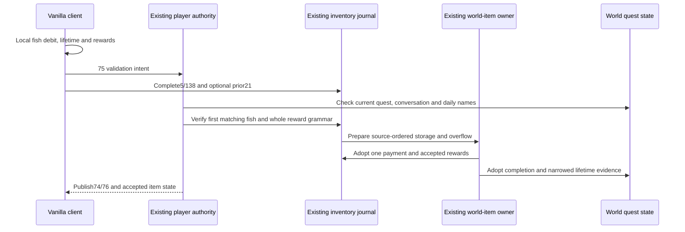

# Angler quest authority, Terraria 1.4.5.8

The client-validation candidate follows the ordinary vanilla UI: `Main.NPCChatText_DoAnglerQuest` consumes the local fish, advances the local lifetime count and grants local rewards before sending `75`. The server retains `75` as an intent to validate that operation. That packet alone does not consume another fish, generate an additional server reward or complete the day. The whole reported result must pass the existing inventory/world-item transaction. This candidate's preliminary Release build is not completed connected/full/Native or graphical-client acceptance.

The current quest and completed names belong to the canonical world state. At dawn, after the existing tree-shake reset and before daytime, the existing world owner chooses an eligible quest with source rejection-sampling order and clears the daily names. Selection uses loaded surface/evil flags and loaded/live progression; all 41 source quest identities are represented.

A completion needs a current living player, a retained conversation with the current living Angler, represented happiness conditions and the actual quest fish. Source `Player.FindItem` checks slots `0..57` in ascending order. Validation cannot skip an earlier inadmissible matching stack for a later payable one. The fish may have an initial character physical ceiling or accepted server-owned provenance. Initial character import creates no private funded quantities or copper budget. One fish, including the last unit, is debited before replaying the accepted reward witness through storage.

Reward legality covers the correlated full `Player.GetAnglerReward` result: the main selection, required costume companions, decoration, money and bait, in source QuickSpawn order. It checks milestone and quest-specific outcomes, Hardmode/Expert and happiness arithmetic, and the missing/composite accessory exclusions against inventory, banks and retained equipment. Gifts use the Item overload, with prefix zero and no Void Vault destination. Independent random histories may select different valid rewards; the server validates the complete possible result and deterministic storage image instead of rerolling it. Inventory `5`, `138` and any preceding reserved overflow `21` are observations in the same existing inventory journal; none individually funds a reward.

An absent ordinary-client lifetime report does not prove a zero quest count. The validator retains bounded evidence for compatible lifetime counts. A validated reward narrows that evidence and advances it for the next completion; it does not reset to a fresh existential count on every day. An explicit authenticated `76` can establish known character counters under the existing import policy. After paid progress becomes owned, later reports cannot choose a different Angler milestone. Managed transfer carries the evidence, count, golf and ownership state; it introduces no parallel character database.

A duplicate day/name, stale actor/vendor, missing fish, invalid companion set, wrong quantities/prefixes or incomplete storage/overflow evidence cannot create a second paid completion. Progress, inventory/world items and the source receipt are adopted before observers. A gameplay refusal does not automatically ban the client. Choosing among source-possible rewards cannot establish the statistical fairness of client RNG.

Packet `74` represents the quest and recipient's daily completion. Explicit playing-state `76` carries nonnegative Angler and golf counters for the authenticated occupation; its claimed slot cannot choose a peer and claim `255` is ignored. It is a character snapshot, not fish payment or a completion flag. Original-source observations capture 356 join frames without `76`, no ordinary sync frames for a counter-only change, and a non-SSC client ignoring its own `76`. The same client's unlocked inventory ignores its own-slot `5` correction. The normal legal path validates the already produced local image; these source guards still limit correction of an illegal image and do not prove automatic character persistence or GUI reconciliation. SSC and server `.plr` storage are not prerequisites. A new character-file join remains a classic client-trust boundary.

The existing checkpoint captures an immutable quest/name image. The writer replaces only the validated variable-length Angler header block, preserving the rescue flag and following bytes, validates changed-length current headers before updating offsets, and retains the same metadata in disposable prepared caches. Layout `6` rebuilds older caches from `.wld`. The represented base conversation range is conservative; unknown happiness/storage inputs or exhausted work budgets refuse. Daily names and quest rejection sampling have separate `4096` bounds, with no invented fallback quest.

Historical independent evidence includes 256 original `Main.AnglerQuestSwap` and 480 complete `Player.GetAnglerReward` observations with physical inventory and next RNG. It covers milestones, Zombie Fish, Hardmode/Expert money, three happiness multipliers and accessory exclusions. An omitted post-main RNG draw fails those comparisons. Independent persistence evidence rewrites and reloads a real $8400\times2400\,\text{tile}$ world with 734 chest records for quest/name images `40`/two names, `0`/none and `39`/256 names; the original `WorldFile.LoadWorldFlags` reads the changed headers to their exact section ends. Input SHA256 is `2289c366a15cdce62fad61888a3bf6f9f76f4e51fcd9b9d99aa8f8c71e4ceec0`; evidence is `.cache/angler-world/` and `.cache/angler-world-header/`. Those component observations and the preceding `0d48670b` full/Windows Native/TCP acceptance do not attest this changed client-validation candidate. See [fishing status](fishing-authority-1458.md) and [work state](../agent-memory/work-state.md); official GUI and genuine Linux NativeAOT remain separate evidence requirements.
