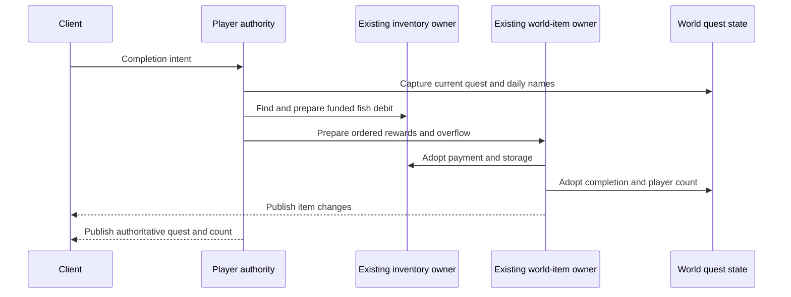

# Angler quest authority, Terraria 1.4.5.8

The Angler uses the existing world, player membership, inventory funding, town conversation, source random and world-item owners. A client completion notification requests a transaction. It does not establish a completed quest, a fish payment or a reward.

The current quest comes from the canonical world header. At dawn, after the existing tree-shake reset and before the clock becomes daytime, the world selects a new eligible quest with the source rejection-sampling order and clears the daily completed-name list. Selection reads loaded world surface and evil type, plus loaded and live boss/Hardmode progression. The quest list contains all 41 source identities.

Completion requires a living current player, a retained conversation with the current living Angler, represented happiness pricing and real server-funded quest fish. Source `Player.FindItem` searches slots `0..57` in ascending order. The runtime consumes that first matching fish before rewards, including its last unit; it cannot skip an unfunded earlier stack in favor of a later funded one. A same-day duplicate, stale actor/vendor or missing fish leaves stock, source random and rewards unchanged. The current player also retains the local finished state through an appearance-name change. The canonical daily names prevent another payout to the same name after reconnect or world reload.

Rewards follow `Player.GetAnglerReward`: main reward and costume companions, decoration, money, then bait. The planner yields at each original Item-overload `QuickSpawnItem` boundary so inventory storage and overflow draws execute before the next reward roll. Those gifts do not roll a natural prefix and do not enter Void Vault storage. Missing-accessory selection reads the existing inventory, banks and retained equipment/loadout items, including the source composite-accessory exclusions. Full inventory uses the existing world-item allocation and publication owner. All accepted payment, inventory/world items, random cursor and quest state are adopted before network observers.

The detached checkpoint snapshot carries an immutable quest/name image. The world writer replaces only the validated variable-length Angler header block, preserving the saved-Angler rescue flag and every following byte. Changed-length headers require a complete current-version metadata parse before rewriting section offsets. Prepared runtime caches retain the same data; layout `6` causes older disposable caches to rebuild from `.wld`.

Packet `74` represents the current quest and recipient completion state. Packet `75` is an intent. Packet `76` cannot import an Angler completion count. The authoritative lifetime count travels with the existing player transfer payload. There is no server `.plr` persistence owner in this repository: that count starts from zero in a fresh player lifetime after a process restart. The `.wld` daily completion list remains durable and prevents another payout that day. This limitation is explicit; no second character or reward database is added.

The runtime conservatively admits the source base conversation range; larger Journey/accessory reach is not represented here. Unknown Angler happiness inputs, unsupported inventory storage or exhausted transaction budgets refuse before adoption. A world holds at most `4096` daily completion names; quest rejection sampling has a `4096`-attempt refusal bound rather than an invented fallback.

Independent original evidence contains 256 complete `Main.AnglerQuestSwap` calls and 480 complete `Player.GetAnglerReward` calls from the official Linux `1.4.5.8` assembly. Reward observations include guaranteed milestones, Zombie Fish special rewards, Hardmode/Expert money, three happiness multipliers and missing/composite accessory pools, with final physical inventory and next random value. These are scoped observations, not full Windows arithmetic, NativeAOT, official graphical-client or whole-game compatibility acceptance. The latest implementation test results and remaining acceptance gates are recorded in agent memory.

Persistence also has independent real-world evidence. An existing $8400\times2400\,\text{tile}$ world with 734 chest records was fully rewritten and reloaded for three quest/name images: quest `40` with two names, quest `0` with none, and quest `39` with 256 names. The first image grows the header by $46\,\mathrm{bytes}$. Following header bytes and opaque NPC/tile-entity sections remain exact. The official executable's complete `WorldFile.LoadWorldFlags` independently reads all three images and reaches the exact first-section end cursor. This verifies the original header reader, not a full official-world launch. The input world SHA256 is `2289c366a15cdce62fad61888a3bf6f9f76f4e51fcd9b9d99aa8f8c71e4ceec0`; local evidence is `.cache/angler-world/status.json` and `.cache/angler-world-header/status.json`.

Copied controls establish that the observations detect the repaired behavior. Restoring the former same-length header guard makes the real-world rewrite fail with `InvalidHeaderSection`; restoring the implementation passes. Inserting one extra reward RNG draw after the main gift fails the independent inventory/next-RNG comparison; an explicit rebuild after restoring the source passes all 736 rule observations. Rejected diagnostics are retained separately. The normal regression tests additionally cover the existing progression, season and invasion patch owners with 256 daily names, so their old 255-name limits cannot silently block later saves. The Angler budget is shared with the production world-load policy; the independent party-NPC limits remain unchanged.
