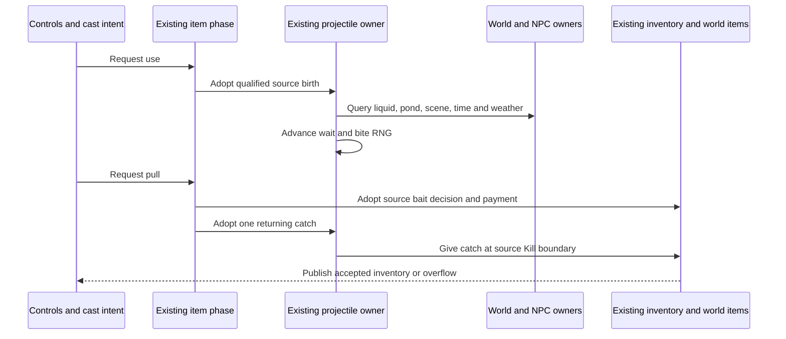

# Fishing authority, Terraria 1.4.5.8

A retained paid-ammo delivery record does not restore a retired player item phase. Fresh bobber processing and crate opening require the existing fishing phase admission; delivery of an already paid catch remains a separate completion path.

Fishing joins the existing player item phase, inventory funding, projectile store, world tiles, NPC spawning and reward publication. A packet `27` supplies a bounded cast direction and wire identity. It cannot supply a catch, pay bait, move a trusted bobber or grant inventory. The local source clocks must first reach their actual Shoot boundary; packet `41` cannot initialize those clocks. Each accepted bobber retains its exact projectile generation and connection occupation.

The current admission covers the eleven base poles with a neutral prefix and an ordinary upright, unmounted player. Casting without bait is allowed, but cannot produce a normal bite. Source bait selection searches slots `54..57`, then `0..49`. A bite retains the bait type; pulling searches those slots again for that type. The existing inventory owner admits both accepted server-funded stock and the character's legitimate initial fishing stock. Before the first accepted spawn, the initial `packet 5` image seals existing physical quantity ceilings for fishing stock in the main inventory and all four banks. This does not mint private funded quantities or copper provenance: both can remain zero. Bait, quest fish, crates and the three fishing potions use those same bounded quantities; conserved bait still requires real admitted stock. Slots/types absent at that seal have a zero ceiling. Later reports cannot increase ceilings, and respawn or managed transfer cannot reseed them. Payment adopts the spent unit and its ceiling before publication, including canonical empty state after the last unit. A new character-file join remains a client-trust boundary rather than server-side character storage.

AI `61` motion uses the existing terrain/liquid collision owner. Pond width and vertical columns read actual tiles, excluding source solid half bricks and slopes. The vertical census refuses after `262144` cell reads, in addition to the world-width-bounded horizontal scan; this is a runtime work bound, not a vanilla pond constant. Larger pathological ponds require a separately budgeted query before admission can expand. Fishing conditions use the existing scene scanner, loaded surface/rock layer and seed flags, live world clock/weather and loaded or newly completed Hardmode/Skeletron progression. The rules include water, honey, lava, pond penalties, depth, time, moon phase and weather. Gummy Worm's existing permanent booster contributes through the player phase.

The three fishing potions use the existing paid selected-consumable path and indexed local buff clock: Fishing `2354/121`, Sonar `2355/122`, Crate `2356/123`. Their source durations and last-positive effects are retained, including the update where a timer changes from one to zero. A raw buff snapshot cannot grant these effects or refresh a paid duration. Consumed ladybug bait uses the existing player luck state and transient world weather owner; the source penalty becomes effective after the already completed UpdateLuck stage. Its owned timer survives transfer and cannot be erased by a client luck report.

Current source `FishingCheck` uses `FishDropsDB`; the old `FishingCheck_RollItemDropOld` is not the active selector. The clean implementation preserves the ordered factual rules, probability-before-rarity draw, display-preview draws and separate shared drop-context RNG. Ordinary AI/bite draws use the existing world Main stream; pull/payment draws use the existing UpdatePlayers stream. Neither stream is replaced by client random values. Special NPC results enter the existing NPC allocator and progression owner; Duke Fishron uses the source bobber-center spawn branch. NPC creation support is distinct from complete AI parity.

An accepted pull retires its source receipt before observers. Repeated controls, forged catch `ai`, stale packet `27/29`, replacement generations and later re-entry cannot issue a second catch. Selection changes, crowd control, death, disconnect and transfer retire the corresponding actor lifetime. A paid positive catch follows the source returning/Kill reward path; an unpaid bite carries no reward entitlement. Rewards use the existing inventory/world-item transaction and its source overflow path. See [Angler quests](angler-quest-authority-1458.md) and [fishing crates](fishing-crates-authority-1458.md) for the connected downstream operations.

The source and runtime tests cover scoped behavior; they do not establish full vanilla compatibility. Decorative bobber override accessories, unrepresented fishing equipment/loadout effects, chum projectile lifecycle, mounted/inverted bodies and Shimmer fishing effects remain outside current admission. Imported unknown local clocks do not become known from a client report. Vanilla character files remain client-owned; server `.plr` storage or enabling SSC is not a prerequisite. Initial fishing-stock ceilings and explicit character `76` import are represented, but the observed normal source join sends no `76`. Normal graphical-client quest lifetime/reconnect and reward RNG parity remain open: the original UI grants Angler rewards locally before sending `75`, which the server's paid transaction does not by itself reconcile. Outbound inventory `5` bytes also do not prove adoption of authoritative bait debits or catch rewards by an unlocked non-SSC client; the direct source receive method ignores its own-slot update in that case. See [protocol evidence](networking-protocol.md) and [Angler quests](angler-quest-authority-1458.md) for the exact observation boundaries. Official graphical-client acceptance, genuine Linux NativeAOT execution and complete special-NPC scheduling/RNG parity require separate evidence.

The cloud bonus reads source `Main.cloudBGAlpha`, whose writer is graphical `DrawSurfaceBG`. The dedicated no-draw path leaves it zero. The runtime therefore uses live rain separately and does not substitute rain-driven `Main.cloudAlpha`; rendered-client cloud history remains outside the authoritative capture.

Special catches reuse the existing NPC spawn preview and physical allocator. Dedicated packet `130` births truncate bobber position, add Nautilus's `64` offset, then divide/multiply by `16`; direct/SP ItemCheck keeps pixel coordinates. Fishron `370` instead uses the owned bobber center plus `100`, ordinary NewNPC slot/defaults and target `255`. Red Slime `682` adopts its existing town-resident identity, two English name/profile draws and progression flag before world `7`, birth retention and public `23`; the same resident/name and unlock enter checkpoint owners. An already unlocked Red result refuses another birth even when the bite predates another player's unlock. Independent evidence comprises 42 actual official calls: seven types, two caller roles and three seeds, with 21 dedicated runtime comparisons of position/wet, defaults, target, AI, lifetime `937`, names and next RNG. This is birth/publication evidence; full NPC AI, arbitrary external WetCollision callback ordering and complete client/local RNG scheduling are not claimed.

The frozen implementation at `51197c1a` passes fresh Release warnings-as-errors, focused `556/556`, mandatory fast `25350/25350` and one unfiltered xUnit full run `1566763/1566763`, with zero failures, errors or skips. The independent full audit executes all 5253 discovered methods with zero exclusions, missing or unplanned methods. Full runner time is $1592.490\,\mathrm{s}$ and wall time is $1612.8170618\,\mathrm{s}$; fast runner/wall times are $1049.777\,\mathrm{s}$/$1052.546\,\mathrm{s}$. Source fingerprint `8fae36726e33c2c502daa9282b71736db28238a9da300792e1b167f6e06010fb`, all 4122 inputs and 197 canonical DLL paths were independently checked twice without change. Evidence is `.cache/character-sync/full-audit.json`.

Fresh Windows NativeAOT server SHA256 `76abfc4a96c3c9ea8209092c80b0f3e5534a0661fe43ebdaed17c9254b0278e2` has PE CLR directory `0/0` and passes loop, protocol, network, world and TUI smokes. Separately, the statically linked typed Windows Native replay passes the same `55/55` cases across 42 methods and 189951 assertions as the managed replay, plus three assertion-shim self-checks, with no excluded assertions. This component executable is distinct from the normal full xUnit runner and does not establish whole Main or GUI parity. Evidence is `.cache/character-sync/native-result.json` and `.cache/character-sync/typed-replay/native-result.json`.

Actual Release and Windows Native TCP hosts both pass `82/49/129` bootstrap with 15 sections per client, two-client relay/chat and 72 signed `35/43` vitals effects per host. The private character probe observes initial slot `54` bait `2674` × `2`, refusal to publish a forged increase to three, authenticated `76` Angler/golf counters, negative/`255` refusal, duplicates, unpaid `75` intents and a real rejoin with explicit `76`. This proves the exercised wire/session boundaries, not GUI adoption, private quantity introspection, a paid graphical quest or save/reload. Accepted evidence is `.cache/character-sync/live-v2/manifest.json`. The hosts use fresh private world copies with explicit `--import-world-custody`; this is fixture preparation only, leaves the original source world untouched and adds no production behavior. The earlier `.cache/character-sync/live` attempt failed for missing custody before listening and remains unaccepted. Both successful hosts are stopped.

The older fishing full run was interrupted without final XML and remains explicitly unaccepted; it is separate from the completed current full run. Genuine Linux NativeAOT, normal GUI inventory adoption and quest lifetime/reward RNG reconciliation remain unverified. The known `5`/`76` and client/server RNG boundaries above remain open despite these green gates. Exact evidence is indexed in [work state](../agent-memory/work-state.md).
