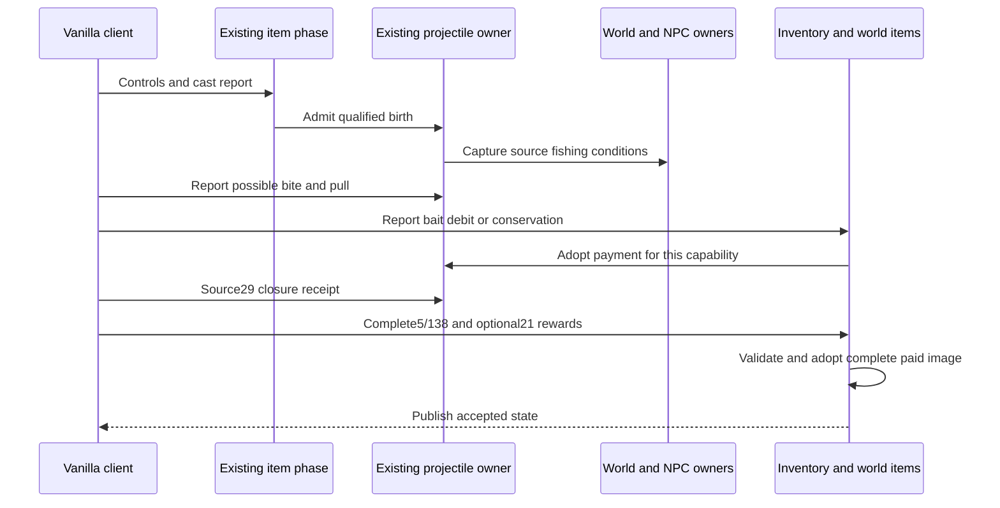

# Fishing authority, Terraria 1.4.5.8

The candidate on `feature/fishing-client-validation-1458` supports the vanilla client's role in selecting fishing outcomes, with mandatory server checks of legality and payment. A reported outcome must be possible under the represented source conditions and belong to a current action. Agreement with an independently advanced server RNG cursor is not required. This candidate has a preliminary Release warnings-as-errors build; its connected checks are still being resolved. Acceptance of the preceding `0d48670b` tree is historical evidence and does not attest this changed source.

Fishing uses the existing item phase, physical inventory ceilings, projectile generations, world tiles/clock/weather, NPC allocator and inventory/world-item reward transaction. There is no separate fishing inventory, reward database or SSC requirement. The eleven base poles with a neutral prefix and an upright, unmounted player remain the represented casting boundary. Real local item clocks must reach the source Shoot boundary; client animation `41` does not initialize those clocks. A `27` birth report supplies a bounded direction and wire identity for the existing projectile owner.

For a client-owned bobber, later `27` bite and pull reports are observations to validate. They must refer to the same connection occupation and projectile generation, follow the admitted movement/wet/settlement and timing conditions, and identify a result reachable through the active source `FishDropsDB` conditions. The server captures actual liquid, pond, biome, depth, time, moon, weather and progression facts. A catch ID or a forged `ai` value alone grants nothing. Reported stack sizes must fit the source bounds, including the conditions after a last-unit bait debit. Client-rendered `cloudBGAlpha` can have source histories that a dedicated no-draw server does not reproduce; validation represents the admitted possibilities instead of substituting rain-driven `cloudAlpha` or demanding the same visual RNG history.

Bait selection searches source slots `54..57`, then `0..49`; pulling searches again for the retained bait type. Both consumption and conservation require real admitted stock. The source rules determine which consumption outcomes are possible for that bait and catch. A `5/138` cohort must prove the actual debit or permitted conservation against the existing inventory before-image and ceilings. The private quantity and last-unit empty state are adopted before publication. Repeated, stale or forged reports do not establish another payment.

The returning catch also needs the source `29` closure receipt for that same action before its item image can be accepted. Catch inventory reports and any `21` overflow enter the existing whole-inventory journal. Only a complete legal reward/payment image can add private funded quantities or publish paid world items. Special catches reported through `130`, and the Fishron path through `61`, use the same fishing capability; those messages are not independent permission to summon an NPC or boss. Accepted births go through the existing NPC/progression owners. Death, disconnect, selection or action invalidation and world replacement cannot carry a reward entitlement to another actor lifetime.

AI `61` motion and pond measurements reuse terrain/liquid owners. The vertical pond census refuses after `262144` cell reads, in addition to the world-width-bounded horizontal scan; this is a runtime work bound, not a vanilla pond constant. Fishing power reads the scene scanner, loaded surface/rock layer and seed flags, live time/weather and loaded or completed Hardmode/Skeletron progression. Water, honey and lava remain distinct source contexts. The existing Gummy Worm upgrade contributes through the player phase.

Fishing `2354/121`, Sonar `2355/122` and Crate `2356/123` potions use the paid selected-consumable owner and indexed buff clock, retaining source durations and the last-positive update. A raw buff snapshot cannot grant or refresh their effects. Consumed ladybug bait uses the existing luck/weather owners; its penalty follows the already completed UpdateLuck stage, and its timer survives managed transfer.

At first accepted spawn, the character's preceding `5` image seals physical fishing-stock ceilings in the main inventory and four banks. It creates no private pickup quantities or copper provenance. Absent stock is capped at zero; later reports cannot inflate it, and respawn/managed transfer do not reseed it. A new character-file join still trusts its initial image under the classic character model. This is not cross-reconnect protection against edited character files.

Source receive observations still matter: an unlocked non-SSC client ignores its own-slot `5` correction and its own `76`. The normal legal path therefore validates and adopts the image that the client already produced, rather than rerolling on the server and expecting an owner echo to replace it. Those source guards remain a limitation for correcting an illegal client image. A gameplay refusal is not an automatic cheat ban. Checking possible outcomes cannot prove an unbiased client RNG or distinguish a lucky legal result from deliberate selection of another legal result.

Decorative bobber overrides, unrepresented equipment/loadout effects, chum lifecycle, mounted/inverted bodies, Shimmer fishing effects and complete special-NPC AI/scheduling remain outside the represented scope. Imported unknown clocks do not become known from reports. No current full vanilla or official graphical-client acceptance claim follows. Downstream details are in [Angler quests](angler-quest-authority-1458.md), [crates](fishing-crates-authority-1458.md) and [protocol boundaries](networking-protocol.md).

Historical source evidence includes the original fishing-rule fixtures and 42 official special-NPC birth calls across seven types, two caller roles and three seeds, including 21 dedicated birth comparisons. The preceding character-boundary checkpoint `51197c1a`, integrated through `0d48670b`, passed focused `556/556`, fast `25350/25350`, one audited full `1566763/1566763`, Windows Native server/component checks and actual Release/Native TCP character probes. Its evidence is `.cache/character-sync/acceptance.json`; the earlier interrupted fishing full and failed missing-custody live setup remain unaccepted. Those old artifacts do not validate the new client-outcome path, GUI correction/adoption, save/reload of client-local state or genuine Linux NativeAOT. Current acceptance status belongs to [work state](../agent-memory/work-state.md).
