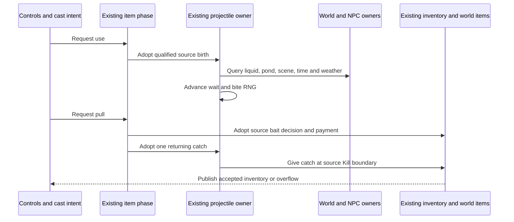

# Fishing authority, Terraria 1.4.5.8

Fishing joins the existing player item phase, inventory funding, projectile store, world tiles, NPC spawning and reward publication. A packet `27` supplies a bounded cast direction and wire identity. It cannot supply a catch, pay bait, move a trusted bobber or grant inventory. The local source clocks must first reach their actual Shoot boundary; packet `41` cannot initialize those clocks. Each accepted bobber retains its exact projectile generation and connection occupation.

The current admission covers the eleven base poles with a neutral prefix and an ordinary upright, unmounted player. Casting without bait is allowed, but cannot produce a normal bite. Source bait selection searches slots `54..57`, then `0..49`. A bite retains the bait type; pulling searches those slots again for that type. Only real funded stock can pay the action, including a conserved-bait result. The existing inventory journal adopts a spent unit and its ceiling before publication, including canonical empty state after the last unit. Transfer carries those same quantities and ceilings; a later client report cannot recreate them.

AI `61` motion uses the existing terrain/liquid collision owner. Pond width and vertical columns read actual tiles, excluding source solid half bricks and slopes. The vertical census refuses after `262144` cell reads, in addition to the world-width-bounded horizontal scan; this is a runtime work bound, not a vanilla pond constant. Larger pathological ponds require a separately budgeted query before admission can expand. Fishing conditions use the existing scene scanner, loaded surface/rock layer and seed flags, live world clock/weather and loaded or newly completed Hardmode/Skeletron progression. The rules include water, honey, lava, pond penalties, depth, time, moon phase and weather. Gummy Worm's existing permanent booster contributes through the player phase.

The three fishing potions use the existing paid selected-consumable path and indexed local buff clock: Fishing `2354/121`, Sonar `2355/122`, Crate `2356/123`. Their source durations and last-positive effects are retained, including the update where a timer changes from one to zero. A raw buff snapshot cannot grant these effects or refresh a paid duration. Consumed ladybug bait uses the existing player luck state and transient world weather owner; the source penalty becomes effective after the already completed UpdateLuck stage. Its owned timer survives transfer and cannot be erased by a client luck report.

Current source `FishingCheck` uses `FishDropsDB`; the old `FishingCheck_RollItemDropOld` is not the active selector. The clean implementation preserves the ordered factual rules, probability-before-rarity draw, display-preview draws and separate shared drop-context RNG. Ordinary AI/bite draws use the existing world Main stream; pull/payment draws use the existing UpdatePlayers stream. Neither stream is replaced by client random values. Special NPC results enter the existing NPC allocator and progression owner; Duke Fishron uses the source bobber-center spawn branch. NPC creation support is distinct from complete AI parity.

An accepted pull retires its source receipt before observers. Repeated controls, forged catch `ai`, stale packet `27/29`, replacement generations and later re-entry cannot issue a second catch. Selection changes, crowd control, death, disconnect and transfer retire the corresponding actor lifetime. A paid positive catch follows the source returning/Kill reward path; an unpaid bite carries no reward entitlement. Rewards use the existing inventory/world-item transaction and its source overflow path. See [Angler quests](angler-quest-authority-1458.md) and [fishing crates](fishing-crates-authority-1458.md) for the connected downstream operations.

The source and runtime tests cover scoped behavior; they do not establish full vanilla compatibility. Decorative bobber override accessories, unrepresented fishing equipment/loadout effects, chum projectile lifecycle, mounted/inverted bodies and Shimmer fishing effects remain outside current admission. Imported unknown local clocks do not become known from a client report. Vanilla character files are client-owned; the server saves its world and keeps connected player state in memory. Missing server `.plr` storage is not a compatibility limitation or a requested subsystem. The real outstanding boundary is normal character import/reconnect: the current branch does not restore the client Angler counter, and source-funded pickup scenarios do not establish correct handling of a character's initial inventory. This needs verification and correction through existing session/inventory owners while keeping later action payments and rewards server-validated. Official graphical-client acceptance, genuine Linux NativeAOT execution and complete special-NPC scheduling/RNG parity require separate evidence. Current checks and exact remaining work are recorded in agent memory.

The cloud bonus reads source `Main.cloudBGAlpha`, whose writer is graphical `DrawSurfaceBG`. The dedicated no-draw path leaves it zero. The runtime therefore uses live rain separately and does not substitute rain-driven `Main.cloudAlpha`; rendered-client cloud history remains outside the authoritative capture.

Special catches reuse the existing NPC spawn preview and physical allocator. Dedicated packet `130` births truncate bobber position, add Nautilus's `64` offset, then divide/multiply by `16`; direct/SP ItemCheck keeps pixel coordinates. Fishron `370` instead uses the owned bobber center plus `100`, ordinary NewNPC slot/defaults and target `255`. Red Slime `682` adopts its existing town-resident identity, two English name/profile draws and progression flag before world `7`, birth retention and public `23`; the same resident/name and unlock enter checkpoint owners. An already unlocked Red result refuses another birth even when the bite predates another player's unlock. Independent evidence comprises 42 actual official calls: seven types, two caller roles and three seeds, with 21 dedicated runtime comparisons of position/wet, defaults, target, AI, lifetime `937`, names and next RNG. This is birth/publication evidence; full NPC AI, arbitrary external WetCollision callback ordering and complete client/local RNG scheduling are not claimed.

Local code checkpoint: Release warnings-as-errors and focused `532/532` pass. Mandatory fast passes `25315/25316` with the existing canonical-liquid skip. The user interrupted the only unfiltered full run to release the shared slot; no final XML or accepted full result exists. Fresh Windows NativeAOT, live TCP and genuine Linux NativeAOT remain pending. The prepared typed replay currently passes nine unchanged methods and 37484 assertions under managed execution only. Exact commits, source pins and resume gates are in [work state](../agent-memory/work-state.md).

The local merge with current main additionally passes fresh Release warnings-as-errors, 532 focused/neighbor cases and two separate ordinary-placement/paid-furniture checks. Existing resource groups and the current world/checkpoint bindings are preserved. This is targeted merge verification; full/Native/live acceptance and the known character-counter import/reconnect correction remain pending.
