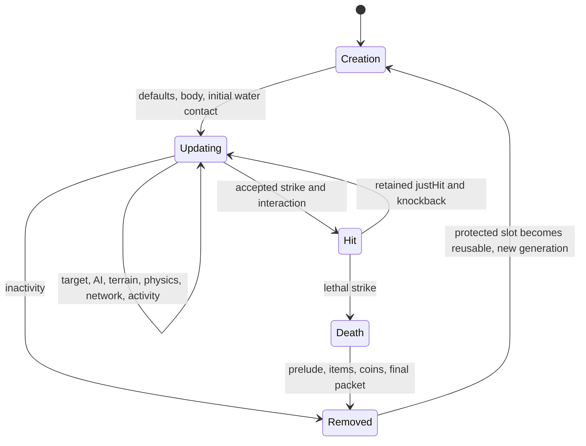

# AI3/AI7 runtime admission, Terraria 1.4.5.8

## Ordinary melee cohort accepted, 2026-10-28

Seventeen exact AI3 identities now use the existing retained NPC/status/RNG phase, subtype movement and complete admitted presentation, combat and NPC-specific loot owners. AI3/AI7 runtime admission rises from 208 to **225 of 300**; 75 identities remain creation-only. Positive AI3 admission is **149 of 191**. Global explicit lifecycle admission is 489, with 266 creation-only definitions and one zero-body metadata-only definition. This counts explicit supported slices, not complete vanilla behavior.

Three-seed original/runtime comparison matches **55,872 actual composed NPC phases**, including status, named state, actual raw player facts and all physical RNG slots. Sixty old-to-new control scenarios preserve previous behavior; their pre-existing source frame gaps remain excluded from source parity. Dedicated Ghoul HitEffect choices, 43 ordered specific-loot rules and all 48 materializable rewards are independently captured. Real omission/extra-RNG and unchanged-test runtime controls reject the intended faults. Retained death world-fact guards reject changes to Don't Starve, blood-night and kite-wind conditions before adoption.

Release warnings-as-errors, focused `8,221/8,221`, fast `33,662/33,662` and one unfiltered full `1,575,076/1,575,076` pass with zero failures, errors, skips or not-run cases. Actual XML covers all `5,452` discovered methods. Fresh Windows x64 NativeAOT passes all five smokes. Actual Release and Native TCP checks pass two complete joins, the source Banner/Bestiary `82` sequence before `49/129`, movement/chat and replacement Hello. [TCP evidence](../verification/npc-ordinary-melee-live-join-20261028.json) retains that bounded scope. [Combined acceptance](../verification/npc-ordinary-melee-acceptance-20261028.json) binds exact source/DLL/index bytes and component scopes. All 891 original fixtures remain unchanged; there is no new shipping project or dependency.

`FullVanillaAiParity` remains false. Unsupported door/switch contact, friendly overlap, Shimmer/lava, unowned statuses and humanoid social poses retain whole-phase refusal. The phase oracle excludes whole-world ticks; specific-loot captures exclude global rules and complete original death. Linux NativeAOT, original GUI and graceful-save shutdown are not established by this checkpoint.

## Ordinary melee component provenance

The connected death path also requires every NPC-specific loot table. The [original loot component record](../verification/npc-ordinary-melee-loot-20261028.json) observes all seventeen tables and 43 ordered top-level registrations, including the verified empty table for `140`. New tables preserve food/statue checks, Expert status rerolls, failed-roll chains, the ten-option moss selection, Don't Starve conditions, night Blood Moon conditions and the wind threshold. Unknown required world facts refuse lethal admission; a missing bad-luck-only roll capability refuses that rule instead of substituting ordinary luck. Existing global loot, allocation and retained death owners remain in use.

Two identical primary captures each execute 7,344 explicit specific-loot contexts with complete RNG checkpoints after every top-level rule and immediate original item materialization. A separate, also repeated source search retains 58 contexts that collectively select all 48 reward identities. Actual item defaults and natural prefixes are captured separately. These observations exclude global rules and complete death/update execution; they support the component implementation with the combined gate recorded separately above.

The [normal omission control](../verification/npc-ordinary-melee-loot-causal-20261028.json) preserves the current API and changes only the central registration hook in a privately built Gameplay DLL. The same first fresh test DLL passes all 7,615 cases with the correction; omitting the hook produces 7,423 actual assertion failures and 192 passes, with no runner errors or skips. Its precise source/DLL snapshot is retained separately from later combined acceptance.

The [final gate03 causal successor](../verification/npc-ordinary-melee-loot-causal-final03-20261028.json) repeats those exact counts with the final test DLL and the same private mutant, without rebuilding. All 372 shipping source/build inputs and the other 157 DLLs remain identical to the first fresh snapshot. This closes the component's final-test-binary bridge; the combined server gate is recorded separately.

The implemented cohort selects `44`, `104`, `140`, `181`, `196`, `197`, `464`, `470`, `489`, `524..529`, `536` and `691`. It reuses the existing retained NPC/status/RNG transaction, shared fighter strategy and world-motion owner. Unknown world-clock facts and unsupported contacts, statuses or humanoid poses retain whole-phase refusal. The accepted phase and combined-gate records above retain their exact scope; `FullVanillaAiParity` remains false.

Ghoul `524..527` requires dedicated-server `HitEffect` entropy even when no particles are allocated. A nonlethal hit makes one `Next(4)` choice per iteration below the double threshold `resolvedDamage / lifeMax * 20`; a fractional threshold includes its final iteration. Plain Ghoul `524` rolls before the zero-color visual guard. Death makes twenty `Next(3)` choices. The shared owner receives the rounded post-defense damage through every caller; packet `28` previously omitted it, which also suppressed Lava Slime's existing damage-dependent choices.

The [Ghoul component record](../verification/npc-ghoul-hiteffect-20261028.json) pins two byte-identical original-only captures, each with 258 actual `HitEffect` calls and 42 nonlethal `StrikeNPC_Inner` calls across three seeds. It compares the cursor and all 56 physical RNG slots, fractional/zero/lethal damage profiles, thirteen cohort controls and existing Lava/Eskimo/Gold controls. Original raw damage `35` with defense `19` or `20` resolves to `25` before `HitEffect`. All 434 focused cases pass on the first implementation snapshot; the same test DLL with only the earlier Application DLL restored fails 274 assertions and passes 160, with no runner errors or skips. The tests cover accepted environment/contact/client/prepared-projectile routes, refusal, detached death-preview boundaries and once-only publication. The final death checkpoint is a retained-transaction assertion; the original probe executes neither full death/loot nor `UpdateNPC`.

The [final Ghoul replay](../verification/npc-ghoul-hiteffect-final03-20261028.json) uses the final gate03 test DLL and App closure: 434 passes, versus 274 assertion failures and 160 passes when only the earlier App DLL is restored, with no errors or skips. It retains the original component corpus unchanged and separately pins the final `Loot.cs`, including the later condition/bad-luck work.

## Dryad Stardew animation continuation

The existing unified town phase now continues an already active Dryad state `24` instead of refusing every update. It retains source horizontal damping and world physics, right-facing pose, the 480-tick timer and return to ordinary idle/cooldown. Source frame timing alternates Dryad frames `19`/`20`, emits emotes `87` for 60 ticks at animation tick `60` and `3` for 90 ticks at tick `150`, and uses standing frame `0` from tick `240` onward. Effects are published after the existing accepted NPC/status/RNG commit; no extra owner or delayed emote queue is introduced.

The [actual AI7 oracle](npc-source-tools.md#dryad-ai7-continuation) covers the complete continuation and subsequent idle RNG. The initiating `HaveDryadDoStardewAnimation` interaction remains separate. Non-Dryad state `24`, state `14` magic combat and wet residents retain their admission fences. This scoped continuation does not change definition counts or `FullVanillaAiParity`.

[Русский](../ru/npc-ai3-ai7-runtime-1458.md) · [Definition census](npc-ai3-ai7-roster-1458.md)

Creation defaults and runtime admission are separate contracts. The starting roster had 133 `CreationDefaultsOnly` identities among the 300 AI3/AI7 identities. Runtime work starts with an explicit connected cohort, verifies the original update and death paths, and keeps every other identity fenced. `FullVanillaAiParity` remains false.

## Ordinary bunny siblings: explicit shared runtime owner

The five non-gem identities require an explicitly owned **inactive Blood Moon** for their NPC update phase. An absent clock is unknown. An active or unknown Blood Moon refuses the entire phase, including the early lower-world death path; the captured neutral owner is checked again before unpublished NPC/status/RNG adoption. Existing gem-bunny admission is unchanged. The predicate reads the existing authoritative clock directly, without the GoodWorld filtering used by door AI.

Original `UpdateNPC` invokes `UpdateNPC_BloodMoonTransformations` before gravity and AI. Its condition is dedicated/nonclient mode plus `Main.bloodMoon`, with no separate daytime check. `AttemptToConvertNPCToEvil` includes all five new identities and transforms them to `47` or `464` according to `WorldGen.crimson`. A bounded original-assembly probe observes all 30 conversions and six unchanged gem controls across the two evil-world contexts. Correct transformation ownership remains a separate task; ordinary walking is not a substitute for that source phase.

The same accepted nonresident AI007 owner now admits ordinary Bunny `46`, Slimed Bunny `303`, Xmas Bunny `337`, Gold Bunny `443`, and Party Bunny `540`, alongside gem bunnies `646..652`. Four creation-only definitions gain runtime admission; `46` already had lifecycle defaults but lacked this update dispatcher. The shared catalog owns these twelve exact identities and supplies creation protection, movement admission, coverage, statue-catch publication and accepted network phases. It does not admit other AI7 actors. Capture items retain their existing source facts: `2019` for the four ordinary variants and `2890` for Gold Bunny.

This change applies the semantic source analyzer to the actual original `NPC.AI_007_TownEntities` entry with `NPC.cs` and `Main.cs`. The entry itself is qualified with no diagnostics. The bounded 27-method inventory remains rejected as a complete analysis: its depth limit, two unqualified helpers and 149 opaque frontiers are retained. It is evidence for finding and inspecting the common path, never proof of effect completeness. In particular, squirrel admission was rejected after inspecting the player-luck/hostile-transformation branch; the existing bunny owner cannot execute that branch. Explosive Bunny also remains excluded.

Gold Bunny's dedicated hit effect also owns caller-side RNG: the original evaluates ten `Next(232,234)` choices on a nonlethal hit and twenty on death before `Dust.NewDust` returns early on the server. The existing shared strike/death owners now retain those choices. Accepted environment, NPC-contact and prepared-projectile routes consume them once; refused, zero-damage and stale retries do not adopt them. This change is limited to type `443`, not the whole gold-critter roster.

The [Gold Bunny evidence](../verification/npc-gold-bunny-hiteffect-20261028.json) contains twelve original-only `HitEffect` component observations, including five non-gold controls, and full physical RNG checkpoints. A separate original sequence executes `HitEffect`, zero-value `NPCLoot_DropMoney` and `NPCLoot_DropHeals` in source order. For its seed `1458`, zero-luck/uninjured player and value/damage `0` profile, their cursors are `20`, `29`, `31`: zero money value still makes money offers, and healing offers precede damage/vitals checks. This does not make total death RNG a fixed count. The unchanged normal test DLL passes all 17 cases with the correction and fails five assertions against the earlier runtime, without runner errors or skips. These are component and causal observations; they do not capture a complete original strike/loot/update or attest the final aggregate gates.

The historical pre-fence checkpoint compares actual pinned Linux-assembly `NPC.UpdateNPC(0)` with actual `ServerRuntimeState.Tick`, using the same explicit floor, active player, complete named NPC projection and physical 56-slot `Main.rand` checkpoint. The retained old runtime differs in all 1,680 new-sibling phases at seed `1458`, while the existing gem-bunny control matches all 336 phases. A discarded all-players-inactive bootstrap correctly triggered source activity removal; it is not accepted as movement evidence. The normal regression checks real default protection and exact original first-step position/velocity through the existing server composition, rather than just counting catalog entries.

The historical [component evidence record](../verification/npc-bunny-family-20261028.json) pins three seeds (`1458`, `42`, `8675309`): 6,048 actual original updates and 6,048 runtime updates match exactly. A real omitted first tick differs in all 2,016 state phases; one real extra RNG draw differs in all 2,016 RNG checkpoints and later affects 1,584 state phases. At that checkpoint, the unchanged normal Fact failed with the old Core DLL (missing default protection) and passed on the fixed DLL. This is component evidence; final combined acceptance is recorded separately.

The admitted states and existing whole-phase refusals remain the same. Natural spawn selection, resident roles, pressure plates/mines, Shimmer, turning critters and `FullVanillaAiParity` gain no new claim. The historical gem-bunny corpora below retain their original seven-identity scope.

The post-fence [phase-carrier evidence](../verification/npc-bunny-family-gate04-20261028.json) uses an explicitly owned inactive Blood Moon and the existing spawn-cycle suppression. It compares 6,048 original `NPC.UpdateNPC` calls with 6,048 actual `NpcAuthority.AdvanceWorldTick`/`TickSimulation` phase advances, including complete named NPC state and physical RNG. The real omission and extra-RNG controls remain rejected. This precisely bounded NPC carrier is not a complete `ServerRuntimeState.Tick` RNG comparison: adding the authoritative clock also activates world-time and other world-loop work outside the original NPC call.

## First cohort: sized undead and ordinary skeleton variants

The cohort contains **30 identities**: positive `201`, `202`, `203`, `635`; signed `-13`, `-14`, `-26` through `-37`, and `-44` through `-55`. The signed identities retain their original positive type, physical body, difficulty arithmetic, money and creation identity. The exact signed allowlist also requires an admitted positive parent; neither AI3 membership nor a registered parent admits other signed identities.

Skeletons `201/202/203` have separate speed bands; `635` uses the ordinary skeleton band. All four apply the source speed adjustment from scale. `-13/-14` reuse Angry Bones' close lunge and daytime exemption. Bone Throwing Skeletons `449..452`, Giant Skeleton `-15`, and Torch Zombie `590` have additional branches and remain outside this cohort.

The implementation uses the existing `RuntimeNpcStore`, targeting dispatcher, world collision, shared random source, interaction ledger, damage/death pipeline, world-item allocator and replication registry. There is no second NPC simulation or independent gameplay random stream.

Integer half-body geometry matters for the signed bodies. AI3 obstacle, door and step-up probes use integer division; `NewNPC`'s bottom-center anchor uses floating division. Target selection scores physical centers, while target-facing uses the integer target rectangle. Its temporary vertical direction can request `netUpdate` even when AI3 then restores the previous final direction. Grounded `FindFrame` facing runs after collision. The Expert elevated-target jump follows obstacle and stuck launches, precedes the subtype lunge and does not independently request `netUpdate`.

The existing creation boundary now samples the world's `WetCollision` before publishing a colliding birth. It uses the final materialized body and rejects reentrant changes before publishing the outer birth. Detached natural-spawn previews retain this query and still require their existing world/store/RNG currentness checks. Activity uses the live NPC body, integer half dimensions and actual player body, including extended player hitboxes.

Both shared wet-contact queries now use the original integer half-body and half-probe origins. `TryGetWetContact` retains first-hit tile ordering; the aggregate `GetLiquidContacts` API retains its existing kind aggregation. Lava's full-body query remains separate. A repeated original matrix covers 5,824 rows per edition, including fourteen odd undead bodies, liquid edges, fill amounts, inherited slopes and mixed-liquid order. The former DLL fails 864 rows; the corrected DLL matches every row. The real creation boundary also exercises the odd `-27` body against those source contacts.

Ordinary authenticated catching reuses the existing item-allocation publication journal and exact NPC terminal-removal owner. Both states and the shared random state are adopted before item callbacks; publication retains item `21`, owner `22`, inactive NPC `23` order. A callback cannot update or catch the retired generation twice, and cannot remove its replacement after two real updates expire spawn protection. Custom random adapters without the concrete shared owner retain their narrower existing guarantees; this does not establish transactional rollback for arbitrary host callbacks.

`INpcStateCommitSink.NpcCatchCommitted` carries retained `spawnNeedsSyncing` to replication without inventing a second NPC snapshot owner. The source wire path sends one inactive `23` for a catch before the first AI; the default sink method preserves activation/retirement notifications for ordinary lifecycle observers. Application and extension fanouts forward both typed catch and vanilla-AI callbacks, as well as retained birth notifications.

AI network intent travels with the accepted update and is not retained in the next simulation state. `INpcStateCommitSink.NpcVanillaAiStateCommitted` distinguishes the actual source network phase from immediate combat/manual publications; its default implementation preserves existing sinks. The replication registry owns bounded generation-specific cooldown state for the exact cohort. Source forced offers and sticky spam/full-cooldown requests use the original nonboss counters. Other types retain their previous replication policy. Late-join baselines still observe every accepted state, including states for which no live packet is due.

The same registry supplies source proximity streaming for this cohort, including two identical packet offers when a forced update and proximity stream coincide. Recipient credits use fixed physical-slot arrays with full generation owners and reset after accepted sends; successive generations cannot grow a per-connection dictionary. The old Moon Lord transport path is retained as a separate bounded legacy policy. The source proximity catalog defaults true and excludes `396..398`; its former inverse interpretation is not claimed as source parity outside the new cohort.

Original Windows percentage arithmetic can change a coin stack at an integer boundary. `VanillaNpcMoneyContext1458.WindowsArithmetic` is explicit and defaults false. The application enables the proven Windows rule only for the exact 30-identity cohort; other admitted actors retain their previous arithmetic pending their own Windows verification. The rejected global prototype exposed 60 differences from retained Linux expectations; those expectations and their assertions were preserved. No stack adjustment or value-specific exception is used.

## Second cohort: gem bunnies

Exact types `646..652` use nonresident `NoneBehavior` and `GenericGround` physics. Their AI7 behavior grants no resident, housing, shop or teleport role. Home tiles are source AI memory and packet `60` metadata; they also appear in late-join home replay for these nonresidents. Existing explicit catch-item facts grant capture independently of AI style.

The existing dispatcher plans source states `0/1/8`, raw target `255` initialization and fallback, home/resting behavior, day/night and weather predicates, danger turns, cliff rules, jumps, drowning, steps, platforms, frames and activity removal. Its accepted plan uses the existing store preview, shared RNG, physical collision and status owner. Changed world sections, players, peers, NPC revision or RNG refuse adoption of the entire phase.

Source catchable protection is retained in nullable `CatchableNpcTempImmunityCounter` and `ReleaseOwner` fields on the existing NPC simulation revision. Exact gem identities start at `90/255`; omitted same-identity updates preserve them, and changing definitions resets their source defaults. The post-AI phase decrements the counter while keeping `Friendly`; update 91 clears that flag and requests synchronization. Statue and released actors clear protection immediately. Unknown counter/owner imports are refused.

Regeneration, hostile contact, lava and lower-world deaths reuse existing damage, loot, prelude, status, item and RNG owners. Contact death retains the pre-collision loot origin and post-collision terminal packet body. Stinky expiry, tile `666` refresh, visual argument draws and water removal have separate source observations; wet removal may emit `54` after the lethal `28` and loot, before inactive `23`. Late join sees the final committed buffs and home state. Statue capture preserves the source smoke RNG and inactive `23` then packed-coordinate `106`; the statue bit and release owner also travel in `23`.

The unique source census per edition is 6,286 actual `UpdateNPC` calls, 252 inner `AI_007` calls and 42 `CatchNPC` calls. Mechanical and wire copies of the same observations are not counted twice. This includes 1,974 updates through temporary-protection completion, 546 combined wet/status updates, 168 danger/drowning updates across the grace boundary, and fresh births with absent, dead and distant players. Flee speed reads the committed pre-AI `Friendly`; its expiry occurs afterwards. The post-grace capsule caught and corrected an unconditional speed override that quiet expiry sequences could not expose. The [gem-bunny provenance manifest](../../tests/TerraRuntime.Tests/Fixtures/npc-gem-bunny-runtime-1458.provenance.json) records the repeated artifacts and source helpers. Immediate pending-birth catch has a [separate 28-case original capsule](../../tests/TerraRuntime.Tests/Fixtures/npc-pending-catch-1458.provenance.json) with an authenticated playable player pose. Combined post-grace verification is recorded below.

`FullVanillaAiParity` remains false. First Shimmer/Faeling contexts, Shimmer history, conveyors, wider imported DOT histories, unsupported AI/counter/owner state, nonstandard life maxima and reciprocal Bee/SmallBee contacts remain explicit whole-phase fences. Ordered natural gem spawn pools also remain off until sibling gem-squirrel and other preceding critter selections are proven; unsupported source outcomes cannot be skipped or rerolled.

## Independent observations and checks

The retained Windows x86/.NET Framework and Linux-assembly/CoreCLR corpora are separate, repeated original-assembly observations. Only numeric state, protocol bytes and fixture-owned scenario labels are retained. Existing complete creation/default matrices and the undead loot/death corpus are reused.

The [numeric fixture provenance manifest](../../tests/TerraRuntime.Tests/Fixtures/npc-undead-runtime-1458.provenance.json) pins both original binary hashes, compressed and uncompressed fixture hashes, group/update counts and bootstrap requirements. It identifies the execution host separately from the original edition.

| Capsule, per platform | Groups | Actual `UpdateNPC` phases | Scope |
| --- | ---: | ---: | --- |
| Birth, updates, interaction, nonlethal and lethal strike | 240 | 1,920 | All 30 identities, four difficulty/world profiles, two surface contexts |
| Target handoff, daytime distance, obstacles, platforms, water | 300 | 13,688 | All 30 identities and two random seeds |
| Elevated targets, visibility and platform-assisted jumps | 1,440 | 19,104 | Four representative bodies, Classic/Expert/Good contexts, threshold boundaries and landing sequences |
| Knockback strike, subsequent updates, cooldown and death | 90 | 6,210 | All 30 identities in Classic/Expert/Good; eight preceding and 61 subsequent updates |

`Main.isThereAWorldSurface` derives from `worldSurface > 50`; the two full-lifecycle contexts explicitly retain that fact. A surface value of 40 is a valid no-surface context, not evidence for an ordinary surface world. Dungeon loot suppression is checked against the corresponding owned facts.

The loot oracle must initialize `ContentSamples.NpcsByNetId` before `ItemDropDatabase.Populate`. The original database expands positive registrations to signed identities using those samples. Earlier captures missing that bootstrap are rejected as signed-death evidence; their identical birth, movement and nonlethal segments are recorded separately. The retained final corpus initializes all 762 source sample entries, including 65 signed entries, using original `SetDefaults`.

Legacy assertions retain their original purpose. Catalogue censuses include the four new fighter profiles and exact seven nonresident coverage entries; the `NoneBehavior` exception is restricted to those seven and asserts their exact partial capabilities. The historical custom-behavior JSON hash is unchanged: new retained fields are asserted separately and excluded only from its old schema. The [focused Goldfish birth proof](../../tests/TerraRuntime.Tests/Fixtures/npc-goldfish-birth-wet-1458.provenance.json) corrects the former dry-birth assumption in an existing water-spawn test: both original editions retain wet state and unchanged RNG through eight updates, while the dry control consumes exactly three first-update draws. No spawn selector or production guard was relaxed.

Runtime checks compare sequential motion, AI/local state, target changes, collisions, liquid state, life, drops and the next shared RNG value. They exercise actual committed packets and late-join baselines, death retirement, spawn protection and stale generation rejection. The existing death matrix also covers all 3,120 contexts for the four newly admitted positive types. Source slot weights are tested through the real before-RNG natural-spawn cap and rate paths: `-13` retains one slot, `-14` owns two, and the sized zombie/skeleton pairs use the final source scale.

The initial scoped 33,433 checks included all six grouped undead runtime Facts and the complete 33,426-row existing death matrix plus its census. New undead numeric runtime evidence covers 2,070 groups and 40,922 source updates per platform. Final post-grace combined verification passes:

| Check | Result |
| --- | --- |
| Release warnings-as-errors | 0 warnings, 0 errors |
| Combined targeted cases | 33,679 passed, no failures or skips |
| Mandatory fast tier | 25,134 passed of 25,135 |
| Unfiltered full suite, all 5,065 methods | 1,566,547 passed of 1,566,548 |
| Fresh Windows NativeAOT | Publish and loop/protocol/network/world/TUI smokes passed |
| Six unchanged undead Facts, typed managed and NativeAOT runners | 1,547,878 assertions passed in each |

Fast and full have exactly one unchanged allowed skip: the previously recorded canonical three-basin liquid rounding fixture. No new skip or sampled matrix is introduced. Final shipping executable SHA256 is `3E5D7CBB1C9EEA1AD8B07BA4CBD38B57839774BCC0519C17264C9646038942F5`. Omission controls retain their source/DLL pins and genuinely failing assertions; restored current-production runs pass. The earlier full run stopped after the post-grace source gap was found is explicitly rejected, not counted as acceptance. Linux NativeAOT remains unverified locally because the available Ubuntu WSL distribution is still `Installing`.

## Remaining admission and dependencies

After the ordinary bunny extension, **92 identities** remain creation-only: 59 positive AI3 types, signed `-15`, and 32 AI7 types. AI7 residents, ordinary animals, rescued actors, merchants and special actors have distinct lifecycle rules. The admitted gem-bunny `646..652` implementation is explicitly separate; source AI7 membership grants no housing, shop, resident strike reaction or capture permission.

Ordinary spawn-pool expansion remains fenced. The existing conservative selector cannot safely acquire a terminal size/style roll alone. `NPC.Spawner.SpawnAnNPC` first consumes zombie-style selection, gnome/fairy luck offers, other creature offers and world-owned cavern monster selections. Missing earlier branches must not be replaced by an admitted skeleton or zombie. The required dependencies include the original world-ID-derived cavern matrix, source scene/world facts and correct roll ordering. Event spawn pools belong to the concurrent events workstream.

NPC-sensitive world switches are a dependency of the concurrent world/tools workstream. Source `NPC.UpdateNPC` evaluates `Collision.SwitchTiles` before its subtype whitelist for the following AI reset; excluding a type from that reset does not prevent its plate or mine activation. This worktree has pressure-plate persistence but no runtime `SwitchTiles/HitSwitch` owner. Plate/mine activation and its packet `59` are therefore unsupported here; they are not claimed as a verified fail-closed context or NPC/world-interaction parity. This pass adds no second wiring engine.

Broader status histories, Shimmer transformations, conveyor behavior, unsupported subtype attacks/children/transformations, complete outer-update ordering and graphical official-client acceptance remain separate limits. Refusing unowned contexts remains part of the contract. Running an original Linux assembly on this Windows host is not Linux NativeAOT acceptance.
