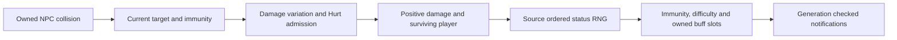

# NPC contact debuffs (`1.4.5.8`)

[Русский](../ru/npc-contact-debuffs-1458.md) · [Combat](combat-damage.md)

The existing NPC/player collision pass now applies source-selected contact debuffs to connected and clientless players. It retains the existing admitted NPC definitions, hitboxes, incoming-combat capture, HP executor and immunity registry. This does not enable autonomous contact for `DefinitionOnly` NPCs.

`Player.StatusFromNPC` rules include expert Brain/Creeper selection, carried slime items, negative slime net identity, independent multiple procs and Frozen-dependent branches. The honey-slime exception (`type 1`, `ai[1] == 1125`) grants Honey `48` without Hurt or damage variation. Ordinary effects require positive accepted Hurt and a surviving player. General immunity rejects before damage variation; BossNoCheese refusal remains inside Hurt and still consumes that variation. GodMode consumes neither variation nor status draws. Rejected/zero damage and lethal hits grant no ordinary contact effect. Existing unsupported dodge/parry equipment remains outside admitted combat; no new dodge or parry simulation is claimed.

The default composition uses its existing shared gameplay RNG, without a separate contact seed. Proc and random-duration draws precede buff-immunity rejection. `AddBuff` difficulty extension is applied once (Expert `2`, Master `2.5` for the source-selected types). For the Worthy raises the effective difficulty before these rules. Reapplication keeps the larger duration. Ankh Shield immunity now comes from the existing equipment snapshot: Chilled is covered, Frozen is not. Terraspark does not grant On Fire immunity. Warmth/Obsidian Skin and additional immunity accessories need their own owned producers before runtime admission; the pure duration rule includes source cold-resistance arithmetic, but current contact execution does not infer it from packet `50`.

Connected-player contact provenance and durations live in the existing bounded `44` buff slots. Slot compaction, cloning, death and transfer preserve or retire that provenance with the slot. The owned clock ages each slot once, including when an unrelated remote phase is refused, and retains the last update's represented damage-over-time/Frozen effects. Exact packet-50 acknowledgements leave owned timers unchanged; a changed presence-only snapshot cannot remove or renew an owned contact effect. Local cures and simultaneous unrelated presence changes need a causal server transaction before admission. Legacy imported buff presence is still a presentation contract; it does not supply earned contact duration or suppress the contact Frozen RNG branch.

HP, immunity, motion and contact slots adopt before observers. Connected targets receive packet `55` with the already adjusted duration; the official client uses `AddBuff(fromNetPvP: true)` and does not scale it again. This is TerraRuntime's authoritative notification policy, not a claim that vanilla dedicated contact naturally emits `55`. Inbound PvP packet-55 restrictions are unchanged. Packet `50` supplies presence to other players and late join. Exact generation/liveness guards suppress stale effects after callbacks, disconnect or slot reuse.

Clientless contact slots merge with the existing Moon Leech and lava/On Fire owners for one packet-50 view. Neutral Poisoned/Cursed Inferno/On Fire damage uses the existing regeneration accumulator and HP executor, including the last active tick; poison death uses source other-reason `9`, fire uses `8`. This retains the existing known-world/non-Vampire environmental scope.

Remaining limits: complete Hurt reactions, banner/luck/parry/dodge rules, all contact hitbox exceptions and whole `Main` RNG scheduling are not established. Effects beyond the represented Poisoned/On Fire/Cursed Inferno health projection and existing item restrictions have authoritative application/timers/presentation, but not complete server stat, motion, regeneration or cure consumers. An unrepresented active status still retires the shared remote-player phase and its RNG provenance; expiration does not restore that custody. This is an existing fail-closed boundary that this application block does not complete. The three represented damage-over-time types can continue through that phase. This block does not add hostile-projectile debuffs or expand inventory/tool/world-edit authority.

Independent evidence consists of numeric observations from official Windows and Linux `Player.StatusFromNPC`: `110,016` rows per edition, repeated exactly, covering all `694` identities, difficulty, frozen state, seeds and carried-item/immunity/cold/world variants. The fixtures include RNG call count and the following RNG value. Explicit source-platform arithmetic preserves the Brain/Creeper duration rounding difference. These observations verify the rule boundary, not natural-client contact or whole `Player.Update` parity. Decompiled code and game assets are excluded from the commit.

Local validation: Release warnings-as-errors, 41 focused/neighbor tests and mandatory fast (25,004 passed, one known skip) pass. Windows NativeAOT server and five smokes pass; static typed replay of all 16 unchanged new Fact bodies passes both managed and Native with 1,024,679 assertion invocations. The final unfiltered xUnit run passes 1,563,297 of 1,563,298 cases, with zero failures/errors and the same known skip; all 5,001 methods run without exclusions. CI tools, documentation, project graph and domain checks pass. A contact-application omission causes five assertion failures and restoration passes. Linux NativeAOT remains unavailable on this Windows-only host. Linux-edition original helper observations were executed under Windows CoreCLR, distinct from Linux OS validation.

The empty-contact clock checks ownership before cloning slots. In the same isolated 10,000-update workload after 1,000 warmups, one player changes from $848\,\mathrm{B/tick}$ to $40\,\mathrm{B/tick}$, ten players from $8264\,\mathrm{B/tick}$ to $40\,\mathrm{B/tick}$. This measures only the contact-clock component, not whole-server throughput. The unrelated worker-forwarder test shutdown budget now matches the neighboring five-second worker tests; ownership/thread/result assertions remain intact. The rejected first full result and aborted intermediate retry remain recorded separately from final acceptance.
