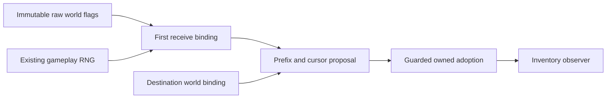
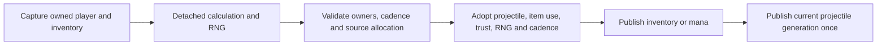
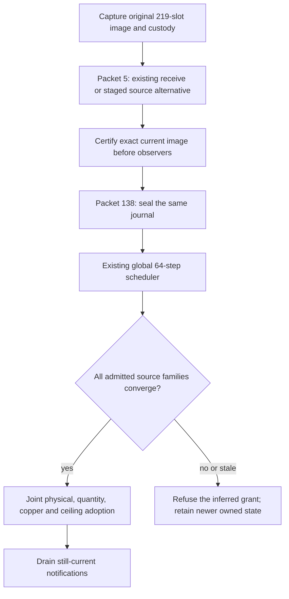

# Owned player item use 1.4.5.8

## QuickBuff local acceptance, 2026-10-11

Release WAE0/0, focused88/88, fast24963/24964 and one unfiltered full1563256/1563257 pass with zero failures/errors and one known liquid skip. Exact new Game/owned Facts pass29346/77936 checks each on managed and Windows Native. Five Native server smokes and Release/Native live82/49/129 plus72 signed health/mana effects pass; both hosts stopped. Linux Native and broader vanilla compatibility remain open.

The full run finished successfully; XML export then failed because the disk filled. Execution acceptance uses the matching terminal console and finished XML assembly header; the failed partial export is preserved and the suite was not rerun.

## Detached QuickBuff planner — scoped local acceptance

The Game component now exposes detached `TryPlanQuickBuff` for the six represented potions `292`/`303`/`2344`/`2346`/`2347`/`2349`. It preserves source-order one-item costs from inventory slots `0..57`, then the forty Void Vault slots when an open Void Bag is present, and the full indexed 44-slot buff image, including the source `CountBuffs` prefix rule. Unsupported potentially mutating buff or food families refuse the plan. This operation does not advance clocks or RNG, infer QuickBuff button intent, or grant private funding. Canonical input validation also covers inactive Void slots; immunity is an explicit detached input, not an admitted equipment producer. Component evidence includes 168 original QuickBuff cases and 25,584 original numeric metadata records, four sensitive omission controls, and a root warnings-as-errors build with seven direct xUnit tests passing. Connected Application adoption is integrated; fresh combined local/Windows Native acceptance passed; indistinguishable closed cursor exchanges require separate private-custody convergence before a paid buff can be granted.


## QuickBuff reconciliation for six funded buff potions — local acceptance passed

The existing inventory journal can explain the configured original QuickBuff batches for the six supported buff potions. The source scans main slots `0..57`, then the forty Void Bag slots when the represented Void Bag gate permits them; cursor `58` is excluded. Existing buffs suppress another use, and active animation or item-time clocks do not by themselves block this bulk operation. Food and other QuickBuff families remain outside this scope.

Original synchronization sends the changed `5` images, `50`, unchanged controls `13`, and delimiter `138`. These packets do not identify a QuickBuff button press. The same retained journal compares source-valid explanations, validates the complete `219`-slot inventory and private funding/caps, and uses the existing global `64` work-step budget. A successful explanation explicitly debits one funded unit for each used potion. It adopts inventory and indexed buff state jointly before observers; an unfunded source batch cannot obtain its new buffs through raw `50`. Initial unrelated imported buff reports retain their existing policy.

The promoted grouped test checks full indexed `44` buffs, all physical/private slots, exact source RNG state at the configured direct-use boundary, and actual owned ticks for denial, generation transfer, late-provider mutation and another player's phase progress. Exact delayed acknowledgements preserve durations and cannot restore a deleted buff. Observer reentry and an exception after adoption do not repeat payment.

A genuine full-stack closed cursor exchange can leave every physical image and synchronization packet unchanged while changing which private funded unit pays for the buff. Represented main-inventory, Void Bag, and main-to-each-bank cycles are compared as alternatives; absence of a discovered witness is not proof of uniqueness. An unchanged live ACK does not move hidden funding. Source cycles solely within banks 1–3 do not use QuickBuff potions and are not declared paid producers. Combined local acceptance passed; Linux Native remains unverified. Unrestricted hidden history, natural whole `Main`/UI execution and new immunity/equipment producers remain outside this scope.

## Combined local checkpoint, 2026-10-11

Coin-value custody, favorite/nonfavorite cursor Return and inventory-close residual drops are integrated with the committed equipment block. Known-local NewItem retains reservation in its allocation plan; NPC catch validates it instead of sending a second owner22, preserving source21/22/23. Unchanged catch goldens pass6684/6684; restoring the old caller causes12 assertion failures, zero runner errors. Release has zero warnings/errors; joint focused 18647/18647. One unfiltered full run: 1563184/1563186, one known canonical-liquid skip and one nondeterministic conversation-test failure from the source-valid idle laugh timer45. The test now uses its existing QuietNpcRandom, retaining all assertions; corrected town 46/46 and final fast 24892/24893 pass with zero failures/errors and the known skip only in fast. Production source and all32 shipping DLLs remain exact through that test-only correction. Fresh Windows NativeAOT/five smokes and Release/Native live82/49+129/two-client relay pass; both hosts are stopped. The failed unfiltered run is preserved and not declared green; it was not repeated after the isolated fixture correction. Linux NativeAOT remains locally unverified; GitHub CI is not awaited. This scoped checkpoint does not establish full vanilla gameplay, complete Native durable-Fact or natural UI/wire parity.

## Functional combat accessories — integrated, scoped local checkpoint accepted

The owned remote player phase admits seven combat accessories through the existing equipment catalog and slot rules: 489 (magic damage), 490 (melee damage), 491 (ranged damage), 2998 (minion damage), 935 (all four damage classes), 1301 (all four damage classes and critical chance), and 1858 (ranged damage and critical chance). Alternate-loadout favorite inheritance uses the same catalog; unsupported equipment still retires the whole shared player phase.

Destroyer Emblem 1301 now supplies its source minion damage bonus, and accessory damage prefixes 69–72 also apply to minions. The remote phase retains accessory speed prefixes 77–80 for these families. Its existing melee clock consumes the derived animation multiplier once; the common equipment snapshot keeps its raw attack-speed multiplier for other consumers. Configured Wooden Sword 24 use has maximum animation 20 with no speed prefix and 19 with any of these four speed prefixes. Existing 101 remote melee identities retain their default clock behavior; special speed-exempt items and broader slowing effects are not admitted by this change.

Equipment expert/master mode and dedicated local vanity context are captured before external providers and compared again before joint adoption. A late equipment-world change refuses the complete census without advancing the shared RNG. Dedicated local vanity remains immutable after its first binding.

Candidate evidence covers 4832 admitted source phase comparisons and 60 connected launch/NPC-hit compositions, with three grouped Facts and eight sensitive omission controls. The copied candidate builds and restored tests pass; combined local checks and the isolated test follow-up are recorded above. Configured original calls do not establish natural client scheduling, Windows equipment wire parity or full vanilla gameplay parity.

## Owned contact pickup

Owned contact pickup requires a live represented player phase, an assigned owner and actual body intersection. It runs after the player phase and before world-item timers or new owner discovery. Ground quantity custody is private to the existing item generation: trusted creation can fund a grant, while raw reports cannot increase that budget. Mixed ordinary stacks grant only funded quantity and retain the visible remainder. The accepted pickup checkpoint required a fully funded coin stack; the reviewed coin-value extension below separates physical conversion from copper-value custody. Final callback guards precede joint ground/inventory adoption, and publication follows both changes, with world packets 21/151 before inventory packet 5. A stale notification is suppressed without undoing an accepted grant.

Unknown world-item imports have no funded quantity, and public snapshots cannot restore it. A future persistence format must explicitly preserve this metadata or treat restored quantities as unknown. Initial client inventory and client coin balances still have no funded provenance. The bounded owned move/drop follow-on is described below.

A constructor item phase does not by itself bind a component runtime to owned pickup. Runtimes that never bound remote player updates retain their existing command handling. After binding, unavailable or retired phase custody refuses represented pickup instead of using that compatibility path. Empty worlds and never-bound components skip the pickup scan before allocating its snapshot.

Owned pickup uses source-backed ordinary and ammunition storage plans, plus denomination-changing coin plans. Ordinary storage respects matching prefixes, favorites, hotbar priority and ammunition slots; coin conversion preserves total value with 64-bit arithmetic and the original reset of prefix/favorite fields. These plans describe inventory placement, not permission to create quantity from a client report. Void Bag storage and movement outside the context-0 pair below remain open.

Selected coins 71–74 use the existing remote placeable-item clock with style 1, animation 15 and automatic reuse. Configured original remote player updates on both platforms cover living, dead, ghost and outside branches. This clock admission does not authorize local coin placement, consumption or Coin Gun projectile creation. The accepted pickup checkpoint below includes this remote coin clock admission; it does not validate the new move/drop block.

Crystal/Flower local checkpoint accepted: Release Rebuild with zero warnings/errors; focused18623/18623; one unfiltered full suite with1563161/1563162 passes, zero failures/errors and1 known canonical-liquid skip. Fresh shipping Windows NativeAOT/five smokes and Release/Native live join82/49 with two-client relay pass. Typed managed/fresh Windows Native checks agree: Crystal436 and Flower62622; all32 shipping references are exact and all three Native images are AMD64 with no CLR directory. Native covers direct owned phases, public RNG checkpoints and typed publication/provenance, not managed State.Tick, private full56 or literal full-wire checks. Linux NativeAOT remains locally unverified; GitHub CI is not awaited.

Local checkpoint: Release Rebuild with zero warnings/errors; focused18633/18633. One unfiltered full suite passes 1563171/1563172, zero failures/errors and one known canonical-liquid skip. Fresh shipping Windows NativeAOT and five smokes pass; Release/Native live join82/49 and two-client relay pass. Typed managed/fresh Windows Native checks agree: Core261, pure coin11849 and Application99475. All32 shipping references and source/test bytes are exact. Native scope excludes private full56, literal full-wire parity and complete durable-Fact parity. Linux NativeAOT remains locally unverified; GitHub CI is not awaited.

## Owned cursor movement and whole-stack dropping

The funded move/drop owners are integrated and locally accepted. The pickup checkpoint recorded above remains separate.

Move/drop local checkpoint accepted: Release Rebuild has zero warnings/errors; focused18636/18636. One unfiltered full run passes 1563174/1563175, zero failures/errors and one known canonical-liquid skip. Fresh shipping Windows NativeAOT and all five smokes pass; Release/Native live82/49+129 and two-client relay pass with processes stopped. Typed managed/fresh Windows Native agree on48836 checks:36 drop rows,122 cursor rows and12 custody cases. Typed scope distinguishes24 actual State drops from12 configured moving-body drops, and58 actual State cursor rows from64 configured clock/animation rows. All32 shipping references and source/test bytes are independently verified. Native excludes private full56, literal whole-wire and entire durable-Fact parity. Linux NativeAOT remains locally unverified; GitHub CI is not awaited.

The existing inventory store keeps funded quantity per physical slot and retained identity. Trusted pickup adds only the accepted quantity; initial client inventory and packet-5 reports never create funding. Consumed quantity ceilings remain separate obligations. A conserved move carries funding and the matching ceiling with the items; a different reported image cannot erase an old ceiling.

Context-0 reconciliation accepts source-valid pairs between a noncoin inventory slot0..49 or54..57 and cursor58. It preserves retained prefixes, favorites, stack limits, whole exchanges/merges and accumulated right-click splits. Left-click plans require captured animation0 and itemTime0; right-click plans require animation0 and admit positive itemTime. If the first ordinary-slot report is Air, both allowed tuple families remain candidates until the exact cursor report selects one. Packet5 carries no UI gesture, so the server does not infer a click family from that first report alone.

Source synchronization reports the ordinary slot before cursor58. A debit-first report applies its ordinary-slot debit immediately; its first observer sees no completed cursor credit. A credit-first report stays deferred. Exact pair completion adopts both slots, funding and ceilings before its observers; current slot notifications drain independently even if a callback throws. An unmatched or invalidated debit remains a reported debit and cannot be used to restore its lost funding.

One receipt belongs to the exact player occupation. The command-input epoch, full inventory/funding/ceiling census and that player's inventory mutation stamp guard completion. Owned clock or physics progression and another player's inventory writes preserve a still-current receipt; an intervening write by the same player, phase retirement or publication reentry invalidates it. Transfer discards speculative credit, preserves accepted funding/ceilings, and normalizes an accepted cursor item through the existing transfer owner.

Whole-stack dropping requires a living bound phase, an exact source-shaped ground proposal and a completely funded canonical noncoin stack without favorite flags. A nonempty cursor takes priority over the selected slot. Ground allocation, inventory debit and accepted use clocks adopt before notifications. Partial funding cannot authorize a whole drop. That accepted checkpoint excluded favorite Return and coin-value custody; the reviewed extensions below have separate acceptance. Held-projectile interruption, Void Bag handling and general UI contexts remain outside this admission.

Configured original evidence covers70 drop profiles and61 cursor profiles on Linux/CoreCLR and genuine Windows CLR4/x86 with independent repeats:616 unchanged source invocations in total. Runtime comparisons cover36 drop and122 cursor images, including unchanged UI-gated acknowledgements. Repeated-right-click captures explicitly reset the split cooldown between calls; they do not prove natural UI cooldown aging or whole Main behavior. The isolated candidate passes8/8 Facts; all13 copied omissions fail assertions with zero runner errors and restore8/8. These are component/source and candidate proofs, not final shipping, complete Native durable-Fact or literal full-wire acceptance.

## Coin value and favorite cursor Return — integrated, scoped local checkpoint accepted

The reviewed owners keep coin funding as a 64-bit count of copper units inside the existing world-item and inventory stores. Physical coin count and funded value are different facts. Raw packet5, initial client inventory and unknown world-item imports cannot create this value. Reports may conservatively reduce or discard existing funding; they cannot restore it from a matching visible balance.

Owned coin pickup follows the source storage journal, including exact-100 denomination conversion, recursive higher-coin placement and the source reset of prefix/favorite fields on conversion. A mixed funded/unknown pile can retain a fractional budget through conversion: one funded copper unit in a converted silver coin remains one copper unit, not one funded silver coin. The physical source result does not make unknown money funded. Context-0 cursor merging separately follows its source tuples and does not invoke GetItem's denomination conversion. Whole-stack coin dropping requires the complete physical value to be funded; a fraction cannot authorize dropping the whole higher-denomination coin.

The existing context-0 move owner carries copper value with accepted coin movement. Transfer validates the budget against the exact inventory image and preserves it across the new player occupation. Coin cursor normalization keeps the existing first-empty-main-slot policy and its exact value; it does not perform favorite coin Return or a new wallet conversion. If no such slot is available, the source player remains attached. Shop payments, broader wallet authority and favorite coin Return remain outside this block.

A favorite noncoin cursor item can use the source-backed GetItem Return plan. A fully fitting Return reconciles the exact ascending inventory images and cursor58 acknowledgement. The first inventory report can also match an ordinary LeftClick pair, so both source-valid alternatives remain retained until the later images resolve the operation. Neither the favorite flag nor the first image identifies a UI gesture. Reported images do not add funding; only an accepted complete journal moves existing funding and consumed-quantity ceilings before publication.

A favorite Return that leaves a ground residual reserves that residual's funding before assigning funding to the fitting inventory part. For a visible cursor stack20 with residual13, a budget13 can return seven unknown units and drop thirteen funded units; budget12 refuses the transaction. The accepted residual must be wholly funded. Its ground allocation, inventory/cursor changes and use clocks adopt before observers. A fully fitting transfer uses the same storage plan and carries funding/ceilings with it; an unfitting noncoin cursor leaves the source attached rather than discarding the residual.

Return receipts keep the existing exact player occupation, input epoch, inventory image and per-player mutation stamp. Speculative credit does not survive phase retirement or transfer. Publication guards each accepted component and drains later current notifications after an observer exception. Inventory-close Return/drop admission is integrated in the scoped owner described below; no favorite-to-Air rejection rule or complete UI authority is inferred from these packets.

Independent configured original calls and the candidate comparisons distinguish physical source behavior from the server's funded/unknown policy. They do not establish natural UI scheduling, complete Main behavior or shipping Native/full-wire parity. Combined local checks and the isolated test follow-up are recorded above; the previously accepted pickup and move/drop checkpoint counts above remain unchanged.

## Inventory-close Return and residual drop — integrated, scoped local checkpoint accepted

The close owner extends the existing Return journal to a represented noncoin cursor without requiring its favorite flag. A fully fitting return has no ground packet21: its exact ascending inventory images and cursor58 acknowledgement can also match an ordinary LeftClick plan. The existing receipt keeps both valid alternatives until the complete images resolve them. Neither the cursor's favorite bit nor the first inventory image proves that the UI was closed. This does not introduce a new client command or authorize quantity from a report.

A return with a residual requires the complete residual to be funded. Its budget is reserved before assigning funding to the fitting inventory part, so mixed funded/unknown cursor contents cannot make an unfunded ground item. The existing storage plan, funding and consumed-quantity ceilings move together. The close producer does not add the manual-drop animation10; it retains the source close clocks and refuses unsupported held/channelled contexts.

Residual creation requires the exact source-shaped ReserveForLocalPlayer proposal, including enemy-pickup delay100 and the represented player-center position. The configured original server reservation probe with local player0 observes packet21 with owner255, then packet22 assigning owner0, and final owner0. The runtime binds that reservation to the authenticated player; the source unknown-local255 warning is a diagnostic, not an admitted owned context.

Client and server NewItem calls use separate random cursors. The server retains its two creation offers, then overlays the received source-compatible velocity. Each component must match the exact binary32 result of an integer offer multiplied by0.1f: X offers -30..30; Y offers -40..-16 for gravity or -30..30 for represented no-gravity items. Finite approximate values do not establish that match. These checks prove a bounded source velocity lattice, not reconstruction of the client's RNG or complete world creation parity.

All allocation, inventory/cursor, funding/ceilings and accepted server RNG changes adopt before the first observer. The publication tail attempts remaining current components after an observer throws and preserves newer callback writes; stale generations or replaced inventory components cannot publish their old state. The existing world owner remains responsible for birth/reservation publication. The overflow/sentinel allocation is refused by this transaction.

Favorite coin Return and coin inventory-close creation remain unsupported. Unknown item/prefix effects, unowned player/world contexts and source sentinel outcomes do not become trusted producers; residual creation requires PrefixNone. A fully fitting noncoin journal retains the prefixes already represented by storage. Configured original close/Return and reservation calls establish their separate component scope, not natural ToggleInventory scheduling, whole Main, or a universal favorite-to-Air rule.

The candidate and its controls have local copied-graph evidence, but combined local checks and the isolated test follow-up are recorded above. Earlier accepted pickup/move/drop counts and the reviewed coin/Return sections above remain unchanged. Shipping Native smoke/live checks do not establish complete typed Native durable-Fact or whole-wire parity. The six close owners were checked against the immutable final manifest before integration; the adjacent NPC catch caller now retains a single owner22.

## Crystal and automatic mana restoration: source evidence

The later configured automatic local corpus covers all four mana potions110/189/500/2209, restoring50/100/200/400 mana. Its60 cases repeat independently on Linux/CoreCLR and genuine Windows CLR4/x86, with exact common full state, literal frames and complete RNG diagnostics. Automatic use consumes a potion only when the spell payment needs it; equal or greater available mana does not consume one. A separate direct QuickMana call can consume at full mana and must not be used as that automatic admission rule. Ordinary inventory selection uses the first eligible positive stack in slots0..57, including favorites, rather than the strongest potion. Void Bag storage remains a separate ownership boundary. Evidence: `.cache/quickmana-four-automatic-local-v1/manifest.json` and `.cache/quickmana-four-potionevidence-v1/manifest.json`.

The configured original Linux local caller now repeats all24 ManaFlower555 scenarios in two independent processes, including the six mana shortages. Unchanged original methods run with100 real active CombatText instances; the earlier cosmetic failures remain preserved. During shortage, the original caller emits43/152/27/13, then inventory/mana/buff synchronization5/42/50/13/138. The effect callback sees potion110/+50 mana and buff94 with300 ticks before the potion debit; the projectile callback sees the final paid mana and decreased stack. All original RNG entries and public next values repeat exactly. This is configured local component evidence, not Windows local-client, whole ItemCheck or Main acceptance.

Crystal109 with PrefixNone increases base, derived and current mana by20 when base mana is below200, without an immediate clamp; base190 therefore becomes210. Functional ManaFlower555 applies its once-only mana-cost reduction and admits automatic restoration for the three represented channelled weapons. Potion debit, mana payment, indexed buff94 and projectile provenance adopt before observers in both packet orders. Their shared inventory journal retains consumed quantity custody after raw reports, player-phase retirement and transfer. Matching item reports cannot restore a consumed stack; a changed slot image cannot prove a pickup or release that custody. Legitimate increases require an explicit owned inventory operation, including the funded contact pickup described above. Matching packet50 acknowledges the current indexed restoration duration, including a later reduced duration, rather than rebuilding300 ticks or truncating them to the generic60-tick import. Lasting mana authority also survives retirement and transfer. Unknown equipment, Void Bag storage and general inventory movement retain their separate boundaries.

## Owned channelled magic payment

With a bound, still-owned player-update stream, Magic Missile113, Flamelash218 and Rainbow Rod495 with represented stored magic prefixes use the existing item phase for mana payment and channel state. A matching projectile report consumes the same captured attempt once; packet-first use prepares that payment for the following phase. ManaV2 shortage can still produce an admitted shot, spending the available mana and retaining the longer source animation. A failed LastUseSuccess attempt pays before the failure mask and keeps that debit; a later real release/press creates another attempt. Current active Cursed23, ghost/dead and the original remote out-of-range branch reject birth before either fresh payment or receipt reuse. Unknown active-buff ownership also rejects. Cadence, selected item, generation and complete captured phase still guard adoption.

After payment history exists, same-base-mana packet42 values explained by the captured payment or current owned mana acknowledge the use without overwriting regeneration count/delay or newer mana. Unexplained grants and maximum changes reject. The original dedicated server instead uses client reports to synchronize this state; this server-owned acknowledgement rule is an explicit authority policy. ManaCrystal109 progression and ManaFlower555/QuickMana use the same inventory and mana custody. Deferred packet42 publication revalidates current mana and maximum, suppressing stale notifications after observer mutation while independent inventory/buff notifications still drain. Transfer preserves the paid balance but invalidates an old birth claim.

Steering of the three admitted magic projectiles reads retained owned Channel, including a positive item-animation report, rather than treating packet13 controlUseItem as the channel state. Missing or retired ownership rejects steering without manufacturing a release. Never-bound component runtimes retain their existing policy. This does not establish full AI9, rendered client, whole Main or all mana-modifier parity.

Three managed regression groups preserve 24 admitted births in both packet orders and 1120 original remote phases, including early branches and full56 RNG diagnostics. Original whole-phase references repeat on Linux/CoreCLR and genuine Windows CLR4/x86; local caller and report-interleaving supplements are Linux-only component proofs. Runtime shot poses are explicitly translated into the admitted world interior. Five final v3 omissions cover Cursed/ghost/outside admission, receipt reuse and packet42 overwrite; all fail assertions with zero runner errors and restore all3 Facts. Ten earlier CLI omissions are historical evidence for unchanged parts; the initial permissive admission failure is preserved separately.

## Bot conservation and represented sword prefixes

Trusted Bot attacks prepare ammo conservation with the existing projectile RNG. Conserved ammunition keeps its item tuple and publishes no inventory mutation; accepted use retains presentation, projectile birth and cadence before observers. Rejected admitted ranged preparation cannot fall back and draw again. Configured original conservation evidence and later original weapon spread have separate scopes.

Both Bot melee paths admit the 41 represented Muramasa155 prefixes using stored item stats. Neutral entries for other supported swords retain their existing policy. Bot geometry and variation-before-crit remain predictive policy. Release Rebuild has zero warnings/errors; focused 18569/18569 passes. One unfiltered full run passes 1563151/1563152, with zero failures/errors and 1 known canonical-liquid skip. Fresh shipping Windows NativeAOT and five smokes pass; Release/Native live join82/49 and two-client relay pass with clean shutdown. All32 shipping references are pinned. Typed Bot managed/Native checks pass 3923/3727; Native excludes only managed private full56 introspection, retaining public cursor checks. Typed human managed/Native checks pass 1477/1477; this direct-owned-phase harness does not claim managed State.Tick/private history or literal wire assertions. Linux NativeAOT remains locally unverified; GitHub CI is not awaited.

## Prepared melee and combat buffs

Prepared ordinary nonlethal Bot melee adopts NPC HP, actual player item-use presentation, shared accepted cadence and Bot clocks before observers. Preparation uses current NPC geometry and the complete held-item census; an owned refusal cannot fall back. Still-current notifications drain after an exception, then propagate the first failure. Presentation-only use introduces no fake item mutation or packet5. Potentially lethal, boss, town and shared-life paths retain their existing handling; source melee RNG and selected-prefix crit remain open.

The remote phase retains Ironskin5, Endurance114, Rage115 and Brain321 in indexed order, including outside compounding and existing early branches. Selected raw item crit is added once to buff-owned class crit. Endurance remains finite/nonnegative without a1 clamp across phase, transfer and common mitigation; values >=1 yield minimum1 damage (immune0). These four buffs and the already represented Archery16/Wrath117 enter the existing prepared projectile-hit and ordinary4/5 continuation boundaries without new intrinsic status effects. Brain accessory dodge and Inferno are not added. Independent component source probes and typed runtime reports remain distinct from natural-client and whole Main support.

Local acceptance passes: Release, focused 18495/18495, one full run 1563144/1563145 with one known skip, shipping Windows NativeAOT/five smokes and Release/Native live 82/49. Typed managed/Native proofs pass 558 melee, 586331 human phase/hit/arrow and 338 Endurance checks each. Managed State.Tick/private RNG/literal-wire assertions and separate typed Native public-state checks retain distinct scopes. Linux NativeAOT remains locally unverified. FullVanillaAiParity remains false.

## Retained ranged weapon and human combat buffs

Bot ranged use checks the actual weapon identity in its configured policy slot and derives represented prefix launch stats before the existing complete inventory preparation. Neutral catalog presets remain supported. Newer callback inventory survives accepted publication. Positive stack and exact configured identity are bounded Bot policy, while source stack0 and alternate selected weapons retain their separate reference scope. Prefix hit crit and Bot buff hit projection remain open.

Neutral Bot melee now requires its configured positive-stack sword with PrefixNone in the actual policy slot before random variation or presentation. Empty slots, Stone and other identities refuse. The existing NPC strike/death/status path remains in use; melee callback adoption, selected-prefix crit and source RNG ordering remain open.

The human candidate retains Archery and MinionDamage in the existing phase snapshot. Source-ordered indexed Archery/Wrath effects preserve living reset, outside compounding, dead carry and ghost reset. With a bound UpdatePlayers stream, represented bow/bullet reports use its owned phase projection for damage and Archery speed; missing or retired ownership rejects before generic fallback. Never-bound component runtimes retain the existing equipment-only projection, including quiver and inherited accessory modifiers. Indexed buff duration, complete census and shared RNG guards remain authoritative. Original phase/local Shoot/configured speed-cap references are distinct from runtime geometry translation and broader client behavior. Combined Release, focused18488 and one unfiltered full1563137 passes/one known skip are accepted. Fresh shipping WindowsNativeAOT/five smokes and Release/Native live82/49 pass. Exact typed held-weapon managed/Native verification passes645 checks each; separate human owned-phase verification passes437433 checks each. Actual durable State.Tick/full56/full44 and separate typed direct-phase/public RNG scopes remain distinct. LinuxNativeAOT remains locally unverified. Broader combat/inventory and full NPC AI remain open.

## Bot ranged-use custody and Arcane mana

Trusted Bot ranged use prepares and adopts ammo, held controls, animation, combat-trusted projectile birth and item-use cadence before observers. Attack recaptures the same exact known-living actor after earlier same-tick navigation/self-care, using the current aim and retaining strict prepared snapshot equality. Allocation refusal has no item or presentation side effects; callbacks cannot trigger rollback over newer state or a second accepted shot. The notification tail checks component contents and actor/projectile generations and attempts remaining valid notifications after a throw. The existing birth journal seals exact endpoint/playing-occupation recipients after providers and before writes: provider-time newcomers receive one birth, observer-time newcomers receive the adopted baseline once; stale replacement/restarted occupations are skipped. The predictive single-projectile Bot policy remains; represented ammo conservation is now admitted as described above. Later original Shoot spread and complete RNG geometry remain separate work.

The bounded remote equipment phase derives Arcane66 mana through the existing effective-slot selector on156/3212, with20 per effective contributor and a400 cap before regeneration. Known None-prefix156/3212 vanity13..19 only block matching inherited favorites. Base mana and regeneration count/delay remain owned by their existing phases. Independent configured original53 profiles across both original platforms support phase arithmetic and selection, not captured inventory transport or broader equipment. Combined Release, focused18482, one unfiltered full1563131 passes/one known skip, shipping WindowsNativeAOT five smokes and Release/Native live82/49 acceptance pass. Exact typed Bot custody passes5786 checks on managed/Native. Arcane separate typed owned-phase verification passes956618 checks on each; durable managed State.Tick/full56/full44 integration retains its separate scope. Full human inventory/ammo and broader combat/equipment remain open.

## Trusted Bot partial pickup

Trusted Bot pickup accepts available capacity across a bounded unique-slot journal and leaves a same-generation world residual. One prepared player revision adopts all slots before observers. Required ammo visits54..57 then1..49; other useful items visit1..49, matching stacks before empty slots, with held slot0 protected. This restricted policy differs from original GetItem favorite/hotbar/ammo ordering. Incoming stacks above9999 refuse before import. The existing world allocation owner preserves partial body/generation and advances revision, or retains ordinary full-removal semantics. Per-slot notifications preserve newer callback contents; the bounded tail attempts other valid notifications after a throw and propagates the first exception. World publication runs independently in finally, suppressing replaced body/generation. Existing consumable single-item behavior remains. Original28 identities/168 configured calls establish capacity/conservation references, not whole pickup or human inventory authority.

Two grouped durable Facts cover59 actual pickup cases and direct bounded batch contracts, including capacity/fanout, maximum53 journal, protected0, explicit matching-before-empty policy, malformed10000 refusal, first-observer all-owner adoption, newer slot/actor/world state, throws/reentry and provider/lease/Bot currentness. Exact typed positive/restored runs pass2/2. Nine copied typed omissions cause2/2/1/1/1/1/1/1/1 assertion failures, zero runner errors. A separate cache-only managed private-state diagnostic passes1/1; accepted-content alias and world-saturation omissions each cause one assertion failure, zero runner errors. Private reflection is absent from the durable two Facts and Native. Initial fixture/scaffold and unreachable-code duplicate-control compilation failures are retained as diagnostics, excluded from meaningful omission results. Final source copies are restored. Original168 numeric rows preserve full56/public-Next as source-reference equality; they do not establish full runtime GetItem or human pickup authority.

Release Rebuild has zero warnings/errors; focused 18477/18477 passes. ONE unfiltered full passes 1563126/1563127, zero failures/errors, one known canonical-liquid skip; runner $552.801\,\mathrm{s}$. Fresh shipping WindowsNativeAOT and five smokes pass. Typed managed/fresh WindowsNative each pass5039 checks against exact32 references, executing both exact promoted Fact methods/assertions and embedded fixture with no exclusions; source168 capacity references and59 pickup cases remain scoped as above. AMD64 PE has zero CLR directory. Release/Native live82/49 pass:15 sections/client,312 frames before49,129/relay/chat82 and clean stop. CI-tools/docs/graph/domain/diff pass. No dependency/project edge or performance improvement is claimed. LinuxNativeAOT remains locally unverified; GitHub CI is not awaited. Source/test SHA256 `3bc74a252d640676b87be51d0fde2c0c52d28fc342f405e29f0339fe7ddab0cf`; production SHA256 `17d95adf456518b66e9d87657a058300b6aed1a37a907343b5b79ead41d383d1`.

Evidence: `.cache/bot-partial-pickup-block-v1-status.json`, `.cache/bot-partial-pickup-block-v1-full-tests/result.json`, `.cache/bot-partial-pickup-shipping-bin-v1/shipping-freeze.json`, `.cache/bot-partial-pickup-native-preparation/freeze-manifest.json`, `.cache/bot-partial-pickup-block-live-v1/results.json`, `.cache/getitem-storage-next-proof/manifest.json`, `.cache/bot-partial-pickup-next-witness/manifest.json`, `.cache/bot-partial-pickup-prototype-v1/final-candidate-freeze-v3.json`, `.cache/bot-partial-pickup-independent-tests/freeze-manifest.json`, `.cache/bot-partial-pickup-independent-tests/promotion-manifest.json`, `.cache/bot-partial-pickup-independent-review/freeze-manifest.json`.

## Trusted Bot consumable custody

Healing, mana and admitted Archery/Wrath consumption prepare inventory and effect together. A known living actor and exact player/Bot command scope are required. The prepared player owner applies item and optional normalized vitals in one revision; staged potion delay/buff expiry is accepted before observers. Independent item/vitals publication guards preserve newer callback state and consume offers before throws/reentry. A changed actor/configuration/goal/observation/tick prevents remaining mana or buff-slot consumption. Pickup retains its preceding strict owner guard. Expiry overflow and normalized death transitions refuse before consumption. Existing selection and conservation stay unchanged; original ManaV2=true full-mana consumption differs from Bot conservation. Three healing/four mana/two combat buffs are admitted;14 source identities and42 plus seven clamp references do not establish full Quick* semantics, sickness21/94, void inventory, animations or complete player buff slots.

Two grouped durable Facts cover callback custody, component publication, continuation mutations and independent source numeric evidence. Exact promoted gzip positive/restored runs pass both Facts; six production omissions cause 2/1/1/2/1/1 assertion failures with zero runner errors. The first five detect producer regressions; the sixth checks the new internal known-health preparation contract. The public observation scope already rejected unknown health. An initial byte-identical old-producer control and initial public-only unknown-health control are preserved as diagnostics, excluded from meaningful omission results. Independent original evidence comprises 42 repeated configured Quick* profiles and seven additive clamp calls, covering 14 catalog identities. These configured component calls do not establish natural client, whole Main or inventory-wire chronology. Existing three healing/four mana/two combat buff admissions and conservation policy remain unchanged; ManaV2 full-mana consumption is an explicit source-policy difference.

Release Rebuild has zero warnings/errors; focused 18475/18475 passes. ONE unfiltered full passes 1563124/1563125, zero failures/errors, one known canonical-liquid skip; runner $534.048\,\mathrm{s}$. Fresh shipping WindowsNativeAOT and five smokes pass. Typed managed/fresh WindowsNative each pass 1224 checks against exact32 references, including the two exact promoted Facts, 14 catalog rows, seven policy-compatible actual Bot clamp cases, four source ordering references and one full-mana policy reference. AMD64 PE has zero CLR directory. Release/Native live82/49 pass:15 sections/client,312 frames before49,129/relay/chat82 and clean stop. CI-tools/docs/graph/domain/diff pass. No dependency/project edge or performance improvement is claimed. LinuxNativeAOT remains locally unverified; GitHub CI is not awaited. Source/test SHA256 `5f1826fa04cba376765bf464c3b3a97135b58d4e621a60c119b5ec3fc1efd9ed`; production SHA256 `b082573a13a384b7f3ed332d8924e03098365e191e82d590ef78a59d26738416`.

Evidence: `.cache/bot-consumable-block-v1-status.json`, `.cache/bot-consumable-block-v1-full-tests/result.json`, `.cache/bot-consumable-shipping-bin-v1/shipping-freeze.json`, `.cache/bot-consumable-native-preparation/freeze-manifest.json`, `.cache/bot-consumable-block-live-v1/results.json`, `.cache/bot-consumable-callback-next-proof/manifest.json`, `.cache/bot-quick-consumable-original-next-proof-v3/manifest.json`, `.cache/bot-quick-consumable-smallmax-next-proof/manifest.json`, `.cache/bot-consumable-atomic-next-prototype/promoted-final-freeze.json`, `.cache/bot-consumable-independent-durable-v2/promotion-manifest.json`, `.cache/bot-consumable-independent-durable-v2/promoted-gzip-controls-final.json`.

## Retained identity before received prefixes

The bound server receive path resolves six positive Item.SetDefaults replacements and28 deprecated Air identities before prefix acceptance. `VanillaItemRetainedIdentity1458` owns only canonical positive identity; signed wire aliases remain in the existing ingress normalizer. Prefix arithmetic uses the retained identity with the existing context and RNG. Deprecated Air relays as the canonical empty tuple. Existing ingress policies and unbound custom component behavior remain explicit boundaries; this is not complete ItemDefaults or client no-relay parity. Independent source evidence covers6196 requested identities and328 original packet5 calls;152 server rows are admitted,12 prior-policy and164 client rows are references. Independent original SetDefaults evidence covers6196 requested identities;328 original GetData5 calls repeat identically. The server slice admits152 literal peer-frame/canonical tuple/full56/public-Next rows;12 negative-stack prior-policy and164 no-relay client rows remain separate references. Game positive/restored19534 checks and omissions yield96/364/10 assertion failures, zero runner errors. App positive/restored39159 checks preserve old168/194/2800 references; both omissions yield one assertion failure with zero runner errors. One grouped durable Fact additionally checks all6196 independent numeric identities/idempotence/bounds and profile/currentness/unbound behavior; no extra theory matrix was added. Two grouped Bot Facts detect old notification order, player ABA, bot configuration and provider lease-owner replacement: omission failures2/1/1/1, zero runner errors. All positive/restored runs pass. Initial Native harness scaffolding failures (missing implicit imports and an anonymous JSON AOT contract) are preserved; corrected typed scaffolding retains assertions. Human pickup chronology is six repeated original calls: full151 or partial21 precedes later5/138, without server inventory mutation from151/21. This does not establish full human inventory custody or source GetItem parity.

Release Rebuild has zero warnings/errors; focused 18473/18473 passes. ONE unfiltered full passes 1563122/1563123, zero failures/errors and one known canonical-liquid skip, runner $625.014\,\mathrm{s}$. Fresh shipping WindowsNativeAOT/five smokes and typed managed/fresh Native31267 checks each pass against exact32 references; AMD64 PE has zero CLR directory. Native covers typed canonical inventory/public seeded-next and five Bot custody scenarios; private full56/literal source relay comparisons and lease/null-dictionary extras remain managed evidence. Release/Native live82/49 pass:15 sections/client,312 frames before49,129/relay/chat82 and clean stop. CI-tools/docs/graph/domain/diff pass. No dependency/project edge added. Genuine LinuxNativeAOT remains locally unverified; GitHub CI is not awaited. Source/test SHA256 `531e486fe015fc20573854707df3233f3bb6cdfbb7f30f8e6fa11eeb0ee2ba10`; production SHA256 `798b571ed3835fe48648170a92f2f3f37e01ed7333a7ec9a3f8a127cc2b7b048`.

Evidence: `.cache/identity-bot-block-v1-status.json`, `.cache/identity-bot-block-v1-full-tests/result.json`, `.cache/identity-bot-shipping-bin-v1/shipping-freeze.json`, `.cache/packet5-identity-bot-native-preparation/freeze-manifest.json`, `.cache/identity-bot-block-live-v1/results.json`, `.cache/packet5-retained-identity-game-work/freeze-manifest.json`, `.cache/packet5-retained-identity-game-work/promotion/promotion-manifest.json`, `.cache/packet5-retained-identity-app-next-work/freeze-manifest-v2.json`, `.cache/bot-pickup-atomic-lease-v4/promoted-final-freeze.json`, `.cache/packet5-retained-identity-next-proof/manifest.json`, `.cache/inventory-stack-metadata-next-proof/manifest.json`, `.cache/world-item-pickup-chronology-next-proof/manifest.json`.

## Packet5 world-context prefixes (2026-10-10, accepted local checkpoint)

WorldRuntime passes the raw immutable `RemixWorld`, `GetGoodWorld` and `SkyblockWorld` flags into the first binding of the existing receive RNG. A known normal world differs from an unknown context. Known context supports the25 official variant identities, including18 prefix-capable and seven known nonprefixable items; unknown custom composition keeps the existing nonzero variant fence. This yields886 prefix-capable records with known context and868 without it. Prefix zero needs no context. Mechdusa requires `RemixWorld && GetGoodWorld`.

Preparation and publication retain the bound context alongside the existing cursor. Transfer preserves the carried inventory; later packet5 uses the destination world's context and cursor. This selects prefix acceptance metadata only and does not establish complete item defaults, combat variant support or whole inventory producer custody. Independent1400 Linux GetData and1400 Windows CLR4 Prefix references cover all eight contexts; Windows evidence remains a subcall. The independent1400 LinuxGetData and1400 genuine Windows CLR4 Prefix references cover all eight contexts and200 source-default cells. Both original captures repeated identically. Game positive/restored44720 checks and five omissions yield11447/24/82/56/1377 assertion failures, zero runner errors. App positive/restored38085 checks and three omissions fail independently. Three grouped durable Facts compare2800 configured item/cursor rows, all1400 realState receipts and eight actualWorldRuntime raw metadata bindings, nullable first-bind/currentness, transfer destination ownership and known-context pending cancellation. On Windows,1368 peer frames match literal LinuxGetData and32 arithmetic differences use WindowsPrefix-only typed/full56 references; no original WindowsGetData frame oracle is invented. Async durable omission controls each yield one assertion failure, zero runner errors; restored3/3 passes. A minimal optional context parameter in the existing pending fixture preserves all old Fact bodies/assertions/goldens. Initial combined v1 stopped at two xUnit1031 analyzer errors before focused/full; replacing blocking transfer waits with await retains the exact checks. The generated appendix reproduces independent200 numeric cells with canonical UTF-8/LF hashing; three small tool tests include six malformed-input and two line-ending controls.

Release Rebuild has zero warnings/errors; focused 711/711 passes. ONE unfiltered full passes 1563119/1563120 with zero failures/errors and one known canonical-liquid skip, runner $566.598\,\mathrm{s}$. Fresh shipping WindowsNativeAOT/five smokes and typed managed/fresh Native36158 checks each pass against exact32 references; AMD64 PE has zero CLR directory. Native checks use typed canonical inventory and independently captured public Next, not private full56 or literal WindowsGetData. Release/Native live82/49 pass with15 sections/client,312 frames before49,129/relay/chat82 and clean process stop. CI-tools/docs/graph/domain/diff pass. No new dependency/project edge. Genuine LinuxNativeAOT remains locally unverified; GitHub CI is not awaited.

Evidence: `.cache/packet5-world-context-block-v2-status.json`, `.cache/packet5-world-context-block-v2-full-tests/result.json`, `.cache/packet5-world-context-shipping-bin-v2/shipping-freeze.json`, `.cache/packet5-world-context-shipping-native-v1/freeze-manifest.json` (exact v2 shipping snapshot), `.cache/packet5-world-context-block-live-v2/results.json`, `.cache/packet5-worldvariant-eight-context-proof/manifest.json`, `.cache/packet5-contextual-prefix-game-work-v4/freeze-manifest-v4.json`, `.cache/packet5-app-context-prototype/freeze-manifest-v1.json` and `.cache/packet5-context-durable-preparation/promoted-freeze-manifest.json`.

The generated contextual appendix is reproducible from the independent200-cell numeric fixture and the existing normal prefix table. The generator checks all eight contexts, capability, family and acceptance fields before writing; canonical UTF-8/LF input hashing keeps Windows and Linux output identical. It needs no official game DLL:

```powershell
python tools/ci/generate_item_prefix_world_table.py tests/TerraRuntime.Tests/Fixtures/prefix-world-acceptance-official-1458.json src/TerraRuntime.Gameplay/Items/VanillaItemPrefixTable1458.cs .cache/prefix-world-regenerated.cs
```




## Packet5 prefix normalization (2026-10-10, accepted local checkpoint)

Supported inventory and equipment reports normalize their prefix before any observer runs. The existing numeric acceptance table determines whether a requested positive prefix survives; a rejected prefix rerolls from the item family using the existing shared gameplay cursor. Item/profile, member and input revisions, cursor and accounting are accepted together. Publication checks accepted state again and suppresses stale work without rollback.

`VanillaItemPrefixNormalization1458.IsSupported` classifies canonical inputs without random callbacks. `Resolve` receives a detached cursor callback and explicit platform arithmetic; only `Resolved` permits adopting its candidate cursor. `Unsupported`, `BudgetExhausted` and `InvalidDraw` preserve the live cursor. The result's `Applied` distinguishes an original requested zero (`false`) from a reroll landing on zero (`true`); it does not grant combat capability.

Nonzero requests on the25 official variant identities retain their previous component policy. The invariant table contains868 prefix-capable records; canonical nonprefixable items consume no random offers. Zero requests need no variant defaults. The256-attempt limit is a runtime safety budget, not an original game limit: an admitted exhausted proposal rejects before live adoption and cannot fall back.

Global prefix clipping>=98, ClientReported inventory, SSCfalse, pre-spawn reports and matching-report pending cancellation retain their existing policies. Full inventory producers, ammo-report causality and complete ItemDefaults remain open. Configured shared-cursor custody does not prove whole Main scheduling. Independent source168 actual LinuxGetData rows and genuine Windows CLR4 x86 Prefix266 subcalls are frozen separately. Aligned same-seed105 rows/platform expose42 arithmetic differences across21 identities. Of210 aligned references,194 are admitted and16 nonzero variant cases stay reference/early-refusal evidence. Three compact durable Facts cover all59 canonical inventory slots/full56/original public-next, actual bootstrap claimed31 to bound0/literal154 server relays, currentness/prejoin/reentry and same-value5 pending cancellation. Game positive/restored3750 checks and six omissions yield427/250/66/152/2/434 assertion failures with zero runner errors. App positive/restored21276 checks and four copied omissions fail independently; all three durable Facts detect each of those omissions with one assertion failure/zero errors. Initial focused v1 preserves704/708 with four old consumer-negative fixture failures and no full run. Three minimal fixture migrations seed deliberately malformed retained prefix directly in its existing owner, preserving every assertion/source golden. Removing migrations reproduces two Mining/one Metal/one Style1 assertion failures; corrected classes and restored runs pass. This isolates source ItemSpace/phase consumer checks from the newly corrected receive producer.

Release Rebuild has zero warnings/errors; focused 708/708 passes. ONE full suite passes 1563116/1563117 with zero failures/errors and one known canonical-liquid skip, runner $685.374\,\mathrm{s}$. Fresh shipping WindowsNativeAOT/five smokes and typed managed/fresh Native22156 checks each pass against exact32 references; AMD64 PE has zero CLR directory. Native proof uses typed canonical inventory, independent public seeded-next, platform arithmetic and adoption/currentness observers; full56/private guards and literal154 relay bytes remain managed evidence. Release/Native live82/49 pass with15 sections/client,312 frames before49,129/relay/chat82 and clean stop. CI-tools/docs/graph/domain/diff pass. No new dependency/project edge. Genuine LinuxNativeAOT remains locally unverified; GitHub CI is not awaited.

Evidence: `.cache/packet5-normalization-block-v2-status.json`, `.cache/packet5-normalization-block-v2-full-tests/result.json`, `.cache/packet5-normalization-shipping-bin-v2/shipping-freeze.json`, `.cache/packet5-normalization-shipping-native-v2/freeze-manifest.json`, `.cache/packet5-normalization-block-live-v2/results.json`, `.cache/packet5-prefix-game-api-work/freeze-manifest.json`, `.cache/packet5-app-promoted-work/freeze-manifest.json` and `.cache/packet5-durable-tests-v2-work/final-freeze-manifest.json`.

```mermaid
sequenceDiagram
    participant Ingress
    participant PlayerAuthority
    participant PrefixRule
    participant OwnedState
    participant Observer
    Ingress->>PlayerAuthority: canonical equipment command
    PlayerAuthority->>PrefixRule: supported defaults and cloned cursor
    PrefixRule-->>PlayerAuthority: normalized prefix and candidate cursor
    PlayerAuthority->>OwnedState: verify current owners; adopt item, revision, cursor, accounting
    PlayerAuthority->>Observer: publish current accepted state
```

## Retained ordinary-arrow subupdates — 2026-10-10, accepted local checkpoint

The accepted block prepares motion and NPC hits in each source arrow subupdate. Jester has two local updates per world tick; source damage and immunity from the first must affect the next target and update. Genuine configured original36 Update calls distinguish equal-final-cursor cases with different second-hit HP. Stored future damage attenuation and raw AI2 flags accompany hit ordering; adding all RNG offers before the existing outer combat pass would preserve the defect.

The implemented candidate covers trusted human Unholy/Jester projectiles4/5 with known plain terrain, neutral retained owner effects and reachable nonlethal canonical NPC3 with known-empty status. The direct concrete actor/registry replay passes1469 checks over18 contact cases, two no-contact cases and two repeated same-owner arrows; final motion, mapped lifecycle, source RNG and literal packet28/27 ordering agree with those original captures. The real ProjectileAuthority driver passes1455 checks over the same22 source rows, including final baseline bytes before the first observer, later join replay, shared immunity and no duplicate outer hits. Six actual driver guard cases pass. The corrected v2 design also proves subsequent expiry instead of freezing; independent positive/restored267 checks and six meaningful omission controls pass. Two compact durable Facts are frozen, with three old-design assertion failures. The typed managed/fresh WindowsNative prototype passes383 checks per runtime, using public seeded checkpoints and typed state/queue observers; Native literal packets/full56 are not claimed. Release Rebuild and focused705/705 pass. One full suite passes1563113 tests with zero failures/errors and one known skip. Fresh shipping WindowsNativeAOT/five smokes and typed383 checks per managed/Native runtime pass against exact32 references; AMD64 CLR directory is zero. Release/Native live82/49 pass. Full56/literal28/27/final-baseline bytes remain managed proof; Native checks use typed state/public seeded checkpoints/queue counts. Genuine LinuxNativeAOT is locally unverified; GitHub CI is not awaited. All retained actor/NPC/RNG/status/immunity/interaction state is adopted before observers. Historical packet27 publication must preserve the final state used for a joining player, including no-hit motion that generates no new packet. Owned late refusal prevents legacy motion and duplicate outer hits for that generation. Deterministic initial terminal penetration/expiry excludes the new lane early and retains the prior compatibility path, so arrows keep aging and retire. That human Remove path clears baseline/binding but differs from original terminal29 and visual RNG; complete semantic Kill parity remains open. Lethal or other intersecting NPCs, PvP, complete NumHits/oldPosition and Main/client scheduling remain open. Whole actor Prepare+Dispose allocation is about$10.7\,\mathrm{kB}$/actor in the diagnostic, not the isolated40-byte NPC lease; shipping driver allocation is not yet measured.

```mermaid
sequenceDiagram
    participant Loop as world tick
    participant Arrows as ProjectileAuthority
    participant Combat as arrow continuation
    participant Owners as retained stores and RNG
    participant Wire as replication registries
    Loop->>Arrows: TryTickState(combat)
    Arrows->>Combat: prepare detached subupdate journal
    Arrows->>Owners: adopt final state, immunity and interactions
    Arrows->>Wire: retain final join baseline
    Arrows->>Combat: publish ordered journal
    Combat->>Wire: historical packets preserve final baseline
    Loop->>Combat: outer combat pass
    Note over Combat: Exact generation mark prevents duplicate hits
```

## Additional arrow launch profiles and scoped NPC hit points — 2026-10-10, accepted local checkpoint

The same source-candidate launch boundary is extended from wooden arrows40 to Flaming41, Unholy47, Jester51 and Endless3103. Independently repeated original2800 launches cover175 valid prefixes, two directions and both platforms. Rounded incoming Jester components are preserved; Endless stock is unchanged while consumable arrows debit one. The plain unmounted normal-gravity origin, complete candidate body and shorter surviving source use period remain required. Other non-neutral contexts retain their earlier catalog component scope.

The connected NPC hit transaction stages the two source hit-point RNG offers for projectiles1/4/5 on bounded NPC1/3/59, with no invented intrinsic status draw. Source32 private kernels and three fire-positive rows do not establish complete outer Update/Kill or natural dedicated remote-player simulation. Post-hit stored damage attenuation, AI2 flags/numHits, broader shared RNG scheduling and arrow termination remain open. Current kernel comparisons cover HP/status/penetration/RNG/literal28, rather than the complete post-hit projectile body; Release rebuild and focused550/550 pass; one full suite passes1563111 tests with zero failures/errors and one known skip. Fresh shipping WindowsNativeAOT/five smokes and Release/Native live82/49 pass. Typed managed/WindowsNative execute171489 checks each against3566 source launches,3566 origin refusals and27 scoped NPC kernels/public seeded checkpoints; all32 references match. Full56/literal28 stay managed-only, and the Linux NPC corpus is not a genuine Windows CLR4 capture. Genuine LinuxNativeAOT remains locally unverified.

## Exact ordinary bow launch origin and prefix arithmetic — 2026-10-10, accepted local checkpoint

The existing generic bow component is tightened for nine ordinary bows with wooden arrows40. The source plain player center determines arrow1's top-left; the former generic192-pixel origin allowance does not establish source launch provenance. Rounded incoming source velocity components are preserved after bounded magnitude validation. Only this bow lane captures and rechecks its plain unmounted, normal-gravity physics; gun pending currentness is unchanged. Other ammo keeps its existing catalog component scope. These are item/projectile acceptance rules, not a complete local ItemCheck/Main/client implementation.

Source evidence additionally covers175 valid prefixed identities on both platforms. Explicit source arithmetic distinguishes Windows TungstenBow3486 damage from Linux for prefixes25/58/40/60. Identical body3480/46 cannot reveal which source use period24/23 produced it; acceptance chooses the shorter surviving complete profile. Inventory debit, RNG, trust, cadence and accounting precede observers; arbitrary full-slot reports still use the existing client-reported inventory contract. Source-neutral36, arbitrary-aim30 and logical-publication6 evidence is preserved; the connected700 prefixed Shoot calls are integrated. Release rebuild and focused547/547 pass; one full suite passes1563108 tests with zero failures/errors and one known skip. Fresh shipping WindowsNativeAOT/five smokes and Release/Native live82/49 pass. Typed managed/WindowsNative execute36769 checks each against766 source uses,766 origin refusals and cadence/first-observer boundaries; all32 shipping references match. Full56 RNG remains managed-only; genuine LinuxNativeAOT remains locally unverified.

## Additional placeable selected items — 2026-10-10, accepted local checkpoint

The same whole remote-phase owner admits another2803 exact unprefixed placeable identities. Its passive catalog now contains4782 identities:1418 inert and3364 placeable, including the previous561 structural blocks/walls. The71 manual placeables retain their source release gate; the remaining3293 placeables use auto-reuse. All placeable fresh animations are15. The existing common clock engine, rotation-attempt writer and raw-crit resolver are reused. Held selected capability does not admit equipped effects, world placement, material debit or Shoot. Prefix/range/Mechdusa exclusions and global unsupported-census retirement remain in force.

Independently repeated original calls cover44444 phases:13492 fresh/manual updates on each source platform,11220 Linux carried-clock updates and3120 orthogonal updates on each platform. Exact selected identities, full represented state/RNG and unchanged positive inventory/projectiles are retained; Linux emits no phase frames. Windows original capture has no wire-frame collector. Game source comparisons and six meaningful omission controls pass after restoration. The earlier1979 fixture and its three Facts remain intact; new App comparisons reuse only the existing test helpers. Local acceptance passes: Release rebuild, focused500, one full suite (1563104 passed, zero failures, one known skip), shipping WindowsNativeAOT and Release/Native live82/49. Typed managed/Native compares27784 actual State.Tick updates and all4782 admission queries; full56 RNG remains managed-only. Original Linux carried rows executed on Windows do not imply a fresh original Windows carried capture. Genuine LinuxNativeAOT remains locally unverified.

## Passive selected items and use-attempt rotation — 2026-10-10, accepted local checkpoint

The whole remote phase admits1979 exact unprefixed identities:1418 inert selected items and561 ordinary structural blocks/walls. This includes gear when held in hand, without admitting its equipped effects. Int-valued IDs are range-checked before conversion; large IDs cannot alias valid items. Mechdusa-sensitive5334 remains excluded. Ash5279/5280/5281 selected capability matches actual original Remix traces despite changed item defense. Other placeables, channelled magic and unsupported equipment remain outside this block.

Structural clocks reuse the melee/tool owner. The transition explicitly stages the source non-shooting rotation reset at a use attempt, before success, Cursed and potion-delay checks; even a refused start can reset it. Inert/ranged items preserve rotation. Structural, represented melee/tools and potions consume this shared writer, adopted with the complete phase after currentness checks. There is no placement, stack consumption or Shoot expansion. Unsupported actors still retire the shared human phase.

Repeated original captures provide fresh Linux/CoreCLR and genuine WindowsCLR4/x86 identities, carried/orthogonal/Ash Linux components and independent actual41 failed-start evidence. App tests compare26832 whole represented phases, full56 RNG and all20combat fields; private buffered/variant-sensitive references are explicit exclusions. Typed managed/WindowsNative cover18720 actual State.Tick updates/all1979 identities/695810 checks each, with full56 remaining managed-only. Linux carried/orthogonal references are compared directly on Windows, without inventing a second original Windows capture. Build, one full suite and Release/Native live gates pass within these limits. PhaseOwned incoming damage also retains current healed HP; see [combat ownership](combat-damage.md). Earlier sections are historical.

## Ordinary bows and incoming combat — 2026-10-10, accepted local checkpoint

The accepted combined block extends the existing remote style5 phase to nine ordinary bows: `39`, `99`, `3480`, `3486`, `3492`, `3498`, `3504`, `3510`, `3516`. Their source manual-release clocks share the gun implementation; HasAmmo selects the existing arrow family across inventory slots `0`–`57`. This phase does not shoot or debit arrows. Selected raw crit uses the same source-valid prefix gate, with explicit Linux/Windows arithmetic. Wooden Bow is `39`; item `5` is Mushroom.

Human world incoming mitigation is connected to the retained whole combat projection. Target capture occurs before hit randomness and is checked again before mutation. Missing or retired phase custody refuses a hit; current equipment does not reconstruct it. A trusted standalone component policy remains explicit. Unsupported actors still retire the entire shared human phase census. Local acceptance passes within these limits; the accepted checkpoint below is historical.

## Derived combat fields and defensive accessories — 2026-10-09, accepted local checkpoint

The owned item phase now retains the existing nullable combat projection. It covers source defense, armor penetration, NoKnockback and class crit, with the represented final mana heat/Mana Sickness magic-damage writer. Selected-item and equipment reports do not recompute these fields. Constructor/Ghost reset and dead/outside preservation match independent whole-field source observations; unknown imports remain unknown. Projectile NPC combat consumes the retained projection. Incoming player mitigation, direct melee and PvP still use their existing equipment projections and are not included in this acceptance claim.

Whole remote-phase equipment admission is pinned to the existing neutral metal family plus Cobalt Shield `156` and Shark Tooth Necklace `3212`, with prefixes `0`, `62`–`65`, `67`–`68`. The common equipment calculator continues to own slot gates, the captured Demon Heart flag and inherited/favorite selection. Arcane `66`, Ankh Shield `1613` and unrepresented effect writers remain excluded. An unsupported active actor still retires the shared player stream and the entire human phase census. Independent source comparisons and local validation pass within these limits; earlier checkpoints below remain dated history.

Independent repeated original captures cover58 platform profiles/696 updates (648 admitted runtime comparisons,48 excluded reference updates), all20 combat fields and full56 RNG arrays/cursor,44 buffs and existing life/mana/motion/clocks. Four Facts and eight meaningful omission controls pass after restoration; malformed transfer refuses inventory/profile writes. Fresh potion110 affects magic damage from its newly offered94 on the following phase. Duration94 over1200 falls outside this nonnegative magic-damage representation.

Release warnings-as-errors/focused357 pass. The one unfiltered full passes 1563075/1563076, zero failures/errors and one known canonical-liquid skip in $472.563\,\mathrm{s}$; it includes the mandatory fast tier and all affected matrices. Fresh shipping WindowsNativeAOT/five smokes and a separate typed Native648 actual State.Tick updates/four exclusions/25,802 checks pass. Native checks whole fields and typed refusal-cursor equality; private full56/cursor differential remains managed-only. All32 references match the exact exercised shipping snapshot. Fresh Release/Native live82/49 pass with15 sections/client,312 frames before49, confirmed129/relay/chat82 and clean stop. CI-tool/documentation/graph/domain/diff gates pass; no new dependency/project edge. Genuine LinuxNativeAOT remains locally unverified; GitHub CI is not awaited.

## Expanded authoritative bullet prefixes - 2026-10-09, accepted local checkpoint

The eight represented ordinary bullet weapons now plan all 256 source-valid weapon/prefix identities. The explicit Linux/CoreCLR and Windows CLR4/x86 arithmetic profiles preserve Item.Prefix damage rounding and the source Chain Gun/Quad Barrel speed calculations. Packet27 carries no platform discriminator, so admission retains at most two complete candidates from the same captured player, inventory and detached RNG cursor. Each accepted volley uses one whole surviving candidate, one ammunition decision and one cursor adoption; child reports cannot independently select different candidate fields. When both complete profiles remain indistinguishable within the established report interval, the shorter represented use period wins; this identifies no client platform. Cadence retains the accepted use period across later weapon selection rather than recomputing it from the incoming weapon.

Independent repeated original Shoot captures cover 512 profiles. Four Game Facts compare resolved item stats, raw selected crit, ordered source velocity bits, ammunition and the full RNG state; nine omission controls detect regressions. Inverse aim recovery and network admission retain their existing float representation bounds; these do not identify the client's hardware or establish ownership of its MouseWorld or Main.rand. Combined local acceptance is recorded below. Proofs `.cache/bullet-prefix-launch-next-proof/manifest.json`, `.cache/bullet-prefix-direct-memory-bits-proof/manifest.json`, `.cache/windows-quad-xna-stage-proof/manifest.json` and `.cache/bullet-prefix-game-work/final-freeze-manifest.json`.

## Retained selected-item crit — 2026-10-09, accepted local checkpoint

The selected phase retains the source melee, ranged and magic crit fields together. A selected-item report does not refresh these fields; an admitted living player phase does. Projectile NPC combat consumes the retained class value instead of combining a former selected bonus with current equipment. Constructor and Ghost reset values are `4/4/4`; dead and outside updates preserve prior values. Unknown imported values remain unknown until a source-owned overwrite, and transfer rejects negative represented values before membership or inventory writes. Equipment-only direct-melee and PvP projections remain separate.

Four phase/transfer Facts compare 18 configured original phase traces and three early-return histories with 12 player updates. Four hit Facts additionally compare 18 source-born Blue Slime and four source-born Demon Eye hits, including literal packet28 frames, life and all56 RNG entries. These use independently seeded player, launch and hit components: remote player updates precede configured local-owner Shoot/private-hit calls. They establish neither complete dedicated Projectile.Update nor client RNG ownership. Nine copied App omission controls detect regressions with zero runner errors and restored positives, including mutation of retained crit from the actual lethal-loot provider after the initial owner capture. Two existing State.Tick fixtures now bind a separate known empty-selected player phase, preserving their NPC/Projectile goldens; adjacent checks pass18/18. Combined local acceptance is recorded below.

Retiring an unsupported player phase also retires its crit provenance. Unrepresented equipment cannot supply a guessed baseline4; independently owned derived-equipment crit for broader gear remains open. Proofs: `.cache/selected-prefix-crit-next-proof/manifest.json`, `.cache/selected-crit-early-next-proof/manifest.json`, `.cache/selected-prefix-crit-born-next-proof/manifest.json`, `.cache/selected-prefix-crit-demon-eye-born-next-proof/manifest.json` and `.cache/selected-item-crit-tests/consumer-final-freeze-manifest.json`. Earlier accepted checkpoints remain history.

## Combined local validation — 2026-10-09

Release warnings-as-errors/focused353 pass. The one unfiltered full executed1,563,072 tests:1,563,070 passed, one obsolete physical-sentinel fixture failed, zero runner errors and one known canonical-liquid skip, runner $579.385\,\mathrm{s}$. The rejected run is preserved. Test-only repair supplies a separately owned neutral player phase and accepted interior movement/collision poses; the attached-world bounds had rejected the old100/100 reports. Original physical999/1000 expectations remain. Corrected sentinel2/2 and adjacent positive/restored5/5 pass; the copied old-pose control fails one assertion with zero errors. Final mandatory fast passes 24778/24779, zero failures/errors, one known skip. No second exhaustive run: all32 production DLLs, the other1,018 test PDB source documents and all318 embedded resources match the binaries exercised by the original full run.

Fresh shipping WindowsNativeAOT/five smokes, separate typed Native512 launch profiles/1,880 children/29,501 checks plus crit/hit/guard scenarios, and fresh Release/Native live82/49 pass. Each live client receives15 sections/312 frames before49; packet129, relay and chat82 are confirmed and processes stop cleanly. No new production dependency or project edge. Genuine LinuxNativeAOT remains locally unverified; GitHub CI is not awaited. Configured source components do not establish complete Main scheduling or arbitrary client RNG ownership.

The current next slice is retained derived combat fields and defensive accessories156/3212. Broader item, equipment, shared-player-stream and client RNG compatibility remain open.

## Accepted remote style1 and expanded gun-prefix clocks — 2026-10-09

The accepted combined block extends the retained remote phase to the verified 80 mining tools and 21 wood/metal broadswords, and to 256 valid gun/prefix combinations from 288 independent original requests. Clock admission remains separate from the authoritative launch/combat prefix mask. Independent Linux and genuine Windows Framework captures cover 128 style1 histories and 256 gun-prefix histories per platform; carried-clock supplements cover fresh use, renewal, empty selection and dead/ghost/outside returns. These are source-scoped player updates, without remote picking, melee hits, Shoot, inventory debit or complete client RNG ownership.

`ToolTime` and `AttackCD` are nullable fields of the existing retained item phase, with explicit constructor zeroes and preserved transfer provenance. The common source phase ages attack cooldown after the outside return and before dead/ghost handling. Genuine StartActualUse resets attack cooldown for tools, swords, guns and potions; mining starts set tool time to one. Style1 auto-reuse can perform a fresh start after clearing animation1, whereas remote style5 renewal extends animation directly. Unknown clocks remain unknown. Independent source captures preserve 200 remote melee cooldown entries and item-location observations; the runtime does not model or assert those fields.

Projectile-use capture now includes exact retained item-phase equality. Pending child delivery can refresh only from an exact owned pose/item-phase pair, with unchanged input stamp, member, inventory and profiles. Real phase retirement clears that proof. The direct `TickRemotePlayerPhase` regression isolates retirement without a new input epoch; the full `State.Tick` regression also checks proof clearing, while its fallback can advance the input epoch. Combined local acceptance passes. Independent source evidence resides in `.cache/remote-style1-next-proof/manifest.json`, `.cache/remote-all-ranged-prefix-next-proof/manifest.json`, `.cache/remote-crossfamily-clock-next-proof/manifest.json` and `.cache/remote-style1-early-clock-next-proof/manifest.json`; pending-owner controls are in `.cache/pending-retained-item-tests/status-v2.json`. Earlier accepted equipment/prefix evidence remains below.

Six isolated Facts compare 49,252 actual runtime player phases: 128×64 style1 and 256×64 gun-prefix profiles on each platform, plus 88 cross-family and 12 early-return phases. They also test all 32 source-rejected prefix requests and real detach/attach preservation of constructor, carried and unknown clocks; negative transfers refuse before membership or inventory mutation. Eight Game, five App and three retained-pending omission controls detect regressions with zero runner errors and restored positives. Evidence: `.cache/remote-style1-game-controls/final-freeze-manifest.json`, `.cache/style1-app-controls/status.json` and `.cache/remote-style1-prefix-app-tests/final-freeze-manifest.json`. The known unsupported Muramasa identity replaces the now-admitted Iron Pickaxe in two historical refusal fixtures, with actual inventory assertions; independent two-class migration checks pass15/15 without changing goldens.

Release warnings-as-errors and coherent focused335/335 pass. The single unfiltered full run passes 1,563,054/1,563,055 with zero failures/runner errors and one known skip. Five fresh shipping Windows Native smokes and Release/Native packet82/49 live probes pass; all32 compared DLLs match the frozen snapshot exercised by typed Native555 profiles/26,766 ticks. Results: `.cache/remote-style1-prefix-phase-v3-status.json`, `.cache/remote-style1-allprefix-native-smoke/manifest-v2.json` and `.cache/remote-style1-prefix-phase-live-v3/results.json`. Independent runtime comparisons cover49,252 player phases;16 meaningful omission controls and the old15-test fixture migration pass after restoration. Genuine Linux NativeAOT remains locally unverified; GitHub CI was not awaited. The next source-owned slice is authoritative admission of the172 additional launch-prefix profiles and current selected-weapon critical-chance custody. Broader inventory, combat/buffs, events and complete client RNG ownership remain open.

## Accepted neutral metal equipment and prefixed remote clocks — 2026-10-09, 0ce969b6

The remote player phase now admits the proven 26 metal armor pieces, ten complete-set profiles and matching metal vanity positions. It reuses the common equipment calculator, pins the admitted identities, and requires a baseline combat profile apart from defense. Inherited functional armor is limited to those pieces and the source first-favorite sharing branch, with an owned empty local-player vanity context. A known inactive Copper Broadsword can stop that search without becoming equipped armor; other unrepresented equipment remains fenced.

The eight admitted bullet weapons also retain the represented ranged prefix clocks. An immutable world fact selects the original Linux single-precision or Windows Framework arithmetic; four Quad-Barrel Shotgun prefix profiles differ by one animation tick. This does not add remote shooting, ammunition debit, reports or arbitrary client RNG ownership.

Six isolated Facts compare 12,408 actual runtime player phases with independent original captures: 80 armor profiles, 84 Linux and 84 Windows prefix profiles, six admitted inherited profiles, ten blocker profiles and 31 vanity profiles. The nonempty local-player vanity reference is retained as an unsupported-context refusal. The final armor corpus uses actual packet 5 ingress plus original localization initialization: the missing-initialization capture cleared items during source relay and remains preserved as rejected evidence. No source names or localization assets are included. Complete RNG snapshots, inventory, life/mana, movement and retained clocks are checked; the Windows corpus compares its captured fields only.

Source evidence: `.cache/neutral-metal-player-phase-next-proof/manifest.json`, `.cache/remote-prefixed-bullet-next-proof/manifest.json`, its `windows-framework/manifest.json`, and the inherited/blocker/vanity whole-player proof directories. Targeted results are in `.cache/remote-equipment-phase-tests/positive-v5.xml`; five meaningful prefix controls are recorded in `.cache/remote-item-phase-work/prefix-final-freeze-manifest.json`. Two App controls each produce two assertion failures, with zero runner errors and restored 6/6 results, in `.cache/neutral-equipment-app-controls/status.json`. A separate typed Windows NativeAOT harness using the same shipping DLLs covers 237 profiles and 7,524 actual State.Tick calls with zero errors in `.cache/remote-prefix-metal-native-smoke/manifest-v1.json`. Combined acceptance passes: Release warnings-as-errors/focused 327/327; unfiltered full 1,563,046/1,563,047 with zero failures/errors and one known skip; fresh shipping Windows NativeAOT/five smokes and Release/Native packet82/49 live checks. Results `.cache/remote-equipment-phase-v1-status.json` and `.cache/remote-equipment-phase-live-v1/results.json`; these comparisons establish the bounded remote phase, not full `Main` scheduling or complete equipment compatibility. The preceding accepted checkpoint remains history below.

## Current remote bullet phase — 2026-10-09, accepted local results

The actual `ServerRuntimeState.Tick` remote phase now adds ItemCheck clocks and presentation for eight bullet weapons (98, 219, 533, 1929, 964, 534, 679, 4703), with represented neutral buffs 93/112 and the source Cursed-use gate. It preserves release, auto-reuse, animation/time, item rotation and `PendingItemReuse` across actual packets 13/41 and potion-to-gun selection. Remote ItemCheck neither calls Shoot/PickAmmo nor debits ammunition or invents reports. The existing full ascending census, typed environment, single UpdatePlayers stream, no-double-health/clocks and unknown-cursor retirement boundaries remain in force.

Pending Shotgun child delivery can cross a verified owned remote phase at one or two ticks. Reconciliation uses the exact phase watermark while retaining the same member, input stamp, inventory, equipment/appearance and buff provenance, then performs a fresh strict commit check. It does not relax global snapshot currentness. Five accepted children consume one ammo (20→19) and the retained source RNG once; nine negative scenarios preserve refusal. Unknown phase history or changed input/owners cannot use this exception. Evidence: `.cache/pending-bullet-phase-tests/status.json` and `.cache/pending-volley-interior-source-proof/manifest.json`; the latter is one original Shoot profile with a translated interior pose, not general client-RNG reconciliation.

Independent source comparisons cover 41×64 bullet phases plus two common pending-reuse profiles×64: 2,752 actual State.Tick comparisons with full RNG checkpoints, unchanged inventory and no remote projectile/report emission. Ammo readiness adds 12 profiles×12 original updates (144 calls); all 6,195 positive item IDs are classified against the actual source, including the exact 16-item bullet set. Source paths: `.cache/remote-bullet-item-phase-next-proof/manifest.json`, `.cache/remote-common-pending-next-proof/manifest.json`, `.cache/remote-check-ammo-boundaries-proof/manifest.json` and `.cache/source-bullet-classification-audit/manifest.json`.

The seven accepted remote-phase Facts remain adjacent coverage. Their obsolete weapon-98 refusal expectation was migrated to an actually unsupported item; the original census now compares all 32 direct and 32 actual Tick passes, with all three historical golden files unchanged. New four Facts and adjacent 11/11 pass. Six Game, two App and one common-Pending omission controls each fail meaningfully and pass after restoration with zero runner errors. Two pending-delivery controls also detect old strict refusal and an unsafe watermark. Exact own hashes/results: `.cache/remote-bullet-item-phase-tests/final-freeze-manifest.json`, `.cache/remote-item-phase-work/bullet-game-controls/status.json` and `.cache/remote-item-phase-work/common-pending-controls-v3/status.json`.

Release warnings-as-errors and coherent focused 272/272 pass. The unfiltered full suite passes 1,563,040/1,563,041 with zero failures/runner errors and one known skip in $538.669\,\mathrm{s}$. Fresh shipping Windows NativeAOT/five smokes, typed Native 26 cases/680 actual State.Tick calls and Release/Native packet82/49 live checks pass. The typed Native harness excludes outside, slot255 and raw player-cursor comparisons; genuine Linux NativeAOT remains locally unverified. CI tools/documentation/production graph/domain/diff gates and source-unchanged checks pass. Results: `.cache/remote-bullet-phase-v1-status.json`, `.cache/remote-bullet-phase-native-smoke/manifest.json` and `.cache/remote-bullet-phase-live-v1/results.json`. Source/test SHA256 `240b972893dc2a128034333d937244bbcb490344b828992d5bc4b91586169f35`; shipping Native SHA256 `4ed00c44319b04893f6e0bba2d83f698ae7e50a822d2c216e455b542868e6224`.

Next source work is bounded neutral armor admission (26 metal pieces and 10 full-set arrangements, including two ancient helmets) and prefixed eight-gun clock effects. Existing combat facts alone do not admit those whole player phases. Full Main scheduling, complete equipment/consumable behavior and arbitrary client RNG ownership remain open. Earlier accepted checkpoints remain dated history below.

## Accepted remote phase history — 2026-10-09, 66ca811b

`ServerRuntimeState.Tick` now runs the bounded ordinary remote phase through `PlayerAuthority.TickRemotePlayerPhase`. It captures the full active census, plans physical slots `0`–`254` in ascending order on one retained `UpdatePlayers` cursor, and checks every captured member, inventory, indexed buff table, tile section and RNG before callback-free adoption. Slot `255` remains outside the source update loop. Typed world and projectile owners establish environment/grappling facts; optional callbacks cannot substitute different facts. An accepted phase replaces the separate health/animation tick for those players, avoiding a second regeneration or clock decrement. Remote drinking keeps source semantics: no second inventory debit and no invented health, mana, item-animation or buff report.

The admitted profile covers empty selection and eight ordinary potions with neutral represented equipment/environment. Living phases own mana regeneration/heat, selected-item clocks/release, potion delays, ordinary physics and projected current life. Dead, ghost and outside early returns preserve or reset only their source-selected fields. Source packet `12`/Spawn evidence preserves jump, Honey/Shimmer contacts and gravity where required while resetting Wet/Lava contacts. Constructor release-jump is false; ordinary packet `13` carries its actual gravity flag. Living no-wing updates retain `WingTime = 0`; explicit early-return imports retain their prior wing time. Both horizontal controls follow the source velocity branch.

An unsupported actor refuses the entire prepared census. The actual tick then retires shared RNG custody and all item/physics phase provenance: later packets `5`/`42`/`50`, reconnecting or rebinding the same RNG cannot recover unobserved source history. An empty pre-join tick preserves the seed/cursor without requiring world facts. Unsupported equipment, consumables, grappling and wider player phases remain outside this lane; it does not establish full `Main` scheduling or client RNG parity.

Release warnings-as-errors and 2,579 focused checks pass. The initial unfiltered run recorded 1,563,033 passed out of 1,563,035, one obsolete vitals assertion and one existing skip, with zero runner errors in $579.954\,\mathrm{s}$. The context-0 Revive fixture expected a dead player despite source-fresh projected life100 and reported life0; its expectation was corrected without changing production. Updated vitals/ownership checks pass11/11; final fast checks pass24,741/24,742 with one existing skip and no failures/errors. The old dead-state omission control fails as intended. All17 shipping DLLs are identical to those exercised by the initial full run, Native and live checks, so no second exhaustive run was performed.

Fresh shipping Windows NativeAOT/five smokes and Release/Native packet82/49 socket probes pass. The typed Native harness covers14 cases and38 actual `State.Tick` calls with zero errors; it excludes outside, slot255 and raw-cursor checks. Genuine Linux NativeAOT remains locally unverified. Results: `.cache/remote-player-phase-final-status.json`, `.cache/remote-player-phase-final-fast-tests/result.json`, `.cache/remote-player-phase-final-shipping-comparison.json`, `.cache/remote-player-phase-native-smoke/manifest.json` and `.cache/remote-player-phase-live-v1/results.json`.

Independent source comparisons include28 direct and28 actual `State.Tick` census passes,12 configured early returns, five actual packet13 velocity rows and three explicit wing-time early profiles over four passes. Seven focused Facts and eight meaningful omission controls pass after restoration, with zero runner errors. Exact scope/hashes: `.cache/remote-item-phase-tests/final-v8-freeze-manifest.json`; source census: `.cache/remote-item-phase-app-source-proof/manifest.json`; Spawn/vitals controls: `.cache/player-spawn-command-controls/status.json` and `.cache/player-vitals-spawn-controls/status.json`. Earlier tiny/non-solid scenes remain configured component evidence. The next phase is source-owned remote ItemCheck clocks for the eight bullet weapons and neutral buffs93/112; broader player/client-RNG compatibility remains open.

## Foundation history — 2026-10-08

Checkpoint validation: 772 focused checks and the unfiltered full suite pass (1,563,025 passed; one existing skip; no failures/errors). Fresh Windows NativeAOT and all five smoke paths pass; Release and Native socket probes retain packet82/49 ordering and two-client relay. Linux NativeAOT remains locally unverified. Explicit unknown/changed compact buff imports cannot inherit stale full slots. The combined player phase remains unscheduled; stored clocks are not yet continuously simulated.

Selected-consumable foundation checkpoint (2026-10-08): source-backed component planners cover eight ordinary healing/mana potions, the empty selected item, item clocks/release gating, mana heat and remote mana regeneration. The buff owner preserves all 44 indexed types and durations, source potion-sickness insertion and mana-sickness accumulation capped at 600. Actual source constructors remain distinct from configured warm inputs. Packet42 changes reported mana/base maximum without manufacturing missing clocks; packet41 updates only the reported animation. World transfers retain known item phase state and clone exact buff slots; imported payloads without phase state remain unknown.

Loaded world composition binds a separate persistent UpdatePlayers RNG using the exact saved seed text and actual world dimensions/surface/mode. Seed ownership does not establish the cursor after unrepresented updates. A source-world ordinary physics overload includes sky gravity and borders; Remix/Skyblock death producers remain outside that proposal. The combined Player.Update phase is not yet connected to the production tick. These components therefore do not establish complete remote item-use, inventory/ammunition authority or player scheduling parity. Existing runtime health/animation scheduling is retained pending verified atomic integration.

Independent component evidence includes source consumable/mana/lifecycle captures, actual AddBuff comparisons and 12 fully initialized world-physics profiles over three ticks. Earlier configured consumable captures used a tiny scene and incomplete solid-tile initialization: they remain phase-component evidence, not ordinary floor or full-world acceptance. Separate corrected Main.UpdateWorld_Players captures verify shared ascending census RNG ordering, but the new atomic runtime planner is preserved outside this checkpoint until tested.

## Existing ranged ownership

The ordinary bullet launch slice covers Minishark (`98`), Phoenix Blaster (`219`), Megashark (`533`), Chain Gun (`1929`), Boomstick (`964`), Shotgun (`534`), Tactical Shotgun (`679`) and Quad-Barrel Shotgun (`4703`). Minishark and Megashark consume their source spread offers; Chain Gun retains both early aim jitter and late velocity jitter. Shotgun and Boomstick retain their source count offers; Tactical emits six children and Quad-Barrel eight with the source nonlinear rotation. Item-specific prefix validity includes the source stat-rounding rules. Conservation offers execute once per use, including all applicable later offers after an earlier success or with endless ammunition.

For multiple children, the first packet `27` prepares a bounded proposal on a detached RNG cursor. Later source reports supply their exact keys in order. One proposal per player holds at most eight reports for one weapon-use cadence window. Duplicate identical reports are idempotent; conflicting reports, stale player/inventory/equipment/buffs, changed RNG or expiry refuse the proposal without adopting a partial volley. Before adoption, every reported full key is rechecked: a key occupied while the proposal was pending rejects the volley and preserves its existing projectile. This is the existing strict server-RNG policy: recovery of bounded aim intent does not establish ownership of the client's original `MouseWorld` or `Main.rand`. Honest shots outside that represented cursor remain outside strict combat trust; complete client RNG reconciliation remains open.

The complete use adopts all source-ordered allocations, one ammunition debit, trust, RNG, cadence and final wire baselines before outward callbacks. Every immutable accepted birth is published, including intermediate generations replaced in the same physical slot. Replacement does not invent packet `29`; a joining peer receives only the final live baselines in physical slots `0`–`999`. The retained source overflow slot `1000` is representable with capacity `1001` and publishes its birth to connected peers, but source `MessageBuffer` case `8` excludes it from initial join replay. It also stays outside ordinary projectile update and PvE/PvP hit loops. Smaller capacities keep their bounded allocation refusal. A callback that replaces accepted state preserves the newer actor and identity; accepted ammo and RNG are not rewound.

[Русский](../ru/player-item-use-1458.md) · [Combat calculation](combat-damage.md)

Additional functional accessory slots use the same source usability rules in the common combat calculation. Armor index `8` (packet-5 slot `67`) requires the retained Demon Heart flag and effective Expert mode; index `9` (slot `68`) requires effective Master mode independently of Demon Heart. Good World increases effective difficulty before these checks. Locked slots contribute no item or prefix effects. Unknown Demon Heart ownership refuses a selected Expert slot rather than inferring an unlock. Human and server-player equipment use the destination runtime's mode and the current player's appearance.

An empty active functional slot can inherit its first favorited item from the three inactive loadouts in source order. An incompatible first favorite ends the search; a later loadout cannot replace it. Actual active equipment, vanity duplicates, wing/incompatibility groups and first favorites in earlier empty accessory slots participate in selection. Locked active slots can still block another slot's inherited choice, although they grant no benefits. Selected admitted items retain their own prefixes and ordinary armor-set effects without moving or consuming the inactive item. Human and server-player combat consumers use the same selection. The dedicated host binds the constructor-empty vanity armor of source-local slot `255`, which its shared player slot pool reserves; isolated contexts must explicitly own those three identities for inherited armor. Source armor compatibility reads `Main.LocalPlayer`, while accessory compatibility reads the actual actor. Unknown selected metadata or required local armor remains untrusted. Real packet-5 loadout changes invalidate existing prepared item uses through the retained player/profile guards.

Projectile item-use preparation retains the player's revision alongside inventory, equipment and buffs. A changed packet-4 profile advances that revision and invalidates the prepared use before ammo, mana, projectile generation or RNG adoption.

Ordinary projectile and explosion hits recheck the attacker after damage-roll callbacks before applying PvE or PvP damage. Direct PvP item hits also recheck the selected inventory and target revision. A refused stale hit does not change target health, penetration or immunity. Supplied external random callbacks retain their own draw state; these checks do not rewind an arbitrary external `Random`. Server-player projectile damage uses the same equipment calculation and refuses unsupported gear instead of applying baseline bonuses.

The common equipment calculator admits all eight ordinary metal armor sets and their Ancient Iron/Gold helmet alternatives: 26 pieces and ten complete-set combinations. Complete defense is 6/7/9/11/13/15/16/20 for Copper/Tin/Iron/Lead/Silver/Tungsten/Gold/Platinum. Mixed pieces retain individual defense. PvE, PvP and server players use the same existing combat snapshot. Wrong slots, armor prefixes, unknown equipment and unowned complete endgame sets retain their gates; vanity grants no combat effects, while compatible inherited functional items follow the selection above.

Strict projectile item use captures the exact connection/player, inventory serial, equipment and buffs before calculation. Conservation is prepared on a clone of the existing shared `UnifiedRandom`: Celebration Mk2 (`3930`, `Next(2)`) precedes the applicable Magic Quiver, Ammo Box and Ammo Reservation offers; the selected Minishark, Megashark or Chain Gun offer follows them. Endless ammo still performs applicable draws. Only the first accepted Celebration volley child owns conservation and consumption. An ordinary bullet volley likewise owns one conservation decision and ammunition debit for the whole use. Earlier unsupported compatible ammo is never skipped.



Preparation does not advance a generation or invoke sinks. Rejected stale owners, allocation, cadence or RNG preserve the item-use state. The successful adoption tail has no external callbacks; inventory/mana, combat trust, projectile, RNG and cadence are complete before publication. Subsequent deliberate callback mutations are not overwritten. Projectile publication is single-use and refuses a generation retired or replaced by a callback. Public ordinary spawning retains the existing source full-pool replacement/overflow behavior. The transaction also protects already admitted standalone thrown and channeled magic sources.

Source births own empty buff slots. Known Ammo Box (`93`) and Ammo Reservation (`112`) contribute their source conservation offers. The exact order is Celebration `Next(2)`, applicable Quiver `Next(5)`, Box `Next(5)`, Potion `Next(5)`, then the selected weapon offer: Minishark `Next(3) == 0`, Megashark `Next(2) == 0`, or Chain Gun `Next(3) != 0`. An earlier successful offer never skips later draws, including for endless ammunition. Weapon count and spread offers follow conservation on the same detached cursor. Duplicate buff slots produce one effect flag and one offer. Packet 50 retains duration 60; the dedicated server does not locally decrease remote player buff time. Death clears the nonpersistent slots; effect fields become clear at the following reset/buff phase. Missing imported buff ownership remains unknown and cannot gain strict ranged combat trust.

Tungsten Bullet (`4915`) uses existing projectile `14`: damage 9, knockback 4, ammo speed 4.5 and consumable semantics. The admitted neutral bullet subset is Musket Ball, Silver Bullet, Tungsten Bullet and Endless Musket Pouch. This adds no inferred special projectile or status behavior. Independent dedicated-server captures cover 32 ammo uses and four lifecycle snapshots; compact tests compare consumption, next RNG, retained slots and Tungsten gun launch math. Copied controls detect omitted Box/Potion draws, wrong ordering, early conservation return, skipped endless draws and the missing Tungsten entry.

Conservation armor, cycling, animation-dependent families, other ammo transforms, potion/bag use, complete item-use parity and complete player-update RNG phase ordering remain separate work. No new item-use packet is introduced. Source `StatusNPC` effects for already-admitted Fire Arrow (`2`) and other status-producing projectiles remain a separate NPC-hit boundary; this ammo extension does not claim their complete NPC status parity.

Independent original armor defaults/grants/set effects and `Player.PickAmmo` captures accompany compact regression tests and failing controls. Command tests cover stale inventory/equipment/player/RNG, connection reuse, capacity, cadence, first-callback state, callback mutation retention, endless ammo, Celebration children and adjacent mana/standalone use.

Previous armor/atomic checkpoint: full 1562839/1562840, focused 98/98, fast tier, zero failures/errors and one existing liquid skip; Windows NativeAOT/five smokes and all local gates pass. Linux NativeAOT remains locally unverified.

Ammo conservation checkpoint: full 1562851/1562852, focused 110/110, fast 24558/24559; zero failures/errors, one existing liquid skip. Fresh Windows NativeAOT/five smokes and local gates pass. Genuine Linux NativeAOT remains locally unverified.


## Stored prefixes for channelled magic — accepted local checkpoint, 2026-10-11

Magic Missile (`113`), Flamelash (`218`) and Rainbow Rod (`495`) use the retained item's represented magic prefix for damage, knockback, launch speed, integer mana cost, use period, animation and selected-item crit. Prefix rounding occurs before equipment mana-cost scaling and class combat modifiers. The existing owned player phase supplies its explicit host item-prefix arithmetic; this does not identify the client's UI shop-price arithmetic. Neutral component callers retain their existing policy. Unsupported prefix families cannot gain item-use or projectile trust.

The same retained payment attempt supports phase-first and packet-first projectile reports, including Mana Flower's existing ordinary potion refill. A matching mana acknowledgement cannot debit twice, and a second projectile identity cannot consume the accepted attempt again. Late changes to the actual held prefix or selected slot preserve the newer state and refuse the prepared birth. No RNG owner or stream is added.

Independent unchanged originals cover 5376 whole remote-phase calls, 444 stored-prefix captures and 432 configured local shoot-component calls across Linux/CoreCLR and genuine Windows CLR4/x86 with exact repeats. The integrated managed checks compare 222 stored-stat rows, 2688 owned phases with full managed RNG checkpoints, and 432 trusted births in both payment orders. The local shoot sequence is a configured component composition, not a complete local `ItemCheck` or natural client/whole `Main` replay. Selected crit fields are verified; this does not add new projectile-hit crit ownership. Release Rebuild has zero warnings/errors; focused49/49, fast24894/24895 and one unfiltered full run 1563187/1563188 pass with zero failures/errors and one known canonical-liquid skip in fast/full. Fresh Windows NativeAOT/five smokes pass. Typed managed and Windows Native each pass97119 checks:222 stored-stat rows,2688 direct-owned phase comparisons and432 trusted birth cases; Native uses public RNG offers/Next and excludes private full56 and whole State.Tick claims. Release/Native live82/49+129 and two-client relay pass; both hosts are stopped. Linux NativeAOT remains locally unverified; GitHub CI is not awaited.

Evidence: `.cache/magic-prefix-production-acceptance-v1/status.json`, `.cache/magic-prefix-production-focused-v2.xml`, `.cache/magic-prefix-typed-root-v1/managed-shipping-result-v1.json`, `.cache/magic-prefix-typed-root-v1/native-shipping-result-v1.json`, `.cache/magic-prefix-production-live-v1/results.json`. Source/test SHA256 `e48af8675c87c9437c564b37ada6616ce8f52f992d13946e2521a6e519b14fd9`; production SHA256 `cc1827af02b95d1261cbf9a9c588691903a1788d89dc9d1c33a2d527de8b1ede`.

At that earlier magic checkpoint, shop/bank support remained cache-only; its later acceptance is recorded below.

## Standard-client shop journal and bank custody — accepted local checkpoint, 2026-10-11

Authenticated packet `5` images followed by the empty packet `138` delimiter are reconciled with the captured town-shop quote on the authoritative loop. The journal retains all 59 main inventory slots and four 40-slot banks. Physical reports cannot create funded quantities or copper. Buying must cover the gross charge before a sellback refund; accepted inventory, stock and memo outcomes must agree across every admitted explanation. Unsupported custom currencies and unrepresented offers remain refused.

Client shop-price arithmetic and the lifetime of the equipped discount remain correlated unknown facts. Host item-prefix arithmetic does not choose a client's price branch. A conserved receipt can narrow the admitted client platform/discount pair. Later equipment observations cannot rewrite the first report's captured price. A conversation close can retire the captured journal for safe completion, while refusing new trade capture and preserving later equipment history.

Packet `138` seals the existing journal. The owned update advances at most $64\,\text{work steps/tick}$ globally, rotating between players. Later commands from that connection stay in the existing bounded source queue with their original accounting and order; other connections and system lifecycle commands can progress. Price-search clocks are captured at sealing. Actor, inventory, vendor and quote changes refuse stale work before adoption. Economic and inventory adoption occur together before observer callbacks.

A final socket disconnect uses the existing system disconnect completion barrier, so an inventory that cannot absorb a held cursor does not leave an orphaned player or purchase journal. Abortable world transfers keep their normal refusal and item-preservation semantics. Existing queue capacity and cancellation policy remain in force.

The adversarial two-receipt, 40-distinct-price/four-context measurement required 21,084 update slices and allocated $7{,}452{,}536\,\mathrm{bytes}$. Its 99th-percentile slice was $2.1653\,\mathrm{ms}$ and maximum $33.2879\,\mathrm{ms}$; total measured work time was $11{,}562.8447\,\mathrm{ms}$. This bounds work per tick, without promising sub-frame wall time or immediate completion of pathological requests. Bound whole-player updates also preserve a legitimate configured 9999-unit receipt across 157 ticks.

Source evidence is configured unchanged Terraria 1.4.5.8 wallet/UI/shop execution on both original platforms with independent repeats. Bank image retention and bank-funded purchases do not admit every bank-movement producer. Natural happiness, full UI/Main replay, generated travelling stock and full NPC/gameplay parity remain separate work. Local gates passed: focused 150/150, fast 24909/24910, full 1563202/1563203. Zero failures/errors, one known skip in fast/full. Typed managed and fresh Windows Native each passed 3015 checks, preserving all 2964 original predicates through static typed private-field access on the same authorities. Five Native server smokes and live Release/Native with two-client relay passed; both hosts stopped. Linux Native remains locally unverified; GitHub CI was not awaited. No whole Main/natural UI or full NPC/gameplay parity claim.

Source-backed cursor/bank moves use contexts `4` and `32`; the independent no-conversation replay covers 72 original rows and disjoint-player traffic. Without a captured shop quote, an ordinary cursor `58` report preserves immediate physical receive adoption and observers before `138`; retained funding is at most the earlier budget and the new physical quantity, never a minted grant. A compatible bank alternative retains the original image until matching bank reports and the delimiter complete it. With a known quote, the journal stages its reports and publishes the accepted batch after joint completion. Raw Bank4 retains normal receive normalization, RNG, input revision and transfer-profile mirroring; private bank state is adopted before callbacks. Other bank-movement families remain outside this producer.

## Bulk and multi-bank custody — accepted local checkpoint

This follow-on extends the existing packet `5`/`138` journal rather than introducing a bank-intent packet, another inventory or another command queue. Its retained physical domain is $59+4\times40=219\,\text{slots}$: inventory and cursor `0..58`, plus four banks of `40` slots. Contexts `4` and `32` use the represented bank storage rules. The original planning image retains quantities, copper and consumed-item ceilings; a separate exact current image follows accepted receive fragments. A reported tuple never supplies funding.

The receive boundary must preserve ordinary unquoted normalization, RNG and immediate observers, including an established eager debit. A successful physical write certifies its exact min-preserving current image before an observer can throw or reenter. It does not replace the original planning budgets. Source-valid cursor-to-bank starts which the accepted implementation stages still wait for joint completion; the intermediate early-observer failure is preserved as diagnostic history. The integrated extension passed the local gates recorded below. A known shop quote continues to stage the trade journal.



Synchronization orders changed main slots before bank slots. This is not the order of UI operations: a multi-slot deposit can have no cursor `58` report, and an unchanged coin slot can participate in `MoveCoins` without emitting packet `5`. Source bulk calls remain valid with animation $9\,\text{ticks}$ and item time $7\,\text{ticks}$; they must not inherit a cursor gesture's zero-clock gate. `MoveCoins` includes main coin slots `54` and `57`, excludes cursor `58`, and restores source coin positions according to its own ordering. The coin plan retains restored participants through `DestinationOrder`, even when the final tuple is unchanged; it does not invent another packet `5`. Only the represented protocol tuple drives image reconciliation; non-wire Air defaults can differ between source operations.

The same observed final images can explain different source families. Actual Shift of main slot `51` and Deposit All produce the same `219` physical slots, mouse and literal `5`/`138` frames in the captured platinum case, although the visited source coin pools differ. Acceptance must therefore compare both physical and private results of every admitted explanation: funded item quantities, copper and consumed-item ceilings. Fully funded examples do not establish convergence for partially funded or unconfirmed items. Ambiguous private attribution cannot grant credit merely because one matching source plan exists.

The integrated implementation reuses the existing global scheduler with $W_{\mathrm{tick}}\le64\,\text{work steps/tick}$. An independent configured two-player nonmatching full-bank workload completes in `13` owned ticks and `816` steps; its maximum and first saturated shared tick are exactly `64`. A third player's reports progress each slice. The first-player death variant completes in `7` ticks/`409` steps while preserving the newer dead body. Exact conservation before chain search excludes an impossible target that previously remained incomplete after `5000` slices/`320000` steps. In one fresh process delimiter work is `1.2919 ms / 560 B`; this is a workload measurement, not a latency guarantee.

A separate actual existing queue probe with `ServerRuntimeState.CanApplyCommand`/`Apply` preserves the parked source's FIFO: a system command and another player progress before its waiting commands, which later apply in order. System disconnect retires the exact generation's journal; shutdown does not wait for readiness or apply the blocked head. Removing readiness breaks ordering; raising the global bound to `128` breaks the `64` assertion; both restorations pass. Journal work uses the owned `TickShopJournalWork` callback, so this probe does not claim whole `State.Tick` or natural Main.

Evidence remains scoped to isolated components: two pure Game Facts compare `168` original platform rows. The final root replay passes all `312` runtime rows in `614` work slices with maximum `64` (`179208` checks); separate `16` partially funded cases pass `9184` checks. These are bulk operations and source-certified reduced chains, not arbitrary hidden UI histories. Earlier incomplete graphs and observer failures remain diagnostic history. Corrected capture passes `39/39`; removing the guard restores `20` failures, and restoration passes. Production owners compiled without warnings/errors.

Local gates passed: focused 155/155, fast 24914/24915, full 1563207/1563208. Zero failures/errors; fast/full skips: 1/1. Typed managed and fresh Windows Native each passed the same `312` source rows (`179208` checks) plus `16` partially funded rows (`9184` checks), and the earlier shop Root3 predicates passed `3015` checks on each host against the same final 32 DLLs. This is literal-packet/configured-custody evidence with typed private-field access, not whole UI/Main acceptance. Five Native server smokes and live Release/Native `82`/`49`/`129` plus two-client relay passed; both live hosts stopped. Linux Native remains locally unverified; GitHub CI was not awaited. `FullVanillaAiParity` remains false.

Evidence is configured unchanged original Terraria `1.4.5.8` execution on both binaries with independent repeats, plus separately scoped typed runtime probes. No natural UI/Main, arbitrary hidden cycles or mixed bulk sequence, Restock/Sort, nearby world chest, Linux Native or `FullVanillaAiParity` claim follows. The accepted shop checkpoint and its counts above remain historical production evidence.

## Restock, Sort and retained coin images — accepted local checkpoint

Restock and main/bank Sort extend the existing `5 → 138` inventory journal. Reports describe final images, not UI intent. The journal retains all `219` slots, funded quantities, copper values and consumption ceilings separately from the receive overlay. Acceptance requires every represented matching explanation to agree on both physical and private outcomes. Existing immediate receive and eager minimum-budget rules remain part of this boundary.

Restock follows the original descending main-slot and ascending bank-source order, compatible prefixes, favorite/OnlyNeedOne rules and remaining-ammunition spill. It excludes coins and leaves cursor `58` unchanged. Bulk Restock does not inherit the cursor animation/time-zero gate. The grouped source comparison covers `24` original platform rows plus `40` branch rows. Sort retains its distinct coin, ammo and ordinary stages, favorite positions, localized comparison keys, class order and exact tie behavior. The Application comparison preserves `96` fully funded localized source images and their literal synchronization reports.

A matching physical image can still conceal different funded allocations. Represented alternatives include source-valid reduced cursor paths and a constructive closed cycle: take a whole stack, merge it into another compatible stack, take the original amount back with Right operations, then return it. All legs use the existing context-specific primitives. An exact physical return with a valid but different private allocation proves ambiguity and rejects the receipt. Absence of this witness never proves uniqueness or removes the remaining search. Genuine original Sort plus the witnessed Wood cycle produces the same twelve final synchronization packets as Sort alone; the corresponding `24` partial-funded localized cases must therefore reject rather than guess.

Cooperative resolution shares the existing global limit of `64` work steps per tick. The same command queue parks the blocked source while system and other-player work continues. The reduced walker remembers at most `128` exact states, including physical items, funded quantity, copper, ceilings and traversal state. This bounds retained memory, not the search: filling the cache does not discard unexplored explanations.

Retained positive coin stacks up to `32767` are distinct from nominal stack capacity. Prefix admission remains specific to each existing owner: storage and wallet retain their source-supported prefix ranges, while the represented cursor coin family requires `PrefixNone`. A shared stack bound does not impose one prefix policy on every owner. Original capacities and conversion thresholds remain `100` or `9999`; increasing retained-image admission does not increase those limits. Source GetItem can place an entire retained oversized pile into an empty slot, while a compatible merge accepts only its remaining capacity. Source Sort may split or retain an oversized pile according to its own coin stages. The source wallet availability calculation caps its reported value at `9,999,999,999` even when physical coin value is larger; payment and change still follow the captured wallet algorithm.

Physical coin storage and protected copper credit are separate. An explicit prepared-owned world coin producer may preserve a physical pile whose protected credit is zero. Its generation-bound internal capability permits the source physical pickup without minting copper. Raw synchronization never creates this capability; replacement and reuse clear it. Owned partial takes, physics and owner changes preserve the remaining exact generation. Merging with unknown physical stock cannot endorse that stock: the capability requires both participating piles to be owned. Inventory, world residual and protected budgets adopt before observers, and later publication offers retain their currentness guards.

The genuine pickup-to-cursor case starts with cursor `58` empty and coin slot `53` Air in the client baseline. Source pickup followed by context `1` Left returns slot `53` to Air, so final synchronization sends only the cursor image in packet `5`, then delimiter `138`. The owned route preserves the exact existing protected copper value, including zero or fractional credit; the raw cursor report does not fund it. A forged coin image replacing a non-Air Stone cursor is not this source-valid case and does not authorize a protected coin exchange.

Local acceptance passed: Release warnings-as-errors builds 0/0; focused `348/348`; fast `24922/24923`; one unfiltered full run `1563215/1563216`. Failures/errors are zero; fast/full retain the single known canonical-liquid skip. Typed managed and fresh Windows Native each passed the ten new grouped Facts (`261251` checks), including the configured MainSort/cursor credit-first overlap. The unchanged bank neighbors passed `328` rows (`195736` checks), and the earlier shop predicates passed `3015` checks on each host against the same fresh 32 DLLs. Five fresh Windows Native server smokes and Release/Native live `82`/`49`/`129` with two-client relay passed; both live hosts stopped. Linux Native remains locally unverified; GitHub CI was not awaited. These component gates do not establish natural whole Main/UI or full gameplay parity.

Original captures invoke configured unchanged methods with separate mirror/synchronization; full RNG checkpoints are reference evidence, not a claim of new runtime RNG ownership. Original send observations provide packet IDs, not complete inventory snapshots at callbacks. Natural whole Main/UI, world-chest ingress, arbitrary mixed operation batches and unrestricted hidden cycles remain outside this scope. `FullVanillaAiParity` remains false; Linux Native remains locally unverified.

## Selected ordinary potions — accepted local checkpoint

Owned use covers healing items `28/188/499/3544` and mana items `110/189/500/2209` with neutral prefixes. Configured original local ItemCheck consumes once and applies sickness even at full life or mana. Each accepted benefit debits one funded quantity together with the physical item, clocks, vitals and indexed buffs. Physical stack `3` with funded quantity `1` becomes physical `2` with funded quantity `0`; a raw inventory report cannot replenish that budget. The existing five consumption-ceiling lanes remain unchanged. An unfunded actor cannot obtain the benefit or stop another funded actor's phase progression.

Synchronization reports images rather than payment intent. With initial `LastUseSuccess=false`, ItemCheck can send movement `13`, then cosmetic `35`/`43` before the inventory debit. The subsequent synchronization batch orders changed inventory `5`, throttled life `16` or mana `42`, buff types `50`, movement `13` and delimiter `138`. Unchanged full vitals can omit `16`/`42`; independently captured synchronization calls show a vital report delayed until call `61`. The owned receive path handles the complete batch before one phase tick, fragmented reports and exact duplicates while preserving an ordinary cursor-transfer alternative.

The bounded latest-use receipt retains anticipated client results separately from actual paid results after an intervening owned hit or mana payment. Matching acknowledgements of either result do not grant vitals, reset durations or recreate removed buffs. An edited inventory report cannot discard that completed acknowledgement protection. A fresh funded use after release and the clock tail can replace the receipt; transfer clears unfinished/completed use authorization while preserving accepted inventory and budgets. The configured two-use mana regression verifies physical and funded quantities `3 → 2 → 1`; it uses source-proven operation shapes, not an original two-use UI capture. Unrelated health and buff reports retain their existing receive policy: this is not general health authority.

Packets `35`/`43` are presentation and relay messages, not health/mana grants or payment evidence; their incoming runtime presentation relay is now integrated, with shipping checks pending below. The original last consumed item retains its type with stack zero until actual packet-5 synchronization or animation cleanup. Early canonical Air in the runtime is an explicit owned policy. The original local ItemCheck clocks and remote presentation clocks have separate evidence and are not claimed to be identical.

The grouped ACK proof uses real configured `State.Apply/Tick`, normal pickup ownership, typed private-layout accessors and all `44` indexed buff slots. It covers `64` main source batches, `32` synchronization-throttle cases, partial funding, newer damage/mana payment, raw stack restoration, transfer and observer throw/reentry. Mana regeneration is held inactive to isolate ItemCheck-only source effects. The first missing-localization capture's ordinary Air packet remains diagnostic history and is excluded from positive wire evidence. Meaningful ACK and transfer omissions fail assertions with zero runner errors, and restoration passes.

Local acceptance passed: Release warnings/errors `0/0`, focused `38/38`, fast `24925/24926`, and one unfiltered full run `1563218/1563219`; failures/errors are zero, with the one known canonical-liquid skip in fast/full. Game managed and fresh Windows Native each pass `2/2` Facts and `146858` checks; the ACK grouped Fact passes `1/1` and `16492` checks on both hosts against the verified shipping references. Five fresh Native server smokes and final live Release/Native `82`/`49`/`129` plus two-client relay pass; both live hosts stopped. Linux Native remains locally unverified, GitHub CI was not awaited, and `FullVanillaAiParity` remains false. Configured unchanged original ItemCheck and explicit synchronization do not establish natural whole Main/UI or arbitrary healing authority.

## Healing and mana presentation relay — accepted local checkpoint

Incoming packets `35` and `43` carry a three-byte payload: an actor byte and a signed 16-bit amount. The authenticated connection supplies the outgoing actor; the wire actor cannot select another player. Every admitted occurrence, including identical repeats and amounts `-32768/-1/0/1/50/32767`, is relayed to other playing endpoints and excluded from the origin. Malformed payload lengths refuse at the protocol boundary. Bounded command pressure drops the unqueued occurrence without disconnecting the sender or fabricating an effect.

These messages are presentation, not a potion-use intent or health/mana grant. Relaying them leaves player vitals, phase, indexed buff durations, inventory, funded quantities, copper, consumed-item ceilings and the public RNG cursor unchanged. Visible but unfunded potions and high reported vitals do not authorize payment. Existing selected-potion consumption and its acknowledgements remain separate owners.

The one grouped regression compares `36` original receive profiles, each repeated twice, through a real pipe decoder, connection policy, bootstrap, typed ingress, `State.Apply` and two playing peer queues. Its additional actual authoritative-loop case uses capacity `2` and per-source pending limit `2`: two occurrences apply in FIFO order on the owner thread; a third cannot queue, and shutdown disposes the loop. The original matrix uses a deterministic queue stub; only this companion proves the real bounded mailbox. Membership and world endpoints are configured through typed test-only private-field access, so the proof does not claim a natural live-socket join or whole Main/UI. The original capture fills CombatText slots to isolate relay behavior; exact cosmetic allocation/RNG is not claimed. The helper passes `1776` checks and real xUnit `1/1`; fresh shipping/Native acceptance is recorded below.

## Armor ammo conservation: accepted local checkpoint

The represented equipment owner admits head `1002` and bodies `3804/4983/3878/1549/2758`. Their supported defense, damage, crit and minion benefits remain in the retained combat snapshot. Four armor conservation flags reset on each equipment census. Ammo selection evaluates their enabled rolls after weapon conservation, in source order with bounds `10/5/5/4`; an earlier successful roll does not skip later enabled draws. The shared rule feeds client projectile candidates, bots and trusted shots. Existing slot, prefix, inherited-equipment, full-set and joint census currentness checks remain in force.

Selected-stack consumption also distinguishes the nine existing standalone projectile items. The seven ranged items `42/154/279/287/1809/1913/3379` evaluate the applicable armor offers; Bomb `166` and Dynamite `167` are not ranged and do not perform those offers. The represented items have no ForceConsumption override and their original CanConsumeConsumableItem result permits consumption. Preparation uses a detached RNG cursor and adopts it only with the accepted projectile and inventory mutation.

The two Game Facts compare `1984` original source rows: `1472` configured PickAmmo calls and `512` selected-consumption checkpoint rows across both official platforms and independent repeats. Separate original SetDefaults evidence verifies the six equipment roles and defense values. The grouped Application Fact performs `2594` checks: actual owned `State.Tick` equipment projection and Bow `39` projectile acceptance, natural armor/Knife `279` and Bomb `166` consumption, removal/reset, wrong roles, the existing complete-set refusal and late equipment-provider invalidation. Its standalone RNG is configured from the genuine original packet-27 publication checkpoint immediately before consumption, then compared with the exact resulting full RNG state and next offer. This proves the represented consumption boundary, not the earlier critical/spawn draws, standalone remote item clocks, whole original UpdateEquips, natural ItemCheck/Shoot scheduling, arbitrary armor sets or additional armor physics.

Validated projectile consumption debits one confirmed unit when a confirmed unit exists and its source-certified physical mutation consumes one item. Conserved shots leave physical and confirmed quantities unchanged. The joint inventory result is adopted without callbacks before observers; raw reports, transfer and shop funding retain their existing boundaries. Historical imported zero-budget ammunition remains usable under the existing policy, so this is exact custody debit for validated projectile producers, not complete paid-ammo authority. Trusted server and bot inventories remain separate from this private-quantity owner. The funded selected-potion owner remains a separate accepted boundary. Local acceptance passed: Release warnings-as-errors builds; focused 81/81; fast 24959/24960 and full 1563252/1563253, with no failures/errors and one known skip. Windows NativeAOT passed five server smokes, the same two Game Facts with 500722 checks and three connected Facts with 2715 outer assertions. Release and Native passed real socket join 82/49/129 and 72 effects 35/43; both hosts stopped. Linux NativeAOT remains locally unverified; GitHub CI was not awaited.

### Selected funded buff potions and Magic Quiver — accepted local checkpoint

The selected-item owner supports Ironskin `292` → buff `5` for `28,800` ticks, Archery `303` → `16` for `28,800`, Ammo Reservation `2344` → `112` for `28,800`, Endurance `2346` → `114` for `14,400`, Rage `2347` → `115` for `14,400`, and Wrath `2349` → `117` for `14,400`. One owned use debits one funded unit, then adopts the inventory, indexed buff state, and use clocks before observers. A physical stack reported by a client does not create funding. The fixed five quantity-cap lanes are unchanged.

The bounded selected-use receipt reconciles source packet `5`, controls `13`, buffs `50`, and the `138` batch boundary in either paid-phase or report-first order. An ordinary cursor split remains an inventory movement alternative. A denied unfunded use cannot obtain its new buff through a following raw `50`. Exact delayed acknowledgements do not restore a removed buff, renew funding, or shorten a remaining paid duration. A supported unique subset removal preserves the surviving indexed durations, including sparse slots; ambiguous duplicate survivors refuse that reconciliation. Initial unrelated imported buffs retain their existing remote policy. This is not general authority over arbitrary health, mana, or buff reports.

The current phase keeps its previously captured combat projection; the next owned buff/equipment phase applies the new defense, damage, critical-hit, endurance, Archery, and ammo-conservation effects. Dedicated remote durations keep the existing presence policy. The independent local `ResetEffects`/`UpdateBuffs` captures show local duration aging separately. The proof compares actual `Single` bits rather than serializer-specific decimal spelling, full `59` inventory and `44` buff slots, and the typed `56`-entry RNG state plus cursor and copied next value.

Magic Quiver `1321` is supported in represented functional and inherited equipment roles with the existing supported accessory prefixes. Its arrow damage, speed, knockback, and ammo-conservation effects are checked against genuine `GetWeaponDamage`/`GetWeaponKnockback`/`PickAmmo` outputs and actual owned Bow `39` packet admission. The RNG is configured at the paid-shoot checkpoint; this is not a whole `Main.Update` claim. Unsupported armor roles, blocked inheritance, and unsupported vanity configurations still refuse the owned census. Food, automatic QuickBuff, and unrepresented equipment remain outside this block. Potion-effect presentation `35`/`43` belongs to the previously accepted relay path; these six buff-only potions do not use that presentation path.

The grouped runtime proof contains `84` source consumption batches, `48` next-boundary projections, funded and unfunded batch orders, transfer/replay/removal/cursor/provider/observer boundaries, and `248` admitted Quiver cases with `56` explicit refusals. The previous eight-potion acknowledgement Fact remains unchanged. Local acceptance passed: Release builds with zero warnings/errors, focused `54/54`, fast `24961/24962` and full `1563254/1563255`, with zero failures/errors and one known liquid skip. Windows Native passed three Game Facts and the owned runtime Fact, five server smokes, and real join/relay on both Release and Native. Component proof reuse after two neighboring fixture migrations is backed by identical production, source/resource and 32 DLL pins. Both live hosts stopped. Linux Native remains locally unverified, and `FullVanillaAiParity` remains `false`.
