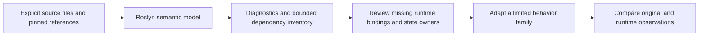

# Offline source dependency analysis

`tools/vanilla.py source analyze` builds an isolated Roslyn probe and inventories the selected original C# methods. It identifies symbols, calls and represented state accesses to reduce the manual search needed before adapting NPC, world-generation or player behavior. It does not translate methods, execute the game or establish Terraria compatibility. Shipping projects do not reference the analyzer or Roslyn.

The original `TerrariaServer.exe` `1.4.5.8` and its decompiled source remain local reference inputs. The report contains identities, diagnostics and analysis facts; it does not emit copied method bodies. The repository's independent-reimplementation rule still applies to production changes.

A separate experimental `source adapt-scalar` operation now **automatically generates** a bounded candidate from the bound source method. Unlike `analyze`, it compiles the generated candidate and a proper original-method carrier, and explicitly executes the untouched official assembly for differential checks. It writes original-derived bodies only below this worktree's `.cache`; nothing is included in shipping projects automatically. The two operations have separate acceptance scopes.

The [main requalification](../verification/semantic-scalar-candidate-main-20261028.json) repeats the actual-original checks on the main checkout. The [combined integration record](../verification/ground-critter-semantic-main-union-20261029.json) keeps this development-tool proof separate from the NPC runtime acceptance while verifying both source sets after merge.

The [schema 2 main receipt](../verification/semantic-typed-weapon-main-20261029.json) separately qualifies the later read-only weapon-stat adaptation. Detailed observations and generated bodies remain in the local cache.



## Request and command

Run from the repository root with Python and the repository's .NET SDK. Provide a JSON request with explicit sources and exact method identities. For example, save the following as a local cache request and replace the two input paths with your local original source tree and admitted Linux server assembly:

```json
{
  "schemaVersion": 1,
  "sourceRoot": "C:/local/Terraria1458/decompiled",
  "assembly": "C:/local/Terraria1458/Linux/TerrariaServer.exe",
  "sources": ["Terraria/Utils.cs"],
  "entries": [
    {
      "path": "Terraria/Utils.cs",
      "type": "Terraria.Utils",
      "method": "GetLerpValue",
      "parameterTypes": ["float", "float", "float", "bool"]
    }
  ],
  "maxDepth": 1,
  "maxMethods": 32
}
```

```powershell
py -3 tools/vanilla.py source analyze --request .cache/source-analysis/request.json --output-dir .cache/source-analysis/run01
```

Use a new output directory for every run. Sources are explicit relative `.cs` paths under `sourceRoot`; each entry must name an included source file. Unknown request fields, duplicate or escaping source paths, malformed entries and invalid bounds are rejected. At most 256 sources are admitted, with $32\,\mathrm{MiB}$ per file and $128\,\mathrm{MiB}$ in total. `maxDepth` accepts `0` through `4` and defaults to `1`; `maxMethods` accepts `1` through `128` and defaults to `32`. Entry type, method and parameter types must identify exactly one method; C# aliases are normalized against Roslyn's canonical C# type display.

## Reading the evidence

The new directory retains `request.json`, `input-before.json`, `build.log`, `probe.log`, `observation.json` and `result.json`. The runner pins source/reference inputs and the fresh backend DLL/Roslyn closure before and after analysis. Retain these artifacts together.

`accepted` qualifies only the explicitly visited method-body inventory: entries must be unique, visited method spans must have no compiler errors, invalid operations or unresolved/dynamic calls, and neither traversal budget may be cut short. Input and executed-backend guards must also pass. The global compilation error count is reported separately; acceptance does not establish that the entire original project compiles.

A resolved metadata-only callee is an opaque frontier. It does not alone reject the inventory, but it makes `sourceClosureComplete=false`; the analyzer does not interpret it as pure or claim its transitive effects. Review these frontiers before using the inventory to plan an adaptation. Reaching the depth or method budget rejects complete inventory acceptance rather than proving that the remaining dependencies are harmless.

The initial feasibility experiment found a real example of this distinction: `NPC.HaveDryadDoStardewAnimation` had resolved calls and zero `Invalid` operation nodes, yet still had a source/metadata NPC identity conflict and a missing embedded `ReLogic` reference. Neither the resolved-call count nor the operation count was sufficient to accept that semantic model. The [feasibility record](../verification/roslyn-feasibility-20261028.json) retains the exact scope of that earlier experiment.

Compiler errors, unresolved calls and dependency-budget cutoffs remain visible instead of being replaced with guessed defaults. A source file or reference that changes during a run invalidates the run's provenance.

## Applying the inventory

Review the inventory against existing runtime owners. Examples include original `Main.npc` accesses versus the runtime NPC store, projectile creation versus the existing publication transaction, `StructureMap` versus the generation workspace, and `Main.rand`/`genRand` versus the admitted RNG owner. These are adaptation questions, not automatic equivalences or permission to create parallel state stores.

Start with a limited family whose dependencies can be represented explicitly. Preserve the order of state mutations, RNG calls and publication boundaries in the independent implementation. Then exercise the existing [NPC](npc-source-tools.md), [worldgen](worldgen-source-tools.md) or [gameplay](gameplay-source-tools.md) differential workflow on matching original/runtime inputs. Compare the stated state and event projection and full RNG, and retain a negative control capable of detecting the intended mistake.

The inventory does not prove alias relationships, virtual or delegate targets, static initialization effects, dynamic execution order or complete transitive effects outside its stated boundary. Successful analysis does not qualify an adaptation, advance a roadmap parity status or measure a development speedup. Every production change retains its ordinary build, regression, ownership and NativeAOT requirements.

Ref locals and returns, unsafe pointer accesses, properties, arrays, and implicit `using`/iterator/await/lock protocols retain explicit uncertainty frontiers. Deconstruction field targets are recorded as writes. Source offsets give lexical positions rather than an execution trace.

## Checking the analyzer

```powershell
py -3 -m unittest discover -s tools/ci -p test_vanilla_source_analysis.py
dotnet build tools/vanilla_data/SourceProbe/SourceProbe.csproj -c Release -warnaserror
dotnet tools/vanilla_data/SourceProbe/bin/Release/net11.0/SourceProbe.dll --self-test .cache/source-analysis/checks01.json
```

Create the cache parent directory first and use a new result filename. The executable checks use author-written synthetic C# and core-library metadata; they need no original game files. They cover overloads, recursion, mutation forms, opaque effects and genuine traversal/error refusals. The Python checks exercise request bounds, exact entry/provenance binding, input/output drift and backend failures. Neither set is a gameplay parity test.

## Experimental automatic scalar adaptation

This is an executable prototype for instance `void` helpers with explicitly mapped mutable `int`/`bool` fields and by-value `int`/`bool` arguments. It resolves exact Roslyn symbols, checks the complete bound method against a small operation whitelist, and transforms those field references into a generated typed state passed by `ref`. Parameter shadowing remains distinct. Fields must be observed and written; mapping two source fields to one target is refused. Attributes and their implicit protocols, properties, other receivers, globals, calls, arrays, locals, loops, exceptions, numeric conversions, ref/in/out arguments and unowned effects are rejected. Resolved metadata alone never grants a translation capability.

The request nests a regular analysis request and adds exact field mappings and explicit differential cases. Set `maxDepth=0` and `maxMethods=1`. Replace the clearly local example paths:

```json
{
  "schemaVersion": 1,
  "analysis": {
    "schemaVersion": 1,
    "sourceRoot": "C:/local/Terraria1458/decompiled",
    "assembly": "C:/local/Terraria1458/Linux/TerrariaServer.exe",
    "sources": ["Terraria/NPC.cs"],
    "entries": [{"path": "Terraria/NPC.cs", "type": "Terraria.NPC",
                 "method": "EncourageDespawn", "parameterTypes": ["int"]}],
    "maxDepth": 0,
    "maxMethods": 1
  },
  "fields": [
    {"symbol": "Terraria.NPC.timeLeft", "target": "RemainingTicks", "type": "int"},
    {"symbol": "Terraria.NPC.despawnEncouraged", "target": "ExpiryRequested", "type": "bool"}
  ],
  "cases": [
    {"state": {"RemainingTicks": 750, "ExpiryRequested": false},
     "arguments": [10], "rngSeed": 1458}
  ]
}
```

```powershell
py -3 tools/vanilla.py source adapt-scalar --request .cache/scalar/request.json --output-dir .cache/scalar/run01
```

The new cache directory also contains `candidate.cs`, `original-carrier.cs`, their compiled assembly and one compiled write-omission mutant per state field. The unchanged original method body is compiled only inside a cache-only proper carrier; the entire original NPC source unit is not claimed to compile. The original NPC unit's global diagnostics are reported separately from the qualified method span. Both mapped output fields are compared against the carrier and the **actual untouched official method**, with full original RNG cursor/56-slot checkpoints. Every write-omission control must produce a state difference; runner exceptions do not count as detected mutants. Each input, backend/Roslyn closure and emitted artifact is pinned.

The [prototype proof](../verification/semantic-scalar-candidate-20261028.json) qualifies automatic generation of real `NPC.EncourageDespawn(int)` and `DiscourageDespawn(int)`: each uses 1,014 signed-int edge/boolean/three-seed cases, with two identical repeats. The generated source, compiled candidate and complete observed state/RNG repeat identically. Omitting the time write differs in 468 cases; omitting the flag write differs in 507, for each helper. These are two small NPC helpers, not automatic AI3/AI7 or world-generation conversion. There is no measured development-speed claim or new runtime admission.

The useful next step is a source-selected cohort of scalar leaf helpers with explicit return/state contracts, then separately qualified arithmetic conversions and owned API/RNG calls. Arrays, aliases, collision and publication transactions need their actual owners before broader AI can be generated. Generated candidates remain review inputs under the repository's independent production implementation rule.

Tool-only checks:

```powershell
py -3 -m unittest discover -s tools/ci -p test_vanilla_scalar_candidate.py
dotnet tools/vanilla_data/SourceProbe/bin/Release/net11.0/SourceProbe.dll --candidate-self-test .cache/scalar/checks01.json
```

## Read-only scalar results, schema 2

`adapt-scalar` also accepts a separate schema2 contract for `int`, `bool` and finite `float` results. Schema1 keeps its original write-only capability rules. Schema2 maps exact own-instance fields and fields of one explicit class parameter as **read-only** inputs. Each mapping adds `receiver` (`this` or the original parameter name) and `access: "readOnly"`; the request adds `returnType`. Every input remains mandatory. The generated candidate receives a flattened typed state by `in`; the class argument disappears only after every use is proved to be a permitted field read.

For example, the `GetWeaponCrit(Terraria.Item)` request uses this shape inside the existing analysis envelope:

```json
{
  "schemaVersion": 2,
  "returnType": "int",
  "fields": [
    {"symbol":"Terraria.Player.meleeCrit","target":"MeleeCrit","type":"int","receiver":"this","access":"readOnly"},
    {"symbol":"Terraria.Player.rangedCrit","target":"RangedCrit","type":"int","receiver":"this","access":"readOnly"},
    {"symbol":"Terraria.Player.magicCrit","target":"MagicCrit","type":"int","receiver":"this","access":"readOnly"},
    {"symbol":"Terraria.Item.melee","target":"Melee","type":"bool","receiver":"sItem","access":"readOnly"},
    {"symbol":"Terraria.Item.ranged","target":"Ranged","type":"bool","receiver":"sItem","access":"readOnly"},
    {"symbol":"Terraria.Item.magic","target":"Magic","type":"bool","receiver":"sItem","access":"readOnly"}
  ],
  "cases": [{"state":{"MeleeCrit":17,"RangedCrit":29,"MagicCrit":41,"Melee":true,"Ranged":true,"Magic":true},
             "arguments":[{"receiver":"sItem"}],"rngSeed":1458}]
}
```

The fragment omits `analysis`: supply the same required envelope as above, selecting `Terraria/Player.cs`, `Terraria.Player.GetWeaponCrit` and parameter type `Terraria.Item`. All float inputs and results use `{"bits":2147483648}`-style uint32 bit records; that example is negative zero. Subnormals and finite boundaries are preserved. NaN, infinity, numeric casts/widening and nonfinite results are refused in this bounded mode. Supported statements include scalar locals, by-value scalar parameter assignments, typed returns and checked-for-whitelist add/subtract/multiply operations. Properties, globals, API/RNG calls, arrays, reference aliases, unsafe blocks and actor-field writes remain rejected.

The [typed weapon evidence](../verification/semantic-typed-weapon-candidate-20261029.json) covers automatically generated `Player.GetWeaponKnockback` and `GetWeaponCrit`, actual unchanged official calls, a proper compiled method-body carrier, raw result bits, unchanged named input facts and full 56-slot RNG. Original Player/Item fingerprints cover every direct field, recursively represented value types and array elements; other references retain identity, without claiming their transitive internals. Automatically generated omitted-modifier and category-precedence mutants must change results with zero execution errors. Constructed Item flag profiles and separate `Item.SetDefaults` category readbacks are explicit test inputs, not valid-world or equipment admission.

No production behavior changes here. Glove, knockback-buff, stealth and other fact producers still require their own retained owners before these candidates could be bound to gameplay. `GetWeaponDamageMultiplier`/`GetWeaponDamage` remain deferred because their property and classification-table closure is not admitted. Generated original-derived bodies stay exclusively in `.cache`.

```powershell
py -3 -m unittest tools.ci.test_vanilla_source_analysis tools.ci.test_vanilla_scalar_candidate tools.ci.test_vanilla_scalar_values
dotnet tools/vanilla_data/SourceProbe/bin/Release/net11.0/SourceProbe.dll --value-candidate-self-test .cache/scalar/value-checks01.json
```
