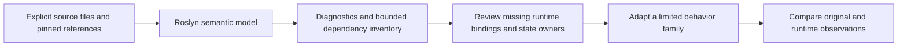

# Offline source dependency analysis

`tools/vanilla.py source analyze` builds an isolated Roslyn probe and inventories the selected original C# methods. It identifies symbols, calls and represented state accesses to reduce the manual search needed before adapting NPC, world-generation or player behavior. It does not translate methods, execute the game or establish Terraria compatibility. Shipping projects do not reference the analyzer or Roslyn.

The original `TerrariaServer.exe` `1.4.5.8` and its decompiled source remain local reference inputs. The report contains identities, diagnostics and analysis facts; it does not emit copied method bodies. The repository's independent-reimplementation rule still applies to production changes.



## Request and command

Run from the repository root with Python and the repository's .NET SDK. Provide a JSON request with explicit sources and exact method identities. For example, save the following as a local cache request and replace the two input paths with your local original source tree and admitted Linux server assembly:

```json
{
  "schemaVersion": 1,
  "sourceRoot": "C:/local/Terraria1458/decompiled",
  "assembly": "C:/local/Terraria1458/Linux/TerrariaServer.exe",
  "sources": ["Terraria/Utils.cs"],
  "entries": [
    {
      "path": "Terraria/Utils.cs",
      "type": "Terraria.Utils",
      "method": "GetLerpValue",
      "parameterTypes": ["float", "float", "float", "bool"]
    }
  ],
  "maxDepth": 1,
  "maxMethods": 32
}
```

```powershell
py -3 tools/vanilla.py source analyze --request .cache/source-analysis/request.json --output-dir .cache/source-analysis/run01
```

Use a new output directory for every run. Sources are explicit relative `.cs` paths under `sourceRoot`; each entry must name an included source file. Unknown request fields, duplicate or escaping source paths, malformed entries and invalid bounds are rejected. At most 256 sources are admitted, with $32\,\mathrm{MiB}$ per file and $128\,\mathrm{MiB}$ in total. `maxDepth` accepts `0` through `4` and defaults to `1`; `maxMethods` accepts `1` through `128` and defaults to `32`. Entry type, method and parameter types must identify exactly one method; C# aliases are normalized against Roslyn's canonical C# type display.

## Reading the evidence

The new directory retains `request.json`, `input-before.json`, `build.log`, `probe.log`, `observation.json` and `result.json`. The runner pins source/reference inputs and the fresh backend DLL/Roslyn closure before and after analysis. Retain these artifacts together.

`accepted` qualifies only the explicitly visited method-body inventory: entries must be unique, visited method spans must have no compiler errors, invalid operations or unresolved/dynamic calls, and neither traversal budget may be cut short. Input and executed-backend guards must also pass. The global compilation error count is reported separately; acceptance does not establish that the entire original project compiles.

A resolved metadata-only callee is an opaque frontier. It does not alone reject the inventory, but it makes `sourceClosureComplete=false`; the analyzer does not interpret it as pure or claim its transitive effects. Review these frontiers before using the inventory to plan an adaptation. Reaching the depth or method budget rejects complete inventory acceptance rather than proving that the remaining dependencies are harmless.

The initial feasibility experiment found a real example of this distinction: `NPC.HaveDryadDoStardewAnimation` had resolved calls and zero `Invalid` operation nodes, yet still had a source/metadata NPC identity conflict and a missing embedded `ReLogic` reference. Neither the resolved-call count nor the operation count was sufficient to accept that semantic model. The [feasibility record](../verification/roslyn-feasibility-20261028.json) retains the exact scope of that earlier experiment.

Compiler errors, unresolved calls and dependency-budget cutoffs remain visible instead of being replaced with guessed defaults. A source file or reference that changes during a run invalidates the run's provenance.

## Applying the inventory

Review the inventory against existing runtime owners. Examples include original `Main.npc` accesses versus the runtime NPC store, projectile creation versus the existing publication transaction, `StructureMap` versus the generation workspace, and `Main.rand`/`genRand` versus the admitted RNG owner. These are adaptation questions, not automatic equivalences or permission to create parallel state stores.

Start with a limited family whose dependencies can be represented explicitly. Preserve the order of state mutations, RNG calls and publication boundaries in the independent implementation. Then exercise the existing [NPC](npc-source-tools.md), [worldgen](worldgen-source-tools.md) or [gameplay](gameplay-source-tools.md) differential workflow on matching original/runtime inputs. Compare the stated state and event projection and full RNG, and retain a negative control capable of detecting the intended mistake.

The inventory does not prove alias relationships, virtual or delegate targets, static initialization effects, dynamic execution order or complete transitive effects outside its stated boundary. Successful analysis does not qualify an adaptation, advance a roadmap parity status or measure a development speedup. Every production change retains its ordinary build, regression, ownership and NativeAOT requirements.

Ref locals and returns, unsafe pointer accesses, properties, arrays, and implicit `using`/iterator/await/lock protocols retain explicit uncertainty frontiers. Deconstruction field targets are recorded as writes. Source offsets give lexical positions rather than an execution trace.

## Checking the analyzer

```powershell
py -3 -m unittest discover -s tools/ci -p test_vanilla_source_analysis.py
dotnet build tools/vanilla_data/SourceProbe/SourceProbe.csproj -c Release -warnaserror
dotnet tools/vanilla_data/SourceProbe/bin/Release/net11.0/SourceProbe.dll --self-test .cache/source-analysis/checks01.json
```

Create the cache parent directory first and use a new result filename. The executable checks use author-written synthetic C# and core-library metadata; they need no original game files. They cover overloads, recursion, mutation forms, opaque effects and genuine traversal/error refusals. The Python checks exercise request bounds, exact entry/provenance binding, input/output drift and backend failures. Neither set is a gameplay parity test.
