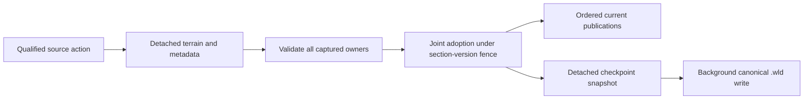

# Exceptional tool furniture in Terraria 1.4.5.8

This component extends the [tool authority](tool-use-authority-1458.md) for legacy mannequins 128/269, legacy weapon rack 334, display doll 470, weapon rack 471, hat rack 475 and minecart track 314. Component evidence is separate from the combined shipping gates.

## Source action and ownership

The existing selected tool phase, reach, building permission, local clocks, full 219 inventory image, player generation and 501-entry mining cache remain the admission boundary. Reports 17/125 do not grant damage or authorize a raw clear. A completed 470/475 pick emits action 20 without a CLIENT local clear; the SERVER result includes the origin. Track pounding uses action 15. Pose 121 context 2 authenticates the player and carries entityID and pose, without a clicked tile coordinate. The authority tries the six current doll cells and adopts one result only after complete private and public effects converge. Prior histories that do not converge stay refused; no guessed cursor or extra journal is introduced.

Legacy 128/269 armor and 334 weapon extraction precede dust and the ordinary failed-hit branch. A populated 471 extracts one item, clears that stored payload and returns with tiles intact. A later completed break removes the empty object. Failed doll/hat hits return before dust/framing. Whole-object checks retain their source footprints, floor/wall predicates, recursive call order and the shared source `destroyObject` guard across represented object families. The two caller RNG domains remain distinct: CLIENT sentinel-item construction can still draw local RNG, while SERVER allocation uses the existing world stream and preview. Manual 17 uses the authenticated source player's default item-assignment scope.

## Canonical metadata, sections and persistence

Pose and breakability checks for modern dolls and hat racks use the source left-cell raw vertical frame. Their framing checks use a separate modulo-height anchor. Five independently captured edge cases distinguish these rules; they do not establish general malformed-world support.

`WorldTileStore.RuntimeTileEntities` owns the already decoded `WorldTileEntity` representation. Fixed lookup indexes describe that same table; they are not another stock ledger. Payload arrays are copied on import and snapshot. Unknown standalone metadata does not mean empty furniture. This component removes rows, clears a rack item or changes a pose; it admits no client equipment/content writes.

Metadata-only changes advance the concrete anchor section revision. The same odd/even section fence covers metadata and terrain adoption; metadata work and read bounds are admitted before any participant commits. Packet 10 uses current canonical payloads, and old section snapshots become stale. Checkpoint snapshots copy tile entities before background serialization; the existing typed encoder and atomic checkpoint workflow write the replacement section. Later owner changes cannot alter an accepted save snapshot. Prepared caches continue to rebuild from the canonical saved world; they are not the metadata authority.

## Evidence and limits

Both official editions and independent repeats capture 400 direct world/pose rows,4608 track transitions and 66 private pound-call rows per run. Source tables include initialized armor mappings, all 6196 no-gravity entries and track topology metadata. The caller-v 4 addendum corrects a capture alias: before-call mining order is cloned rather than retaining a live array. Only that preimage differs from v 3; other values and old artifacts are preserved.

The grouped normal proof checks exact represented source values/RNG, all 501 mining entries, literal pose/track wire, real State/socket actions for the seven families, unchanged inventory/private balances, adoption before item observers, metadata currentness, section staleness and canonical save/reload. These are bounded source/component checks, not wholeMain or official-client acceptance. Non-important cosmetic stone frames are outside the persistent tile representation.

Furniture placement, GUI item/equipment transactions, general tile-entity lifecycle, invalid imported item/prefix normalization and track riding remain separate work. Imported contents are trusted canonical world data; the new reports cannot create stock. A through-track must have a source-framed incoming topology. Unreported or non-convergent cursor histories are not reconstructed. The existing 4096-query/change and 64-section tool-overlay policy remains a refusal bound, not a vanilla constant or performance claim. FullVanillaAiParity and Linux NativeAOT acceptance are not implied.
