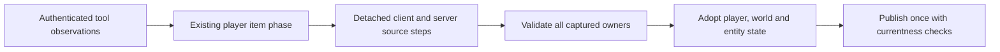

# Tool use authority in Terraria 1.4.5.8

The source-backed catalog covers 106 tool items. Runtime paths cover ordinary mining, wall hits, combined tools, the shovel, 23 channelled projectile producers and returning axe `1052`. World interaction support has the explicit boundaries below.

## Input, time and ownership

Authenticated commands enter the existing player item phase. A bounded observation cohort records the source sequence; it grants no damage, inventory credit or extra simulation update. The complete action must agree with selected item/prefix, reach, building permission, hit cache, clock, inventory, player generation and the captured world.

The local player and dedicated-world random streams retain separate ownership. Source draws remain ordered, including argument evaluation for suppressed effects. Refused preparations leave live RNG and world state unchanged. Clock or input changes invalidate prior preparations; a known owned transition can preserve an already-current phase marker.

| Packet | Tool meaning |
|---|---|
| `17` | Source tile/wall/shape observation matched against the complete action |
| `125` | This PickTile call's visual damage, with authenticated player identity |
| `27` | A qualified producer observation; source birth/trust is adopted separately |
| `34` | Correlated container removal after its source failed-hit observation |
| `79` | Item5295's correlated sapling placement |
| `141` | Lucy visual relay, with source-qualified local RNG when correlated |
| `16`, `117` | Existing health baseline and tool self-hurt chronology |

An altar's source sequence contains the before-Hurt health baseline. For example, baseline `100` then Hurt `50` yields life `50`. A baseline `50` requires the subsequent Hurt `25`; it is not treated as an already-applied afterimage. An unchanged acknowledgement preserves the pending input, and publications use the adopted current health.

## World actions and projectiles

Pick/wall/shovel steps share the evolving detached world and source-ordered hit cache. Container permission captures the actual stored contents and open state. Recipient mining caches clear through the common successful-kill publication boundary.

Item `5295` keeps the successful tree cut pending until its matching `79`. Client and server each run their own CanPlace choice when invoked. The action creates the source two-cell sapling without spending an acorn. Publication follows world effects, consumes its once marker and checks the accepted footprint after reentrant observers.

Lucy `141` is relayed in its source position before the following successful `17`. Idle/storage/throw visuals remain ordinary cosmetic messages. Tree/cactus qualification keeps the source message index and does not invent missing UI cooldown history.

Held tools and the returning axe retain their source AI, wet movement and physical/collision dimensions. World bombs `28`/`75` use their source-owned world origin. Bomb `28` has a $14\times14\,\mathrm{px}$ collision box inside its $22\times22\,\mathrm{px}$ physical body; natural dedicated births `28`/`75` retain `TimeLeft=180`. Bounce draws execute at the source impact boundary. NPC contact, player Hurt, terrain effects and saved-origin `29` preserve their respective owners and ordering. Unknown Journey damage context, mounted human Hurt and intersecting server-player Hurt remain fenced.

Falling blocks retain constructor27 and the source post-constructor motion separately. The legacy wake queue and recursive source framing use the same coupled preparation. Callback observers see adopted tiles, actor state, trust and registration. A shared publication guard prevents a superseded outer birth from overwriting the current replication key or late-join baseline, including same-generation edits and slot replacement.

## Validation and remaining coverage

Hammer rotation for `137/424/442` uses the source one-cell client packet `20`, followed by server range framing. Client liquid claims are rejected; the server retains its own liquid and publishes the accepted server image. The publication consumes its once marker before callbacks and checks the full surrounding footprint. Source framing for Water Candle `49` and Switch `136` has a separate qualified caller and anchor rules. These additions preserve the generic frame-important refusal. The isolated furniture and single-cell proofs include actual socket ingress; the latest combined single-cell composition still awaits its joint checks.

Owned selected consumables retain the local tool-clock lineage when their exact known input matches the consumer's prepared input. The already executed transition includes the visual RNG tail; it is not evaluated twice. `ToolTime` is sampled before potion, buff and permanent effects and last-stack consumption, as in source `ItemCheck_OwnerOnlyCode`. Existing original food snapshots now also check this intermediate field on local rows; their strengthened normal Fact covers 15,200 source phases.

An unsupported local operation does not discard the independent dedicated-player ItemCheck or its paid buffs and mana. Its local clocks remain unknown and cannot authorize a tool action or projectile birth. Active block/wall placement still needs an owned local clock participant before the placement-to-tool world-action transition is accepted; remote animation checks alone do not prove that transition.

The normal grouped proofs include source tool metadata/clocks/power, player health/selection/Lucy, replant custody/reentry, 480 projectile terrain episodes, 24 plant-cut consumers, 220 configured falling episodes and 176 natural-origin episodes. Independent original numeric captures preserve exact frames, cell state and RNG; Windows execution of both source editions is distinct from Linux runtime acceptance. Causal omission controls cover replant, bomb draws/collision/lifetime and stale birth publication.

Remaining work includes rare bait births and their complete NPC targeting context, display-doll/hat-rack state, tracks, other special furniture actions, additional frame-important objects and progression tiles. General inventory/ammo/equipment authority and complete vanilla AI remain broader roadmap work. Linux NativeAOT is still unverified locally.

See [gameplay scope](gameplay.md), [world progression](world-progression-events.md) and the [roadmap](../roadmap.md).
