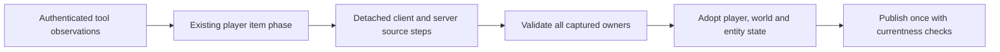

# Tool use authority in Terraria 1.4.5.8

[Local weapon and tool continuity](local-weapon-tool-continuity-1458.md) documents the scoped local-clock, ordered mana/refill and Gem cohort component; metadata coverage and final shipping gates remain separate.

The source-backed catalog covers 106 tool items. Runtime paths cover ordinary mining, wall hits, combined tools, the shovel, 23 channelled projectile producers and returning axe `1052`. World interaction support has the explicit boundaries below.

## Input, time and ownership

Authenticated commands enter the existing player item phase. A bounded observation cohort records the source sequence; it grants no damage, inventory credit or extra simulation update. The complete action must agree with selected item/prefix, reach, building permission, hit cache, clock, inventory, player generation and the captured world.

For a qualified local tool phase, an equipped tile-range accessory (`2215`, `3061` or `5126`) increases mining reach by $3\,\text{tiles}$ horizontally and $2\,\text{tiles}$ vertically, once even if several are equipped. Vanity or empty slots grant no reach. The whole equipment phase must still be admitted before this source rule can authorize an edit; this range rule alone does not qualify a character's other accessories or placement speed.

The combat equipment catalog can project the functional `-=GOOD=-` accessory set's bounded combat fields, including Shackle defense and Terraspark protection when its slot is usable. In ordinary Journey difficulty, slots `67` and `68` do not grant the Terraspark and Toolbelt effects. A narrowly scoped network player phase admits the first observed equipment census while a Journey player stands still on solid ground with a selected tool or represented placement item. It refuses movement, jumping, flight, mounts and changed equipment identities; wing and boot movement remain outside this phase. This admission has a focused synthetic regression, but an official-client block edit has not yet been observed.

An unsupported **first** player tick retires the shared `UpdatePlayers` RNG ownership and clears the player's item and physics phases for the session. Selecting the pickaxe afterward cannot restart the stationary subset. In a second official-client probe, the selected pickaxe sent 31 mining reports; all were rejected because no item phase was retained. Initial selected-item, equipment and movement admission must be completed before this character can mine or place blocks.

The existing effective-slot selector also captures whether a usable functional accessory supplies tile speed, wall speed or automatic painting. For Architect Gizmo Pack `3061`, all three flags are present in slot `66`; vanity and difficulty-locked equipment slots supply none through this selector. Terraria also scans carried inventory slots `0`–`57` for mechanical accessory effects, which this equipment result does not represent. For equipment admitted by the whole player phase, the raw speed input follows the selected non-torch tile rule and feeds the existing permanent-booster and reciprocal-speed transition. Automatic paint and its inventory source remain unmodeled.

The owned player phase recognizes the character's social head `4955`, body `3267` and legs `844` in their matching vanity slots. It also recognizes the phase-neutral social accessories `4771`, `1921`, `1323` and `554` in their observed slots. The observed horn `4563` and darkness `3581` in social slots `73` and `75` set display flags only. These pieces grant no functional combat or tool benefit there. The exact functional wings and social wing `4746` participate only in the stationary grounded profile above.

The observed `-=GOOD=-` dye slots `79`–`88`, `96` and `98` are admitted by exact slot/item identity with no prefix. Terraria's `Player.UpdateDyes` reads them into visual shader fields, so they do not grant tool or movement authority. Other dye identities have not been qualified by this census.

The observed cart `3353`, mount `4444` and hook `939` are also recognized only in their matching misc slots while they are stored there. Active mount, cart and grapple movement remain subject to their separate state and physics checks; recognition of these items does not enable those actions.

The local player and dedicated-world random streams retain separate ownership. Source draws remain ordered, including argument evaluation for suppressed effects. Refused preparations leave live RNG and world state unchanged. Clock or input changes invalidate prior preparations; a known owned transition can preserve an already-current phase marker.

| Packet | Tool meaning |
|---|---|
| `17` | Source tile/wall/shape observation matched against the complete action |
| `125` | This PickTile call's visual damage, with authenticated player identity |
| `27` | A qualified producer observation; source birth/trust is adopted separately |
| `34` | Correlated container removal after its source failed-hit observation |
| `79` | Item5295's correlated sapling placement |
| `141` | Lucy visual relay, with source-qualified local RNG when correlated |
| `16`, `117` | Existing health baseline and tool self-hurt chronology |

An altar's source sequence contains the before-Hurt health baseline. For example, baseline `100` then Hurt `50` yields life `50`. A baseline `50` requires the subsequent Hurt `25`; it is not treated as an already-applied afterimage. An unchanged acknowledgement preserves the pending input, and publications use the adopted current health.

## World actions and projectiles

Pick/wall/shovel steps share the evolving detached world and source-ordered hit cache. Container permission captures the actual stored contents and open state. Recipient mining caches clear through the common successful-kill publication boundary.

Item `5295` keeps the successful tree cut pending until its matching `79`. Client and server each run their own CanPlace choice when invoked. The action creates the source two-cell sapling without spending an acorn. Publication follows world effects, consumes its once marker and checks the accepted footprint after reentrant observers.

Lucy `141` is relayed in its source position before the following successful `17`. Idle/storage/throw visuals remain ordinary cosmetic messages. Tree/cactus qualification keeps the source message index and does not invent missing UI cooldown history.

Held tools and the returning axe retain their source AI, wet movement and physical/collision dimensions. World bombs `28`/`75` use their source-owned world origin. Bomb `28` has a $14\times14\,\mathrm{px}$ collision box inside its $22\times22\,\mathrm{px}$ physical body; natural dedicated births `28`/`75` retain `TimeLeft=180`. Bounce draws execute at the source impact boundary. NPC contact, player Hurt, terrain effects and saved-origin `29` preserve their respective owners and ordering. Unknown Journey damage context, mounted human Hurt and intersecting server-player Hurt remain fenced.

Falling blocks retain constructor27 and the source post-constructor motion separately. The legacy wake queue and recursive source framing use the same coupled preparation. Callback observers see adopted tiles, actor state, trust and registration. A shared publication guard prevents a superseded outer birth from overwriting the current replication key or late-join baseline, including same-generation edits and slot replacement.

## Validation and remaining coverage

Hammer rotation for `137/424/442` uses the source one-cell client packet `20`, followed by server range framing. Client liquid claims are rejected; the server retains its own liquid and publishes the accepted server image. The publication consumes its once marker before callbacks and checks the full surrounding footprint. Source framing for Water Candle `49` and Switch `136` has a separate qualified caller and anchor rules. These additions preserve the generic frame-important refusal. The furniture and single-cell proofs include actual socket ingress and the combined tools checkpoint below.

Generic shape changes and failed mining retain the center reset sample for `385/446/447/448` as well. Their source cosmetic branch reaches `Framing.SelfFrame8Way`, which consumes one `Next(0,3)` sample when reset is requested. Neighbor-only framing does not request that reset. The correction preserves both role RNG streams without admitting new placement items.

Owned selected consumables retain the local tool-clock lineage when their exact known input matches the consumer's prepared input. The already executed transition includes the visual RNG tail; it is not evaluated twice. `ToolTime` is sampled before potion, buff and permanent effects and last-stack consumption, as in source `ItemCheck_OwnerOnlyCode`. Existing original food snapshots now also check this intermediate field on local rows; their strengthened normal Fact covers 15,200 source phases.

An unsupported local operation does not discard the independent dedicated-player ItemCheck or its paid buffs and mana. Its local clocks remain unknown and cannot authorize a tool action or projectile birth. Represented paid block/wall placement and the 41 retained weapon definitions now have owned local clock participants for subsequent tool actions. Their exact scope is described in [placement continuity](local-placement-tool-continuity-1458.md) and [weapon continuity](local-weapon-tool-continuity-1458.md); remote animation checks alone do not prove that transition.

The normal grouped proofs include source tool metadata/clocks/power, player health/selection/Lucy, replant custody/reentry, 480 projectile terrain episodes, 24 plant-cut consumers, 220 configured falling episodes and 176 natural-origin episodes. Independent original numeric captures preserve exact frames, cell state and RNG; Windows execution of both source editions is distinct from Linux runtime acceptance. Causal omission controls cover replant, bomb draws/collision/lifetime and stale birth publication.

The combined tools/Larva/events/NPC checkpoint passes Release with warnings as errors, the fast tier (25,259 /25,260) and the unfiltered full suite (1,566,672 /1,566,673 cases); both suites have zero failures/errors and the same known liquid skip. All 5,189 methods are selected in full, with 3,848 source/config/fixture inputs and 158 executed DLLs unchanged. Fresh Windows NativeAOT and five server smokes pass, as do actual Release/Native TCP82/49/129, two-client chat and 72 signed effect checks per host. Both hosts are stopped. These checks do not establish official GUI-client or whole `Main.Update` parity.

Remaining work includes broader weapon/placement families and equipment contexts, rare bait births and their complete NPC targeting context, furniture placement and additional interactions, track riding, other frame-important objects and progression tiles. General inventory/ammo/equipment authority and complete vanilla AI remain broader roadmap work. Linux NativeAOT is still unverified locally.

See [gameplay scope](gameplay.md), [world progression](world-progression-events.md) and the [roadmap](../roadmap.md).

## Exceptional furniture and track tools

The source-qualified tool component adds legacy mannequins128/269, racks334/471, display doll470, hat rack475 and track314, including pose121, action20 results and canonical mutable tile-entity snapshots. See [ownership, evidence and remaining limits](tool-furniture-exceptions-1458.md). Existing clock/CC/placement authority remains unchanged.
