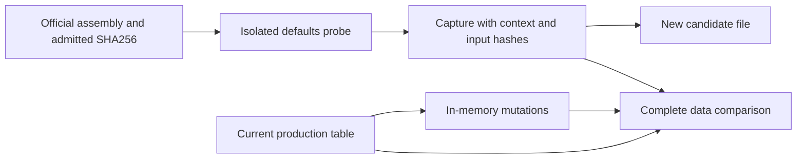

# Official data tools

`tools/vanilla.py` gives the existing NPC metadata and item-placement tables one reproducible offline workflow. It invokes the pinned official assembly in a developer-only CoreCLR process, checks every represented row, emits review candidates and tests the checker with corrupted data. It adds no production dependency or runtime loader.

The same entry point also provides the [worldgen source catalog and bounded Reset replay](worldgen-source-tools.md).



## Commands

Run from the repository root with Python 3.11 or newer. Capture also requires the repository's .NET SDK. The official executable remains local and is never committed. Use the Linux server assembly identified by `tools/vanilla_data/reference.json`; its assembly edition does not establish which OS executes the probe.

```sh
python tools/vanilla.py capture --assembly /path/to/Linux/TerrariaServer.exe --output .cache/vanilla-data/capture.json
python tools/vanilla.py check all --reference .cache/vanilla-data/capture.json --report .cache/vanilla-data/check.json
python tools/vanilla.py mutate all --reference .cache/vanilla-data/capture.json --report .cache/vanilla-data/mutations.json
python tools/vanilla.py verify all --reference .cache/vanilla-data/capture.json --report .cache/vanilla-data/verification.json
python tools/vanilla.py emit npc-defaults --reference .cache/vanilla-data/capture.json --output .cache/vanilla-data/NpcCandidate.cs
python tools/vanilla.py check npc-defaults --reference .cache/vanilla-data/capture.json --actual .cache/vanilla-data/NpcCandidate.cs
python tools/vanilla.py emit item-placement --reference .cache/vanilla-data/capture.json --output .cache/vanilla-data/ItemCandidate.cs
```

On Windows, `py -3` can replace `python`. `--repo` selects the checkout whose tables are checked or used as generation templates. `--actual` selects one candidate file and therefore requires one dataset. `verify` combines the complete comparison with mutation checks; if its baseline is red it does not count mutants as acceptance. Outputs are new files: reruns require fresh output/report names. Check and mutation commands never write production files.

Exit `0` means the requested check passed, `1` means differences or surviving mutants, and `2` means invalid inputs, changed provenance, build/capture failure or a refused output. A detailed JSON report identifies missing/extra identities and individual fields. A malformed or truncated array is a failure rather than an empty successful comparison.

## Represented data

| Dataset | Official input | Existing table and checked scope |
|---|---|---|
| `npc-defaults` | Fresh `NPC.SetDefaults` calls: 696 positive and 65 negative requested identities | All 756 live rows of `VanillaNpcSourceDefaultRoster1458.cs`, 15 columns including identity, geometry, stats, scale and flags; five zero-life identities remain explicitly absent |
| `item-placement` | Fresh `Item.SetDefaults` calls: all 6,195 positive item identities | All 3,523 placeable records, including signed tile/wall IDs, style, consumable bit, ordering and count headers |

The NPC reader also checks the positional record's column order. Single-precision fields compare after exact binary32 normalization, without epsilon. The placement reader decodes the committed byte array independently of the official capture. Generation replaces only the data array and its placement count headers; existing lookup algorithms remain in the template. Candidates require normal review and the checks appropriate to any later production change.

The profile is `classic-constructor-coreclr`: Classic mode, seed `1458` reset for each request, dedicated receive role, `gameMenu=true`, default spawn parameters and fresh objects. There is no content-sample initialization, loaded world, update, AI or slot-reuse scenario. This does not verify `CreationRows`, difficulty/seed variants, an item-use operation, natural spawn reachability, NativeAOT or whole vanilla compatibility. The existing runtime/creation evidence remains authoritative for those separate claims.

## Provenance and checker coverage

The capture records official assembly/dependency SHA256, actual probe DLL SHA256, host OS/framework, complete identity bounds, data digest and hashes of the probe, orchestrator, schema pin, build properties and SDK configuration. Adjacent managed dependencies must be admitted in the reference pin; embedded dependencies remain bound to the official executable hash. Changed inputs require an explicit recapture; a cached check does not invoke the official assembly again. Digests detect drift and identify observations; they are not signatures or independent proof that a capture was executed.

Mutation checks change every column at the first and last represented identity, remove a row and duplicate a row: 32 NPC and 12 placement mutations. They run on in-memory candidate text. The duplicate mutations are inserted directly into source so that the emitter's own refusal cannot masquerade as the checker detecting a duplicate. The report describes this bounded set; it does not claim every cell or program mutation was tested.

`python -m unittest discover -s tools/ci -p test_vanilla_data.py` runs without an official assembly. It compares all NPC metadata against the existing independent official fixture and exercises binary layout, float ULP drift, missing/duplicate rows, context/provenance changes, generation and a deliberately broken always-green comparator. Comments/literals cannot hide a changed declaration; conditional compilation is refused because this reader does not infer compiler symbols. The existing CI Python discovery includes these tests automatically. These developer commands do not themselves run gameplay matrices or change test-tier selection. Later generated production changes retain their normal acceptance requirements.
