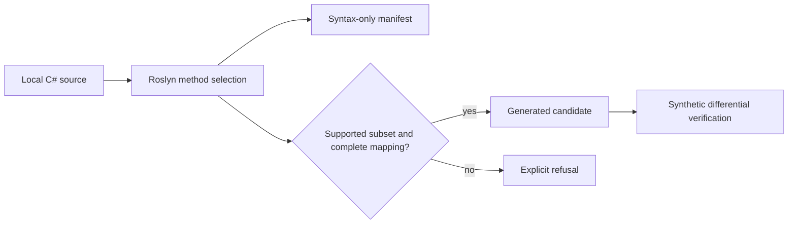

# VanillaPorter: developer-only Roslyn prototype

VanillaPorter lives at [tools/TerraRuntime.VanillaPorter](../../tools/TerraRuntime.VanillaPorter/README.md), outside production projects. The pilot provides a deterministic, syntax-only C# method scan, a deliberately restricted mapped-method scaffold, and a synthetic compiler/differential check. The scan reports member expressions, direct calls, suspicious RNG call names, branch conditions, and unsupported scaffold syntax.

The tool does not include decompiled game sources, run official-game code, or claim vanilla equivalence. A C# method that scans successfully is not necessarily scaffoldable. Unmapped calls, globals, locals, loops and unsupported syntax fail closed. Candidate output is ignored by git and is **not** included in NativeAOT or CoreCLR production builds. The synthetic differential comparison covers 15 combinations, not the original Terraria server.

Next milestone: introduce a version-pinned binding-aware dependency resolver, adapt one real previously unported AI method via an explicit state/RNG mapping, and collect independent official source-vs-runtime tick traces. Measure person-hours and debugging effort before claiming a development-speed benefit.
