# Built-in vanilla world generation

[Русский](../ru/vanilla-world-generation.md) · [World generation](world-generation.md) · [Roadmap](../roadmap/gameplay-worldgen-extensibility.md)

`terraruntime:vanilla` is TerraRuntime's runtime-owned clean-room TerrariaServer 1.4.5.8 generator. The public generator ID is stable while the runtime owns the exact generation plan behind it.

Generation town placement can supply an optional `directionX` to `IWorldGenerationEntityEffects1458.MoveTownNpc`. Omitting it preserves the canonical NPC direction. The native Guide pass explicitly requests right-facing after allocating the NPC and resolving its identity; generic NPC birth keeps its original default. The existing NPC owner applies position, home and direction together.

Generation WaterCheck delegates Glow Tulip (`656`) destruction to the existing generation framer. This admission applies only during generation with that owner present; loading and live liquid object support retain their existing contract.

The cold projectile adapter uses the existing `RuntimeProjectileStore`: birth assigns `Damage`, while `OriginalDamage` remains zero after source defaults; later changes belong to the calling owner. Optional `sourceNetUpdate` retains the caller's synchronization request in `ProjectileLifecycleState.SourceNetUpdate` at birth. This describes the cold generation phase and does not itself publish a network event or hand the projectile to live simulation.

Micro Biomes `98` also has a separate detached qualification for nine configured basic special profiles, numeric seeds `1458`/`42`, Classic Corruption at $4200\times1200$ tiles. These tests explicitly import original `97` checkpoints and compare the actual Execute caller, whole tiles/RNG, ordered chests/maps, phase flags and declared entity effects. They do not prove continuous special generation or equivalence to canonical named seed texts. The shared special buried-chest extension admits the forced Ivy family only; other special chest families retain an explicit refusal before mutation/RNG. That refusal is a runtime support boundary, not original vanilla behavior. The early production special prefix still stops after `19`.

The shared generation dust decision reads the destroyed tile’s `FrameX`: crimson altar/orb bands select fixed dust and consume no appearance RNG. All five generation callers pass that frame context. Actual dungeon cracked-brick destruction delegates to the same framer and canonical projectile store, retaining original `736`–`738` birth order and lifecycle fields. Dedicated generation uses an explicit server context; client context skips that producer. Particle rendering and particle simulation are omitted. These cold births do not establish live AI10 support.

Living-tree passage furniture uses the existing placement-anchor cleanup and canonical framing for successful and failed door, chair and loom offers. Failed offers can change inactive tile metadata without spending RNG; the original prologue and framing tail are preserved.

## Continuous ordinary generation through Final Cleanup

Ordinary Classic Corruption and Crimson worlds at $4200\times1200$ tiles, seeds `1458` and `42`, execute from fresh Reset through native `106`, Final Cleanup, without importing original checkpoints. Independent original captures compare every cell's 21 canonical fields, complete physical RNG at the observed native boundaries, both ordered StructureMap lists, sparse source chest slots with all 40 items, generation solidity, liquid queues and flags, shared loot counters, encoded NPC/extra-spawn sections, declared physical NPC/projectile state and the final Angler quest. Crimson observes every native boundary; Corruption combines the preceding prefix qualifications with the complete execution's final nine observed boundaries. Native passes reseed their RNG as the original does; this is not a claim of one uninterrupted RNG stream.

The same canonical owners retain Dungeon first-key/rune decisions, the Micro Biomes caller's current generation layers, Guide facing after identity resolution and the final Shimmer solidity phase. Track construction, its retained height between both waves, structure protection, furniture framing and suppressed drop-argument RNG follow independently captured source behavior. The [combined managed qualification](../verification/worldgen-continuous106-managed-20261103.json) records the release gates and exact boundaries; an incomplete receipt is not release acceptance. NativeAOT remains user-deferred.

Complete vanilla generation remains open. Medium/large worlds pass structural execution checks but their original-reference parity is still under investigation. Special stages after their qualified prefix, extra styles/combinations, other game-mode/evil cross-products, all retained source fields and full original save/load parity are not established by this checkpoint. The separate metadata audit compares 96 selected scalar/active-prefix GenVars facts at final boundaries; inactive array tails and a complete original memory image are outside that projection.

## Earlier checkpoint through native pass 76

Reset through native pass `76` is independently qualified for ordinary Classic Corruption, seeds `1458` and `42`, at $4200\times1200$ tiles. The executor imports no original checkpoint. It compares every cell's 21 canonical fields, the complete physical RNG and report draw, 175/171 ordered chests with all 40 items, 99/94 protected rectangles, three sky houses, and nine checkpoints of all 754 generation solidity values. This covers the existing prefix plus underground trees, floating houses, Quick Cleanup, pots, hellforges and the following surface passes. It does not establish complete-world equality or every retained GenVars field.

Cold generation effects use the existing canonical NPC, projectile and tile-entity owners. Source-backed continuations include larva, tombstone and hive effects; town allocation before identity draws; held-item clearing and six further tile-entity footprints; cold logic-sensor pulses through the existing wiring circuit; and the existing furniture owner's derived pylon index. Arbitrary live leashes, unsupported circuit devices, nondefault island-house styles and grass tree conversion remain separate boundaries.

The basic Drunk, Not the Bees, For the Worthy, Anniversary, Constant, No Traps, Remix, Everything and Skyblock profiles now execute the source-backed early prefix through native `19`, Mud Caves To Grass, on all three canonical sizes. Together with the ordinary control, their original seed texts give 30 independently repeated contexts and 570 boundaries checking all canonical tile fields, full physical RNG, all 754 generation solidity values and the declared retained metadata. Skyblock uses the original two-island placement, furniture, landmass and spawn lifecycle. Special native `20` and later refuse before unqualified execution. Extra island styles, other evil/game-mode combinations and full special pipelines remain open.

All 37 original extra seed aliases retain their separately qualified Reset/Terrain prefixes, including rain and dual-dungeon state and two rain/lightning combinations. Unsupported combinations refuse at Reset before mutation. Those alias prefixes do not admit later special-world stages.

Flowers now passes the canonical workspace into every plant-framing path. Filled and empty containers follow the original destruction order; their metadata remains available to later generation callbacks. Only explicit fresh vanilla finalization applies the actual SaveChests predicate: four active cells whose identities belong to the five source container identities. Invalid records are excluded at that late boundary without rewriting tiles. The matching source save/load evidence admits valid-atlas unregistered remnants of `21/467`; surviving records still require complete anchors and footprints. Other validation modes keep their existing contract. The older non-container Flowers destruction frontier remains explicit.

The [combined managed acceptance](../verification/worldgen-continuous76-managed-20261103.json) records the final qualification and its limits. Detached native liquid `50/99` and final `105→106` checkpoint evidence remains separate from continuous-prefix evidence. NativeAOT remains deferred by the user's managed-only instruction.

## Earlier checkpoint through spider caves

The source-backed ordinary executor is independently qualified from Reset through native pass `64` (Spider Caves) for Classic Corruption, seeds `1458` and `42`, at $4200\times1200\,\text{tiles}$. These runs import no original tiles, random state or metadata. They compare every cell's canonical 21 fields, all 56 physical RNG slots and the report draw, ordered chest contents and protected rectangles, and all 754 generation solidity entries. The two worlds retain 168/164 chests and 99/94 protected rectangles respectively. This projection does not establish whole `.wld` byte identity.

Mutable generation solidity belongs to the candidate workspace. Framing reads that live owner, while the immutable gameplay collision catalog remains separate. Both liquid-settle passes borrow the retained water line, dungeon bounds, shimmer boundary, solidity callbacks and existing liquid queues. Only the first pass performs the ocean prelude. Loading WaterCheck now preserves the liquid kind when clearing its amount; the retained live/loading and FIFO compatibility checks remain exercised.

Wet bee hive `444` destruction follows the original footprint and ordered halo framing without creating a projectile. Unsupported dry destruction still requires its projectile owner and refuses before mutation. Generation KillTile also retains the verified Hellstone `58` lava rule strictly below the underworld boundary.

The earlier native `99` evidence uses actual original incoming checkpoints and covers vine framing, liquid skip flags, wet/stuck counters and queue state. That detached evidence alone did not establish continuous generation through `99`; the current continuous scope is stated above. The [earlier managed acceptance](../verification/worldgen-continuous64-managed-20261103.json) records the pass64 checkpoint. NativeAOT remains user-deferred.

## Ordinary canonical pipeline

For the three canonical Terraria dimensions (`4200x1200`, `6400x1800`, `8400x2400`) with an ordinary seed profile, the production provider now composes the source-backed/source-shaped overlays through the end of the pinned 109-pass registration catalog.

```mermaid
flowchart LR
    Reset["Reset"] --> Terrain["Terrain"]
    Terrain --> Early["early terrain / caves / biomes"]
    Early --> Structures["dungeon / jungle / temple / hives"]
    Structures --> Objects["liquids / chests / spawn / vegetation"]
    Objects --> Micro["Micro Biomes"]
    Micro --> Settle["Settle Liquids Again"]
    Settle --> Nature["Cactus, Palm Trees, & Coral"]
    Nature --> Cleanup["Tile Cleanup"]
    Cleanup --> Altar["Lihzahrd Altars"]
    Altar --> Water["Water Plants"]
    Water --> Stalac["Stalac"]
    Stalac --> Traps["Remove Broken Traps"]
    Traps --> Final["Final Cleanup"]
    Final --> Secrets["compatibility SecretSeeds barrier"]
    Secrets --> Metadata["Metadata + fresh .wld v326"]
```

Every source-backed ordinary-world pass that participates in vanilla generation retains `WorldGenerationRngMode.VanillaSharedRng`. The name denotes Terraria's shared world-generation RNG API **inside a pass**, not one continuously advancing stream across the entire plan. Pinned TerrariaServer 1.4.5.8 `WorldGenerator.RunPass` assigns `Main.rand = new UnifiedRandom(_seed)` before applying each enabled pass, so TerraRuntime creates a fresh `VanillaUnifiedRandom1458` from the resolved world seed for each such pass. RNG calls within one pass advance that pass-local stream normally; carrying RNG state from one registered pass into the next is a compatibility bug.

The permanent `terraria-worldgen-pass-catalog.yml` source contract decompiles the pinned official server and now fails unless that `RunPass` reseed remains present before pass application. This prevents a self-consistent runtime test from silently redefining vanilla RNG lifetime.

## Final eight-pass overlay

`SourceBackedFinal1458` completes the ordinary canonical pass identity sequence after `Micro Biomes` with the final eight TerrariaServer 1.4.5.8 registrations:

1. `Settle Liquids Again`
2. `Cactus, Palm Trees, & Coral`
3. `Tile Cleanup`
4. `Lihzahrd Altars`
5. `Water Plants`
6. `Stalac`
7. `Remove Broken Traps`
8. `Final Cleanup`

The implementation keeps these as separate passes rather than a single aggregate cleanup step. That preserves the source order, the per-pass RNG reseed boundary, pass-level progress reporting, dependency diagnostics, and a clean replacement point for deeper parity work.

The late passes perform deterministic liquid compaction, beach/desert vegetation and coral placement, normalized tile state, temple-altar placement, aquatic decoration, cave stalactite/stalagmite decoration, orphan-trap cleanup and a final vanilla-content/flag validation sweep before the compatibility secret-seed barrier.

## Selection and fallbacks

The full source-backed chain is selected only when both conditions are true:

- the seed profile is ordinary/default;
- the world dimensions are one of Terraria's canonical sizes.

Noncanonical synthetic dimensions replay the compatibility provider. Canonical basic special profiles execute the qualified prefix through native `19` and refuse at the next unqualified stage. Extra aliases/combinations retain their separately qualified Reset/Terrain boundary; unadmitted combinations refuse before mutation. These prefixes do not establish a complete special-world pipeline.

The production registration in `BuiltInWorldGeneratorSource` resolves `terraruntime:vanilla` to `SourceBackedFinal1458`. The older overlay classes remain implementation layers in the chain, not alternative public generators.

## Persistence and authority

Generation writes into an unpublished `Workspace` backed by the contiguous `WorldTileStore`. Generated tiles, chests, starting town NPC metadata, spawn/dungeon anchors and layers remain candidate state until validation succeeds. No generation pass mutates the live network-visible world.

Final cleanup rejects out-of-catalog tile/wall identities and unknown runtime tile flags before the normal world-generation finalizer and fresh `.wld` v326 composition take ownership.

Its generation-time framing validates all seven `Check2x1` objects `16/18/29/103/134/462/649`, including type103's frame-qualified top-slope platform table anchor. It also validates the 2×2 basic chests `21/467`: unsupported or incomplete empty containers lose their surviving tiles and generated chest record, while occupied containers resist destruction. The twelve `Check1x1` objects, both golf one-cell objects and all six logic-tile identities follow their support, frame and chain rules; Abigail's flower `624` additionally requires grass-family ground. Ten bottom-supported `Check1x2` and six non-tile-entity ceiling-supported `Check1x2Top` objects follow their footprint rules; type20's changed ground style consumes its source RNG draw. The 50 ordinary-bottom-support `Check2x2` identities validate their frame-derived 2×2 footprint, both supports and the post-destruction 4×4 halo. Nine exceptional 2×2 identities additionally cover ceiling support, Echo frame-atlas styles, wall/ground switching and `Check2x2Style` framing. All ten boulder identities use the source's one-support-or-container-above rule. PlanterBox380, Sunflower27 and herbs82/83/84 now retain source plant framing and lava transitions. Independently registered official `Final Cleanup` fixtures pin the tile-grid and scoped shared RNG for these branches. Type698/520 tile entities, pumpkin `254`, rope-end framing, other objects, special seeds and full real-prefix parity remain outside this slice.

The same generation framer now handles 25 non-tile-entity `Check2xX` furniture identities and three `Check1xX` identities, including the hanging-anchor agreement across two ceiling columns. TrainingDummy `378` remains outside this slice because its tile entity has separate item and kill ownership.

It also validates fifteen floor-supported rectangular furniture identities across `Check3x4`, `Check5x4`, `Check4x4`, `Check2x5`, `Check3x5`, `Check3x6` and `Check4x2`, retaining each family's style and reframe-halo rules.

`Finalizer` now enforces the fail-closed `Validator1458` before publication:

- `Finalized` is returned only when the structural validator reports `Valid`;
- any `InvalidTileType`, `InvalidWallType`, `InvalidLiquid`, orphan frame-important object, chest-anchor mismatch, duplicate chest, out-of-bounds object, dungeon/temple absence, ocean-bounds violation or spawn/beam invalidity yields `ValidationFailed` and the candidate is discarded without ever reaching `WorldFileFreshComposer326`.

For canonical ordinary worlds the validator additionally checks biome presence (`$147$` snow, `$59$`/`$60$` jungle, `$53$` desert), active-tile density, per-beach `$30$` water / `$50$` sand minima, and structural ocean integrity: edge-connected wet columns, sand-floor coverage, bounded adjacent floor steps, and a rising beach transition.

## Verification boundary

There are two separate milestones and they must not be conflated:

- **complete source-pinned pass coverage**: the ordinary canonical plan reaches all 109 TerrariaServer 1.4.5.8 pass identities through `Final Cleanup`;
- **reference-world parity**: fixed official seeds produce reference-equivalent output with verified per-pass RNG behavior and geometry/content parity.

The first milestone is implemented by the final overlay. The second remains an evidence task until reference-world differential tests prove it. Several existing source-shaped algorithms intentionally preserve pass boundaries and deterministic ownership while still awaiting deeper parity.

`terraria-vanilla-generated-world-acceptance.yml` remains the executable production gate: build the runtime, run focused world-generation contracts, generate a real canonical vanilla world, load the resulting `.wld` through TerraRuntime and boot the pinned official TerrariaServer 1.4.5.8 against it.

## Production integration evidence

`VanillaWorldGenerationFullIntegrationTests` is the in-process executable proof that complements the native acceptance gate:

- generates a full `4200x1200` ordinary canonical world via `BuiltInWorldGeneratorSource`/`SourceBackedFinal1458` (114-plan through `Final Cleanup`);
- verifies plan length and that every tile/wall id, shape and flag is within `VanillaTileIds`/`VanillaWallIds`/known-flag bounds – the same invariant enforced by `Final Cleanup`;
- checks that generated chests form dense `2x2` `Containers` objects with unique anchors, that the side-table survives fresh `.wld` v326 composition and that spawn/dungeon/layers/bootstrap are within canonical ranges;
- checks that the starting `Guide` town NPC (`netId 22`) is emitted once with source-backed placement and identity and round-trips through `WorldFileFreshComposer326`;
- composes the candidate to a validated `.wld` byte image ( >1 MiB for small worlds ), reloads it through `WorldFileLoader` with `ServerWorldLoadPolicy.CreateLimits()` and confirms chest/NPC counts are preserved;
- proves deterministic replay: the same `WorldGenerationRequest` (seed `8675309`, `640x240` smoke size) hashed with SHA-256 yields byte-identical `.wld` images and that a different seed yields a different hash;
- exercises budget and cancellation hardening: a `8000x5000` request is rejected as `GenerationBudgetExceeded`, a pre-cancelled `CancellationToken` yields `Cancelled`, and non-canonical `192x128`/`640x240` fallbacks remain valid and composable.

The test retains the distinction between pass-coverage and reference-world parity: it guarantees production-path validity, atomic persistence and deterministic ownership without claiming byte-identical vanilla reference output, which remains tracked as the remaining parity milestone.
