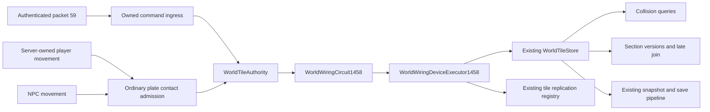

# Authoritative wiring and basic mechanisms

[Русский](../ru/wiring-mechanisms.md) · [Architecture](architecture.md) · [Networking](networking-protocol.md)

This block connects admitted Terraria `1.4.5.8` switch requests and ordinary pressure-plate contacts to the existing authoritative world, replication and persistence owners. It does not establish compatibility for the complete vanilla wiring system. Local acceptance is complete: Release has zero warnings/errors, focused `164/164`, fast `25335/25336` and unfiltered full `1566748/1566749` pass with zero failures/errors and the same one known liquid skip. All `5250` discovered methods executed; `3897` inputs and `60` DLLs remained exact. Windows NativeAOT passes five shipping smokes. See the [verification record](../verification/wiring-mechanisms-1458.json); Linux Native and official GUI remain unverified.

## Ownership and execution

`WorldWiringCircuit1458` owns transient traversal state and mechanism clocks for one world. `WorldWiringDeviceExecutor1458` mutates the same `WorldTileStore` used by collision, section caching and saving. Actuation delegates its cell commit to `VanillaWorldWiringMutationService`; doors, trapdoors and tall gates reuse `VanillaWorldGroundFighterDoorOpeningService`. No parallel world, collision image or random stream is created. Door direction consumes the existing shared gameplay RNG; closing consumes the existing door-frame RNG owner.

`RuntimeNpcAiStateExecutor.Tick` accepts an optional `Action<NpcSnapshot, NpcSnapshot> actorContact` after the commit sink. It receives the captured before-state and the exact current committed revision after AI effects, before deactivation and the next live slot. The callback runs on the writer thread; generation/revision validation remains required for any actor mutation. Existing callers can omit it. Door mutation overloads similarly accept an optional per-call `skipWire` callback instead of retaining global circuit state.

Pulses run red, blue, green and yellow, with separate per-color skip state. Seeds are scanned by column then row; traversal uses the source FIFO and down/up/right/left neighbor order. Multi-cell lights skip their whole footprint. The existing door mutation owner also supplies the delegated `WorldGen` skip operations through an optional per-call callback: opening an ordinary door skips the resulting `2×3` footprint, while closing skips its retained column. Trapdoors use their source direction-dependent coordinates, and tall gates skip all five rows after footprint validation, including when an actor then blocks the operation. Consecutive pulses clear their temporary state and can operate shared wire segments again.

Traversal has no arbitrary wire-length cutoff. Storage is bounded by world cells and the four directed entrances of routers. Repeated identical router entrances are suppressed as an explicit memory/work safety policy. Malformed junction frames outside `0`, `18` and `36` do not fan out. These guards are not an independently demonstrated equivalence for every router topology. Logic-gate-generated nested pulses are outside this block. Reentrant external pulses are rejected while a pulse is running.

## Supported sources and devices

| Family | Admitted tile identities and behavior |
| --- | --- |
| Manual sources | Switch `136`, lever `132`, timer `144`, momentary switch `411`. |
| Additional direct `HitSwitch` origins | `135`, `314`, `423`, `428`, `442`, `476` emit their source single-cell pulse. This does not admit their other physical producers or wire-device effects. |
| Ordinary pressure plates | Tile `135`, styles `0`–`6`, for physically simulated players and NPCs according to source actor eligibility. |
| Single-cell lights | Torch `4`; candles `33`, `49`, `174`, `372`, `646`; holiday light `149`. |
| Multi-cell lights | Hanging lantern `42`; standing lamp `93`; lamp post `92`; `2×2` lights `95`, `100`, `126`, `173`, `564`; chandelier `34`; campfire `215`; fireplace `405`. |
| Doors and gates | Ordinary doors `10`/`11`, trapdoors `386`/`387`, tall gates `388`/`389`, through the existing source-specific mutation owner. |
| Actuators | Existing active solid tiles, subject to `Wiring.DeActive` restrictions and existing `CanKillTile` rules when an active tile stands above. |
| Momentary switch reached by wire | Tile `411` changes its complete frame footprint and skips those cells. This wire-hit branch does not register the manual switch's reset clock or emit another pulse. |
| Crossings | Junction box `424` routing; pixel-box `445` axis accumulation and the pass after all four colors. |

Wiring uses the composition's existing shared occupancy probe, which includes connected humans, server-owned players and NPCs. A live server-owned player inside a tall gate blocks its operation; removing that generation immediately releases the gate on the next valid press.

Ordinary plate styles `2`, `3`, `4` and `6` admit players. Style `5` admits NPC and projectile actor categories in the source rule; this block connects the NPC category. Styles `0` and `1` admit player and NPC actors. Contacts require a new overlap with the source asymmetric old/new bounds; remaining on a plate does not repeatedly trigger it. The source bottom-world scan exclusion is retained. Server-owned player and NPC simulation compares committed before/after movement on the authoritative thread, before the next actor advances. Connected human players retain the original local-client `59` path; the server does not synthesize an additional contact from packet `13`. The request contains no actor category or plate-result flag. Represented pressure-sensitive critters enter the source `ai=(1,400,0,ai3)` escape state. Complete NPC `23` publication ordering relative to contact `20`/`59` is not established by this block.

Actuators reject nonsolid tiles and the source exclusions, including tracks, trapdoors, tall gates and golf holes. Lihzahrd brick `226` below `worldSurface` cannot deactivate before Plantera; equality with the surface remains allowed. The source support set above a block prevents deactivation. Other active supports consult the existing source-backed `CanKillTile` policy. Reactivation does not repeat the deactivation guards. Collision immediately observes the same tile's inactive flag, and the existing store marks section and persistence versions dirty.

## Timers and lifecycle

The independent corpus contains `110` scenes: its original `98` rows remain unchanged, with eight full door/trapdoor/gate images, three boundary-clock traces and a repeated momentary-switch trace added. The source-backed trapdoor close path retains dormant type/frame/paint/coating metadata as `Tile.ClearTile` does. Timer updates follow the world-time phase, as in `Main.DoUpdateInWorld_Inner`.

| Timer style (`frameX / 18`) | Pulse interval |
| --- | --- |
| `0` | $60\,\text{ticks}$ |
| `1` | $180\,\text{ticks}$ |
| `2` | $300\,\text{ticks}$ |
| `3` | $30\,\text{ticks}$ |
| `4` | $15\,\text{ticks}$ |

Mechanisms decrement before checking for a pulse and are processed in reverse registration order, matching `Wiring.UpdateMech`. Turning a timer off and on while its registration still exists does not allocate a second clock or reset its remaining interval. Registrations are coordinate-based and limited to `999`, matching `Wiring.CheckMech`; destroying a device does not invent an independent cancellation rule. The admitted momentary-switch reset uses $60\,\text{ticks}$. Mechanism updates run through the existing world tick after actor simulation.

Wire colors, actuator/inactive flags and device frames use the existing tile snapshot and `.wld` representations. Saving retains a live timer's frame, but official `WorldFile.LoadWorldTiles` resets timer `144`'s loaded `frameY` to `0`; the mechanism countdown is transient and is not serialized. Canonical and runtime-cache loads therefore start timers off. World replacement discards the old circuit and its clocks. Save/reload regressions are checked separately from the canonical file rule; the final acceptance record identifies their verified scope.

## Network boundary and publication

Packet `59` contains two signed little-endian tile coordinates. The frame sink requires an authenticated playing session and converts the request to an owned command before receive-buffer disposal. Execution validates the connection/player generation, the existing per-player edit budget, world bounds and the current source device. The request carries no desired tile state, light frame, output device list or actor eligibility flag.

`MessageBuffer.GetData` case `59` has no reach test, so this path does not invent one. Repeated legal presses remain meaningful successive activations; they are not treated as idempotent acknowledgements. Stale sessions and reused player slots cannot borrow a current player's identity. Mutations and existing registry publication run on the authoritative thread. Tile writes invalidate section versions for cache rebuilding and late join, while tile-square publication exposes committed device results to current clients. A manual source's frame is replayed by packet `59` on peers, without an earlier source tile-square that would make the client toggle it twice. Wire-driven timer changes and mechanism expiration publish their resulting tile state directly.

Wired doors emit the source packet `19` action before the enclosing switch `59`: `0`/`1` for ordinary opening/closing, `2`/`3` for trapdoors and `4`/`5` for tall gates. Ordinary opening reports the successful attempt's direction; trapdoors report `+1` for the first attempt and `-1` for its fallback. Closing ordinary doors and tall-gate actions use the source default direction byte, decoded as `-1`. A tall gate emits its action even if server occupancy rejects the change. Each emitted action is followed by an authoritative packet `20` image, including that rejected-gate case, so the client's forced gate operation converges to the server state. This additional correction image is a runtime publication policy beyond vanilla's door action. The World owner exposes a protocol-neutral `WorldWiringDoorTransition1458` callback; the existing replication registry owns encoding and delivery.

## Evidence and remaining work

The `GameLoopTests` telemetry fixture allows $30\,\mathrm{s}$ for background-loop startup under full-matrix host load. Its tick, missed-deadline and measured update-phase assertions remain unchanged. This test-only adjustment changes no shipping source; all 59 other managed reference DLLs and the NativeAOT executable remain byte-identical across it.

The main integration points for merging this branch are `WorldTileAuthority.cs`, `ServerRuntimeComposition.cs`, `ServerRuntimeState.Tick.cs`, `ProjectileLifecycleFrameSink.cs`, `NpcAuthority.cs`, `ServerPlayerAuthority.cs`, Core's `RuntimeNpcAiStateExecutor.cs`, the existing `VanillaWorldGroundFighterDoorOpeningService.cs`, `WorldFileTileEncoder.cs`, `RuntimeWorldSnapshotCache.Read.cs`, `TerrariaMessageId.cs`, the test project's resource list and the fixture-only allowance in `GameLoopTests.cs`. The circuit, devices, ingress/codec, native-smoke owner, numeric fixture and reference probe are additive files.

Behavior is pinned to local official `1.4.5.8` `Wiring.HitSwitch`, `TripWire`, `HitWire`, `HitWireSingle`, `UpdateMech`, `CheckMech`, `DeActive`, `ReActive` and light-toggle methods; `WorldGen.OpenDoor`, `CloseDoor`, `ShiftTrapdoor`, `ShiftTallGate`, `CanKillTile`; `TileObjectData`; `Collision.SwitchTiles`; `MessageBuffer.GetData` case `59`; and `WorldFile.SaveWorldTiles` and `LoadWorldTiles`.

The retained independent numeric fixture executes the unmodified official Linux-edition binary under Windows CoreCLR. It contains `109` scenes replayed through their supported outputs and one style-`7` plate scene checked only for actor eligibility and the required destruction flag. Its final destruction/framing effects remain unadmitted. Supported scenes cover switch/lever/timer traces, actor eligibility, light frames and actuator progression. This is source-binary evidence, not execution on Linux or a Linux NativeAOT claim. Production ingress, publication, persistence and stale-session regressions complement those component traces. Final focused, fast, full and available NativeAOT results must come from the branch's completed validation, not earlier checkpoints.

The following remain outside the supported chain:

- Client tool removal and mass wiring. Ordinary paid installation by four wrenches and selected actuators is described in [paid wiring installation](wiring-tool-installation-1458.md).
- Plate style `7`, whose pulse must be followed by the actual destruction/drop transaction; weighted plates and projectile/boulder plate producers.
- Pumps and teleporters, pending full integration with liquid and movement owners.
- Logic gates, traps, statues and their spawn, projectile, cooldown and nested-pulse effects.
- General `SquareTileFrame` propagation and object-removal side effects beyond the admitted owners. Circuit actuation now uses the existing transaction for its nine-cell frame pass, supported switch removal/drop and torch support. Unsupported neighbors reject before adoption; complete attachment framing parity is not claimed.
- Trapdoor opening into cuttable content: the existing service rejects this until a complete cut/drop/metadata transaction is connected. Occupied tall gates and closing trapdoors retain their source actor checks.
- Whole vanilla wiring compatibility, arbitrary unsupported devices/styles, official GUI playthrough and unavailable platform validation.

The next connected block is broader attachment destruction and disposable plates, plus the missing client visual-state owner needed for cutter RNG, followed by pumps/teleporters through their existing authoritative owners.

The shipping `--world-smoke` also exercises authenticated command application, light and actuator mutation, the timer deadline, and the independently captured timer-save bytes. The reference probe is retained under [`tools/reference/wiring1458`](../../tools/reference/wiring1458/README.md).
