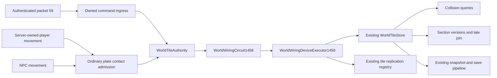

# Authoritative wiring and basic mechanisms

[Русский](../ru/wiring-mechanisms.md) · [Architecture](architecture.md) · [Networking](networking-protocol.md)

This block connects admitted Terraria `1.4.5.8` switch requests and ordinary pressure-plate contacts to the existing authoritative world, replication and persistence owners. It does not establish compatibility for the complete vanilla wiring system. Local acceptance is complete: Release has zero warnings/errors, focused `164/164`, fast `25335/25336` and unfiltered full `1566748/1566749` pass with zero failures/errors and the same one known liquid skip. All `5250` discovered methods executed; `3897` inputs and `60` DLLs remained exact. Windows NativeAOT passes five shipping smokes. See the [verification record](../verification/wiring-mechanisms-1458.json); Linux Native and official GUI remain unverified.

## Ownership and execution

`WorldWiringCircuit1458` owns transient traversal state and mechanism clocks for one world. `WorldWiringDeviceExecutor1458` mutates the same `WorldTileStore` used by collision, section caching and saving. Actuation delegates its cell commit to `VanillaWorldWiringMutationService`; doors, trapdoors and tall gates reuse `VanillaWorldGroundFighterDoorOpeningService`. No parallel world, collision image or random stream is created. Door direction consumes the existing shared gameplay RNG; closing consumes the existing door-frame RNG owner.

`RuntimeNpcAiStateExecutor.Tick` accepts an optional `Action<NpcSnapshot, NpcSnapshot> actorContact` after the commit sink. It receives the captured before-state and the exact current committed revision after AI effects, before deactivation and the next live slot. The callback runs on the writer thread; generation/revision validation remains required for any actor mutation. Existing callers can omit it. Door mutation overloads similarly accept an optional per-call `skipWire` callback instead of retaining global circuit state.

Pulses run red, blue, green and yellow, with separate per-color skip state. Seeds are scanned by column then row; traversal uses the source FIFO and down/up/right/left neighbor order. Multi-cell lights skip their whole footprint. The existing door mutation owner also supplies the delegated `WorldGen` skip operations through an optional per-call callback: opening an ordinary door skips the resulting `2×3` footprint, while closing skips its retained column. Trapdoors use their source direction-dependent coordinates, and tall gates skip all five rows after footprint validation, including when an actor then blocks the operation. Consecutive pulses clear their temporary state and can operate shared wire segments again.

Traversal has no arbitrary wire-length cutoff. Storage is bounded by world cells and the four directed entrances of routers. Repeated identical router entrances are suppressed as an explicit memory/work safety policy. Malformed junction frames outside `0`, `18` and `36` do not fan out. These guards are not an independently demonstrated equivalence for every router topology. Logic-gate-generated nested pulses are outside this block. Reentrant external pulses are rejected while a pulse is running.

## Supported sources and devices

| Family | Admitted tile identities and behavior |
| --- | --- |
| Manual sources | Switch `136`, lever `132`, timer `144`, momentary switch `411`. |
| Additional direct `HitSwitch` origins | `135`, `314`, `423`, `428`, `442`, `476` emit their source single-cell pulse. This does not admit their other physical producers or wire-device effects. |
| Ordinary pressure plates | Tile `135`, styles `0`–`6`, for physically simulated players and NPCs according to source actor eligibility. |
| Single-cell lights | Torch `4`; candles `33`, `49`, `174`, `372`, `646`; holiday light `149`. |
| Multi-cell lights | Hanging lantern `42`; standing lamp `93`; lamp post `92`; `2×2` lights `95`, `100`, `126`, `173`, `564`; chandelier `34`; campfire `215`; fireplace `405`. |
| Doors and gates | Ordinary doors `10`/`11`, trapdoors `386`/`387`, tall gates `388`/`389`, through the existing source-specific mutation owner. |
| Actuators | Existing active solid tiles, subject to `Wiring.DeActive` restrictions and existing `CanKillTile` rules when an active tile stands above. |
| Momentary switch reached by wire | Tile `411` changes its complete frame footprint and skips those cells. This wire-hit branch does not register the manual switch's reset clock or emit another pulse. |
| Crossings | Junction box `424` routing; pixel-box `445` axis accumulation and the pass after all four colors. |

Wiring uses the composition's existing shared occupancy probe, which includes connected humans, server-owned players and NPCs. A live server-owned player inside a tall gate blocks its operation; removing that generation immediately releases the gate on the next valid press.

Ordinary plate styles `2`, `3`, `4` and `6` admit players. Style `5` admits NPC and projectile actor categories in the source rule; this block connects the NPC category. Styles `0` and `1` admit player and NPC actors. Contacts require a new overlap with the source asymmetric old/new bounds; remaining on a plate does not repeatedly trigger it. The source bottom-world scan exclusion is retained. Server-owned player and NPC simulation compares committed before/after movement on the authoritative thread, before the next actor advances. Connected human players retain the original local-client `59` path; the server does not synthesize an additional contact from packet `13`. The request contains no actor category or plate-result flag. Represented pressure-sensitive critters enter the source `ai=(1,400,0,ai3)` escape state. Complete NPC `23` publication ordering relative to contact `20`/`59` is not established by this block.

Actuators reject nonsolid tiles and the source exclusions, including tracks, trapdoors, tall gates and golf holes. Lihzahrd brick `226` below `worldSurface` cannot deactivate before Plantera; equality with the surface remains allowed. The source support set above a block prevents deactivation. Other active supports consult the existing source-backed `CanKillTile` policy. Reactivation does not repeat the deactivation guards. Collision immediately observes the same tile's inactive flag, and the existing store marks section and persistence versions dirty.

## Timers and lifecycle

The independent corpus contains `110` scenes: its original `98` rows remain unchanged, with eight full door/trapdoor/gate images, three boundary-clock traces and a repeated momentary-switch trace added. The source-backed trapdoor close path retains dormant type/frame/paint/coating metadata as `Tile.ClearTile` does. Timer updates follow the world-time phase, as in `Main.DoUpdateInWorld_Inner`.

| Timer style (`frameX / 18`) | Pulse interval |
| --- | --- |
| `0` | $60\,\text{ticks}$ |
| `1` | $180\,\text{ticks}$ |
| `2` | $300\,\text{ticks}$ |
| `3` | $30\,\text{ticks}$ |
| `4` | $15\,\text{ticks}$ |

Mechanisms decrement before checking for a pulse and are processed in reverse registration order, matching `Wiring.UpdateMech`. Turning a timer off and on while its registration still exists does not allocate a second clock or reset its remaining interval. Registrations are coordinate-based and limited to `999`, matching `Wiring.CheckMech`; destroying a device does not invent an independent cancellation rule. The admitted momentary-switch reset uses $60\,\text{ticks}$. Mechanism updates run through the existing world tick after actor simulation.

Wire colors, actuator/inactive flags and device frames use the existing tile snapshot and `.wld` representations. Saving retains a live timer's frame, but official `WorldFile.LoadWorldTiles` resets timer `144`'s loaded `frameY` to `0`; the mechanism countdown is transient and is not serialized. Canonical and runtime-cache loads therefore start timers off. World replacement discards the old circuit and its clocks. Save/reload regressions are checked separately from the canonical file rule; the final acceptance record identifies their verified scope.

## Network boundary and publication

Packet `59` contains two signed little-endian tile coordinates. The frame sink requires an authenticated playing session and converts the request to an owned command before receive-buffer disposal. Execution validates the connection/player generation, the existing per-player edit budget, world bounds and the current source device. The request carries no desired tile state, light frame, output device list or actor eligibility flag.

`MessageBuffer.GetData` case `59` has no reach test, so this path does not invent one. Repeated legal presses remain meaningful successive activations; they are not treated as idempotent acknowledgements. Stale sessions and reused player slots cannot borrow a current player's identity. Mutations and existing registry publication run on the authoritative thread. Tile writes invalidate section versions for cache rebuilding and late join, while tile-square publication exposes committed device results to current clients. A manual source's frame is replayed by packet `59` on peers, without an earlier source tile-square that would make the client toggle it twice. Wire-driven timer changes and mechanism expiration publish their resulting tile state directly.

Wired doors emit the source packet `19` action before the enclosing switch `59`: `0`/`1` for ordinary opening/closing, `2`/`3` for trapdoors and `4`/`5` for tall gates. Ordinary opening reports the successful attempt's direction; trapdoors report `+1` for the first attempt and `-1` for its fallback. Closing ordinary doors and tall-gate actions use the source default direction byte, decoded as `-1`. A tall gate emits its action even if server occupancy rejects the change. Each emitted action is followed by an authoritative packet `20` image, including that rejected-gate case, so the client's forced gate operation converges to the server state. This additional correction image is a runtime publication policy beyond vanilla's door action. The World owner exposes a protocol-neutral `WorldWiringDoorTransition1458` callback; the existing replication registry owns encoding and delivery.

## Evidence and remaining work

The `GameLoopTests` telemetry fixture allows $30\,\mathrm{s}$ for background-loop startup under full-matrix host load. Its tick, missed-deadline and measured update-phase assertions remain unchanged. This test-only adjustment changes no shipping source; all 59 other managed reference DLLs and the NativeAOT executable remain byte-identical across it.

The main integration points for merging this branch are `WorldTileAuthority.cs`, `ServerRuntimeComposition.cs`, `ServerRuntimeState.Tick.cs`, `ProjectileLifecycleFrameSink.cs`, `NpcAuthority.cs`, `ServerPlayerAuthority.cs`, Core's `RuntimeNpcAiStateExecutor.cs`, the existing `VanillaWorldGroundFighterDoorOpeningService.cs`, `WorldFileTileEncoder.cs`, `RuntimeWorldSnapshotCache.Read.cs`, `TerrariaMessageId.cs`, the test project's resource list and the fixture-only allowance in `GameLoopTests.cs`. The circuit, devices, ingress/codec, native-smoke owner, numeric fixture and reference probe are additive files.

Behavior is pinned to local official `1.4.5.8` `Wiring.HitSwitch`, `TripWire`, `HitWire`, `HitWireSingle`, `UpdateMech`, `CheckMech`, `DeActive`, `ReActive` and light-toggle methods; `WorldGen.OpenDoor`, `CloseDoor`, `ShiftTrapdoor`, `ShiftTallGate`, `CanKillTile`; `TileObjectData`; `Collision.SwitchTiles`; `MessageBuffer.GetData` case `59`; and `WorldFile.SaveWorldTiles` and `LoadWorldTiles`.

The retained independent numeric fixture executes the unmodified official Linux-edition binary under Windows CoreCLR. It contains `109` scenes replayed through their supported outputs and one style-`7` plate scene checked only for actor eligibility and the required destruction flag. Its final destruction/framing effects remain unadmitted. Supported scenes cover switch/lever/timer traces, actor eligibility, light frames and actuator progression. This is source-binary evidence, not execution on Linux or a Linux NativeAOT claim. Production ingress, publication, persistence and stale-session regressions complement those component traces. Final focused, fast, full and available NativeAOT results must come from the branch's completed validation, not earlier checkpoints.

The following remain outside the supported chain:

- Client tool removal and mass wiring. Ordinary paid installation by four wrenches and selected actuators is described in [paid wiring installation](wiring-tool-installation-1458.md).
- Plate style `7`, whose pulse must be followed by the actual destruction/drop transaction; weighted plates and projectile/boulder plate producers.
- Pumps and teleporters, pending full integration with liquid and movement owners.
- Other NPC-spawning and town-teleport statues; contexts outside the bounded trap, logic, item-statue and NPC-statue continuations below.
- General `SquareTileFrame` propagation and object-removal side effects beyond the admitted owners. Circuit actuation now uses the existing transaction for its nine-cell frame pass, supported switch removal/drop and torch support. Unsupported neighbors reject before adoption; complete attachment framing parity is not claimed.
- Trapdoor opening into cuttable content: the existing service rejects this until a complete cut/drop/metadata transaction is connected. Occupied tall gates and closing trapdoors retain their source actor checks.
- Whole vanilla wiring compatibility, arbitrary unsupported devices/styles, official GUI playthrough and unavailable platform validation.

The next connected block is broader attachment destruction and disposable plates, plus the missing client visual-state owner needed for cutter RNG, followed by pumps/teleporters through their existing authoritative owners.

The shipping `--world-smoke` also exercises authenticated command application, light and actuator mutation, the timer deadline, and the independently captured timer-save bytes. The reference probe is retained under [`tools/reference/wiring1458`](../../tools/reference/wiring1458/README.md).

## Bounded dart-trap continuation

Tile `137` styles `0`, `1` and `5` fire source projectile types `98`, `184` and `980` through the existing wire traversal and projectile store. The observed five frame orientations, source muzzle position, speed, damage and owner `255` are retained. All wire colors share the existing mechanism clock: CheckMech registers a $200\,\text{updates}$ cooldown before projectile allocation, including failed allocation. Switches, ordinary plates and timers reuse their existing trigger paths. No player or NPC owner is fabricated for the environmental projectile.

The same projectile owner supplies creation, movement, tile collision, cleanup and replication. Ordinary and stronger poison darts apply Poisoned for source durations `600`/`900`; the venom dart applies Venom for `300`, before difficulty and equipment adjustments on player contacts. Both connected and server-owned player HP/buff/immunity participants adopt with RNG before observers. Dead Man's Sweater in the functional body slot halves trap damage and status duration before the remaining source adjustments. NPC contacts are admitted for Blue Slime, Zombie and Lava Slime; other NPC families remain outside this qualified slice. Venom retains its distinct NPC regeneration pulses and player regeneration loss, including the final positive buff update. Packet-50 presentation does not grant the owned Venom effect.

Original observations cover births, trigger/cooldown timelines, complete dry flight/termination, NPC contacts/deaths and local-player EVP components. These bounded comparisons do not establish complete `Main.Update`, an unmodified GUI session, arbitrary wet flight or all equipment. The following checkpoint adds trap styles `2`, `3` and `4`. Statues, logic gates, pumps, teleporters and unsupported plate families remain unimplemented; this does not close the complete wiring roadmap.

Venom regeneration is independently represented; its complete player visual phase remains unqualified and retires shared player RNG. Item storage transfers remain available through the separate bound storage context.

Lethal player contacts reuse the existing functional death path; the complete `KillMe`/tombstone RNG continuation is outside this source-qualified slice.

The additive `PlayerDebuffSnapshot1458.Venom` property exposes the owned effect to consumers of player health snapshots.

[Managed checkpoint, 2026-11-16](../verification/net11-stable-item-flow-darts-managed-20261116.json).

## Remaining trap families: managed checkpoint

Tile `137` styles `2`, `3`, `4` now enter the same circuit and authoritative projectile store. This continuation uses source cooldowns of $200$, $300$, and $90\,\text{updates}$ respectively. The spike ball samples its two launch components from the existing gameplay RNG; its cardinal frames differ from dart frames. The spear retains its source anchor, reverses on solid contact or after $300\,\mathrm{px}$, and ends on return.

The stationary flame emitter (`187`) creates flame children (`188`) every $6\,\text{updates}$. The projectile executor schedules a child in the current census only when its physical slot is later than the emitting slot; earlier slots wait for the next census. Child creation and parent state use the existing detached world-spawn preparation. `WiringFlameSourceUpdate` is a runtime-only step marker for its dedicated source visual RNG argument.

Flame contacts use the original expanded hitbox and warm-up gate. `On Fire 3` (`323`) has its own owned timer/effect and regeneration loss; `PlayerDebuffSnapshot1458.OnFire3` exposes it to snapshot consumers. Packet `50` supplies display state. The existing contact slot owner grants the physical effect only from admitted combat. The pure NPC debuff-regeneration owner is now `VanillaNpcDebuffRegeneration1458`; it combines the represented damage-over-time effects.

Ten independent original-server captures repeat byte-identically across $20\,865$ scenarios with no observed exceptions. They cover full dry flight/room lifetimes, source circuit cooldowns, NPC contact/death/loot, flame subupdate contacts and lower-slot child scheduling, and owned damage-over-time rules. Managed gates pass: focused $42\,754$, fast $220\,418$ and unfiltered full $1\,765\,733$ cases. Nine effective causal controls, ordinary and fresh CoreCLR smokes also pass. This managed checkpoint does not close the entire wiring issue; statues, logic gates, pumps, teleporters, other NPC families, unqualified cuttable/wet contexts and a real GUI session remain outside accepted scope.

`VanillaWiringTrap1458.TryResolve` replaces the former dart-only rule and returns `WiringTrapLaunch1458`: projectile identity, damage, cardinal direction, speed, muzzle offset and cooldown. `IsDart` retains its original narrow meaning; `IsContact` includes the damaging children, balls and spears. Emitter `187` itself does not deal contact damage.

Self-displacement of an updating emitter when the physical projectile pool is saturated remains a conservative refusal: neither a partial child nor a stale parent afterimage is published. Other source-qualified allocation paths retain their existing replacement rules. Complete player visual RNG and the `KillMe`/tombstone tail remain unqualified; the separate health and storage owners keep their existing scope.

[Remaining-trap managed receipt, 2026-11-16](../verification/wiring-remaining-traps-managed-20261116.json). Local NativeAOT remains user-deferred.

## Logic lamps and gates: managed checkpoint

Tile `419` now toggles ordinary lamps and checks faulty lamps through the existing device and circuit owners. Tile `420` supports the six source rules: AND, OR, NAND, NOR, exactly one and not exactly one. Gate evaluation follows all four wire colors and the pixel-box pass. Queued gate waves retain source ordering; a gate emits at most once in one cascade, and further feedback uses the existing dedicated-server smoke RNG offers and packet `106` codec.

`WorldWiringCircuit1458` adds optional `nextLogicSample` and `publishLogicSmoke` constructor callbacks. A logic-capable host supplies both; the sample callback mirrors `UnifiedRandom.Next(maximum)`, including its draw for `maximum == 0`. Existing server composition binds its owned shared source stream. Missing source capability refuses logic operations. `PokeLogicGate` evaluates an existing column without toggling a lamp; external reentry into an active pulse is rejected.

The circuit caps retained logical work at $65\,536\,\text{events/pulse}$. `LastLogicBudgetExceeded` reports a stopped logical cascade and resets on the next admitted pulse. Already committed input/device changes remain visible; ordinary wire traversal retains its existing world bound. This is an explicit runtime safety ceiling, not a vanilla wire-length rule.

This continuation admits intact dry framing neighborhoods containing only empty cells and supported logic tiles. Malformed frames, unsupported neighbors and destruction/drop/placement-triggered reevaluation still require the existing full framing transaction before admission. It does not add statues, pumps, teleporters, unsupported plate producers or whole-client acceptance.

The independently repeated original capture covers $2\,448$ scenarios: normal/faulty/empty/repaired columns, four-color input, multi-gate waves, feedback and trap births. Both world-circuit and server-composition projections match state and complete RNG. Tile and smoke packet bytes are compared; projectile births are compared physically through their existing qualified owner. Managed gates pass: focused $47\,716$, fast $225\,321$ and complete unfiltered full $1\,770\,636$ cases, plus eight effective causal controls and ordinary/fresh CoreCLR smokes.

Gate and lamp frames stay in the existing tile store, section invalidation and world-file representation. Lamp/gate queues and per-cascade visitation are transient; they are cleared on completion or exception and are not restored as pending pulses after reload.

[Logic-gate managed receipt, 2026-11-16](../verification/wiring-logic-gates-managed-20261116.json). Local NativeAOT remains user-deferred.

## Item-producing statues: managed checkpoint

Tile `105` styles `2`, `17` and `37` now create a mana star, bomb and heart through the existing world-item authority. The device validates the complete $2\times3$ footprint and skips its six cells for each wire color. The circuit registers the source cooldown of $600\,\text{updates}$ before checking population, so a blocked attempt still consumes its cooldown. Unsupported NPC and town-teleport statues remain outside this continuation.

`WorldWiringDeviceExecutor1458` accepts the optional `fireStatue(left, top, style)` callback. It runs after validation and marking all six footprint cells as visited for that wire color, including when the callback refuses the action. A host without the callback does not create statue items; server composition binds the existing world-item owner.

`Item.MechSpawn` counts occupied physical item slots, independently of stack quantity: fewer than $3$ matching items within $300\,\mathrm{px}$, fewer than $6$ within $800\,\mathrm{px}$, and fewer than $10$ globally. Distance uses the item's top-left and the statue's bottom-center; both radial comparisons are strict. Heart/star seasonal identities each have their own limit. The existing calendar rule selects seasonal and tenth-anniversary replacements before the source velocity draws.

The existing allocation preview owns free/oldest/sentinel selection, publication and one-use item funding. The source creation owner now serves both world actions and client-funded creation: world births retain generated velocity, while the existing client path still overlays its transmitted velocity after consuming the original draws. Player/owner facts, calendar, shared RNG, clock and the retained statue image are checked before adopting and publishing the item. No second item writer or new RNG stream is introduced.

This continuation admits intact dry non-actuated statue footprints and a qualified source RNG/calendar. Births use the normal item representation, owner and pickup paths; they do not grant inventory stock directly. Tile frames and wiring retain their existing persistence path; mechanism cooldowns remain transient. Arbitrary wet/actuated statues, NPC statues, King/Queen teleports and real GUI-client acceptance remain open.

The independent original capture repeats byte-identically across $3\,267$ scenarios without observed exceptions. It covers all six contact cells, wire colors, eight calendar combinations, radius/slot/stack/alias caps, repeated/capped/cleared cooldown traces, full item allocation and packet `21`/`151` bytes. These controlled traces advance mechanisms only; item physics is not advanced, and stock clearing/initial ages are explicit fixture inputs. Managed gates pass: focused $55\,447$, fast $228\,606$ and unfiltered full $1\,773\,921$ cases; nine effective causal controls and ordinary/fresh CoreCLR smokes also pass.

[Item-statue managed receipt, 2026-11-16](../verification/wiring-item-statues-managed-20261116.json). Local NativeAOT remains user-deferred.

## NPC-producing statues: managed checkpoint

Tile `105` now connects twelve additional styles to the existing NPC authority:

| Statue style | NPC type before NewNPC seed substitution |
| --- | --- |
| `4` | `1` |
| `5` | `73` |
| `7` | `49` |
| `8` | `55` |
| `9` | `46`, or `540` while the owned party fact is true |
| `10` | `21` |
| `13` | `24` |
| `18` | `67` |
| `27` | `85` |
| `30` | `6` |
| `35` | `2` |
| `42` | `58` |

The existing circuit registers $30\,\text{updates}$ before the population test. `NPC.MechSpawn` counts active physical slots: fewer than $3$ nearby within $200\,\mathrm{px}$, fewer than $6$ within $600\,\mathrm{px}$ and fewer than $10$ globally. Distances are strict and use the NPC top-left and statue bottom-center. Bunny identities `46`/`540`/`303`/`337` share the count; goldfish requests also count `230`. Good World's `46` to `614` substitution happens afterward, inside the existing source constructor, including its unconditional draw on a full table.

Births use the existing detached physical allocator, protection, replacement and shared RNG. Before retention they receive zero money, zero spawn-slot cost, `SpawnedFromStatue` and replacement eligibility. The source sentinel represents no new authoritative entity. `NewNPC` leaves the birth pending: the existing NPC update, replacement or strike publishes packet `23` later. The ordinary catch owner removes statue creatures with smoke instead of granting an item; the existing death/loot owner consumes statue provenance.

The pool aliases have typed identifiers `VanillaNpcIds.PartyBunny`, `BunnySlimed`, `BunnyXmas` and `GoldfishWalker`.

`NpcSimulationState.SpawnSlotCost` is an optional owned override; null uses the existing definition-based population rule. Same-identity updates preserve it. `Transform` resets the override independently of the retained statue flag and zero money. Shared creation for NPC `6`, `24`, `49` and `58` now includes their ordinary scaling, Remix/Good body rules and represented boss-minion adjustments. `VanillaNpcSpawnContext.EaterOfWorldsActive` and `WallOfFleshActive` mean current active bosses, not defeated progression; composition captures physical NPC slots. These constructor corrections also serve ordinary creation.

Admission requires an intact dry non-actuated footprint and the same owned NPC/world source RNG. NPC birth validation retains surrounding terrain section versions and the wet-query identity; changed terrain, clock, NPC table, constructor context or RNG refuses speculative adoption while retaining the already registered cooldown. The bounded body guard is $128\,\mathrm{px}$ per dimension, inside the retained $16\,\text{tile}$ neighborhood. This conservative transaction guard is runtime policy, not a vanilla size rule. The party branch uses the owned world metadata fact; it adds no party controller.

Each unmodified original edition was captured twice across $3\,168$ controlled scenarios without observed exceptions: Linux edition on CoreCLR and Windows edition on CLR4 x86. They cover the admitted styles, wire contacts/colors, difficulty, Good World, Hardmode, Remix, anniversary, boss presence, slot/radius/alias caps, replacement and protection, and complete RNG plus pending/public packet bytes. Another $1\,452$ constructor cases check both platform arithmetic modes directly. These traces advance mechanism clocks and explicit spawn synchronization only; stock preimages and clearing are controlled inputs, with no whole NPC AI or Main.Update trace. Managed gates pass: focused $60\,334$, fast $233\,252$ and unfiltered full $1\,778\,567$ cases; ten effective causal controls and ordinary/fresh CoreCLR smokes pass.

Other NPC styles, blocked-spawn smoke devices, town teleports, tile-conversion statues, wet/actuated footprints and a real GUI-client playthrough remain open. This continuation does not close issue `125` or claim complete NPC AI, loot or wiring parity.

[Managed NPC-statue receipt, 2026-11-16](../verification/wiring-npc-statues-managed-20261116.json). Local NativeAOT remains user-deferred.
