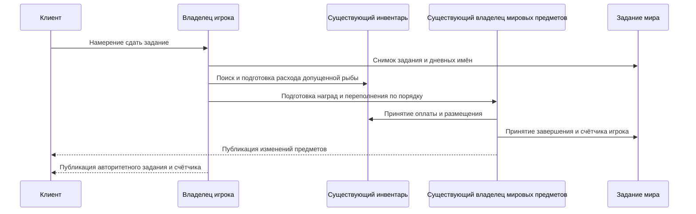

# Авторитетные задания Рыбака, Terraria 1.4.5.8

Рыбак использует существующих владельцев мира, игроков, финансирования инвентаря, диалога с горожанином, исходного RNG и мировых предметов. Клиентское уведомление о завершении запрашивает транзакцию. Оно не подтверждает завершение задания, оплату рыбой или награду.

Текущее задание загружается из канонического заголовка мира. На рассвете, после существующего сброса встряхивания деревьев и до переключения часов на день, мир выбирает новое допустимое задание в исходном порядке повторных выборок и очищает список имён, сдавших рыбу сегодня. Выбор читает сохранённую поверхность и тип зла мира, а также сохранённую и текущую прогрессию боссов/Hardmode. Список содержит все 41 исходный идентификатор.

Для сдачи требуются живой актуальный игрок, сохранённый диалог с текущим живым Рыбаком, представленные факторы цены счастья и настоящая допущенная рыба задания. Исходный `Player.FindItem` ищет в слотах `0..57` по возрастанию. Runtime расходует первую подходящую рыбу до наград, включая последнюю единицу; нельзя пропустить более ранний недопустимый стек ради более позднего доступного для оплаты. Рыба может происходить из начального физического ограничения персонажа до spawn или из принятого добавления серверным владельцем. Начальный импорт персонажа не создаёт приватных оплаченных количеств или происхождения медной стоимости; поздние отчёты не увеличивают этот запас. Повторная сдача в тот же день, устаревший игрок/Рыбак и отсутствие рыбы оставляют количество, исходный RNG и награды неизменными. Текущий игрок также сохраняет локальный признак завершения при изменении имени во внешности. Канонический список имён запрещает повторную выплату тому же имени после переподключения или загрузки мира.

Награды следуют `Player.GetAnglerReward`: основная награда и части костюма, декорация, деньги, затем наживка. Планировщик приостанавливается на каждой исходной границе Item-перегрузки `QuickSpawnItem`, чтобы размещение в инвентаре и RNG переполнения выполнялись до следующего выбора награды. Эти подарки не выбирают натуральный префикс и не попадают в Хранилище Бездны. Выбор недостающих аксессуаров читает существующий инвентарь, банки и сохранённые предметы экипировки/наборов, включая исходные исключения составных аксессуаров. При полном инвентаре работает существующий владелец создания и публикации мировых предметов. Оплата, инвентарь/мировые предметы, курсор RNG и состояние задания принимаются до сетевых наблюдателей.

Отделённый checkpoint-снимок содержит неизменяемое задание и имена. Запись мира заменяет только проверенный блок Рыбака переменной длины, сохраняя флаг спасения Рыбака и все последующие байты. Для изменённой длины заголовка необходим полный разбор метаданных текущей версии до пересчёта смещений секций. Подготовленный runtime-кеш сохраняет те же данные; layout `6` заставляет пересоздать старые одноразовые кеши из `.wld`.

Пакет `74` представляет текущее задание и признак завершения получателя. Пакет `75` запрашивает оплаченную серверную транзакцию. Явный `76` теперь импортирует неотрицательные счётчики Рыбака и гольфа для аутентифицированного текущего игрока; заявленный слот не выбирает другого игрока, а значение `255` игнорируется, как в исходном dedicated-пути. Повреждённый payload является ошибкой протокола; отрицательные счётчики вызывают ограниченный семантический отказ. Runtime передаёт принятое состояние другим игрокам, исключая исходное соединение. До оплаченной сдачи задания в этой сессии отчёты персонажа могут обновлять его счётчик Рыбака. Оплаченная сдача увеличивает счётчик и закрывает его от последующих отчётов; гольф остаётся отдельным импортируемым полем персонажа. Управляемый transfer сохраняет оба счётчика и признак владения оплаченным счётчиком. Пакет `76` никогда не оплачивает рыбу, не выбирает награды, не меняет дневной список и не доказывает новую сдачу. Новое соединение может импортировать явный отчёт персонажа; это граница доверия клиенту, а не вторая база персонажей или наград.

Файлы vanilla `.plr` остаются клиентскими; SSC или серверное хранилище `.plr` не требуются. Прямой probe официального `MessageBuffer.GetData` проверяет девять серверных/клиентских случаев `76` и сырые байты relay. Отдельный перехват настоящего исходного входа фиксирует 356 кадров без `76`; изменение только счётчиков с последующим `TrySyncingMyPlayer` в этой фикстуре даёт ноль кадров. Исходный клиент без SSC также игнорирует собственный `76`. Таким образом, явный импорт/relay исправлен, но эти доказательства не устанавливают автоматическое восстановление счётчика обычного персонажа, переподключение или локальное сохранение персонажа. Исходный UI Рыбака вызывает `GetAnglerReward` локально до отправки `75`; согласование жизненного цикла заданий обычного графического клиента и RNG наград остаётся открытым. Одна серверная публикация `74/76` эти границы не закрывает. Исходящие байты инвентаря `5` также не доказывают принятие серверного расхода рыбы или наград обычным клиентом без SSC и блокировки: настоящий исходный метод приёма игнорирует коррекцию собственного слота. Это отдельное [наблюдение инвентаря](networking-protocol.md) оставляет согласование обычного клиента открытым, не превращая SSC или серверное хранилище `.plr` в предварительное требование. Наблюдения перехватывают исходный метод отправки и не являются приёмкой графического клиента или настоящего TCP. Дневной список завершений `.wld` сохраняется сервером и запрещает вторую выплату в этот день.

Runtime консервативно допускает исходную базовую дальность диалога; увеличенная дальность Journey/аксессуаров здесь не представлена. Неизвестные факторы счастья Рыбака, неподдержанное размещение инвентаря и исчерпанные бюджеты транзакций вызывают отказ до принятия. Мир хранит не более `4096` дневных имён; повторный выбор задания ограничен `4096` попытками с отказом вместо выдуманного запасного результата.

Независимые исходные наблюдения содержат 256 полных вызовов `Main.AnglerQuestSwap` и 480 полных вызовов `Player.GetAnglerReward` официальной Linux-сборки `1.4.5.8`. Наблюдения наград включают гарантированные рубежи, особые награды за Zombie Fish, деньги Hardmode/Expert, три коэффициента счастья и пулы недостающих/составных аксессуаров, с конечным физическим инвентарём и следующим значением RNG. Это ограниченные наблюдения, а не приёмка всей Windows-арифметики, NativeAOT, официального графического клиента или полной совместимости игры. Фактические результаты проверок реализации и оставшиеся общие проверки записываются в agent-memory.

Для persistence также получены независимые наблюдения настоящего мира. Существующий мир размером $8400\times2400\,\text{тайлов}$ с 734 записями сундуков полностью перезаписан и загружен для трёх образов задания/имён: задание `40` с двумя именами, задание `0` без имён и задание `39` с 256 именами. Первый образ увеличивает заголовок на $46\,\mathrm{bytes}$. Последующие байты заголовка и непрозрачные секции NPC/tile-entity остаются точными. Полный метод `WorldFile.LoadWorldFlags` официального исполняемого файла независимо читает все три образа и достигает точного курсора конца первой секции. Это проверка исходного читателя заголовка, а не полный запуск официального мира. SHA256 входного мира: `2289c366a15cdce62fad61888a3bf6f9f76f4e51fcd9b9d99aa8f8c71e4ceec0`; локальные свидетельства: `.cache/angler-world/status.json` и `.cache/angler-world-header/status.json`.

Проверки на копиях показывают, что наблюдения обнаруживают исправленное поведение. Возврат прежнего ограничения одинаковой длины заголовка приводит к отказу настоящей перезаписи с `InvalidHeaderSection`; восстановленная реализация проходит. Вставка одного лишнего RNG-вызова после основного подарка нарушает независимое сравнение инвентаря/следующего RNG; явная пересборка после восстановления исходников проходит все 736 наблюдений правил. Отвергнутые диагностические запуски сохранены отдельно. Обычные regression-тесты дополнительно проверяют существующих владельцев progression, season и invasion patch с 256 дневными именами, чтобы прежние ограничения в 255 имён не блокировали последующие сохранения. Бюджет Рыбака общий с production-политикой загрузки мира; независимые ограничения NPC вечеринки не меняются.
