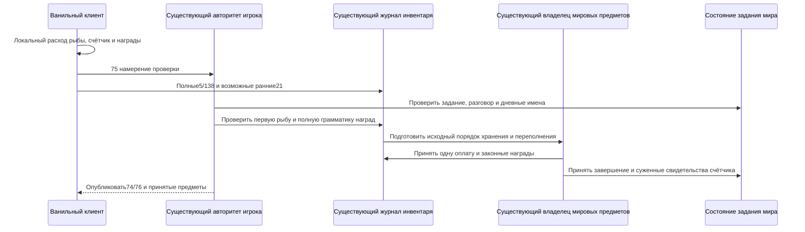

# Авторитетные задания Рыбака, Terraria 1.4.5.8

Кандидат с проверкой клиента следует обычному ванильному UI: `Main.NPCChatText_DoAnglerQuest` расходует локальную рыбу, увеличивает локальный счётчик заданий и выдаёт локальные награды до отправки `75`. Сервер сохраняет `75` как намерение проверить эту операцию. Сам пакет не расходует вторую рыбу, не создаёт дополнительную серверную награду и не завершает день. Полный заявленный результат должен пройти существующую транзакцию инвентаря/мировых предметов. Предварительная Release-сборка кандидата не является завершённой связанной/full/Native-приёмкой или приёмкой графического клиента.

Текущее задание и завершившие его имена принадлежат каноническому состоянию мира. На рассвете после существующего сброса tree-shake и до перехода в день владелец мира выбирает допустимое задание с исходным порядком rejection sampling и очищает дневные имена. Выбор использует загруженные уровни поверхности/флаги зла и загруженную/живую прогрессию; представлены все 41 исходный тип задания.

Сдаче нужны текущий живой игрок, сохранённый разговор с текущим живым Рыбаком, представленные условия счастья и настоящая квестовая рыба. Исходный `Player.FindItem` проверяет слоты `0..57` по возрастанию. Проверка не пропускает раннюю недопустимую подходящую стопку ради поздней оплачиваемой. Рыба может иметь физическое ограничение начального персонажа либо принятое серверное происхождение. Начальный импорт не создаёт приватных оплаченных количеств или медного бюджета. Одна рыба, включая последнюю единицу, расходуется до воспроизведения принятого порядка наград через хранение.

Законность награды охватывает связанный полный результат `Player.GetAnglerReward`: основной выбор, обязательные части костюма, декор, деньги и наживку в исходном порядке QuickSpawn. Проверяются результаты порогов и особых заданий, арифметика Hardmode/Expert и счастья, исключения отсутствующих/составных аксессуаров по инвентарю, банкам и сохранённой экипировке. Подарки используют Item-перегрузку с нулевым префиксом и без помещения в Void Vault. Независимые истории RNG могут выбрать разные законные награды; сервер проверяет полный возможный результат и детерминированный образ хранения, а не перебрасывает его. Инвентарные `5`, `138` и возможное предшествующее зарезервированное переполнение `21` являются наблюдениями в том же существующем журнале; ни одно отдельно не оплачивает награду.

Отсутствие обычного клиентского отчёта общего числа заданий не доказывает нулевой счётчик. Валидатор хранит ограниченные свидетельства совместимых значений счётчика. Проверенная награда сужает эти свидетельства и продвигает их для следующей сдачи; каждый день не начинается с нового произвольного подходящего числа. Явный аутентифицированный `76` может установить известные счётчики персонажа в рамках существующей политики импорта. После принятия оплаченной прогрессии поздние отчёты не выбирают другой порог Рыбака. Управляемый перенос сохраняет свидетельства, счётчик, гольф и владение, не создавая параллельную базу персонажей.

Повтор дня/имени, устаревший игрок/NPC, отсутствие рыбы, неверный комплект, количества/префиксы или неполное доказательство хранения/переполнения не создают вторую оплаченную сдачу. Прогресс, инвентарь/мировые предметы и исходная квитанция принимаются до наблюдателей. Игровой отказ не банит клиента автоматически. Выбор среди исходно возможных наград не устанавливает статистическую честность клиентского RNG.

Пакет `74` представляет задание и дневное завершение получателя. Явный `76` в Playing содержит неотрицательные счётчики Рыбака и гольфа аутентифицированного занятия; заявленный слот не выбирает другого игрока, а `255` игнорируется. Это снимок персонажа, а не оплата рыбой или флаг завершения. Наблюдения оригинала фиксируют 356 кадров входа без `76`, отсутствие обычной синхронизации при изменении только счётчиков и игнорирование собственного `76` клиентом без SSC. Его незаблокированный инвентарь также игнорирует собственную коррекцию `5`. Обычный законный путь проверяет уже созданный локальный образ; эти исходные условия всё ещё ограничивают коррекцию незаконного образа и не доказывают автоматическое сохранение персонажа или согласование GUI. SSC и серверное хранилище `.plr` не требуются. Новый вход с файлом персонажа остаётся классической границей доверия клиенту.

Существующий checkpoint захватывает неизменяемый образ задания/имён. Writer заменяет только проверенный блок Рыбака переменной длины, сохраняя флаг спасения и следующие байты, проверяет изменённый текущий заголовок до обновления offsets и хранит те же метаданные в пересоздаваемых prepared caches. Layout `6` перестраивает старые кэши из `.wld`. Представленная базовая дальность разговора консервативна; неизвестные условия счастья/хранения или исчерпанные рабочие бюджеты дают отказ. У дневных имён и выбора задания разные ограничения `4096`, без выдуманного резервного задания.

Исторические независимые свидетельства включают 256 исходных `Main.AnglerQuestSwap` и 480 полных `Player.GetAnglerReward` с физическим инвентарём и следующим RNG. Они покрывают пороги, Zombie Fish, деньги Hardmode/Expert, три множителя счастья и исключения аксессуаров. Пропуск RNG после основного подарка обнаруживается сравнением. Независимые свидетельства persistence переписывают и загружают настоящий мир $8400\times2400\,\text{тайлов}$ с 734 сундуками для образов задания/имён `40`/два имени, `0`/пусто и `39`/256 имён; оригинальный `WorldFile.LoadWorldFlags` читает изменённые заголовки точно до концов секций. SHA256 входа — `2289c366a15cdce62fad61888a3bf6f9f76f4e51fcd9b9d99aa8f8c71e4ceec0`; свидетельства — `.cache/angler-world/` и `.cache/angler-world-header/`. Эти наблюдения компонентов и предыдущая full/Windows Native/TCP-приёмка `0d48670b` не подтверждают изменённый кандидат проверки клиента. См. [статус рыбалки](fishing-authority-1458.md) и [work state](../agent-memory/work-state.md); официальный GUI и настоящий Linux NativeAOT требуют отдельных свидетельств.
