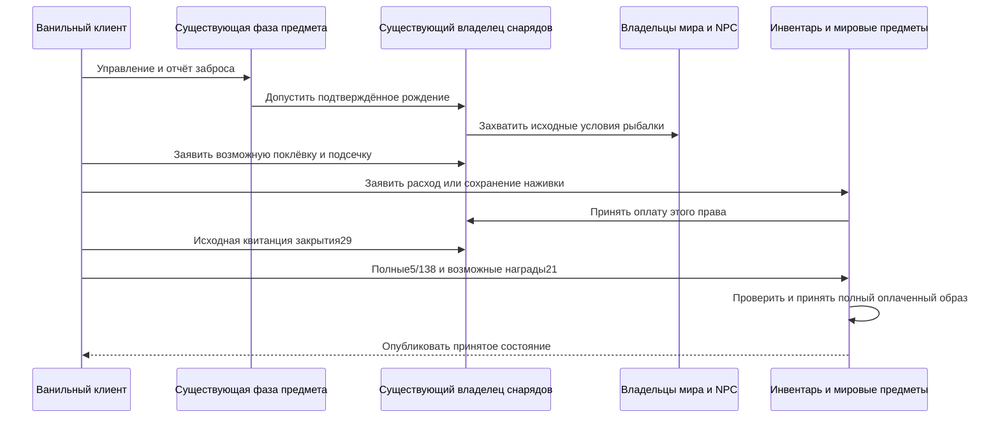

# Авторитетная рыбалка, Terraria 1.4.5.8

Кандидат в `feature/fishing-client-validation-1458` поддерживает роль ванильного клиента в выборе результата рыбалки при обязательной серверной проверке законности и оплаты. Заявленный результат должен быть возможен при представленных исходных условиях и принадлежать текущему действию. Совпадение с независимо продвинутым серверным RNG не требуется. Для кандидата есть предварительная Release-сборка warnings-as-errors; связанные проверки ещё исправляются. Приёмка предыдущего дерева `0d48670b` является историческим свидетельством и не подтверждает изменённый код.

Рыбалка использует существующих владельцев фазы предмета, физических ограничений инвентаря, поколений снарядов, тайлов/часов/погоды мира, NPC и транзакции наград инвентаря/мировых предметов. Отдельного рыболовного инвентаря, базы наград или требования SSC нет. Представленная граница заброса по-прежнему включает одиннадцать базовых удочек с нейтральным префиксом и обычного неперевёрнутого игрока без маунта. Настоящие локальные часы предмета должны дойти до исходной границы Shoot; клиентская анимация `41` не инициализирует их. Отчёт рождения `27` передаёт ограниченное направление и сетевой идентификатор существующему владельцу снарядов.

Для клиентского поплавка последующие `27` о поклёвке и подсечке являются наблюдениями для проверки. Они должны относиться к тому же занятию соединения и поколению снаряда, соответствовать допущенным условиям движения, жидкости, установления состояния и времени, а также задавать результат, достижимый через действующие условия исходного `FishDropsDB`. Сервер захватывает настоящую жидкость, водоём, биом, глубину, время, фазу луны, погоду и прогрессию. Один ID улова или поддельное значение `ai` ничего не выдаёт. Размер стопки должен укладываться в исходные границы, включая условия после расхода последней наживки. У отрисовываемого клиентом `cloudBGAlpha` возможны исходные истории, которые dedicated-сервер без отрисовки не воспроизводит; проверка представляет допущенные возможности, не подменяет их дождевым `cloudAlpha` и не требует одинаковой истории визуального RNG.

Выбор наживки проверяет исходные слоты `54..57`, затем `0..49`; при подсечке поиск повторяется для сохранённого типа наживки. И расход, и сохранение наживки требуют настоящего допущенного запаса. Исходные правила определяют возможные исходы расхода для этой наживки и улова. Группа `5/138` должна доказать настоящий расход либо допустимое сохранение по исходному образу и ограничениям существующего инвентаря. Приватное количество и пустое состояние после последней единицы принимаются до публикации. Повторные, устаревшие или поддельные отчёты не создают новую оплату.

Возвращаемому улову также нужна исходная квитанция закрытия `29` того же действия до принятия образа предмета. Отчёты инвентаря улова и возможное переполнение `21` входят в существующий журнал целого инвентаря. Только полный законный образ награды и оплаты может добавить приватные оплаченные количества или опубликовать оплаченные мировые предметы. Особые уловы через `130` и путь Fishron через `61` используют то же право рыбалки; эти сообщения не являются отдельным разрешением призвать NPC или босса. Принятые рождения проходят через существующих владельцев NPC и прогрессии. Смерть, disconnect, смена выбора или недействительность действия и замена мира не переносят право на награду в другое время жизни игрока.

Движение AI `61` и измерение водоёма используют владельцев тайлов и жидкостей. Вертикальный подсчёт отказывает после `262144` чтений клеток вдобавок к горизонтальному проходу, ограниченному шириной мира; это рабочая граница runtime, а не ванильная константа водоёма. Fishing power читает сканер окружения, загруженные уровни поверхности/камня и флаги seed, живые часы/погоду и загруженную либо завершённую прогрессию Hardmode/Skeletron. Вода, мёд и лава остаются разными исходными контекстами. Существующее улучшение Gummy Worm учитывается через фазу игрока.

Зелья Fishing `2354/121`, Sonar `2355/122` и Crate `2356/123` используют владельца оплаченных расходников и индексированные часы баффов с исходными длительностями и последним положительным обновлением. Сырой снимок баффов не выдаёт и не продлевает эффекты. Расход божьей коровки использует существующих владельцев удачи и погоды; штраф следует после уже завершённого UpdateLuck, а таймер сохраняется при управляемом переносе.

При первом принятом spawn предшествующий образ персонажа `5` фиксирует физические ограничения рыболовного запаса в основном инвентаре и четырёх банках. Он не создаёт приватных количеств подбора или происхождения медной стоимости. Отсутствующий запас ограничен нулём; поздние отчёты его не увеличивают, а respawn и управляемый transfer не заполняют заново. Новый вход с файлом персонажа всё ещё доверяет начальному образу классической модели персонажа. Это не защита между переподключениями от редактирования файлов персонажей.

Наблюдения исходного приёма остаются существенными: клиент без SSC и блокировки инвентаря игнорирует собственную коррекцию слота `5` и собственный `76`. Поэтому обычный законный путь проверяет и принимает уже созданный клиентом образ, а не перебрасывает результат на сервере с ожиданием замены через собственный echo. Эти исходные условия остаются ограничением исправления незаконного клиентского образа. Игровой отказ не является автоматическим баном за чит. Проверка возможных результатов не доказывает непредвзятость клиентского RNG и не отличает удачный законный результат от намеренного выбора другого законного результата.

Декоративные замены поплавков, непредставленные эффекты экипировки/loadout, жизненный цикл прикормки, маунты и перевёрнутые тела, эффекты Shimmer и полный AI/планирование особых NPC остаются вне представленной области. Импортированные неизвестные часы не становятся известными из отчётов. Заявления о полной ванильной совместимости или приёмке официального графического клиента не следуют. Связанные операции описаны в [заданиях Рыбака](angler-quest-authority-1458.md), [ящиках](fishing-crates-authority-1458.md) и [границах протокола](networking-protocol.md).

Исторические исходные свидетельства включают фикстуры правил рыбалки и 42 официальных вызова рождения особых NPC: семь типов, две роли вызывающего и три seed, включая 21 сравнение dedicated-рождения. Предыдущий checkpoint границы персонажа `51197c1a`, интегрированный через `0d48670b`, прошёл focused `556/556`, fast `25350/25350`, один проверенный full `1566763/1566763`, Windows Native проверки сервера/компонента и настоящий Release/Native TCP персонажа. Свидетельство — `.cache/character-sync/acceptance.json`; более ранний прерванный full рыбалки и неудачный live без custody остаются непринятыми. Эти старые артефакты не проверяют новый путь клиентских результатов, коррекцию/принятие GUI, save/reload клиентского состояния или настоящий Linux NativeAOT. Текущий статус приёмки принадлежит [work state](../agent-memory/work-state.md).
