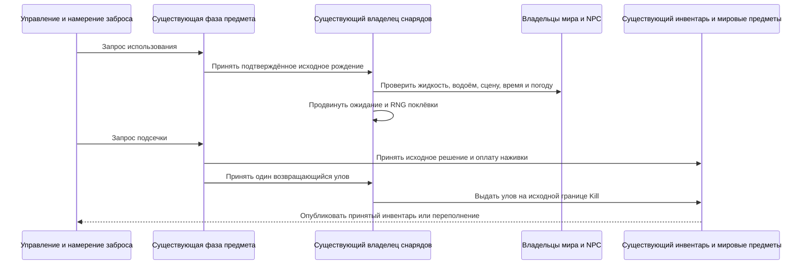

# Авторитетная рыбалка, Terraria 1.4.5.8

Рыбалка связывает существующие владельцы фазы использования предметов, оплаченных количеств инвентаря, снарядов, тайлов мира, рождения NPC и публикации наград. Пакет `27` передаёт ограниченное намерение направления заброса и сетевой идентификатор. Он не задаёт улов, не оплачивает наживку, не перемещает доверенный поплавок и не выдаёт предметы. Локальные исходные часы должны сначала достичь настоящей границы Shoot; пакет `41` не может инициализировать эти часы. Принятый поплавок хранит точное поколение снаряда и занятие соединения.

Текущий допуск охватывает одиннадцать базовых удочек с нейтральным префиксом и обычного вертикального игрока без транспорта. Заброс без наживки разрешён, но не создаёт обычной поклёвки. Исходный выбор наживки проверяет слоты `54..57`, затем `0..49`. Поклёвка запоминает тип наживки; подсечка повторно ищет этот тип в тех же слотах. Существующий владелец инвентаря допускает как принятые сервером оплаченные запасы, так и законный начальный рыболовный запас персонажа. До первого принятого spawn начальный образ `packet 5` фиксирует существующие физические ограничения количества рыболовных предметов в основном инвентаре и всех четырёх банках. Это не создаёт приватное оплаченное количество или происхождение медной стоимости: оба значения могут оставаться нулевыми. Наживка, рыба задания, ящики и три рыболовных зелья используют те же ограниченные количества; сохранение наживки всё равно требует настоящего допущенного запаса. Для отсутствовавших при фиксации слотов/типов ограничение равно нулю. Поздние отчёты не увеличивают ограничения, а respawn и управляемый transfer не заполняют их заново. Оплата принимает расход единицы и её ограничение до публикации, включая каноническую пустоту после последней единицы. Новый вход с файлом персонажа остаётся границей доверия клиенту, а не серверным хранилищем персонажей.

Движение AI `61` использует существующий владелец столкновений с поверхностью и жидкостями. Ширина водоёма и вертикальные столбцы читают настоящие тайлы; исходная проверка твёрдости не считает препятствиями полублоки и склоны. Вертикальный подсчёт отказывается после `262144` чтений ячеек, дополнительно к горизонтальному сканированию, ограниченному шириной мира: это ограничение работы runtime, а не константа водоёма vanilla. Для допуска патологически больших водоёмов потребуется отдельно бюджетируемый запрос. Условия рыбалки используют существующий сканер сцены, загруженные уровни поверхности и камня, флаги seed, живые часы и погоду мира, а также загруженную и новую прогрессию Hardmode/Skeletron. Правила учитывают воду, мёд, лаву, штрафы водоёма, глубину, время, фазу луны и погоду. Gummy Worm добавляет существующий постоянный эффект через фазу игрока.

Три рыболовных зелья используют существующие оплаченный путь выбранного расходника и индексированные локальные часы баффов: Fishing `2354/121`, Sonar `2355/122`, Crate `2356/123`. Сохраняются исходные длительности и эффекты последнего положительного значения, включая обновление таймера из единицы в ноль. Сырой снимок баффов не выдаёт эти эффекты и не обновляет оплаченную длительность. Расход наживки-божьей коровки использует существующие состояние удачи игрока и временный владелец погоды мира; исходный штраф действует после уже завершённой стадии UpdateLuck. Его оплаченный таймер переносится через transfer и не стирается клиентским отчётом удачи.

Текущий исходный `FishingCheck` использует `FishDropsDB`; старый `FishingCheck_RollItemDropOld` не является действующим выбором. Чистая реализация сохраняет упорядоченные исходные данные правил, бросок вероятности до проверки редкости, броски показа рыб и отдельный общий RNG контекста наград. Обычные броски AI и поклёвки используют существующий мировой поток Main; подсечка и оплата — существующий поток UpdatePlayers. Клиентские случайные значения не заменяют эти потоки. Особые результаты NPC входят в существующие распределитель NPC и владелец прогрессии; Duke Fishron использует исходную ветку рождения у центра поплавка. Поддержка рождения NPC отделена от полной совместимости AI.

Принятая подсечка погашает исходное подтверждение до наблюдателей. Повторы управления, поддельный `ai` улова, устаревшие пакеты `27/29`, новые поколения и повторный вход не выдают второй улов. Смена выбора, ограничения управления, смерть, disconnect и transfer завершают соответствующую жизнь актора. Оплаченный положительный улов следует исходному пути возврата и награды Kill; неоплаченная поклёвка не даёт права на награду. Награды используют существующую транзакцию инвентаря и мировых предметов с исходным переполнением. Связанные последующие операции описаны в разделах [задания Рыбака](angler-quest-authority-1458.md) и [рыболовные ящики](fishing-crates-authority-1458.md).

Исходные и runtime-проверки доказывают ограниченную область поведения, а не полную совместимость vanilla. Аксессуары декоративной замены поплавка, непредставленные эффекты рыболовной экипировки и loadout, жизнь снарядов прикормки, тела на транспорте и с обратной гравитацией, а также эффекты Shimmer остаются вне текущего допуска. Неизвестные импортированные локальные часы не восстанавливаются из клиентского отчёта. Файл персонажа vanilla принадлежит клиенту; серверное хранилище `.plr` или включение SSC не являются предварительным требованием. Начальные ограничения рыболовного запаса и явный импорт персонажа через `76` представлены, но наблюдаемый обычный вход оригинала не отправляет `76`. Совместимость обычного графического клиента по жизненному циклу заданий/переподключению и RNG наград остаётся открытой: исходный UI выдаёт награды Рыбака локально до отправки `75`, а серверная оплаченная транзакция сама по себе это не согласует. Исходящие байты инвентаря `5` также не доказывают принятие авторитетного расхода наживки или награды улова клиентом без SSC и блокировки инвентаря; прямой исходный метод приёма в этом случае игнорирует обновление собственного слота. Точные границы наблюдений описаны в [доказательствах протокола](networking-protocol.md) и [заданиях Рыбака](angler-quest-authority-1458.md). Приёмка официальным графическим клиентом, настоящее исполнение Linux NativeAOT и полное соответствие планирования/RNG особых NPC требуют отдельных доказательств.

Бонус облачности читает исходный `Main.cloudBGAlpha`, который изменяется графическим `DrawSurfaceBG`. В dedicated-пути без отрисовки он остаётся нулевым. Поэтому runtime отдельно использует живой дождь и не подменяет этот параметр зависящим от дождя `Main.cloudAlpha`; история облаков графического клиента остаётся вне авторитетного снимка.

Особые уловы используют существующие NPC spawn preview и физический распределитель. Dedicated-рождение через пакет `130` обрезает позицию поплавка до целых пикселей, добавляет смещение Nautilus `64`, затем делит/умножает на `16`; прямой/SP ItemCheck сохраняет пиксельные координаты. Fishron `370` использует центр принадлежащего игроку поплавка плюс `100`, обычные слот/defaults NewNPC и цель `255`. Red Slime `682` принимает существующую запись горожанина, два английских броска имени/профиля и флаг прогрессии до мирового `7`, retention рождения и публичного `23`; те же имя/житель и unlock входят в checkpoint. Уже открытый Red запрещает ещё одно рождение, даже если поклёвка предшествовала открытию другим игроком. Независимые наблюдения: 42 настоящих вызова официальной сборки — семь типов, две роли вызывающего и три seed; 21 dedicated-сравнение runtime проверяет позицию/wet, defaults, цель, AI, время жизни `937`, имена и следующий RNG. Это доказательства рождения/публикации; полный NPC AI, порядок произвольных внешних WetCollision callback и всё клиентское/local расписание RNG не заявляются.

Текущее исправление синхронизации персонажа: свежая Release-сборка warnings-as-errors имеет ноль предупреждений/ошибок, проходят все 556 целевых проверок без пропусков. Они охватывают начальные ограничения рыболовного запаса, явный импорт/relay `76` и границу отложенных отчётов ящика. Прежние рыболовные и интеграционные контрольные точки остаются историческими доказательствами ограниченного объёма. Результаты свежего полного набора, Windows NativeAOT и live для этого исправления ожидают согласованного прогона основного чата; результаты прежних бинарников не переносятся. Точные свидетельства и оставшиеся проверки находятся в [состоянии работы](../agent-memory/work-state.md).