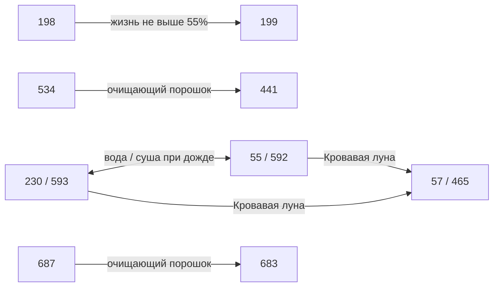
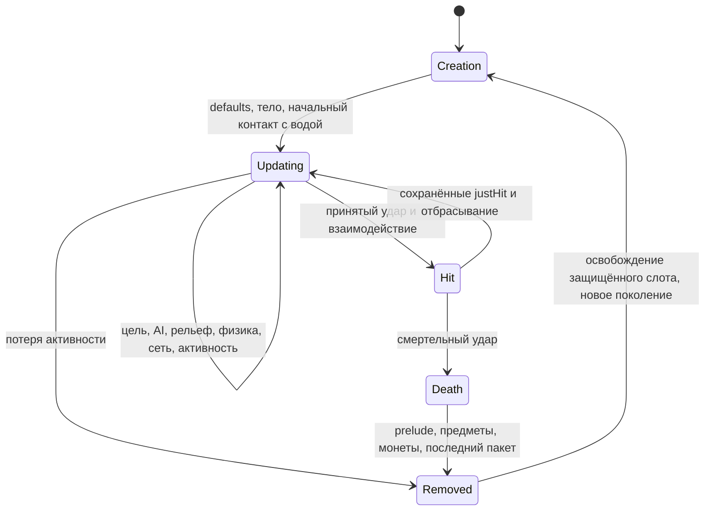

# Runtime-допуск AI3/AI7, Terraria 1.4.5.8

## Семь идентичностей с превращениями: реализация продолжается, 2026-10-29

Следующая исходная группа — `198`, `230`, `532`, `534`, `586`, `593` и `687`. Эти идентичности включены в кандидатной ветке для интеграционных проверок; опубликованная поддержка остаётся на предыдущем принятом блоке, пока AI, превращения внутри коллизии, статусы, бой/добыча, спасение/поимка и публикация не будут проверены вместе. Census кандидата — 270/300 lifecycle-идентичностей AI3/AI7 и 30 creation-only, а во всём каталоге — 534 lifecycle/221 creation-only. Уже поддержанные конечные формы не увеличивают эти счётчики. `FullVanillaAiParity` остаётся false; общей приёмки этого кандидата ещё нет.

Эти переходы происходят в разных точках оригинала. Lihzahrd меняется внутри AI и продолжает тот же вызов. Золотая рыбка меняется после обработки воды и сброса старой скорости/коллизий, до движения по тайлам. Порошок меняет актёра вне его обновления NPC. Итоговая смена идентичности не должна повторно сбрасывать уже вычисленный кадр, позу или движение. Поколение остаётся прежним; отложенные уведомления с исходными промежуточными снимками требуют принятую ревизию и должны прекращаться, если наблюдатель заменил или изменил актёра. Nullable-поля телепорта сохраняют неизвестную импортированную историю; собственный свежий Mystic Frog начинает с нулей, а известный телепорт сохраняет исходный стиль до завершения соответствующего пролога.

Тот же снимок NPC теперь содержит nullable-поля `WetCount` (0..10), `LavaWet`, `HoneyWet` и `ShimmerWet`. Свежие выбранные линии владеют нулём/false; пропущенные поля обновления сохраняют известную или неизвестную историю. Исходное превращение сбрасывает счётчик и сохраняет накопленные флаги жидкости. Независимые парные вызовы исходной коллизии показывают, почему одного текущего контакта недостаточно: сохранённый мёд/shimmer меняет движение в обычной воде, а счётчик меняет RNG при выходе из Shimmer. Поля используют прежние поколение/ревизию NPC и транзакцию статусов; отдельного владельца жидкости или RNG не появляется.

Nullable-поле `BreathCounter` сохраняет исходный счётчик утопления (`0..6`). Известные свежие выбранные акторы и материализованные превращения начинают с нуля; пропуск поля при обновлении той же идентичности сохраняет известную или неизвестную историю. Старые fixtures не получают выдуманный ноль при отсутствии поля. [Корпус исходных фаз](../verification/npc-transform-original-phase-20261029.json) содержит 26 304 настоящих вызова `NPC.UpdateNPC` в независимых контекстах с тремя seed и двумя повторами, включая мокрых жителей после настоящего превращения от powder. Продолжение со счётчиком сохраняет все прежние значения случаев/состояний/RNG/пакетов после удаления только добавленного поля. Ограниченное составное продолжение описано ниже; истории с ненулевым Shimmer остаются явно неподдержанными контекстами.

[Компонент позы](../verification/ground-transform-presentation-20261029.json) содержит 2 442 независимых исходных случая кадров для семи идентичностей и конечной формы `199`. [Продолжение для конечных форм рыб](../verification/ground-transform-fish-presentation-20261029.json) добавляет 288 неизменённых исходных строк для `55`, `57`, `465` и `592`; существующие helpers выбирают их по настоящей конечной идентичности. Проходят все 5 936 частных вызовов обычных тестов, включая 3 206 прежних контролей боя и животных. Контроли с пропусками обнаруживают отсутствие обработчиков рыб/семи форм, смены направления пловца и вращения падающей рыбки. Это ограниченное сравнение поз с инициализированной Linux-сборкой под Windows CoreCLR; общие канонические проверки и приёмка полной фазы ещё впереди. У конечных форм жителей остаётся прежний владелец представления города.

Имена жителей требуют настоящей загрузки `LanguageManager.Instance.SetLanguage("en-US")`. Согласованное продолжение фаз проверяет официальные встроенные ресурсы и реальные размеры категорий 19/27 перед съёмкой превращений от powder; старые следы города с одной legacy-локализацией остаются ограниченной диагностикой. На выделенном сервере `NPC.TrySyncingUniqueTownNPCData` не отправляет пакет 56 и не снимает ожидающий флаг: эта исходная ветка требует `netMode == 1`. Настоящие следы powder с правильной инициализацией сохраняют все пакеты и показывают отсутствие 56 в следующих 32 обновлениях NPC. Baseline личности для подключающегося игрока всё равно требует принятого жителя; выдуманный live-пакет 56 не заменяет его.

[Продолжение diagnostic07](../verification/npc-transform-phase-diagnostic07-20261029.json) подтверждает всё представленное состояние и полные пакеты в 435 контекстах: 11 904 сравниваемые фазы и 2 016 явных отказов для неподдерживаемой истории Shimmer. Совпадают состояние NPC, упорядоченные статусы, сырые игроки, полный физический RNG и флаги мира, включая мокрые городские конечные формы, настоящую историю дома и все 167 байт WorldInfo. [Предыдущий diagnostic06](../verification/npc-transform-phase-diagnostic06-20261029.json) неизменно сохраняет свои 27 красных контекстов пакетов; отсутствовавшие бит появления Shimmer и позднее уведомление о доме исправлены в продолжении. Восемь исходных диагностических полей явно не представлены. Source Spam наблюдается только при совпадающем владельце реестра; отсутствие владельца, включая путь жителей, остаётся явно неизвестным. Это ограниченное сравнение и 7 138 обычных целевых случаев не заменяют ожидающие совместные full-, Native- и live-client-проверки.

В протокольной проекции добавлен необязательный `TerrariaNpcUpdateState.SpawnShimmered`; packet 23 записывает его исходный бит только вместе с `SpawnNeedsSyncing`. [Независимые данные Shimmer](../verification/npc-spawn-shimmer-20261029.json) проверяют известную прозрачность и границу ожидающего появления, включая причинные ошибки со старым кодировщиком. Поддержку Shimmer AI это не открывает. Существующий реестр дома отдельно сохраняет исходные старые координаты и признак бездомности через превращения и загрузку дома. Тихое обновление join-baseline не подтверждает исходный вызов дома; явный вызов подтверждает, даже если аргументы не изменились. Поэтому заключительная сетевая фаза может отправить поздний packet 60 после packet 23.

[Данные взаимодействий](../verification/npc-transform-interactions-20261029.json) также проверяют границу команд комнаты и выселения выбранных `441`/`683`: снимок NPC, предпочтение жителя и тихий join-baseline меняются вместе, сохраняя исходную историю старого дома; немедленный 60 не выдумывается. Команда комнаты очищает существующий таймер; выселение устанавливает 3 600 тиков, а следующий шаг мира наблюдает 3 599. Полное совпадение жилья или `SpawnTownNPC` не заявляется.

Отдельный [компонент позы Yellow Slime](../verification/town-slime-yellow-presentation-20261029.json) сверяет 324 исходных случая с существующей точкой представления города: обратное направление спрайта, пороги ходьбы/ожидания и ограничения кадров в воздухе. Он сохраняет `JustHit` и всё состояние вне позы; пропуск инверсии даёт 324 настоящих ошибки утверждений. [Продолжение для вызова с алиасом](../verification/town-slime-yellow-alias-presentation-20261029.json) дополнительно проверяет настоящий вызов `in value, out value`: неизменённые обычные случаи дают 324 ошибки утверждений на старом полном приложении и проходят с исправленным копированием входа. Успех с отдельной переменной выхода сам по себе не подтверждал эту границу. Эти компоненты не подтверждают полный AI жителей или совместный lifecycle семи идентичностей.

## ??????????? ????????? ??? ???????, 2026-10-29

??? ??????????? ????????????? ?????????? ???????????? ???? NPC/status/??????/?????? RNG, ???????? ???????? ????????? ????????, ?????????? ?????? ? ????????. ???? ???????? ???????? (`436`, `438`, `471`, `508`, `592`) ???????? ??????????? ????????????/?????????/????? ????? ? ???????????? ??????? ????? ??????? ??????? ????? ???????????? ?????????? HP ??????? ? ????????? ???????. ? ?? ?? ??????????? ????? ?????????? ?????????? Ankh ? ??????????? ????? ??????? ????????. Lifecycle-?????? AI3/AI7 ? **263/300 (87,7%)**, creation-only ???????? 37; ??? ???????? ?????????? ?????, ? ?? ?????? ???????? vanilla AI.

[??????? ? ???????????](../verification/ground-combat-acceptance-20261029.json) ????????? ??????????? ??????? ???/???????????, ????????? omission-????????, ?????????? 880 ?????????????? gzip-fixtures, ?????? Windows NativeAOT/???? smoke ? ???????? Release/Native TCP. ?????? ??????????????? ?????? ???????? 1 595 001 ???????? ?? ???? 5 551 ???????: ???????????? ??????? ???? ? ????? ???? ????????, ????????? ?? ???????? ?????. ????? ?????????????????? ??????????? ?????? ???????? ????? ??????? fast-????? ???????? 49 687 ????????, ??????? ??? ?????????? rate-limit facts, ??? ????????? ?????????? 157 runtime DLL. ???????? full XML ???????? ???????; ?????? ??????????????? ?????? ??? ??????? ???????? full-????????? ?? ??????????. ?????????? ???? ?????????? ???????? ???????/?????????????? AI-???? ????????? ????????.

?????????? ???????? ?????????? NPC, ???????? ???????/cross-CLR ???????????? Flinx, ???????? ?????? ??????, ???????????????? ???????/????????? ??????, Linux NativeAOT, ??????????? GUI ? graceful-save shutdown ????????? ?????????? ???????????. ????????? ?????? ???????? ????????? ??????? ?????????? ?? ???????.

## Продолжение наземного боя проходит проверку, 2026-10-29

Следующий кандидат соединяет шестнадцать ранее creation-only идентичностей: `185`, `385`, `482`, `508`, `580`, `582`, `590`, signed `77/-15`, `381`, `382`, `449..452`, `481` и `520`. Положительная `77/77` служит контролем уже существующего допуска. В кандидате 263/300 lifecycle-идентичностей AI3/AI7, 37 creation-only, а глобально 527 lifecycle и 228 creation-only. Это ещё не принятый checkpoint; опубликованный блок наземных critter ниже остаётся принятой базой.

Существующая удерживаемая боевая фаза захватывает поколение NPC, статусы, исходные слоты игроков (включая nullable stealth живого игрока), факты мира и invasion, затронутые секции тайлов и общий RNG. Дальние атаки подготавливают выделение снарядов в исходном порядке до принятия. NPC/status/RNG и подготовленный пакет снарядов принимаются без callbacks; наблюдатели рождения вызываются после этого. Изменение пула снарядов, игрока, тайлов, контекста или RNG отклоняет предложение. Внешние обёртки статусов и CheckActive должны уступать этой фазе, чтобы не принимать тот же статус и не уменьшать время её промежуточного состояния дважды.

[Доказательства исходных компонентов](../verification/ground-combat-source-components-20261029.json) фиксируют независимые захваты оригинала для добычи, кадров и удара Flinx. Реакция Flinx на удар и множитель сильного воздушного отбрасывания проверяются отдельно: прежние различия float при слабом отбрасывании и точности Windows CLR4 x86 остаются явными ограничениями. Выполнение компонента через reflection не подтверждает полную среду запуска/FPU оригинального Windows-сервера. AI/бой новых снарядов, сравнение составной фазы, причинные контроли и общие тяжёлые/Native проверки ещё выполняются. `FullVanillaAiParity` остаётся false.

`VanillaZombieObstacleMotionParameters.ForwardProbeOffset` по умолчанию задаёт15 пикселей от центра тела. Три допущенных antlion явно передают целочисленное `width/2 + 16`, как оригинал. Ветки атаки/защиты с исходным `flag8=false` сохраняют счётчики AI на этапе взаимодействия с тайлами, при этом используют настоящий запрос опоры под NPC.

Необязательная возможность Core `IProjectileInactiveLifetimeMotionStepper` покрывает только проверенный хвост времени жизни `438`/`592`. `SupportsInactiveLifetimeMotion` выбирает поддерживаемый тип; `TryStepInactiveLifetimeMotion` получает следующий subupdate с lifetime0 и причиной `LifetimeExpired`. Он выполняет одно движение без AI, урона, уменьшения времени жизни и повторного Kill. Отказ либо изменение AI/боевых полей отклоняет предложение целиком. Core сохраняет исходную позицию первого Kill и выдаёт одно завершение; итоговый снимок может содержать более позднюю физическую позицию. Это не добавляет постоянного хранилища неактивных снарядов и не допускает такой же хвост для остальных семейств снарядов.

??????????? ? ???? ???????? ???????? ????????? ??????? ? ??????? ????? ??????? ??????? ???????? ? ?? ?????????? ????? ?????. ?? ?????????????? ???????????? ?????????? HP ??????? ? ????????? ???????, ?????, ?????????, ????? ? ????? RNG; ??? ????????? ????????? ????????? ?? callbacks. ???????????, ????? ????????? ??? ?????????? ?????? ?? ???????? ? ??????? ?????? ????? ?? ???????? ???????. ????????? ??????? ????????? ?????????? `netMode=0` ? ????????? ??????????? ????? CombatText ? headless-???????: ???????????? dedicated `netMode=2` ?????????? `Damage_EVP`, ????? ??? TerraRuntime ????????? ??????? ???? ?????? ?? ???????. ???????????? ?????????????? ?? ???????????? ???????? GUI ??? ?????? ???????? ?????? ??????. ????????? ???????? NPC ??? callbacks ????? ???????? ????????? ??????????? ????? ????? callbacks ?????????; ?????????? ????????? ????????? ???????????? ? ????????? ?????????/?????? ????? ????????? ????? ??????? ?????.

### Компонентные доказательства кандидата наземного боя

[Запись исходных компонентов](../verification/ground-combat-source-components-20261029.json) сохраняет два одинаковых захвата оригинала: 384 вызова `HitEffect`, 2 664 вызова `FindFrame` и все семнадцать графов индивидуальной добычи, включая контроль уже существующей положительной `77`. Графы содержат 67 упорядоченных правил верхнего уровня и 38 идентичностей наград. Основные 3 672 контекста и отдельный набор из 81 контекста редкой добычи исполняют исходное разрешение правил и немедленное создание предметов с полными checkpoint RNG; отдельный набор действительно выбирает каждую награду. Это не включает глобальную добычу и полную смерть NPC. Максимальный Expert-стек Flinx задаётся необязательным переопределением существующего normal/Expert common-правила без разделения исходной регистрации и изменения старых правил.

Принятый удар Flinx устанавливает `localAI[0]=1` внутри существующей транзакции HP; отклонённый или устаревший запрос не публикует эту реакцию. Сильное воздушное отбрасывание использует исходный вертикальный множитель `1.5`. Исходный корпус сохраняет все 3 456 профилей с явно заданными параметрами и ещё 432 удара с настоящими Classic/Expert defaults. Они отдельно проверяют реакцию и применимую сильную ветку Linux-оригинала, не закрывая прежнюю общую арифметику слабого отбрасывания: частное сравнение функции всё ещё показывает 36 различий слабой скорости в заданных Linux-профилях, 63 в наборе с естественными defaults и 192 различия скорости относительно компонентного хоста Windows CLR4 x86. Совместимость слабой скорости и полной среды запуска/FPU Windows не заявлена; специальные численные обходы для отдельных NPC не меняют общую платформенную арифметику.

[Компонент обычного движения снарядов](../verification/ground-combat-projectile-usual-20261029.json) и его [продолжение для склонов с изменением только позиции](../verification/ground-combat-projectile-slope-impact-20261029.json) покрывают `436`, `438`, `471`, `508` и `592`. Три seed и два одинаковых повтора исполняют 67 200 настоящих исходных вызовов `Projectile.Update`. Частная сборка вызывает написанный обычный тест через настоящий Core executor и существующих владельцев эффектов: 525 контекстов и 11 361 активный такт мира совпадают по телу/движению, синхронизированному AI, lifecycle и всем 56 физическим слотам RNG. Кандидат включает четыре subupdate для `438`/`592`, описанное выше позднее движение после истечения lifetime, защиту `436`/`592` от ветра, центрированный тайловый collider Javelin и завершение на склоне при изменении только позиции. Kill снаряда `436` расходует исходный выбор количества пыли даже на dedicated-сервере; удаление на границе мира обходит его. [Контроли пропуска с сохранённым API](../verification/ground-combat-projectile-usual-controls-20261029.json) и продолжение для склонов дают настоящие ошибки утверждений без ошибок загрузчика. Это частные компонентные результаты; итоговые обычные xunit, составная NPC-фаза и общая тяжёлая/Native приёмка фиксируются отдельно.

[Продолжение для жидкостей и рождения](../verification/ground-combat-projectile-liquid-birth-20261029.json) расширяет частное сравнение до 690 контекстов обновления, 20 985 активных тактов мира, 105 контекстов подготовленного рождения и отдельного контроля актуальности секции рождения. Настоящие исходные рождения различают первый найденный вид жидкости и `ignoreWater`: последний подавляет только `wet`, тогда как начальные `honeyWet`/`shimmerWet` могут оставаться true; `lavaWet` и `wetCount` начинаются с нуля. Внутренний `InitialLiquid` подготовленного рождения получен закреплённым запросом к тайлам и принят до настоящего наблюдателя рождения. Обновление использует первый контакт WetCollision и независимый полнотелый LavaCollision, очищает историю видов жидкости при выходе и сохраняет существующий исходный счётчик мокроты. Преобразование Shimmer немедленно возвращается для этих враждебных AI1/AI2, но его визуальная вызывающая сторона при входе/выходе всё равно расходует десять выборов `Next(6)`, когда исходные условия допускают их.

Публичный `ProjectileSimulationStepResult` добавляет необязательный `SourceWetCountOverride` (`0..10`, отсутствие сохраняет счётчик) и `ShimmerVisualOffers` (`0` или `10`). Core допускает эти поля только для пяти явных типов и требует `IProjectileSimulationPrePublicationCommitSink.OwnsShimmerVisualOffers` при ненулевом предложении. Существующий sink расходует выборы из общего потока до предложений столкновения, после принятия состояния. Отклонённый actor не может опубликовать их. Контроли пропуска с сохранённым API обнаруживают отсутствие истории жидкости и начальных полей рождения: соответственно 57 и 45 настоящих ошибок утверждений; с исправлением проходят все 796 частных вызовов обычных тестов. Эти числа ещё требуют итогового связывания с неизменённой тестовой DLL и общего gate.

[Продолжение для подготовленного HP server-player](../verification/ground-combat-server-player-preparation-canonical09-20261029.json) проверяет все 65 обычных тестов на неизменённой тестовой DLL diagnostic09. Используется существующий владелец HP/status/immunity server-player с отдельным планированием, полным набором игроков и неизменяемыми уведомлениями после принятия без callbacks. Та же тестовая DLL обнаруживает каждый пропуск защиты актуальности только buff-состояния, теневого иммунитета и защиты публикации после наблюдателя: одна ошибка утверждения и 64 контроля на каждый mutant, без ошибок runner и пропусков. Компонентная математика исходного EVP адаптируется к серверной авторитетности; это не утверждение, что исходный dedicated `Projectile.Update` вызывает EVP в net mode2. Летальные HP/dead/отсутствие нового статуса остаются рабочими, а полная исходная энтропия KillMe/tombstone явно не квалифицирована.

Alpha, rotation и визуальные кадры снарядов остаются диагностическими наблюдениями оригинала вне этой области владения. Попадания в игрока и дополнительные эффекты имеют отдельные доказательства и допуск; необратимые случаи с разрезаемыми тайлами сохраняют существующий отказ целого шага. Кандидат не заявляет завершение всего сервера или `FullVanillaAiParity`.

## Продолжение наземных critter принято, 2026-10-28

[Общая приёмка](../verification/ground-critter-acceptance-20261028.json) проходит Release warnings-as-errors, focused **1,391/1,391** и один unfiltered full **1,575,840/1,575,840** по всем **5,485** обнаруженным методам без failures, errors и skips. Все **34,426** случаев обязательного fast проверены по тому же полному выполнению; отдельный повтор fast не заявляется. Свежий Windows NativeAOT проходит пять smoke-путей и [настоящую TCP-проверку Release/Native](../verification/ground-critter-live-join-20261028.json).

[Сравнение этапов](../verification/ground-critter-phase-final02-20261028.json) совпадает для 63 744 активных NPC-этапов и 960 этапов у поверхности воды, включая полный RNG. Стабильны 60 сравнений прежнего и нового runtime. После удаления 4 224 этапа подтверждают только retained NPC/raw-player/RNG; недоступное владение статусами исключено, strict projection всего корпуса не принято. [Итоговый мост изменения только теста](../verification/ground-critter-final03-test-only-bridge-20261028.json) сохраняет точные shipping-входы и 157 runtime DLL после исправления проверки исторической схемы. `FullVanillaAiParity` остаётся false; Linux NativeAOT, официальный GUI и graceful-save shutdown не проверены.

Принятый блок расширяет существующего retained-владельца с двенадцати кроликов до34 точных идентичностей: новая группа — `148`, `149`, `299`, `300`, `361`, `366`, `367`, `445`, `447`, `538`, `539`, `610`, `616`, `617`, `625` и `639..645`. Пингвины, белки, мыши, крыса, лягушки, скорпионы, черепахи и морская черепаха используют прежнюю транзакцию NPC/status/RNG и владельцев столкновений, боя, поимки и loot. Пустые индивидуальные loot-таблицы заданы явно по оригиналу. Census каталога:247 lifecycle-идентичностей AI3/AI7 и53 creation-only,511 lifecycle и244 creation-only во всём каталоге; положительных AI3 по-прежнему149. Это счётчики явно допущенных ограниченных lifecycle-срезов, а не полного соответствия vanilla.

Белки сохраняют явный live override AI style, когда luck или настоящее имя игрока запускает AI7→AI3 без смены идентичности. Переходный этап завершает AI7; последующие используют fighter-путь и его обычный счётчик застревания, включая значения ноль и один. Friendly следует независимой исходной истории защиты. Ревизии имени/игрока, все затронутые LOS-секции, terrain и мировые факты повторно проверяются до принятия состояния. Завершение жизни при AI7 `ai[3]==1`, неизвестная история статусов и неподдержанные контакты/часы сохраняют отказ целого этапа. Такое же числовое значение `ai[3]` разрешено как существующий счётчик застревания AI3.

[Новый компонентный fixture FindFrame](../../tests/TerraRuntime.Tests/Fixtures/GroundCritterFindFrameLinux1458.provenance.json) содержит542 настоящих вызова оригинала, каждый с независимым повтором, для всех34 идентичностей и девяти семейств поз. Он сохраняет биты frameCounter, именованное состояние и неизменный полный физический RNG. Обычные тесты отдельно сравнивают новый presentation helper. Движение мокрых лягушек/черепах требует также заключительного исходного swim-этапа и актуального запроса water line; изменение общей gravity не воспроизводит этот порядок. Ограниченное сравнение этапа и общие проверки подтверждены выше.

[Компонент рождения и защиты после инициализации](../../tests/TerraRuntime.Tests/Fixtures/GroundCritterBirthProtectionLinux1458.provenance.json) исправляет прежнее предположение о defaults: у `303`, `337` и `540` сохраняется положительный `catchItem=2019`, но после инициализации `Main.npcCatchable` равен false. Поэтому настоящий оригинальный `NewNPC` создаёт их с friendly=false и counter0;91 настоящее обновление не меняет эти поля. Bunny46 рождается с friendly/counter90, получает friendly/counter0 на90-м тике и friendly=false на91-м. Три seed и два одинаковых повтора выполняют24 рождения и2 184 обновления с полными исходными state/RNG receipts. Runtime-тест компонента сравнивает только свежие friendly/counter defaults и их91-этапную историю; полного соответствия тела/RNG он не заявляет. Явная история существующего экземпляра остаётся состоянием владельца, а не defaults для перезаписи. Положительный catchItem в CatchNPC и временная защита поимки — отдельные условия; у морской черепахи625 нет ни предмета поимки, ни защиты.

Первый [компонент state/presentation/currentness](../verification/ground-critter-state-presentation-currentness-20261028.json) связывает свой focused-снимок и три частных контроля с сохранением текущего API. Та неизменная тестовая DLL проходит все 549 выбранных случаев. Удаление только сохранения LOS-секций ломает assertion дальней секции, тогда как контроль настоящего имени проходит; замена renderer только новых семейств прежним renderer кроликов даёт 318 assertion failures, сохраняя все 150 старых frame-контролей; удаление сохранения AI style ломает assertion разреженного обновления. Во всех контролях ноль ошибок runner и пропусков, заменена только одна DLL, остальные 157 неизменны.

[Продолжение для итогового кандидата](../verification/ground-critter-state-presentation-currentness-final02-20261028.json) добавляет исправление аудита: ранний удар у нижнего края мира проверяет текущий AI style7, поэтому белка с той же идентичностью, уже перешедшая в AI3, продолжает этап вместо смерти или отказа. И внешний prepass, и terminal-владелец проверяют это исходное условие. Свежие тесты используют настоящий переход Cenx и независимо проверяют обе границы; удаление каждой проверки даёт собственный assertion failure. Компонентная тестовая DLL final02 проходит 551 выбранный случай и повторяет три прежних контроля. Она также связывает общий focused-результат: 1 381 случай, 107 методов, ноль failures/errors/skips, и явный мост байтов provenance LF/CRLF. Это ограниченные компонентные доказательства; общая приёмка final03 и мост изменения только теста приведены выше. [Итоговые доказательства боя/поимки](../verification/ground-critter-combat-catch-final02-20261028.json) отдельно квалифицируют инициализированные caller- и wire-входы.

Принятая ниже контрольная точка семнадцати врагов остаётся исторической и неизменной. Прежние описания каталога только из двенадцати кроликов и универсальной90-тиковой защиты рождения заменяются точными идентичностями и инициализированными исходными фактами этого продолжения; старые fixtures сохраняются без перезаписи ожиданий.

## Группа обычного ближнего боя принята, 2026-10-28

Семнадцать явно перечисленных AI3 используют существующую отложенную фазу NPC/status/RNG, движение подтипов, полное представление допущенных состояний и владельцев боя и специфичного loot. Runtime-допуск AI3/AI7 вырос с 208 до **225 из 300**; 75 идентичностей остаются creation-only. Допущены **149 из 191** положительных AI3. Всего явно допущены 489 lifecycle-идентичностей; 266 definitions остаются creation-only, одна с нулевым телом — metadata-only. Это счётчик явно поддержанных срезов, а не полного vanilla-поведения.

Сравнение оригинала и runtime на трёх seed даёт **55 872 совпадающие фактические NPC-фазы**, включая статусы, именованное состояние, фактические raw-данные игроков и все физические слоты RNG. Шестьдесят сценариев old-to-new сохраняют прежнее поведение; их прежние отличия кадров от оригинала не включены в source parity. Независимо захвачены dedicated-server HitEffect Ghoul, 43 упорядоченных правила специфичного loot и все 48 создаваемых наград. Настоящие пропуски, дополнительный RNG и контроли с неизменными тестами обнаруживают нужные ошибки. Защита от устаревшего контекста смерти отклоняет изменения Don't Starve, ночного Blood Moon и ветра для kite до adoption.

Release-сборка с warnings-as-errors, focused `8,221/8,221`, fast `33,662/33,662` и один полный нефильтрованный прогон `1,575,076/1,575,076` прошли без failures, errors, skips и not-run. Фактический XML покрывает все `5,452` обнаруженных методов. Свежий Windows x64 NativeAOT прошёл все пять smoke-проверок. Настоящие TCP-проверки Release и Native прошли два полных входа, исходную последовательность Banner/Bestiary `82` до `49/129`, движение/чат и replacement Hello. [TCP-доказательства](../verification/npc-ordinary-melee-live-join-20261028.json) сохраняют эту ограниченную область. [Совмещённое подтверждение](../verification/npc-ordinary-melee-acceptance-20261028.json) связывает точные байты source/DLL/index и области компонентов. Все 891 исходных fixtures неизменны; новых shipping-проектов и зависимостей нет.

`FullVanillaAiParity` остаётся false. Контакты с неподдержанными дверями/переключателями, пересечение с friendly NPC, Shimmer/lava, статусы без владельца и социальные humanoid-позы сохраняют отказ целой фазы. NPC-oracle не сравнивает полный world tick; специфичный loot не включает глобальные правила и полную смерть оригинала. Linux NativeAOT, оригинальный GUI и сохранение при штатном завершении этим checkpoint не подтверждены.

## Происхождение компонентных доказательств ближнего боя

Связанный путь смерти также требует всех специфичных для NPC таблиц loot. [Исходная компонентная запись loot](../verification/npc-ordinary-melee-loot-20261028.json) наблюдает все семнадцать таблиц и 43 упорядоченные регистрации верхнего уровня, включая проверенную пустую таблицу `140`. Новые таблицы сохраняют проверки еды/статуй, повторные Expert-броски статусного предмета, цепочки неудачных бросков, выбор из десяти видов мха, условия Don't Starve, ночной Blood Moon и порог ветра. Неизвестные обязательные факты мира отклоняют смертельный удар; отсутствие возможности отдельного bad-luck-only броска отклоняет такое правило, а не заменяет его обычной удачей. Используются существующие владельцы global loot, выделения предметов и сохранённой смерти.

Два одинаковых основных захвата выполняют по 7 344 явных контекста специфичного loot с полными точками RNG после каждого правила верхнего уровня и немедленным созданием предметов оригиналом. Отдельный, также повторённый исходный поиск сохраняет 58 контекстов, которые вместе выбирают все 48 идентичностей наград. Настоящие параметры предметов и естественные префиксы захвачены отдельно. Эти наблюдения не включают глобальные правила или полную смерть/обновление; они подтверждают компоненты, при отдельной записи совмещённой проверки выше.

[Контроль пропуска в обычных тестах](../verification/npc-ordinary-melee-loot-causal-20261028.json) сохраняет текущий API и меняет только центральный hook регистрации в отдельно собранном Gameplay DLL. Тот же первый свежий test DLL проходит все 7 615 случаев с исправлением; пропуск hook даёт 7 423 настоящих ошибки утверждений и 192 успешных случая, без ошибок runner и пропусков. Точный снимок исходников/DLL сохранён отдельно от последующей совмещённой проверки.

[Финальный causal successor gate03](../verification/npc-ordinary-melee-loot-causal-final03-20261028.json) повторяет эти точные результаты с финальным test DLL и тем же private mutant, без пересборки. Все 372 входа исходников/сборки shipping-кода и остальные 157 DLL совпадают с первым свежим снимком. Это связывает компонент с финальным тестовым бинарником; совмещённая серверная проверка записывается отдельно.

Реализованная группа включает `44`, `104`, `140`, `181`, `196`, `197`, `464`, `470`, `489`, `524..529`, `536` и `691`. Она использует существующую отложенную транзакцию NPC/status/RNG, общую стратегию бойца и владельца движения мира. Неизвестные факты world clock и неподдержанные контакты, статусы или humanoid-позы сохраняют отказ целой фазы. Принятые записи NPC-фазы и совмещённой проверки выше сохраняют точную область; `FullVanillaAiParity` остаётся false.

Ghoul `524..527` требует энтропии серверного `HitEffect`, даже когда частицы не выделяются. Несмертельный удар выполняет по одному `Next(4)` на каждую итерацию ниже порога double `resolvedDamage / lifeMax * 20`; дробный порог включает последнюю итерацию. Обычный Ghoul `524` делает выбор до визуальной проверки нулевого цвета. Смерть выполняет двадцать `Next(3)`. Общий владелец получает округлённый урон после защиты через каждого вызывающего; пакет `28` раньше его не передавал, что также подавляло существующие зависимые от урона выборы Lava Slime.

[Компонентная запись Ghoul](../verification/npc-ghoul-hiteffect-20261028.json) фиксирует два побайтово одинаковых захвата только оригинала: по 258 настоящих вызовов `HitEffect` и 42 несмертельных `StrikeNPC_Inner` на трёх seed. Сравниваются курсор и все 56 физических слотов RNG, дробные/нулевые/смертельные профили урона, тринадцать контрольных NPC группы и существующие Lava/Eskimo/Gold. Исходный урон `35` при защите `19` или `20` превращается в `25` до `HitEffect`. Все 434 направленных случая проходят на первом снимке реализации; тот же test DLL с заменой только Application DLL на предыдущую версию получает 274 ошибки утверждений и 160 успешных случаев, без ошибок runner и пропусков. Проверены принятые пути окружения/контакта/клиента/подготовленного снаряда, отказы, границы отдельного предпросмотра смерти и однократная публикация. Итоговая точка смерти проверяет сохранённую транзакцию; исходный probe не выполняет полную смерть/loot или `UpdateNPC`.

[Финальный replay Ghoul](../verification/npc-ghoul-hiteffect-final03-20261028.json) использует финальные test DLL и App-окружение gate03: 434 успешных случая против 274 ошибок утверждений и 160 успешных случаев при замене только App DLL на прежнюю версию, без ошибок runner и пропусков. Исходный компонентный корпус не меняется; отдельно фиксируется финальный `Loot.cs`, включая последующую работу с условиями и bad luck.

## Обычные варианты Bunny: существующий владелец runtime

Для обновления пяти обычных вариантов требуется явно известный **неактивный Blood Moon** из существующих авторитетных часов мира. Отсутствие часов означает неизвестный контекст. При активном или неизвестном Blood Moon отклоняется вся NPC-фаза, включая раннюю смерть у нижней границы мира; сохранённое нейтральное условие повторно проверяется перед принятием NPC/status/RNG. Прежний допуск семи gem-bunny сохранён. Используется настоящий флаг часов без GoodWorld-фильтра, применяемого door AI.

Исходный `UpdateNPC` вызывает `UpdateNPC_BloodMoonTransformations` до гравитации и AI. Условие проверяет dedicated/nonclient mode и `Main.bloodMoon` без отдельной проверки времени суток. `AttemptToConvertNPCToEvil` включает все пять новых вариантов и превращает их в `47` либо `464` по `WorldGen.crimson`. Ограниченный запуск исходной сборки наблюдает все 30 превращений и шесть неизменённых gem-контролей в двух evil-world контекстах. Реализация настоящего владельца превращения остаётся отдельной задачей; обычное движение не заменяет эту исходную фазу.

Существующий принятый нерезидентный AI007 теперь обслуживает Bunny `46`, Slimed Bunny `303`, Xmas Bunny `337`, Gold Bunny `443` и Party Bunny `540` вместе с gem-bunny `646..652`. Четыре creation-only определения получают runtime-допуск; у `46` уже были lifecycle defaults, но отсутствовала эта диспетчеризация обновления. Общий каталог содержит ровно двенадцать идентичностей и используется для начальной защиты, движения, coverage, statue-catch публикации и принятых сетевых фаз. Остальные AI7 не допускаются. Сохраняются прежние исходные catch-item факты: `2019` для четырёх обычных вариантов и `2890` для Gold Bunny.

Семантический анализатор применён к настоящему исходному `NPC.AI_007_TownEntities` с `NPC.cs` и `Main.cs`. Сам entry квалифицирован без diagnostics. Ограниченный inventory из 27 методов остаётся отклонён как полный анализ: сохранены ограничение глубины, два неквалифицированных helper и 149 opaque frontiers. Это инструмент поиска и проверки общего пути, а не доказательство полноты эффектов. Допуск белок отклонён после проверки ветки player luck и превращения во враждебного NPC: существующий владелец Bunny её не исполняет. Explosive Bunny тоже исключён.

Историческое доказательство до добавления BloodMoon-fence:

Серверный HitEffect Gold Bunny также владеет RNG вызывающей стороны: оригинал вычисляет десять выборов `Next(232,234)` при нелетальном попадании и двадцать при смерти до раннего выхода `Dust.NewDust` на сервере. Существующие общие владельцы удара и смерти теперь сохраняют эти выборы. Принятые пути environment, NPC-contact и prepared-projectile расходуют их один раз; отказ, нулевой урон и устаревшие повторы не принимают их. Изменение ограничено типом `443`, а не всем списком золотых животных.

[Доказательства Gold Bunny](../verification/npc-gold-bunny-hiteffect-20261028.json) содержат двенадцать компонентных наблюдений оригинального `HitEffect`, включая пять незолотых контролей, и полные физические состояния RNG. Отдельная исходная последовательность вызывает `HitEffect`, `NPCLoot_DropMoney` с нулевой стоимостью и `NPCLoot_DropHeals` в исходном порядке. Для её профиля с seed `1458`, невредимым игроком с нулевой удачей и стоимостью/уроном `0` курсоры равны `20`, `29`, `31`: нулевая стоимость всё равно вызывает денежные предложения, а предложения лечения предшествуют проверкам урона и показателей игрока. Это не делает общий расход RNG смерти фиксированным. Неизменённая DLL обычных регрессий проходит все 17 случаев с исправлением и обнаруживает пять ошибок утверждений на прежнем runtime, без ошибок runner и пропусков. Это компонентные и причинные наблюдения; они не захватывают полный исходный удар/loot/update и не подтверждают итоговые общие gates.

Независимый запуск сравнивает настоящий `NPC.UpdateNPC(0)` закреплённой Linux-сборки с настоящим `ServerRuntimeState.Tick` на одинаковом явном полу, активном игроке, полной именованной NPC-проекции и физическом checkpoint `Main.rand` из 56 слотов. Прежний runtime расходится во всех 1 680 фазах новых вариантов при seed `1458`, а существующий gem-bunny контроль совпадает во всех 336 фазах. Отброшенный bootstrap без активных игроков корректно приводил к исходному удалению по активности и не считается доказательством движения. Обычный regression проверяет настоящие defaults защиты и точные исходные position/velocity первого шага через существующую серверную композицию, а не только census каталога.

Историческая [запись компонентных доказательств](../verification/npc-bunny-family-20261028.json) закрепляет три seed (`1458`, `42`, `8675309`): 6 048 настоящих исходных обновлений точно совпали с 6 048 обновлениями runtime. Реальный пропуск первого такта меняет все 2 016 фаз состояния; один настоящий лишний RNG-бросок меняет все 2 016 RNG-checkpoint и затем 1 584 фазы состояния. На том checkpoint неизменённый обычный Fact падал с прежним Core DLL из-за отсутствия начальной защиты и проходил с исправленным DLL. Это компонентное доказательство; итоговая совместная приёмка фиксируется отдельно.

Набор состояний и прежние отказы целой фазы сохранены. Для natural spawn, resident-ролей, pressure plates/mines, Shimmer, превращающихся critter и `FullVanillaAiParity` новых заявлений нет. Исторические gem-bunny корпуса ниже сохраняют исходную область из семи идентичностей.

## Продолжение Stardew-анимации Dryad

Существующая единая town-фаза теперь продолжает уже активное состояние `24` Dryad вместо отказа от каждого обновления. Сохранены исходные горизонтальное торможение и мировая физика, направление вправо, таймер на 480 тактов и возврат к обычному idle/cooldown. Исходная последовательность чередует кадры Dryad `19`/`20`, создаёт emote `87` на 60 тактов в такт анимации `60` и emote `3` на 90 тактов в такт `150`, а с такта `240` использует стоячий кадр `0`. Эффекты публикуются после существующей фиксации NPC/status/RNG; новый владелец или очередь отложенных emotes не добавлены.

[Реальный AI7 oracle](npc-source-tools.md#продолжение-анимации-dryad-ai7) покрывает полное продолжение и последующий idle RNG. Запускающее взаимодействие `HaveDryadDoStardewAnimation` остаётся отдельной задачей. Состояние `24` других NPC, магический бой состояния `14` и мокрые жители сохраняют запреты допуска. Ограниченное продолжение не меняет количество definitions и `FullVanillaAiParity`.

[English](../en/npc-ai3-ai7-runtime-1458.md) · [Каталог definitions](npc-ai3-ai7-roster-1458.md)

Параметры создания и runtime-допуск — отдельные контракты. В исходном каталоге среди 300 идентичностей AI3/AI7 было 133 записи `CreationDefaultsOnly`. Runtime-работа начинается с явно выбранной связанной группы, проверяет исходные пути обновления и смерти и сохраняет запрет для остальных идентичностей. `FullVanillaAiParity` остаётся false.

[Доказательства NPC-фазы после ограничения](../verification/npc-bunny-family-gate04-20261028.json) используют явно принадлежащую runtime неактивную Blood Moon и существующее подавление spawn cycle. Сравниваются 6 048 исходных вызовов `NPC.UpdateNPC` и 6 048 настоящих продвижений фазы через `NpcAuthority.AdvanceWorldTick`/`TickSimulation`, включая полное именованное состояние NPC и физический RNG. Настоящие контроли пропуска и лишнего обращения к RNG по-прежнему отклоняются. Этот точно ограниченный NPC carrier не является сравнением RNG полного `ServerRuntimeState.Tick`: добавление авторитетных часов также включает продвижение мирового времени и другую работу world loop вне оригинального вызова NPC.

## Первая группа: размерные варианты нежити и обычных скелетов

Группа содержит **30 идентичностей**: положительные `201`, `202`, `203`, `635`; знаковые `-13`, `-14`, от `-26` до `-37` и от `-44` до `-55`. Знаковые варианты сохраняют исходный положительный тип, физическое тело, арифметику сложности, деньги и идентичность создания. Точный список знаковых вариантов дополнительно требует допущенного положительного родителя; ни принадлежность AI3, ни зарегистрированный родитель не разрешают остальные варианты.

У скелетов `201/202/203` разные скоростные диапазоны; `635` использует обычный диапазон скелета. Все четыре применяют исходную поправку скорости от scale. `-13/-14` используют ближний выпад Angry Bones и его исключение из дневного ухода. Bone Throwing Skeletons `449..452`, Giant Skeleton `-15` и Torch Zombie `590` имеют дополнительные ветки и не входят в эту группу.

Реализация использует существующие `RuntimeNpcStore`, targeting dispatcher, world collision, общий RNG, interaction ledger, damage/death pipeline, аллокатор мировых предметов и replication registry. Второй симуляции NPC и независимого потока игрового RNG нет.

Для знаковых тел существенно целочисленное деление размеров пополам. Пробы препятствий, дверей и ступеней AI3 используют целочисленное деление; нижняя центральная точка `NewNPC` использует вещественное деление. Выбор цели сравнивает физические центры, а разворот — целочисленный прямоугольник цели. Промежуточное вертикальное направление может запросить `netUpdate`, даже если AI3 затем восстановит прежнее итоговое направление. Разворот стоящего на земле NPC в `FindFrame` выполняется после столкновений. Expert-прыжок к расположенной выше цели следует за прыжками от препятствия и застревания, предшествует специальному выпаду и самостоятельно не запрашивает `netUpdate`.

Существующая граница создания теперь выполняет мировой `WetCollision` до публикации рождения NPC со столкновениями. Используется окончательное физическое тело; повторный вход с изменением состояния запрещает публикацию внешнего рождения. Отложенные previews обычного появления сохраняют этот запрос и требуют прежних проверок актуальности мира, store и RNG. Проверка активности использует текущее тело NPC, целые половины размеров и настоящее тело игрока, включая увеличенные hitbox.

Сетевой intent AI передаётся вместе с принятым обновлением и не сохраняется в следующем состоянии симуляции. `INpcStateCommitSink.NpcVanillaAiStateCommitted` отличает настоящий исходный сетевой этап от немедленных боевых и ручных публикаций; реализация по умолчанию сохраняет существующие sinks. Replication registry владеет ограниченным состоянием cooldown для точного поколения и выбранной группы. Исходные принудительные запросы и сохраняемые spam/full-cooldown запросы используют оригинальные счётчики обычных NPC. Остальные типы сохраняют прежнюю политику репликации. Baseline для позднего подключения обновляется при каждом принятом состоянии, даже если live-пакет сейчас не требуется.

Тот же registry выполняет исходный proximity stream для этой группы, включая два одинаковых пакета при совпадении принудительного запроса и proximity stream. Кредиты получателя хранятся в фиксированных массивах физических слотов с полным поколением и сбрасываются после принятой отправки; повторные поколения не увеличивают словарь на соединение. Прежний Moon Lord transport сохранён как отдельная ограниченная legacy-политика. Исходный proximity-каталог по умолчанию true и исключает `396..398`; его прежняя обратная трактовка не объявляется source parity за пределами новой группы.

Процентная арифметика оригинального Windows может менять стопку монет на целочисленной границе. `VanillaNpcMoneyContext1458.WindowsArithmetic` задаётся явно и по умолчанию false. Application включает доказанное Windows-правило только для точной группы из 30 идентичностей; остальные допущенные акторы сохраняют прежнюю арифметику до собственной Windows-проверки. Отвергнутый глобальный прототип выявил 60 отличий от сохранённых Linux-ожиданий; эти ожидания и assertions сохранены. Поправок стопки или исключений для конкретного значения нет.

Оба общих запроса контакта с жидкостью теперь используют исходные целочисленные половины тела и пробы. `TryGetWetContact` сохраняет порядок первого совпавшего тайла; агрегирующий `GetLiquidContacts` сохраняет существующее объединение видов жидкости. Полнотелый запрос лавы остаётся отдельным. Повторённая исходная матрица содержит по 5 824 строки на редакцию: четырнадцать нечётных тел нежити, границы и объёмы жидкостей, унаследованные уклоны и порядок смешанных жидкостей. Прежняя DLL расходится в 864 строках; исправленная совпадает во всех. Реальная граница создания также проверяет нечётное тело `-27` по этим исходным контактам.

Обычная аутентифицированная поимка использует существующий журнал публикации предметов и владельца точного удаления NPC. Оба состояния и общий RNG принимаются до callbacks предметов; публикация сохраняет порядок предмет `21`, владелец `22`, неактивный NPC `23`. Callback не может обновить или повторно поймать удалённое поколение и не может удалить его замену после истечения spawn protection за два реальных обновления. Пользовательские random adapters без конкретного общего владельца сохраняют прежние более узкие гарантии; транзакционный rollback произвольных callbacks хоста этим не доказывается.

`INpcStateCommitSink.NpcCatchCommitted` передаёт сохранённый `spawnNeedsSyncing` в репликацию без второго владельца NPC snapshot. Исходный сетевой путь отправляет один неактивный `23` при поимке до первого AI; default-метод sink сохраняет уведомления активации/удаления для обычных lifecycle-наблюдателей. Fanout приложения и расширений передают типизированные catch- и vanilla-AI-callbacks, а также уведомления о сохранённом pending-рождении.

## Вторая группа: драгоценные кролики

Точные типы `646..652` используют нерезидентные `NoneBehavior` и физику `GenericGround`. Их AI7 не даёт роли жителя, жилья, магазина или телепортации. Домашние тайлы служат исходной AI-памятью и метаданными пакета `60`; для этих нерезидентов они также входят в late-join replay домов. Поимку разрешают существующие явные сведения о catch item независимо от AI style.

Существующий dispatcher планирует исходные состояния `0/1/8`, инициализацию и fallback сырой цели `255`, домашнее поведение и отдых, условия дня/ночи и погоды, развороты от опасности, обрывы, прыжки, утопление, ступени, платформы, кадры и удаление по активности. Принятый план использует существующий preview хранилища, общий RNG, физические столкновения и владельца статусов. Изменение секций мира, игроков, соседних NPC, ревизии или RNG отменяет принятие всей фазы.

Исходная временная защита catchable NPC хранится в nullable-полях `CatchableNpcTempImmunityCounter` и `ReleaseOwner` существующей simulation-ревизии. Точные gem-типы начинают с `90/255`; пропуск полей при обновлении той же идентичности сохраняет их, а смена definitions сбрасывает к исходным defaults. Фаза после AI уменьшает счётчик, сохраняя `Friendly`; обновление 91 снимает этот флаг и запрашивает синхронизацию. Акторы от статуй и выпущенные игроком снимают защиту сразу. Неизвестные импортированные значения counter/owner отклоняются.

Регенерация, враждебный контакт, лава и смерть у нижней границы мира используют существующих владельцев урона, loot, prelude, статусов, предметов и RNG. Контактная смерть сохраняет источник loot до столкновения и тело последнего пакета после столкновения. Истечение Stinky, обновление от тайла `666`, случайные аргументы визуальных эффектов и снятие водой имеют отдельные исходные наблюдения; снятие водой может отправить `54` после смертельного `28` и loot, перед неактивным `23`. Late join видит окончательно принятые buffs и home state. Поимка statue-актора сохраняет исходный smoke RNG и порядок неактивный `23`, затем `106` с упакованными координатами; признак статуи и release owner также передаются в `23`.

Уникальный исходный корпус на редакцию содержит 6 286 реальных вызовов `UpdateNPC`, 252 внутренних вызова `AI_007` и 42 вызова `CatchNPC`. Механические и сетевые копии одних наблюдений не считаются повторно. Включены 1 974 обновления до завершения временной защиты, 546 совмещённых wet/status-обновлений, 168 обновлений с опасностью/утоплением на границе защиты и свежие рождения без игроков, с мёртвым или далёким игроком. Скорость бегства читает принятый `Friendly` до AI; защита истекает после AI. Новая капсула обнаружила и исправила безусловное ускорение, которое спокойные последовательности истечения защиты не выявляли. [Манифест происхождения gem-bunny](../../tests/TerraRuntime.Tests/Fixtures/npc-gem-bunny-runtime-1458.provenance.json) фиксирует повторённые артефакты и исходные helpers. Немедленная поимка pending-рождения имеет [отдельную исходную капсулу из 28 случаев](../../tests/TerraRuntime.Tests/Fixtures/npc-pending-catch-1458.provenance.json) с аутентифицированной допустимой позицией игрока. Общая post-grace-проверка зафиксирована ниже.

`FullVanillaAiParity` остаётся false. Первый контакт с Shimmer/Faeling-контексты, Shimmer history, конвейеры, более широкие импортированные DOT histories, неподдержанные AI/counter/owner state, нестандартный максимум жизни и ответные контакты Bee/SmallBee остаются явными запретами всей фазы. Упорядоченные обычные gem spawn pools также закрыты до проверки соседних gem-squirrel и других предшествующих critter-выборов; неподдержанные исходы нельзя пропускать или перебрасывать.

## Независимые наблюдения и проверки

[Манифест происхождения числовых fixtures](../../tests/TerraRuntime.Tests/Fixtures/npc-undead-runtime-1458.provenance.json) фиксирует хеши обоих исходных бинарников, сжатых и распакованных fixtures, число групп и обновлений и требования к bootstrap. Редакция исходного сервера указана отдельно от среды исполнения.

Сохранённые корпуса Windows x86/.NET Framework и Linux-assembly/CoreCLR получены отдельно повторными запусками оригинальной сборки. Сохраняются только числовое состояние, байты протокола и собственные названия сценариев. Повторно используются существующие полные матрицы создания/defaults и корпус undead loot/death.

| Наблюдения на платформу | Групп | Настоящих этапов `UpdateNPC` | Объём |
| --- | ---: | ---: | --- |
| Рождение, обновления, взаимодействие, нелетальный и смертельный удар | 240 | 1 920 | Все 30 идентичностей, четыре профиля сложности/мира, два контекста поверхности |
| Смена цели, дневная дистанция, препятствия, платформы, вода | 300 | 13 688 | Все 30 идентичностей и два seed RNG |
| Цель сверху, видимость и прыжки с помощью платформ | 1 440 | 19 104 | Четыре представительных тела, Classic/Expert/Good, пороговые границы и последовательности до приземления |
| Удар с отбрасыванием, последующие обновления, cooldown и смерть | 90 | 6 210 | Все 30 идентичностей в Classic/Expert/Good; восемь предыдущих и 61 последующее обновление |

`Main.isThereAWorldSurface` вычисляется как `worldSurface > 50`; оба полных lifecycle-контекста явно сохраняют этот факт. Значение поверхности 40 — допустимый контекст без поверхности, а не доказательство обычного поверхностного мира. Запрет dungeon loot проверяется с соответствующими принадлежащими runtime фактами.

Loot-oracle обязан инициализировать `ContentSamples.NpcsByNetId` до `ItemDropDatabase.Populate`. Оригинальная база распространяет положительные регистрации на знаковые варианты через эти samples. Ранние captures без этой инициализации отвергнуты как доказательство смерти знаковых вариантов; их идентичные этапы рождения, движения и нелетального удара учтены отдельно. Итоговый сохранённый корпус создаёт все 762 исходных sample-записи, включая 65 знаковых, через оригинальный `SetDefaults`.

Runtime-проверки сравнивают последовательные движение, AI/local state, смену цели, столкновения, жидкости, жизнь, предметы и следующее значение общего RNG. Выполняются реальные публикации пакетов и late-join baselines, удаление после смерти, spawn protection и отказ для старого поколения. Существующая death-матрица дополнительно охватывает все 3 120 контекстов четырёх новых положительных типов. Исходные веса слотов проверяются через настоящие cap/rate пути обычного появления до RNG: `-13` сохраняет один слот, `-14` занимает два, а размерные пары зомби/скелетов используют окончательный исходный scale.

Scoped Windows Release build с warnings-as-errors и 33 433 проверки проходят: все шесть новых сгруппированных runtime Facts и полная существующая death-матрица из 33 426 строк с проверкой census. Новые числовые runtime-наблюдения охватывают 2 070 групп и 40 922 исходных обновления на платформу. Это первичная scoped-приёмка; итоговые общие результаты после post-grace-исправления приведены ниже. Подготовительные captures и изолированные component runs не являются приёмкой объединённого shipping runtime.

Прежние assertions сохраняют исходное назначение. Число записей каталога учитывает четыре новых fighter-профиля и ровно семь нерезидентных coverage-записей; исключение `NoneBehavior` ограничено этими семью с проверкой точного набора partial capabilities. Исторический JSON hash пользовательского поведения не изменён: новые retained-поля проверяются отдельно и исключены только из старой схемы. [Целевое доказательство рождения Goldfish](../../tests/TerraRuntime.Tests/Fixtures/npc-goldfish-birth-wet-1458.provenance.json) исправляет прежнее предположение о сухом рождении в существующем тесте водного появления: оба исходных сервера сохраняют wet и неизменный RNG за восемь обновлений, а сухой контроль делает ровно три броска при первом обновлении. Spawn selector и production-ограничения не ослаблялись.

Итоговая общая проверка после post-grace-исправления прошла:

| Проверка | Результат |
| --- | --- |
| Release warnings-as-errors | 0 предупреждений, 0 ошибок |
| Общие целевые случаи | 33 679 прошли, без падений и пропусков |
| Обязательный fast tier | 25 134 прошли из 25 135 |
| Unfiltered full suite, все 5 065 методов | 1 566 547 прошли из 1 566 548 |
| Свежий Windows NativeAOT | Publish и loop/protocol/network/world/TUI smokes прошли |
| Шесть неизменённых undead Facts, типизированные managed- и NativeAOT-runner | По 1 547 878 утверждений прошли |

У fast и full ровно один прежний разрешённый пропуск: ранее зафиксированный canonical three-basin liquid fixture с расхождением округления. Новых пропусков или выборки строк матриц нет. SHA256 итогового shipping executable: `3E5D7CBB1C9EEA1AD8B07BA4CBD38B57839774BCC0519C17264C9646038942F5`. Omission controls сохраняют исходные/DLL pins и действительно падающие assertions; восстановленные прогоны на текущем production проходят. Ранний full, остановленный после обнаружения post-grace-пробела, явно отклонён и не считается приёмкой. Linux NativeAOT локально не проверен: доступный Ubuntu WSL остаётся в состоянии `Installing`.

## Оставшийся допуск и зависимости

После расширения обычных Bunny остаются **92 creation-only идентичности**: 59 положительных AI3, знаковый `-15` и 32 AI7. Жители, обычные животные, спасаемые персонажи, торговцы и особые акторы AI7 имеют разные правила lifecycle. Допущенная реализация gem-bunny `646..652` явно обособлена; сам AI7 не разрешает жильё, магазин, resident-реакцию на удар или поимку.

Расширение обычных spawn pools остаётся закрыто. Существующему консервативному selector нельзя просто добавить конечный бросок размера/разновидности. Перед ним `NPC.Spawner.SpawnAnNPC` выбирает zombie style, выполняет luck-проверки гномов и фей, предложения других существ и мировой выбор пещерных монстров. Недостающие ранние исходы нельзя подменять поддержанным скелетом или зомби. Зависимости включают исходную cavern-матрицу от world ID, факты сцены/мира и порядок RNG. Событийные spawn pools принадлежат параллельной events-работе.

NPC-чувствительные мировые переключатели зависят от параллельной world/tools-работы. Исходный `NPC.UpdateNPC` вычисляет `Collision.SwitchTiles` до списка типов для последующего сброса AI; исключение типа из этого сброса не отменяет активацию плиты или мины. В этом worktree есть сохранение pressure plates, но нет runtime-владельца `SwitchTiles/HitSwitch`. Поэтому активация плит/мин и её пакет `59` здесь не поддержаны; это не заявлено как проверенный fail-closed-контекст или parity взаимодействий NPC с миром. Второй wiring engine не добавляется.

Более широкие status histories, Shimmer-превращения, конвейеры, неподдержанные атаки/дочерние сущности/превращения подтипов, полный порядок outer update и графическая приёмка оригинальным клиентом остаются отдельными ограничениями. Отказ для контекстов без владельца — часть контракта. Запуск оригинальной Linux-сборки на этом Windows-хосте не является Linux NativeAOT-приёмкой.
