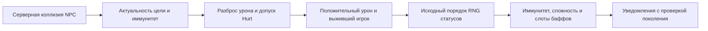

# Контактные дебаффы NPC (`1.4.5.8`)

[English](../en/npc-contact-debuffs-1458.md) · [Бой](combat-damage.md)

Существующий проход коллизий NPC с игроками теперь накладывает выбранные по исходнику контактные дебаффы на подключённых и бесклиентных игроков. Сохранены существующие допущенные определения NPC, хитбоксы, захват входящего боя, исполнитель HP и реестр иммунитета. Автономный контакт NPC с признаком `DefinitionOnly` не включается.

Правила `Player.StatusFromNPC` включают выбор Brain/Creeper в Expert, предметы внутри слизней, отрицательный net identity слизня, независимые множественные срабатывания и ветви, зависящие от Frozen. Исключение медового слизня (`type 1`, `ai[1] == 1125`) даёт Honey `48` без Hurt и разброса урона. Обычные эффекты требуют положительного принятого Hurt и выжившего игрока. Общий иммунитет отсекает удар до разброса; отказ BossNoCheese остаётся внутри Hurt и расходует этот разброс. GodMode не расходует RNG разброса и статусов. Отклонённый, нулевой и смертельный урон не дают обычного контактного эффекта. Неподдержанное снаряжение с уклонением/парированием остаётся вне допуска боя; новая симуляция уклонения или парирования не заявляется.

Стандартная композиция использует существующий общий gameplay RNG без отдельного seed контактов. Броски вероятности и случайной длительности происходят до отказа по иммунитету к баффу. Продление `AddBuff` по сложности применяется один раз (Expert `2`, Master `2.5` для выбранных исходником типов). For the Worthy повышает эффективную сложность до этих правил. Повторное наложение сохраняет большую длительность. Иммунитет Ankh Shield теперь приходит из существующего снимка снаряжения: Chilled покрыт, Frozen — нет. Terraspark не даёт иммунитета к On Fire. Warmth/Obsidian Skin и дополнительные защитные аксессуары требуют собственных серверных производителей перед допуском; чистое правило длительности включает исходную арифметику сопротивления холоду, но исполнение контакта сейчас не выводит его из пакета `50`.

Происхождение контакта и длительности подключённого игрока хранятся в существующих ограниченных `44` слотах баффов. Уплотнение, клонирование, смерть и перенос сохраняют или завершают происхождение вместе со слотом. Серверные часы уменьшают каждый слот один раз, включая отказ несвязанной удалённой фазы, и сохраняют представленные эффекты периодического урона/Frozen на последнем обновлении. Точное подтверждение пакетом `50` не меняет серверный таймер; изменённый снимок присутствия не может снять или продлить серверный контактный эффект. Локальные лечения и одновременные несвязанные изменения присутствия требуют причинной серверной транзакции. Старое импортированное присутствие баффов остаётся контрактом отображения; оно не даёт заработанной контактной длительности и не подавляет контактную ветвь RNG Frozen.

HP, иммунитет, движение и контактные слоты принимаются до наблюдателей. Подключённая цель получает пакет `55` с уже скорректированной длительностью; официальный клиент вызывает `AddBuff(fromNetPvP: true)` без повторного масштабирования. Это политика серверного уведомления TerraRuntime, а не утверждение, что vanilla dedicated естественно отправляет `55` при контакте. Ограничения входящего PvP-пакета `55` не меняются. Пакет `50` передаёт присутствие другим игрокам и при позднем входе. Проверки точного поколения и жизни подавляют устаревшие эффекты после callback, отключения и повторного занятия слота.

Контактные слоты бесклиентных игроков объединяются с существующими владельцами Moon Leech и лавы/On Fire в одном представлении пакета `50`. Нейтральный урон Poisoned/Cursed Inferno/On Fire использует существующий накопитель регенерации и исполнитель HP, включая последний активный тик; смерть от яда использует исходную other-reason `9`, от огня — `8`. Сохранена существующая область окружения с известным миром и без Vampire.

Ограничения: полные реакции Hurt, правила banner/luck/парирования/уклонения, все особые контактные хитбоксы и весь порядок RNG `Main` не установлены. За пределами представленной проекции здоровья Poisoned/On Fire/Cursed Inferno и существующих ограничений предметов эффекты имеют серверное наложение/таймеры/отображение, но не полные серверные потребители характеристик, движения, регенерации и лечения. Непредставленный активный статус по-прежнему завершает владение общей удалённой фазой игроков и её RNG; истечение эффекта не восстанавливает это владение. Это существующая граница безопасного отказа, которую блок наложения не закрывает. Три представленных типа периодического урона могут продолжать эту фазу. Блок не добавляет дебаффы вражеских снарядов и не расширяет власть над инвентарём/инструментами/изменением мира.

Независимые доказательства — числовые наблюдения официального Windows и Linux `Player.StatusFromNPC`: по `110 016` строк на редакцию с точным повтором, все `694` identity, сложность, frozen, seed и варианты предмета/иммунитета/холода/мира. Fixtures содержат число вызовов RNG и следующее значение RNG. Явная арифметика платформы исходника сохраняет различие округления длительности Brain/Creeper. Наблюдения подтверждают границу правил, но не естественный клиентский контакт или весь `Player.Update`. Декомпилированный код и игровые ресурсы в коммит не включаются.

Локальные проверки: Release с warnings-as-errors, 41 целевых/соседних тестов и обязательный fast (25 004 пройдено, один известный skip) проходят. Windows NativeAOT сервера и пять smokes проходят; статический типизированный повтор всех 16 неизменённых новых Fact проходит в managed и Native с 1 024 679 вызовами assertions. Итоговый полный xUnit-прогон без фильтра проходит 1 563 297 из 1 563 298 случаев с нулём failures/errors и тем же известным skip; все 5001 методов выполнены без исключений. Проверки CI tools, документации, графа проектов и доменных литералов проходят. Удаление наложения контакта даёт пять падений assertions, восстановление проходит. Linux NativeAOT недоступен на этом Windows-хосте. Оригинальные наблюдения Linux-редакции helper выполнены под Windows CoreCLR и отделены от проверки Linux OS.

Часы без контактных эффектов проверяют владение до клонирования слотов. В неизменённом изолированном workload на 10 000 обновлений после 1000 прогревочных один игрок меняется с $848\,\mathrm{B/tick}$ на $40\,\mathrm{B/tick}$, десять — с $8264\,\mathrm{B/tick}$ на $40\,\mathrm{B/tick}$. Это измерение только компонента контактных часов, не пропускной способности всего сервера. Бюджет остановки несвязанного worker-forwarder теста приведён к соседним пятисекундным worker-тестам; проверки владения/потока/результата сохранены. Отклонённый первый полный результат и прерванная промежуточная попытка записаны отдельно от итогового принятия.
