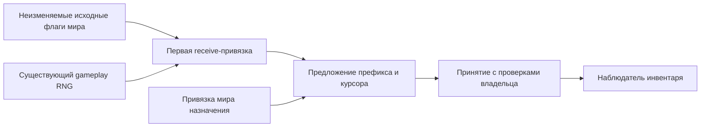
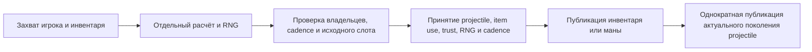
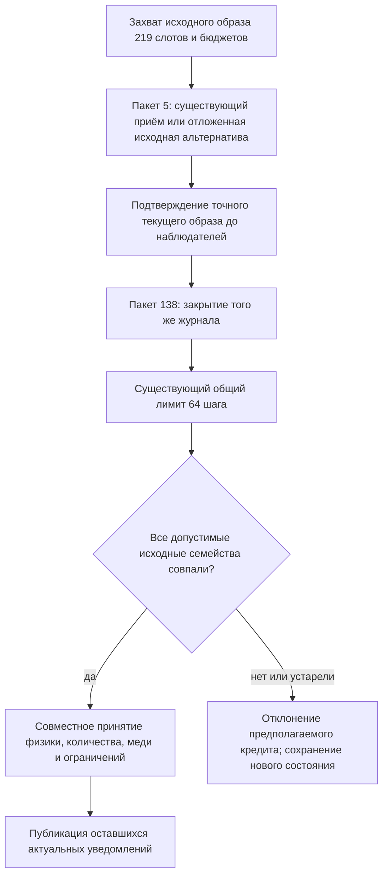

# Владение использованием предметов игрока 1.4.5.8

Текущий связанный ordinary-placement/furniture checkpoint проходит свежие Release-сборки с warnings-as-errors, **191 focused case в 46 классах**, fast **25 285/25 286** и один нефильтрованный full **1 566 698/1 566 699**. Failures/errors отсутствуют, остаётся известный liquid-skip; независимый аудит фактического full XML находит все **5 204** обнаруженных метода без missing/unplanned. Все **3 969** source/config/fixture inputs и **158** выполненных DLL неизменны. Свежая Windows NativeAOT имеет PE CLR directory `0/0` и пять успешных smokes; реальные Release/Native TCP foundation, чат двух клиентов и 72 effect checks на каждый host проходят, оба host остановлены. Fingerprint: `e59b2d5086f402a8c380643690fd33849d2158c656a26b562ba8cb9076233687`. См. локальную приёмку (`.cache/merge-player-use/connected-candidate-04/acceptance.json`) и [дорожную карту](../roadmap.md); shipment отдельно фиксирует Git history. Linux Native, официальный GUI-клиент и полная vanilla-совместимость не подтверждены.

[Локальное размещение и переход к инструменту](local-placement-tool-continuity-1458.md) теперь охватывает **251 сохраняемый предмет сплошных блоков, 292 расходуемых предмета стен и ограниченные успешные замены `21`/`22`**. [Оплаченное размещение мебели](paid-furniture-placement-1458.md) охватывает восемь разрешённых базовых предметов, создание изначально пустых tile entities тем же владельцем, исходные live ID/entry-slot LIFO порядок сохранения, перенумерацию производственной загрузки и дальнейшие использование/добычу. Расширения сохраняют точный оплаченный расход и оба caller-role RNG до observers; метаданные и raw-отчёты `13`/`20`/`87`/`121` не создают ресурс или новые исходные часы. Задержанные placement-стадии одного update используют строгое endpoint-доказательство существующей группы, не ослабляя общий source-stage guard. Начальное владение stock, остальные furniture/styles, неограниченные скрытые истории и provenance загрузки malformed duplicate positions сохраняют документированные границы. Private repeated-ammo scheduling и дополнительный pick-witness не входят в этот checkpoint.

[Локальные часы оружия и переход к инструменту](local-weapon-tool-continuity-1458.md) описывает связанный компонент часов, порядка mana/refill и Gem cohort; покрытие метаданных и итоговые shipping gates остаются отдельными.

[Локальное размещение и переход к инструменту](local-placement-tool-continuity-1458.md) описывает связанный срез и оставшиеся границы совместимости.

## Самоцветные посохи и эффективная мантия

Интегрированный блок охватывает сохраняемые посохи `739..744` и `3377`, функциональные мантии `1282..1287` и `4256`. Характеристики префикса, защита мантии, максимум маны и снижение её стоимости следуют проверенному порядку экипировки и выбору эффективного нагрудного слота, включая представленные правила наследуемых комплектов. Явное применение положительных префиксов `0..97` отличается от случайного выбора префикса игрой. Зафиксированные результаты целочисленного округления Windows и CoreCLR сохраняются раздельно.

Один исходный акт использования оплачивается один раз и может создать один или два синхронных снаряда. Spread отдельно разрешает залп на половине анимации без повторной оплаты маны и сброса itemTime. Существующая квитанция оплаты хранит локальные исходные часы рядом с отображаемыми часами dedicated-remote; право на рождение ограничено эпохой использования, выбором предмета, эффективной мантией и актуальностью частного инвентаря. Пакет `27`, сообщённая мана и клиентские AI-поля не создают оплаченного права. Общий AutoQuickMana списывает первую выбранную исходным порядком бутылку через существующего владельца оплаченного количества, в том числе для прежних channel-оружий; неоплаченную первую бутылку нельзя пропустить ради следующей.

У предмета `6171` есть неактивная ветка AllGems, но публичный исходный `SetDefaults` в конце превращает его в Air по правилу устаревших предметов. Обычным восьмым посохом он не является. Для AllGems2 исходный производитель не обнаружен. Обе ветки не допускаются обычным projectile ingress.

Связанная реализация снарядов хранит признаки, AI, след и возраст локальной неуязвимости в настоящем поколении. Обычный контакт сохраняет терминальную penetration до исходного Kill; площадной урон наносит тот же изменённый снаряд, а не вымышленный дочерний. Prepared-контакт пока охватывает NPC `1`, `3`, `59`, представленные эффекты владельца и нулевую удачу; новые независимые PVE-эталоны напрямую охватывают NPC `1`. Срезание тайлов снарядами игрока остаётся отдельным пробелом полномочий на изменение мира; сравнительные проверки terrain используют инертные твёрдые тайлы. Произвольные семейства NPC, полное выполнение vanilla, Linux Native и прежние пробелы food для призыва и локальной добычи этим блоком не подтверждены. Итоговые shipping-проверки фиксируются отдельно.

Приобретённое до NoItems/buff23 право на midpoint сохраняется: этот флаг запрещает новый акт использования, но не отменяет уже оплаченный залп. При исчезновении точного поколения владельца dedicated-ветка выполняет исходные AI/Kill и остаток движения без нового выбора цели и owner-derived PVE. Обычный Kill в этой роли не отправляет пакет29; более ранний выход за границы мира сохраняет безусловную отправку пакета29. Сохранённый ai2 может использовать прежнюю raw-геометрию NPC; новый игрок в том же слоте не наследует старые права.


## Обеспеченная еда и её эффекты

Проверка допуска попаданий по NPC принимает пищевые баффы `26`, `206` и `207`: их урон и классовый крит уже входят в сохранённую проекцию игрока, а собственного эффекта при попадании снаряда они не добавляют. Регрессия настроенного пути «оплаченная еда → оплаченный выстрел из лука → симуляция снаряда → попадание по NPC» охватывает обычные, нечестивые и шутовские стрелы с тремя пищевыми баффами и контролями без еды. Она расширяет прежнюю проверку создания и оплаты снаряда, но не доказывает все взаимодействия снарядов и NPC.

Использование выбранной еды расширяет существующую транзакцию предмета. Успешное использование списывает одну обеспеченную единицу инвентаря и принимает результат в индексированных слотах баффов до уведомления наблюдателей. Физическая стопка, клиентский список баффов и подтверждение не заменяют оплату. Исходный набор содержит 82 определения еды для баффов `26`, `206` и `207`; полнота метаданных не доказывает поддержку всех взаимодействий с едой.

У выбранного использования и QuickBuff разные правила. Выбранный `AddBuff` удаляет состояния насыщения в исходном порядке до обновления или вставки результата. Поэтому повторное употребление той же еды может сбросить таймер, а более слабая еда — заменить более сильный уровень. Отделённый исходный планировщик сохраняет расход предмета, когда иммунитет предотвращает бафф; этот явный вход не добавляет новых runtime-производителей иммунитета или экипировки. QuickBuff сначала выбирает еду по собственным правилам уровня, длительности и порядка инвентаря, затем обрабатывает поддержанные зелья. Курсор `58` не является источником QuickBuff; доступ к Void определяется существующим снимком состояния сумки. Перед признанием оплаты все частные объяснения должны сходиться на результате инвентаря и индексированных баффов.

Происхождение обеспечения еды хранится в существующем владельце 44 слотов баффов. Начальное присутствие из пакета `50` сохраняет прежнюю политику импорта, но необеспеченное присутствие еды не даёт новых бонусов боя, движения и регенерации. Клонирование, уплотнение, очистка после смерти и перенос мира сохраняют или удаляют обеспечение вместе со слотом. Точное подтверждение не продлевает оплаченный таймер; изменённый или неоднозначный отчёт только о типах не выбирает частный обеспеченный слот.

Кооперативный журнал QuickBuff сохраняет выбранное действие, пока часы мира продолжают идти. При оплате упорядоченные предложения баффов применяются к текущему состоянию. Прежний таймер еды никогда не копируется обратно из снимка. Такой промежуток могут объяснить только реальные изменения часов владельца; посторонняя замена, удаление или изменение частного состояния делает объяснение недействительным. Существующий ограниченный журнал допускает до семи расходов предметов: одну еду и шесть поддержанных зелий.

Срок оплаченной еды является бюджетом авторитетных обновлений мира, пока игрок подключён и жив. Он истекает и при неподдержанном состоянии другого игрока. Это отдельное правило авторитетности оплаченной еды; исходные удалённые списки присутствия dedicated server и прежняя политика таймеров шести зелий остаются отдельными. Положительный таймер даёт эффект текущего обновления до уменьшения; обычная очистка следует исходному прямому проходу по индексам с его особенностями уплотнения. Только что съеденный предмет не оплачивает предшествующую фазу. Отсоединённая загрузка приостанавливает остаток. Перенос сохраняет этот бюджет и начинает новую эпоху часов назначения; он не пополняет и не замораживает срок. Смерть очищает обеспеченную еду, в том числе у игроков вне границ мира. Ветки вне мира сохраняют исходное отсутствие сброса полей; окончание срока не должно выдумывать посторонний сброс характеристик.

Эффекты еды применяются до экипировки с сохранением исходного порядка сложения `Single`. Связанные потребители включают поддержанные защиту, критический шанс, урон и темп оружия, обычное движение и условие `wellFed` естественной регенерации в Expert. Сохранённые входы отбрасывания миньонов и скорости добычи не доказывают авторитетные рождения призывов или локальную добычу. Подносы с едой, особые состояния голода и сидения, а также естественное полное выполнение `Main`/UI остаются отдельными задачами.

Независимые фикстуры сохраняют исходные числовые значения, индексированные слоты и состояния RNG. Корректные точки потребителей после ограничения скоростей отделены от прежней диагностики анимации без такого ограничения. Платформенные различия прежних границ регенерации без еды указаны явно; ожидаемые значения не переписываются, чтобы скрыть их.

Локальная проверка2026-10-15: Release-сборки с предупреждениями как ошибками,193 целевых теста, быстрый набор24982/24983 и один полный1563275/1563276 проходят без падений и ошибок, с одним прежним пропуском проверки жидкостей. Те же три новых групповых Facts проходят на managed и свежем WindowsNative. Пять smoke-проверок Native-сервера и реальные проверки подключения клиентов Release/Native проходят; оба хоста остановлены. LinuxNative остаётся непроверенным. Эти результаты сохраняют описанные выше границы настроенных исходных и runtime-вызовов.

## Замкнутые обмены полных стопок

Сравнение оплаченных ресурсов учитывает обмен за три нажатия левой кнопки: взять полную стопку, обменять её с другой такой же полной стопкой и вернуть содержимое курсора в первый слот. Видимый инвентарь может остаться прежним, хотя оплаченные количества переходят между объектами. Если допустимая альтернатива даёт другое итоговое распределение оплаченных ресурсов, общая квитанция банка отклоняется, в том числе когда отчёт одновременно перемещает посторонний предмет.

Этот сценарий охватывает полные стопки с одинаковыми типом и префиксом, включая разные флаги избранного, когда исходные контексты `0` и `32` сохраняют итоговый образ. Обычные конечные слоты этого дополнительного семейства ограничены основными `0..49`; специальные слоты и курсор исключены. Обмены полных стопок монет используют банковские контексты `4` и `32`. Существующее семейство из четырёх действий со слиянием и извлечением отдельно применяет контекст монет `1` к слотам `50..53` и исходную проверку входящих боеприпасов к слотам `54..57`: Stone нельзя вернуть в эти слоты, тогда как Gel и стрелы допускаются в слоты боеприпасов. Полностью оплаченные и полностью неоплаченные группы сохраняют единственное распределение. Работа использует общий предел $64\,\text{шагов/тик}$ и согласование ограничений по исходному и итоговому состояниям. Эти представленные альтернативы не доказывают единственность для произвольной скрытой истории.

## Обеспеченный крафт и Torch God's Favor

Владелец крафта сопоставляет повторное использование одного исходного рецепта с полным образом инвентаря и банков. Он захватывает альтернативные ближайшие станции, жидкости, условия мира, порядок доступных банков и расширенную область Artisan Loaf, затем проверяет их актуальность перед принятием результата. Исходный каталог содержит 3 603 рецепта и 34 группы; наличие рецепта в каталоге само по себе не означает готового серверного пути. Проверка префиксов описывает возможные исходы клиента, но не владеет его RNG. Неподтверждённые алхимические скидки и исходы без расхода материалов по-прежнему отклоняются.

Удалённые запросы материалов сохраняют подтверждённые обеспеченные списания из сундуков в том же журнале операции. Сначала расходуются локальные материалы; результат должен ровно один раз полностью использовать сохранённое подтверждение удалённых затрат до публикации. Одного одобрения недостаточно для обеспечения результата. Ранние подтверждения инвентаря сохраняют ожидающую операцию. Запросы используют общую ограниченную FIFO и бюджет работы; устаревшие ревизии контейнеров запрещают принятие. При отказе возврат локальных материалов оригинальным клиентом согласуется без спекулятивного возврата в сундук. Запасы загруженного мира используют явную границу доверенного содержимого; частично обеспеченные и необеспеченные вклады в мировые сундуки остаются запрещены до интеграции долговременного хранения обеспечения.

Torch God's Favor `5043` получает отдельное владение обеспеченной разблокировкой и доказательство заработанного применения. Пакет `4` подтверждает разблокировку перед списанием инвентаря; исходный `51` subtype `5` относится к scripted credit записи бестиария `664`. Инвентарь, разблокировка и credit принимаются совместно до вызова наблюдателей. Сырой импорт флага не доказывает заработанное применение. Потребители рецептов включают `190` в `5573` у станции `13` и `3565` в `5638` у станции `18`. Отключение автоматического выбора биомных факелов не отключает эти разблокированные рецепты. Свежие Release-сборки, 21 целевой тест, обязательный быстрый набор и один полный прогон проходят с одним прежним пропуском canonical-liquid. Все шесть новых public Facts проходят на managed и Windows Native; smoke-проверки Native-сервера и живое подключение/relay Release и Native проходят. Linux Native остаётся непроверенным. Результаты прежних этапов ниже относятся к указанным в них снимкам исходников.

## Восемь личных постоянных улучшений

Правила геймплея представляют Demon Heart `3335`, Artisan Loaf `5326`, Aegis Crystal `5337`, Aegis Fruit `5338`, Arcane Crystal `5339`, Galaxy Pearl `5340`, Gummy Worm `5341` и Ambrosia `5342`. Demon Heart требует экспертного режима и ещё не открытого дополнительного слота аксессуара. Остальные семь сохраняют позиции флагов в пакете `4`. Захваченное использование требует одной оплаченной единицы инвентаря; отчёт внешности перед синхронизацией инвентаря служит лишь кандидатом подтверждения. Владение постоянными флагами сохраняется после удаления квитанции и переноса игрока.

Постоянные эффекты рассчитываются по флагам на входе в фазу, после экипировки. Новые оплаченные флаги действуют со следующей фазы: Aegis Crystal добавляет `0.2` ко времени регенерации; Aegis Fruit добавляет четыре защиты; Arcane Crystal передаётся существующему владельцу регенерации маны; Galaxy Pearl добавляет `0.03` удачи; Gummy Worm добавляет три навыка рыбалки. Ambrosia изменяет исходную скорость кирки на `-0.05`, скорость тайлов и стен на `+0.05`, затем применяются исходные ограничения и обратные величины. Анимация размещения тайлов и стен использует захваченный множитель для всех 3 368 уже представленных размещений, сверенных с оригиналом. Скорость кирки не сокращает удалённую анимацию добычи. Demon Heart также управляет исходными условиями функционального и декоративного слотов аксессуаров.

Artisan Loaf расширяет исходную область крафта на четыре тайла. Описанная выше интеграция крафта связывает альтернативные станции, контекст жидкостей и обеспеченную выдачу результатов; общая локальная приёмка зафиксирована для текущего этапа. Навык рыбалки и скорость кирки сохраняются как входные данные; серверный контекст наживки, удочки и мира, выдача улова и локальное время добычи остаются незавершёнными игровыми путями. Эти ограничения остаются в дорожной карте. Свежие Release-сборки проходят с предупреждениями как ошибками; целевые620/620 и быстрые24972/24973 проходят с одним известным пропуском жидкостей. Точные групповые source/runtime Facts проходят на managed и Windows Native. Пять smoke-проверок Native-сервера и живой Release/Native82/49/129 проходят. Для этого завершающего этапа в описанных границах новый полный прогон и ожидание GitHub CI не выполнялись; Linux Native остаётся непроверенным. Предыдущий этап Life служит отдельным доказательством.


## Постоянные расходники — локальный этап в описанных границах

Изолированный игровой расчёт теперь представляет Life Crystal `29`, Mana Crystal `109` и Life Fruit `1291`. Он отделяет эффекты локального владельца от продвижения часов удалённого игрока и явно принимает действующий запрет `noItems`. Само поле `cursed` отличается от баффа `23`, чей исходный обработчик также устанавливает `noItems`.

Life Crystal добавляет 20 к базовому и производному максимуму и текущему здоровью, если базовый максимум ниже 400. Life Fruit добавляет 5 при базовом максимуме от 400 до значения ниже 500. Эффект не ограничивает немедленно нестандартный импортированный максимум: исходные сценарии включают `390 → 410` и `499 → 504`. Эти методы не используют отдельные счётчики потребления.

Управляемые эффекты Life Crystal и Life Fruit требуют зафиксированного намерения локального использования и ровно одной подтверждённой единицы инвентаря. Необработанные сообщения об инвентаре и здоровье не создают ресурс. Привязка этого семейства защищает максимум здоровья даже после попытки без ресурса, завершения квитанции или переноса игрока. До привязки несвязанный первоначальный импорт здоровья сохраняет существующую политику. Точные ожидаемые и оплаченные сообщения о здоровье подтверждают ограниченное последнее использование, не перезаписывая промежуточный управляемый урон.

Завершённые квитанции и импортированная анимация `41` не выдают повторный эффект. Отпускание использования или смена выбранного предмета завершает незавершённое намерение; новое настоящее использование может штатно оплатить эффект. Отмена предварительного подтверждения инвентаря сохраняет физический исходный образ сервера, поэтому следующее использование должно уменьшить именно этот образ. Контракт Mana Crystal и пять исторических каналов ограничения количества не меняются.

Групповой дифференциальный тест сравнивает все 8 160 исходных фаз ItemCheck в четырёх запусках. Удаление четырёх игровых правил и четырёх защит управляемого пути вызывает ошибки утверждений; восстановление проходит. Групповое доказательство управляемого пути проходит 44 788 проверок через настоящие команды и тики, явно отделяя настроенные сценарии вызывающего пути от захваченных пакетов. Исходное поведение нулевого стека не разрешает канонический Air и не подтверждает ресурс. Свежие Release-сборки, focused235/235, точные managed/Windows Native Facts, пять проверок Native-сервера и live-приёмка Release/Native проходят. Полный прогон выполнил1 563 261 случай с одним известным пропуском и одним падением теста точного расхода стрел ботом: случайная броня Vortex/Shroomite может сохранять стрелы. Исправлена только настройка теста: эти бонусы убраны, все исходные утверждения сохранены; bot69/69 и свежий fast записаны отдельно. Исходный full остаётся неуспешным, сохранён и не повторялся. Рабочий исходный код и все32 shipping-библиотеки не изменились. Общая власть над здоровьем, сохранение, естественное выполнение всего Main/UI и Linux Native остаются за границами этапа.

## Роль хранения Void Vault — локальная приёмка в описанных границах пройдена

Release WAE0/0, соседние231/231 и быстрые24965/24966 прошли без ошибок и падений, с одним известным пропуском жидкостей. Game/runtime Facts прошли106345/2688 проверок на managed и Windows Native; пять smoke-проверок Native-сервера и живой Release/Native82/49/129 с72 знаковыми событиями здоровья/маны прошли. Оба хоста остановлены. Второй полный прогон отложен по просьбе пользователя; предыдущий full относится к своим исходникам.

Предметы Void Vault получают основанную на оригинале классификацию роли хранения для всех 6 196 исходных идентификаторов. Из положительных идентификаторов 6 153 нейтральны для фазы игрока. Предметы 4346 и 5095 нейтральны, потому что оригинал исключает их из эффектов Void Bag. Ещё 42 информационных или механических производителя остаются неподдержанными при активных эффектах хранения.

Фаза захватывает исходное условие доступа к сумке из основных слотов 0..57 до внешних провайдеров. Курсор 58 и сумки внутри банков не открывают хранилище. Известные сохранённые производители неактивны и допускаются при закрытом условии; при открытом условии их неподдержанные эффекты вызывают отказ всей фазы. Префиксы сохранённой брони и аксессуаров не дают экипированных бонусов. Неизвестные представленные идентификаторы и неподдержанная функциональная экипировка вызывают отказ; сырые некорректные отчёты сохраняют существующее правило нормализации. Планирование боевой экипировки и здоровья при использовании предмета получает одно захваченное условие с последующей полной проверкой актуальности инвентаря, экипировки, игрока, индексированных усилений и провайдеров.

Исходные доказательства включают четыре совпадающих захвата метаданных, 272 исходных случая ResetEffects/UpdateEquips для хранения и сравнение объединённых эффектов заполненной сумки. Групповой runtime Fact выполняет настоящие тики владельца, закрытое условие, сумку на курсоре и в банке, открытое условие и поздние изменения провайдера. Пять runtime-срезов и два среза каталога дают ошибки утверждений, восстановление проходит. Свежая общая локальная/Windows Native-приёмка пройдена; естественный полный Main/UI, 42 активных эффекта и Linux Native остаются открытыми.

## Локальная приёмка QuickBuff, 2026-10-11

Release WAE0/0, соседние88/88, быстрые24963/24964 и один полный прогон1563256/1563257 прошли без ошибок и падений, с одним известным пропуском жидкостей. Новые Game/runtime Facts прошли29346/77936 проверок каждый на managed и Windows Native. Пять smoke-проверок Native-сервера и живой Release/Native82/49/129 с72 знаковыми событиями здоровья/маны прошли; оба хоста остановлены. Linux Native и более широкая vanilla-совместимость остаются открытыми.

Полный прогон завершил все тесты; затем запись XML завершилась ошибкой из-за заполнения диска. Приёмка выполнения опирается на совпадающие финальную консольную сводку и завершённый заголовок XML; оборванный отчёт сохранён, повторного полного прогона не было.

## Прежний этап планировщика QuickBuff для шести зелий

Game-компонент теперь предоставляет отделённый `TryPlanQuickBuff` для шести представленных зелий `292`/`303`/`2344`/`2346`/`2347`/`2349`. Он сохраняет исходный порядок списания одного предмета из слотов инвентаря `0..57`, затем из сорока слотов Void Vault при наличии открытого Void Bag, и полный индексированный образ 44 слотов усилений, включая исходное правило префикса `CountBuffs`. На том этапе неподдержанные семейства усилений или еды, способные менять состояние, отклоняли план; раздел об обеспеченной еде выше описывает расширение. Операция не продвигает часы или RNG, не выводит намерение нажать QuickBuff и не создаёт частное финансирование. Проверка канонического входа охватывает также неактивные слоты Void; иммунитет — явный вход отделённого компонента, а не допущенный производитель от экипировки. Компонент подтверждён 168 исходными случаями QuickBuff и 25 584 исходными числовыми записями метаданных, четырьмя чувствительными omission-контролями и сборкой root с предупреждениями как ошибками и семью прошедшими прямыми xUnit-тестами. Связанное принятие состояния Application интегрировано; свежая объединённая локальная/Windows Native-приёмка пройдена; неразличимые замкнутые обмены через курсор требуют отдельной проверки сходимости частного владения до выдачи оплаченного усиления.


## Прежний этап сверки QuickBuff для шести оплаченных зелий

Существующий журнал инвентаря может объяснять настроенные исходные пакеты QuickBuff для шести поддержанных зелий усиления. Исходный метод проверяет основные слоты `0..57`, затем сорок слотов Void Bag, когда это допускает представленный признак доступа к сумке; курсор `58` исключён. Уже имеющееся усиление предотвращает повторное применение, а активная анимация или время предмета сами по себе не блокируют эту массовую операцию. На том прежнем этапе еда не поддерживалась; раздел об обеспеченной еде выше описывает расширение. Другие непредставленные семейства QuickBuff по-прежнему не допускаются.

Исходная синхронизация передаёт изменённые образы `5`, `50`, неизменённое управление `13` и разделитель `138`. Эти пакеты не определяют нажатие кнопки QuickBuff. Тот же удержанный журнал сравнивает допустимые исходные объяснения, проверяет полный инвентарь из `219` слотов и частное финансирование/пределы, используя существующий общий бюджет `64` шага работы. Успешное объяснение явно списывает одну оплаченную единицу для каждого использованного зелья. Инвентарь и индексированное состояние усилений принимаются совместно до наблюдателей; неоплаченный исходный пакет не может получить новые усиления через сырой `50`. Начальные несвязанные импортированные отчёты усилений сохраняют существующее правило.

Перенесённый групповой тест охватывает все `44` индексированных усиления, физические и частные слоты, точное исходное состояние RNG на настроенной границе прямого использования и настоящие тики владельца для отказа, переноса поколения, позднего изменения поставщиком и продвижения фазы другого игрока. Точные запоздалые подтверждения сохраняют длительности и не восстанавливают удалённое усиление. Повторный вход наблюдателя и исключение после принятия не повторяют оплату.

Настоящий замкнутый обмен полных стеков через курсор может оставить все физические образы и пакеты синхронизации неизменными, но изменить частную оплаченную единицу, которая оплачивает усиление. Представленные циклы основного инвентаря, Void Bag и обмена между основным инвентарём и каждым из четырёх банков сравниваются как альтернативные объяснения; отсутствие найденного свидетеля не доказывает уникальность. Неизменённый живой ACK не переносит скрытое финансирование. Исходные циклы только между слотами банков 1–3 не используют зелья QuickBuff и не объявляются оплаченным производителем. Общая локальная приёмка пройдена; этот блок не заявляет неограниченную скрытую историю, естественное полное выполнение `Main`/UI или новых производителей иммунитета/экипировки.

## Общая локальная контрольная точка, 2026-10-11

Общий блок стоимости монет, возврата курсора и выброса остатка при закрытии инвентаря интегрирован вместе с ранее принятым блоком экипировки. NewItem с известным локальным игроком сохраняет reservation в плане размещения; ловля NPC проверяет его без второго owner22, сохраняя последовательность21/22/23. Неизменённые проверки ловли проходят6684/6684; возврат прежнего обработчика вызывает12 ошибок утверждений без ошибок runner. Release проходит без предупреждений и ошибок; общий целевой набор 18647/18647. Один полный прогон: 1563184/1563186, один прежний canonical-liquid skip и одна ошибка нестабильного теста разговора из-за допустимого исходного таймера смеха45. Тест использует существующий QuietNpcRandom, все assertions сохранены; исправленный набор NPC 46/46 и итоговый fast 24892/24893 проходят без failures/errors, с прежним skip только в fast. Production-исходники и все32 shipping DLL не изменились при этой тестовой правке. Свежий Windows NativeAOT/пять smoke-проверок и Release/Native live82/49+129/обмен двух клиентов проходят; оба процесса остановлены. Неуспешный полный прогон сохранён и не объявлен зелёным; после изолированной правки fixture он не повторялся. Linux NativeAOT локально не проверен; CI GitHub не ожидается. Этот ограниченный checkpoint не доказывает полной совместимости геймплея, всего Native durable-Fact или естественного UI/wire паритета.

## Боевые аксессуары — интегрированы, ограниченная локальная контрольная точка принята

Авторитетная фаза удалённого игрока допускает семь боевых аксессуаров через существующий каталог экипировки и правила слотов: 489 (магический урон), 490 (урон ближнего боя), 491 (дальний урон), 2998 (урон миньонов), 935 (все четыре класса урона), 1301 (все четыре класса урона и шанс критического удара), 1858 (дальний урон и шанс критического удара). Наследование избранных предметов из других комплектов использует тот же каталог; неподдерживаемая экипировка по-прежнему прекращает общую фазу всех игроков.

Эмблема разрушителя 1301 теперь даёт исходный бонус урона миньонов; префиксы урона аксессуаров 69–72 также действуют на миньонов. Удалённая фаза сохраняет префиксы скорости 77–80 для этих семейств. Существующий таймер ближнего боя один раз использует производный множитель анимации; общий снимок экипировки сохраняет прямой множитель скорости атаки для других потребителей. При настроенном использовании деревянного меча 24 максимальная анимация равна 20 без префикса скорости и 19 с любым из этих четырёх префиксов. Для существующей 101 разновидности удалённого оружия ближнего боя сохранены исходные таймеры без дополнительного множителя; особые исключения скорости и более широкие эффекты замедления этим изменением не допускаются.

Режимы expert/master экипировки и контекст декоративной брони локального игрока dedicated-сервера фиксируются до внешних поставщиков и повторно проверяются перед совместным применением. Позднее изменение режима экипировки отклоняет всю группу без продвижения общего RNG. Контекст локальной декоративной брони неизменяем после первого связывания.

Свидетельства кандидата охватывают 4832 сравнения допущенных фаз с оригиналом и 60 связанных случаев запуска с попаданием по NPC: три сгруппированных теста и восемь чувствительных контрольных исключений. Изолированные сборки кандидата и восстановленные тесты проходят; общие локальные проверки и изолированная повторная проверка теста описаны выше. Настроенные вызовы оригинала не доказывают естественный клиентский порядок, эквивалентность Windows-пакетов экипировки или полную совместимость геймплея.

## Авторитетный подбор при контакте

Авторитетный контактный подбор требует живой поддерживаемой фазы игрока, назначенного владельца и фактического пересечения тел. Он выполняется после фазы игрока, до таймеров предметов мира и поиска нового владельца. Учёт подтверждённого количества принадлежит существующему поколению предмета: доверенное создание может обеспечить выдачу, а сырые отчёты не увеличивают этот запас. Смешанные обычные стаки выдают только подтверждённое количество и сохраняют видимый остаток. Принятый checkpoint подбора требовал полностью подтверждённого стака монет; проверенное ниже расширение стоимости монет отделяет физическое преобразование от владения медной стоимостью. Окончательные проверки после callback предшествуют совместному изменению земли и инвентаря, публикация идёт после обоих изменений: пакеты мира 21/151 перед пакетом инвентаря 5. Устаревшее уведомление подавляется без отмены принятой выдачи.

Неизвестные импорты предметов мира не имеют подтверждённого количества, а публичные снимки не восстанавливают его. Будущий формат сохранения должен явно переносить эти метаданные либо считать восстановленное количество неизвестным. Начальный клиентский инвентарь и клиентский баланс монет по-прежнему не имеют подтверждённого запаса. Ограниченный follow-on перемещения и выбрасывания описан ниже.

Фаза предмета из конструктора сама по себе не привязывает компонентный runtime к авторитетному подбору. Runtime, который никогда не привязывал обновления удалённых игроков, сохраняет существующую обработку команд. После привязки отсутствие или утрата владения фазой запрещает поддерживаемый подбор вместо перехода на этот путь совместимости. Пустые миры и непривязанные компоненты пропускают сканирование подбора до выделения его снимка.

Owned pickup использует основанные на оригинале планы размещения обычных предметов и боеприпасов, а также планы монет с изменением номинала. Обычное размещение учитывает совпадение префиксов, избранное, приоритет панели и слоты боеприпасов; преобразование монет сохраняет общую стоимость в 64-битной арифметике и исходный сброс префикса и признака избранного. Эти планы определяют размещение в инвентаре, но не разрешают создавать количество из клиентского отчёта. Void Bag и перемещение вне описанной ниже пары context0 остаются открытыми.

Выбранные монеты 71–74 используют существующий удалённый таймер размещаемых предметов: стиль 1, анимация 15 и автоматическое повторение. Настроенные обновления оригинального удалённого игрока на обеих платформах охватывают живого, мёртвого, призрака и выход за пределы мира. Поддержка этого таймера не разрешает локальное размещение монет, расходование или создание снарядов Coin Gun. Принятая выше контрольная точка подбора включает эти удалённые часы монет; она не подтверждает новый блок перемещения и выбрасывания.

Локальный этап Crystal/Flower принят: Release Rebuild без предупреждений и ошибок; целевой набор18623/18623; один полный прогон с1563161/1563162 успешных тестов, без failures/errors и с1 известным пропуском canonical-liquid. Свежая shipping Windows NativeAOT/пять smoke-проверок и Release/Native live join82/49 с relay двух клиентов проходят. Typed managed/свежие Windows Native совпадают: Crystal436 и Flower62622; все32 shipping references точны, три Native-образа — AMD64 без CLR directory. Native проверяет прямые owned-фазы, публичные RNG checkpoints и типизированную публикацию/происхождение, а managed State.Tick, приватный full56 и полные literal wire-проверки остаются отдельными доказательствами. Linux NativeAOT локально не проверен; CI GitHub не ожидается.

Локальная контрольная точка: Release Rebuild без предупреждений и ошибок; целевые18633/18633. Один полный прогон: 1563171/1563172, без ошибок и падений, один известный пропуск canonical-liquid. Свежий Windows NativeAOT и пять smoke-проверок прошли; Release/Native live join82/49 и обмен между двумя клиентами прошли. Типизированные проверки managed и свежего Windows Native совпадают: Core261, монеты11849 и Application99475. Все32 ссылки на сборки и исходники/тесты совпадают с проверенной фиксацией. Native-доказательства не включают private full56, полную точность wire и все durable Facts. Linux NativeAOT локально не проверен; ожидания GitHub CI нет.

## Перемещение через курсор и выбрасывание целого стака

Владельцы подтверждённого перемещения и выбрасывания интегрированы и локально приняты. Принятая выше контрольная точка подбора остаётся отдельной.

Локальная контрольная точка move/drop принята: Release Rebuild без предупреждений и ошибок; целевой набор18636/18636. Один полный прогон проходит 1563174/1563175, без ошибок и падений, с одним известным пропуском canonical-liquid. Свежий shipping Windows NativeAOT и все пять smoke-проверок проходят; Release/Native live82/49+129 и обмен между двумя клиентами проходят, процессы завершены. Typed managed и свежий Windows Native совпадают:48836 проверок,36 строк выбрасывания,122 строки cursor и12 случаев владения. Typed-доказательства отделяют24 реальных State-случая выбрасывания от12 случаев с настроенным движением и58 реальных State-строк cursor от64 строк с настроенными таймерами/анимацией. Все32 shipping-ссылки и исходники/тесты независимо проверены. Native не заявляет private full56, полную точность wire или весь набор durable Fact. Linux NativeAOT локально не проверен; CI GitHub не ожидается.

Существующее хранилище учитывает подтверждённое количество для физического слота и сохранённого предмета. Доверенный подбор добавляет только принятое количество; начальный клиентский инвентарь и packet5 не создают запас. Лимиты уже потраченного количества остаются отдельными обязательствами. Перемещение переносит запас и соответствующий лимит вместе с предметом; другой отчёт слота не удаляет старый лимит.

Согласование context0 принимает исходно допустимые пары между немонетным слотом0..49 или54..57 и курсором58. Сохраняются префиксы, favorite, пределы стаков, целые обмены/слияния и накопленные разделения правой кнопкой. Левая кнопка требует захваченных animation0 и itemTime0; правая требует animation0 и допускает положительный itemTime. При первом отчёте Air оба допустимых семейства остаются кандидатами до точного отчёта курсора. Packet5 не содержит UI-жеста, поэтому первый отчёт не определяет семейство клика.

Исходная синхронизация сообщает обычный слот раньше курсора58. Первое списание применяется сразу; первый наблюдатель ещё не видит завершённого пополнения курсора. Первое пополнение остаётся отложенным. Завершение точной пары принимает оба слота, запас и лимиты до наблюдателей; актуальные уведомления завершаются независимо даже при исключении callback. Непарное или потерявшее актуальность списание остаётся сообщённым списанием и не восстанавливает утраченный запас.

Одна запись пары принадлежит точному подключению и поколению игрока. Завершение проверяет эпоху командного ввода, полный состав предметов/запаса/лимитов и stamp изменений инвентаря этого игрока. Продвижение собственных часов или физики и запись другого игрока сохраняют актуальную пару; запись того же игрока, завершение владения фазой или повторный вход из публикации её инвалидируют. Transfer отбрасывает спекулятивное пополнение, сохраняет принятый запас/лимиты и нормализует принятый предмет курсора через существующего владельца transfer.

Выбрасывание целого стака требует живой привязанной фазы, точного исходного предложения предмета на земле и полностью подтверждённого канонического немонетного стака без favorite. Непустой курсор имеет приоритет над выбранным слотом. Размещение на земле, списание инвентаря и принятые часы использования принимаются до уведомлений. Частичный запас не разрешает выбросить весь стак. Этот принятый checkpoint исключал favorite Return и владение стоимостью монет; проверенные ниже расширения имеют отдельную приёмку. Прерывание удерживаемого projectile, Void Bag и общие UI-контексты остаются вне допуска.

Настроенный оригинал охватывает70 профилей выбрасывания и61 профиль курсора на Linux/CoreCLR и настоящем Windows CLR4/x86 с независимыми повторами: всего616 неизменённых исходных вызовов. Runtime сверяет36 изображений выбрасывания и122 изображения курсора, включая неизменённые подтверждения UI-отказа. При повторных правых кликах split cooldown явно сбрасывается между вызовами; это не доказывает естественное старение UI-таймера или весь Main. Изолированный кандидат проходит8/8 Facts; все13 копированных исключений дают assertion failures без ошибок runner, восстановление проходит8/8. Это исходные, компонентные и кандидатные доказательства, а не финальная shipping-приёмка, полное Native-покрытие durable Facts или точность всего wire.

## Оплата управляемой магии из owned-фазы

При привязанном и ещё принадлежащем runtime потоке обновления игрока Magic Missile113, Flamelash218 и Rainbow Rod495 с поддерживаемыми магическими префиксами используют существующую фазу предмета для оплаты маны и состояния channel. Соответствующий отчёт projectile однократно принимает ту же захваченную попытку; если первым приходит projectile, его оплата подготавливается для следующей фазы. Нехватка маны в ManaV2 всё ещё допускает выстрел: расходуется доступная мана и сохраняется увеличенная исходная анимация. Неудачная попытка LastUseSuccess платит до применения маски отказа и сохраняет расход; новый фактический release/press создаёт другую попытку. Текущий активный Cursed23, ghost/dead и исходная ветвь remote out-of-range отклоняют рождение до новой оплаты или принятия старой попытки. Неизвестное владение активными buffs также приводит к отказу. Cadence, выбранный предмет, generation и полная захваченная фаза остаются условиями принятия.

После появления истории оплаты значения packet42 с тем же базовым максимумом маны, объясняемые захваченной оплатой или текущей owned-маной, подтверждают использование без перезаписи count/delay регенерации или более новой маны. Необъяснённые выдачи и изменения максимума отклоняются. Исходный dedicated server синхронизирует это состояние отчётами клиента; правило подтверждения owned-состояния является явной политикой авторитетности runtime. ManaCrystal109 и ManaFlower555/QuickMana используют общее владение инвентарём и маной. Отложенная публикация packet42 повторно проверяет текущую ману и максимум, подавляя устаревшие уведомления после изменения наблюдателем; независимые уведомления инвентаря и buffs продолжают публиковаться. Transfer сохраняет оплаченный баланс, но прекращает право старой попытки на рождение projectile.

Управление тремя допущенными magic projectiles читает сохранённый owned Channel, включая положительный отчёт анимации предмета, вместо подмены channel флагом packet13 controlUseItem. Отсутствующая или утратившая владение фаза отклоняет управление без выдуманного release. Никогда не привязанные компонентные runtime сохраняют прежнюю политику. Это не устанавливает полную эквивалентность AI9, отрисованного клиента, whole Main или всех mana modifiers.

Три managed-группы регрессий сохраняют 24 принятых рождения в обоих порядках пакетов и 1120 исходных удалённых фаз, включая ранние ветви и диагностику полного56 RNG. Исходные whole-phase references независимо повторены на Linux/CoreCLR и настоящем Windows CLR4/x86; дополнения local caller и report interleaving являются Linux-only компонентными доказательствами. Runtime-позиции выстрелов явно перенесены внутрь допущенного мира. Пять финальных v3 omissions проверяют допуск Cursed/ghost/outside, принятие оплаченной попытки и перезапись packet42; все дают assertion failures без runner errors и после восстановления проходят все3 Facts. Десять прежних CLI omissions остаются историческим доказательством неизменённых частей; исходное падение permissive admission сохранено отдельно.

## Стоимость монет и возврат избранного предмета курсора — интегрированы, ограниченная локальная контрольная точка принята

Проверенные владельцы сохраняют финансирование монет как 64-битное число медных единиц внутри существующих хранилищ мировых предметов и инвентаря. Физическое количество монет и подтверждённая стоимость — разные факты. Сырой пакет5, начальный клиентский инвентарь и импорт неизвестного мирового предмета не создают эту стоимость. Сообщения могут консервативно уменьшить или отбросить уже имеющееся финансирование, но не восстанавливают его по совпавшему видимому балансу.

Авторитетный подбор монет использует исходный журнал размещения: преобразование при точном количестве100, рекурсивное размещение старшей монеты и исходный сброс префикса/избранности при преобразовании. Смесь подтверждённых и неизвестных монет сохраняет дробный бюджет: одна подтверждённая медная единица в преобразованной серебряной монете остаётся одной медной единицей, а не одной подтверждённой серебряной монетой. Физический результат оригинала не делает неизвестные деньги подтверждёнными. Слияние через курсор в контексте0 отдельно следует исходным кортежам и не запускает преобразование номинала из GetItem. Для выбрасывания целого стека монет нужна подтверждённая полная физическая стоимость; её доля не разрешает выбросить целую монету старшего номинала.

Существующий владелец перемещения в контексте0 переносит медную стоимость вместе с принятым перемещением монет. Transfer проверяет бюджет относительно точного образа инвентаря и сохраняет его при новой занятости слота игрока. Нормализация монет на курсоре сохраняет существующее правило первого пустого основного слота и точную стоимость; она не выполняет возврат избранных монет или новое преобразование кошелька. При отсутствии такого слота игрок остаётся подключённым к исходному миру. Оплата в магазинах, более широкое владение кошельком и возврат избранных монет остаются вне этого блока.

Избранный предмет курсора, не являющийся монетой, может использовать исходный план возврата GetItem. Полностью помещающийся возврат согласует точные образы инвентаря в возрастающем порядке и подтверждение курсора58. Первое сообщение инвентаря также может совпасть с обычной парой LeftClick, поэтому обе исходно допустимые альтернативы сохраняются до разрешающих последующих образов. Ни флаг избранности, ни первый образ не определяют жест интерфейса. Сообщённые образы не добавляют финансирования: только принятый полный журнал переносит имеющееся финансирование и потолки израсходованного количества до публикации.

Возврат избранного предмета с остатком на земле сначала резервирует финансирование этого остатка и лишь затем распределяет его в помещающуюся часть инвентаря. Для видимого стека20 с остатком13 бюджет13 позволяет вернуть семь неизвестных единиц и выбросить тринадцать подтверждённых; бюджет12 отклоняет транзакцию. Принятый остаток должен быть полностью профинансирован. Его размещение на земле, изменения инвентаря/курсора и таймеры использования принимаются до наблюдателей. Полностью помещающийся transfer использует тот же план размещения и переносит финансирование/потолки; непомещающийся немонетный курсор оставляет игрока в исходном мире, не отбрасывая остаток.

Квитанции возврата сохраняют существующие точную занятость слота игрока, эпоху ввода, образ инвентаря и штамп изменений данного игрока. Спекулятивный кредит не переживает прекращение фазы или transfer. Публикация проверяет каждый принятый компонент и продолжает отправку следующих актуальных уведомлений после исключения наблюдателя. Допуск возврата/выбрасывания при закрытии инвентаря интегрирован в ограниченного владельца, описанного ниже; из этих пакетов не выводятся правило отказа favorite→Air или полное владение интерфейсом.

Независимые настроенные вызовы оригинала и сравнения кандидата отделяют физическое исходное поведение от серверной политики подтверждённых/неизвестных количеств. Они не доказывают естественный порядок интерфейса, полный Main или shipping Native/full-wire паритет. Общие локальные проверки и изолированная повторная проверка теста описаны выше; приведённые выше числа принятых checkpoint подбора и перемещения/выбрасывания не меняются.

## Возврат при закрытии инвентаря и выброс остатка — интегрированы, ограниченная локальная контрольная точка принята

Владелец закрытия расширяет существующий журнал Return на представленный не-монетный предмет курсора без требования флага избранного. Полный возврат не создаёт наземный пакет21: точные образы слотов в возрастающем порядке и подтверждение курсора58 могут также совпасть с обычным планом LeftClick. Существующая квитанция сохраняет обе допустимые альтернативы до получения полного набора образов. Ни флаг избранного, ни первый образ инвентаря не доказывают закрытие интерфейса. Новый клиентский запрос не вводится; сообщение не даёт права создавать количество.

При наличии остатка всё его количество должно иметь подтверждённое финансирование. Бюджет остатка резервируется до распределения финансирования по вместившейся части, поэтому смесь подтверждённых и неизвестных единиц на курсоре не создаёт неподтверждённый наземный предмет. План размещения, финансирование и потолки потраченного количества перемещаются совместно. Обработчик закрытия не добавляет анимацию10 ручного выброса: он сохраняет исходные часы закрытия и отказывает неподдержанным контекстам удержания и каналирования.

Создание остатка требует точного сообщения ReserveForLocalPlayer исходной формы, включая задержку подбора врагами100 и положение в центре представленного игрока. Настроенный исходный серверный вызов с локальным игроком0 показывает пакет21 с владельцем255, затем пакет22 с назначением владельца0 и итогового владельца0. Runtime связывает резервирование с аутентифицированным игроком; предупреждение исходного кода при неизвестном локальном игроке255 остаётся диагностикой, а не допустимым принадлежащим контекстом.

Клиентский и серверный NewItem используют разные случайные курсоры. Сервер сохраняет два своих предложения создания, затем накладывает полученную допустимую исходную скорость. Каждая компонента должна точно совпасть с результатом binary32 умножения целого предложения на0.1f: X от-30 до30; Y от-40 до-16 при гравитации либо от-30 до30 для представленного предмета без гравитации. Приблизительного конечного значения недостаточно. Проверяется ограниченная решётка исходных скоростей, а не восстановление клиентского RNG или полная эквивалентность создания предметов мира.

Размещение, инвентарь/курсор, финансирование/потолки и принятый серверный RNG применяются до первого наблюдателя. После исключения наблюдателя публикация пытается обработать остальные актуальные компоненты и сохраняет новые записи обратного вызова; устаревшие поколения или заменённые компоненты инвентаря не публикуют прежнее состояние. Рождение и резервирование публикует существующий владелец предметов мира. Транзакция отказывает размещению в переполненный служебный слот Sentinel.

Избранный Return монет и создание монет при закрытии инвентаря не поддержаны. Неизвестные эффекты предмета/префикса, неподтверждённые контексты игрока/мира и исходные результаты Sentinel не становятся доверенными производителями; создание остатка требует PrefixNone. Полный не-монетный журнал сохраняет уже представленные размещением префиксы. Настроенные исходные вызовы закрытия/Return и резервирования доказывают отдельные компоненты, но не естественное расписание ToggleInventory, весь Main или универсальное правило запрета favorite-to-Air.

Кандидат и его контрольные изменения проверены на локальном скопированном графе, однако общие локальные проверки и изолированная повторная проверка теста описаны выше. Ранее принятые количества pickup/move/drop и проверенные разделы coin/Return выше не меняются. Shipping Native smoke/live не доказывают полного typed Native durable-Fact или whole-wire паритета. Шесть владельцев закрытия сверены с неизменяемым итоговым манифестом перед интеграцией; соседний обработчик ловли NPC сохраняет единственный owner22.

## Crystal и автоматическое восстановление маны: исходные данные

Последующий настроенный корпус автоматического локального использования покрывает все четыре зелья маны110/189/500/2209, восстанавливающие50/100/200/400 маны. Его60 случаев независимо повторяются на Linux/CoreCLR и настоящем Windows CLR4/x86 с точным совпадением общего полного состояния, буквальных кадров и полной диагностики RNG. Автоматическое использование расходует зелье только при нехватке маны для оплаты заклинания; равный или больший доступный запас не расходует его. Отдельный прямой вызов QuickMana может расходовать зелье при полной мане и не определяет это правило автоматического допуска. Обычный инвентарь выбирает первый подходящий положительный stack в слотах0..57, включая избранные предметы, а не самое сильное зелье. Хранилище Void Bag остаётся отдельной границей владения. Доказательства: `.cache/quickmana-four-automatic-local-v1/manifest.json` и `.cache/quickmana-four-potionevidence-v1/manifest.json`.

Настроенный исходный локальный caller Linux теперь повторяет все24 сценария ManaFlower555 в двух независимых процессах, включая шесть случаев нехватки маны. Неизменённые исходные методы работают со100 настоящими активными экземплярами CombatText; прежние косметические падения сохранены. При нехватке маны исходный caller отправляет43/152/27/13, затем синхронизацию инвентаря, маны и buffs5/42/50/13/138. Callback эффекта видит potion110/+50 маны и buff94 с300 тиками до списания зелья; callback снаряда видит окончательную оплаченную ману и уменьшенный stack. Все исходные элементы RNG и public next повторяются точно. Это доказательство настроенного локального компонента, а не принятие локального Windows-клиента, полного ItemCheck или Main.

Crystal109 с PrefixNone увеличивает базовую, вычисленную и текущую ману на20 при базовом максимуме ниже200, без немедленного ограничения; базовые190 поэтому становятся210. Функциональный ManaFlower555 однократно уменьшает стоимость маны и допускает автоматическое восстановление для трёх представленных управляемых оружий. Расход зелья, оплата маны, индексированный buff94 и происхождение projectile принимаются до наблюдателей при обоих порядках пакетов. Общий журнал инвентаря сохраняет владение списанным количеством после сырых отчётов, прекращения фазы игрока и transfer. Отчёт того же предмета не может восстановить списанный stack; изменение образа слота не доказывает pickup и не освобождает владение. Законное увеличение требует явной owned-операции инвентаря; такой producer реализован для описанного выше подбора с подтверждённым количеством. Совпавший packet50 подтверждает текущую индексированную длительность восстановления, включая позднее сокращённую, вместо восстановления300 тиков или сокращения до обычного импорта на60 тиков. Владение маной также сохраняется после прекращения фазы и transfer. Неизвестная экипировка, Void Bag и общее перемещение инвентаря сохраняют отдельные границы.

## Сохранение боеприпасов Bot и префиксы меча

Атака Bot готовит сохранение боеприпаса через существующий RNG снарядов. Сохранённый боеприпас оставляет прежний предмет и не публикует изменение инвентаря; принятая атака сохраняет представление использования, рождение снаряда и cooldown до вызова наблюдателей. Отклонённая подготовка после допуска дальнобойной атаки не может перейти к запасной атаке с новым броском RNG. Настроенные исходные проверки сохранения боеприпаса и последующий исходный разброс оружия имеют разные области доказательств.

Оба пути ближнего боя Bot допускают 41 представленный префикс Muramasa155 через сохранённые характеристики предмета. Нейтральные записи остальных поддерживаемых мечей сохраняют прежнюю политику. Геометрия Bot и порядок variation-before-crit остаются предиктивной политикой. Release Rebuild проходит без предупреждений и ошибок; целевой набор 18569/18569. Один полный прогон проходит 1563151/1563152, без ошибок и с 1 известным пропуском canonical-liquid. Свежая Windows NativeAOT-сборка и пять smoke-проверок проходят; live join82/49 и relay двух клиентов проходят на Release и Native с завершением процессов. Все32 shipping DLL зафиксированы. Типизированные проверки Bot на managed/Native проходят 3923/3727; Native исключает только managed-интроспекцию полного56 состояния RNG и сохраняет проверки публичного курсора. Типизированные проверки игрока на managed/Native проходят 1477/1477; этот набор прямой проверки фазы не заявляет managed State.Tick, приватную историю или literal wire assertions. Linux NativeAOT локально не проверен; CI GitHub не ожидается.

## Подготовленный melee и боевые баффы

Подготовленный обычный нелетальный melee Bot принимает HP NPC, состояние использования реального оружия игрока, общий таймер принятого использования и часы Bot до внешних уведомлений. Подготовка использует текущую геометрию NPC и полный снимок инвентаря; отказ после принятия владения попыткой не переключается на старую атаку. После исключения остальные актуальные уведомления выполняются, затем передаётся первое исключение. Подготовка только presentation не создаёт фиктивного изменения предмета или packet5. Потенциально летальные удары, боссы, town и shared-life сохраняют прежнюю обработку; исходный RNG melee и selected-prefix crit ещё открыты.

Удалённая фаза сохраняет Ironskin5, Endurance114, Rage115 и Brain321 в порядке индексированных слотов, включая накопление outside и существующие ранние ветви. Raw crit выбранного предмета добавляется к crit от баффов один раз. Endurance сохраняет конечное неотрицательное значение без ограничения1 в фазе, transfer и общей mitigation; значение >=1 даёт минимальный урон1 (immune0). Эти четыре баффа и уже представленные Archery16/Wrath117 допускаются существующими владельцами подготовленного попадания projectile и продолжения обычных стрел4/5 без новых intrinsic status effects. Dodge аксессуара Brain и Inferno не добавлены. Независимые component probes оригинала и типизированные runtime reports не означают поддержку natural-client или всего Main.

Локальные проверки прошли: Release, целевые тесты 18495/18495, один полный прогон 1563144/1563145 с одним известным skip, shipping Windows NativeAOT/пять smokes и live 82/49 для Release/Native. Типизированные managed/Native проверки дают по 558 проверок melee, 586331 фазы/попаданий/стрел и 338 Endurance. Проверки managed State.Tick/закрытого RNG/буквальных сетевых кадров и отдельные типизированные Native проверки публичного состояния сохраняют разные области доказательства. Linux NativeAOT локально не проверен. FullVanillaAiParity остаётся false.

## Сохранённое оружие и боевые баффы игрока

Бот перед стрельбой проверяет фактический тип оружия в слоте, выбранном его настройками, и получает подтверждённые характеристики префикса до подготовки полного инвентаря. Прежние наборы оружия без префиксов поддерживаются. Новые изменения инвентаря из обработчика события сохраняются после принятия выстрела. Положительный стек и точное соответствие настройкам — ограниченная политика бота; поведение оригинала со стеком0 и другим выбранным оружием остаётся отдельным эталоном. Критический удар с префиксом и проекция баффов бота при попадании ещё не закрыты.

Для melee-удара Bot требует фактический меч из своего набора с положительным стеком и PrefixNone в предусмотренном слоте до случайного расчёта урона и публикации использования. Пустой слот, камень и другие предметы не допускаются. Прежний путь удара, смерти и статусов NPC сохранён; согласованное принятие melee-состояния перед обработчиками событий, критический шанс выбранного префикса и порядок RNG оригинала ещё не закрыты.

Кандидат для человека сохраняет Archery и MinionDamage в общем состоянии боевой фазы. Эффекты Archery/Wrath применяются в порядке индексированных слотов: живой игрок сбрасывает значения перед применением, за пределами мира эффекты накапливаются, смерть сохраняет боевые значения, призрак сбрасывает их. При подключённом потоке UpdatePlayers отчёты о выстрелах подтверждённых луков и пистолетов используют принадлежащую ему сохранённую фазу для урона и скорости Archery; отсутствие или потеря владения отклоняет отчёт до общего резервного пути. Компонентные runtime, к которым этот поток никогда не подключался, сохраняют прежний расчёт экипировки, включая колчан и наследуемые модификаторы аксессуаров. Проверки длительностей баффов, полного списка игроков и общего RNG сохраняются. Эталоны фазы, локального Shoot и настроенной границы скорости имеют отдельную область проверки от переноса геометрии в runtime и поведения полного клиента. Объединённая проверка принята: Release, 18488 целевых тестов и один полный прогон с 1563137 успешными тестами и одним известным skip. Свежий shipping WindowsNativeAOT/пять smokes и live82/49 для Release/Native проходят. Точные типизированные проверки оружия на managed/Native дают по 645 проверок; отдельная проверка боевой фазы — по 437433. Области durable State.Tick/full56/full44 и отдельной типизированной direct-phase/public RNG проверки различаются. LinuxNativeAOT локально не проверен. Остальные combat/inventory и полная NPC AI остаются открытыми.

## Расход патронов ботом и мана Arcane

Бот принимает расход патрона, выбранный предмет, анимацию, создание снаряда с доверенным владельцем и задержку атаки до первого обработчика события. Атака берёт актуальное состояние того же живого персонажа после навигации и использования расходников в этом тике; прицеливание использует текущую позицию, строгая проверка подготовленного снимка сохраняется. Отказ выделения снаряда не меняет инвентарь и представление игрока. Обработчик не может вызвать откат поверх новых значений или второй принятый выстрел. Уведомления проверяют актуальное содержимое компонентов и поколения игрока и снаряда; после исключения остальные актуальные уведомления выполняются, затем возвращается первое исключение. Существующий журнал фиксирует подключения и их игровые сеансы после внешних вызовов, до изменения состояния: подключившийся до принятия получает одно сообщение создания, подключившийся из обработчика видит снаряд в начальном состоянии один раз; заменённые подключения и перезапущенные сеансы пропускаются. Предиктивная политика Bot с одним снарядом сохраняется; описанное выше сохранение боеприпасов теперь поддерживается. Последующий исходный разброс Shoot и полная геометрия RNG остаются отдельной работой.

Ограниченная фаза удалённого игрока получает бонус Arcane66 через общий выбор эффективных слотов для156/3212:20 маны на эффективный предмет, предел400 до регенерации. Предметы156/3212 без префикса в декоративных слотах13..19 только блокируют соответствующее наследование. Базовая мана, счётчик и задержка регенерации сохраняют прежних владельцев. Независимые53 профиля оригинала на двух платформах подтверждают арифметику и выбор экипировки в настроенных фазах; это не захват сетевого инвентаря и не поддержка всей экипировки. Объединённая проверка пройдена: Release,18482 целевых теста, один полный прогон с1563131 успешным тестом и одним известным skip, пять проверок WindowsNativeAOT и live82/49 для Release/Native. Точные типизированные проверки расхода патронов бота дают5786 проверок на managed/Native. Отдельная типизированная проверка фазы Arcane даёт956618 проверок на каждой платформе; интеграционные managed-тесты State.Tick/full56/full44 сохраняют отдельную область проверки. Полный инвентарь и патроны человека, остальная экипировка и combat остаются открытыми.

## Частичный подбор предметов ботом

Доверенный подбор принимает доступную часть стака через ограниченный журнал уникальных слотов и оставляет остаток того же поколения в мире. Одна подготовленная player revision принимает все слоты до observers. Для нужных боеприпасов порядок54..57 затем1..49, для других полезных предметов1..49; совместимые стаки идут до пустых слотов, оружие в слоте0 защищено. Эта политика бота отличается от original GetItem favorite/hotbar/ammo ordering. Входящий стак больше9999 отклоняется до импорта. Существующий world allocation owner сохраняет body/generation остатка и увеличивает revision либо сохраняет обычную семантику полного удаления. Уведомления каждого слота сохраняют новые значения callback; после исключения остальные актуальные уведомления выполняются, затем возвращается первое исключение. Публикация мира идёт независимо в finally и подавляется при замене body/generation. Прежний single-item путь расходников сохранён. Original28 identities/168 configured calls подтверждают capacity/conservation references, без полной pickup или human inventory authority.

Локальная проверка принята: Release Rebuild без warnings/errors, focused 18477/18477; ОДИН полный прогон 1563126/1563127, ноль failures/errors, один известный canonical-liquid skip, runner $552.801\,\mathrm{s}$. Shipping WindowsNativeAOT и пять smokes зелёные; typed managed/fresh Native проходят по5039 проверок против точных32 references, выполняя оба перенесённых Fact с теми же assertions/resource, без исключений. Source168 capacity references и59 actual pickup cases ограничены описанной политикой бота, без полной GetItem parity. AMD64 PE: CLR directory нулевой. Release/Native live82/49 зелёные:15 sections/client,312 frames before49,129/relay/chat82, чистая остановка. Два групповых Fact проходят2/2; девять typed omission controls дают2/2/1/1/1/1/1/1/1 assertion failures без runner errors. Отдельный cache-only managed private-state diagnostic проходит1/1; два его omission controls дают по одному assertion failure, без runner errors. Reflection отсутствует в двух durable Fact и Native. Исторические ошибки scaffolding/компиляции duplicate-control сохранены как diagnostics и не входят в meaningful results. CI-tools/docs/graph/domain/diff зелёные; dependencies/project edges не добавлены. LinuxNativeAOT локально не проверен, GitHub CI не ожидаем. Source/test SHA256 `3bc74a252d640676b87be51d0fde2c0c52d28fc342f405e29f0339fe7ddab0cf`; production SHA256 `17d95adf456518b66e9d87657a058300b6aed1a37a907343b5b79ead41d383d1`.

Evidence: `.cache/bot-partial-pickup-block-v1-status.json`, `.cache/bot-partial-pickup-block-v1-full-tests/result.json`, `.cache/bot-partial-pickup-shipping-bin-v1/shipping-freeze.json`, `.cache/bot-partial-pickup-native-preparation/freeze-manifest.json`, `.cache/bot-partial-pickup-block-live-v1/results.json`, `.cache/getitem-storage-next-proof/manifest.json`, `.cache/bot-partial-pickup-next-witness/manifest.json`, `.cache/bot-partial-pickup-prototype-v1/final-candidate-freeze-v3.json`, `.cache/bot-partial-pickup-independent-tests/freeze-manifest.json`, `.cache/bot-partial-pickup-independent-tests/promotion-manifest.json`, `.cache/bot-partial-pickup-independent-review/freeze-manifest.json`.

## Доверенное потребление расходников ботом

Лечение, мана и допустимые Archery/Wrath готовят инвентарь и эффект вместе. Нужен известный живой актёр и точный player/Bot command scope. Подготовленный player owner принимает предмет и необязательные нормализованные vitals одной revision; подготовленные potion delay/buff expiry принимаются до observers. Независимые item/vitals publication guards сохраняют новые значения callback и потребляют offers до throws/reentry. Смена actor/configuration/goal/observation/tick останавливает оставшееся потребление маны или следующих бафф-слотов. Pickup сохраняет прежний строгий owner guard. Переполнение expiry и нормализованный переход смерти отклоняются до расхода предмета. Прежний выбор и экономия зелий сохранены; оригинальный ManaV2=true допускает расход при полной мане, в отличие от экономии бота. Допустимы три healing/четыре mana/два combat buff;14 исходных ID и42 плюс семь clamp references не доказывают полные Quick* semantics, sickness21/94, void inventory, animations или полные player buff slots.

Локальная проверка принята: Release Rebuild без warnings/errors, focused 18475/18475; ОДИН полный прогон 1563124/1563125, ноль failures/errors, один известный canonical-liquid skip, runner $534.048\,\mathrm{s}$. Shipping WindowsNativeAOT и пять smokes зелёные; typed managed/fresh Native проходят по1224 проверки против точных32 references, включая два перенесённых Fact,14 catalog rows,7 совместимых Bot clamp cases,4 source ordering references и1 full-mana policy reference. AMD64 PE: CLR directory нулевой. Release/Native live82/49 зелёные:15 sections/client,312 frames before49,129/relay/chat82, чистая остановка. Два групповых Fact проходят; шесть omission controls дают2/1/1/2/1/1 assertion failures без runner errors. Первые пять обнаруживают регрессии; шестой проверяет новый внутренний known-health contract — публичный observation scope уже отклонял неизвестное здоровье. Независимые42 Quick* profiles и7 clamp calls охватывают14 ID; это configured component evidence, без whole Main или inventory-wire chronology. Допуск трёх healing/четырёх mana/двух combat buffs сохранён; ManaV2 full-mana source policy отличается от экономии бота. CI-tools/docs/graph/domain/diff зелёные; dependencies/project edges не добавлены. LinuxNativeAOT локально не проверен, GitHub CI не ожидаем. Source/test SHA256 `5f1826fa04cba376765bf464c3b3a97135b58d4e621a60c119b5ec3fc1efd9ed`; production SHA256 `b082573a13a384b7f3ed332d8924e03098365e191e82d590ef78a59d26738416`.

Evidence: `.cache/bot-consumable-block-v1-status.json`, `.cache/bot-consumable-block-v1-full-tests/result.json`, `.cache/bot-consumable-shipping-bin-v1/shipping-freeze.json`, `.cache/bot-consumable-native-preparation/freeze-manifest.json`, `.cache/bot-consumable-block-live-v1/results.json`, `.cache/bot-consumable-callback-next-proof/manifest.json`, `.cache/bot-quick-consumable-original-next-proof-v3/manifest.json`, `.cache/bot-quick-consumable-smallmax-next-proof/manifest.json`, `.cache/bot-consumable-atomic-next-prototype/promoted-final-freeze.json`, `.cache/bot-consumable-independent-durable-v2/promotion-manifest.json`, `.cache/bot-consumable-independent-durable-v2/promoted-gzip-controls-final.json`.

## Сохранённый ID до обработки входящего префикса

Привязанный серверный receive-путь разрешает шесть положительных замен Item.SetDefaults и28 устаревших ID, превращающихся в Air, до принятия префикса. `VanillaItemRetainedIdentity1458` владеет только положительными каноническими ID; знаковые wire aliases остаются в существующем ingress normalizer. Префикс вычисляется для сохранённого ID с уже принадлежащими runtime контекстом и RNG. Устаревший Air ретранслируется как канонический пустой tuple. Прежние ingress policies и поведение непривязанной пользовательской композиции остаются явными границами; полные ItemDefaults и client no-relay parity не заявлены. Независимый источник покрывает6196 запрошенных ID и328 оригинальных packet5 вызовов:152 допустимых серверных строки,12 prior-policy и164 клиентские reference-строки. Один групповой Fact проверяет6196 независимых numeric identities/idempotence/bounds и152 настоящие bootstrap server rows с literal peer frames/full56/public Next;12 prior-policy и164 client rows остаются references. Game positive/restored19534 проверок, omissions96/364/10 assertion failures без runner errors. App positive/restored39159 проверок, оба omissions дают по одному assertion failure без runner errors; прежние168/194/2800 references сохранены. Два групповых Bot Fact обнаруживают старый порядок уведомлений, player ABA, bot configuration и замену владельца reservation: omissions2/1/1/1 failures, ноль runner errors, positive/restored зелёные. Начальные ошибки Native harness scaffolding (implicit imports и anonymous JSON AOT contract) сохранены; исправлено только typed scaffolding, assertions прежние. Шесть повторённых оригинальных human pickup calls показывают151/21 до следующих5/138 без server inventory grant от151/21. Полные human inventory custody и source GetItem parity не заявлены.

Release Rebuild без warnings/errors; focused 18473/18473 зелёный. ОДИН полный прогон: 1563122/1563123, ноль failures/errors и один известный canonical-liquid skip, время runner $625.014\,\mathrm{s}$. Свежий shipping WindowsNativeAOT и пять smokes зелёные; typed managed/fresh Native31267 проверок каждый против точных32 references; AMD64 PE с нулевым CLR directory. Native проверяет typed canonical inventory/public seeded-next и пять Bot custody scenarios; private full56/буквальные source relay frames и lease/null-dictionary extras остаются managed evidence. Release/Native live82/49 зелёные:15 sections/client,312 frames before49,129/relay/chat82 и чистое завершение. CI-tools/docs/graph/domain/diff зелёные. Новых dependencies/project edges нет. Настоящий LinuxNativeAOT локально не проверен; GitHub CI не ожидаем.

Evidence: `.cache/identity-bot-block-v1-status.json`, `.cache/identity-bot-block-v1-full-tests/result.json`, `.cache/identity-bot-shipping-bin-v1/shipping-freeze.json`, `.cache/packet5-identity-bot-native-preparation/freeze-manifest.json`, `.cache/identity-bot-block-live-v1/results.json`, `.cache/packet5-retained-identity-game-work/freeze-manifest.json`, `.cache/packet5-retained-identity-game-work/promotion/promotion-manifest.json`, `.cache/packet5-retained-identity-app-next-work/freeze-manifest-v2.json`, `.cache/bot-pickup-atomic-lease-v4/promoted-final-freeze.json`, `.cache/packet5-retained-identity-next-proof/manifest.json`, `.cache/inventory-stack-metadata-next-proof/manifest.json`, `.cache/world-item-pickup-chronology-next-proof/manifest.json`.

## Префиксы packet5 с контекстом мира (2026-10-10, локальная проверка пройдена)

WorldRuntime передаёт исходные неизменяемые флаги `RemixWorld`, `GetGoodWorld` и `SkyblockWorld` при первой привязке существующего receive RNG. Известный обычный мир отличается от неизвестного контекста. Известный контекст поддерживает25 официальных variant identities:18 предметов с префиксами и семь заведомо непригодных для них. Пользовательская композиция с неизвестным контекстом сохраняет прежний отказ для ненулевого префикса variant. При известном контексте доступны886 prefix-capable записей, без него868. Нулевой префикс не требует контекста. Mechdusa требует `RemixWorld && GetGoodWorld`.

Подготовка и публикация сохраняют привязанный контекст вместе с существующим курсором. Перенос сохраняет переданный инвентарь; последующий packet5 использует контекст и курсор мира назначения. Здесь выбираются только метаданные принятия префикса: полные ItemDefaults, поддержка variant в combat и авторитетность всех inventory producers не заявляются. Независимые1400 Linux GetData и1400 Windows CLR4 Prefix references покрывают все восемь контекстов; Windows-проверка остаётся subcall. Независимые1400 LinuxGetData и1400 настоящих Windows CLR4 Prefix references покрывают восемь контекстов и200 source-default ячеек; оба оригинальных захвата повторились идентично. Game positive/restored44720 проверок; пять omissions дают11447/24/82/56/1377 assertion failures без runner errors. App positive/restored38085 проверок и три omissions выявляют ошибки независимо. Три групповых durable Facts проверяют2800 настроенных item/cursor строк,1400 настоящих State receipts, восемь привязок исходных WorldRuntime-флагов, null/обычный мир, currentness, перенос и отмену pending при известном контексте. На Windows1368 peer frames совпадают с буквальными LinuxGetData;32 различия арифметики проверяются по WindowsPrefix-only typed/full56 references, без выдуманной WindowsGetData frame oracle. Async omission controls дают по одному assertion failure без runner errors, restored3/3 зелёный. Минимальный необязательный параметр контекста в pending fixture сохраняет прежние Fact bodies/assertions/goldens. Первый combined v1 остановился на двух xUnit1031 analyzer errors до focused/full; await сохраняет все проверки. Генератор воспроизводит200 независимых числовых ячеек с каноническим UTF-8/LF-хешем; три небольших tool tests включают шесть malformed-input и две line-ending проверки.

Release Rebuild без warnings/errors; focused711/711 зелёный. ОДИН полный прогон: 1563119/1563120, ноль failures/errors, один известный canonical-liquid skip, время runner $566.598\,\mathrm{s}$. Свежий shipping WindowsNativeAOT и пять smokes зелёные; typed managed/fresh Native36158 проверок каждый против точных32 references; AMD64 PE с нулевым CLR directory. Native использует typed canonical inventory и независимо захваченный public Next, без private full56 и буквального WindowsGetData. Release/Native live82/49 зелёные:15 sections/client,312 frames before49,129/relay/chat82 и чистое завершение процессов. CI-tools/docs/graph/domain/diff зелёные. Новых dependencies/project edges нет. Настоящий LinuxNativeAOT локально не проверен; GitHub CI не ожидаем.

Evidence: `.cache/packet5-world-context-block-v2-status.json`, `.cache/packet5-world-context-block-v2-full-tests/result.json`, `.cache/packet5-world-context-shipping-bin-v2/shipping-freeze.json`, `.cache/packet5-world-context-shipping-native-v1/freeze-manifest.json` (exact v2 shipping snapshot), `.cache/packet5-world-context-block-live-v2/results.json`, `.cache/packet5-worldvariant-eight-context-proof/manifest.json`, `.cache/packet5-contextual-prefix-game-work-v4/freeze-manifest-v4.json`, `.cache/packet5-app-context-prototype/freeze-manifest-v1.json` and `.cache/packet5-context-durable-preparation/promoted-freeze-manifest.json`.

Контекстное приложение к таблице воспроизводится из независимой числовой fixture на200 ячеек и существующей таблицы обычных префиксов. Генератор проверяет все восемь контекстов, capability, family и поля принятия до записи; канонический UTF-8/LF-хеш входа сохраняет одинаковый результат на Windows и Linux. Официальная игровая DLL не требуется:

```powershell
python tools/ci/generate_item_prefix_world_table.py tests/TerraRuntime.Tests/Fixtures/prefix-world-acceptance-official-1458.json src/TerraRuntime.Gameplay/Items/VanillaItemPrefixTable1458.cs .cache/prefix-world-regenerated.cs
```




## Нормализация prefix в packet5 (2026-10-10, локальная проверка пройдена)

Поддерживаемые отчёты inventory и equipment нормализуют prefix до вызова наблюдателей. Существующая таблица числовой допустимости определяет, сохраняется ли запрошенный положительный prefix; отклонённый prefix выбирается повторно из семейства предмета с существующим общим gameplay-курсором. Предмет/profile, ревизии игрока и ввода, курсор и учёт принимаются вместе. Публикация повторно проверяет принятое состояние и подавляет устаревшую работу без отката.

`VanillaItemPrefixNormalization1458.IsSupported` классифицирует канонический ввод без случайных callbacks. `Resolve` получает callback отделённого курсора и явную платформенную арифметику; только `Resolved` разрешает принять предложенный курсор. `Unsupported`, `BudgetExhausted` и `InvalidDraw` сохраняют живой курсор. Поле `Applied` отличает изначально запрошенный ноль (`false`) от нуля, полученного при повторном выборе (`true`); боевую capability оно не предоставляет.

Ненулевые запросы для25 официальных variant-идентификаторов сохраняют предыдущую компонентную политику. Таблица инвариантных предметов содержит868 записей с поддержкой prefix; канонические предметы без prefix не расходуют случайные предложения. Нулевым запросам variant-defaults не нужны. Лимит256 попыток — бюджет безопасности runtime, а не предел оригинальной игры: исчерпанное принятое предложение отклоняется до изменения живого состояния и не переходит на старый путь.

Глобальное ограничение prefix>=98, ClientReported inventory, SSCfalse, отчёты до Spawn и отмена pending по совпадающему отчёту сохраняют прежние политики. Полные inventory-производители, причинность ammo-отчётов и полные ItemDefaults остаются открытыми. Владение настроенным общим курсором не доказывает целое расписание Main. Независимые168 строки LinuxGetData и266 настоящих Windows CLR4 x86 Prefix subcalls сохранены отдельно. Сравнение105 строк на платформу с одинаковым seed выявляет42 различия арифметики для21 предмета;194 из210 строк поддерживаются,16 ненулевых variant-запросов остаются reference/early-refusal. Три групповых Facts проверяют59 inventory-слотов/full56/оригинальный public-next, настоящий bootstrap claimed31 в bound0 и154 буквальных server relay, currentness/prejoin/reentry и отмену pending по совпадающему5. Game positive/restored3750 проверок; шесть omissions дают427/250/66/152/2/434 assertion failures без runner errors. App positive/restored21276 проверок; четыре omissions выявляются независимо и тремя durable Facts с одним assertion failure на omission. Первоначальный focused v1 сохраняет704/708, четыре конфликта старых consumer-negative fixtures и отсутствие full-прогона. Минимальные исправления трёх fixtures напрямую задают намеренно некорректный retained prefix в существующем owner, сохраняя все assertions/source goldens. Удаление исправлений воспроизводит два Mining/один Metal/один Style1 assertion failures; исправленные классы и restored проходят.

Release Rebuild: ноль warnings/errors; focused 708/708 проходит. ОДИН full suite: 1563116/1563117, ноль failures/errors, один известный canonical-liquid skip, runner $685.374\,\mathrm{s}$. Свежие shipping WindowsNativeAOT/пять smokes и typed managed/Native 22156 проверок каждый проходят с exact32 references; AMD64 PE CLR directory равен нулю. Native проверяет канонический inventory, независимый public seeded-next, платформенную арифметику и adoption/currentness observers; full56/private guards и154 буквальных relay остаются managed-доказательствами. Release/Native live82/49 проходит с15 sections/client,312 frames до49,129/relay/chat82 и чистой остановкой. CI-tools/docs/graph/domain/diff проходят. Новых dependency/project edges нет. Настоящий LinuxNativeAOT локально не проверен; GitHub CI не ожидается.

Evidence: `.cache/packet5-normalization-block-v2-status.json`, `.cache/packet5-normalization-block-v2-full-tests/result.json`, `.cache/packet5-normalization-shipping-bin-v2/shipping-freeze.json`, `.cache/packet5-normalization-shipping-native-v2/freeze-manifest.json`, `.cache/packet5-normalization-block-live-v2/results.json`, `.cache/packet5-prefix-game-api-work/freeze-manifest.json`, `.cache/packet5-app-promoted-work/freeze-manifest.json` and `.cache/packet5-durable-tests-v2-work/final-freeze-manifest.json`.

```mermaid
sequenceDiagram
    participant Ingress
    participant PlayerAuthority
    participant PrefixRule
    participant OwnedState
    participant Observer
    Ingress->>PlayerAuthority: canonical equipment command
    PlayerAuthority->>PrefixRule: supported defaults and cloned cursor
    PrefixRule-->>PlayerAuthority: normalized prefix and candidate cursor
    PlayerAuthority->>OwnedState: verify current owners; adopt item, revision, cursor, accounting
    PlayerAuthority->>Observer: publish current accepted state
```

## Удерживаемые subupdate обычных стрел — 2026-10-10, локальная проверка пройдена

Принятый блок готовит движение и попадания в NPC на каждом source subupdate стрелы. У Jester два локальных обновления на мировой tick; damage и immunity после первого должны влиять на следующую цель и обновление. Настоящие configured36 Update-вызовы оригинала различают случаи с одинаковым итоговым cursor, но разным HP после второго попадания. Изменение сохранённого damage и raw AI2 flags связано с порядком hits; добавление всех RNG-вызовов перед прежним внешним combat pass сохранит ошибку.

Реализованный кандидат охватывает доверенные человеческие Unholy/Jester projectiles4/5 с известной обычной местностью, нейтральными сохранёнными эффектами владельца и достижимыми нелетальными canonical NPC3 с известным пустым статусом. Прямой replay конкретного actor/registry проходит1469 проверок:18 случаев попадания, два без контакта и два повторных выстрела того же владельца. Конечное движение, представленные lifecycle-поля, исходный RNG и буквальный порядок packet28/27 совпадают с этими оригинальными захватами. Настоящий драйвер ProjectileAuthority проходит1455 проверок по тем же22 source-строкам, включая конечные baseline-байты до первого observer, поздний join replay, shared immunity и отсутствие повторных внешних hits. Шесть реальных driver guard-случаев проходят. Исправленный v2 также доказывает последующее истечение жизни вместо зависания; независимые positive/restored267 проверки и шесть содержательных omission controls проходят. Два компактных durable Facts заморожены; старый вариант даёт три assertion failures. Typed managed/fresh WindowsNative prototype проходит383 проверки на runtime, используя публичные seeded checkpoints и typed state/queue observers; Native literal packets/full56 не заявляются. Release Rebuild и focused705/705 проходят. Один full suite: 1563113 успешных тестов, ноль failures/errors и один известный skip. Свежие shipping WindowsNativeAOT/пять smokes и typed383 проверки на managed/Native runtime проходят с exact32 references; AMD64 CLR directory равен нулю. Release/Native live82/49 проходят. Full56/literal28/27/конечные baseline-байты остаются managed-доказательством; Native проверяет typed state/public seeded checkpoints/queue counts. Настоящий LinuxNativeAOT локально не проверен; GitHub CI не ожидается. Всё сохранённое состояние actor/NPC/RNG/status/immunity/interaction принимается до observers. Публикация исторических packet27 должна сохранять конечное состояние для подключающегося игрока, включая движение без попадания и без нового пакета. Поздний owned отказ запрещает старое движение и повторный внешний удар для этой generation. Детерминированные начальные terminal penetration/expiry рано исключают новую ветку и сохраняют прежний compatibility path: стрелы продолжают стареть и исчезают. Human Remove очищает baseline/binding, но отличается от оригинальных terminal29 и visual RNG; полная semantic Kill parity остаётся открытой. Летальные или другие пересекающиеся NPC, PvP, полные NumHits/oldPosition и Main/client scheduling остаются открытыми. Диагностическая аллокация всего actor Prepare+Dispose составляет около$10.7\,\mathrm{kB}$/actor, а не40 байт изолированного NPC lease; аллокация shipping driver пока не измерена.

```mermaid
sequenceDiagram
    participant Loop as world tick
    participant Arrows as ProjectileAuthority
    participant Combat as arrow continuation
    participant Owners as сохранённые stores и RNG
    participant Wire as replication registries
    Loop->>Arrows: TryTickState(combat)
    Arrows->>Combat: подготовить отдельный subupdate journal
    Arrows->>Owners: принять конечное состояние, immunity и interactions
    Arrows->>Wire: сохранить конечный join baseline
    Arrows->>Combat: опубликовать упорядоченный journal
    Combat->>Wire: исторические пакеты сохраняют конечный baseline
    Loop->>Combat: внешний combat pass
    Note over Combat: Метка exact generation предотвращает повторные hits
```

## Дополнительные стрелы и source hit-point при попадании в NPC — 2026-10-10, локальная проверка пройдена

Тот же source-candidate контракт выстрела расширен с деревянных стрел40 на Flaming41, Unholy47, Jester51 и Endless3103. Независимо повторённые2800 выстрелов оригинала охватывают175 допустимых префиксов, два направления и обе платформы. Округлённые входящие компоненты Jester сохраняются; Endless не меняет запас, расходуемые стрелы списывают одну. По-прежнему нужны исходная позиция обычного игрока без mount с нормальной гравитацией, полный совпавший профиль выстрела и меньший из подтверждённых source-периодов. Другие ненейтральные контексты сохраняют прежние границы catalog-компонента.

Связанная транзакция попадания в NPC планирует два source hit-point RNG-вызова для projectile1/4/5 на ограниченном наборе NPC1/3/59, без придуманного intrinsic status draw. Source32 private kernels и три положительных fire-случая не подтверждают полный внешний Update/Kill или естественную dedicated симуляцию чужого игрока. Изменение сохранённого damage после попадания, AI2 flags/numHits, общий RNG scheduler и завершение стрел остаются открытыми. Текущие kernel-сравнения охватывают HP/status/penetration/RNG/literal28, а полное тело projectile после попадания ещё не подтверждено; Release rebuild и focused550/550 проходят; один полный прогон: 1563111 успешных тестов, ноль failures/errors и один известный skip. Свежий shipping WindowsNativeAOT, пять smoke-проверок и Release/Native live82/49 проходят. Typed managed/WindowsNative выполняют по171489 проверок:3566 source-выстрелов,3566 отказов неверной позиции и27 ограниченных NPC kernels/public seeded checkpoints; все32 references совпадают. Full56/literal28 проверяются только в managed; Linux NPC corpus не является настоящим Windows CLR4 capture. Настоящий LinuxNativeAOT локально не проверен.

## Точная позиция выстрела обычного лука и арифметика префиксов — 2026-10-10, локальная проверка пройдена

Существующий общий bow-компонент уточняется для девяти обычных луков с деревянными стрелами40. Центр обычного игрока определяет исходную позицию arrow1; прежний допуск позиции192 пикселя не подтверждает происхождение выстрела. Округлённые входящие компоненты source-скорости сохраняются после ограниченной проверки модуля. Только эта ветка луков захватывает и повторно проверяет физику обычного игрока без mount, с нормальной гравитацией; проверки pending-выстрелов из ружей сохраняются. Другие боеприпасы остаются в прежнем catalog component scope. Это правила принятия предмета/projectile, а не полная реализация локального ItemCheck/Main/client.

Source-проверки также охватывают175 допустимых сочетаний предмета/префикса на обеих платформах. Явная арифметика оригинала различает Windows и Linux damage у TungstenBow3486 с префиксами25/58/40/60. Одинаковое тело3480/46 не определяет, какой source-период24/23 породил его; принятие выбирает меньший период из полных совпавших профилей. Списание инвентаря, RNG, trust, cadence и счётчики записываются перед наблюдателями; произвольные full-slot reports по-прежнему используют существующий client-reported контракт инвентаря. Neutral36, arbitrary-aim30 и logical-publication6 доказательства сохранены; связанные700 prefixed Shoot интегрированы. Release rebuild и focused547/547 проходят; один полный прогон: 1563108 успешных тестов, ноль failures/errors и один известный skip. Свежий shipping WindowsNativeAOT, пять smoke-проверок и Release/Native live82/49 проходят. Typed managed/WindowsNative выполняют по36769 проверок:766 source-выстрелов,766 отказов неверной позиции, границы cadence и принятие перед первым наблюдателем; все32 shipping references совпадают. Full56 RNG проверяется только в managed; настоящий LinuxNativeAOT локально не проверен.

## Дополнительные выбранные placeable-предметы — 2026-10-10, принят локальный этап

Тот же владелец общей удалённой фазы допускает ещё2803 точных ID размещаемых предметов без префикса. Пассивный каталог теперь содержит4782 ID:1418 пассивных и3364 размещаемых, включая прежние561 строительных блоков/стен. У71 ручного предмета сохранён source release gate; остальные3293 используют auto-reuse. Все свежие анимации placeable равны15. Повторно используются существующие общий clock engine, запись поворота при попытке и raw-crit resolver. Выбранный предмет в руке не разрешает эффекты надетого снаряжения, размещение в мире, списание материала или Shoot. Исключения prefix/range/Mechdusa и отказ общей census custody при unsupported игроке сохраняются.

Независимо повторённые вызовы оригинала покрывают44444 фазы:13492 fresh/manual updates на каждой source-платформе,11220 Linux carried-clock updates и3120 orthogonal updates на каждой платформе. Сохранены точные выбранные ID, полное представленное состояние/RNG и неизменный положительный инвентарь/projectiles; Linux не выдаёт phase frames. Windows original capture не содержит wire-frame collector. Game source comparisons и шесть значимых omission controls проходят после восстановления. Прежний fixture1979 и его три Facts сохранены; новые App comparisons повторно используют только существующие test helpers. Локальные проверки пройдены: Release rebuild, focused500, один полный прогон (1563104 успешных, без ошибок, один известный skip), shipping WindowsNativeAOT и Release/Native live82/49. Typed managed/Native сравнивает27784 настоящих State.Tick и все4782 допускаемых ID; full56 RNG проверяется только managed. Linux carried-строки, исполненные на Windows, не являются новым захватом Windows-оригинала. Настоящий LinuxNativeAOT локально остаётся непроверенным.

## Пассивные выбранные предметы и поворот при попытке использования — 2026-10-10, принят локальный этап

Общая удалённая фаза допускает1979 точных ID без префикса:1418 пассивных выбранных предметов и561 обычный строительный блок/стену. Это включает снаряжение в руке, не добавляя его эффекты при надевании. Диапазон int-ID проверяется до преобразования; большой ID не может совпасть с допустимым предметом после усечения. Зависимый от Mechdusa предмет5334 исключён. Выбранные Ash5279/5280/5281 совпадают с реальными Remix-трассами оригинала, несмотря на изменение защиты предмета. Другие размещаемые предметы, канальная магия и неподдерживаемое снаряжение остаются вне блока.

Строительные часы используют владельца часов мечей/инструментов. Переход явно планирует исходный сброс поворота предмета без снаряда при попытке использования, до проверок успеха, Cursed и задержки зелья; даже отвергнутая попытка может сбросить поворот. Пассивные предметы и дальнобойное оружие сохраняют его. Строительные предметы, поддерживаемые мечи/инструменты и зелья используют общий writer; он записывается вместе с полной фазой после проверки актуальности. Размещение, расход стека и Shoot не расширены. Неподдерживаемый игрок по-прежнему отменяет общую фазу людей.

Повторные запуски оригинала дают свежие ID на Linux/CoreCLR и настоящем WindowsCLR4/x86, перенесённые/ортогональные/Ash-компоненты Linux и независимое поведение неуспешного старта после реального41. App-тесты сравнивают26832 полные представленные фазы, full56 RNG и все20 полей боя; приватные buffered/зависимые от варианта строки явно исключены. Typed managed/WindowsNative охватывают18720 настоящих State.Tick/all1979 ID/695810 проверок каждый; full56 остаётся managed-only. Linux-перенос/ортогональные строки сравниваются непосредственно на Windows, без выдуманного второго захвата Windows-оригинала. Build, один полный набор и Release/Native live прошли в этих пределах. PhaseOwned-урон также сохраняет актуальный вылеченный HP; см. [владение боем](combat-damage.md). Предыдущие разделы являются историей.

## Обычные луки и входящий урон — 2026-10-10, локальный этап принят

Принятый общий блок расширяет существующую удалённую фазу style5 на девять обычных луков: `39`, `99`, `3480`, `3486`, `3492`, `3498`, `3504`, `3510`, `3516`. Их исходные часы с ручным отпусканием используют общий исполнитель ружей; HasAmmo проверяет существующее семейство стрел в слотах инвентаря `0`–`57`. Эта фаза не стреляет и не списывает стрелы. Raw crit выбранного предмета использует ту же проверку допустимого префикса и явную арифметику Linux/Windows. Wooden Bow — `39`; предмет `5` — Mushroom.

Входящий урон человеку в мире подключён к сохранённой полной проекции боя. Снимок цели берётся до случайных выборок удара и повторно проверяется перед изменением состояния. Отсутствующая или отозванная фаза отклоняет удар; текущая экипировка её не восстанавливает. Доверенная политика отдельного компонента остаётся явной. Неподдерживаемый участник по-прежнему отзывает фазу всего общего набора людей. Локальная приёмка пройдена в этих границах; принятый этап ниже является историческим.

## Вычисленные боевые поля и защитные аксессуары — 2026-10-09, принят локальный этап

Подтверждённая фаза предмета теперь сохраняет существующую nullable-проекцию боя. Она охватывает исходные защиту, пробивание брони, NoKnockback и crit классов с представленным финальным изменением магического урона через mana heat/Mana Sickness. Отчёты выбора предмета и экипировки не пересчитывают эти поля. Сброс Constructor/Ghost и сохранение dead/outside совпадают с независимыми наблюдениями всех полей оригинала; неизвестный импорт остаётся неизвестным. Бой снарядов с NPC использует сохраняемую проекцию. Входящий урон игроку, прямой melee и PvP пока используют прежние проекции экипировки и в эту приёмку не включены.

Допуск экипировки для полной удалённой фазы ограничен прежним семейством нейтральной металлической брони, Cobalt Shield `156` и Shark Tooth Necklace `3212` с префиксами `0`, `62`–`65`, `67`–`68`. Общий вычислитель экипировки по-прежнему владеет ограничениями слотов, подтверждённым флагом Demon Heart и выбором inherited/favorite. Arcane `66`, Ankh Shield `1613` и непредставленные эффекты исключены. Неподдерживаемый активный игрок по-прежнему снимает происхождение общего потока обновления и всей фазы человеческих игроков. Независимые сравнения с оригиналом и локальные проверки проходят в этих пределах; предыдущие принятые этапы ниже сохранены как история.

Независимые повторные захваты оригиналов охватывают58 платформенных профилей/696 обновлений (648 сопоставленных допущенных обновлений runtime,48 исключённых исходных обновлений), все20 боевых полей, полные56 элементов RNG/курсор,44 buffs и прежние жизнь/mana/motion/clocks. Четыре Facts и восемь значимых omission-контролей проходят после восстановления; ошибочный transfer не изменяет inventory/profile. Новый mana potion110 изменяет магический урон через предложенный94 со следующей фазы. Длительность94 свыше1200 выходит за представление неотрицательного магического урона.

Release warnings-as-errors и focused357 проходят. Единственный полный прогон проходит 1563075/1563076, ноль failures/errors и один известный canonical-liquid skip за $472.563\,\mathrm{s}$; он включает обязательный fast и все затронутые матрицы. Свежие shipping WindowsNativeAOT/пять smoke и отдельный typed Native648 настоящих State.Tick/четыре исключения/25 802 проверки проходят. Native сверяет все поля и typed равенство курсора при отказе; private full56/cursor differential остаётся только в managed. Все32 ссылки совпадают с точным проверенным shipping snapshot. Свежие Release/Native live82/49 проходят:15 секций на клиента,312 кадров до49, подтверждены129/relay/chat82, процессы остановлены. CI-tool/documentation/graph/domain/diff проходят; новых dependencies/project edges нет. Настоящий LinuxNativeAOT локально не проверен; GitHub CI не ожидался.

## Расширенные авторитетные префиксы пуль — 2026-10-09, принят локальный этап

Восемь представленных обычных видов огнестрельного оружия теперь планируют все 256 исходно допустимых сочетаний оружия и префикса. Явные профили арифметики Linux/CoreCLR и Windows CLR4/x86 сохраняют округление урона Item.Prefix и исходные вычисления скорости Chain Gun/Quad Barrel. Пакет27 не содержит признака платформы: допуск сохраняет не более двух полных кандидатов из одного снимка игрока, инвентаря и отделённого курсора RNG. Принятый залп использует одного целого кандидата, одно решение о патроне и одно принятие курсора; отчёты дочерних снарядов не могут независимо выбирать поля разных кандидатов. Если оба полных профиля неразличимы в установленном интервале отчётов, выбирается меньший представленный период использования; это не определяет платформу клиента. Cadence сохраняет принятый период при последующем выборе оружия, не пересчитывая его по новому предмету.

Независимые повторные захваты настоящего Shoot охватывают 512 профилей. Четыре Game Facts сравнивают вычисленные характеристики предмета, исходный crit выбранного предмета, упорядоченные биты скоростей, патроны и полное состояние RNG; девять omission-контролей выявляют регрессии. Обратное восстановление прицеливания и сетевой допуск сохраняют существующие границы представления float; они не определяют оборудование клиента и не устанавливают владение его MouseWorld или Main.rand. Результаты общей локальной приёмки приведены ниже. Доказательства: `.cache/bullet-prefix-launch-next-proof/manifest.json`, `.cache/bullet-prefix-direct-memory-bits-proof/manifest.json`, `.cache/windows-quad-xna-stage-proof/manifest.json` и `.cache/bullet-prefix-game-work/final-freeze-manifest.json`.

## Сохраняемый crit выбранного предмета — 2026-10-09, принят локальный этап

Выбранная фаза совместно сохраняет исходные melee, ranged и magic crit. Отчёт о выборе предмета не обновляет их; допущенная живая фаза игрока обновляет. Бой снаряда с NPC использует сохранённое значение класса вместо сложения прежнего бонуса выбранного предмета с текущей экипировкой. Constructor и Ghost задают `4/4/4`; dead и outside сохраняют прежние значения. Неизвестный импорт остаётся неизвестным до подтверждённой исходной записи; transfer отклоняет отрицательные значения до изменения membership или инвентаря. Проекции экипировки для прямого melee и PvP остаются отдельными.

Четыре phase/transfer Facts сравнивают 18 настроенных исходных трасс фазы и три истории раннего выхода с 12 обновлениями игрока. Четыре hit Facts дополнительно сравнивают 18 попаданий по исходно рождённому Blue Slime и четыре по Demon Eye: буквальные кадры packet28, жизнь и все56 элементов RNG. Используются независимо заданные потоки фазы игрока, запуска и попадания: удалённые обновления предшествуют настроенным вызовам Shoot/private-hit локального владельца. Это не доказывает полный dedicated Projectile.Update или владение клиентским RNG. Девять копированных App omission-контролей выявляют регрессии без runner errors с успешным восстановлением, включая смену сохраняемого crit из настоящего провайдера lethal loot после первого захвата владельца. Два существующих State.Tick fixture теперь подключают отдельную подтверждённую фазу с пустым выбранным предметом, сохраняя NPC/Projectile goldens; соседние проверки проходят18/18. Результаты общей локальной приёмки приведены ниже.

Отказ от происхождения неподдержанной фазы также снимает происхождение crit. Непредставленная экипировка не получает выдуманное базовое4; независимое владение derived-equipment crit для более широкой экипировки остаётся открытым. Доказательства: `.cache/selected-prefix-crit-next-proof/manifest.json`, `.cache/selected-crit-early-next-proof/manifest.json`, `.cache/selected-prefix-crit-born-next-proof/manifest.json`, `.cache/selected-prefix-crit-demon-eye-born-next-proof/manifest.json` и `.cache/selected-item-crit-tests/consumer-final-freeze-manifest.json`. Предыдущие принятые этапы сохранены как история.

## Общая локальная проверка — 2026-10-09

Release warnings-as-errors и focused353 проходят. Единственный полный прогон выполнил1 563 072 теста:1 563 070 успешных, один сбой устаревшей подготовки physical-sentinel, ноль runner errors и один известный canonical-liquid skip; время runner $579.385\,\mathrm{s}$. Отклонённый результат сохранён. Исправлен только тест: отдельная подтверждённая нейтральная фаза игрока и допустимые внутренние координаты движения/столкновения; границы подключённого мира отклоняли прежние отчёты100/100. Исходные ожидания physical999/1000 сохранены. Исправленный класс2/2 и соседние positive/restored5/5 проходят; контроль прежних координат даёт один assertion failure без ошибок runner. Финальный обязательный fast проходит 24778/24779, ноль failures/errors и один известный skip. Повторный полный прогон не нужен: все32 production DLL, остальные1 018 документов PDB тестов и все318 встроенных ресурсов совпадают с артефактами исходного полного прогона.

Свежий shipping WindowsNativeAOT с пятью smoke, отдельный typed Native512 профилей запуска/1 880 снарядов/29 501 проверка плюс crit/hit/guard и свежие Release/Native live82/49 проходят. Каждый live-клиент получает15 секций/312 кадров до49; подтверждены packet129, relay и chat82, процессы корректно остановлены. Новых production dependencies и project edges нет. Настоящий LinuxNativeAOT локально не проверен; GitHub CI не ожидался. Настроенные компоненты оригинала не доказывают полный Main scheduling или произвольное владение клиентским RNG.

Следующий блок — сохраняемые derived combat fields и защитные аксессуары156/3212. Более широкая совместимость предметов, экипировки, общего потока обновления игроков и клиентского RNG остаётся открытой.

## Принятые удалённый style1 и расширенные часы префиксов — 2026-10-09

Принятый общий блок расширяет сохраняемую удалённую фазу на проверенные 80 инструментов добычи и 21 деревянный/металлический меч, а также на 256 допустимых сочетаний оружия с префиксом из 288 независимых исходных запросов. Допуск часов остаётся отдельным от маски префиксов авторитетной стрельбы и боя. Независимые захваты Linux и настоящего Windows Framework содержат по 128 историй style1 и 256 историй огнестрельного оружия на платформу; дополнительные профили сохраняемых часов охватывают начало использования, продление, пустой выбранный слот и ранние возвраты dead/ghost/outside. Это ограниченные обновления игрока оригинала, без удалённой добычи, ударов мечом, Shoot, списания инвентаря или полного владения клиентским RNG.

`ToolTime` и `AttackCD` являются nullable-полями существующей сохраняемой фазы предмета, с явными исходными нулями конструктора и сохранением происхождения при переносе. Общая исходная фаза обновляет откат атаки после возврата outside и до обработки dead/ghost. Настоящий StartActualUse сбрасывает откат для инструментов, мечей, оружия и зелий; начало добычи задаёт время инструмента один. Автоповтор style1 может выполнить новое начало после обнуления animation1, тогда как удалённое продление style5 напрямую продлевает анимацию. Неизвестные часы остаются неизвестными. Независимые захваты оригинала сохраняют 200 удалённых откатов ударов по NPC и наблюдения позиции предмета; runtime не моделирует и не проверяет эти поля.

Снимок использования снарядов теперь включает точное равенство сохраняемой фазы предмета. Ожидающая доставка дочерних снарядов обновляет доказательство только по точной паре подтверждённых позиции/фазы предмета, с неизменными input stamp, участником, инвентарём и профилями. Настоящее прекращение владения фазой очищает доказательство. Прямой регрессионный вызов `TickRemotePlayerPhase` изолирует прекращение без смены input epoch; проверка полного `State.Tick` также подтверждает очистку, но его fallback может изменить input epoch. Общая локальная приёмка пройдена. Доказательства оригинала: `.cache/remote-style1-next-proof/manifest.json`, `.cache/remote-all-ranged-prefix-next-proof/manifest.json`, `.cache/remote-crossfamily-clock-next-proof/manifest.json` и `.cache/remote-style1-early-clock-next-proof/manifest.json`; контроли pending-владельца — в `.cache/pending-retained-item-tests/status-v2.json`. Предыдущие принятые доказательства экипировки и префиксов сохранены ниже.

Шесть изолированных Facts сравнивают 49 252 настоящие фазы игроков runtime: 128×64 профиля style1 и 256×64 профиля огнестрельного оружия на каждой платформе, плюс 88 общих и 12 ранних фаз. Они также проверяют все 32 отклонённых оригиналом запроса префиксов и настоящее сохранение исходных, ненулевых и неизвестных часов при detach/attach; отрицательные значения отклоняются до изменения membership или инвентаря. Восемь контролей Game, пять App и три retained-pending выявляют регрессии без runner errors с успешным восстановлением. Доказательства: `.cache/remote-style1-game-controls/final-freeze-manifest.json`, `.cache/style1-app-controls/status.json` и `.cache/remote-style1-prefix-app-tests/final-freeze-manifest.json`. В двух исторических отказах вместо теперь допущенной Iron Pickaxe используется известная неподдержанная Muramasa с проверкой настоящего инвентаря; независимые проверки двух мигрированных классов проходят15/15 без изменения goldens.

Release warnings-as-errors и согласованные335/335 целевых проверок проходят. Единственный полный прогон проходит 1 563 054/1 563 055 без failures/runner errors с одним известным skip. Пять свежих shipping Windows Native smokes и live-проверки пакетов82/49 Release/Native проходят; все32 сравниваемых DLL совпадают с замороженным снимком, проверенным typed Native555 профилей/26 766 тиков. Результаты: `.cache/remote-style1-prefix-phase-v3-status.json`, `.cache/remote-style1-allprefix-native-smoke/manifest-v2.json` и `.cache/remote-style1-prefix-phase-live-v3/results.json`. Независимые сравнения runtime охватывают49 252 фазы игроков;16 содержательных omission-контролей и миграция15 старых тестов проходят после восстановления. Настоящий Linux NativeAOT локально не проверен; ожидания GitHub CI не было. Следующий исходно подтверждаемый участок — авторитетный допуск172 дополнительных профилей префиксов стрельбы и владение текущим critical chance выбранного оружия. Более широкие инвентарь, бой/баффы, события и полное владение клиентским RNG остаются открытыми.

## Принятая нейтральная металлическая экипировка и часы префиксов — 2026-10-09, 0ce969b6

Удалённая фаза игрока теперь допускает доказанные 26 металлических частей брони, десять профилей полных комплектов и соответствующие позиции металлической косметической брони. Она использует общий калькулятор экипировки, фиксирует проверенные идентичности и требует базовый боевой профиль за исключением защиты. Наследуемая функциональная броня ограничена этими предметами и исходным поиском первого избранного предмета; необходим подтверждённый пустой контекст косметической брони локального игрока. Известный неактивный Copper Broadsword может остановить поиск, не становясь надетой бронёй. Остальная непредставленная экипировка сохраняет отказ.

Восемь допущенных видов огнестрельного оружия также сохраняют часы представленных дальнобойных префиксов. Неизменяемый факт мира выбирает исходную арифметику Linux одинарной точности или Windows Framework; четыре профиля префиксов Quad-Barrel Shotgun различаются на один тик анимации. Это не добавляет удалённую стрельбу, списание патронов, отчёты или владение произвольным клиентским RNG.

Шесть изолированных Facts сравнивают 12 408 настоящих фаз игроков runtime с независимыми захватами оригинала: 80 профилей брони, по 84 профиля префиксов Linux и Windows, шесть допущенных наследуемых профилей, десять профилей остановки поиска и 31 косметический профиль. Исходный пример непустой косметической брони локального игрока сохранён как отказ неподдержанного контекста. Итоговый корпус брони использует настоящий вход пакета 5 и исходную инициализацию локализации: захват без этой инициализации очищал предметы при исходной ретрансляции и сохранён как отклонённое доказательство. Имена и ресурсы локализации в fixture не включены. Проверяются полные снимки RNG, инвентарь, жизнь/мана, движение и сохраняемые часы; корпус Windows сравнивает только действительно захваченные поля.

Доказательства оригинала: `.cache/neutral-metal-player-phase-next-proof/manifest.json`, `.cache/remote-prefixed-bullet-next-proof/manifest.json`, его `windows-framework/manifest.json` и каталоги whole-player для наследования, остановки поиска и косметической брони. Целевые результаты находятся в `.cache/remote-equipment-phase-tests/positive-v5.xml`; пять содержательных контролей префиксов — в `.cache/remote-item-phase-work/prefix-final-freeze-manifest.json`. Два контроля App дают по две ошибки утверждений без ошибок runner; восстановленный результат 6/6 записан в `.cache/neutral-equipment-app-controls/status.json`. Отдельный типизированный Windows NativeAOT-harness с теми же shipping DLL проверяет 237 профилей и 7524 тика без ошибок в `.cache/remote-prefix-metal-native-smoke/manifest-v1.json`. Сравнения доказывают ограниченную удалённую фазу, без заявления полной совместимости планировщика Main или всей экипировки. Предыдущий принятый checkpoint сохранён ниже как история.

Общая приёмка завершена: Release с предупреждениями как ошибками и целевой набор 327/327; полный прогон 1 563 046/1 563 047 без ошибок и с одним известным skip; свежие shipping Windows NativeAOT/пять smoke-проверок и live packet82/49 на Release/Native. Результаты `.cache/remote-equipment-phase-v1-status.json` и `.cache/remote-equipment-phase-live-v1/results.json`.

## Текущая remote-фаза оружия — 2026-10-09, локальная приёмка завершена

Настоящий `ServerRuntimeState.Tick` теперь ведёт часы и отображаемое состояние ItemCheck восьми видов оружия (98, 219, 533, 1929, 964, 534, 679, 4703), нейтральные представленные баффы 93/112 и исходный запрет использования при Cursed. Сохраняются release, auto-reuse, animation/time, поворот предмета и `PendingItemReuse` после настоящих пакетов 13/41 и смены зелья на оружие. Удалённый ItemCheck не вызывает Shoot/PickAmmo, не списывает патроны повторно и не создаёт вымышленных отчётов. Сохраняются полный возрастающий обход игроков, типизированное окружение, единый поток UpdatePlayers, отсутствие двойной регенерации/часов и отказ от владения неизвестным курсором.

Отложенная доставка детей Shotgun может пересечь подтверждённую принадлежащую runtime remote-фазу через один или два тика. Согласование использует точную отметку принятой фазы при неизменных member, входной отметке, инвентаре, экипировке/внешности и баффах; перед принятием снова выполняется строгая проверка. Общая проверка полного снимка не ослаблена. Пять детей расходуют один патрон (20→19) и исходный RNG один раз; девять отрицательных сценариев сохраняют отказ. Неизвестная история фазы или изменённые входные данные/владельцы исключают этот путь. Доказательства: `.cache/pending-bullet-phase-tests/status.json` и `.cache/pending-volley-interior-source-proof/manifest.json`; второй путь содержит один настоящий вызов Shoot с перенесённой во внутреннюю область позицией, а не общее согласование клиентского RNG.

Независимые сравнения с оригиналом включают 41×64 фазы оружия и два общих профиля pending reuse×64: 2 752 настоящих вызова State.Tick с полными снимками RNG, неизменным инвентарём и отсутствием удалённых снарядов/отчётов. Готовность патронов проверена на 12 профилях×12 исходных обновлений (144 вызова); все 6 195 положительных ID предметов классифицированы по оригиналу, включая точное множество из 16 видов пуль. Исходные доказательства: `.cache/remote-bullet-item-phase-next-proof/manifest.json`, `.cache/remote-common-pending-next-proof/manifest.json`, `.cache/remote-check-ammo-boundaries-proof/manifest.json` и `.cache/source-bullet-classification-audit/manifest.json`.

Прежние семь Facts сохранены как смежная проверка. Устаревший отказ для оружия 98 заменён действительно неподдерживаемым предметом; исходный корпус теперь проверяет все 32 прямых и 32 настоящих Tick-вызова, три прежних файла golden не изменены. Новые четыре Facts и смежные 11/11 проходят. Шесть Game-, два App-контроля и контроль общего Pending выявляют реальные ошибки и после восстановления проходят без ошибок runner. Ещё два контроля отложенной доставки обнаруживают старый строгий отказ и небезопасную отметку фазы. Точные хеши и результаты: `.cache/remote-bullet-item-phase-tests/final-freeze-manifest.json`, `.cache/remote-item-phase-work/bullet-game-controls/status.json` и `.cache/remote-item-phase-work/common-pending-controls-v3/status.json`.

Release с warnings-as-errors и согласованные focused 272/272 проходят. Полный прогон: 1 563 040/1 563 041, без падений/ошибок runner, с одним известным skip за $538.669\,\mathrm{s}$. Свежий shipping Windows NativeAOT/пять smoke-проверок, типизированный Native (26 случаев/680 настоящих State.Tick) и live-проверки пакетов82/49 для Release/Native проходят. Типизированный Native не включает outside, слот255 и сравнения сырого курсора игроков; настоящий Linux NativeAOT локально не проверен. CI tools, документация, production graph, domain, diff и неизменность исходников проверены. Результаты: `.cache/remote-bullet-phase-v1-status.json`, `.cache/remote-bullet-phase-native-smoke/manifest.json` и `.cache/remote-bullet-phase-live-v1/results.json`. SHA256 source/test `240b972893dc2a128034333d937244bbcb490344b828992d5bc4b91586169f35`; shipping Native `4ed00c44319b04893f6e0bba2d83f698ae7e50a822d2c216e455b542868e6224`.

Следующая исходная проверка — ограниченный допуск нейтральной брони (26 металлических деталей и 10 полных комбинаций, включая два древних шлема) и влияние префиксов восьми видов оружия на часы. Одни боевые характеристики не дают права исполнять всю фазу игрока с этой экипировкой. Полная совместимость Main, всей экипировки/расходников и произвольного клиентского RNG остаётся открытой. Прежние принятые checkpoint ниже сохранены как датированная история.

## Принятая remote-фаза — 2026-10-09, 66ca811b

`ServerRuntimeState.Tick` теперь выполняет ограниченную обычную remote-фазу через `PlayerAuthority.TickRemotePlayerPhase`. Она захватывает полный состав активных игроков, планирует физические слоты `0`–`254` по возрастанию на одном сохранённом курсоре `UpdatePlayers` и проверяет каждого захваченного игрока, инвентарь, индексированные buff-слоты, секции тайлов и RNG перед принятием без callbacks. Слот `255` остаётся вне исходного цикла обновления. Типизированные владельцы мира и projectiles устанавливают факты окружения/grappling; необязательные callbacks не могут заменить их другими фактами. Принятая фаза заменяет отдельный тик здоровья/анимации этих игроков, исключая повторную регенерацию или уменьшение таймеров. Удалённое питьё сохраняет исходную семантику: без второго расхода инвентаря и выдуманных сообщений о здоровье, мане, анимации или баффах.

Допущенный профиль покрывает пустой выбранный предмет и восемь обычных зелий с нейтральными представленными экипировкой/окружением. Живая фаза владеет регенерацией/heat маны, таймерами предмета/отпусканием кнопки, задержками зелий, обычной физикой и проекцией текущего здоровья. Ранние выходы dead/ghost/outside сохраняют или сбрасывают только поля, выбранные исходной ветвью. Доказательства реального packet `12`/Spawn сохраняют jump, контакты Honey/Shimmer и gravity там, где это требуется, сбрасывая контакты Wet/Lava. Constructor release-jump равен false; обычный packet `13` несёт свой реальный флаг gravity. Живые обновления без крыльев сохраняют `WingTime = 0`; явно импортированные ранние выходы сохраняют прежнее wing time. Одновременные горизонтальные флаги следуют исходной ветви скорости.

Неподдерживаемый игрок отклоняет весь подготовленный состав. Реальный тик затем снимает владение общим RNG и достоверность всех item/physics-фаз: последующие пакеты `5`/`42`/`50`, повторное соединение или привязка того же RNG не восстанавливают неизвестную исходную историю. Пустой тик до первого подключения сохраняет seed/курсор без требования фактов мира. Неподдерживаемые экипировка, расходуемые предметы, grappling и более широкие фазы игрока остаются вне этой границы; полное расписание `Main` и совместимость клиентского RNG не заявлены.

Release с warnings-as-errors и 2 579 целевых проверок проходят. Первоначальный полный прогон без фильтра дал 1 563 033 успешных из 1 563 035, одно устаревшее ожидание vitals и один прежний skip, без runner errors за $579.954\,\mathrm{s}$. Fixture Revive с context0 ожидал мёртвого игрока при исходной свежей проекции здоровья100 и сообщённом здоровье0; ожидание исправлено без изменений production. Обновлённые vitals/ownership проверки проходят11/11; финальный fast проходит24 741/24 742 с одним прежним skip и без failures/errors. Контроль с прежним dead-state выявляет ошибку. Все17 shipping DLL совпадают с проверенными первоначальным full, Native и live, поэтому второй исчерпывающий прогон не выполнялся.

Свежая shipping Windows NativeAOT/пять smokes и Release/Native socket-пробы packet82/49 проходят. Типизированный Native harness покрывает14 случаев и38 реальных `State.Tick` без ошибок; outside, slot255 и raw-cursor проверки в него не входят. Настоящая Linux NativeAOT локально не проверена. Результаты: `.cache/remote-player-phase-final-status.json`, `.cache/remote-player-phase-final-fast-tests/result.json`, `.cache/remote-player-phase-final-shipping-comparison.json`, `.cache/remote-player-phase-native-smoke/manifest.json` и `.cache/remote-player-phase-live-v1/results.json`.

Независимые исходные сравнения включают28 прямых и28 реальных `State.Tick` проходов состава,12 настроенных ранних выходов, пять реальных packet13 строк скорости и три явно заданных wing-time профиля по четыре прохода. Семь целевых Facts и восемь значимых omission-контролей проходят после восстановления, без runner errors. Точный scope/hashes: `.cache/remote-item-phase-tests/final-v8-freeze-manifest.json`; исходный состав: `.cache/remote-item-phase-app-source-proof/manifest.json`; Spawn/vitals контроли: `.cache/player-spawn-command-controls/status.json` и `.cache/player-vitals-spawn-controls/status.json`. Ранние маленькие сцены с неполной solid-инициализацией остаются доказательствами настроенных компонентов. Следующая фаза — исходные remote ItemCheck clocks для восьми пулевых оружий и нейтральных buffs93/112; более широкая совместимость игрока/клиентского RNG остаётся открытой.

## История foundation — 2026-10-08

Проверки checkpoint: прошли 772 целевые проверки и полный прогон без фильтра (1 563 025 успешных, один ранее известный skip, без ошибок). Свежая Windows NativeAOT-сборка и все пять smoke-путей проходят; Release и Native socket-проверки сохраняют порядок packet82/49 и ретрансляцию между двумя клиентами. Linux NativeAOT локально не проверен. Явно неизвестный/изменённый компактный импорт баффов не получает старые полные слоты. Общая фаза игрока остаётся вне расписания; сохранённые таймеры пока не симулируются непрерывно.

Основа выбранных расходуемых предметов (2026-10-08): расчёты по исходному серверу покрывают восемь обычных лечебных/мановых зелий, пустой выбранный предмет, таймеры и отпускание кнопки, mana heat и регенерацию маны удалённого игрока. Владелец баффов сохраняет все 44 индексированных типа и длительности, исходную вставку potion sickness и накопление mana sickness с пределом 600. Реальные значения конструктора отделены от настроенных прогретых входов. Packet42 меняет сообщённую ману и базовый максимум, не создавая отсутствующие таймеры; packet41 меняет только сообщённую анимацию. Перенос между мирами сохраняет известное состояние фазы предметов и копирует точные buff-слоты; импорт без состояния фаз остаётся неизвестным.

Композиция загруженного мира привязывает отдельный постоянный RNG UpdatePlayers по точному сохранённому тексту seed и реальным размерам/поверхности/режиму мира. Владение seed не устанавливает курсор после непредставленных обновлений. Новый вариант обычной физики учитывает небесную гравитацию и границы; производители смерти Remix/Skyblock остаются вне этого предложения. Общая фаза Player.Update пока не подключена к production-тику. Эти компоненты не устанавливают полную совместимость удалённого использования предметов, авторитетность инвентаря/патронов или расписания игроков. До проверенной атомарной интеграции сохраняется существующее расписание здоровья/анимации.

Независимые доказательства компонентов включают захваты расходуемых предметов/маны/lifecycle, сравнения реального AddBuff и 12 профилей физики полностью инициализированного мира по три тика. Ранние настроенные захваты зелий использовали маленькую сцену и неполную инициализацию solid-тайлов: они остаются доказательствами отдельных фаз, а не обычного пола или полного мира. Отдельные исправленные захваты Main.UpdateWorld_Players проверяют общий RNG и порядок игроков по слотам, но новый атомарный runtime-планировщик сохранён вне этого checkpoint до тестирования.

## Существующее владение ranged

Обычная стрельба пулями охватывает Minishark (`98`), Phoenix Blaster (`219`), Megashark (`533`), Chain Gun (`1929`), Boomstick (`964`), Shotgun (`534`), Tactical Shotgun (`679`) и Quad-Barrel Shotgun (`4703`). Minishark и Megashark выполняют исходные броски разброса; Chain Gun сохраняет раннее отклонение направления и позднее отклонение скорости. Shotgun и Boomstick сохраняют исходный бросок количества снарядов; Tactical создаёт шесть, Quad-Barrel — восемь с исходным нелинейным поворотом. Допустимость префикса учитывает исходное округление характеристик конкретного предмета. Броски сохранения патрона выполняются один раз на использование, включая все последующие применимые броски после раннего успеха и для бесконечных патронов.

Для нескольких снарядов первый пакет `27` готовит ограниченное предложение на отдельном RNG. Следующие исходные сообщения передают точные ключи в своём порядке. На игрока удерживается одно предложение, не более восьми сообщений в течение одного интервала использования оружия. Одинаковые повторы ничего не расходуют; противоречивые сообщения, устаревшие игрок/инвентарь/экипировка/buffs, изменившийся RNG или истечение срока отклоняют предложение без принятия части очереди. Перед принятием повторно проверяется каждый полный ключ сообщения: ключ, занятый за время ожидания, отклоняет очередь и сохраняет уже существующий projectile. Это существующая строгая политика серверного RNG: восстановление ограниченного направления не означает владения исходными клиентскими `MouseWorld` или `Main.rand`. Честные выстрелы вне представленного состояния RNG остаются вне строгого combat trust; полное согласование клиентского RNG ещё не закрыто.

Полное использование принимает все исходные выделения слотов, один расход патрона, trust, RNG, cadence и конечные сетевые baseline до внешних callbacks. Публикуется каждое принятое создание, включая промежуточные поколения, заменённые в том же физическом слоте. Замена не добавляет пакет `29`; подключающийся игрок получает только конечные живые baseline физических слотов `0`–`999`. Исходный резервный слот `1000` представим при вместимости `1001` и публикует создание уже подключённым игрокам, но исходный `MessageBuffer`, case `8`, исключает его из начальной отправки при подключении. Он также не входит в обычное обновление projectile и проверки попаданий PvE/PvP. Меньшая вместимость сохраняет ограниченный отказ выделения. Callback, заменивший принятое состояние, сохраняет нового персонажа и ключ; принятые патрон и RNG не откатываются.

[English](../en/player-item-use-1458.md) · [Расчёт боя](combat-damage.md)

Дополнительные функциональные слоты аксессуаров используют исходные правила доступности в общем расчёте боя. Индекс брони `8` (слот `67` в packet 5) требует сохранённый флаг Demon Heart и эффективный режим Expert; индекс `9` (слот `68`) требует эффективный Master независимо от Demon Heart. Good World увеличивает эффективную сложность до этих проверок. Заблокированные слоты не дают эффектов предмета или префикса. Неизвестное состояние Demon Heart отклоняет выбранный слот Expert вместо предположения о разблокировке. Экипировка человека и серверного игрока использует режим runtime назначения и актуальный профиль игрока.

Пустой активный функциональный слот может наследовать первый избранный предмет из трёх неактивных loadout в исходном порядке. Несовместимый первый избранный предмет останавливает поиск; более поздний loadout не заменяет его. При выборе учитываются настоящая активная экипировка, дубликаты в vanity, группы несовместимости и крыльев, а также первые избранные предметы в предыдущих пустых слотах аксессуаров. Заблокированный активный слот тоже может мешать наследованию в другом слоте, хотя сам не даёт бонусов. Выбранные поддержанные предметы сохраняют свои префиксы и эффекты обычных комплектов брони; предмет из неактивного loadout не перемещается и не расходуется. Боевые потребители человека и серверного игрока используют один выбор. Dedicated host явно владеет исходной пустой vanity-бронёй локального слота `255`, зарезервированного общим пулом игроков; изолированный контекст должен явно владеть этими тремя идентичностями для наследования брони. Совместимость брони в исходнике обращается к `Main.LocalPlayer`, а совместимость аксессуаров — к настоящему персонажу. Неизвестные метаданные выбранного предмета или необходимая локальная броня не получают доверия. Настоящие изменения loadout через packet 5 отклоняют подготовленные использования предметов существующими проверками игрока и профиля.

Подготовка использования projectile сохраняет ревизию игрока вместе с инвентарём, экипировкой и buffs. Изменённый профиль packet 4 увеличивает эту ревизию и отклоняет подготовленное использование до принятия расхода ammo, mana, поколения projectile или RNG.

Обычные попадания projectile и взрыва повторно проверяют атакующего после callbacks броска урона перед применением PvE или PvP damage. Прямые PvP-попадания предметом также повторно проверяют выбранный инвентарь и ревизию цели. Отклонённое устаревшее попадание не меняет здоровье цели, penetration или immunity. Переданные внешние random callbacks сохраняют собственное состояние бросков; эти проверки не откатывают произвольный внешний `Random`. Урон projectile серверного игрока использует тот же расчёт экипировки и отклоняет неподдержанные предметы вместо применения базовых бонусов.

Общий калькулятор экипировки принимает восемь обычных металлических комплектов и варианты с древними железным/золотым шлемами: 26 деталей и десять комбинаций полных комплектов. Итоговая защита Copper/Tin/Iron/Lead/Silver/Tungsten/Gold/Platinum равна 6/7/9/11/13/15/16/20. Смешанные детали сохраняют личную защиту. PvE, PvP и серверные игроки используют существующий общий боевой snapshot. Неправильные слоты, префиксы брони, неизвестная экипировка и неподтверждённые полные endgame-комплекты сохраняют ограничения; vanity не даёт боевых бонусов, а совместимые наследуемые функциональные предметы проходят описанный выше выбор.

Строгий projectile item use захватывает точное соединение/игрока, serial инвентаря, экипировку и buffs до расчёта. Сохранение ammo готовится на клоне существующего общего `UnifiedRandom`: Celebration Mk2 (`3930`, `Next(2)`) идёт до применимых проверок Magic Quiver, Ammo Box и Ammo Reservation; выбранная проверка Minishark, Megashark или Chain Gun — после них. Бесконечные ammo тоже выполняют применимые броски. Только первый принятый дочерний projectile Celebration volley владеет сохранением и расходом ammo. Обычная очередь пуль также владеет одним решением о сохранении и одним расходом патрона на всё использование. Более ранний совместимый неподдержанный ammo не пропускается.



Подготовка не продвигает поколение и не вызывает sinks. Отказ при устаревших владельцах, распределении, cadence или RNG сохраняет состояние использования предмета. Успешное принятие проходит без внешних callbacks; инвентарь/мана, combat trust, projectile, RNG и cadence приняты до публикации. Последующее намеренное изменение callback не перезаписывается. Публикация projectile однократна и отказывается от поколения, удалённого или заменённого callback. Публичное обычное создание сохраняет исходное замещение/overflow заполненного пула. Транзакция также защищает уже допущенные самостоятельные метательные и channeled magic источники.

Исходные рождения владеют пустыми buff-слотами. Известные Ammo Box (`93`) и Ammo Reservation (`112`) участвуют в исходных проверках сохранения боеприпасов. Точный порядок: Celebration `Next(2)`, применимый Quiver `Next(5)`, Box `Next(5)`, Potion `Next(5)`, затем выбранная проверка оружия: Minishark `Next(3) == 0`, Megashark `Next(2) == 0` или Chain Gun `Next(3) != 0`. Успешная ранняя проверка не пропускает следующие броски, в том числе для бесконечных боеприпасов. Броски количества снарядов и разброса идут после сохранения на том же отдельном RNG. Дубли buff-слотов дают один флаг эффекта и одну проверку. Пакет 50 сохраняет длительность 60; выделенный сервер не уменьшает её локально для удалённого игрока. Смерть очищает непостоянные слоты; поля эффектов очищаются следующей фазой сброса и buffs. Отсутствующий владелец импортированных buffs остаётся неизвестным и не даёт строгого ranged combat trust.

Вольфрамовая пуля (`4915`) использует существующий projectile `14`: урон 9, отбрасывание 4, скорость боеприпаса 4.5 и расходуемость. Принятое нейтральное подмножество пуль — Musket Ball, Silver Bullet, Tungsten Bullet и Endless Musket Pouch. Новое специальное поведение projectile или статусов не предполагается. Независимые вызовы выделенного сервера охватывают 32 использования боеприпасов и четыре состояния жизненного цикла; компактные тесты сравнивают расход, следующий RNG, сохранённые слоты и параметры выстрела вольфрамовой пулей. Контроли на копиях обнаруживают пропущенные броски Box/Potion, неверный порядок, ранний выход при сохранении, пропуск бросков бесконечных боеприпасов и отсутствие вольфрамовой пули.

Броня с сохранением ammo, cycling, зависимые от анимации семейства, другие ammo transforms, potion/bag use, полная совместимость item use и полный порядок RNG-фаз обновления игрока требуют отдельной работы. Новый пакет использования предмета не добавляется. Эффекты исходного `StatusNPC` для уже принятых Fire Arrow (`2`) и других projectile со статусами остаются отдельной границей NPC-попаданий; расширение боеприпасов не заявляет их полную NPC-совместимость статусов.

Независимые исходные defaults/grants/эффекты комплектов и captures `Player.PickAmmo` сопровождаются компактными тестами и отрицательными контролями. Команды проверяют устаревшие инвентарь/экипировку/игрока/RNG, повторное соединение, место, cadence, состояние первого callback, сохранение изменения callback, бесконечные ammo, детей Celebration и соседние mana/standalone use.

Предыдущий checkpoint брони и атомарности: full 1562839/1562840, focused 98/98, fast tier, без failures/errors и с одним прежним skip жидкостей; Windows NativeAOT/пять smokes и все локальные gates прошли. Linux NativeAOT локально не подтверждён.

Проверка экономии боеприпасов: full 1562851/1562852, focused 110/110, fast 24558/24559; без отказов и ошибок, один прежний пропуск жидкостей. Свежая Windows NativeAOT, пять smoke-проверок и локальные проверки прошли. Настоящая Linux NativeAOT локально не подтверждена.


## Сохранённые префиксы управляемой магии — принят локальный этап, 2026-10-11

Magic Missile (`113`), Flamelash (`218`) и Rainbow Rod (`495`) используют представленный магический префикс сохранённого предмета для урона, отбрасывания, скорости запуска, целочисленной стоимости маны, периода использования, анимации и crit выбранного предмета. Округление префикса предшествует множителю стоимости маны экипировки и классовым боевым модификаторам. Существующая owned-фаза игрока задаёт явную арифметику характеристик предмета на хосте; она не определяет арифметику цен клиентского UI магазина. Нейтральные компонентные вызовы сохраняют существующую политику. Неподдержанные семейства префиксов не получают доверие к использованию предмета или снаряду.

Одна сохранённая попытка оплаты поддерживает отчёты снаряда до и после фазы, включая существующее восполнение обычным зельем при Mana Flower. Совпадающее подтверждение маны не списывает её повторно, а второй ключ снаряда не использует принятую попытку ещё раз. Позднее изменение фактического префикса или выбранного слота сохраняет новое состояние и отклоняет подготовленное рождение. Новый владелец или поток RNG не добавляется.

Независимые неизменённые оригиналы охватывают 5376 вызовов полной удалённой фазы, 444 захвата сохранённых префиксов и 432 настроенных вызова локального Shoot-компонента на Linux/CoreCLR и настоящем Windows CLR4/x86 с точными повторами. Интегрированные managed-проверки сравнивают 222 строки характеристик, 2688 owned-фаз с полными managed-снимками RNG и 432 доверенных рождения в обоих порядках оплаты. Локальная последовательность Shoot — настроенная композиция компонентов, а не полный локальный `ItemCheck`, естественный клиент или весь `Main`. Проверены поля crit выбранного предмета; новое владение crit попадания снаряда не добавляется. Release Rebuild:0 предупреждений/ошибок; focused49/49, fast24894/24895 и один полный нефильтрованный прогон 1563187/1563188 проходят с0 ошибок/падений и одним известным пропуском canonical-liquid в fast/full. Свежий Windows NativeAOT и пять smoke-проверок проходят. Typed managed и Windows Native выполняют по97119 проверок:222 строки характеристик,2688 direct-owned фаз и432 доверенных рождения; Native использует публичные RNG offers/Next и не заявляет private full56 или весь State.Tick. Release/Native live82/49+129 и relay двух клиентов проходят; оба хоста остановлены. Linux NativeAOT локально не проверен; GitHub CI не ожидается.

Доказательства: `.cache/magic-prefix-production-acceptance-v1/status.json`, `.cache/magic-prefix-production-focused-v2.xml`, `.cache/magic-prefix-typed-root-v1/managed-shipping-result-v1.json`, `.cache/magic-prefix-typed-root-v1/native-shipping-result-v1.json`, `.cache/magic-prefix-production-live-v1/results.json`. Source/test SHA256 `e48af8675c87c9437c564b37ada6616ce8f52f992d13946e2521a6e519b14fd9`; production SHA256 `cc1827af02b95d1261cbf9a9c588691903a1788d89dc9d1c33a2d527de8b1ede`.

На том более раннем этапе magic кандидат NPC shop/bank оставался cache-only; его последующая приёмка описана ниже.

## Журнал покупок стандартного клиента и сохранение средств в банках — принятая локальная контрольная точка, 2026-10-11

Аутентифицированные образы из пакетов `5`, завершённые пустым пакетом `138`, сверяются с сохранённым предложением магазина на авторитетном цикле. Журнал сохраняет 59 слотов основного инвентаря и четыре банка по 40 слотов. Физические отчёты не создают подтверждённое количество предметов или медь. Покупка должна покрывать полную стоимость до возврата за продажу; принятые результаты инвентаря, запаса магазина и записи сделки должны совпадать для всех допустимых объяснений. Неподдерживаемые особые валюты и непредставленные предложения отклоняются.

Арифметика клиентской цены и время действия скидки от экипировки остаются связанными неизвестными фактами. Арифметика префикса предмета на сервере не выбирает клиентскую ветвь цены. Сделка с сохранением средств может сузить допустимую пару платформы и скидки. Поздние наблюдения экипировки не переписывают цену, захваченную первым отчётом. Закрытие разговора позволяет завершить уже захваченный журнал, запрещая новые сделки и сохраняя последующую историю экипировки.

Пакет `138` запечатывает существующий журнал. Авторитетное обновление выполняет глобально не более $64\,\text{шагов работы/тик}$, чередуя игроков. Последующие команды этого соединения остаются в существующей ограниченной очереди источника с исходным учётом и порядком; другие соединения и системные команды жизненного цикла продолжают работу. Часы поиска цены фиксируются при запечатывании. Изменения игрока, инвентаря, продавца и предложения отклоняют устаревшую работу до принятия. Экономический результат и инвентарь принимаются совместно до вызовов наблюдателей.

Окончательное отключение сокета использует существующий системный барьер завершения отключения. Инвентарь, который не вмещает предмет курсора, не оставляет осиротевшего игрока или журнал покупки. Отменяемые переходы между мирами сохраняют обычный отказ с сохранением предметов. Действуют существующие ограничения ёмкости очереди и правила отмены.

Измерение двух неблагоприятных сделок с 40 различными ценами и четырьмя контекстами потребовало 21 084 порций обновления и выделило $7{,}452{,}536\,\mathrm{байт}$. 99-й процентиль порции составил $2.1653\,\mathrm{мс}$, максимум — $33.2879\,\mathrm{мс}$; суммарное измеренное рабочее время — $11{,}562.8447\,\mathrm{мс}$. Ограничивается объём работы за тик; время меньше кадра и мгновенное завершение патологических запросов не гарантируются. Проверки целого обновления игрока сохраняют допустимую настроенную сделку на 9999 единиц в течение 157 тиков.

Исходные доказательства используют настроенное выполнение неизменённой Terraria 1.4.5.8 для кошелька, интерфейса и магазина на обеих исходных платформах с независимыми повторами. Сохранение образов банков и покупки за банковские средства не означают поддержку каждого способа перемещения между банками. Естественное счастье, полный повтор UI/Main, генерация запасов странствующего торговца и полная совместимость NPC и геймплея остаются отдельной работой. Локальные проверки прошли: focused 150/150, fast 24909/24910, full 1563202/1563203. Без падений и ошибок, один известный пропуск в fast/full. Typed managed и свежий Windows Native прошли по 3015 проверок, сохранив все 2964 исходных предиката через статический типизированный доступ к приватным полям тех же владельцев. Пять smoke-проверок сервера Native и live Release/Native с ретрансляцией двух клиентов прошли; оба процесса остановлены. Linux Native локально не проверен; GitHub CI не ожидался. Полный Main, естественный UI и полная совместимость NPC/геймплея не заявляются.

Перемещения курсор/банк используют исходные контексты `4` и `32`; независимый повтор без разговора охватывает 72 оригинальные строки и сообщения другого игрока. Без захваченного предложения магазина обычный отчёт курсора `58` сохраняет немедленное физическое принятие и наблюдателей до `138`; сохранённое подтверждённое количество ограничено прежним бюджетом и новым физическим количеством, не создавая новое право. Совместимая банковская альтернатива сохраняет исходный образ до завершения совпадающими отчётами банка и разделителем. При известном предложении журнал откладывает отчёты и публикует принятый пакет после совместного завершения. Сырые отчёты Bank4 сохраняют нормализацию приёма, RNG, ревизию ввода и копию профиля переноса; приватное состояние банка принимается до наблюдателей. Другие семейства банковских перемещений остаются вне этого производителя.

## Массовые и межбанковские перемещения — принятая локальная контрольная точка

Этот этап расширяет существующий журнал пакетов `5`/`138`, не вводя пакет банковского намерения, второй инвентарь или новую очередь команд. Его сохранённая физическая область равна $59+4\times40=219\,\text{слотов}$: инвентарь и курсор `0..58`, а также четыре банка по `40` слотов. Контексты `4` и `32` используют представленные правила банковского хранения. Исходный образ планирования сохраняет количество, медь и ограничения уже потраченных предметов; отдельный точный текущий образ учитывает принятые фрагменты приёма. Отчёт о кортеже не создаёт подтверждённый бюджет.

Граница приёма сохраняет нормализацию, RNG и немедленных наблюдателей обычных отчётов без предложения магазина, включая уже установленный ранний дебет. Успешная физическая запись подтверждает точный текущий образ с ограничением прежним бюджетом до исключения или повторного входа наблюдателя. Она не заменяет исходные бюджеты планирования. Начало допустимого исходного перемещения курсор→банк, которое принятая реализация откладывает, по-прежнему ждёт совместного завершения; промежуточная ошибка раннего наблюдателя сохранена как диагностика. Интегрированное расширение прошло локальные проверки, указанные ниже. При известном предложении магазина журнал сделки остаётся отложенным.



Синхронизация отправляет изменённые основные слоты перед банковскими. Это не порядок действий интерфейса: массовый вклад может не содержать отчёта курсора `58`, а неизменившийся монетный слот может участвовать в `MoveCoins` без пакета `5`. Исходные массовые вызовы допустимы при анимации $9\,\text{тиков}$ и времени предмета $7\,\text{тиков}$; нельзя переносить на них требование нулевых часов курсорного жеста. `MoveCoins` включает основные монетные слоты `54` и `57`, исключает курсор `58` и восстанавливает исходные позиции монет по собственному порядку. Монетный план сохраняет восстановленные участники через `DestinationOrder`, даже если конечный кортеж не изменился; дополнительный пакет `5` не придумывается. Сверка образов использует только представленный протокольный кортеж; непередаваемые значения Air могут различаться между исходными операциями.

Одинаковые наблюдаемые конечные образы могут объясняться разными исходными семействами. Реальный Shift основного слота `51` и Deposit All дают одинаковые `219` физических слотов, мышь и буквальные кадры `5`/`138` в захваченном примере с платиной, хотя посещённые исходные пулы монет различаются. Поэтому принятие должно сверять физические и приватные результаты всех допустимых объяснений: подтверждённое количество предметов, медь и ограничения потраченных предметов. Полностью подтверждённые примеры не доказывают совпадение для частично подтверждённых или неподтверждённых предметов. Неоднозначное распределение приватного бюджета нельзя принимать только потому, что найден один совпавший исходный план.

Интегрированная реализация использует существующий общий планировщик с $W_{\mathrm{tick}}\le64\,\text{шагов работы/тик}$. Независимая настроенная нагрузка двух игроков с несовпадающими полными банковскими образами завершается за `13` собственных тиков и `816` шагов; максимум и первый насыщенный общий тик равны ровно `64`. Отчёты третьего игрока проходят на каждом срезе. Вариант со смертью первого игрока завершается за `7` тиков/`409` шагов, сохраняя более новое мёртвое тело. Точная проверка сохранения количества до поиска цепочек исключает невозможный образ, ранее требовавший `5000` срезов/`320000` шагов без завершения. В одном свежем процессе разделитель занимает `1.2919 ms / 560 B`; это измерение конкретной нагрузки, не гарантия задержки.

Отдельная проба реальной существующей очереди с `ServerRuntimeState.CanApplyCommand`/`Apply` сохраняет FIFO остановленного источника: системная команда и другой игрок проходят раньше его ожидающих команд, затем эти команды выполняются по порядку. Системное отключение завершает журнал точного поколения; остановка цикла не ждёт готовности источника и не применяет заблокированную голову. Удаление проверки готовности нарушает порядок, увеличение общего лимита до `128` нарушает утверждение `64`; восстановление обоих проходит. Работа журнала вызывается через собственный `TickShopJournalWork`, поэтому проба не заявляет весь `State.Tick` или естественный Main.

Текущие доказательства ограничены изолированными компонентами: два чистых Game Fact сравнивают `168` оригинальных платформенных строк. Финальный корневой повтор проходит все `312` runtime-строк за `614` рабочих срезов с максимумом `64` (`179208` проверок); отдельные `16` частично подтверждённых случаев проходят `9184` проверки. Это массовые операции и сокращённые цепочки, подтверждённые исходником, не произвольная скрытая история UI. Более ранние неполные графы и ошибки наблюдателей сохраняются как диагностика. Исправленный захват проходит `39/39`; удаление защиты возвращает `20` ошибок, восстановление проходит. Production-владельцы компилируются без предупреждений и ошибок.

Локальные проверки прошли: focused 155/155, fast 24914/24915, full 1563207/1563208. Ошибок и падений нет; пропуски fast/full: 1/1. Типизированные managed и свежий Windows Native проходят одинаковые `312` исходные строки (`179208` проверок) и `16` частично подтверждённых строк (`9184` проверки); прежние предикаты Root3 магазина проходят `3015` проверок на каждом хосте с теми же финальными 32 DLL. Это доказательство буквальных пакетов и настроенных бюджетов с типизированным доступом к приватным полям, не приёмка всего UI/Main. Пять smoke-проверок Native-сервера и live Release/Native `82`/`49`/`129` с ретрансляцией двух клиентов прошли; оба live-хоста остановлены. Linux Native локально не проверен; GitHub CI не ожидался. `FullVanillaAiParity` остаётся false.

Доказательства используют настроенное выполнение неизменённой оригинальной Terraria `1.4.5.8` на обеих сборках с независимыми повторами и отдельно ограниченные типизированные runtime-пробы. Естественный UI/Main, произвольные скрытые циклы или смешанные последовательности массовых операций, Restock/Sort, соседние мировые сундуки, Linux Native и `FullVanillaAiParity` не заявляются. Принятая контрольная точка магазина и её числа выше остаются историческими доказательствами production.

## Restock, Sort и сохранённые образы монет — принятая локальная контрольная точка

Restock и Sort основного инвентаря/банка расширяют существующий журнал `5 → 138`. Отчёты описывают итоговые образы, а не намерение UI. Журнал сохраняет все `219` слотов, обеспеченные количества, медную стоимость и пределы расхода отдельно от наложения принятых отчётов. Для принятия все представленные объяснения совпадающего результата должны согласоваться и по физическому, и по приватному состоянию. Существующие правила немедленного приёма и раннего уменьшения бюджета остаются частью этой границы.

Restock следует исходному порядку убывающих слотов основного инвентаря и возрастающих источников банка, совместимости префиксов, правилам избранности/OnlyNeedOne и размещения оставшихся боеприпасов. Он исключает монеты и не меняет курсор `58`. Массовый Restock не наследует требование нулевых animation/time от курсорных действий. Сгруппированное исходное сравнение покрывает `24` первоначальные платформенные строки и `40` строк дополнительных ветвей. Sort сохраняет отдельные этапы монет, боеприпасов и обычных предметов, позиции избранного, локализованные ключи сравнения, порядок классов и точное разрешение равенства. Сравнение Application сохраняет `96` локализованных исходных образов с полным обеспечением и их буквальные отчёты синхронизации.

Совпадающий физический образ может скрывать разные распределения обеспечения. Представленные альтернативы включают допустимые исходником сокращённые курсорные пути и конструктивный замкнутый цикл: взять целую стопку, объединить её с другой совместимой стопкой, забрать исходное количество действиями Right и вернуть его. Все шаги используют существующие примитивы соответствующего контекста. Точный физический возврат с допустимым, но иным приватным распределением доказывает неоднозначность и отклоняет квитанцию. Отсутствие свидетеля не доказывает единственность и не отменяет оставшийся поиск. Реальный исходный Sort с проверенным циклом Wood выдаёт те же двенадцать итоговых пакетов синхронизации, что и один Sort; соответствующие `24` локализованных случая с частичным обеспечением поэтому должны отказывать, а не угадывать.

Кооперативное разрешение разделяет существующий глобальный предел `64` шагов работы за тик. Та же очередь команд удерживает заблокированный источник, продолжая системную работу и команды других игроков. Сокращённый обход запоминает не более `128` точных состояний: физические предметы, обеспеченное количество, медную стоимость, пределы и состояние обхода. Это ограничивает удерживаемую память, а не поиск: заполнение кеша не отбрасывает неизученные объяснения.

Сохранённые положительные стопки монет до `32767` с нейтральным префиксом отличаются от номинальной вместимости стопки. Исходные вместимости и пороги преобразования остаются `100` или `9999`; расширение допуска сохранённого образа не увеличивает эти пределы. Исходный GetItem может поместить целую сохранённую крупную стопку в пустой слот, тогда как совместимое объединение принимает только оставшуюся вместимость. Исходный Sort разделяет или сохраняет крупную стопку по собственным монетным этапам. Исходный расчёт доступности кошелька ограничивает сообщаемое значение числом `9,999,999,999`, даже когда физическая стоимость монет больше; платёж и сдача по-прежнему следуют зафиксированному алгоритму кошелька.

Физическое хранение монет и защищённый медный кредит разделены. Явный подготовленный производитель мировых монет может сохранить физическую стопку с нулевым защищённым кредитом. Его внутренняя возможность, привязанная к поколению, допускает исходный физический подбор без создания медной стоимости. Сырая синхронизация никогда не создаёт такую возможность; замена и повторное использование слота очищают её. Подготовленные частичные изъятия, физика и изменения владельца сохраняют остаток того же точного поколения. Объединение с неизвестным физическим запасом не подтверждает этот запас: возможность требует обеспечения обеих участвующих стопок. Инвентарь, мировой остаток и защищённые бюджеты принимаются до наблюдателей, а последующие публикации сохраняют проверки актуальности.

Настоящий исходный пример pickup→курсор начинается с пустого курсора `58` и Air в монетном слоте `53` клиентского базового образа. Pickup и затем Left в контексте `1` возвращают слот `53` в Air, поэтому финальная синхронизация отправляет только образ курсора в пакете `5`, затем разделитель `138`. Владеющий путь сохраняет точную существующую защищённую медную стоимость, включая нулевой или дробный кредит; сырой отчёт курсора её не создаёт. Поддельный образ монет вместо непустого курсора Stone не является этим исходным примером и не разрешает защищённый обмен монет.

Локальная приёмка завершена: Release с предупреждениями как ошибками 0/0; focused `348/348`; fast `24922/24923`; один нефильтрованный full `1563215/1563216`. Ошибок и падений нет; fast/full сохраняют единственный известный пропуск канонической проверки жидкостей. Типизированные managed и свежий Windows Native проходят по десять новых сгруппированных Facts (`261251` проверка), включая настроенное пересечение первого кредитующего отчёта MainSort с курсорным действием. Неизменённые банковские соседние проверки проходят `328` строк (`195736` проверок), а прежние предикаты магазина — `3015` проверок на каждом хосте с теми же свежими 32 DLL. Пять свежих Windows Native smoke-проверок сервера и live Release/Native `82`/`49`/`129` с ретрансляцией двух клиентов прошли; оба live-хоста остановлены. Linux Native локально не проверен, GitHub CI не ожидался. Эти компонентные проверки не означают естественного исполнения всего Main/UI или полной совместимости геймплея.

Исходные захваты вызывают настроенные неизменённые методы с отдельными зеркалированием/синхронизацией; полные контрольные точки RNG служат справочным доказательством, а не заявлением нового владения runtime RNG. Исходные наблюдения отправки содержат идентификаторы пакетов, а не полные снимки инвентаря в callbacks. Естественное выполнение всего Main/UI, приём мировых сундуков, произвольные смешанные пакеты операций и неограниченные скрытые циклы остаются вне этой области. `FullVanillaAiParity` остаётся false; Linux Native локально не проверен.

## Выбранные обычные зелья — принятая локальная контрольная точка

Владеющее применение охватывает лечащие предметы `28/188/499/3544` и предметы маны `110/189/500/2209` с нейтральными префиксами. Настроенный оригинальный локальный ItemCheck расходует предмет один раз и накладывает sickness даже при полной жизни или мане. Каждая принятая польза списывает одну обеспеченную единицу вместе с физическим предметом, часами, витальными значениями и индексированными баффами. Физическая стопка `3` с обеспеченным количеством `1` становится физической `2` с обеспеченным количеством `0`; сырой отчёт инвентаря не пополняет этот бюджет. Существующие пять полос ограничений расхода остаются неизменными. Необеспеченный игрок не получает пользу и не останавливает продвижение фазы другого обеспеченного игрока.

Синхронизация сообщает образы, а не намерение платежа. При начальном `LastUseSuccess=false` ItemCheck может отправить движение `13`, затем косметические `35`/`43` до списания предмета. Последующий пакет синхронизации содержит изменённый инвентарь `5`, ограниченные по частоте жизнь `16` или ману `42`, типы баффов `50`, движение `13` и разделитель `138`. Неизменённые полные витальные значения могут не отправлять `16`/`42`; отдельно захваченные вызовы синхронизации показывают задержку витального отчёта до вызова `61`. Владеющий путь приёма обрабатывает полный пакет до одного тика фазы, разделённые отчёты и точные дубликаты, сохраняя альтернативу обычного переноса курсора.

Ограниченная последняя квитанция применения сохраняет ожидаемые клиентом результаты отдельно от фактических оплаченных результатов после промежуточного владеющего удара или платежа маны. Совпадающие подтверждения любого из этих результатов не выдают витальные значения, не сбрасывают длительности и не восстанавливают удалённые баффы. Изменённый отчёт инвентаря не снимает эту защиту завершённого подтверждения. Новое обеспеченное применение после отпускания управления и завершения часов может заменить квитанцию; перенос очищает незавершённое/завершённое разрешение применения, сохраняя принятый инвентарь и бюджеты. Настроенная регрессия двух применений маны проверяет физическое и обеспеченное количество `3 → 2 → 1`; она использует доказанные исходными методами формы операций, а не оригинальный захват двух применений UI. Несвязанные отчёты жизни и баффов сохраняют существующую политику приёма: это не общее владение здоровьем.

Пакеты `35`/`43` служат представлению и ретрансляции, а не выдаче жизни/маны или доказательству платежа; их входящая ретрансляция представления в runtime теперь интегрирована; shipping-проверки описанного ниже блока ожидаются. Последний израсходованный предмет оригинала сохраняет тип со стопкой ноль до фактической синхронизации пакетом 5 или очистки анимации. Ранний канонический Air в runtime — явная владеющая политика. Часы оригинального локального ItemCheck и удалённого представления имеют отдельные доказательства и не заявлены одинаковыми.

Сгруппированное доказательство ACK использует настоящие настроенные `State.Apply/Tick`, обычное владение подбором, типизированный доступ к приватным полям и все `44` индексированных слота баффов. Оно охватывает `64` основных исходных пакета, `32` случая ограничения частоты синхронизации, частичное обеспечение, более новый урон/платёж маны, восстановление сырой стопки, перенос и исключения/повторный вход наблюдателей. Регенерация маны настроена неактивной для изоляции эффектов исходного ItemCheck. Пакет Air обычного предмета в первом захвате без локализации остаётся диагностической историей и исключён из положительного wire-доказательства. Значимые исключения логики ACK и переноса вызывают ошибки утверждений при нуле ошибок runner, восстановление проходит.

Локальная приёмка завершена: Release с предупреждениями/ошибками `0/0`, focused `38/38`, fast `24925/24926` и один нефильтрованный full `1563218/1563219`; падений/ошибок нет, fast/full сохраняют единственный известный пропуск канонической проверки жидкостей. Game managed и свежий Windows Native проходят по `2/2` Facts и `146858` проверок; сгруппированный ACK Fact проходит `1/1` и `16492` проверки на обоих хостах с проверенными shipping-ссылками. Пять свежих Native smoke-проверок сервера и финальные live Release/Native `82`/`49`/`129` с ретрансляцией двух клиентов прошли; оба live-хоста остановлены. Linux Native локально не проверен, GitHub CI не ожидался, `FullVanillaAiParity` остаётся false. Настроенные неизменённые оригинальные ItemCheck и явная синхронизация не доказывают естественного исполнения всего Main/UI или произвольного владения лечением.

## Ретрансляция представления лечения и маны — принятая локальная контрольная точка

Входящие пакеты `35` и `43` несут трёхбайтовый payload: байт игрока и знаковое 16-битное количество. Исходящего игрока задаёт аутентифицированное соединение; переданный по сети игрок не позволяет выбрать другого. Каждый принятый экземпляр, включая одинаковые повторы и количества `-32768/-1/0/1/50/32767`, ретранслируется другим играющим endpoints, исключая отправителя. Неверная длина payload отклоняется на границе протокола. Давление ограниченной очереди отбрасывает не поставленный в очередь экземпляр без отключения отправителя и без создания эффекта.

Эти сообщения служат представлению, а не намерению применения зелья или выдаче жизни/маны. Ретрансляция не меняет витальные значения игрока, фазу, индексированные длительности баффов, инвентарь, обеспеченные количества, медную стоимость, ограничения расхода и публичный курсор RNG. Видимые необеспеченные зелья и высокие сообщённые витальные значения не разрешают платёж. Существующее расходование выбранных зелий и его подтверждения остаются отдельными владельцами.

Одна сгруппированная регрессия сравнивает `36` оригинальных профилей приёма, каждый повторён дважды, через настоящий декодер pipe, политику соединения, bootstrap, типизированный ingress, `State.Apply` и очереди двух играющих получателей. Дополнительный случай настоящего authoritative loop использует ёмкость `2` и предел ожидающих команд источника `2`: два экземпляра применяются в порядке FIFO на потоке владельца; третий не попадает в очередь, завершение освобождает loop. Оригинальная матрица использует детерминированную заглушку очереди; только этот дополнительный случай доказывает настоящую ограниченную очередь. Членство и endpoints мира настроены через типизированный доступ к приватным полям только в тесте, поэтому доказательство не заявляет естественный вход через live-сокет или исполнение всего Main/UI. Оригинальный захват заполняет слоты CombatText для изоляции ретрансляции; точное выделение косметических объектов/RNG не заявлено. Helper проходит `1776` проверки и настоящий xUnit `1/1`; итоги shipping/Native-проверок приведены ниже.

## Сохранение боеприпасов бронёй: принятая локальная контрольная точка

Владелец представленного снаряжения принимает головной предмет `1002` и нагрудники `3804/4983/3878/1549/2758`. Их поддерживаемые прибавки к защите, урону, критическому шансу и урону миньонов сохраняются в снимке боевых параметров. Четыре флага сохранения боеприпасов сбрасываются при каждой проверке снаряжения. При выборе боеприпаса включённые броски брони выполняются после бросков оружия, в исходном порядке с границами `10/5/5/4`; ранний успешный бросок не пропускает последующие включённые броски. Общий алгоритм используют кандидаты клиентских снарядов, боты и доверенные выстрелы. Существующие проверки слотов, префиксов, унаследованного снаряжения, полных комплектов и актуальности совместной подготовки остаются в силе.

Расходование выбранной стопки также различает девять уже представленных предметов, создающих снаряд непосредственно из этой стопки. Семь дистанционных предметов `42/154/279/287/1809/1913/3379` выполняют применимые броски брони; бомба `166` и динамит `167` не относятся к дистанционному классу и этих бросков не выполняют. У представленных предметов отсутствует переопределение ForceConsumption, а оригинальный результат CanConsumeConsumableItem разрешает расходование. Подготовка использует отделённый курсор RNG и принимает его только совместно с разрешённым снарядом и мутацией инвентаря.

Два Game Fact сравнивают `1984` строки оригинальных исходных наблюдений: `1472` настроенных вызова PickAmmo и `512` строк с контрольной точкой расходования выбранного предмета на обеих официальных платформах с независимыми повторами. Отдельные оригинальные наблюдения SetDefaults подтверждают роли и защиту шести предметов брони. Сгруппированный Application Fact выполняет `2594` проверки: настоящую проекцию снаряжения через принадлежащий runtime `State.Tick` и приём снаряда лука `39`, расходование с естественными прибавками брони для ножа `279` и бомбы `166`, снятие и сброс, неправильные роли, существующий отказ для полного комплекта и потерю актуальности после позднего изменения снаряжения провайдером. RNG для непосредственного расходования настраивается из настоящей оригинальной контрольной точки публикации пакета `27` перед расходованием, затем сравнивается с точным полным итоговым состоянием RNG и следующим результатом. Это доказательство представленной границы расходования, а не более ранних бросков критического шанса и создания снаряда, удалённых часов этих предметов, всего оригинального UpdateEquips, естественного расписания ItemCheck/Shoot, произвольных комплектов брони или дополнительной физики брони.

Проверенное расходование снаряда списывает одну подтверждённую единицу, если такая единица существует и физическая мутация проверенного производителя расходует один предмет. При сохранении боеприпаса физический и подтверждённый запасы не меняются. Совместный результат инвентаря принимается без обратных вызовов до наблюдателей; сырые отчёты, перенос и финансирование магазина сохраняют прежние границы. Импортированные боеприпасы с нулевым подтверждённым запасом по-прежнему доступны согласно существующей политике. Поэтому это точное списание запаса проверенных производителей снарядов, а не полная экономическая авторизация боеприпасов. Доверенные серверные инвентари и боты остаются отдельными от этого владельца подтверждённого количества. Финансируемый владелец выбранных зелий остаётся отдельной принятой границей. Локальные проверки завершены: Release-сборки без предупреждений и ошибок; 81/81 профильных проверок, fast 24959/24960 и полный набор 1563252/1563253, без ошибок и с одним известным пропуском. Windows NativeAOT прошёл пять серверных smoke-проверок, те же два Game Fact с 500722 проверками и три связанных Fact с 2715 внешними утверждениями. Release и Native прошли реальные подключения 82/49/129 и 72 эффекта 35/43; оба сервера остановлены. Linux NativeAOT локально не проверен; GitHub CI не ожидали.

### Выбранные оплаченные зелья усиления и Magic Quiver — принятая локальная контрольная точка

Владелец выбранного предмета поддерживает Ironskin `292` → эффект `5` на `28 800` тактов, Archery `303` → `16` на `28 800`, Ammo Reservation `2344` → `112` на `28 800`, Endurance `2346` → `114` на `14 400`, Rage `2347` → `115` на `14 400` и Wrath `2349` → `117` на `14 400`. Одно принадлежащее серверу применение списывает одну подтверждённую единицу, затем принимает инвентарь, индексированное состояние эффектов и часы применения до вызова наблюдателей. Сообщение клиента о физическом стеке не создаёт подтверждённого количества. Пять фиксированных полос ограничений количества не изменены.

Ограниченная квитанция выбранного применения согласует исходные пакеты `5`, управление `13`, эффекты `50` и границу серии `138`, когда сначала выполняется оплаченная фаза или сначала приходят сообщения. Обычное разделение стека курсором остаётся альтернативой перемещения инвентаря. Отклонённое неоплаченное применение не получает новый эффект через последующий сырой `50`. Точные отложенные подтверждения не восстанавливают удалённый эффект, не возобновляют подтверждённое количество и не сокращают оставшуюся оплаченную длительность. Поддержанное удаление уникального подмножества сохраняет индексированные длительности оставшихся эффектов, включая разреженные слоты; неоднозначные дубли оставшихся эффектов отклоняют такое согласование. Начальные несвязанные импортированные эффекты сохраняют прежнюю удалённую политику. Это не общая власть над произвольными сообщениями здоровья, маны или эффектов.

Текущая фаза сохраняет ранее захваченную боевую проекцию; следующая принадлежащая серверу фаза эффектов и экипировки применяет новые защиту, урон, критические шансы, выносливость, Archery и экономию боеприпасов. Длительности удалённого игрока сохраняют существующую политику присутствия. Независимые локальные вызовы `ResetEffects`/`UpdateBuffs` отдельно показывают локальное уменьшение длительности. Проверка сравнивает фактические биты `Single`, а не зависящую от сериализатора запись десятичных чисел, все `59` слотов инвентаря, `44` слота эффектов и типизированное состояние RNG из `56` элементов, курсор и следующий результат копии.

Magic Quiver `1321` поддержан в представленных функциональных и наследуемых ролях экипировки с существующими поддержанными префиксами аксессуаров. Его эффекты урона стрел, скорости, отбрасывания и экономии боеприпасов проверены по настоящим результатам `GetWeaponDamage`/`GetWeaponKnockback`/`PickAmmo` и фактическому принятию пакета для лука `39` принадлежащим серверу владельцем. RNG настроен на границе оплаченного выстрела; это не заявление о полном `Main.Update`. Неподдержанные роли брони, заблокированное наследование и неподдержанные конфигурации декоративных слотов по-прежнему отклоняют перепись владельца. Еда, автоматический QuickBuff и непредставленная экипировка не входят в этот блок. Представление эффекта зелья `35`/`43` относится к ранее принятому пути ретрансляции; эти шесть зелий усиления его не используют.

Группированная runtime-проверка включает `84` исходные серии применения, `48` проекций следующей границы, оплаченные и неоплаченные порядки сообщений, границы переноса, повторов, удаления, курсора, внешних поставщиков и наблюдателей, а также `248` принятых случаев Quiver и `56` явных отказов. Прежний Fact подтверждений восьми зелий не изменён. Локальная приёмка пройдена: Release-сборки без предупреждений и ошибок, целевые тесты `54/54`, fast `24961/24962` и full `1563254/1563255`, без ошибок и падений, с одним известным пропуском проверки жидкостей. Windows Native прошёл три Game Fact, runtime Fact, пять серверных smoke-проверок и реальное подключение с ретрансляцией на Release и Native. Повторное использование компонентных проверок после замены двух соседних фикстур подтверждено совпадением production-кода, тестов, ресурсов и 32 DLL. Оба live-сервера остановлены. Linux Native локально не проверен, `FullVanillaAiParity` остаётся `false`.
