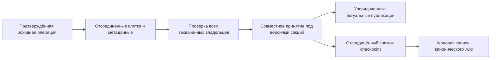

# Исключительные операции инструментов с мебелью Terraria 1.4.5.8

Компонент расширяет [авторитет инструментов](tool-use-authority-1458.md) для старых манекенов 128/269, старой оружейной стойки 334, куклы 470, оружейной стойки 471, вешалки 475 и рельса 314. Компонентные доказательства отделены от общих проверок поставки.

## Исходная операция и владение

Границей допуска остаются существующая фаза выбранного инструмента, дальность, разрешение строительства, локальные часы, полный снимок 219 ячеек инвентаря, поколение игрока и 501 запись mining cache. Отчёты 17/125 не дают урон и не разрешают произвольное удаление клетки. Завершённый удар киркой по 470/475 отправляет действие 20 без локального CLIENT-удаления; ответ SERVER включает отправителя. Удар молотком по рельсу использует действие 15. Контекст 2 пакета 121 аутентифицирует игрока и содержит entityID и позу, но не координаты клика. Авторитет проверяет шесть текущих клеток куклы и принимает один результат только при совпадении всех приватных и публичных эффектов. Несходящиеся предыдущие истории отклоняются; координата не угадывается, дополнительный журнал не создаётся.

Извлечение брони 128/269 и оружия 334 предшествует пыли и обычной ветви неудачного удара. Заполненная 471 извлекает один предмет, очищает сохранённое содержимое и возвращается, оставляя клетки целыми. Следующее завершённое разрушение удаляет пустой объект. Неудачные удары по кукле и вешалке выходят до пыли и фрейминга. Проверки полного объекта сохраняют исходные размеры, условия пола/стен, порядок рекурсивных вызовов и общий исходный флаг `destroyObject` для представленных семейств. Домены RNG вызывающих сторон остаются раздельными: создание CLIENT sentinel-предмета может расходовать локальный RNG, а SERVER использует существующий мировой поток и preview выделения. Ручной 17 сохраняет контекст назначения новых предметов аутентифицированному игроку.

## Канонические метаданные, секции и сохранение

Проверки позы и возможности разрушения современных манекенов и стоек для шляп используют исходный вертикальный кадр левой клетки. Проверка целостности применяет отдельную формулу якоря с остатком по высоте. Пять независимо записанных граничных случаев различают эти правила; они не доказывают общую поддержку некорректных миров.

`WorldTileStore.RuntimeTileEntities` владеет уже декодированным представлением `WorldTileEntity`. Неизменные индексы описывают ту же таблицу и не являются отдельным балансом предметов. Массивы содержимого копируются при импорте и создании снимка. Неизвестные метаданные отдельного мира не считаются пустой мебелью. Компонент удаляет записи, очищает предмет стойки или меняет позу; запись содержимого и экипировки со стороны клиента не допускается.

Изменение только метаданных увеличивает версию конкретной секции якоря. Общая нечётная/чётная версия секции охватывает принятие метаданных и клеток; работа и границы чтения допускаются до принятия любого участника. Пакет 10 использует актуальное каноническое содержимое, а старые снимки секций устаревают. Снимок checkpoint копирует tile entities до фоновой сериализации; существующий типизированный encoder и атомарное сохранение записывают заменённую секцию. Позднейшие изменения владельца не меняют принятый снимок сохранения. Подготовленные кэши по-прежнему перестраиваются из сохранённого канонического мира и не являются авторитетом метаданных.

## Доказательства и ограничения

Обе официальные редакции и независимые повторы захватывают по 400 прямых мировых/позовых строк,4608 переходов рельсов и 66 вызовов приватного метода удара молотком. Исходные таблицы включают инициализированные отображения брони,6196 признаков отсутствия гравитации и топологию рельсов. Дополнение caller-v 4 исправляет алиас в захвате: порядок mining cache до вызова копируется, а не сохраняет ссылку на живой массив. От v 3 отличается только этот снимок до вызова; остальные значения и старые артефакты сохранены.

Одна обычная группа проверяет точные представленные исходные значения и RNG, все 501 записи mining cache, буквальные байты позы/рельсов, реальные State/socket-операции семи семейств, неизменность инвентаря и приватных балансов, принятие до наблюдателей предметов, актуальность метаданных, устаревание секций и сохранение/повторную загрузку канонического мира. Это ограниченные исходные/компонентные проверки, не доказательство wholeMain или официального GUI-клиента. Косметические кадры обычного камня не входят в сохраняемое представление клетки.

Размещение мебели, GUI-транзакции предметов/экипировки, общий жизненный цикл tile entities, нормализация некорректных импортированных предметов/префиксов и движение по рельсам остаются отдельной работой. Импортированное содержимое является доверенными каноническими данными мира; новые отчёты не создают запас. Входящий сквозной рельс должен иметь исходный кадр для своей топологии. Неотправленные или несходящиеся истории курсора не восстанавливаются. Существующая политика 4096 запросов/изменений и 64 секций overlay остаётся границей отказа, а не константой vanilla или заявлением производительности. FullVanillaAiParity и приёмка Linux NativeAOT из этого не следуют.
