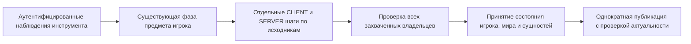

# Авторитетное использование инструментов Terraria 1.4.5.8

Каталог по исходникам охватывает 106 инструментов. Runtime обрабатывает обычное копание, удары по стенам, комбинированные инструменты, лопату, 23 производителя снарядов с удержанием и возвращающийся топор `1052`. Границы взаимодействия с миром перечислены ниже.

## Ввод, время и владение

Аутентифицированные команды поступают в существующую фазу предмета игрока. Ограниченная группа наблюдений сохраняет исходную последовательность; она не выдаёт урон, запас предметов или дополнительное обновление симуляции. Полное действие должно совпадать с выбранным предметом/prefix, дальностью, разрешением строительства, hit cache, временем, инвентарём, поколением игрока и захваченным миром.

Потоки случайных чисел локального игрока и выделенного мира сохраняют отдельных владельцев. Порядок вызовов соответствует исходникам, включая вычисление аргументов подавленных эффектов. Отклонённая подготовка не меняет живые RNG и мир. Изменение времени или ввода делает старую подготовку неактуальной; известный собственный переход может сохранить уже актуальный маркер фазы.

| Пакет | Значение для инструмента |
|---|---|
| `17` | Наблюдение изменения блока/стены/формы, сопоставляемое с полным действием |
| `125` | Визуальный урон именно этого вызова PickTile с аутентифицированным игроком |
| `27` | Наблюдение разрешённого производителя; рождение и доверие принимаются отдельно |
| `34` | Связанное удаление контейнера после исходного наблюдения неуспешного удара |
| `79` | Связанная посадка саженца предметом5295 |
| `141` | Визуальная ретрансляция Lucy с исходным локальным RNG при подтверждённой связи |
| `16`, `117` | Существующий baseline здоровья и последовательность самоурона инструмента |

Исходная последовательность алтаря содержит здоровье до Hurt. Например, baseline `100` и Hurt `50` дают жизнь `50`. Baseline `50` требует следующего Hurt `25`; он не считается уже применённым результатом. Неизменившееся подтверждение сохраняет ожидающий ввод, а публикации используют принятое текущее здоровье.

## Действия мира и снаряды

Шаги кирки, стены и лопаты используют общий изменяемый снимок мира и исходный порядок hit cache. Разрешение контейнера захватывает реальные сохранённые предметы и открытое состояние. Кэш копания получателей очищается через общую границу публикации успешного удаления.

Предмет `5295` удерживает успешное срубание до совпадающего `79`. CLIENT и SERVER каждый выполняют собственный выбор CanPlace, когда он вызывается. Действие создаёт исходный саженец из двух клеток без траты жёлудя. Публикация следует за эффектами мира, расходует однократный маркер и проверяет принятое положение клеток после повторного входа из наблюдателей.

Lucy `141` ретранслируется на исходном месте перед следующим успешным `17`. Визуальные сообщения ожидания, хранения и броска остаются обычной косметикой. Сопоставление дерева/кактуса сохраняет индекс сообщения и не выдумывает отсутствующую историю UI cooldown.

Удерживаемые инструменты и возвращающийся топор сохраняют исходные AI, движение в жидкости и физические/коллизионные размеры. Мировые бомбы `28`/`75` используют собственное происхождение мира. Коллизионная область бомбы `28` равна $14\times14\,\mathrm{px}$ внутри физического тела $22\times22\,\mathrm{px}$; естественные dedicated-рождения `28`/`75` сохраняют `TimeLeft=180`. RNG отскока выполняется на исходной границе столкновения. Контакт с NPC, Hurt игрока, эффекты рельефа и `29` с сохранённой позицией сохраняют своих владельцев и порядок. Неизвестный контекст урона Journey, Hurt человека верхом и Hurt пересекающегося серверного игрока остаются ограничениями.

Падающие блоки отдельно сохраняют конструкторный27 и исходные изменения движения после конструктора. Старая очередь пробуждения и рекурсивный framing используют общую связанную подготовку. Наблюдатели видят уже принятые блоки, состояние снаряда, доверие и регистрацию. Общая проверка публикации не даёт устаревшему внешнему рождению затереть текущий сетевой ключ или baseline позднего подключения, включая изменение того же поколения и замену слота.

## Проверки и оставшееся покрытие

Поворот молотком `137/424/442` использует исходный клиентский packet `20` одной клетки с последующим серверным range framing. Клиентские заявления о жидкости отклоняются; сервер сохраняет свою жидкость и публикует принятое серверное состояние. Публикация погашает once-маркер до callbacks и проверяет весь окружающий footprint. Для framing Water Candle `49` и Switch `136` добавлены отдельный подтверждённый caller и правила опоры. Общий отказ для frame-important сохраняется. Изолированные проверки мебели и single-cell включают реальный socket ingress; последняя общая композиция single-cell ещё ожидает совместных проверок.

Авторитетное использование выбранного расходника сохраняет преемственность локальных часов инструмента, когда их точное известное входное состояние совпадает с подготовленным входом расходника. Уже выполненный переход включает визуальный хвост RNG; повторно он не вычисляется. `ToolTime` считывается до эффектов зелий, buffs, постоянных улучшений и расходования последней единицы, как в исходном `ItemCheck_OwnerOnlyCode`. Существующие снимки оригинального использования еды теперь проверяют и это промежуточное поле в локальных строках; усиленный normal Fact охватывает 15 200 исходных фаз.

Неподдержанная локальная операция не удаляет независимый ItemCheck удалённого игрока на выделенном сервере, его оплаченные buffs и mana. Локальные часы остаются неизвестными и не разрешают действие инструмента или рождение снаряда. Для активного размещения блока или стены ещё нужен авторитетный участник локальных часов, прежде чем переход размещение → действие инструмента в мире будет принят; проверки remote-анимации сами по себе этот переход не доказывают.

Обычные групповые проверки охватывают исходные metadata/clocks/power инструментов, здоровье/выбор/Lucy игрока, владение и reentry перепосадки, 480 сценариев снарядов в рельефе, 24 случая срезания растений, 220 настроенных сценариев падения и 176 сценариев естественного рождения. Независимые числовые снимки оригинала сохраняют точные пакеты, клетки и RNG; выполнение обоих изданий исходных данных на Windows отличается от проверки Linux runtime. Causal omission controls проверяют перепосадку, RNG/коллизию/lifetime бомб и устаревшую публикацию рождения.

Остаются редкие рождения наживки с полным контекстом выбора цели NPC, состояние манекенов и вешалок, рельсы, другие особые действия с мебелью, дополнительные frame-important объекты и progression-блоки. Общая авторитетность inventory/ammo/equipment и полное vanilla AI остаются более широкими задачами roadmap. Linux NativeAOT локально ещё не проверен.

См. [границы gameplay](gameplay.md), [прогресс мира](world-progression-events.md) и [дорожную карту](../roadmap.md).
