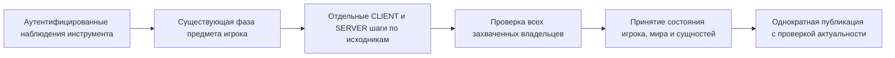

# Авторитетное использование инструментов Terraria 1.4.5.8

[Локальные часы оружия и переход к инструменту](local-weapon-tool-continuity-1458.md) описывает связанный компонент часов, порядка mana/refill и Gem cohort; покрытие метаданных и итоговые shipping gates остаются отдельными.

Каталог по исходникам охватывает 106 инструментов. Runtime обрабатывает обычное копание, удары по стенам, комбинированные инструменты, лопату, 23 производителя снарядов с удержанием и возвращающийся топор `1052`. Границы взаимодействия с миром перечислены ниже.

## Ввод, время и владение

Аутентифицированные команды поступают в существующую фазу предмета игрока. Ограниченная группа наблюдений сохраняет исходную последовательность; она не выдаёт урон, запас предметов или дополнительное обновление симуляции. Полное действие должно совпадать с выбранным предметом/prefix, дальностью, разрешением строительства, hit cache, временем, инвентарём, поколением игрока и захваченным миром.

В подтверждённой локальной фазе инструмента надетый аксессуар дальности (`2215`, `3061` или `5126`) увеличивает дальность добычи на $3\,\text{тайла}$ по горизонтали и $2\,\text{тайла}$ по вертикали, однократно даже при нескольких таких аксессуарах. Слоты внешнего вида и пустые слоты не дают бонуса. Перед разрешением изменения блока должна пройти общая проверка экипировки; одно это правило дальности не подтверждает остальные аксессуары персонажа или скорость размещения.

Неподвижный профиль допускает выбранный Жезл раздора без модификатора, когда оба таймера предмета равны нулю. Тик без использования сохраняет состояние таймеров для переключения на поддерживаемый инструмент. Фаза по-прежнему отклоняет попытку использовать жезл и не разрешает телепортацию.

Каталог боевой экипировки может вычислить ограниченные боевые свойства функционального набора аксессуаров `-=GOOD=-`, включая защиту Shackle и эффекты Terraspark при доступном слоте. В обычной сложности Journey слоты `67` и `68` не дают эффектов Terraspark и Toolbelt. Узкая сетевая фаза допускает первый наблюдавшийся состав экипировки, когда персонаж Journey неподвижно стоит на твёрдой земле и выбрал инструмент или представленный предмет размещения. Движение, прыжок, полёт, транспорт и изменённые сочетания предметов и слотов отклоняются; движение на крыльях и в ботинках остаётся за пределами этой фазы. Для допуска есть узкий синтетический регрессионный тест, но изменение блока официальным клиентом ещё не наблюдалось.

Неподдержанный **первый** такт игрока прекращает владение общим потоком случайных чисел `UpdatePlayers` и очищает фазы предмета и физики на оставшуюся сессию. Последующий выбор кирки не запускает узкую неподвижную фазу заново. Во второй проверке официальный клиент отправил 31 запрос на добычу выбранной киркой; все были отклонены из-за отсутствия сохранённой фазы предмета. Для работы блоков требуется сначала поддержать начальную фазу с её выбранным предметом, экипировкой и движением.

Существующий выбор действующего слота также фиксирует, даёт ли доступный функциональный аксессуар скорость установки блоков, скорость установки стен или автоматическую покраску. Для Architect Gizmo Pack `3061` в слоте `66` присутствуют все три признака; слот внешнего вида и закрытый сложностью слот не дают их через этот выбор. Terraria отдельно просматривает предметы в инвентарных слотах `0`–`57` для механических эффектов аксессуаров; результат проверки экипировки их не описывает. Для уже допущенной полной фазой экипировки исходная скорость зависит от того, создаёт ли выбранный предмет блок, отличный от факела, и проходит существующий переход постоянных улучшений и обратного коэффициента скорости. Автопокраска и её источник в инвентаре пока не смоделированы.

Принадлежащая серверу фаза игрока распознаёт предметы персонажа в соответствующих слотах внешнего вида: голову `4955`, тело `3267` и ноги `844`. Она также распознаёт нейтральные для фазы социальные аксессуары `4771`, `1921`, `1323` и `554` в наблюдавшихся слотах. Наблюдавшиеся рог `4563` и темнота `3581` в социальных слотах `73` и `75` задают только визуальные флаги. Эти предметы не дают функциональных бонусов боя или инструментов. Точные функциональные и социальные крылья `4746` участвуют только в описанном выше неподвижном профиле на земле.

Наблюдавшиеся слоты красителей `-=GOOD=-` `79`–`88`, `96` и `98` допускаются по точному сочетанию слота и предмета без префикса. В Terraria `Player.UpdateDyes` считывает их в визуальные поля окраски, поэтому они не дают прав на инструменты или движение. Другие красители этим составом не подтверждены.

Наблюдавшиеся вагонетка `3353`, транспорт `4444` и крюк `939` также распознаются только в соответствующих специальных слотах, пока они там хранятся. Активное движение на транспорте, вагонетке или крюке по-прежнему проходит отдельные проверки состояния и физики; распознавание этих предметов не включает такие действия.

Потоки случайных чисел локального игрока и выделенного мира сохраняют отдельных владельцев. Порядок вызовов соответствует исходникам, включая вычисление аргументов подавленных эффектов. Отклонённая подготовка не меняет живые RNG и мир. Изменение времени или ввода делает старую подготовку неактуальной; известный собственный переход может сохранить уже актуальный маркер фазы.

| Пакет | Значение для инструмента |
|---|---|
| `17` | Наблюдение изменения блока/стены/формы, сопоставляемое с полным действием |
| `125` | Визуальный урон именно этого вызова PickTile с аутентифицированным игроком |
| `27` | Наблюдение разрешённого производителя; рождение и доверие принимаются отдельно |
| `34` | Связанное удаление контейнера после исходного наблюдения неуспешного удара |
| `79` | Связанная посадка саженца предметом5295 |
| `141` | Визуальная ретрансляция Lucy с исходным локальным RNG при подтверждённой связи |
| `16`, `117` | Существующий baseline здоровья и последовательность самоурона инструмента |

Исходная последовательность алтаря содержит здоровье до Hurt. Например, baseline `100` и Hurt `50` дают жизнь `50`. Baseline `50` требует следующего Hurt `25`; он не считается уже применённым результатом. Неизменившееся подтверждение сохраняет ожидающий ввод, а публикации используют принятое текущее здоровье.

## Действия мира и снаряды

Шаги кирки, стены и лопаты используют общий изменяемый снимок мира и исходный порядок hit cache. Разрешение контейнера захватывает реальные сохранённые предметы и открытое состояние. Кэш копания получателей очищается через общую границу публикации успешного удаления.

Предмет `5295` удерживает успешное срубание до совпадающего `79`. CLIENT и SERVER каждый выполняют собственный выбор CanPlace, когда он вызывается. Действие создаёт исходный саженец из двух клеток без траты жёлудя. Публикация следует за эффектами мира, расходует однократный маркер и проверяет принятое положение клеток после повторного входа из наблюдателей.

Lucy `141` ретранслируется на исходном месте перед следующим успешным `17`. Визуальные сообщения ожидания, хранения и броска остаются обычной косметикой. Сопоставление дерева/кактуса сохраняет индекс сообщения и не выдумывает отсутствующую историю UI cooldown.

Удерживаемые инструменты и возвращающийся топор сохраняют исходные AI, движение в жидкости и физические/коллизионные размеры. Мировые бомбы `28`/`75` используют собственное происхождение мира. Коллизионная область бомбы `28` равна $14\times14\,\mathrm{px}$ внутри физического тела $22\times22\,\mathrm{px}$; естественные dedicated-рождения `28`/`75` сохраняют `TimeLeft=180`. RNG отскока выполняется на исходной границе столкновения. Контакт с NPC, Hurt игрока, эффекты рельефа и `29` с сохранённой позицией сохраняют своих владельцев и порядок. Неизвестный контекст урона Journey, Hurt человека верхом и Hurt пересекающегося серверного игрока остаются ограничениями.

Падающие блоки отдельно сохраняют конструкторный27 и исходные изменения движения после конструктора. Старая очередь пробуждения и рекурсивный framing используют общую связанную подготовку. Наблюдатели видят уже принятые блоки, состояние снаряда, доверие и регистрацию. Общая проверка публикации не даёт устаревшему внешнему рождению затереть текущий сетевой ключ или baseline позднего подключения, включая изменение того же поколения и замену слота.

## Проверки и оставшееся покрытие

Поворот молотком `137/424/442` использует исходный клиентский packet `20` одной клетки с последующим серверным range framing. Клиентские заявления о жидкости отклоняются; сервер сохраняет свою жидкость и публикует принятое серверное состояние. Публикация погашает once-маркер до callbacks и проверяет весь окружающий footprint. Для framing Water Candle `49` и Switch `136` добавлены отдельный подтверждённый caller и правила опоры. Общий отказ для frame-important сохраняется. Проверки мебели и single-cell включают реальный socket ingress и общий checkpoint инструментов ниже.

Обычное изменение формы и неудачное копание сохраняют центральный reset-вызов RNG также для `385/446/447/448`. Их исходная косметическая ветка доходит до `Framing.SelfFrame8Way`, который при запросе reset выполняет один `Next(0,3)`. Framing только соседней клетки такой reset не запрашивает. Исправление сохраняет оба потока RNG и не разрешает размещение новых предметов.

Авторитетное использование выбранного расходника сохраняет преемственность локальных часов инструмента, когда их точное известное входное состояние совпадает с подготовленным входом расходника. Уже выполненный переход включает визуальный хвост RNG; повторно он не вычисляется. `ToolTime` считывается до эффектов зелий, buffs, постоянных улучшений и расходования последней единицы, как в исходном `ItemCheck_OwnerOnlyCode`. Существующие снимки оригинального использования еды теперь проверяют и это промежуточное поле в локальных строках; усиленный normal Fact охватывает 15 200 исходных фаз.

Неподдержанная локальная операция не удаляет независимый ItemCheck удалённого игрока на выделенном сервере, его оплаченные buffs и mana. Локальные часы остаются неизвестными и не разрешают действие инструмента или рождение снаряда. Для представленного оплаченного размещения блоков/стен и 41 удерживаемого определения оружия теперь есть авторитетные участники локальных часов для последующих действий инструмента. Точные границы описаны в [преемственности размещения](local-placement-tool-continuity-1458.md) и [преемственности оружия](local-weapon-tool-continuity-1458.md); проверки remote-анимации сами по себе этот переход не доказывают.

Обычные групповые проверки охватывают исходные metadata/clocks/power инструментов, здоровье/выбор/Lucy игрока, владение и reentry перепосадки, 480 сценариев снарядов в рельефе, 24 случая срезания растений, 220 настроенных сценариев падения и 176 сценариев естественного рождения. Независимые числовые снимки оригинала сохраняют точные пакеты, клетки и RNG; выполнение обоих изданий исходных данных на Windows отличается от проверки Linux runtime. Causal omission controls проверяют перепосадку, RNG/коллизию/lifetime бомб и устаревшую публикацию рождения.

Объединённый checkpoint tools/Larva/events/NPC проходит Release с предупреждениями как ошибками, fast (25 259 /25 260) и полный набор (1 566 672 /1 566 673 cases); в обоих наборах нет failures/errors и остаётся один известный liquid-skip. В полном наборе выбраны все 5 189 методов; 3 848 исходных/config/fixture входов и 158 выполняемых DLL не изменились. Свежая Windows NativeAOT-публикация и пять серверных smoke-проверок проходят, как и реальные TCP82/49/129, чат двух клиентов и 72 проверки знаковых эффектов на каждом Release/Native host. Оба host остановлены. Эти проверки не доказывают совместимость официального GUI-клиента или всего `Main.Update`.

Остаются более широкие семейства оружия/размещения и контексты экипировки, редкие рождения наживки с полным контекстом выбора цели NPC, размещение мебели и дополнительные взаимодействия, езда по рельсам, другие frame-important объекты и progression-блоки. Общая авторитетность inventory/ammo/equipment и полное vanilla AI остаются более широкими задачами roadmap. Linux NativeAOT локально ещё не проверен.

См. [границы gameplay](gameplay.md), [прогресс мира](world-progression-events.md) и [дорожную карту](../roadmap.md).

## Исключительные операции с мебелью и рельсами

Исходно подтверждённый компонент инструментов добавляет старые манекены128/269, стойки334/471, куклу470, вешалку475 и рельс314, включая позу121, результаты действия20 и канонические снимки изменяемых tile entities. См. [владение, доказательства и оставшиеся ограничения](tool-furniture-exceptions-1458.md). Существующий авторитет часов, CC и размещения сохраняется.
