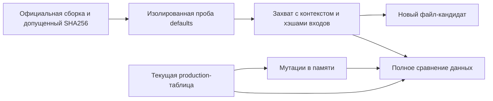

# Инструменты официальных данных

`tools/vanilla.py` объединяет существующие таблицы метаданных NPC и размещения предметов в воспроизводимый автономный процесс. Инструмент вызывает закреплённую официальную сборку в отдельном процессе CoreCLR для разработки, сравнивает каждую представленную запись, создаёт кандидаты для ревью и проверяет анализатор на испорченных данных. Новых production-зависимостей или runtime-загрузчика нет.

Тот же вход предоставляет [каталог исходных проходов worldgen и ограниченный повтор Reset](worldgen-source-tools.md).



## Команды

Запускайте из корня репозитория с Python 3.11 или новее. Для захвата также нужен .NET SDK репозитория. Официальный executable остаётся локальным и не коммитится. Используется Linux-сборка сервера, указанная в `tools/vanilla_data/reference.json`; редакция сборки не доказывает, на какой ОС выполняется проба.

```sh
python tools/vanilla.py capture --assembly /path/to/Linux/TerrariaServer.exe --output .cache/vanilla-data/capture.json
python tools/vanilla.py check all --reference .cache/vanilla-data/capture.json --report .cache/vanilla-data/check.json
python tools/vanilla.py mutate all --reference .cache/vanilla-data/capture.json --report .cache/vanilla-data/mutations.json
python tools/vanilla.py verify all --reference .cache/vanilla-data/capture.json --report .cache/vanilla-data/verification.json
python tools/vanilla.py emit npc-defaults --reference .cache/vanilla-data/capture.json --output .cache/vanilla-data/NpcCandidate.cs
python tools/vanilla.py check npc-defaults --reference .cache/vanilla-data/capture.json --actual .cache/vanilla-data/NpcCandidate.cs
python tools/vanilla.py emit item-placement --reference .cache/vanilla-data/capture.json --output .cache/vanilla-data/ItemCandidate.cs
```

В Windows вместо `python` можно использовать `py -3`. `--repo` выбирает рабочую копию для проверки таблиц или шаблонов генерации. `--actual` выбирает один файл-кандидат и потому требует один набор данных. `verify` объединяет полное сравнение с мутационными проверками; при красном baseline мутации не засчитываются как принятие. Результаты записываются в новые файлы: повторный запуск требует новых имён захвата или отчёта. Проверка и мутации никогда не записывают production-файлы.

Код `0` означает успешную запрошенную проверку, `1` — расхождения или выжившие мутации, `2` — неверные входы, изменение происхождения, ошибку сборки/захвата или отказ записи результата. Подробный JSON-отчёт указывает отсутствующие/лишние идентичности и конкретные поля. Повреждённый или обрезанный массив считается ошибкой, а не успешным сравнением пустого набора.

## Представленные данные

| Набор | Официальный вход | Существующая таблица и проверяемая область |
|---|---|---|
| `npc-defaults` | Свежие вызовы `NPC.SetDefaults`: 696 положительных и 65 отрицательных запрошенных идентичностей | Все 756 живых записей `VanillaNpcSourceDefaultRoster1458.cs`, 15 столбцов: идентичность, геометрия, характеристики, scale и флаги; пять идентичностей с нулевой жизнью явно отсутствуют |
| `item-placement` | Свежие вызовы `Item.SetDefaults`: все 6 195 положительных идентичностей предметов | Все 3 523 размещаемые записи: знаковые ID тайлов/стен, стиль, бит consumable, порядок и заголовки количества |

Читатель NPC также проверяет порядок столбцов позиционной записи. Поля одинарной точности сравниваются после точной нормализации binary32, без epsilon. Читатель размещения декодирует закоммиченный массив байтов независимо от официального захвата. Генерация заменяет только массив данных и заголовки количества размещения; существующие алгоритмы поиска остаются в шаблоне. Кандидаты требуют обычного ревью и проверок, соответствующих последующему production-изменению.

Профиль — `classic-constructor-coreclr`: Classic, сброс seed `1458` перед каждым запросом, dedicated-роль приёма, `gameMenu=true`, стандартные параметры spawn и свежие объекты. Нет инициализации content samples, загруженного мира, update, AI или повторного использования слота. Это не проверяет `CreationRows`, варианты сложности/seed, применение предмета, достижимость естественного спавна, NativeAOT или всю совместимость с vanilla. Для этих отдельных утверждений действуют существующие runtime/creation-свидетельства.

## Происхождение и покрытие анализатора

Захват фиксирует SHA256 официальной сборки и зависимостей, SHA256 реально выполненной DLL пробы, ОС/framework хоста, полные границы идентичностей, дайджест данных и хэши пробы, оркестратора, закреплённой схемы, build properties и конфигурации SDK. Соседние managed-зависимости должны быть допущены в закреплённом описании; встроенные зависимости связаны хэшем официального executable. Изменение входов требует явного повторного захвата; проверка сохранённого захвата повторно не вызывает официальную сборку. Дайджесты обнаруживают изменения и идентифицируют наблюдения; они не являются подписями или независимым доказательством выполнения захвата.

Мутационные проверки меняют каждый столбец у первой и последней представленной идентичности, удаляют и дублируют запись: 32 мутации NPC и 12 размещения. Они выполняются над текстом кандидатов в памяти. Дубликаты вставляются прямо в исходный текст, чтобы отказ самого генератора не выдавался за обнаружение дубликата анализатором. Отчёт описывает этот ограниченный набор; проверки каждой ячейки или всех программных мутаций не заявляются.

`python -m unittest discover -s tools/ci -p test_vanilla_data.py` работает без официальной сборки. Он сравнивает все метаданные NPC с существующей независимой официальной фикстурой и проверяет бинарный формат, сдвиг float на ULP, отсутствующие/дублированные записи, изменения контекста/происхождения, генерацию и намеренно сломанный всегда зелёный компаратор. Комментарии/литералы не скрывают изменённую декларацию; условная компиляция отвергается, поскольку читатель не выводит символы компилятора. Существующий поиск Python-тестов в CI автоматически включает эти тесты. Эти команды разработки сами не запускают игровые матрицы и не меняют выбор тестовых уровней. Последующие сгенерированные production-изменения сохраняют обычные требования приёмки.
