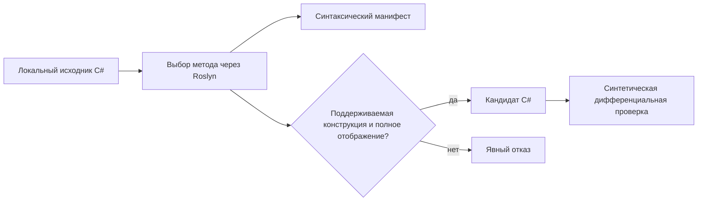

# VanillaPorter: экспериментальный инструмент разработчика на Roslyn

VanillaPorter находится в [tools/TerraRuntime.VanillaPorter](../../tools/TerraRuntime.VanillaPorter/README.md) вне production-проектов. Первая версия обеспечивает детерминированный синтаксический анализ метода C#, генерацию ограниченной заготовки по явному отображению полей и синтетическое сравнение поведения с помощью компилятора. Отчёт содержит обращения к полям, прямые вызовы, потенциальные вызовы RNG, условия ветвления и неподдерживаемые конструкции.

Инструмент не содержит декомпилированных исходников игры, не запускает код официальной Terraria и не подтверждает соответствие vanilla. Успешный анализ ещё не гарантирует возможность генерации. Неразрешённые вызовы, глобальные зависимости, локальные переменные, циклы и неподдерживаемый синтаксис блокируют генерацию. Вывод кандидата игнорируется git и **не входит** в production-сборки NativeAOT/CoreCLR. Синтетическая дифференциальная проверка охватывает 15 комбинаций, а не исходный сервер Terraria.

Следующий этап: анализ зависимостей с разрешением символов, явное сопоставление состояния/RNG для одного ещё не перенесённого настоящего метода ИИ и независимые эталонные покадровые трассы официального сервера. Прежде чем заявлять об ускорении, необходимо измерить затраченное время и сложность отладки.
