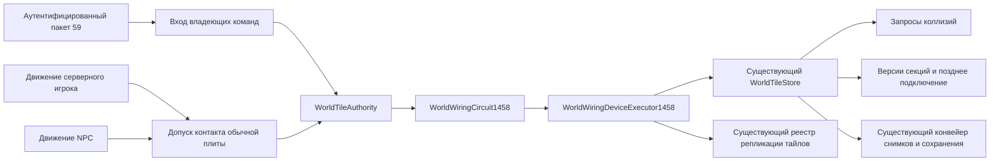

# Авторитетная проводка и базовые механизмы

[English](../en/wiring-mechanisms.md) · [Архитектура](architecture.md) · [Сеть](networking-protocol.md)

Этот блок связывает разрешённые запросы переключателей Terraria `1.4.5.8` и контакты обычных нажимных плит с существующими авторитетными владельцами мира, репликации и сохранения. Он не устанавливает совместимость всей системы проводки vanilla. Локальная приёмка завершена: Release без предупреждений/ошибок, focused `164/164`, fast `25335/25336` и полный набор без фильтров `1566748/1566749` проходят без падений/ошибок с одним прежним пропуском жидкостей. Выполнены все `5250` обнаруженных методов; `3897` входных файлов и `60` DLL остались неизменными. Windows NativeAOT проходит пять штатных smoke-проверок. См. [запись проверки](../verification/wiring-mechanisms-1458.json); Linux Native и официальный GUI остаются непроверенными.

## Владение и исполнение

`WorldWiringCircuit1458` владеет временным состоянием обхода и часами механизмов одного мира. `WorldWiringDeviceExecutor1458` изменяет тот же `WorldTileStore`, который используют коллизии, кэш секций и сохранение. Коммит клетки актуатора передаётся `VanillaWorldWiringMutationService`; двери, люки и высокие ворота используют `VanillaWorldGroundFighterDoorOpeningService`. Параллельный мир, образ коллизий или поток случайных чисел не создаётся. Направление открытия двери использует существующий общий игровой RNG; закрытие использует существующего владельца RNG рамок двери.

Импульсы выполняются в порядке красного, синего, зелёного и жёлтого цветов с отдельным состоянием пропуска для каждого цвета. Источники обходятся по столбцам, затем строкам; обход использует исходную FIFO и порядок соседей вниз/вверх/вправо/влево. Многоклеточные источники света пропускают весь свой прямоугольник. Существующий владелец изменений дверей также передаёт делегированные операции пропуска `WorldGen` через необязательный callback отдельного вызова: открытие обычной двери пропускает результирующий прямоугольник `2×3`, закрытие — сохранённый столбец. Люки используют исходные координаты, зависящие от направления, а высокие ворота пропускают все пять строк после проверки объекта, в том числе если затем операция блокируется актором. Последовательные импульсы очищают временное состояние и могут снова воздействовать на общие участки проводов.

Произвольного ограничения длины провода нет. Хранимое состояние ограничено клетками мира и четырьмя направленными входами маршрутизаторов. Повторные одинаковые входы маршрутизаторов подавляются как явная политика ограничения памяти и работы. Повреждённые рамки развилки вне `0`, `18` и `36` не передают сигнал дальше. Эквивалентность этих защит для всех топологий независимо не доказана. Вложенные импульсы логических вентилей не входят в этот блок. Повторный внешний вход во время исполнения импульса отклоняется.

## Поддержанные источники и устройства

`RuntimeNpcAiStateExecutor.Tick` принимает необязательный `Action<NpcSnapshot, NpcSnapshot> actorContact` после приёмника коммита. Он получает исходный снимок и точную текущую закоммиченную ревизию после эффектов AI, до деактивации и перехода к следующему живому слоту. Callback выполняется в авторитетном потоке; изменение актора по-прежнему требует проверки поколения/ревизии. Существующие вызовы могут его не передавать. Перегрузки изменения дверей аналогично принимают необязательный `skipWire` для отдельного вызова, не сохраняя глобального состояния цепи.

| Семейство | Допущенные идентификаторы тайлов и поведение |
| --- | --- |
| Ручные источники | Переключатель `136`, рычаг `132`, таймер `144`, кратковременный переключатель `411`. |
| Дополнительные прямые источники `HitSwitch` | `135`, `314`, `423`, `428`, `442`, `476` создают исходный одноклеточный импульс. Это не допускает другие физические источники их сигналов или их эффекты как проводных устройств. |
| Обычные нажимные плиты | Тайл `135`, стили `0`–`6`, для физически моделируемых игроков и NPC согласно исходному допуску акторов. |
| Одноклеточный свет | Факел `4`; свечи `33`, `49`, `174`, `372`, `646`; праздничная гирлянда `149`. |
| Многоклеточный свет | Подвесной фонарь `42`; напольная лампа `93`; фонарный столб `92`; светильники `2×2` `95`, `100`, `126`, `173`, `564`; люстра `34`; костёр `215`; камин `405`. |
| Двери и ворота | Обычные двери `10`/`11`, люки `386`/`387`, высокие ворота `388`/`389` через существующего владельца исходных преобразований. |
| Актуаторы | Существующие активные твёрдые тайлы с ограничениями `Wiring.DeActive` и существующими правилами `CanKillTile`, если сверху стоит активный тайл. |
| Кратковременный переключатель при сигнале по проводу | Тайл `411` изменяет рамки всего объекта и пропускает его клетки. Эта ветвь не регистрирует часы сброса ручного нажатия и не создаёт ещё один импульс. |
| Пересечения | Маршрутизация соединительной коробки `424`; накопление направлений пиксельной коробки `445` с обработкой после четырёх цветов. |

Обычные плиты стилей `2`, `3`, `4` и `6` допускают игроков. Стиль `5` по исходному правилу допускает категории NPC и снарядов; этот блок подключает категорию NPC. Стили `0` и `1` допускают подключённые категории игроков и NPC. Контакт требует нового пересечения с исходными асимметричными границами старого/нового положения; стояние на плите не создаёт повторных импульсов. Сохранено исходное исключение нижней области мира из поиска. Симуляция игроков/NPC снимает положения до и после движения в авторитетном потоке; клиент не может передать категорию актора или результат контакта.

Актуаторы отклоняют нетвёрдые тайлы и исходные исключения, включая рельсы, люки, высокие ворота и лунки для гольфа. Кирпич ящеров `226` ниже `worldSurface` не деактивируется до Плантеры; равенство высоте поверхности допускается. Исходный набор объектов сверху запрещает деактивацию опоры. Для остальных активных объектов сверху используется существующая политика `CanKillTile`, основанная на исходнике. Реактивация не повторяет запреты деактивации. Коллизии немедленно видят флаг неактивности той же клетки, а существующее хранилище помечает версии секций и сохранения изменёнными.

## Таймеры и жизненный цикл

Проводка использует существующую общую проверку занятости из composition, учитывающую подключённых людей, серверных игроков и NPC. Живой серверный игрок внутри высоких ворот запрещает операцию; удаление его поколения освобождает ворота при следующем допустимом нажатии.

Независимый корпус содержит `110` сцен: исходные `98` строк не изменены, добавлены восемь полных образов дверей/люков/ворот, три трассы часов на границе мира и трасса повторного нажатия моментальной кнопки. Закрытие люка сохраняет тип, рамки, краску и покрытия неактивных клеток по правилу `Tile.ClearTile`. Обновление таймеров следует после фазы времени мира, как в `Main.DoUpdateInWorld_Inner`.

| Стиль таймера (`frameX / 18`) | Интервал импульсов |
| --- | --- |
| `0` | $60\,\text{тиков}$ |
| `1` | $180\,\text{тиков}$ |
| `2` | $300\,\text{тиков}$ |
| `3` | $30\,\text{тиков}$ |
| `4` | $15\,\text{тиков}$ |

Механизмы сначала уменьшают счётчик, затем проверяют импульс; порядок обработки обратен порядку регистрации, как в `Wiring.UpdateMech`. Выключение и включение таймера при ещё существующей регистрации не создаёт вторые часы и не сбрасывает оставшийся интервал. Регистрации привязаны к координатам и ограничены числом `999`, как в `Wiring.CheckMech`; уничтожение устройства не добавляет отдельного придуманного правила отмены. Допущенный сброс кратковременного переключателя выполняется через $60\,\text{тиков}$. Обновление механизмов проходит через существующий тик мира после симуляции акторов.

Цвета проводов, флаги актуатора/неактивности и рамки устройств используют существующие представления снимков тайлов и `.wld`. Сохранение оставляет рамку работающего таймера, но официальный `WorldFile.LoadWorldTiles` сбрасывает загруженный `frameY` таймера `144` в `0`; обратный отсчёт механизма временный и не сериализуется. Поэтому загрузка канонического файла и кэша runtime начинает работу с выключенными таймерами. Смена мира отбрасывает старый исполнитель цепи и его часы. Регрессии сохранения/загрузки проверяются отдельно от правила канонического файла; итоговая запись приёмки указывает подтверждённую область.

## Сетевая граница и публикация

Пакет `59` содержит две знаковые координаты тайла в little-endian. Приёмник требует аутентифицированную игровую сессию и преобразует запрос во владеющую команду до освобождения приёмного буфера. Исполнение проверяет поколение соединения/игрока, существующий бюджет правок игрока, границы мира и текущее устройство-источник. В запросе нет желаемого состояния тайла, рамки света, списка выходных устройств или флага допустимости актора.

В `MessageBuffer.GetData`, case `59`, нет проверки дальности, поэтому этот путь не добавляет её. Повторные разрешённые нажатия остаются последовательными активациями; они не считаются идемпотентными подтверждениями. Устаревшие сессии и повторно используемые слоты не могут заимствовать личность текущего игрока. Изменения и публикация через существующий реестр выполняются в авторитетном потоке. Запись тайлов инвалидирует версии секций для перестроения кэша и позднего подключения, а публикация прямоугольников тайлов передаёт текущим клиентам закоммиченные результаты устройств. Рамка ручного источника воспроизводится на остальных клиентах пакетом `59` без предшествующего прямоугольника самого источника, который заставил бы клиента переключить её дважды. Изменения таймера по проводу и истечение часов механизмов непосредственно публикуют итоговое состояние тайлов.

Проводные двери публикуют исходное действие пакета `19` до внешнего переключения `59`: `0`/`1` для открытия/закрытия обычной двери, `2`/`3` для люков и `4`/`5` для высоких ворот. Открытие обычной двери передаёт направление успешной попытки; люки передают `+1` для первой попытки и `-1` для запасной. Закрытие обычной двери и действия высоких ворот используют исходный байт направления по умолчанию, декодируемый как `-1`. Высокие ворота публикуют действие даже при отказе серверной проверки занятости. За каждым опубликованным действием следует авторитетный образ пакета `20`, включая случай заблокированных ворот, чтобы принудительная клиентская операция сходилась к серверному состоянию. Этот дополнительный корректирующий образ — политика публикации runtime сверх действия двери vanilla. Владелец World предоставляет независимый от протокола callback `WorldWiringDoorTransition1458`; кодирование и доставка принадлежат существующему реестру репликации.

## Доказательства и оставшаяся работа

Фикстура телеметрии `GameLoopTests` допускает $30\,\mathrm{s}$ на старт фонового цикла при нагрузке полного набора. Проверки тиков, пропущенных дедлайнов и измеренного времени фазы обновления сохранены. Эта правка теста не меняет production-исходники; остальные 59 ссылочных managed DLL и исполняемый файл NativeAOT остались побайтно прежними.

Основные общие точки интеграции при слиянии ветки: `WorldTileAuthority.cs`, `ServerRuntimeComposition.cs`, `ServerRuntimeState.Tick.cs`, `ProjectileLifecycleFrameSink.cs`, `NpcAuthority.cs`, `ServerPlayerAuthority.cs`, `RuntimeNpcAiStateExecutor.cs` в Core, существующий `VanillaWorldGroundFighterDoorOpeningService.cs`, `WorldFileTileEncoder.cs`, `RuntimeWorldSnapshotCache.Read.cs`, `TerrariaMessageId.cs`, список ресурсов тестового проекта и таймаут фикстуры в `GameLoopTests.cs`. Исполнитель цепей, устройства, вход/кодек, владелец Native smoke, числовая фикстура и инструмент воспроизведения добавлены отдельными файлами.

Поведение закреплено за локальным официальным исходником `1.4.5.8`: `Wiring.HitSwitch`, `TripWire`, `HitWire`, `HitWireSingle`, `UpdateMech`, `CheckMech`, `DeActive`, `ReActive` и методами переключения света; `WorldGen.OpenDoor`, `CloseDoor`, `ShiftTrapdoor`, `ShiftTallGate`, `CanKillTile`; `TileObjectData`; `Collision.SwitchTiles`; `MessageBuffer.GetData`, case `59`; `WorldFile.LoadWorldTiles`.

Сохранённая независимая числовая фикстура исполняет неизменённый официальный бинарный файл Linux-редакции под Windows CoreCLR. Она содержит `109` сцен с воспроизведением поддержанных результатов и одну сцену плиты стиля `7`, где проверяются только допуск актора и флаг требуемого разрушения. Её итоговые эффекты разрушения/рамок пока не допускаются. Поддержанные сцены охватывают трассы переключателей/рычагов/таймеров, допуск акторов, рамки света и ограничения актуаторов по прогрессии. Это доказательство по официальному бинарному файлу, а не исполнение на Linux или подтверждение Linux NativeAOT. Регрессии производственного входа, публикации, сохранения и устаревших сессий дополняют эти компонентные трассы. Итоговые результаты focused, fast, full и доступных NativeAOT-проверок должны происходить из завершённых проверок этой ветки, а не прежних контрольных точек.

В поддержанную цепочку пока не входят:

- Клиентское снятие инструментами и массовая проводка. Обычная оплаченная установка четырьмя ключами и выбранным актуатором описана в [руководстве установки проводки](wiring-tool-installation-1458.md).
- Стиль плиты `7`, где после импульса требуется настоящая транзакция разрушения/выпадения предметов; взвешенные плиты и источники контактов снарядов/валунов.
- Насосы и телепортеры до полного подключения владельцев жидкости и перемещения.
- Другие статуи NPC и телепортации горожан; контексты вне ограниченных расширений ловушек, логики, предметных статуй и статуй NPC ниже.
- Общая передача `SquareTileFrame` и побочные эффекты удаления объектов вне допущенных владельцев. Актуация от цепи теперь использует существующую транзакцию для обхода рамок девяти клеток, поддержанного удаления переключателя с выпадением предмета и опоры факела. Неподдержанные соседи отклоняются до записи; полная совместимость рамок прикреплённых объектов не заявляется.
- Открытие люка в срезаемое содержимое: существующий сервис отклоняет его до подключения полной транзакции срезания/предметов/метаданных. Занятые высокие ворота и закрывающиеся люки сохраняют исходные проверки акторов.
- Совместимость всей проводки vanilla, произвольные неподдержанные устройства/стили, прохождение официальным GUI-клиентом и проверки недоступных платформ.

Следующий связанный блок — расширение разрушения прикреплённых объектов и одноразовые плиты, а также недостающий владелец клиентского визуального состояния для RNG кусачек; затем насосы/телепортеры через существующих авторитетных владельцев.

Контакты серверных игроков и NPC обрабатываются после их закоммиченного движения, до следующего актора. Обычные подключённые игроки сохраняют исходный путь локального клиента через `59`; дополнительный импульс из пакета `13` сервер не создаёт. Для представленных чувствительных к плитам животных устанавливается исходное состояние бегства `ai=(1,400,0,ai3)`. Полный исходный порядок публикации NPC `23` относительно контактных `20`/`59` этим блоком не доказан.

Штатный `--world-smoke` также выполняет авторизованную команду, изменение света и актуатора, проверяет срок таймера и независимо снятые байты сохранения таймера. Инструмент воспроизведения находится в [`tools/reference/wiring1458`](../../tools/reference/wiring1458/README.md). При сохранении применяется `WorldFile.SaveWorldTiles`, при загрузке — `LoadWorldTiles`.

## Ограниченное расширение дротиковых ловушек

Тайл `137` со стилями `0`, `1` и `5` выпускает исходные снаряды `98`, `184` и `980` через существующие обход проводов и хранилище снарядов. Сохраняются пять проверенных ориентаций кадра, исходная позиция выпуска, скорость, урон и владелец `255`. Все цвета проводов разделяют прежний таймер механизма: CheckMech регистрирует задержку $200\,\text{updates}$ до выделения снаряда, в том числе при отказе выделения. Переключатели, обычные плиты и таймеры используют прежние пути срабатывания. Для снаряда окружения не создаётся фиктивный владелец игрока или NPC.

Прежний владелец снарядов обеспечивает создание, движение, столкновения с тайлами, завершение и репликацию. Обычный и усиленный ядовитые дротики назначают Poisoned с исходными длительностями `600`/`900`; отравляющий дротик назначает Venom на `300` до поправок сложности и экипировки при попадании в игрока. У подключённых и серверных игроков участники HP, баффов и иммунитета принимаются вместе с RNG до наблюдателей. Dead Man's Sweater в функциональном слоте тела вдвое уменьшает урон ловушки и длительность эффекта до остальных исходных поправок. Контакты с NPC разрешены для синего слизня, зомби и лавового слизня; прочие семейства NPC остаются вне проверенного объёма. Venom сохраняет отдельные импульсы регенерации NPC и потерю регенерации игрока, включая последнее положительное обновление баффа. Отображение из пакета 50 не создаёт принадлежащий серверу эффект Venom.

Наблюдения оригинала покрывают создание, хронологию триггеров и задержек, полный сухой полёт и завершение, попадания и смерти NPC, компоненты EVP локального игрока. Эти ограниченные сравнения не доказывают весь `Main.Update`, сессию немодифицированного GUI-клиента, произвольный полёт в жидкости или всю экипировку. Следующая контрольная точка добавляет стили ловушек `2`, `3` и `4`. Статуи, логические вентили, насосы, телепортеры и неподдержанные семейства плит ещё не реализованы; весь план проводки не закрыт.

Регенерация при Venom поддержана отдельно; полная визуальная фаза игрока ещё не подтверждена и прекращает владение общим RNG игроков. Переносы предметов остаются доступны через отдельный контекст хранилища, привязанный к игроку и миру.

Смертельные попадания в игроков используют прежний функциональный путь смерти; полный RNG-хвост `KillMe` и создания надгробия не входит в подтверждённый исходником объём.

Добавленное свойство `PlayerDebuffSnapshot1458.Venom` передаёт принадлежащий серверу эффект потребителям снимков здоровья игрока.

[Проверка managed-сборки, 2026-11-16](../verification/net11-stable-item-flow-darts-managed-20261116.json).

## Оставшиеся семейства ловушек: managed-контрольная точка

Стили `2`, `3`, `4` тайла `137` используют прежнюю цепь проводки и авторитетное хранилище снарядов. Это расширение сохраняет исходные задержки $200$, $300$ и $90\,\text{обновлений}$ соответственно. Шипастый шар получает две случайные составляющие начальной скорости из прежнего игрового RNG; его направления кадров отличаются от дротиков. Копьё сохраняет исходную точку, разворачивается при контакте с твёрдым блоком или после $300\,\mathrm{px}$ и завершается при возвращении.

Неподвижный источник огня (`187`) создаёт огненные снаряды (`188`) каждые $6\,\text{обновлений}$. Исполнитель снарядов включает дочерний снаряд в текущий проход, только если его физический слот следует за слотом источника; более ранние слоты ждут следующего прохода. Создание снаряда и состояние источника используют прежнюю отделённую подготовку создания снарядов мира. `WiringFlameSourceUpdate` — внутренний маркер шага для исходного RNG-аргумента визуального эффекта.

Огненные попадания используют исходную расширенную область контакта и задержку начала нанесения урона. `On Fire 3` (`323`) имеет отдельные принадлежащие серверу таймер, эффект и потерю регенерации; свойство `PlayerDebuffSnapshot1458.OnFire3` передаёт его потребителям снимков. Пакет `50` предоставляет отображаемое состояние. Прежний владелец слотов контактных эффектов выдаёт физический эффект только по подтверждённому боевому действию. Чистый владелец регенерации NPC теперь называется `VanillaNpcDebuffRegeneration1458` и объединяет поддержанные эффекты периодического урона.

Десять независимых захватов оригинального сервера повторились побайтно: $20\,865$ сценариев без наблюдаемых исключений. Они покрывают полный сухой полёт и время жизни в замкнутой комнате, откаты цепей, попадания по NPC и их смерть с добычей, контакты пламени на подшагах, порядок рождения в ранних слотах и правила периодического урона. Managed-проверки прошли: целевой прогон — $42\,754$, fast — $220\,418$, полный без фильтров — $1\,765\,733$ проверок. Девять действенных причинных контролей, обычные запуски и запуски свежей CoreCLR-публикации также прошли. Это не закрывает всю проводку: статуи, логические элементы, насосы, телепортеры, другие семейства NPC, неподтверждённые контексты срезания растений/жидкостей и реальная GUI-сессия остаются вне подтверждённого объёма.

`VanillaWiringTrap1458.TryResolve` заменяет прежнее правило только для дротиков и возвращает `WiringTrapLaunch1458`: тип снаряда, урон, направление, скорость, смещение точки выстрела и откат. `IsDart` сохраняет прежний узкий смысл; `IsContact` включает наносящие урон языки пламени, шары и копья. Сам эмиттер `187` контактный урон не наносит.

Самозамещение обновляющегося эмиттера при заполнении физических слотов снарядов пока консервативно отклоняется: частичное рождение и устаревший образ родителя не публикуются. Остальные подтверждённые пути выделения сохраняют прежние правила замещения. Полная визуальная фаза RNG игрока и хвост `KillMe`/надгробия не подтверждены; отдельные владельцы здоровья и хранения предметов сохраняют свой объём поддержки.

[Managed-подтверждение остальных ловушек, 2026-11-16](../verification/wiring-remaining-traps-managed-20261116.json). Локальный NativeAOT отложен пользователем.

## Логические лампы и вентили: managed-контрольная точка

Тайл `419` переключает обычные лампы и проверяет неисправные через прежних владельцев устройств и цепи. Для тайла `420` поддержаны шесть исходных правил: И, ИЛИ, И-НЕ, ИЛИ-НЕ, ровно один и не ровно один. Вентили проверяются после всех четырёх цветов и прохода пиксельных блоков. Волны очереди сохраняют исходный порядок; каждый вентиль выдаёт импульс не более одного раза за каскад, а повторная обратная связь использует существующие RNG-аргументы дыма выделенного сервера и кодек пакета `106`.

Конструктор `WorldWiringCircuit1458` получил необязательные callbacks `nextLogicSample` и `publishLogicSmoke`. Для логики хост предоставляет оба; выборка повторяет `UnifiedRandom.Next(maximum)`, включая расход при `maximum == 0`. Серверная композиция подключает свой общий принадлежащий серверу поток. Без подтверждённого источника логические операции отклоняются. `PokeLogicGate` проверяет существующий столбец без переключения лампы; внешний повторный вход во время импульса отклоняется.

Цепь ограничивает сохраняемую логическую работу $65\,536\,\text{событиями/импульс}$. `LastLogicBudgetExceeded` сообщает об остановленном логическом каскаде и сбрасывается при следующем допущенном импульсе. Уже записанные изменения входов и устройств остаются видимыми; обычный обход проводов сохраняет прежнюю границу мира. Это явный предел безопасности runtime, а не правило vanilla о длине провода.

Расширение допускает целые сухие окрестности рамок только из пустых клеток и поддержанных логических тайлов. Повреждённые рамки, неподдержанные соседи и пересчёт при разрушении, выпадении или установке объектов требуют подключения полной существующей транзакции рамок. Статуи, насосы, телепортеры, неподдержанные источники плит и приёмка всего клиента не добавлены.

Независимый повторённый захват оригинала содержит $2\,448$ сценариев: обычные, неисправные, пустые и восстановленные столбцы, вход четырёх цветов, волны нескольких вентилей, обратную связь и рождение снарядов ловушек. Проекции цепи мира и серверной композиции совпадают по состоянию и полному RNG. Байты пакетов тайлов и дыма сравниваются; рождение снарядов сравнивается физически через прежнего подтверждённого владельца. Managed-проверки прошли: целевой прогон — $47\,716$, fast — $225\,321$, полный без фильтров — $1\,770\,636$ проверок; восемь действенных причинных контролей и обычные запуски/свежая CoreCLR-публикация также прошли.

Рамки вентилей и ламп остаются в прежнем хранилище тайлов, инвалидации секций и представлении файла мира. Очереди ламп/вентилей и посещения каскада временны: они очищаются по завершении или исключению и после загрузки не восстанавливаются как ожидающие импульсы.

[Managed-подтверждение логических вентилей, 2026-11-16](../verification/wiring-logic-gates-managed-20261116.json). Локальный NativeAOT отложен пользователем.

## Статуи, создающие предметы: managed-контрольная точка

Стили `2`, `17` и `37` тайла `105` создают звезду маны, бомбу и сердце через прежнего владельца мировых предметов. Исполнитель проверяет целый объект $2\times3$ и пропускает все шесть его клеток для каждого цвета провода. Цепь регистрирует исходный откат $600\,\text{обновлений}$ до проверки количества предметов, поэтому заблокированная попытка тоже расходует откат. Статуи NPC и телепортации горожан не добавлены этим расширением.

`WorldWiringDeviceExecutor1458` принимает необязательный обработчик `fireStatue(left, top, style)`. Он вызывается после проверки и отметки всех шести клеток как посещённых для текущего цвета провода, в том числе когда обработчик отказывает в действии. Хост без обработчика не создаёт предметы статуй; серверная композиция подключает существующего владельца предметов мира.

`Item.MechSpawn` считает занятые физические слоты предметов независимо от размера стопки: меньше $3$ совпадающих предметов в радиусе $300\,\mathrm{px}$, меньше $6$ в радиусе $800\,\mathrm{px}$ и меньше $10$ во всём мире. Расстояние вычисляется от левого верхнего угла предмета до нижнего центра статуи; обе границы радиусов строгие. Каждый праздничный вариант сердца/звезды имеет отдельный лимит. Прежнее правило календаря выбирает праздничные и юбилейные замены до исходных выборок скорости.

Прежняя подготовка выделения предметов владеет выбором свободного/старейшего/сигнального слота, публикацией и однократным подтверждением происхождения предмета. Владелец создания теперь обслуживает действия мира и клиентское создание с подтверждённым расходом: мировые предметы сохраняют вычисленную скорость, а прежний клиентский путь после исходных выборок по-прежнему накладывает переданную скорость. До принятия и публикации проверяются факты игрока/владельца, календарь, общий RNG, такт и сохранённый образ статуи. Второй владелец предметов и новый поток RNG не вводятся.

Расширение допускает целые сухие неактуированные статуи и подтверждённый источник RNG/календаря. Созданные предметы используют обычное представление, владение и подбор; запас инвентаря напрямую не выдаётся. Рамки и провода сохраняют прежний путь сохранения; откаты механизмов временны. Произвольные мокрые/актуированные статуи, статуи NPC, телепортации Короля/Королевы и приёмка реальным GUI-клиентом остаются открытыми.

Независимый захват оригинала повторился побайтно: $3\,267$ сценариев без наблюдаемых исключений. Проверены все шесть клеток контакта, цвета проводов, восемь комбинаций календаря, лимиты радиуса/слотов/стопок/вариантов, повторные и заблокированные импульсы, выдержку задержки и очистку предметов, полное выделение слотов и байты пакетов `21`/`151`. Эти контролируемые трассы обновляют только механизмы: физика предметов не обновляется, очистка запасов и начальные возрасты заданы явно. Managed-проверки прошли: целевой прогон — $55\,447$, fast — $228\,606$, полный без фильтров — $1\,773\,921$ проверок; девять действенных причинных контролей и обычные запуски/свежая CoreCLR-публикация также прошли.

[Managed-подтверждение предметных статуй, 2026-11-16](../verification/wiring-item-statues-managed-20261116.json). Локальный NativeAOT отложен пользователем.

## Статуи NPC: managed-контрольная точка

Тайл `105` подключает ещё двенадцать стилей к существующему владельцу NPC:

| Стиль статуи | Тип NPC до замены семенем внутри NewNPC |
| --- | --- |
| `4` | `1` |
| `5` | `73` |
| `7` | `49` |
| `8` | `55` |
| `9` | `46` или `540`, когда принадлежащий миру признак праздника истинен |
| `10` | `21` |
| `13` | `24` |
| `18` | `67` |
| `27` | `85` |
| `30` | `6` |
| `35` | `2` |
| `42` | `58` |

Существующая цепь регистрирует задержку $30\,\text{обновлений}$ до проверки популяции. `NPC.MechSpawn` считает активные физические слоты: меньше $3$ рядом в радиусе $200\,\mathrm{px}$, меньше $6$ в радиусе $600\,\mathrm{px}$ и меньше $10$ во всём мире. Границы строгие, расстояние вычисляется от левого верхнего угла NPC до нижнего центра статуи. Кролики `46`/`540`/`303`/`337` делят общий счётчик; запросы золотой рыбки также учитывают `230`. Замена `46` на `614` в Good World происходит позднее внутри существующего исходного конструктора, включая безусловную выборку при заполненной таблице.

Создание использует существующее отделённое выделение физических слотов, защиту, замену и общий RNG. До сохранения результата NPC получает нулевую денежную стоимость, нулевую стоимость spawn-слотов, `SpawnedFromStatue` и разрешение на замену. Исходный сигнальный слот не означает новую авторитетную сущность. `NewNPC` оставляет создание ожидающим синхронизации: существующее обновление NPC, замена или удар позднее публикуют пакет `23`. Обычный владелец ловли удаляет существ статуй с дымом вместо выдачи предмета; существующий владелец смерти/добычи учитывает происхождение из статуи.

Варианты общего счётчика имеют типизированные идентификаторы `VanillaNpcIds.PartyBunny`, `BunnySlimed`, `BunnyXmas` и `GoldfishWalker`.

`NpcSimulationState.SpawnSlotCost` — необязательное принадлежащее владельцу переопределение; null использует существующее правило популяции по определению. Обновления той же идентичности сохраняют значение. `Transform` сбрасывает переопределение отдельно от сохранённых признака статуи и нулевой денежной стоимости. Общее создание NPC `6`, `24`, `49` и `58` теперь учитывает обычное масштабирование, правила тела Remix/Good и представленные поправки при присутствии босса. `VanillaNpcSpawnContext.EaterOfWorldsActive` и `WallOfFleshActive` означают текущих активных боссов, а не прогрессию побед; композиция считывает физические слоты NPC. Эти исправления конструктора действуют и при обычном создании.

Допуск требует целого сухого объекта без актуаторов и одного принадлежащего владельцам исходного RNG для NPC и мира. Проверка создания сохраняет версии окружающих секций и идентичность запроса жидкости; изменение ландшафта, времени, таблицы NPC, контекста конструктора или RNG отменяет подготовленное принятие, сохраняя уже зарегистрированную задержку. Граница тела — $128\,\mathrm{px}$ по каждому измерению внутри сохранённой окрестности $16\,\text{тайлов}$. Эта консервативная защита транзакции является политикой runtime, а не ванильным ограничением размеров. Ветка праздника использует принадлежащий миру признак метаданных и не добавляет управление праздниками.

Каждый неизменённый оригинал захвачен дважды по $3\,168$ контролируемых сценариев без наблюдаемых исключений: Linux-редакция на CoreCLR и Windows-редакция на CLR4 x86. Проверены принятые стили, клетки/цвета проводов, сложность, Good World, Hardmode, Remix, юбилейный мир, присутствие боссов, лимиты слотов/радиусов/вариантов, замена и защита, полный RNG и байты ожидающих/опубликованных появлений. Ещё $1\,452$ случая конструктора напрямую проверяют обе платформенные арифметики. Трассы обновляют только часы механизмов и явно вызывают синхронизацию появлений; начальные состояния и очистка заданы контролируемыми входами, полного обновления AI NPC или Main.Update здесь нет. Managed-проверки прошли: целевой прогон — $60\,334$, fast — $233\,252$, полный без фильтров — $1\,778\,567$ случаев; десять действенных причинных контролей и обычные запуски/свежая CoreCLR-публикация также прошли.

Другие стили NPC, устройства с дымом при заблокированном создании, телепортация горожан, преобразование тайлов статуями, мокрые/актуированные объекты и реальная сессия GUI-клиента остаются открытыми. Расширение не закрывает issue `125` и не заявляет полную совместимость AI NPC, добычи или механизмов.

[Managed-подтверждение статуй NPC, 2026-11-16](../verification/wiring-npc-statues-managed-20261116.json). Локальный NativeAOT отложен пользователем.
