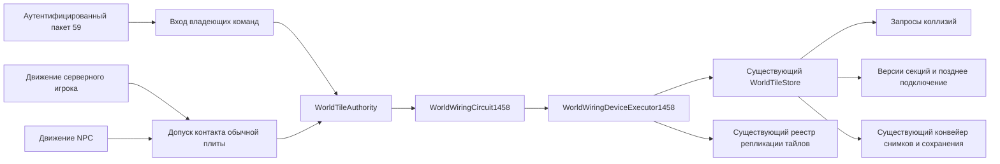

# Авторитетная проводка и базовые механизмы

[English](../en/wiring-mechanisms.md) · [Архитектура](architecture.md) · [Сеть](networking-protocol.md)

Этот блок связывает разрешённые запросы переключателей Terraria `1.4.5.8` и контакты обычных нажимных плит с существующими авторитетными владельцами мира, репликации и сохранения. Он не устанавливает совместимость всей системы проводки vanilla. Локальная приёмка завершена: Release без предупреждений/ошибок, focused `164/164`, fast `25335/25336` и полный набор без фильтров `1566748/1566749` проходят без падений/ошибок с одним прежним пропуском жидкостей. Выполнены все `5250` обнаруженных методов; `3897` входных файлов и `60` DLL остались неизменными. Windows NativeAOT проходит пять штатных smoke-проверок. См. [запись проверки](../verification/wiring-mechanisms-1458.json); Linux Native и официальный GUI остаются непроверенными.

## Владение и исполнение

`WorldWiringCircuit1458` владеет временным состоянием обхода и часами механизмов одного мира. `WorldWiringDeviceExecutor1458` изменяет тот же `WorldTileStore`, который используют коллизии, кэш секций и сохранение. Коммит клетки актуатора передаётся `VanillaWorldWiringMutationService`; двери, люки и высокие ворота используют `VanillaWorldGroundFighterDoorOpeningService`. Параллельный мир, образ коллизий или поток случайных чисел не создаётся. Направление открытия двери использует существующий общий игровой RNG; закрытие использует существующего владельца RNG рамок двери.

Импульсы выполняются в порядке красного, синего, зелёного и жёлтого цветов с отдельным состоянием пропуска для каждого цвета. Источники обходятся по столбцам, затем строкам; обход использует исходную FIFO и порядок соседей вниз/вверх/вправо/влево. Многоклеточные источники света пропускают весь свой прямоугольник. Существующий владелец изменений дверей также передаёт делегированные операции пропуска `WorldGen` через необязательный callback отдельного вызова: открытие обычной двери пропускает результирующий прямоугольник `2×3`, закрытие — сохранённый столбец. Люки используют исходные координаты, зависящие от направления, а высокие ворота пропускают все пять строк после проверки объекта, в том числе если затем операция блокируется актором. Последовательные импульсы очищают временное состояние и могут снова воздействовать на общие участки проводов.

Произвольного ограничения длины провода нет. Хранимое состояние ограничено клетками мира и четырьмя направленными входами маршрутизаторов. Повторные одинаковые входы маршрутизаторов подавляются как явная политика ограничения памяти и работы. Повреждённые рамки развилки вне `0`, `18` и `36` не передают сигнал дальше. Эквивалентность этих защит для всех топологий независимо не доказана. Вложенные импульсы логических вентилей не входят в этот блок. Повторный внешний вход во время исполнения импульса отклоняется.

## Поддержанные источники и устройства

`RuntimeNpcAiStateExecutor.Tick` принимает необязательный `Action<NpcSnapshot, NpcSnapshot> actorContact` после приёмника коммита. Он получает исходный снимок и точную текущую закоммиченную ревизию после эффектов AI, до деактивации и перехода к следующему живому слоту. Callback выполняется в авторитетном потоке; изменение актора по-прежнему требует проверки поколения/ревизии. Существующие вызовы могут его не передавать. Перегрузки изменения дверей аналогично принимают необязательный `skipWire` для отдельного вызова, не сохраняя глобального состояния цепи.

| Семейство | Допущенные идентификаторы тайлов и поведение |
| --- | --- |
| Ручные источники | Переключатель `136`, рычаг `132`, таймер `144`, кратковременный переключатель `411`. |
| Дополнительные прямые источники `HitSwitch` | `135`, `314`, `423`, `428`, `442`, `476` создают исходный одноклеточный импульс. Это не допускает другие физические источники их сигналов или их эффекты как проводных устройств. |
| Обычные нажимные плиты | Тайл `135`, стили `0`–`6`, для физически моделируемых игроков и NPC согласно исходному допуску акторов. |
| Одноклеточный свет | Факел `4`; свечи `33`, `49`, `174`, `372`, `646`; праздничная гирлянда `149`. |
| Многоклеточный свет | Подвесной фонарь `42`; напольная лампа `93`; фонарный столб `92`; светильники `2×2` `95`, `100`, `126`, `173`, `564`; люстра `34`; костёр `215`; камин `405`. |
| Двери и ворота | Обычные двери `10`/`11`, люки `386`/`387`, высокие ворота `388`/`389` через существующего владельца исходных преобразований. |
| Актуаторы | Существующие активные твёрдые тайлы с ограничениями `Wiring.DeActive` и существующими правилами `CanKillTile`, если сверху стоит активный тайл. |
| Кратковременный переключатель при сигнале по проводу | Тайл `411` изменяет рамки всего объекта и пропускает его клетки. Эта ветвь не регистрирует часы сброса ручного нажатия и не создаёт ещё один импульс. |
| Пересечения | Маршрутизация соединительной коробки `424`; накопление направлений пиксельной коробки `445` с обработкой после четырёх цветов. |

Обычные плиты стилей `2`, `3`, `4` и `6` допускают игроков. Стиль `5` по исходному правилу допускает категории NPC и снарядов; этот блок подключает категорию NPC. Стили `0` и `1` допускают подключённые категории игроков и NPC. Контакт требует нового пересечения с исходными асимметричными границами старого/нового положения; стояние на плите не создаёт повторных импульсов. Сохранено исходное исключение нижней области мира из поиска. Симуляция игроков/NPC снимает положения до и после движения в авторитетном потоке; клиент не может передать категорию актора или результат контакта.

Актуаторы отклоняют нетвёрдые тайлы и исходные исключения, включая рельсы, люки, высокие ворота и лунки для гольфа. Кирпич ящеров `226` ниже `worldSurface` не деактивируется до Плантеры; равенство высоте поверхности допускается. Исходный набор объектов сверху запрещает деактивацию опоры. Для остальных активных объектов сверху используется существующая политика `CanKillTile`, основанная на исходнике. Реактивация не повторяет запреты деактивации. Коллизии немедленно видят флаг неактивности той же клетки, а существующее хранилище помечает версии секций и сохранения изменёнными.

## Таймеры и жизненный цикл

Проводка использует существующую общую проверку занятости из composition, учитывающую подключённых людей, серверных игроков и NPC. Живой серверный игрок внутри высоких ворот запрещает операцию; удаление его поколения освобождает ворота при следующем допустимом нажатии.

Независимый корпус содержит `110` сцен: исходные `98` строк не изменены, добавлены восемь полных образов дверей/люков/ворот, три трассы часов на границе мира и трасса повторного нажатия моментальной кнопки. Закрытие люка сохраняет тип, рамки, краску и покрытия неактивных клеток по правилу `Tile.ClearTile`. Обновление таймеров следует после фазы времени мира, как в `Main.DoUpdateInWorld_Inner`.

| Стиль таймера (`frameX / 18`) | Интервал импульсов |
| --- | --- |
| `0` | $60\,\text{тиков}$ |
| `1` | $180\,\text{тиков}$ |
| `2` | $300\,\text{тиков}$ |
| `3` | $30\,\text{тиков}$ |
| `4` | $15\,\text{тиков}$ |

Механизмы сначала уменьшают счётчик, затем проверяют импульс; порядок обработки обратен порядку регистрации, как в `Wiring.UpdateMech`. Выключение и включение таймера при ещё существующей регистрации не создаёт вторые часы и не сбрасывает оставшийся интервал. Регистрации привязаны к координатам и ограничены числом `999`, как в `Wiring.CheckMech`; уничтожение устройства не добавляет отдельного придуманного правила отмены. Допущенный сброс кратковременного переключателя выполняется через $60\,\text{тиков}$. Обновление механизмов проходит через существующий тик мира после симуляции акторов.

Цвета проводов, флаги актуатора/неактивности и рамки устройств используют существующие представления снимков тайлов и `.wld`. Сохранение оставляет рамку работающего таймера, но официальный `WorldFile.LoadWorldTiles` сбрасывает загруженный `frameY` таймера `144` в `0`; обратный отсчёт механизма временный и не сериализуется. Поэтому загрузка канонического файла и кэша runtime начинает работу с выключенными таймерами. Смена мира отбрасывает старый исполнитель цепи и его часы. Регрессии сохранения/загрузки проверяются отдельно от правила канонического файла; итоговая запись приёмки указывает подтверждённую область.

## Сетевая граница и публикация

Пакет `59` содержит две знаковые координаты тайла в little-endian. Приёмник требует аутентифицированную игровую сессию и преобразует запрос во владеющую команду до освобождения приёмного буфера. Исполнение проверяет поколение соединения/игрока, существующий бюджет правок игрока, границы мира и текущее устройство-источник. В запросе нет желаемого состояния тайла, рамки света, списка выходных устройств или флага допустимости актора.

В `MessageBuffer.GetData`, case `59`, нет проверки дальности, поэтому этот путь не добавляет её. Повторные разрешённые нажатия остаются последовательными активациями; они не считаются идемпотентными подтверждениями. Устаревшие сессии и повторно используемые слоты не могут заимствовать личность текущего игрока. Изменения и публикация через существующий реестр выполняются в авторитетном потоке. Запись тайлов инвалидирует версии секций для перестроения кэша и позднего подключения, а публикация прямоугольников тайлов передаёт текущим клиентам закоммиченные результаты устройств. Рамка ручного источника воспроизводится на остальных клиентах пакетом `59` без предшествующего прямоугольника самого источника, который заставил бы клиента переключить её дважды. Изменения таймера по проводу и истечение часов механизмов непосредственно публикуют итоговое состояние тайлов.

Проводные двери публикуют исходное действие пакета `19` до внешнего переключения `59`: `0`/`1` для открытия/закрытия обычной двери, `2`/`3` для люков и `4`/`5` для высоких ворот. Открытие обычной двери передаёт направление успешной попытки; люки передают `+1` для первой попытки и `-1` для запасной. Закрытие обычной двери и действия высоких ворот используют исходный байт направления по умолчанию, декодируемый как `-1`. Высокие ворота публикуют действие даже при отказе серверной проверки занятости. За каждым опубликованным действием следует авторитетный образ пакета `20`, включая случай заблокированных ворот, чтобы принудительная клиентская операция сходилась к серверному состоянию. Этот дополнительный корректирующий образ — политика публикации runtime сверх действия двери vanilla. Владелец World предоставляет независимый от протокола callback `WorldWiringDoorTransition1458`; кодирование и доставка принадлежат существующему реестру репликации.

## Доказательства и оставшаяся работа

Фикстура телеметрии `GameLoopTests` допускает $30\,\mathrm{s}$ на старт фонового цикла при нагрузке полного набора. Проверки тиков, пропущенных дедлайнов и измеренного времени фазы обновления сохранены. Эта правка теста не меняет production-исходники; остальные 59 ссылочных managed DLL и исполняемый файл NativeAOT остались побайтно прежними.

Основные общие точки интеграции при слиянии ветки: `WorldTileAuthority.cs`, `ServerRuntimeComposition.cs`, `ServerRuntimeState.Tick.cs`, `ProjectileLifecycleFrameSink.cs`, `NpcAuthority.cs`, `ServerPlayerAuthority.cs`, `RuntimeNpcAiStateExecutor.cs` в Core, существующий `VanillaWorldGroundFighterDoorOpeningService.cs`, `WorldFileTileEncoder.cs`, `RuntimeWorldSnapshotCache.Read.cs`, `TerrariaMessageId.cs`, список ресурсов тестового проекта и таймаут фикстуры в `GameLoopTests.cs`. Исполнитель цепей, устройства, вход/кодек, владелец Native smoke, числовая фикстура и инструмент воспроизведения добавлены отдельными файлами.

Поведение закреплено за локальным официальным исходником `1.4.5.8`: `Wiring.HitSwitch`, `TripWire`, `HitWire`, `HitWireSingle`, `UpdateMech`, `CheckMech`, `DeActive`, `ReActive` и методами переключения света; `WorldGen.OpenDoor`, `CloseDoor`, `ShiftTrapdoor`, `ShiftTallGate`, `CanKillTile`; `TileObjectData`; `Collision.SwitchTiles`; `MessageBuffer.GetData`, case `59`; `WorldFile.LoadWorldTiles`.

Сохранённая независимая числовая фикстура исполняет неизменённый официальный бинарный файл Linux-редакции под Windows CoreCLR. Она содержит `109` сцен с воспроизведением поддержанных результатов и одну сцену плиты стиля `7`, где проверяются только допуск актора и флаг требуемого разрушения. Её итоговые эффекты разрушения/рамок пока не допускаются. Поддержанные сцены охватывают трассы переключателей/рычагов/таймеров, допуск акторов, рамки света и ограничения актуаторов по прогрессии. Это доказательство по официальному бинарному файлу, а не исполнение на Linux или подтверждение Linux NativeAOT. Регрессии производственного входа, публикации, сохранения и устаревших сессий дополняют эти компонентные трассы. Итоговые результаты focused, fast, full и доступных NativeAOT-проверок должны происходить из завершённых проверок этой ветки, а не прежних контрольных точек.

В поддержанную цепочку пока не входят:

- Клиентское снятие инструментами и массовая проводка. Обычная оплаченная установка четырьмя ключами и выбранным актуатором описана в [руководстве установки проводки](wiring-tool-installation-1458.md).
- Стиль плиты `7`, где после импульса требуется настоящая транзакция разрушения/выпадения предметов; взвешенные плиты и источники контактов снарядов/валунов.
- Насосы и телепортеры до полного подключения владельцев жидкости и перемещения.
- Логические вентили, ловушки, статуи и их создание сущностей, снарядов, cooldown и вложенные импульсы.
- Общая передача `SquareTileFrame` и побочные эффекты удаления объектов вне допущенных владельцев. Актуация от цепи теперь использует существующую транзакцию для обхода рамок девяти клеток, поддержанного удаления переключателя с выпадением предмета и опоры факела. Неподдержанные соседи отклоняются до записи; полная совместимость рамок прикреплённых объектов не заявляется.
- Открытие люка в срезаемое содержимое: существующий сервис отклоняет его до подключения полной транзакции срезания/предметов/метаданных. Занятые высокие ворота и закрывающиеся люки сохраняют исходные проверки акторов.
- Совместимость всей проводки vanilla, произвольные неподдержанные устройства/стили, прохождение официальным GUI-клиентом и проверки недоступных платформ.

Следующий связанный блок — расширение разрушения прикреплённых объектов и одноразовые плиты, а также недостающий владелец клиентского визуального состояния для RNG кусачек; затем насосы/телепортеры через существующих авторитетных владельцев.

Контакты серверных игроков и NPC обрабатываются после их закоммиченного движения, до следующего актора. Обычные подключённые игроки сохраняют исходный путь локального клиента через `59`; дополнительный импульс из пакета `13` сервер не создаёт. Для представленных чувствительных к плитам животных устанавливается исходное состояние бегства `ai=(1,400,0,ai3)`. Полный исходный порядок публикации NPC `23` относительно контактных `20`/`59` этим блоком не доказан.

Штатный `--world-smoke` также выполняет авторизованную команду, изменение света и актуатора, проверяет срок таймера и независимо снятые байты сохранения таймера. Инструмент воспроизведения находится в [`tools/reference/wiring1458`](../../tools/reference/wiring1458/README.md). При сохранении применяется `WorldFile.SaveWorldTiles`, при загрузке — `LoadWorldTiles`.
