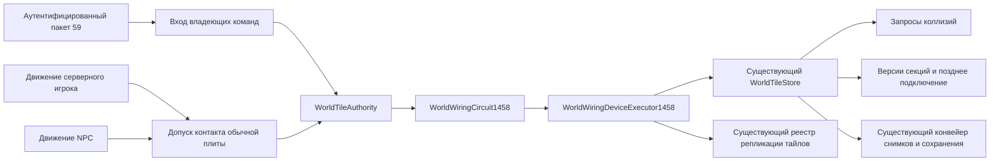

# Авторитетная проводка и базовые механизмы

[English](../en/wiring-mechanisms.md) · [Архитектура](architecture.md) · [Сеть](networking-protocol.md)

## Текущий объём managed-поддержки

| Механизм | Поддержка в runtime |
| --- | --- |
| Плиты и датчики | Обычные, направленные, весовые и одноразовые плиты с исходными правилами для типов акторов. Все семь видов датчиков используют установку со списанием предмета, канонические сущности и исходный порядок обновления. Импульс при разрушении поддержан для источников без провода и цепей с обычными факелами. |
| Ловушки | Дротики, шипастые шары, пламя и копья используют существующих владельцев снарядов. Гейзеры и мины используют сканирование контактов, провода и подтверждённый запрос переключателя в проверенных сценариях геометрии и урона. Для валунов Лунного Лорда поддержаны проверенные сухие контакты в один шаг. |
| Проводка и актуаторы | Переключатели, таймеры, свет, двери, логические элементы, статуи, насосы и телепорты используют общий контур. Удаление проводов, массовая проводка и пересчёт фреймов при работе жезла используют существующих владельцев тайлов, инвентаря и предметов. |
| Телепорты | Поддерживаемые маунты, вода, лава, мёд, шиммер и собственные крюки обрабатываются существующим путём переноса игрока. Готовые секции назначения отправляются до пакета телепорта. Холодные и устаревшие секции перестраиваются в фоне и повторно запрашиваются при подтверждении приземления. |

Остались контакты снарядов в жидкости и при движении в несколько шагов, другие семейства валунов, разрушение в неподдерживаемом окружении, импульсы отпускания в цепях, которые меняют акторов, а также полный порядок загрузки холодных секций и синхронизации наблюдателей. Ниже приведены проверенные ограничения каждого блока и независимые захваты оригинала.

## Начальная контрольная точка

Этот блок связывает разрешённые запросы переключателей Terraria `1.4.5.8` и контакты обычных нажимных плит с существующими авторитетными владельцами мира, репликации и сохранения. Он не устанавливает совместимость всей системы проводки vanilla. Локальная приёмка завершена: Release без предупреждений/ошибок, focused `164/164`, fast `25335/25336` и полный набор без фильтров `1566748/1566749` проходят без падений/ошибок с одним прежним пропуском жидкостей. Выполнены все `5250` обнаруженных методов; `3897` входных файлов и `60` DLL остались неизменными. Windows NativeAOT проходит пять штатных smoke-проверок. См. [запись проверки](../verification/wiring-mechanisms-1458.json); Linux Native и официальный GUI остаются непроверенными.

## Владение и исполнение

`WorldWiringCircuit1458` владеет временным состоянием обхода и часами механизмов одного мира. `WorldWiringDeviceExecutor1458` изменяет тот же `WorldTileStore`, который используют коллизии, кэш секций и сохранение. Коммит клетки актуатора передаётся `VanillaWorldWiringMutationService`; двери, люки и высокие ворота используют `VanillaWorldGroundFighterDoorOpeningService`. Параллельный мир, образ коллизий или поток случайных чисел не создаётся. Направление открытия двери использует существующий общий игровой RNG; закрытие использует существующего владельца RNG рамок двери.

Импульсы выполняются в порядке красного, синего, зелёного и жёлтого цветов с отдельным состоянием пропуска для каждого цвета. Источники обходятся по столбцам, затем строкам; обход использует исходную FIFO и порядок соседей вниз/вверх/вправо/влево. Многоклеточные источники света пропускают весь свой прямоугольник. Существующий владелец изменений дверей также передаёт делегированные операции пропуска `WorldGen` через необязательный callback отдельного вызова: открытие обычной двери пропускает результирующий прямоугольник `2×3`, закрытие — сохранённый столбец. Люки используют исходные координаты, зависящие от направления, а высокие ворота пропускают все пять строк после проверки объекта, в том числе если затем операция блокируется актором. Последовательные импульсы очищают временное состояние и могут снова воздействовать на общие участки проводов.

Произвольного ограничения длины провода нет. Хранимое состояние ограничено клетками мира и четырьмя направленными входами маршрутизаторов. Повторные одинаковые входы маршрутизаторов подавляются как явная политика ограничения памяти и работы. Повреждённые рамки развилки вне `0`, `18` и `36` не передают сигнал дальше. Эквивалентность этих защит для всех топологий независимо не доказана. Вложенные импульсы логических вентилей не входят в этот блок. Повторный внешний вход во время исполнения импульса отклоняется.

## Поддержанные источники и устройства

`RuntimeNpcAiStateExecutor.Tick` принимает необязательный `Action<NpcSnapshot, NpcSnapshot> actorContact` после приёмника коммита. Он получает исходный снимок и точную текущую закоммиченную ревизию после эффектов AI, до деактивации и перехода к следующему живому слоту. Callback выполняется в авторитетном потоке; изменение актора по-прежнему требует проверки поколения/ревизии. Существующие вызовы могут его не передавать. Перегрузки изменения дверей аналогично принимают необязательный `skipWire` для отдельного вызова, не сохраняя глобального состояния цепи.

| Семейство | Допущенные идентификаторы тайлов и поведение |
| --- | --- |
| Ручные источники | Переключатель `136`, рычаг `132`, таймер `144`, кратковременный переключатель `411`. |
| Дополнительные прямые источники `HitSwitch` | `135`, `314`, `423`, `428`, `442`, `476` создают исходный одноклеточный импульс. Это не допускает другие физические источники их сигналов или их эффекты как проводных устройств. |
| Обычные нажимные плиты | Тайл `135`, стили `0`–`6`, для физически моделируемых игроков и NPC согласно исходному допуску акторов. |
| Одноклеточный свет | Факел `4`; свечи `33`, `49`, `174`, `372`, `646`; праздничная гирлянда `149`. |
| Многоклеточный свет | Подвесной фонарь `42`; напольная лампа `93`; фонарный столб `92`; светильники `2×2` `95`, `100`, `126`, `173`, `564`; люстра `34`; костёр `215`; камин `405`. |
| Двери и ворота | Обычные двери `10`/`11`, люки `386`/`387`, высокие ворота `388`/`389` через существующего владельца исходных преобразований. |
| Актуаторы | Существующие активные твёрдые тайлы с ограничениями `Wiring.DeActive` и существующими правилами `CanKillTile`, если сверху стоит активный тайл. |
| Кратковременный переключатель при сигнале по проводу | Тайл `411` изменяет рамки всего объекта и пропускает его клетки. Эта ветвь не регистрирует часы сброса ручного нажатия и не создаёт ещё один импульс. |
| Пересечения | Маршрутизация соединительной коробки `424`; накопление направлений пиксельной коробки `445` с обработкой после четырёх цветов. |

Обычные плиты стилей `2`, `3`, `4` и `6` допускают игроков. Стиль `5` по исходному правилу допускает категории NPC и снарядов; этот блок подключает категорию NPC. Стили `0` и `1` допускают подключённые категории игроков и NPC. Контакт требует нового пересечения с исходными асимметричными границами старого/нового положения; стояние на плите не создаёт повторных импульсов. Сохранено исходное исключение нижней области мира из поиска. Симуляция игроков/NPC снимает положения до и после движения в авторитетном потоке; клиент не может передать категорию актора или результат контакта.

Актуаторы отклоняют нетвёрдые тайлы и исходные исключения, включая рельсы, люки, высокие ворота и лунки для гольфа. Кирпич ящеров `226` ниже `worldSurface` не деактивируется до Плантеры; равенство высоте поверхности допускается. Исходный набор объектов сверху запрещает деактивацию опоры. Для остальных активных объектов сверху используется существующая политика `CanKillTile`, основанная на исходнике. Реактивация не повторяет запреты деактивации. Коллизии немедленно видят флаг неактивности той же клетки, а существующее хранилище помечает версии секций и сохранения изменёнными.

## Таймеры и жизненный цикл

Проводка использует существующую общую проверку занятости из composition, учитывающую подключённых людей, серверных игроков и NPC. Живой серверный игрок внутри высоких ворот запрещает операцию; удаление его поколения освобождает ворота при следующем допустимом нажатии.

Независимый корпус содержит `110` сцен: исходные `98` строк не изменены, добавлены восемь полных образов дверей/люков/ворот, три трассы часов на границе мира и трасса повторного нажатия моментальной кнопки. Закрытие люка сохраняет тип, рамки, краску и покрытия неактивных клеток по правилу `Tile.ClearTile`. Обновление таймеров следует после фазы времени мира, как в `Main.DoUpdateInWorld_Inner`.

| Стиль таймера (`frameX / 18`) | Интервал импульсов |
| --- | --- |
| `0` | $60\,\text{тиков}$ |
| `1` | $180\,\text{тиков}$ |
| `2` | $300\,\text{тиков}$ |
| `3` | $30\,\text{тиков}$ |
| `4` | $15\,\text{тиков}$ |

Механизмы сначала уменьшают счётчик, затем проверяют импульс; порядок обработки обратен порядку регистрации, как в `Wiring.UpdateMech`. Выключение и включение таймера при ещё существующей регистрации не создаёт вторые часы и не сбрасывает оставшийся интервал. Регистрации привязаны к координатам и ограничены числом `999`, как в `Wiring.CheckMech`; уничтожение устройства не добавляет отдельного придуманного правила отмены. Допущенный сброс кратковременного переключателя выполняется через $60\,\text{тиков}$. Обновление механизмов проходит через существующий тик мира после симуляции акторов.

Цвета проводов, флаги актуатора/неактивности и рамки устройств используют существующие представления снимков тайлов и `.wld`. Сохранение оставляет рамку работающего таймера, но официальный `WorldFile.LoadWorldTiles` сбрасывает загруженный `frameY` таймера `144` в `0`; обратный отсчёт механизма временный и не сериализуется. Поэтому загрузка канонического файла и кэша runtime начинает работу с выключенными таймерами. Смена мира отбрасывает старый исполнитель цепи и его часы. Регрессии сохранения/загрузки проверяются отдельно от правила канонического файла; итоговая запись приёмки указывает подтверждённую область.

## Сетевая граница и публикация

Пакет `59` содержит две знаковые координаты тайла в little-endian. Приёмник требует аутентифицированную игровую сессию и преобразует запрос во владеющую команду до освобождения приёмного буфера. Исполнение проверяет поколение соединения/игрока, существующий бюджет правок игрока, границы мира и текущее устройство-источник. В запросе нет желаемого состояния тайла, рамки света, списка выходных устройств или флага допустимости актора.

В `MessageBuffer.GetData`, case `59`, нет проверки дальности, поэтому этот путь не добавляет её. Повторные разрешённые нажатия остаются последовательными активациями; они не считаются идемпотентными подтверждениями. Устаревшие сессии и повторно используемые слоты не могут заимствовать личность текущего игрока. Изменения и публикация через существующий реестр выполняются в авторитетном потоке. Запись тайлов инвалидирует версии секций для перестроения кэша и позднего подключения, а публикация прямоугольников тайлов передаёт текущим клиентам закоммиченные результаты устройств. Рамка ручного источника воспроизводится на остальных клиентах пакетом `59` без предшествующего прямоугольника самого источника, который заставил бы клиента переключить её дважды. Изменения таймера по проводу и истечение часов механизмов непосредственно публикуют итоговое состояние тайлов.

Проводные двери публикуют исходное действие пакета `19` до внешнего переключения `59`: `0`/`1` для открытия/закрытия обычной двери, `2`/`3` для люков и `4`/`5` для высоких ворот. Открытие обычной двери передаёт направление успешной попытки; люки передают `+1` для первой попытки и `-1` для запасной. Закрытие обычной двери и действия высоких ворот используют исходный байт направления по умолчанию, декодируемый как `-1`. Высокие ворота публикуют действие даже при отказе серверной проверки занятости. За каждым опубликованным действием следует авторитетный образ пакета `20`, включая случай заблокированных ворот, чтобы принудительная клиентская операция сходилась к серверному состоянию. Этот дополнительный корректирующий образ — политика публикации runtime сверх действия двери vanilla. Владелец World предоставляет независимый от протокола callback `WorldWiringDoorTransition1458`; кодирование и доставка принадлежат существующему реестру репликации.

## Доказательства и оставшаяся работа

Фикстура телеметрии `GameLoopTests` допускает $30\,\mathrm{s}$ на старт фонового цикла при нагрузке полного набора. Проверки тиков, пропущенных дедлайнов и измеренного времени фазы обновления сохранены. Эта правка теста не меняет production-исходники; остальные 59 ссылочных managed DLL и исполняемый файл NativeAOT остались побайтно прежними.

Основные общие точки интеграции при слиянии ветки: `WorldTileAuthority.cs`, `ServerRuntimeComposition.cs`, `ServerRuntimeState.Tick.cs`, `ProjectileLifecycleFrameSink.cs`, `NpcAuthority.cs`, `ServerPlayerAuthority.cs`, `RuntimeNpcAiStateExecutor.cs` в Core, существующий `VanillaWorldGroundFighterDoorOpeningService.cs`, `WorldFileTileEncoder.cs`, `RuntimeWorldSnapshotCache.Read.cs`, `TerrariaMessageId.cs`, список ресурсов тестового проекта и таймаут фикстуры в `GameLoopTests.cs`. Исполнитель цепей, устройства, вход/кодек, владелец Native smoke, числовая фикстура и инструмент воспроизведения добавлены отдельными файлами.

Поведение закреплено за локальным официальным исходником `1.4.5.8`: `Wiring.HitSwitch`, `TripWire`, `HitWire`, `HitWireSingle`, `UpdateMech`, `CheckMech`, `DeActive`, `ReActive` и методами переключения света; `WorldGen.OpenDoor`, `CloseDoor`, `ShiftTrapdoor`, `ShiftTallGate`, `CanKillTile`; `TileObjectData`; `Collision.SwitchTiles`; `MessageBuffer.GetData`, case `59`; `WorldFile.LoadWorldTiles`.

Сохранённая независимая числовая фикстура исполняет неизменённый официальный бинарный файл Linux-редакции под Windows CoreCLR. Она содержит `109` сцен с воспроизведением поддержанных результатов и одну сцену плиты стиля `7`, где проверяются только допуск актора и флаг требуемого разрушения. Её итоговые эффекты разрушения/рамок пока не допускаются. Поддержанные сцены охватывают трассы переключателей/рычагов/таймеров, допуск акторов, рамки света и ограничения актуаторов по прогрессии. Это доказательство по официальному бинарному файлу, а не исполнение на Linux или подтверждение Linux NativeAOT. Регрессии производственного входа, публикации, сохранения и устаревших сессий дополняют эти компонентные трассы. Итоговые результаты focused, fast, full и доступных NativeAOT-проверок должны происходить из завершённых проверок этой ветки, а не прежних контрольных точек.

В поддержанную цепочку пока не входят:

- Клиентское снятие инструментами и массовая проводка. Обычная оплаченная установка четырьмя ключами и выбранным актуатором описана в [руководстве установки проводки](wiring-tool-installation-1458.md).
- Стиль плиты `7`, где после импульса требуется настоящая транзакция разрушения/выпадения предметов; взвешенные плиты и источники контактов снарядов/валунов.
- Телепортеры и контексты насосов вне ограниченного расширения ниже.
- Контексты запуска/проверки рамок вне ограниченных расширений ловушек, логики, статуй и анимируемых устройств ниже.
- Общая передача `SquareTileFrame` и побочные эффекты удаления объектов вне допущенных владельцев. Актуация от цепи теперь использует существующую транзакцию для обхода рамок девяти клеток, поддержанного удаления переключателя с выпадением предмета и опоры факела. Неподдержанные соседи отклоняются до записи; полная совместимость рамок прикреплённых объектов не заявляется.
- Открытие люка в срезаемое содержимое: существующий сервис отклоняет его до подключения полной транзакции срезания/предметов/метаданных. Занятые высокие ворота и закрывающиеся люки сохраняют исходные проверки акторов.
- Совместимость всей проводки vanilla, произвольные неподдержанные устройства/стили, прохождение официальным GUI-клиентом и проверки недоступных платформ.

Следующий связанный блок — расширение разрушения прикреплённых объектов и одноразовые плиты, а также недостающий владелец клиентского визуального состояния для RNG кусачек; затем насосы/телепортеры через существующих авторитетных владельцев.

Контакты серверных игроков и NPC обрабатываются после их закоммиченного движения, до следующего актора. Обычные подключённые игроки сохраняют исходный путь локального клиента через `59`; дополнительный импульс из пакета `13` сервер не создаёт. Для представленных чувствительных к плитам животных устанавливается исходное состояние бегства `ai=(1,400,0,ai3)`. Полный исходный порядок публикации NPC `23` относительно контактных `20`/`59` этим блоком не доказан.

Штатный `--world-smoke` также выполняет авторизованную команду, изменение света и актуатора, проверяет срок таймера и независимо снятые байты сохранения таймера. Инструмент воспроизведения находится в [`tools/reference/wiring1458`](../../tools/reference/wiring1458/README.md). При сохранении применяется `WorldFile.SaveWorldTiles`, при загрузке — `LoadWorldTiles`.

## Ограниченное расширение дротиковых ловушек

Тайл `137` со стилями `0`, `1` и `5` выпускает исходные снаряды `98`, `184` и `980` через существующие обход проводов и хранилище снарядов. Сохраняются пять проверенных ориентаций кадра, исходная позиция выпуска, скорость, урон и владелец `255`. Все цвета проводов разделяют прежний таймер механизма: CheckMech регистрирует задержку $200\,\text{updates}$ до выделения снаряда, в том числе при отказе выделения. Переключатели, обычные плиты и таймеры используют прежние пути срабатывания. Для снаряда окружения не создаётся фиктивный владелец игрока или NPC.

Прежний владелец снарядов обеспечивает создание, движение, столкновения с тайлами, завершение и репликацию. Обычный и усиленный ядовитые дротики назначают Poisoned с исходными длительностями `600`/`900`; отравляющий дротик назначает Venom на `300` до поправок сложности и экипировки при попадании в игрока. У подключённых и серверных игроков участники HP, баффов и иммунитета принимаются вместе с RNG до наблюдателей. Dead Man's Sweater в функциональном слоте тела вдвое уменьшает урон ловушки и длительность эффекта до остальных исходных поправок. Контакты с NPC разрешены для синего слизня, зомби и лавового слизня; прочие семейства NPC остаются вне проверенного объёма. Venom сохраняет отдельные импульсы регенерации NPC и потерю регенерации игрока, включая последнее положительное обновление баффа. Отображение из пакета 50 не создаёт принадлежащий серверу эффект Venom.

Наблюдения оригинала покрывают создание, хронологию триггеров и задержек, полный сухой полёт и завершение, попадания и смерти NPC, компоненты EVP локального игрока. Эти ограниченные сравнения не доказывают весь `Main.Update`, сессию немодифицированного GUI-клиента, произвольный полёт в жидкости или всю экипировку. Следующая контрольная точка добавляет стили ловушек `2`, `3` и `4`. Статуи, логические вентили, насосы, телепортеры и неподдержанные семейства плит ещё не реализованы; весь план проводки не закрыт.

Регенерация при Venom поддержана отдельно; полная визуальная фаза игрока ещё не подтверждена и прекращает владение общим RNG игроков. Переносы предметов остаются доступны через отдельный контекст хранилища, привязанный к игроку и миру.

Смертельные попадания в игроков используют прежний функциональный путь смерти; полный RNG-хвост `KillMe` и создания надгробия не входит в подтверждённый исходником объём.

Добавленное свойство `PlayerDebuffSnapshot1458.Venom` передаёт принадлежащий серверу эффект потребителям снимков здоровья игрока.

[Проверка managed-сборки, 2026-11-16](../verification/net11-stable-item-flow-darts-managed-20261116.json).

## Оставшиеся семейства ловушек: managed-контрольная точка

Стили `2`, `3`, `4` тайла `137` используют прежнюю цепь проводки и авторитетное хранилище снарядов. Это расширение сохраняет исходные задержки $200$, $300$ и $90\,\text{обновлений}$ соответственно. Шипастый шар получает две случайные составляющие начальной скорости из прежнего игрового RNG; его направления кадров отличаются от дротиков. Копьё сохраняет исходную точку, разворачивается при контакте с твёрдым блоком или после $300\,\mathrm{px}$ и завершается при возвращении.

Неподвижный источник огня (`187`) создаёт огненные снаряды (`188`) каждые $6\,\text{обновлений}$. Исполнитель снарядов включает дочерний снаряд в текущий проход, только если его физический слот следует за слотом источника; более ранние слоты ждут следующего прохода. Создание снаряда и состояние источника используют прежнюю отделённую подготовку создания снарядов мира. `WiringFlameSourceUpdate` — внутренний маркер шага для исходного RNG-аргумента визуального эффекта.

Огненные попадания используют исходную расширенную область контакта и задержку начала нанесения урона. `On Fire 3` (`323`) имеет отдельные принадлежащие серверу таймер, эффект и потерю регенерации; свойство `PlayerDebuffSnapshot1458.OnFire3` передаёт его потребителям снимков. Пакет `50` предоставляет отображаемое состояние. Прежний владелец слотов контактных эффектов выдаёт физический эффект только по подтверждённому боевому действию. Чистый владелец регенерации NPC теперь называется `VanillaNpcDebuffRegeneration1458` и объединяет поддержанные эффекты периодического урона.

Десять независимых захватов оригинального сервера повторились побайтно: $20\,865$ сценариев без наблюдаемых исключений. Они покрывают полный сухой полёт и время жизни в замкнутой комнате, откаты цепей, попадания по NPC и их смерть с добычей, контакты пламени на подшагах, порядок рождения в ранних слотах и правила периодического урона. Managed-проверки прошли: целевой прогон — $42\,754$, fast — $220\,418$, полный без фильтров — $1\,765\,733$ проверок. Девять действенных причинных контролей, обычные запуски и запуски свежей CoreCLR-публикации также прошли. Это не закрывает всю проводку: статуи, логические элементы, насосы, телепортеры, другие семейства NPC, неподтверждённые контексты срезания растений/жидкостей и реальная GUI-сессия остаются вне подтверждённого объёма.

`VanillaWiringTrap1458.TryResolve` заменяет прежнее правило только для дротиков и возвращает `WiringTrapLaunch1458`: тип снаряда, урон, направление, скорость, смещение точки выстрела и откат. `IsDart` сохраняет прежний узкий смысл; `IsContact` включает наносящие урон языки пламени, шары и копья. Сам эмиттер `187` контактный урон не наносит.

Самозамещение обновляющегося эмиттера при заполнении физических слотов снарядов пока консервативно отклоняется: частичное рождение и устаревший образ родителя не публикуются. Остальные подтверждённые пути выделения сохраняют прежние правила замещения. Полная визуальная фаза RNG игрока и хвост `KillMe`/надгробия не подтверждены; отдельные владельцы здоровья и хранения предметов сохраняют свой объём поддержки.

[Managed-подтверждение остальных ловушек, 2026-11-16](../verification/wiring-remaining-traps-managed-20261116.json). Локальный NativeAOT отложен пользователем.

## Логические лампы и вентили: managed-контрольная точка

Тайл `419` переключает обычные лампы и проверяет неисправные через прежних владельцев устройств и цепи. Для тайла `420` поддержаны шесть исходных правил: И, ИЛИ, И-НЕ, ИЛИ-НЕ, ровно один и не ровно один. Вентили проверяются после всех четырёх цветов и прохода пиксельных блоков. Волны очереди сохраняют исходный порядок; каждый вентиль выдаёт импульс не более одного раза за каскад, а повторная обратная связь использует существующие RNG-аргументы дыма выделенного сервера и кодек пакета `106`.

Конструктор `WorldWiringCircuit1458` получил необязательные callbacks `nextLogicSample` и `publishLogicSmoke`. Для логики хост предоставляет оба; выборка повторяет `UnifiedRandom.Next(maximum)`, включая расход при `maximum == 0`. Серверная композиция подключает свой общий принадлежащий серверу поток. Без подтверждённого источника логические операции отклоняются. `PokeLogicGate` проверяет существующий столбец без переключения лампы; внешний повторный вход во время импульса отклоняется.

Цепь ограничивает сохраняемую логическую работу $65\,536\,\text{событиями/импульс}$. `LastLogicBudgetExceeded` сообщает об остановленном логическом каскаде и сбрасывается при следующем допущенном импульсе. Уже записанные изменения входов и устройств остаются видимыми; обычный обход проводов сохраняет прежнюю границу мира. Это явный предел безопасности runtime, а не правило vanilla о длине провода.

Расширение допускает целые сухие окрестности рамок только из пустых клеток и поддержанных логических тайлов. Повреждённые рамки, неподдержанные соседи и пересчёт при разрушении, выпадении или установке объектов требуют подключения полной существующей транзакции рамок. Статуи, насосы, телепортеры, неподдержанные источники плит и приёмка всего клиента не добавлены.

Независимый повторённый захват оригинала содержит $2\,448$ сценариев: обычные, неисправные, пустые и восстановленные столбцы, вход четырёх цветов, волны нескольких вентилей, обратную связь и рождение снарядов ловушек. Проекции цепи мира и серверной композиции совпадают по состоянию и полному RNG. Байты пакетов тайлов и дыма сравниваются; рождение снарядов сравнивается физически через прежнего подтверждённого владельца. Managed-проверки прошли: целевой прогон — $47\,716$, fast — $225\,321$, полный без фильтров — $1\,770\,636$ проверок; восемь действенных причинных контролей и обычные запуски/свежая CoreCLR-публикация также прошли.

Рамки вентилей и ламп остаются в прежнем хранилище тайлов, инвалидации секций и представлении файла мира. Очереди ламп/вентилей и посещения каскада временны: они очищаются по завершении или исключению и после загрузки не восстанавливаются как ожидающие импульсы.

[Managed-подтверждение логических вентилей, 2026-11-16](../verification/wiring-logic-gates-managed-20261116.json). Локальный NativeAOT отложен пользователем.

## Статуи, создающие предметы: managed-контрольная точка

Стили `2`, `17` и `37` тайла `105` создают звезду маны, бомбу и сердце через прежнего владельца мировых предметов. Исполнитель проверяет целый объект $2\times3$ и пропускает все шесть его клеток для каждого цвета провода. Цепь регистрирует исходный откат $600\,\text{обновлений}$ до проверки количества предметов, поэтому заблокированная попытка тоже расходует откат. Статуи NPC и телепортации горожан не добавлены этим расширением.

`WorldWiringDeviceExecutor1458` принимает необязательный обработчик `fireStatue(left, top, style)`. Он вызывается после проверки и отметки всех шести клеток как посещённых для текущего цвета провода, в том числе когда обработчик отказывает в действии. Хост без обработчика не создаёт предметы статуй; серверная композиция подключает существующего владельца предметов мира.

`Item.MechSpawn` считает занятые физические слоты предметов независимо от размера стопки: меньше $3$ совпадающих предметов в радиусе $300\,\mathrm{px}$, меньше $6$ в радиусе $800\,\mathrm{px}$ и меньше $10$ во всём мире. Расстояние вычисляется от левого верхнего угла предмета до нижнего центра статуи; обе границы радиусов строгие. Каждый праздничный вариант сердца/звезды имеет отдельный лимит. Прежнее правило календаря выбирает праздничные и юбилейные замены до исходных выборок скорости.

Прежняя подготовка выделения предметов владеет выбором свободного/старейшего/сигнального слота, публикацией и однократным подтверждением происхождения предмета. Владелец создания теперь обслуживает действия мира и клиентское создание с подтверждённым расходом: мировые предметы сохраняют вычисленную скорость, а прежний клиентский путь после исходных выборок по-прежнему накладывает переданную скорость. До принятия и публикации проверяются факты игрока/владельца, календарь, общий RNG, такт и сохранённый образ статуи. Второй владелец предметов и новый поток RNG не вводятся.

Расширение допускает целые сухие неактуированные статуи и подтверждённый источник RNG/календаря. Созданные предметы используют обычное представление, владение и подбор; запас инвентаря напрямую не выдаётся. Рамки и провода сохраняют прежний путь сохранения; откаты механизмов временны. Произвольные мокрые/актуированные статуи, статуи NPC, телепортации Короля/Королевы и приёмка реальным GUI-клиентом остаются открытыми.

Независимый захват оригинала повторился побайтно: $3\,267$ сценариев без наблюдаемых исключений. Проверены все шесть клеток контакта, цвета проводов, восемь комбинаций календаря, лимиты радиуса/слотов/стопок/вариантов, повторные и заблокированные импульсы, выдержку задержки и очистку предметов, полное выделение слотов и байты пакетов `21`/`151`. Эти контролируемые трассы обновляют только механизмы: физика предметов не обновляется, очистка запасов и начальные возрасты заданы явно. Managed-проверки прошли: целевой прогон — $55\,447$, fast — $228\,606$, полный без фильтров — $1\,773\,921$ проверок; девять действенных причинных контролей и обычные запуски/свежая CoreCLR-публикация также прошли.

[Managed-подтверждение предметных статуй, 2026-11-16](../verification/wiring-item-statues-managed-20261116.json). Локальный NativeAOT отложен пользователем.

## Статуи NPC: managed-контрольная точка

Тайл `105` подключает ещё двенадцать стилей к существующему владельцу NPC:

| Стиль статуи | Тип NPC до замены семенем внутри NewNPC |
| --- | --- |
| `4` | `1` |
| `5` | `73` |
| `7` | `49` |
| `8` | `55` |
| `9` | `46` или `540`, когда принадлежащий миру признак праздника истинен |
| `10` | `21` |
| `13` | `24` |
| `18` | `67` |
| `27` | `85` |
| `30` | `6` |
| `35` | `2` |
| `42` | `58` |

Существующая цепь регистрирует задержку $30\,\text{обновлений}$ до проверки популяции. `NPC.MechSpawn` считает активные физические слоты: меньше $3$ рядом в радиусе $200\,\mathrm{px}$, меньше $6$ в радиусе $600\,\mathrm{px}$ и меньше $10$ во всём мире. Границы строгие, расстояние вычисляется от левого верхнего угла NPC до нижнего центра статуи. Кролики `46`/`540`/`303`/`337` делят общий счётчик; запросы золотой рыбки также учитывают `230`. Замена `46` на `614` в Good World происходит позднее внутри существующего исходного конструктора, включая безусловную выборку при заполненной таблице.

Создание использует существующее отделённое выделение физических слотов, защиту, замену и общий RNG. До сохранения результата NPC получает нулевую денежную стоимость, нулевую стоимость spawn-слотов, `SpawnedFromStatue` и разрешение на замену. Исходный сигнальный слот не означает новую авторитетную сущность. `NewNPC` оставляет создание ожидающим синхронизации: существующее обновление NPC, замена или удар позднее публикуют пакет `23`. Обычный владелец ловли удаляет существ статуй с дымом вместо выдачи предмета; существующий владелец смерти/добычи учитывает происхождение из статуи.

Варианты общего счётчика имеют типизированные идентификаторы `VanillaNpcIds.PartyBunny`, `BunnySlimed`, `BunnyXmas` и `GoldfishWalker`.

`NpcSimulationState.SpawnSlotCost` — необязательное принадлежащее владельцу переопределение; null использует существующее правило популяции по определению. Обновления той же идентичности сохраняют значение. `Transform` сбрасывает переопределение отдельно от сохранённых признака статуи и нулевой денежной стоимости. Общее создание NPC `6`, `24`, `49` и `58` теперь учитывает обычное масштабирование, правила тела Remix/Good и представленные поправки при присутствии босса. `VanillaNpcSpawnContext.EaterOfWorldsActive` и `WallOfFleshActive` означают текущих активных боссов, а не прогрессию побед; композиция считывает физические слоты NPC. Эти исправления конструктора действуют и при обычном создании.

Допуск требует целого сухого объекта без актуаторов и одного принадлежащего владельцам исходного RNG для NPC и мира. Проверка создания сохраняет версии окружающих секций и идентичность запроса жидкости; изменение ландшафта, времени, таблицы NPC, контекста конструктора или RNG отменяет подготовленное принятие, сохраняя уже зарегистрированную задержку. Граница тела — $128\,\mathrm{px}$ по каждому измерению внутри сохранённой окрестности $16\,\text{тайлов}$. Эта консервативная защита транзакции является политикой runtime, а не ванильным ограничением размеров. Ветка праздника использует принадлежащий миру признак метаданных и не добавляет управление праздниками.

Каждый неизменённый оригинал захвачен дважды по $3\,168$ контролируемых сценариев без наблюдаемых исключений: Linux-редакция на CoreCLR и Windows-редакция на CLR4 x86. Проверены принятые стили, клетки/цвета проводов, сложность, Good World, Hardmode, Remix, юбилейный мир, присутствие боссов, лимиты слотов/радиусов/вариантов, замена и защита, полный RNG и байты ожидающих/опубликованных появлений. Ещё $1\,452$ случая конструктора напрямую проверяют обе платформенные арифметики. Трассы обновляют только часы механизмов и явно вызывают синхронизацию появлений; начальные состояния и очистка заданы контролируемыми входами, полного обновления AI NPC или Main.Update здесь нет. Managed-проверки прошли: целевой прогон — $60\,334$, fast — $233\,252$, полный без фильтров — $1\,778\,567$ случаев; десять действенных причинных контролей и обычные запуски/свежая CoreCLR-публикация также прошли.

Другие стили NPC, устройства с дымом при заблокированном создании, телепортация горожан, преобразование тайлов статуями, мокрые/актуированные объекты и реальная сессия GUI-клиента остаются открытыми. Расширение не закрывает issue `125` и не заявляет полную совместимость AI NPC, добычи или механизмов.

[Managed-подтверждение статуй NPC, 2026-11-16](../verification/wiring-npc-statues-managed-20261116.json). Локальный NativeAOT отложен пользователем.

## Телепортация статуями King и Queen

Стили `40` и `41` тайла `105` используют существующие цепь мира и владельца NPC. Целый сухой неактуированный объект $2\times3$ регистрирует задержку $300\,\text{обновлений}$ до поиска NPC. Пустой список расходует задержку без обращения к RNG. Исходный код просматривает активные физические слоты по возрастанию и сохраняет не более $50$ NPC из фиксированного списка King или Queen; жильё, расстояние, метаданные пола и классификация городских питомцев не заменяют эти списки. Непустой список всегда расходует один общий `Next(count)`, даже при единственном кандидате.

Выбранный NPC сохраняет поколение, скорость, AI, жизнь, эффекты, жильё, деньги и происхождение от статуи. Его левый верхний угол перемещается к нижнему центру статуи за вычетом целочисленной половины ширины, высоты и одного пикселя; история телепортации получает время `1` и стиль `14`. В исходном `Main.TeleportEffect` нет ветки стиля `14`, поэтому RNG частиц здесь не расходуется. Немедленная исходная публикация — пакет `65`, без дополнительного пакета `23` и без потребления ожидающего появления. Позднее появление по-прежнему публикует внешний цикл NPC. Сохранённая база для входящих игроков получает новую позицию через прежние проверки идентичности получателей. Существующие допущенные продолжения NPC/горожан уменьшают историю стиля `14` на $0.005\,\text{за обновление}$ с ограничением снизу нулём без RNG частиц; стиль `13` сохраняет отдельный немедленный сброс; новые семейства городского AI не добавлены.

Неизменённый оригинальный dedicated-сервер Linux-редакции повторился побайтно в $268$ контролируемых сценариях без наблюдаемых исключений: оба фиксированных списка и исключённые типы, пустые/одиночные/большие списки, отсечение первых $50$, все шесть контактов/четыре цвета, границы задержки, ожидающие появления, сохраняемые физические поля, полный RNG и байты пакетов. Дополнительные вызовы исходного сериализатора с контролируемым `spawnNeedsSyncing=true` проверяют прежнее представление runtime для сброса состояния при входе; это не трасса реального входа в оригинальный сервер. Тесты авторизованного нажатия проверяют пакет `65` обоим участникам и отказ до истечения задержки. Изменение исходных данных/RNG/ландшафта при подготовке отменяет принятие без расходования подготовленной энтропии. Ещё восемь исходных состояний истории телепортации покрывают $2\,440$ явных обновлений с нулевым расходом RNG, включая дробные значения и переход к нулю. Managed-квалификация прошла: целевой прогон — $13\,279$, fast — $233\,548$, полный без фильтров — $1\,778\,863$ случаев, одиннадцать действенных причинных контролей и обычные/свежие CoreCLR-запуски.

До пакета `65` принадлежащий runtime сохраняемый горожанин обновляет и прежний образ для сохранения; команда checkpoint сразу после нажатия видит новые координаты при сохранённых имени, жилье и варианте. Изменившееся начальное состояние горожанина отменяет телепортацию и принятие подготовленного RNG. Используется прежний формат сохранения NPC.

Блок не допускает мокрые, актуированные или повреждённые статуи, новый AI NPC, реальную сессию GUI-клиента и оставшиеся статуи создания NPC/преобразования тайлов. Issue `125` остаётся открытым.

[Managed-подтверждение](../verification/wiring-town-statues-managed-20261116.json).

## Входные и выходные насосы

Тайлы `142` и `143` собирают целые объекты насосов $2\times2$ в существующей цепи проводов. Для каждого цвета списки клеток очищаются до обхода, а перенос выполняется после завершения этого цвета, в том числе в волнах логических вентилей и импульсах таймеров. Каждый список допускает не более $19\,\text{клеток}$ в порядке: нижняя левая, нижняя правая, верхняя левая, верхняя правая; это не ограничение в девятнадцать объектов насосов. Допущены оба горизонтальных варианта рамок. Порядком обнаружения и пропуском четырёх клеток по-прежнему владеет обход проводов.

Прежний владелец изменений жидкости планирует совместимые переносы через ограниченный отделённый образ ландшафта. Пустой выход принимает вид входной жидкости; непустой допускает только тот же вид с пределом $255\,\text{единиц/клетку}$. У опустевшего входа вид жидкости сбрасывается на воду. Вода, лава, мёд и шиммер сохраняют исходный порядок без реакций внутри самого переноса насосом. Существующие исходные `SquareTileFrame` и подготовленная постановка `Liquid.AddWater` выполняются в исходном порядке, включая повторную проверку входа и проверку при полностью заполненных или несовместимых выходах. Сохраняются порядок активной/буферной очереди, признаки checking/skip и исходный RNG. Между цветами не вставляется тик течения жидкости.

Ландшафт и работа очереди жидкости принимаются совместно прежними владельцами до публикации. Неподдержанная проверка рамок или изменение ландшафта/очереди/RNG отменяют подготовленное принятие. Существующие пределы $4\,096$ запросов/шагов/предложений остаются политикой транзакции runtime. Сохраняемые поля жидкости используют обычную инвалидацию секций `WorldTileStore` и кодирование checkpoint; списки насосов для цветов временны. Общий признак `Main.tileTable` теперь принадлежит `VanillaToolTileCatalog1458` и используется проверкой одиночных клеток и опор насосов.

Публикация жидкости сохраняет координаты и считывает актуальный материал при отправке ожидающих изменений привязанного мира. Это необходимо, когда насос опустошает уже ожидающую отправки клетку без нового предложения `AddWater`. Реестр привязывается к одному миру; непривязанные bootstrap-хосты сохраняют переданные снимки. Прежние бюджеты пакета `48`, ограниченные объединение/вытеснение и видимость секций продолжают действовать. Это прежняя проекция исходных координат изменений жидкости через legacy-`48`; исходная пакетная группировка модуля `82` здесь не заявлена.

Неизменённый официальный сервер Linux-редакции повторился побайтно в $208$ сценариях без наблюдаемых исключений: все четыре материала и устаревшие признаки вида у пустых клеток, заполненные/несовместимые выходы, все контакты/цвета, оба варианта рамок, отсечение первых $19$, раздельные цепи цветов, логическая волна, повторные импульсы и границы активной/буферной очереди. Тесты сравнивают состояние материала/объектов, порядок и признаки очереди, полный RNG, исходные ожидающие координаты и байты оригинального сериализатора legacy-`48`. Тесты авторизованного нажатия проверяют очереди обоих участников; shipping-проверки запускают все четыре материала. Трассы изолируют операции механизмов/рамок/очереди и явную legacy-сериализацию, а не полное обновление `Liquid.UpdateLiquid`, `Main.Update` или реальную GUI/TCP-сессию. Managed-квалификация прошла: целевой прогон — $13\,904$, fast — $233\,765$, полный без фильтров — $1\,779\,080$ случаев; десять действенных причинных контролей и обычные/свежие CoreCLR-запуски.

Актуированные или повреждённые насосы, разрушенные опоры, неподдержанные соседние объекты/растения/падающие тайлы и проверки рамок с необходимостью выпадения предметов пока отклоняются. Телепортеры, другие статуи NPC и приёмка всей проводки остаются открытыми; поддержка по issue `125` остаётся частичной.

[Managed-подтверждение](../verification/wiring-pumps-managed-20261116.json).

## Расширенный набор статуй NPC

Существующий путь статуй NPC также поддерживает стили `16`, `23`, `28`, `50` и `51`–`82`: всего $48\,\text{стилей}$, создающих NPC. Случайный выбор в общей ветке происходит до проверки задержки механизма; статуя птиц сначала проверяет общую популяцию птиц и затем выбирает разновидность. Взвешенный выбор улитки и исходный порядок цветов провода сохраняют общий RNG мира и NPC. Стиль `63` проверяет дополнительную популяцию NPC `165` до регистрации задержки; отрицательный результат этой проверки всё равно расходует доступную задержку.

Птицы, утки, стрекозы (включая золотую разновидность), чайки и черепахи используют исходные общие группы популяции. Стили `16`, `50`, `64` и `71` проверяют включительные прямоугольники твёрдых тайлов после допуска по популяции. Платформы и деактивированные актуатором тайлы не мешают; склоны и полублоки мешают. Заблокированная попытка расходует случайные аргументы серверного `Utils.PoofOfSmoke` и публикует пакет `106` через существующего владельца репликации тайлов, не создавая NPC. Задержка остаётся зарегистрированной при отказе по популяции или отсутствию физического слота.

Общие правила создания теперь учитывают сложность для шершня, гарпии, акулы и призрака, включая характеристики и хитбокс призрака в Remix. `Main.npcCatchable` представлен отдельно от предметов захвата и классификации мирных существ: начальная временная защита и дружелюбность соответствуют инициализированной таблице оригинала. Ловимый NPC со статуйным происхождением использует существующую транзакцию удаления и публикации даже при ещё не принятом полном жизненном цикле AI: захват удаляет его и публикует неактивный NPC и дым, не выдавая предмет. Обычный захват сохраняет проверку допуска жизненного цикла.

Эта точка проверки охватывает создание, порядок механизма, популяцию, препятствия, происхождение, захват и отложенную сетевую публикацию. Она не принимает полный новый AI NPC, мокрые/деактивированные/повреждённые статуи, преобразующий тайлы стиль `34`, весь `Main.Update` или прохождение с графическим клиентом. Issue `125` остаётся частичным. Числовые дифференциальные фикстуры получены из неизменённых официальных Windows- и Linux-версий `1.4.5.8`; инструменты захвата и оригинальные тела игровых методов не являются производственными зависимостями.

Managed-проверка пройдена: целевой прогон — $22\,533$, fast — $242\,783$, полный без фильтров — $1\,788\,098$ случаев по всем $6\,086$ методам; десять действенных причинных контролей, пять обычных и пять свежих автономных CoreCLR-запусков. [Managed-подтверждение](../verification/wiring-npc-statue-roster-managed-20261116.json). Локальная NativeAOT-проверка отложена пользователем.

## Анимируемые объекты и преобразование грибной статуи

Статуя стиля `34` теперь преобразует целый объект $2\times3$ из тайла `105` в грибную статую `349` с исходным смещением кадра `216`. Последующие импульсы переключают эту статую между смещениями `0` и `216`. Малый вулкан `593` ($1\times1$) и большой вулкан `594` ($2\times2$) также переключают исходные состояния кадров. Существующий исполнитель устройств проверяет весь канонический объект, сохраняет исходные клетки и версии секций, отмечает пропуск провода, повторно проверяет исходное состояние и записывает все клетки до публикации. Повреждённые, мокрые, деактивированные или содержащие актуатор объекты это расширение отклоняет; существующая обработка актуатора по-прежнему предшествует устройству. Прочие варианты кадров пока не допускаются. Краска, стены, покрытия, форма и флаги проводов сохраняются.

Преобразование отправляет анимацию `0` до квадрата тайлов `20`; существующая грибная статуя отправляет квадрат до анимации `0`/`1`. Каждый вулкан отправляет квадрат и затем **два** одинаковых пакета анимации `3`/`4`, как исходные `NewTemporaryAnimation` и явная повторная отправка. Существующий реестр репликации тайлов публикует серверный пакет `77` играющим подключениям, включая находящихся вне видимых секций квадрата. Клиентских полномочий на запуск анимации это не добавляет. Раскладкой пакета владеет Multiplicity. Знаковые 16-битные координаты анимации проверяются до изменения материала; непредставимое начало объекта в нестандартном мире отклоняется.

Сервер сохраняет постоянные материальные кадры без второго планировщика отрисовки. Исходный `Animation.UpdateAll` меняет счётчики, читаемые `TileDrawing`; для этих объектов он не создаёт дополнительных изменений материала, RNG или сетевых сообщений. Клиенты получают исходные события анимации и рисуют промежуточные кадры. Контрольные сохранения и кеши `.runtime-world` сохраняют итоговый тип тайла, кадры и метаданные; загрузка/вход не воспроизводит старую анимацию. Новый формат сохранения или производственная зависимость не добавлены.

Независимые трассы выполняют неизменённую официальную Linux-версию `1.4.5.8` под Windows CoreCLR. Все $1\,260$ сценариев повторяются точно без наблюдавшихся исключений: сравниваются клетки материала, полный RNG и оригинальные байты `20`/`77` для точек контакта, сочетаний цветов, обоих состояний, метаданных/формы, повторных импульсов, таймеров и волн логики. Логические устройства отделены свободными клетками с проводом: сохраняется существующий ограниченный допуск проверки рамок логики. Тесты также проверяют доставку авторизованным игрокам, отказ на повреждённых/устаревших/ABA-состояниях, настоящее сохранение/загрузку кеша и исполняемый smoke. Это отдельные обновления механизмов/анимаций, не весь `Main.Update` и не прохождение с графическим клиентом.

Телепортеры, остальные контексты запуска/проверки рамок и приёмка всей проводки остаются открытыми; issue `125` остаётся частичным. Локальная NativeAOT-проверка отложена пользователем. Managed-проверка пройдена: целевой прогон — $25\,064$, fast — $245\,433$, полный без фильтров — $1\,790\,748$ случаев по всем $6\,093$ методам; десять действенных контролей и обычные/свежие CoreCLR-запуски. [Managed-подтверждение](../verification/wiring-animated-devices-managed-20261117.json).

## Продолжение телепортеров (managed-проверки приняты, 2026-11-17)

Существующий контур проводки собирает пары точек тайла `235` отдельно для четырёх цветов, затем выполняет переносы после всех обходов и перекачек насосов, до пиксельных блоков и логических волн. Сохраняется первое касание, а вторую точку заменяет последнее подходящее касание. Учитываются высота полублока в месте касания и исходное сравнение внутри одной площадки; клетки телепортера не попадают в `SkipWire`. Асимметричное исключение перекрытия, включающее границы целочисленное пересечение тел, порядок слотов игроков перед NPC и защита от повторного переноса внутри пары соответствуют `Wiring.Teleport` официальной `1.4.5.8`. Другой цвет или следующий импульс может перенести сущность снова.

Перемещение проходит через существующих владельцев игроков/NPC и пакет `65`; скорость и AI NPC сохраняются. Для NPC действуют исходные фильтры здоровья, босса, столкновений и иммунитета, сохраняется ожидающее появление, а позиция принадлежащего runtime жителя в образе сохранения обновляется до публикации. Выделенный сервер продолжает расходовать исходные случайные числа эффектов переноса и последующих визуальных часов стиля `0`, хотя пыль не рисует. Объекты частиц и владелец отрисовки не добавляются.

Телепортеры работают на целых площадках из трёх клеток без актуаторов, в том числе залитых жидкостью. Подключённые игроки сохраняют размеры тел всех 66 поддерживаемых маунтов. Перемещение сохраняет контакт с водой, лавой и мёдом, сбрасывает состояние шиммера и соответствующий эффект игрока, убирает крюки с AI-стилем 7 у перемещаемого игрока через существующее хранилище снарядов. Клиенты применяют перемещение по пакету 65. Начало падения, иммунитет к среде и обработку устаревших пакетов движения ведут существующие владельцы состояния игроков.

Независимые записи импульсов и визуальных часов официального сервера прошли managed-проверки. Полный `Main.Update`, GUI-сессия, более широкие источники нажимных сигналов и вся проводка не входят в этот срез; issue `125` остаётся частичной. Локальная NativeAOT-проверка отложена пользователем.

Подтверждение прибытия использует существующие границы обычного мира для ограничения доверенной точки назначения: клиент выполняет `Player.BordersMovement` до отправки движения. Это допускает корректное прибытие с поправкой у края мира, сохраняя отказ для далёких старых координат; обычные ограничения движения не ослабляются.

Геометрический допуск NPC ограничен представленными телами размером не более $128\,\mathrm{px}$ по каждой оси. Более крупные или непредставленные тела остаются за границами среза; этот предел является политикой допуска runtime, а не исходным правилом телепортера.

Игровой поток читает актуальные пакеты секций назначения и запрашивает фоновую перестройку при промахе кэша через существующий лимит. Готовые секции в окне три на три попадают в очередь в порядке столбцов. Пакет 9 предваряет соответствующие пакеты 10. При добавлении группы в очереди должно оставаться место для пакета 65. Другие отправители могут занять это место раньше. Недоступные секции повторно запрашиваются при подтверждении движения. Синхронная отправка секций, которых ещё нет в кэше, загрузка для наблюдателей, снимки сущностей при активации секций и остальное вспомогательное состояние игрока требуют продолжения.

Принятие сессии, явное прибытие при переходе между мирами и обычный спавн/респавн отбрасывают более старую ожидающую точку телепортации перед установкой новой позиции. Последующий переход жизненного цикла поэтому не перезаписывается подтверждением переноса из предыдущего состояния.

Нулевые часы переноса при создании материализуются только для принадлежащих runtime ванильных фаз/превращений либо идентичностей из известного каталога ванильных определений. Неизвестные NPC расширений сохраняют прежнее неопределённое состояние; существующая неизменённая базовая проверка жизненного цикла зарегистрированного поведения остаётся обязательной. Наблюдения исходного конструктора не передают владение AI и не превращают неизвестное состояние расширения в представленное ванильное состояние.

Managed-проверки: профильные $27301\,\text{случаев}$, fast $247615\,\text{случаев}$, полный набор без фильтра $1792930\,\text{случаев}$ по всем $6108\,\text{методам}$; шестнадцать действенных причинных контролей и обычные/свежие CoreCLR smoke-проверки. [Подтверждение](../verification/wiring-teleporters-managed-20261117.json).

## Плиты, срабатывающие от снарядов

Серверные шипастые шары (`185`) и пламя ловушки (`188`) могут активировать плиту для снарядов `442` во всех четырёх ориентациях при сухом перемещении за один шаг. Пламя проверяет касания в каждом из трёх локальных обновлений. Контур публикует создание снаряда ловушки и изменения тайлов до пакета переключателя `59`. Снаряд может начать движение в том же тике, если обновление ещё не дошло до его физического слота. Если слот уже пройден, снаряд ждёт следующего тика. Обычный полёт шипастого шара, источника пламени (`187`) и пламени обновляет состояние для подключающихся игроков без рассылки пакета `27`. Пакеты создания и удаления идут по существующим путям.

Независимый захват Terraria `1.4.5.8` охватывает $32\,\text{сценария}$ и $256\,\text{тиков}$ с одним и четырьмя цветами проводов, с появлением источника пламени и без него. Повтор проверяет состояние тайлов и активных снарядов, число механизмов, полный поток случайных чисел и буквальные байты пакетов. Движение по нескольким отрезкам и движение в жидкости остаются в работе.

Валуны Лунного Лорда (`1021`) могут активировать плиты для снарядов и обычные плиты, включая стиль `5`, при сухом перемещении за один шаг. Два локальных обновления идут отдельно. В каждом сначала проверяется тело столкновений во время движения, затем полное тело в фазе после расчёта урона. Поддерживаются цепи до $128\,\text{клеток}$ с плитами, факелами, стреляющими ловушками и проводами без актуаторов. Перед каждым импульсом проверяется наличие игроков и дружественных NPC в зоне возможного урона и мин в области проверки движения. Урон остаётся у существующего боевого прохода. Захват исходного сервера охватывает $20\,\text{сценариев}$ и $160\,\text{тиков}$, включая положение валуна и счётчик обновлений в момент выстрела ловушки. Движение по нескольким отрезкам, в жидкости или со столкновением, контакт с целями урона, другие семейства валунов и частота собственного пакета валуна `27` остаются в работе.

## Гейзерные ловушки

Обе клетки гейзера `443` могут запустить его по проводу, пакетом переключателя `59` или касанием серверного игрока. На две клетки действует общий исходный интервал в $200\,\text{обновлений}$. Снаряд `654` движется при прогреве, затем растёт от текущей опорной точки до твёрдого тайла или высоты $320\,\mathrm{px}$. Сервер хранит текущую высоту для расчёта столкновения с игроками и поддерживаемыми NPC. Снаряд, созданный в ещё не обработанном физическом слоте, может обновиться в том же тике. Владелец снаряда вычисляет исходные обращения к генератору случайных чисел при прогреве, росте и завершении. Объекты частиц не создаются.

Захват Terraria `1.4.5.8` охватывает $72\,\text{сценария}$ запуска и жизненного цикла и $12\,\text{сценариев}$ контакта с NPC. Сценарии жизненного цикла включают воздух, твёрдую преграду и воду. Они проверяют буквальные пакеты создания, удаления и переключения, текущую геометрию и полный поток случайных чисел. Повтор боевого прохода охватывает слизня, зомби и лавового слизня, включая перекрытые преградой выстрелы. Несмертельное попадание сразу отправляет исходный пакет урона и обновляет начальный снимок для подключающихся игроков. Дальнейшую рассылку текущего состояния выполняет штатное обновление NPC. Точное разрушение растений, другие семейства NPC и переходы между жидкостями за пределами захваченных сцен остаются в работе.

## Закрытие оставшейся проводки в работе (2026-11-19)

Физика серверного игрока запускает одноразовую плиту стиля `7`, а после пакета `59` выполняется исходный проход разрушения и обновления кадров. При таком контакте выделенный сервер не отправляет пакет `17`. Обычные и весовые плиты и датчики логики используют общий проход разрушения. Если выпадение предмета включено, нажатая весовая плита освобождается до эффектов проводки и появления предмета. Флаг `noItem` сохраняет ключ нажатия. Включённый датчик игрока или жидкости посылает импульс до удаления его метаданных, в том числе при `noItem`.

Подготовленный импульс поддерживает отключённые от проводов устройства и незапущенные цепи, проходящие через пустые клетки и обычные факелы. Кадры факелов и пакет переключателя `59` принимаются в исходном порядке одной транзакцией с удалением тайла, ключа нажатия или метаданных и выпадением предмета. Эффекты для акторов, другие устройства и повторный вход в активный контур остаются за пределами этого пути. Захваты выделенного сервера охватывают 296 сценариев разрушения, включая плиты с реальным игроком и сохранением и загрузкой ключа. Все 301 целевой managed-тест проходят. Прежняя реализация отклоняет 130 сценариев с импульсом, а снятие проверок отказа ломает три проверки атомарности.

Шесть оригинальных записей контакта совпадают с физикой серверного игрока. Повторный захват оригинального `KillTile` даёт $140\,\text{сценариев}$, включая разрушение опоры. Managed-проверки сверяют с оригиналом клетки, метаданные, RNG и пакеты в $112\,\text{сценариях}$ и подтверждают отказ без частичных изменений в $28\,\text{сценариях}$, требующих импульса отпускания.

Текущая работа охватывает все оставшиеся направления вместе: весовые и одноразовые плиты, датчики и срабатывания от снарядов/валунов; дополнительные состояния тела, жидкостей, крюков и маунтов при телепортации и загрузку назначения; клиентское удаление, массовую проводку и связанные транзакции инвентаря/выпадений; поддерживаемое разрушение и перестройку объектов и прохождение цепочек обычным неизменённым клиентом. Это рабочие пункты, а не новые заявления о готовности. Существующие владельцы контура, игроков/NPC/снарядов, тайлов/предметов и метаданных мебели сохраняют авторитет. Состояние On логического датчика принадлежит существующему каноническому хранилищу тайловых сущностей, а ключи занятых весовых плит должны попадать в тот же путь сохранения мира, что и исходная секция нажимных плит.

Независимые исходные записи и действенные регрессионные контроли нужны для взаимодействий, включая импульсы плит/датчиков, блокирующие перенос игроков, но продолжающие переносить NPC. Установленный официальный клиент имеет версию `1.4.5.8`; GUI-проверка будет использовать отдельный каталог профиля и сохранений. До завершения этих проверок предыдущие принятые ограничения сохраняются, а issue `125` остаётся частичной.

Текущая managed-реализация добавляет принадлежащий миру учёт весовых плит, обновление датчиков в порядке оригинала, сохранение живых ключей плит, аутентифицированный `109` с адресным ответом `110` и удаление через серверный пакет `17`. `348` сценариев триггеров покрывают `11280` шагов оригинала; `1152` сценария массовой проводки повторяются точно, из них `128` проходят через настоящий вход команд и владельцев инвентаря и предметов runtime. Ещё `160` сценариев вызывают оригинальный серверный обработчик удаления `MessageBuffer.GetData` и проверяют буквальные пакеты соседнему клиенту, полный RNG и поля резервирования предмета. Это результаты целевых проверок; общая приёмка, причинные контроли и проверка клиентом ещё впереди.

Серверный путь удаления следует серверному обработчику: запрошенный бит, граница мира с отступом три тайла, аутентификация подключения и существующий бюджет правок за тик. Соседние поля тайла сохраняются; предмет создаётся только при наличии удаляемого бита, получает исходное резервирование отправителю и публикуется до пересылки удаления другим клиентам. Приоритет клиентских кусачек и RNG видимой пыли не являются серверными расчётами. Массовая проводка сохраняет порядок красный/зелёный/синий/жёлтый/актуатор, Г-образный маршрут по направлению игрока и частичное исчерпание ресурсов; расходуется только обеспеченный инвентарь. Предел маршрута — `16384` посещённых клетки; существующая транзакция мира также ограничивает изменения и записи публикации числом `4096`, отказывая слишком большой операции до принятия. Новых владельцев симуляции, связей проектов и зависимостей нет.

Взаимодействие весовых плит и телепортов теперь проходит `32` повтора оригинала для обычных и серверных игроков. Корректный прогон до исправления даёт `24` падения и `8` успехов; исправленный порядок проходит все строки, включая вложенные переносы NPC, общие флаги переноса, ключи плит, полный RNG и буквальные пакеты. Расширенный текущий прогон проводки проходит `63096` тестов. Обычный неизменённый клиент достигает главного меню и загружает отдельного тестового персонажа с зависимостями, распакованными рядом с программой; подключение и игровая проверка ещё впереди. Эти наблюдения не заменяют оставшиеся общие проверки приёмки.

Расширенная проверка сухих телепортов охватывает размеры всех `66` маунтов: `1088` повторов через runtime, включая людей на маунтах и серверных игроков без маунта. Захват оригинала точно повторился для `3216` строк и `6432` импульсов. Дополнительные сценарии с водой и шиммером сохранены для воспроизведения. Последняя расширенная проверка проводки проходит `64490` тестов без ошибок и пропусков. Сохранённые ключи весовых плит проверены в `88` сценариях с активными и неактивными типами тайлов, включая сброс общего запрета телепорта пустым обновлением датчиков. Отдельный повторяемый захват оригинала из `246` строк проверяет фильтры типов акторов и стилей обычных плит, а также серверную последовательность `59`, затем `17` для одноразовой плиты; все `246` новых тестов проходят. Та же неизменённая тестовая сборка даёт шесть падений удаления одноразовой плиты с прежней Application-сборкой и проходит после возврата исправленной сборки. Изолированный обычный клиент и временный сервер закрыты: меню и загрузка игрока проверены, подключение и игровой сценарий ещё не проверены. Новая полная приёмка и слияние не заявляются.

## Интеграция managed-сборки (2026-11-23)

Жезл активации использует пакет `17` с действием `19`. Сервер проверяет подключение, расходует существующий бюджет правок и проверяет текущее состояние актуатора. Общие правила активации учитывают твёрдость тайла, опоры и победу над Плантерой. В поддерживаемых сухих сценариях одна транзакция мира принимает флаг неактивности, фреймы и выпавшие предметы. Пакеты предметов предшествуют обновлению тайла `20`. Отправитель тоже получает обновление тайла. За блокировку при перетаскивании жезла и таймер использования отвечает клиент.

Два одинаковых захвата выделенного сервера охватывают $54\,\text{сценария}$ и $108\,\text{запросов}$, включая переключение, защищённые опоры, проверки Плантеры, фрейминг факела, выпадение прикреплённого переключателя и недопустимые цели. При захвате инициализированы фреймы рельсов, а в сценариях защиты сундука используются целые опоры.

Неизменённый клиент Terraria `1.4.5.8` вошёл в изолированный мир по loopback на предыдущей сборке проводки. В сеансе загрузились $15\,\text{секций}$. Захват записал ручное переключение в точке `(2082, 261)` и последующее серверное обновление подключённого факела. Серверные пакеты подтвердили нажатие и отпускание весовой плиты в точке `(2072, 261)`. При остановке сервер сохранил мир. Продолжаются интеграционные проверки новых изменений и остальных игровых сценариев.

### Установка датчиков логики

Все семь предметов датчиков используют существующую транзакцию размещения со списанием предмета. Сервер сопоставляет одноклеточное сообщение клиента `20`, запрос сущности `87` и уменьшение количества в выбранной ячейке инвентаря. Клетка, монотонный ID сущности тайла, начальное состояние датчика и списание принимаются вместе. Пересылаемый пакет `20` сохраняет допустимый кадр клиента и жидкость сервера и отправляется другим клиентам, которым загружена секция, перед объявлением сущности `86`. В объявлении передаются ID, тип и позиция. Условие датчика и флаг включения сохраняются в данных сущностей мира.

При установке датчики дня и ночи используют часы сервера, а датчик игрока над тайлом использует снимок игроков с последнего обновления датчиков. Датчики жидкости изначально выключены и проверяют клетку при первом обновлении. Изменение состояния публикует одноклеточный пакет `20` до импульса проводки. Два побайтно совпавших захвата оригинала охватывают $140\,\text{сценариев}$ для семи стилей в сухой клетке, воде, лаве, мёде и шиммере. Зарегистрированы $112\,\text{установок}$, $28\,\text{отказов в лаве}$ и $20\,\text{импульсов от жидкости при первом обновлении}$.

### Наземные мины

Канонический сухой тайл `210` срабатывает от подтверждённого нажатия переключателя, импульса проводки или нового пересечения при поддерживаемом движении. Поиск проверяет каждую мину в исходном порядке до нажимной плиты, которая останавливает поиск. Разрушение сохраняет проводку, а пакет очищенной клетки `20` предшествует появлению снаряда `27`. При взрыве на выделенном сервере предмет мины не выпадает. При обычном разрушении может выпасть предмет `937`.

Снаряд `164` появляется с телом размером $128\times128\,\mathrm{px}$ и на первом серверном обновлении рассчитывает урон и завершается. Поддерживаемые попадания по NPC публикуются до пакета удаления `29` с исходной позицией снаряда. Сервер сохраняет последовательность RNG оригинала при выборе точки попадания и завершении снаряда. Оригинальный клиент рассчитывает урон своему игроку при получении пакета удаления или локальном завершении снаряда. Проверенный сухой сценарий ограничен поддерживаемыми соседними фреймами и областью урона без жидкости и срезаемых тайлов. Срабатывание мин при движении с разбиением на шаги и в отложенной обработке контакта валуна остаётся открытым.

Два побайтно совпавших захвата официального сервера содержат $106\,\text{сценариев}$ с четырьмя обновлениями снарядов в каждом. Managed-проверка сравнивает $104\,\text{серверных сценария}$ с оригиналом по состоянию тайлов и предметов, здоровью NPC и игроков, жизненному циклу снаряда, RNG и байтам пакетов. Отдельный захват оригинального кода в режиме клиента охватывает $6\,\text{сценариев приёма}$ тайла мины, появления и удаления снаряда с разным временем локального обновления.
